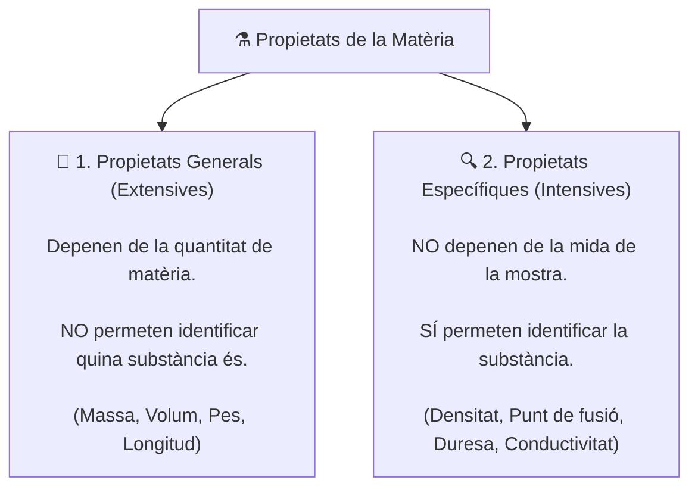
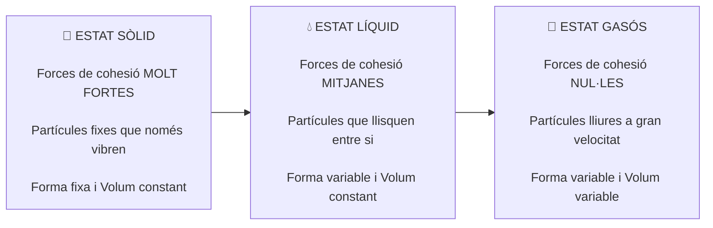
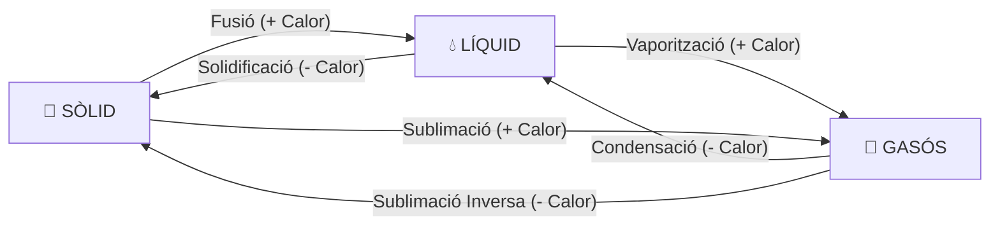
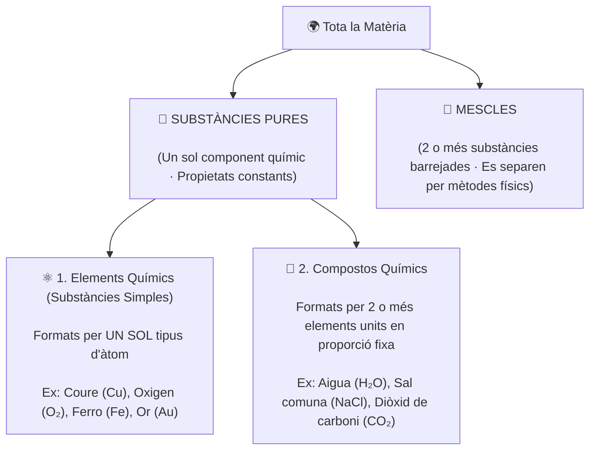
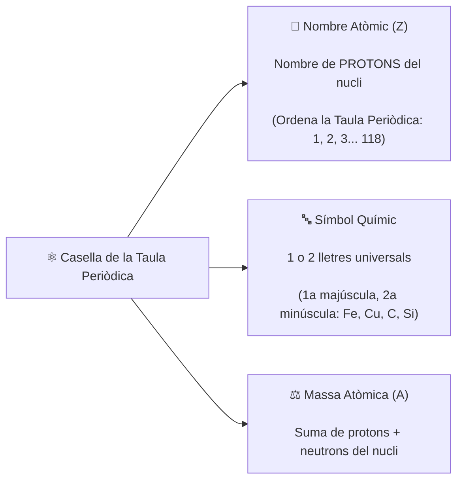
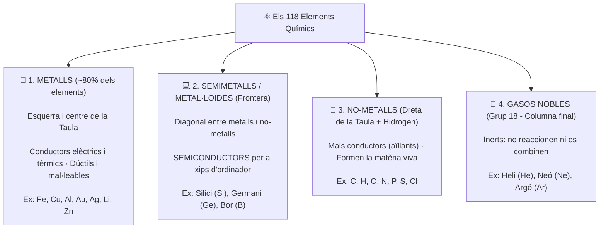
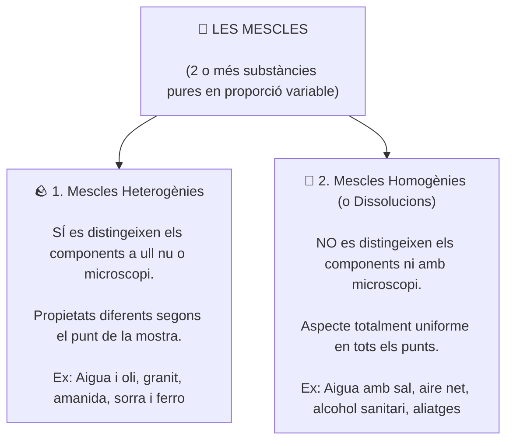
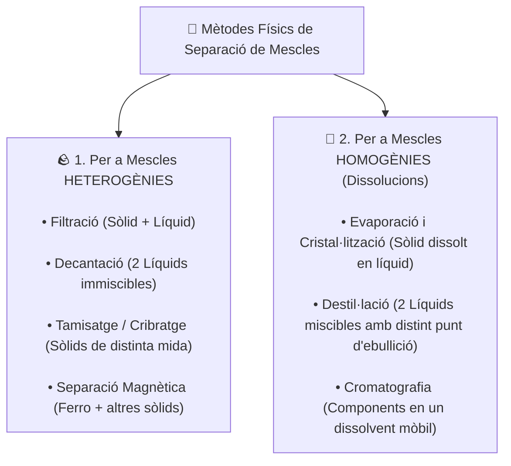

---

layout: default

title: "UD2: La Matèria (Unitat Completa i Exercicis Aules) — Ciències Naturals · 1r FPB"

course_root: ".."

badge: "1r FPB · Ciències Naturals · UD2"

prev_url: "../index.html"

prev_label: "⬅️ Portada Ciències Aplicades I"

next_url: "../nat03/index.html"

next_label: "UD3 Energia Interna del Planeta ➡️"

---

# 🔬 UD2: La Matèria — Temari Complet i Exercicis Diaris per a Aules

En aquesta pàgina tens tant l'**accés directe a cada sessió diària individual** (amb els seus **15 exercicis diaris** i el seu **botó de descàrrega de PDF per a pujar a Aules cada dia**) com la **vista completa de tota la unitat** amb tots els apartats i el **Butlletí Global d'Activitats Finals de la Unitat**.

---

## 📑 Planificació Diària de Sessions i Tasques d'Aules (UD2)

| Sessió | Apartat del Temari Oficial | Tasca Diària per a Aules | Accés Directe |
| :---: | :--- | :---: | :---: |
| **2.1** | **2.1 Les Propietats de la Matèria** | 15 Exercicis Diaris + PDF Aules | [**📖 Teoria + 🎯 15 Exercicis →**](./nat0201.html) · [**🎯 Anar a Exercicis →**](./nat0201.html#activitats) |
| **2.2** | **2.2 Els Estats de la Matèria** | 15 Exercicis Diaris + PDF Aules | [**📖 Teoria + 🎯 15 Exercicis →**](./nat0202.html) · [**🎯 Anar a Exercicis →**](./nat0202.html#activitats) |
| **2.3** | **2.3 Els Canvis d'Estat de la Matèria** | 15 Exercicis Diaris + PDF Aules | [**📖 Teoria + 🎯 15 Exercicis →**](./nat0203.html) · [**🎯 Anar a Exercicis →**](./nat0203.html#activitats) |
| **2.4** | **2.4 Classificació de la Matèria (I): Substàncies Pures** | 15 Exercicis Diaris + PDF Aules | [**📖 Teoria + 🎯 15 Exercicis →**](./nat0204.html) · [**🎯 Anar a Exercicis →**](./nat0204.html#activitats) |
| **2.5** | **2.5 La Taula Periòdica dels Elements** | 15 Exercicis Diaris + PDF Aules | [**📖 Teoria + 🎯 15 Exercicis →**](./nat0205.html) · [**🎯 Anar a Exercicis →**](./nat0205.html#activitats) |
| **2.6** | **2.6 Classificació dels Elements Químics** | 15 Exercicis Diaris + PDF Aules | [**📖 Teoria + 🎯 15 Exercicis →**](./nat0206.html) · [**🎯 Anar a Exercicis →**](./nat0206.html#activitats) |
| **2.7** | **2.7 Classificació de la Matèria (II): Les Mescles** | 15 Exercicis Diaris + PDF Aules | [**📖 Teoria + 🎯 15 Exercicis →**](./nat0207.html) · [**🎯 Anar a Exercicis →**](./nat0207.html#activitats) |
| **2.8** | **2.8 Mètodes de Separació de Mescles** | 15 Exercicis Diaris + PDF Aules | [**📖 Teoria + 🎯 15 Exercicis →**](./nat0208.html) · [**🎯 Anar a Exercicis →**](./nat0208.html#activitats) |
| **** | **📝 2.9 Activitats Finals i Tasca Global de la Unitat 2 (Aules)** | 21 Exercicis Globals + PDF Aules | [**📝 Fer Tasca Global UD →**](./nat0209.html) · [**🎯 Anar a Exercicis →**](./nat0209.html#activitats) |

---

  

    ⚡ Progrés d'aprenentatge (2.1)

    0 / 12 reptes resolts

  

  

    

  

## 📌 2.1 Les Propietats de la Matèria {#nat0201}

En física i química, anomenem **matèria** a tot allò que té **massa** i ocupa un lloc en l'espai (és a dir, té **volum**). Un ordinador portàtil, l'aigua d'una botella, el coure d'un cable elèctric i fins i tot l'aire invisible que respirem dins de l'aula són matèria. En canvi, la llum, el so, la calor, el temps o les idees **no són matèria** perquè no tenen massa ni ocupen espai.

---

## 1. Propietats Generals vs Propietats Específiques

Per descriure i diferenciar els materials que fem servir al taller i a la vida quotidiana, estudiem les seues propietats:

### A) Propietats Generals (o Extensives)

Són comunes a tots els cossos i el seu valor depèn de la quantitat de matèria que tinguem. **No ens serveixen per saber de quin material està fet un objecte** (per exemple, 1 kg de palla té la mateixa massa que 1 kg de ferro):

1. **La Massa (m):** És la quantitat de matèria que té un cos. Es mesura amb la **balança** i la seua unitat al Sistema Internacional (SI) és el **quilogram (kg)**, tot i que per a mostres menudes usem el gram (g, on 1  kg = 1.000  g). La massa d'un cos és constant: val igual a la Terra que a la Lluna.

2. **El Volum (V):** És l'espai tridimensional que ocupa un cos. La seua unitat al Sistema Internacional és el **metre cúbic (m³)**, però en la pràctica diària utilitzem el **litre (L)**, el mil·lilitre (mL) i el centímetre cúbic (cm³).

> [!IMPORTANT]

> ### Equivalències d'Or de Volum i Capacitat

> - **$1\text{ m}^3 = 1.000\text{ litres (L)}$**

> - **$1\text{ dm}^3 = 1\text{ litre (L)}$**

> - **$1\text{ cm}^3 = 1\text{ mil·lilitre (mL)}$**

### B) Propietats Específiques (o Intensives / Característiques)

Tenen un valor propi i constant per a cada substància pura, independentment de si en tenim un gra menut o una tona sencera. **Permeten identificar i distingir una substància d'una altra**:

- **Densitat (d o $

ho$):** Relació entre la massa i el volum d'un cos.

- **Punt de fusió i punt d'ebullició:** Temperatures exactes a les quals una substància es fon o bull (l'aigua pura es fon a 0 °C i bull a 100 °C; el ferro es fon a 1.538 °C).

- **Duresa:** Resistència que oposa un material a ser ratllat per un altre (el diamant és el material natural més dur).

- **Conductivitat elèctrica i tèrmica:** Capacitat de deixar passar l'electricitat o la calor (el coure és conductor; el plàstic PVC és aïllant).

- **Solubilitat, elasticitat, fragilitat, tenacitat, brillantor i color.**

---

## 2. La Densitat: La Clau per Identificar Materials i la Flotabilitat

La **densitat (d)** és la propietat específica més important. Mesura quanta massa hi ha concentrada en cada unitat de volum d'un material:

d = \frac{\text{Massa } (m)}{\text{Volum } (V)}

- **Unitats habituals:** En el laboratori i taller s'expressa en **grams per centímetre cúbic (g/cm³)** o en **quilograms per metre cúbic ($\text{kg/m}^3$)** ($1\text{ g/cm}^3 = 1.000\text{ kg/m}^3$).

| Material / Substància | Densitat (g/cm³) | Què passa si el posem en aigua líquida ($1{,}00\text{ g/cm}^3$)? |
| :--- | :---: | :--- |
| **Suro** | $0{,}24\text{ g/cm}^3$ | **Sura** molt a la superfície (és 4 vegades menys dens que l'aigua). |
| **Oli d'oliva** | $0{,}92\text{ g/cm}^3$ | **Sura** damunt de l'aigua formant una capa superior. |
| **Gel (aigua sòlida)** | $0{,}92\text{ g/cm}^3$ | **Sura** en l'aigua líquida (els icebergs suren al mar). |
| **Aigua pura destil·lada** | **$1{,}00\text{ g/cm}^3$** | Referència patró (1 litre d'aigua té una massa d'1 kg). |
| **Alumini (dissipadors PC)** | $2{,}70\text{ g/cm}^3$ | **S'enfonsa** (és lleuger per ser un metall, però més dens que l'aigua). |
| **Ferro / Acer (xassís)** | $7{,}87\text{ g/cm}^3$ | **S'enfonsa** ràpidament. |
| **Or pur** | $19{,}30\text{ g/cm}^3$ | **S'enfonsa** (un lingot d'1 litre d'or pesa $19{,}3\text{ kg}$!). |

> [!TIP]

> ### 🚢 Per què un vaixell d'acer gegant sura si l'acer és més dens que l'aigua?

> Una bola massissa d'acer ($7{,}87\text{ g/cm}^3$) s'enfonsa a l'acte. Però el buc d'un vaixell és buit per dins i conté un enorme volum d'**aire** ($0{,}0012\text{ g/cm}^3$). Això fa que la **densitat mitjana** de tot el vaixell (acer + aire interior) siga menor que la densitat de l'aigua del mar ($1{,}03\text{ g/cm}^3$), i per això sura segons el Principi d'Arquimedes!

---

> [!NOTE]

> ### 💡 Resum de Conceptes Clau

> - Matèria és tot allò que té massa i ocupa un volum.

> - Les propietats generals (massa i volum) no identifiquen la substància; les específiques (densitat, duresa, conductivitat) sí.

> - La densitat es calcula dividint la massa pel volum ($d = m / V$). L'aigua pura té una densitat d'$1\text{ g/cm}^3$ (1 kg/L).

> - Un cos sura en un líquid si la seua densitat és menor que la del líquid, i s'enfonsa si és major.

---

## 🎯 Activitats i Autoavaluació Interactiva

  

    🎮 <strong>Zona d'Entrenament FPB:</strong> 0 reptes resolts

    ⭐ 0 punts

  

  

### 1. Qüestionari d'Autoavaluació Tipus Test (MCQ)

  
<strong>1. Quina de les següents és una propietat específica o característica que permet saber de quin material està feta una peça del taller?</strong>

  

    <button type="button" class="btn-mcq-opt" data-opt="A">A) La massa mesurada en grams</button>

    <button type="button" class="btn-mcq-opt" data-opt="B">B) El volum mesurat en centímetres cúbics</button>

    <button type="button" class="btn-mcq-opt" data-opt="C">C) La densitat i la temperatura de fusió</button>

    <button type="button" class="btn-mcq-opt" data-opt="D">D) La longitud exterior de la peça</button>

  

  

  
<strong>2. Un bloc metàl·lic d'un dissipador d'ordinador té una massa de 270 grams i ocupa un volum de 100 cm³. Quina és la seua densitat?</strong>

  

    <button type="button" class="btn-mcq-opt" data-opt="A">A) 27.000 g/cm³</button>

    <button type="button" class="btn-mcq-opt" data-opt="B">B) 2,7 g/cm³ (correspon a l'alumini)</button>

    <button type="button" class="btn-mcq-opt" data-opt="C">C) 0,37 g/cm³</button>

    <button type="button" class="btn-mcq-opt" data-opt="D">D) 370 g/cm³</button>

  

  

  
<strong>3. Quina és la unitat fonamental de massa al Sistema Internacional d'Unitats (SI) i amb quin instrument es mesura?</strong>

  

    <button type="button" class="btn-mcq-opt" data-opt="A">A) El litre (L), mesurat amb la proveta</button>

    <button type="button" class="btn-mcq-opt" data-opt="B">B) El quilogram (kg), mesurat amb la balança</button>

    <button type="button" class="btn-mcq-opt" data-opt="C">C) El Newton (N), mesurat amb el termòmetre</button>

    <button type="button" class="btn-mcq-opt" data-opt="D">D) El metre cúbic (m³), mesurat amb la cinta mètrica</button>

  

  

  
<strong>4. Si introduïm en un vas amb aigua líquida (d = 1,00 g/cm³) un tap de suro (0,24 g/cm³) i un cargol de ferro (7,87 g/cm³), què passarà?</strong>

  

    <button type="button" class="btn-mcq-opt" data-opt="A">A) Tots dos s'enfonsaran al fons del vas</button>

    <button type="button" class="btn-mcq-opt" data-opt="B">B) Tots dos suraran a la superfície</button>

    <button type="button" class="btn-mcq-opt" data-opt="C">C) El suro surarà perquè és menys dens que l'aigua i el ferro s'enfonsarà perquè és més dens</button>

    <button type="button" class="btn-mcq-opt" data-opt="D">D) El ferro surarà i el suro s'enfonsarà</button>

  

  

---

### 2. Activitats de Vertader (V) o Fals (F)

  <strong>a) Un quilogram de plom té molta més massa que un quilogram de suro o de palla.</strong>

  

    <button type="button" class="btn-vf" data-opt="V">V</button>

    <button type="button" class="btn-vf" data-opt="F">F</button>

  

  

  <strong>b) L'oli d'oliva sura damunt de l'aigua perquè la densitat de l'oli (0,92 g/cm³) és menor que la de l'aigua (1 g/cm³).</strong>

  

    <button type="button" class="btn-vf" data-opt="V">V</button>

    <button type="button" class="btn-vf" data-opt="F">F</button>

  

  

  <strong>c) La llum d'una llanterna, el so d'un altaveu i la calor es consideren matèria perquè tenen massa i ocupen volum.</strong>

  

    <button type="button" class="btn-vf" data-opt="V">V</button>

    <button type="button" class="btn-vf" data-opt="F">F</button>

  

  

  <strong>d) Un centímetre cúbic (1 cm³) equival exactament a la capacitat d'un mil·lilitre (1 mL).</strong>

  

    <button type="button" class="btn-vf" data-opt="V">V</button>

    <button type="button" class="btn-vf" data-opt="F">F</button>

  

  

---

### 3. Exercicis de Resposta Breu i Vocabulari Tècnic

  
✍️ Com s'anomena la propietat específica que relaciona la massa d'un cos amb el volum que ocupa?

  

    <input type="text" class="quiz-input" placeholder="Escriu la propietat...">

    <button type="button" class="btn-quiz-check">Comprovar</button>

  

  

  
✍️ Quants litres (L) d'aigua caben exactament dins d'un dipòsit d'un metre cúbic (1 m³)?

  

    <input type="text" class="quiz-input" placeholder="Escriu el número...">

    <button type="button" class="btn-quiz-check">Comprovar</button>

  

  

  
✍️ Calcula la densitat (en g/cm³) d'un dau metàl·lic que té una massa de 80 grams i un volum de 10 cm³.

  

    <input type="text" class="quiz-input" placeholder="Escriu la teua resposta...">

    <button type="button" class="btn-quiz-check">Comprovar</button>

  

  

  
✍️ Quants grams (g) de massa té un sac de 3,5 quilograms (kg) de ciment?

  

    <input type="text" class="quiz-input" placeholder="Escriu la teua resposta...">

    <button type="button" class="btn-quiz-check">Comprovar</button>

  

  

---

### 4. Exercicis de Raonament i Desenvolupament Escrit (Tasca d'Aula)

  
✍️ <strong>Comprovació d'autenticitat al taller:</strong> Un client et ven una peça metàl·lica daurada assegurant que és d'or pur (d = 19,3 g/cm³). La peses a la balança i dóna una massa de 170 g, i en mesurar el seu volum veus que ocupa $20\text{ cm}^3$. Calcula la seua densitat real, digues si és d'or pur o és un engany (com llautó, d = 8,5 g/cm³) i explica com ho has descobert.

  <textarea class="open-response-input" rows="4" placeholder="Calcula d = m / V = 170 / 20 i compara el resultat amb la densitat de l'or..."></textarea>

  
✍️ <strong>Exercici 2 (Mètode d'immersió d'Arquimedes al laboratori):</strong> Tens una pedra irregular i vols saber el seu volum exacte. Agafes una proveta graduada amb 50 mL d'aigua, hi introdueixes la pedra i el nivell de l'aigua puja fins a 85 mL. Si la pedra pesa 70 grams a la balança, calcula el seu volum i la seua densitat mostrant tots els passos.

  <textarea class="open-response-input" rows="4" placeholder="Volum de la pedra = 85 mL - 50 mL = ... Densitat = massa / volum = ..."></textarea>

  
✍️ <strong>Exercici 3 (Propietats generals vs específiques al taller):</strong> Explica amb les teues paraules per què la massa i el volum no serveixen per identificar si un cable és d'alumini o de plata, i esmenta tres propietats específiques que sí et permetrien distingir-los.

  <textarea class="open-response-input" rows="4" placeholder="Explica que 10 g d'alumini pesen igual que 10 g de plata, però la densitat, conductivitat i punt de fusió són propis de cada metall..."></textarea>

---

  <h3 style="margin-top:0; color:#0369a1;">📦 Lliurament d'Activitats d'Aules (Act 2.1)</h3>

  
Genera el teu document de tasca d'aquest apartat amb el teu nom i puntuació obtinguda.

  

    <input type="text" class="aules-student-name" placeholder="Cognoms, Nom de l'Alumne/a" style="padding:8px 12px; border:1px solid #94a3b8; border-radius:4px; flex-grow:1; min-width:240px;">

    <button class="btn-generate-aules-pdf" data-unit="NAT02" data-activity="Act01" data-module="CA" style="padding:8px 16px; background:#0284c7; color:#fff; border:none; border-radius:4px; font-weight:600; cursor:pointer;">📄 Descarregar PDF per a Aules</button>

  

---

  

    ⚡ Progrés d'aprenentatge (2.2)

    0 / 12 reptes resolts

  

  

    

  

## 📌 2.2 Els Estats de la Matèria {#nat0202}

A la natura i al nostre entorn quotidià, la matèria es presenta habitualment en tres **estats físics o d'agregació**: **sòlid** (com un glaçó de gel o un tornavís), **líquid** (com l'aigua de l'aixeta o l'alcohol isopropílic) i **gasós** (com el vapor d'aigua o l'aire comprimit), a més d'un quart estat molt abundant a l'univers anomenat **plasma**.

Per comprendre per què una mateixa substància (com l'aigua, H₂O) es comporta de manera tan diferent segons si és gel, aigua líquida o vapor, els científics van formular la **Teoria Cineticomolecular (TCM)**.

---

## 1. La Teoria Cineticomolecular (TCM)

Aquesta teoria explica el comportament intern de la matèria a partir de dos postulats fonamentals:

1. **La matèria és discontínua:** Està formada per un nombre immens de partícules submicroscòpiques (àtoms, molècules o ions) entre les quals hi ha espai buit. Unes **forces d'atracció o cohesió** tendeixen a mantindre aquestes partícules unides.

2. **Les partícules estan en moviment continu:** Sempre s'estan movent o vibrant. Com més alta és la **temperatura** del cos, amb més velocitat i violència es mouen les seues partícules.

---

## 2. Característiques dels Tres Estats d'Agregació

| Propietat | Estat Sòlid | Estat Líquid | Estat Gasós |
| :--- | :--- | :--- | :--- |
| **Forces d'atracció (cohesió)** | **Molt intenses:** mantenen les partícules fortament lligades en posicions fixes formant xarxes ordenades. | **Moderades:** les partícules continuen juntes però tenen llibertat per a desplaçar-se. | **Pràcticament nul·les:** les partícules estan molt allunyades i independents. |
| **Moviment de les partícules** | **Només vibren** al voltant de la seua posició d'equilibri sense desplaçar-se. | **Vibren, roten i llisquen** unes sobre altres (per això els líquids flueixen). | **Es mouen a gran velocitat** en línia recta xocant contra les parets del recipient. |
| **Forma** | **Constant (pròpia):** no canvia encara que el canviem de recipient. | **Variable:** s'adapta a la forma del recipient que el conté. | **Variable:** pren la forma de tot el recipient. |
| **Volum** | **Constant:** no canvia tret d'una xicoteta dilatació tèrmica. | **Constant:** un litre d'aigua ocupa 1 L tant en una botella com en un poal. | **Variable:** tendeix a ocupar tot el volum disponible (**expansibilitat**). |
| **Compressibilitat** | **Incompressibles:** no hi ha espai buit per acostar més les partícules. | **Pràcticament incompressibles** (base de les premses hidràuliques). | **Molt compressibles:** com que hi ha molt de buit, podem reduir el seu volum prement un èmbol. |

---

## 3. El Comportament dels Gasos i el Quart Estat (Plasma)

### A) Propietats exclusives dels gasos

Com que les partícules d'un gas es mouen lliurement i a gran velocitat xocant contra les parets del recipient (el que genera la **pressió del gas**), presenten tres propietats clau:

- **Expansibilitat i Difusió:** Si obrim un pot de perfum o hi ha una fuita de gas butà, les seues partícules es barregen amb l'aire i s'escampen per tota l'habitació.

- **Compressibilitat:** Podem comprimir gran quantitat d'aire dins d'un pot d'aire comprimit per netejar la pols dels teclats i plaques base del taller.

- **Relació Pressió-Temperatura:** Si escalfem un recipient tancat amb gas (com un esprai al foc), les partícules es mouen molt més ràpid, xoquen amb més força, la pressió puja bruscament i el pot **explota**.

### B) El Quart Estat: El Plasma

Quan escalfem un gas a temperatures extremadament altes (milers o milions de graus) o el sotmetem a una descàrrega elèctrica molt forta, els àtoms perden els seus electrons i es forma un gas ionitzat conductor de l'electricitat anomenat **plasma**. És l'estat més abundant de l'univers: forma el **Sol i les estrelles**, els **llamps** d'una tempesta, les aurores boreals i l'interior dels tubs fluorescents.

---

> [!NOTE]

> ### 💡 Resum de Conceptes Clau

> - La Teoria Cineticomolecular afirma que tota la matèria està formada per partícules en moviment continu; la temperatura mesura la seua agitació.

> - **Sòlids:** forma fixa, volum constant i incompressibles (partícules fixes que només vibren).

> - **Líquids:** forma variable, volum constant i fluids (partícules que llisquen entre si).

> - **Gasos:** forma i volum variables, molt compressibles i expansibles (partícules lliures i allunyades).

---

## 🎯 Activitats i Autoavaluació Interactiva

  

    🎮 <strong>Zona d'Entrenament FPB:</strong> 0 reptes resolts

    ⭐ 0 punts

  

  

### 1. Qüestionari d'Autoavaluació Tipus Test (MCQ)

  
<strong>1. Segons la teoria cineticomolecular, quin estat de la matèria es caracteritza per tindre un volum constant però una forma variable que s'adapta al recipient?</strong>

  

    <button type="button" class="btn-mcq-opt" data-opt="A">A) L'estat sòlid cristal·lí</button>

    <button type="button" class="btn-mcq-opt" data-opt="B">B) L'estat líquid</button>

    <button type="button" class="btn-mcq-opt" data-opt="C">C) L'estat gasós</button>

    <button type="button" class="btn-mcq-opt" data-opt="D">D) El plasma estel·lar</button>

  

  

  
<strong>2. Per què podem comprimir fàcilment l'aire dins d'una xeringa tapada amb el dit, però no podem fer el mateix si la xeringa està plena d'aigua o de ferro?</strong>

  

    <button type="button" class="btn-mcq-opt" data-opt="A">A) Perquè l'aire no és matèria i no té àtoms</button>

    <button type="button" class="btn-mcq-opt" data-opt="B">B) Perquè les partícules de l'aigua són quadrades</button>

    <button type="button" class="btn-mcq-opt" data-opt="C">C) Perquè en els gasos les forces d'atracció són extremadament fortes</button>

    <button type="button" class="btn-mcq-opt" data-opt="D">D) Perquè en l'estat gasós les partícules estan molt separades i hi ha un gran espai buit entre elles</button>

  

  

  
<strong>3. Com es comporten les partícules d'un sòlid com un xassís d'acer segons la Teoria Cineticomolecular?</strong>

  

    <button type="button" class="btn-mcq-opt" data-opt="A">A) Viatgen lliurement a gran velocitat xocant contra les parets</button>

    <button type="button" class="btn-mcq-opt" data-opt="B">B) Llisquen unes sobre altres adaptant-se al recipient</button>

    <button type="button" class="btn-mcq-opt" data-opt="C">C) Estan fortament unides en posicions fixes i només poden vibrar</button>

    <button type="button" class="btn-mcq-opt" data-opt="D">D) No existeixen partícules dins d'un sòlid</button>

  

  

  
<strong>4. Quin és el quart estat de la matèria, format per gas ionitzat a molt alta temperatura i present al Sol, les estrelles i els llamps?</strong>

  

    <button type="button" class="btn-mcq-opt" data-opt="A">A) Estat col·loïdal</button>

    <button type="button" class="btn-mcq-opt" data-opt="B">B) Estat de plasma</button>

    <button type="button" class="btn-mcq-opt" data-opt="C">C) Estat cristal·lí</button>

    <button type="button" class="btn-mcq-opt" data-opt="D">D) Estat líquid comprimit</button>

  

  

---

### 2. Activitats de Vertader (V) o Fals (F)

  <strong>a) En un bloc de ferro sòlid a temperatura ambient, els seus àtoms estan completament quiets i sense cap tipus de vibració.</strong>

  

    <button type="button" class="btn-vf" data-opt="V">V</button>

    <button type="button" class="btn-vf" data-opt="F">F</button>

  

  

  <strong>b) Com més alta és la temperatura d'una substància, amb més velocitat i agitació es mouen o vibren les seues partícules internes.</strong>

  

    <button type="button" class="btn-vf" data-opt="V">V</button>

    <button type="button" class="btn-vf" data-opt="F">F</button>

  

  

  <strong>c) Els líquids i els sòlids són pràcticament incompressibles perquè gairebé no hi ha espai buit entre les seues partícules.</strong>

  

    <button type="button" class="btn-vf" data-opt="V">V</button>

    <button type="button" class="btn-vf" data-opt="F">F</button>

  

  

  <strong>d) Si obrim una bombona de gas en un extrem de la classe, el gas es quedarà quiet en un racó perquè els gasos no tenen expansibilitat.</strong>

  

    <button type="button" class="btn-vf" data-opt="V">V</button>

    <button type="button" class="btn-vf" data-opt="F">F</button>

  

  

---

### 3. Exercicis de Resposta Breu i Vocabulari Tècnic

  
✍️ Quin és l'únic estat de la matèria que posseeix tant forma pròpia constant com volum constant?

  

    <input type="text" class="quiz-input" placeholder="Escriu l'estat...">

    <button type="button" class="btn-quiz-check">Comprovar</button>

  

  

  
✍️ Quin estat d'agregació es caracteritza per tindre forces d'atracció nul·les, forma variable i volum variable?

  

    <input type="text" class="quiz-input" placeholder="Escriu l'estat...">

    <button type="button" class="btn-quiz-check">Comprovar</button>

  

  

  
✍️ Com s'anomena la propietat dels gasos per la qual tendeixen a ocupar tot el volum del recipient que els conté?

  

    <input type="text" class="quiz-input" placeholder="Escriu la teua resposta...">

    <button type="button" class="btn-quiz-check">Comprovar</button>

  

  

  
✍️ Què genera els xocs continus de milions de partícules d'un gas contra les parets internes d'una roda o bombona?

  

    <input type="text" class="quiz-input" placeholder="Escriu la teua resposta...">

    <button type="button" class="btn-quiz-check">Comprovar</button>

  

  

---

### 4. Exercicis de Raonament i Desenvolupament Escrit (Tasca d'Aula)

  
✍️ <strong>Prevenció de riscos al taller amb esprais d'aire comprimit:</strong> En tots els pots d'esprai netejador de contactes electrònics hi ha una advertència que prohibeix deixar-los al sol o prop d'una estufa. Explica utilitzant la Teoria Cineticomolecular què fan les partícules del gas interior quan s'escalfa el pot i per què pot arribar a rebentar.

  <textarea class="open-response-input" rows="4" placeholder="Explica l'augment de velocitat de les partícules, els xocs contra les parets i l'augment de pressió..."></textarea>

  
✍️ <strong>Exercici 2 (Comparativa dels 3 estats a la llibreta):</strong> Elabora una explicació comparant l'aigua en estat sòlid (gel), líquid (aigua) i gasós (vapor) indicant per a cadascun: 1) Com són les forces d'atracció entre molècules, 2) Com és la seua forma i 3) Com és el seu volum.

  <textarea class="open-response-input" rows="4" placeholder="Gel (sòlid): forces molt fortes, forma fixa, volum constant. Aigua (líquid): ... Vapor (gas): ..."></textarea>

  
✍️ <strong>Exercici 3 (Aplicació al taller: frens hidràulics vs pneumàtics):</strong> Explica per què un gat hidràulic de taller va ple d'oli líquid incompressible per alçar un cotxe de 2 tones, mentre que un compressor pneumàtic utilitza aire gasós per acumular pressió dins del calderí.

  <textarea class="open-response-input" rows="4" placeholder="Raona a partir de la incompressibilitat dels líquids i la compressibilitat dels gasos..."></textarea>

---

  <h3 style="margin-top:0; color:#0369a1;">📦 Lliurament d'Activitats d'Aules (Act 2.2)</h3>

  
Genera el teu document de tasca d'aquest apartat amb el teu nom i puntuació obtinguda.

  

    <input type="text" class="aules-student-name" placeholder="Cognoms, Nom de l'Alumne/a" style="padding:8px 12px; border:1px solid #94a3b8; border-radius:4px; flex-grow:1; min-width:240px;">

    <button class="btn-generate-aules-pdf" data-unit="NAT02" data-activity="Act02" data-module="CA" style="padding:8px 16px; background:#0284c7; color:#fff; border:none; border-radius:4px; font-weight:600; cursor:pointer;">📄 Descarregar PDF per a Aules</button>

  

---

  

    ⚡ Progrés d'aprenentatge (2.3)

    0 / 12 reptes resolts

  

  

    

  

## 📌 2.3 Els Canvis d'Estat de la Matèria {#nat0203}

Quan escalfem o refredem una substància (o modifiquem la pressió), l'energia d'agitació de les seues partícules canvia i pot passar d'un estat físic a un altre. Els **canvis d'estat** són transformacions físiques: l'aspecte canvia, però la substància continua sent exactament la mateixa (el gel, l'aigua líquida i el vapor d'aigua continuen sent molècules d'H₂O).

---

## 1. Mapa Complet dels Canvis d'Estat

Distingim entre **canvis d'estat progressius** (es produeixen en **absorbir calor / escalfar**) i **canvis d'estat regressius** (es produeixen en **perdre calor / refredar**):

### A) Canvis d'Estat per Escalfament (Progressius)

1. **Fusió (de Sòlid a Líquid):** Quan escalfem un sòlid, les seues partícules vibren tan fort que trenquen l'estructura rígida i comencen a lliscar. Exemples: un glaçó de gel que es descongela o el fil d'**estany** que fonem amb el soldador elèctric a 232 °C al taller d'electrònica.

2. **Vaporització (de Líquid a Gas):** Pas de l'estat líquid al gasós. Es pot produir de dues maneres molt diferents:

   - **Evaporació:** Ocorre **només a la superfície** del líquid, a poc a poc i a **qualsevol temperatura** (per això s'eixuga la roba estesa al sol o una bassa d'aigua al carrer a 20 °C).

   - **Ebullició:** Ocorre a **tota la massa** del líquid de forma tumultuosa formant bombolles de vapor, i només té lloc a una temperatura fixa anomenada **temperatura o punt d'ebullició** (100 °C en l'aigua pura a nivell del mar).

3. **Sublimació (de Sòlid directament a Gas):** Alguns sòlids passen directament a gas sense fondre's ni passar per líquid. Exemples: el iode sòlid, les boletes de naftalina dels armaris o el gel sec (CO₂ congelat).

### B) Canvis d'Estat per Refredament (Regressius)

1. **Condensació (de Gas a Líquid):** Quan un gas o vapor toca una superfície freda, les seues partícules perden velocitat, s'acosten i es converteixen en gotes líquides. Exemples: el baf que entela l'espill del bany en dutxar-nos, la formació dels núvols i la rosada.

2. **Solidificació (de Líquid a Sòlid):** En refredar un líquid, les partícules perden mobilitat fins a quedar fixades en una xarxa sòlida (congelació de l'aigua a 0 °C o refredament d'un punt d'estany soldat).

3. **Sublimació inversa o regressiva (de Gas directament a Sòlid):** Quan el vapor d'aigua de l'aire en una nit d'hivern sota zero es congela directament sobre els vidres dels cotxes formant el **gebre o gelada**.

---

## 2. Punts de Fusió i Ebullició i Gràfiques d'Escalfament

Cada substància pura té una **temperatura de fusió ($T_f$)** i una **temperatura d'ebullició ($T_e$)** pròpies i constants que permeten identificar-la:

| Substància Pura | Punt de Fusió ($T_f$) | Punt d'Ebullició ($T_e$) | Estat físic a temperatura d'aula (20 °C) |
| :--- | :---: | :---: | :--- |
| **Oxigen (O₂)** | -218 °C | -183 °C | **Gasós** (ja ha bullit molt abans de 20 °C). |
| **Alcohol etílic (etanol)** | -114 °C | 78 °C | **Líquid** (està entre $-114 °Ci78 °C$). |
| **Aigua pura (H₂O)** | **0 °C** | **100 °C** | **Líquid** (està entre $0 °Ci100 °C$). |
| **Estany de soldadura** | 232 °C | 2.602 °C | **Sòlid** (encara no ha arribat a 232 °C). |
| **Ferro (Fe)** | 1.538 °C | 2.861 °C | **Sòlid** (necessita més de 1.538 °C per fondre's). |

> [!IMPORTANT]

> ### 📈 Regla d'Or de les Corbes d'Escalfament

> **Mentre dura un canvi d'estat d'una substància pura, la seua temperatura NO PUJA: es manté totalment constant!**

> Per exemple, mentre un glaçó de gel s'està fonent en un got amb aigua, el termòmetre marca exactament **0 °C** fins que desapareix l'últim tros de gel. I mentre l'aigua d'un cassó està bullint, el termòmetre es queda clavat en **100 °C**, perquè tota l'energia del foc es gasta a trencar les forces d'unió entre les molècules!

---

> [!NOTE]

> ### 💡 Resum de Conceptes Clau

> - Els canvis d'estat per escalfament són la fusió, la vaporització i la sublimació; per refredament són la condensació, la solidificació i la sublimació inversa.

> - L'evaporació ocorre a la superfície a qualsevol temperatura; l'ebullició ocorre a tota la massa a una temperatura fixa ($T_e$).

> - Durant qualsevol canvi d'estat d'una substància pura, la temperatura roman constant (trams horitzontals plans a la gràfica).

---

## 🎯 Activitats i Autoavaluació Interactiva

  

    🎮 <strong>Zona d'Entrenament FPB:</strong> 0 reptes resolts

    ⭐ 0 punts

  

  

### 1. Qüestionari d'Autoavaluació Tipus Test (MCQ)

  
<strong>1. Quin canvi d'estat es produeix quan el vapor d'aigua de la dutxa o del nostre alè toca un espill fred i l'entela formant gotetes líquides?</strong>

  

    <button type="button" class="btn-mcq-opt" data-opt="A">A) Fusió</button>

    <button type="button" class="btn-mcq-opt" data-opt="B">B) Sublimació progressiva</button>

    <button type="button" class="btn-mcq-opt" data-opt="C">C) Condensació (pas de gas a líquid per refredament)</button>

    <button type="button" class="btn-mcq-opt" data-opt="D">D) Solidificació</button>

  

  

  
<strong>2. Quina diferència hi ha entre l'evaporació i l'ebullició d'un líquid?</strong>

  

    <button type="button" class="btn-mcq-opt" data-opt="A">A) L'evaporació ocorre lentament a la superfície a qualsevol temperatura, mentre que l'ebullició ocorre a tota la massa a una temperatura fixa</button>

    <button type="button" class="btn-mcq-opt" data-opt="B">B) L'evaporació només passa a 100 °C i l'ebullició passa a 0 °C</button>

    <button type="button" class="btn-mcq-opt" data-opt="C">C) L'evaporació transforma el líquid en sòlid i l'ebullició en plasma</button>

    <button type="button" class="btn-mcq-opt" data-opt="D">D) No hi ha cap diferència entre totes dues</button>

  

  

  
<strong>3. Si el punt de fusió del ferro és 1.538 °C i el seu punt d'ebullició és 2.861 °C, en quin estat físic es trobarà el ferro dins d'un forn industrial a 2.000 °C?</strong>

  

    <button type="button" class="btn-mcq-opt" data-opt="A">A) En estat sòlid</button>

    <button type="button" class="btn-mcq-opt" data-opt="B">B) En estat líquid (ja s'ha fos però encara no bull)</button>

    <button type="button" class="btn-mcq-opt" data-opt="C">C) En estat gasós</button>

    <button type="button" class="btn-mcq-opt" data-opt="D">D) En estat de sublimació</button>

  

  

  
<strong>4. Com s'anomena el canvi d'estat regressiu pel qual el vapor d'aigua de l'aire en una nit gèlida d'hivern passa directament a cristalls de gel (gebre) sense passar per líquid?</strong>

  

    <button type="button" class="btn-mcq-opt" data-opt="A">A) Fusió</button>

    <button type="button" class="btn-mcq-opt" data-opt="B">B) Vaporització</button>

    <button type="button" class="btn-mcq-opt" data-opt="C">C) Sublimació inversa o regressiva</button>

    <button type="button" class="btn-mcq-opt" data-opt="D">D) Ebullició</button>

  

  

---

### 2. Activitats de Vertader (V) o Fals (F)

  <strong>a) Mentre l'aigua pura està bullint a nivell del mar, la seua temperatura es manté constant a 100 °C encara que pugem la potència del foc.</strong>

  

    <button type="button" class="btn-vf" data-opt="V">V</button>

    <button type="button" class="btn-vf" data-opt="F">F</button>

  

  

  <strong>b) El pas de l'estat sòlid a l'estat líquid quan escalfem un metall amb el soldador s'anomena sublimació.</strong>

  

    <button type="button" class="btn-vf" data-opt="V">V</button>

    <button type="button" class="btn-vf" data-opt="F">F</button>

  

  

  <strong>c) La roba humida estesa al balcó s'eixuga a 18 °C gràcies al fenomen d'evaporació superficial.</strong>

  

    <button type="button" class="btn-vf" data-opt="V">V</button>

    <button type="button" class="btn-vf" data-opt="F">F</button>

  

  

  <strong>d) L'alcohol etílic bull a 78 °C; per tant, a 90 °C a pressió normal l'alcohol es troba en estat sòlid.</strong>

  

    <button type="button" class="btn-vf" data-opt="V">V</button>

    <button type="button" class="btn-vf" data-opt="F">F</button>

  

  

---

### 3. Exercicis de Resposta Breu i Vocabulari Tècnic

  
✍️ Com s'anomena el canvi d'estat pel qual un cos passa de sòlid a líquid en absorbir calor?

  

    <input type="text" class="quiz-input" placeholder="Escriu el canvi d'estat...">

    <button type="button" class="btn-quiz-check">Comprovar</button>

  

  

  
✍️ Quin nom rep el canvi d'estat directe de sòlid a gas sense passar en cap moment per l'estat líquid?

  

    <input type="text" class="quiz-input" placeholder="Escriu el terme...">

    <button type="button" class="btn-quiz-check">Comprovar</button>

  

  

  
✍️ A quina temperatura exacta en graus Celsius (°C) es fon el gel d'aigua pura a pressió atmosfèrica normal?

  

    <input type="text" class="quiz-input" placeholder="Escriu la teua resposta...">

    <button type="button" class="btn-quiz-check">Comprovar</button>

  

  

  
✍️ Com s'anomena el pas de l'estat líquid a l'estat sòlid quan refredem aigua al congelador?

  

    <input type="text" class="quiz-input" placeholder="Escriu la teua resposta...">

    <button type="button" class="btn-quiz-check">Comprovar</button>

  

  

---

### 4. Exercicis de Raonament i Desenvolupament Escrit (Tasca d'Aula)

  
✍️ <strong>Soldadura electrònica amb estany i alcohol isopropílic al taller:</strong> Quan netegem una placa base amb unes gotes d'alcohol isopropílic ($T_e = 82 °C$), veiem que desapareix i s'eixuga sol en pocs segons a la temperatura de l'aula (22 °C). En canvi, quan soldem un cable amb fil d'estany ($T_f = 232 °C$), l'apliquem amb el soldador a 350 °C i en retirar-lo es torna dur a l'instant. Explica quins tres canvis d'estat concrets han tingut lloc en aquestes dues operacions de taller.

  <textarea class="open-response-input" rows="4" placeholder="1. Alcohol isopropílic a 22°C -> ... 2. Estany amb el soldador a 350°C -> ... 3. Estany en retirar el soldador -> ..."></textarea>

  
✍️ <strong>Exercici 2 (Interpretació d'una corba d'escalfament):</strong> Traiem un bloc de gel del congelador a -15 °C i l'escalfem fins a convertir-lo en vapor a 120 °C. Explica per què el termòmetre s'atura durant diversos minuts quan arriba a 0 °C i torna a aturar-se quan arriba a 100 °C tot i que el foc segueix encès.

  <textarea class="open-response-input" rows="4" placeholder="Explica que durant la fusió (0 °C) i l'ebullició (100 °C) tota la calor s'utilitza per trencar les forces de cohesió entre molècules..."></textarea>

  
✍️ <strong>Exercici 3 (Determinació d'estats físics amb taula de dades):</strong> Sabent que l'oxigen té Tf = -218 °C i Te = -183 °C, i que l'estany té Tf = 232 °C i Te = 2.602 °C, justifica raonadament en quin estat físic està cadascun a la temperatura de l'aula (25 °C).

  <textarea class="open-response-input" rows="4" placeholder="Compara 25 °C amb les temperatures de fusió i ebullició de l'oxigen i de l'estany..."></textarea>

---

  <h3 style="margin-top:0; color:#0369a1;">📦 Lliurament d'Activitats d'Aules (Act 2.3)</h3>

  
Genera el teu document de tasca d'aquest apartat amb el teu nom i puntuació obtinguda.

  

    <input type="text" class="aules-student-name" placeholder="Cognoms, Nom de l'Alumne/a" style="padding:8px 12px; border:1px solid #94a3b8; border-radius:4px; flex-grow:1; min-width:240px;">

    <button class="btn-generate-aules-pdf" data-unit="NAT02" data-activity="Act03" data-module="CA" style="padding:8px 16px; background:#0284c7; color:#fff; border:none; border-radius:4px; font-weight:600; cursor:pointer;">📄 Descarregar PDF per a Aules</button>

  

---

  

    ⚡ Progrés d'aprenentatge (2.4)

    0 / 12 reptes resolts

  

  

    

  

## 📌 2.4 Classificació de la Matèria (I): Substàncies Pures {#nat0204}

Si observem els materials que ens envolten, veurem que alguns estan formats per una sola classe de component químic (com el fil de coure pur per dins d'un cable o la sal de cuina pura), mentre que la majoria són combinacions de diverses coses barrejades (com l'aigua de la mar, el granit o la llet).

Per això, els químics classifiquen tota la matèria en dos grans grups: **Substàncies Pures** i **Mescles**. En aquesta sessió estudiarem a fons les **substàncies pures**.

---

## 1. Què és una Substància Pura?

Una **substància pura** és aquella matèria que té una **composició química fixa i invariant** i unes **propietats específiques constants** (com la densitat, el punt de fusió i el punt d'ebullició) que no canvien mai, i que **no es pot separar en altres substàncies mitjançant procediments físics** (com filtrar, decantar o escalfar).

---

## 2. Tipus de Substàncies Pures: Elements vs Compostos

Segons si les seues partícules estan formades per una sola classe d'àtoms o per àtoms diferents enllaçats químicament, dividim les substàncies pures en dos grups:

### A) Elements Químics (o Substàncies Simples)

Són les substàncies pures que estan formades **exclusivament per un sol tipus d'àtom**. No es poden descompondre en altres substàncies més senzilles ni per mètodes físics ni per cap reacció química.

- Tots els elements coneguts (118 en total) estan recollits a la **Taula Periòdica** i es representen amb un **símbol químic** d'una o dues lletres (la primera sempre en majúscula):

  - **Metalls d'ús tecnològic:** Coure (Cu), Ferro (Fe), Alumini (Al), Or (Au), Argent (Ag), Liti (Li, bateries).

  - **No-metalls i gasos simples:** Oxigen gasós (O₂, format per parelles d'àtoms d'oxigen idèntics), Nitrogen (N₂), Hidrogen (H₂), Carboni (C, que forma tant el grafit del llapis com el diamant) i Silici (Si, base dels xips).

### B) Compostos Químics

Són substàncies pures formades per la **unió química de dos o més elements diferents combinats en una proporció fixa**. Es representen mitjançant una **fórmula química** que indica quins àtoms els formen i en quina quantitat:

| Compost Químic | Fórmula Química | Proporció d'Àtoms | Propietats i Usos Reals |
| :--- | :---: | :--- | :--- |
| **Aigua pura (destil·lada)** | H₂O | 2 àtoms d'Hidrogen per cada 1 d'Oxigen | Líquid incolor vital; $T_f = 0 °C$, $T_e = 100 °C$, d = 1 g/cm³. |
| **Sal comuna (Clorur de sodi)** | $\text{NaCl}$ | 1 àtom de Sodi per cada 1 de Clor | Cristall blanc comestible i conservant ($T_f = 801 °C$). |
| **Diòxid de carboni** | CO₂ | 1 àtom de Carboni i 2 d'Oxigen | Gas expirat en la respiració i usat en extintors d'incendis elèctrics. |
| **Quars / Sílice** | $\text{SiO}_2$ | 1 àtom de Silici i 2 d'Oxigen | Mineral amb què es fabriquen el vidre i la fibra òptica d'Internet. |
| **Glucosa** | $\text{C}_6\text{H}_{12}\text{O}_6$ | 6 de Carboni, 12 d'Hidrogen i 6 d'Oxigen | Sucre que aporta energia a les nostres cèl·lules. |

> [!TIP]

> ### ⚡ Com es pot descompondre un compost químic?

> Un compost com l'aigua pura (H₂O) no es pot separar en hidrogen i oxigen bullint-la o filtrant-la (si bulls aigua, obtens vapor d'aigua H₂O). Només es pot descompondre mitjançant un **mètode químic** com l'**electròlisi**: fent passar un corrent elèctric continu per l'aigua, els enllaços es trenquen i s'alliberen bombolles de gas hidrogen (H₂) i gas oxigen (O₂).

---

> [!NOTE]

> ### 💡 Resum de Conceptes Clau

> - Una substància pura té composició i propietats constants (com la temperatura d'ebullició o la densitat) i no es pot separar per mètodes físics.

> - Els **elements químics** estan formats per un sol tipus d'àtom ($\text{Fe}, \text{Cu}, \text{O}_2$) i no es poden descompondre de cap manera.

> - Els **compostos químics** estan formats per àtoms de diferents elements units en proporció fixa ($\text{H}_2\text{O}, \text{NaCl}, \text{CO}_2$) i es representen amb fórmules químiques.

---

## 🎯 Activitats i Autoavaluació Interactiva

  

    🎮 <strong>Zona d'Entrenament FPB:</strong> 0 reptes resolts

    ⭐ 0 punts

  

  

### 1. Qüestionari d'Autoavaluació Tipus Test (MCQ)

  
<strong>1. Com es classifica químicament l'aigua pura destil·lada (H₂O)?</strong>

  

    <button type="button" class="btn-mcq-opt" data-opt="A">A) Com un element químic simple de la taula periòdica</button>

    <button type="button" class="btn-mcq-opt" data-opt="B">B) Com una substància pura de tipus compost químic</button>

    <button type="button" class="btn-mcq-opt" data-opt="C">C) Com una mescla heterogènia de roques i gasos</button>

    <button type="button" class="btn-mcq-opt" data-opt="D">D) Com un aliatge metàl·lic</button>

  

  

  
<strong>2. Quin dels següents grups conté EXCLUSIVAMENT elements químics (substàncies simples)?</strong>

  

    <button type="button" class="btn-mcq-opt" data-opt="A">A) Aigua (H₂O), sal (NaCl) i sucre</button>

    <button type="button" class="btn-mcq-opt" data-opt="B">B) Aire, aigua de mar i granit</button>

    <button type="button" class="btn-mcq-opt" data-opt="C">C) Diòxid de carboni (CO₂) i amoníac (NH₃)</button>

    <button type="button" class="btn-mcq-opt" data-opt="D">D) Coure (Cu), Ferro (Fe), Oxigen (O₂) i Silici (Si)</button>

  

  

  
<strong>3. Quants àtoms en total i de quins elements formen una sola molècula de glucosa (C₆H₁₂O₆)?</strong>

  

    <button type="button" class="btn-mcq-opt" data-opt="A">A) 6 àtoms en total</button>

    <button type="button" class="btn-mcq-opt" data-opt="B">B) 24 àtoms en total: 6 de carboni, 12 d'hidrogen i 6 d'oxigen</button>

    <button type="button" class="btn-mcq-opt" data-opt="C">C) 12 àtoms de calci i 6 d'or</button>

    <button type="button" class="btn-mcq-opt" data-opt="D">D) Només 3 àtoms</button>

  

  

  
<strong>4. Quin procediment permet descompondre un compost químic com l'aigua (H₂O) en els seus elements simples (hidrogen H₂ i oxigen O₂)?</strong>

  

    <button type="button" class="btn-mcq-opt" data-opt="A">A) Un mètode químic com l'electròlisi (passant corrent elèctric)</button>

    <button type="button" class="btn-mcq-opt" data-opt="B">B) Passar l'aigua per un colador de cuina</button>

    <button type="button" class="btn-mcq-opt" data-opt="C">C) Deixar l'aigua en repòs dins d'un got</button>

    <button type="button" class="btn-mcq-opt" data-opt="D">D) Moure l'aigua amb una cullera</button>

  

  

---

### 2. Activitats de Vertader (V) o Fals (F)

  <strong>a) Quan fem bullir aigua en una olla a 100 °C, les molècules d'H₂O es trenquen i se separen en gas hidrogen explosiu i gas oxigen.</strong>

  

    <button type="button" class="btn-vf" data-opt="V">V</button>

    <button type="button" class="btn-vf" data-opt="F">F</button>

  

  

  <strong>b) El gas oxigen que respirem (O₂) és una substància simple o element perquè tots els àtoms que formen la seua molècula són idèntics.</strong>

  

    <button type="button" class="btn-vf" data-opt="V">V</button>

    <button type="button" class="btn-vf" data-opt="F">F</button>

  

  

  <strong>c) El diòxid de carboni (CO₂) és un compost químic perquè conté àtoms de dos elements diferents (carboni i oxigen) en proporció fixa 1:2.</strong>

  

    <button type="button" class="btn-vf" data-opt="V">V</button>

    <button type="button" class="btn-vf" data-opt="F">F</button>

  

  

  <strong>d) Un fil de coure pur (Cu) es pot descompondre en altres substàncies més simples filtrant-lo o escalfant-lo.</strong>

  

    <button type="button" class="btn-vf" data-opt="V">V</button>

    <button type="button" class="btn-vf" data-opt="F">F</button>

  

  

---

### 3. Exercicis de Resposta Breu i Vocabulari Tècnic

  
✍️ Com s'anomena la substància pura constituïda per un sol tipus d'àtom que no es pot descompondre en altres més simples?

  

    <input type="text" class="quiz-input" placeholder="Escriu el terme...">

    <button type="button" class="btn-quiz-check">Comprovar</button>

  

  

  
✍️ Quin nom rep la substància pura formada per la unió química de dos o més elements diferents en una proporció fixa?

  

    <input type="text" class="quiz-input" placeholder="Escriu el terme...">

    <button type="button" class="btn-quiz-check">Comprovar</button>

  

  

  
✍️ Escriu la fórmula química de l'aigua pura que indica que té 2 àtoms d'hidrogen i 1 d'oxigen.

  

    <input type="text" class="quiz-input" placeholder="Escriu la teua resposta...">

    <button type="button" class="btn-quiz-check">Comprovar</button>

  

  

  
✍️ Com s'anomena el mètode químic que utilitza corrent elèctric per trencar la molècula d'aigua en hidrogen i oxigen?

  

    <input type="text" class="quiz-input" placeholder="Escriu la teua resposta...">

    <button type="button" class="btn-quiz-check">Comprovar</button>

  

  

---

### 4. Exercicis de Raonament i Desenvolupament Escrit (Tasca d'Aula)

  
✍️ <strong>La curiositat química de la sal comuna (NaCl):</strong> El sodi pur (Na) és un metall tou que explota violentament en tocar l'aigua, i el clor pur (Cl₂) és un gas verdós verinós i mortal si es respira. Tanmateix, quan s'uneixen químicament formen el clorur de sodi ($\text{NaCl}$), la sal blanca que posem a l'amanida cada dia. Explica per què el compost $\text{NaCl}$ no és explosiu ni verinós i què ens demostra això sobre les propietats dels compostos químics.

  <textarea class="open-response-input" rows="4" placeholder="Explica com en formar-se un compost químic nou apareixen propietats específiques noves totalment diferents de les dels elements per separat..."></textarea>

  
✍️ <strong>Exercici 2 (Classificació raonada de substàncies pures):</strong> Classifica les següents substàncies pures en ELEMENTS o COMPOSTOS i justifica per què en cada cas: a) Ferro (Fe), b) Diòxid de silici o quars (SiO₂), c) Gas nitrogen (N₂), d) Amoníac (NH₃).

  <textarea class="open-response-input" rows="4" placeholder="a) Ferro (Fe) -> Element perquè... b) SiO₂ -> Compost perquè..."></textarea>

  
✍️ <strong>Exercici 3 (Comprovació de puresa al laboratori):</strong> Tens dos gots amb un líquid transparent: un conté aigua pura destil·lada i l'altre aigua amb sal dissolta. Si els poses a bullir amb un termòmetre, com sabràs quin got conté la substància pura sense tastar-los?

  <textarea class="open-response-input" rows="4" placeholder="Explica que la substància pura bullirà a una temperatura fixa i constant de 100 °C, mentre que la mescla..."></textarea>

---

  <h3 style="margin-top:0; color:#0369a1;">📦 Lliurament d'Activitats d'Aules (Act 2.4)</h3>

  
Genera el teu document de tasca d'aquest apartat amb el teu nom i puntuació obtinguda.

  

    <input type="text" class="aules-student-name" placeholder="Cognoms, Nom de l'Alumne/a" style="padding:8px 12px; border:1px solid #94a3b8; border-radius:4px; flex-grow:1; min-width:240px;">

    <button class="btn-generate-aules-pdf" data-unit="NAT02" data-activity="Act04" data-module="CA" style="padding:8px 16px; background:#0284c7; color:#fff; border:none; border-radius:4px; font-weight:600; cursor:pointer;">📄 Descarregar PDF per a Aules</button>

  

---

  

    ⚡ Progrés d'aprenentatge (2.5)

    0 / 12 reptes resolts

  

  

    

  

## 📌 2.5 La Taula Periòdica dels Elements {#nat0205}

A mesura que els científics anaven descobrint nous elements químics, es van adonar que molts d'ells compartien propietats semblants. En **1869**, el químic rus **Dmitri Mendeléiev** va tindre la genial idea d'ordenar els 63 elements coneguts aleshores en una graella segons la seua massa, deixant fins i tot caselles buides per als elements que encara no s'havien descobert!

La **Taula Periòdica actual** classifica i ordena els **118 elements químics** coneguts (90 naturals i la resta sintetitzats en laboratoris nuclears) d'acord amb la seua estructura atòmica.

---

## 1. L'Àtom i el Criteri d'Ordenació: El Nombre Atòmic (Z)

Per entendre la Taula Periòdica cal recordar les tres partícules que formen qualsevol àtom:

- **Al nucli central:** Els **protons** (amb càrrega positiva $+$) i els **neutrons** (sense càrrega, neutres).

- **A l'escorça exterior:** Els **electrons** (amb càrrega negativa $-$), que giren a gran velocitat en capes o nivells d'energia. En un àtom neutre hi ha exactament el mateix nombre d'electrons que de protons.

- **El Nombre Atòmic (Z):** És el **nombre de protons** que té un àtom al seu nucli. És el "DNI" de cada element: tots els àtoms amb $Z = 1$ (1 protó) són Hidrogen (H); tots els que tenen $Z = 6$ (6 protons) són Carboni (C); tots els que tenen $Z = 29$ són Coure (Cu); i tots els que tenen $Z = 79$ són Or (Au).

- **Criteri actual:** A la Taula Periòdica moderna, els elements s'ordenen d'esquerra a dreta i de dalt a baix per **ordre creixent del seu nombre atòmic (Z)**, des del $Z=1$ fins al $Z=118$.

---

## 2. Estructura de la Taula Periòdica: Períodes i Grups

La graella de la Taula Periòdica s'organitza en files horitzontals i columnes verticals:

| Eix de la Taula | Nom Científic | Quantitat | Què tenen en comú els elements que hi ha? |
| :--- | :--- | :---: | :--- |
| **Files Horitzontals (↔)** | **Períodes** | **7 períodes** (de l'1 al 7) | Tenen el mateix nombre de **capes o nivells d'electrons** a l'escorça atòmica. |
| **Columnes Verticals (↕)** | **Grups o Famílies** | **18 grups** (de l'1 al 18) | Tenen el mateix nombre d'electrons a l'última capa i, per tant, tenen **propietats químiques molt semblants**! |

### Famílies o Grups més Importants de la Taula

- **Grup 1 (Metalls Alcalins):** Liti (Li), Sodi (Na), Potassi (K). Metalls tous, molt reactius amb l'aigua. El liti és l'element clau de totes les bateries de mòbils, portàtils i cotxes elèctrics.

- **Grup 2 (Metalls Alcalinoterris):** Magnesi (Mg), Calci (Ca, essencial per als ossos).

- **Grups 3 al 12 (Metalls de Transició):** El bloc central. Inclou els metalls d'ús estructural, elèctric i tecnològic: Ferro (Fe), Coure (Cu), Argent (Ag), Or (Au), Zinc (Zn), Titani (Ti) i Mercuri (Hg).

- **Grup 14 (Grup del Carboni):** Carboni (C, base de la vida), **Silici (Si, base de tots els microprocessadors i plaques solars)**, Estany (Sn) i Plom (Pb).

- **Grup 17 (Halògens):** Fluor (F, pasta de dents), Clor (Cl, desinfectant d'aigua i piscines) i Iode (I, antisèptic).

- **Grup 18 (Gasos Nobles):** L'última columna de la dreta: Heli (He), Neó (Ne), Argó (Ar). Són gasos extremadament estables que no reaccionen amb res.

---

> [!NOTE]

> ### 💡 Resum de Conceptes Clau

> - La Taula Periòdica ordena els 118 elements químics per ordre creixent del seu **nombre atòmic (Z)**, que és el nombre de protons del nucli.

> - Les 7 files horitzontals s'anomenen **períodes**.

> - Les 18 columnes verticals s'anomenen **grups o famílies**, i agrupen elements amb propietats químiques semblants.

> - Els símbols químics s'escriuen sempre amb la primera lletra en majúscula i la segona (si en té) en minúscula ($\text{Fe}, \text{Cu}, \text{Na}, \text{Si}$).

---

## 🎯 Activitats i Autoavaluació Interactiva

  

    🎮 <strong>Zona d'Entrenament FPB:</strong> 0 reptes resolts

    ⭐ 0 punts

  

  

### 1. Qüestionari d'Autoavaluació Tipus Test (MCQ)

  
<strong>1. Segons quin criteri s'ordenen els 118 elements químics en la Taula Periòdica actual?</strong>

  

    <button type="button" class="btn-mcq-opt" data-opt="A">A) Per ordre creixent del seu nombre atòmic (Z), és a dir, el nombre de protons del nucli</button>

    <button type="button" class="btn-mcq-opt" data-opt="B">B) Per ordre alfabètic del seu nom en anglès</button>

    <button type="button" class="btn-mcq-opt" data-opt="C">C) Segons l'any en què van ser descoberts</button>

    <button type="button" class="btn-mcq-opt" data-opt="D">D) Del més car al més barat al mercat industrial</button>

  

  

  
<strong>2. Com s'anomenen les 18 columnes verticals de la Taula Periòdica que reuneixen elements amb propietats químiques molt semblants?</strong>

  

    <button type="button" class="btn-mcq-opt" data-opt="A">A) Períodes horitzontals</button>

    <button type="button" class="btn-mcq-opt" data-opt="B">B) Escales de Mendeléiev</button>

    <button type="button" class="btn-mcq-opt" data-opt="C">C) Grups o famílies</button>

    <button type="button" class="btn-mcq-opt" data-opt="D">D) Isòtops radioactius</button>

  

  

  
<strong>3. Si el carboni té un nombre atòmic Z = 6, quants protons té al seu nucli i quants electrons té a la seua escorça quan l'àtom és neutre?</strong>

  

    <button type="button" class="btn-mcq-opt" data-opt="A">A) 12 protons i 6 electrons</button>

    <button type="button" class="btn-mcq-opt" data-opt="B">B) 6 protons i 6 electrons</button>

    <button type="button" class="btn-mcq-opt" data-opt="C">C) 3 protons i 3 electrons</button>

    <button type="button" class="btn-mcq-opt" data-opt="D">D) 6 neutrons i 0 protons</button>

  

  

  
<strong>4. Quin químic rus va publicar en 1869 la primera versió de la Taula Periòdica i va predir l'existència d'elements que encara no s'havien descobert?</strong>

  

    <button type="button" class="btn-mcq-opt" data-opt="A">A) Robert Hooke</button>

    <button type="button" class="btn-mcq-opt" data-opt="B">B) Dmitri Mendeléiev</button>

    <button type="button" class="btn-mcq-opt" data-opt="C">C) Albert Einstein</button>

    <button type="button" class="btn-mcq-opt" data-opt="D">D) Alexander Fleming</button>

  

  

---

### 2. Activitats de Vertader (V) o Fals (F)

  <strong>a) Quan el símbol químic d'un element té dues lletres (com Fe, Cu o Si), la primera lletra s'ha d'escriure obligatòriament en majúscula i la segona en minúscula.</strong>

  

    <button type="button" class="btn-vf" data-opt="V">V</button>

    <button type="button" class="btn-vf" data-opt="F">F</button>

  

  

  <strong>b) La Taula Periòdica actual està formada per 18 files horitzontals anomenades grups i 7 columnes verticals anomenades períodes.</strong>

  

    <button type="button" class="btn-vf" data-opt="V">V</button>

    <button type="button" class="btn-vf" data-opt="F">F</button>

  

  

  <strong>c) Tots els elements que es troben en una mateixa columna vertical (grup) tenen propietats químiques semblants perquè tenen el mateix nombre d'electrons a l'última capa.</strong>

  

    <button type="button" class="btn-vf" data-opt="V">V</button>

    <button type="button" class="btn-vf" data-opt="F">F</button>

  

  

  <strong>d) Els neutrons del nucli atòmic tenen una càrrega elèctrica fortament negativa.</strong>

  

    <button type="button" class="btn-vf" data-opt="V">V</button>

    <button type="button" class="btn-vf" data-opt="F">F</button>

  

  

---

### 3. Exercicis de Resposta Breu i Vocabulari Tècnic

  
✍️ Quines partícules del nucli atòmic amb càrrega positiva determinen el nombre atòmic (Z) d'un element?

  

    <input type="text" class="quiz-input" placeholder="Escriu la partícula...">

    <button type="button" class="btn-quiz-check">Comprovar</button>

  

  

  
✍️ Quin nom reben les 7 files horitzontals de la Taula Periòdica?

  

    <input type="text" class="quiz-input" placeholder="Escriu el terme...">

    <button type="button" class="btn-quiz-check">Comprovar</button>

  

  

  
✍️ Escriu el símbol químic de l'element Silici (base dels xips informàtics, Z = 14).

  

    <input type="text" class="quiz-input" placeholder="Escriu la teua resposta...">

    <button type="button" class="btn-quiz-check">Comprovar</button>

  

  

  
✍️ Quants elements químics en total recull la Taula Periòdica oficial actual?

  

    <input type="text" class="quiz-input" placeholder="Escriu la teua resposta...">

    <button type="button" class="btn-quiz-check">Comprovar</button>

  

  

---

### 4. Exercicis de Raonament i Desenvolupament Escrit (Tasca d'Aula)

  
✍️ <strong>Els elements d'un telèfon mòbil i un ordinador:</strong> Dins del teu telèfon mòbil o d'un PC del taller hi ha elements com el **Liti (Li, $Z=3$)** a la bateria, el **Silici (Si, $Z=14$)** al processador, el **Coure (Cu, $Z=29$)** a les pistes i l'**Or (Au, $Z=79$)** als pins dels connectors. Indica quants protons i quants electrons té un àtom neutre de cadascun d'aquests 4 elements tecnològics i explica per què és tan important reciclar els aparells electrònics vells (RAEE) a l'ecoparc.

  <textarea class="open-response-input" rows="4" placeholder="Liti (Z=3): 3 protons i 3 electrons; Silici (Z=14): ... Importància del reciclatge:"></textarea>

  
✍️ <strong>Exercici 2 (Estructura de l'àtom i les seues partícules):</strong> Dibuixa o descriu les dues parts d'un àtom (nucli i escorça) i indica on es troben els protons, els neutrons i els electrons, i quina càrrega elèctrica té cadascun.

  <textarea class="open-response-input" rows="4" placeholder="Nucli central: protons (+) i neutrons (0). Escorça exterior: electrons (-)..."></textarea>

  
✍️ <strong>Exercici 3 (Per què CO no és el mateix que Co?):</strong> Un alumne escriu el símbol del metall cobalt amb dues majúscules: 'CO'. Explica-li quin greu error químic ha comès i quina diferència hi ha entre escriure 'Co' i escriure 'CO'.

  <textarea class="open-response-input" rows="4" placeholder="Co és l'element químic Cobalt, mentre que CO és el compost tòxic monòxid de carboni (Carboni + Oxigen)..."></textarea>

---

  <h3 style="margin-top:0; color:#0369a1;">📦 Lliurament d'Activitats d'Aules (Act 2.5)</h3>

  
Genera el teu document de tasca d'aquest apartat amb el teu nom i puntuació obtinguda.

  

    <input type="text" class="aules-student-name" placeholder="Cognoms, Nom de l'Alumne/a" style="padding:8px 12px; border:1px solid #94a3b8; border-radius:4px; flex-grow:1; min-width:240px;">

    <button class="btn-generate-aules-pdf" data-unit="NAT02" data-activity="Act05" data-module="CA" style="padding:8px 16px; background:#0284c7; color:#fff; border:none; border-radius:4px; font-weight:600; cursor:pointer;">📄 Descarregar PDF per a Aules</button>

  

---

  

    ⚡ Progrés d'aprenentatge (2.6)

    0 / 12 reptes resolts

  

  

    

  

## 📌 2.6 Classificació dels Elements Químics {#nat0206}

Segons les seues propietats físiques i químiques (especialment la seua capacitat per conduir el corrent elèctric i la calor, la seua brillantor i el seu comportament mecànic), els 118 elements de la Taula Periòdica es divideixen en **quatre grans categories**: **Metalls**, **No-metalls**, **Semimetalls (o Metal·loides)** i **Gasos Nobles**.

---

## 1. Els Quatre Grans Blocs de la Taula Periòdica

---

## 2. Comparativa Detallada de Propietats i Aplicacions

| Característica | 1. Metalls | 2. No-Metalls | 3. Semimetalls (Metal·loides) | 4. Gasos Nobles |
| :--- | :--- | :--- | :--- | :--- |
| **Posició a la Taula** | Esquerra, centre i part inferior (~90 elements). | Part superior dreta (més l'Hidrogen a dalt a l'esquerra). | Escala diagonal que separa metalls i no-metalls (7 elements). | Columna 18 (extrem dret). |
| **Estat físic a 20 °C** | Tots són **sòlids**, excepte el **mercuri (Hg)** que és líquid. | Poden ser **gasos** (O₂, N₂, H₂, Cl₂), **sòlids** (C, S, P) o **líquid** (brom, Br₂). | Tots són **sòlids** cristal·lins d'aspecte metàl·lic. | Tots són **gasos** monoatòmics. |
| **Conductivitat elèctrica i tèrmica** | **Excel·lents conductors** de l'electricitat i la calor. | **Mals conductors (aïllants)**, excepte el carboni en forma de grafit. | **Semiconductors:** només condueixen sota certes condicions de voltatge o temperatura. | Nul·la (aïllants). |
| **Propietats mecàniques i aspecte** | Tenen **brillantor metàl·lica**, són **dúctils** (es fan fils/cables) i **mal·leables** (es fan làmines). | Sense brillantor metàl·lica; quan són sòlids són **fràgils** (es trenquen en colpejar-los). | Durs però trencadissos com el vidre. | Incolors, inodors i insípids. |

---

## 3. Importància en Tecnologia, Indústria i Biologia

### A) Els Metalls i els Semimetalls al Taller d'Informàtica

- **Ductilitat i conductivitat del Coure (Cu) i l'Or (Au):** El coure s'estira en fils finíssims per a tots els cables elèctrics, bobines i pistes de les plaques base. L'or, com que mai s'oxida ni es rovella amb l'aire, recobreix els contactes dels processadors, memòries RAM i connectors RJ-45 o HDMI.

- **Mal·leabilitat i lleugeresa de l'Alumini (Al):** Es modela en làmines i aletes per als dissipadors de calor que refreden la CPU i la targeta gràfica.

- **La revolució del Silici (Si):** El silici és el segon element més abundant de l'escorça terrestre (present a la sorra de quars). Com que és un **semimetall semiconductor**, permet fabricar milers de milions de transistors microscòpics dins dels **microprocessadors (CPU/GPU)**, memòries SSD i panells solars fotovoltaics. Sense el silici no existiria la informàtica moderna!

### B) Els No-Metalls i la Vida (Bioelements)

Tot i ser pocs en nombre, els no-metalls són els protagonistes absoluts de la biologia i de l'atmosfera:

- Els sis bioelements primaris (**$\text{C}, \text{H}, \text{O}, \text{N}, \text{P}, \text{S}$**) que formen el 96% del cos humà, l'ADN, les proteïnes i l'aigua són tots **no-metalls**!

- L'aire que respirem està compost en un 78% pel no-metall **nitrogen (N₂)** i en un 21% pel no-metall **oxigen (O₂)**.

### C) Els Gasos Nobles: Estabilitat Absoluta

Els elements del Grup 18 (**Heli He**, **Neó Ne**, **Argó Ar**, **Kriptó Kr**, **Xenó Xe**) tenen la seua última capa d'electrons totalment plena. Per això són **químicament inerts**: no necessiten unir-se amb cap altre àtom. S'usen per a omplir globus aerostàtics segurs que no cremen (heli), rètols lluminosos de colors (neó), atmosferes protectores en soldadura industrial i interior de bombetes i làsers (argó).

---

> [!NOTE]

> ### 💡 Resum de Conceptes Clau

> - **Metalls:** ~80% de la taula; sòlids (excepte el mercuri), brillants, bons conductors de la calor i l'electricitat, dúctils (fils) i mal·leables (làmines).

> - **No-metalls:** mals conductors (aïllants) i fràgils en estat sòlid, però formen l'aire, l'aigua i tots els éssers vius ($\text{C}, \text{H}, \text{O}, \text{N}$).

> - **Semimetalls (Silici):** tenen propietats intermèdies (**semiconductors**), sent la base de tota la microelectrònica i informàtica.

> - **Gasos nobles (Grup 18):** gasos inerts que no reaccionen químicament amb altres elements.

---

## 🎯 Activitats i Autoavaluació Interactiva

  

    🎮 <strong>Zona d'Entrenament FPB:</strong> 0 reptes resolts

    ⭐ 0 punts

  

  

### 1. Qüestionari d'Autoavaluació Tipus Test (MCQ)

  
<strong>1. Quin element químic classificat com a semimetall (o metal·loide) és indispensable per a fabricar els microprocessadors i xips d'ordinador gràcies a ser semiconductor?</strong>

  

    <button type="button" class="btn-mcq-opt" data-opt="A">A) El calci (Ca)</button>

    <button type="button" class="btn-mcq-opt" data-opt="B">B) L'heli (He)</button>

    <button type="button" class="btn-mcq-opt" data-opt="C">C) El silici (Si)</button>

    <button type="button" class="btn-mcq-opt" data-opt="D">D) El sofre (S)</button>

  

  

  
<strong>2. Com s'anomena la propietat mecànica dels metalls com el coure que permet estirar-los en fils molt fins per a fabricar cables elèctrics sense que es trenquen?</strong>

  

    <button type="button" class="btn-mcq-opt" data-opt="A">A) Fragilitat</button>

    <button type="button" class="btn-mcq-opt" data-opt="B">B) Ductilitat</button>

    <button type="button" class="btn-mcq-opt" data-opt="C">C) Volatilitat</button>

    <button type="button" class="btn-mcq-opt" data-opt="D">D) Inèrcia química</button>

  

  

  
<strong>3. Per què es recobreixen amb una fina capa d'or (Au) els contactes dels microprocessadors, mòduls de memòria RAM i connectors USB d'alta qualitat?</strong>

  

    <button type="button" class="btn-mcq-opt" data-opt="A">A) Només perquè facen bonic i siguen més cars</button>

    <button type="button" class="btn-mcq-opt" data-opt="B">B) Perquè l'or és un metall excel·lent conductor elèctric que no s'oxida ni es corroeix amb l'aire</button>

    <button type="button" class="btn-mcq-opt" data-opt="C">C) Perquè l'or és un aïllant que impedeix el pas del corrent</button>

    <button type="button" class="btn-mcq-opt" data-opt="D">D) Perquè l'or és un gas noble</button>

  

  

  
<strong>4. A quina columna de la Taula Periòdica es troben l'heli (He), el neó (Ne) i l'argó (Ar), i quina és la seua característica principal?</strong>

  

    <button type="button" class="btn-mcq-opt" data-opt="A">A) Al Grup 1; són metalls alcalins explosius</button>

    <button type="button" class="btn-mcq-opt" data-opt="B">B) Al Grup 18; són gasos nobles químicament inerts que no es combinen amb altres elements</button>

    <button type="button" class="btn-mcq-opt" data-opt="C">C) Al centre de la taula; són metalls magnètics</button>

    <button type="button" class="btn-mcq-opt" data-opt="D">D) Són líquids corrosius</button>

  

  

---

### 2. Activitats de Vertader (V) o Fals (F)

  <strong>a) El mercuri (Hg) és l'únic metall de la Taula Periòdica que es troba en estat líquid a temperatura ambient (20 °C).</strong>

  

    <button type="button" class="btn-vf" data-opt="V">V</button>

    <button type="button" class="btn-vf" data-opt="F">F</button>

  

  

  <strong>b) Els gasos nobles del Grup 18 (com l'heli o l'argó) s'anomenen així perquè són extremadament explosius i reaccionen violentament amb l'aire.</strong>

  

    <button type="button" class="btn-vf" data-opt="V">V</button>

    <button type="button" class="btn-vf" data-opt="F">F</button>

  

  

  <strong>c) Els metalls representen aproximadament el 80% de tots els elements de la Taula Periòdica i se situen a l'esquerra i al centre.</strong>

  

    <button type="button" class="btn-vf" data-opt="V">V</button>

    <button type="button" class="btn-vf" data-opt="F">F</button>

  

  

  <strong>d) El sofre (S) i l'oxigen (O) són metalls molt dúctils i mal·leables amb els quals es fabriquen cables d'alta tensió.</strong>

  

    <button type="button" class="btn-vf" data-opt="V">V</button>

    <button type="button" class="btn-vf" data-opt="F">F</button>

  

  

---

### 3. Exercicis de Resposta Breu i Vocabulari Tècnic

  
✍️ Com s'anomena la propietat dels metalls que permet estendre'ls en làmines o planxes molt fines (com el paper d'alumini o les xapes d'una caixa de PC)?

  

    <input type="text" class="quiz-input" placeholder="Escriu la propietat...">

    <button type="button" class="btn-quiz-check">Comprovar</button>

  

  

  
✍️ A quina de les 4 grans categories d'elements pertanyen el Carboni (C), l'Oxigen (O), el Nitrogen (N) i l'Hidrogen (H) que formen els éssers vius?

  

    <input type="text" class="quiz-input" placeholder="Escriu la categoria...">

    <button type="button" class="btn-quiz-check">Comprovar</button>

  

  

  
✍️ Com s'anomenen els materials (com el silici o el germani) que es comporten com a conductors o com a aïllants segons el voltatge aplicat?

  

    <input type="text" class="quiz-input" placeholder="Escriu la teua resposta...">

    <button type="button" class="btn-quiz-check">Comprovar</button>

  

  

  
✍️ Quin gas noble lleuger i incombustibles del Grup 18 s'utilitza per a omplir globus que suren en l'aire?

  

    <input type="text" class="quiz-input" placeholder="Escriu la teua resposta...">

    <button type="button" class="btn-quiz-check">Comprovar</button>

  

  

---

### 4. Exercicis de Raonament i Desenvolupament Escrit (Tasca d'Aula)

  
✍️ <strong>Selecció de materials per a un cable de xarxa i un dissipador:</strong> Explica per quines propietats físiques concretes utilitzem **coure** (metall) per a l'interior d'un cable elèctric, **alumini** (metall) per al dissipador que va sobre el processador i **polímers derivats del carboni i hidrogen** (no-metalls) per a la funda exterior que recobreix el cable. Què passaria si intercanviàrem els materials?

  <textarea class="open-response-input" rows="4" placeholder="Coure -> conductivitat elèctrica i ductilitat; Alumini -> conductivitat tèrmica; Plàstic (no-metalls) -> aïllant elèctric per seguretat..."></textarea>

  
✍️ <strong>Exercici 2 (Taula comparativa Metalls vs No-Metalls):</strong> Redacta quatre diferències fonamentals entre els metalls i els no-metalls pel que fa a: 1) Brillantor, 2) Conductivitat elèctrica i tèrmica, 3) Ductilitat/fragilitat i 4) Paper en els éssers vius.

  <textarea class="open-response-input" rows="4" placeholder="1. Brillantor: els metalls tenen brillantor metàl·lica i els no-metalls no... 2. Conductivitat: ..."></textarea>

  
✍️ <strong>Exercici 3 (El Silici i la Vall del Silici - Silicon Valley):</strong> Explica per què la regió tecnològica més famosa del món (on estan Intel, Apple, Google i AMD) s'anomena 'Silicon Valley' (Vall del Silici) i d'on s'obté aquest element a la natura.

  <textarea class="open-response-input" rows="4" placeholder="Explica el paper del silici com a semimetall semiconductor en tots els xips i que s'obté del quars/sílice de l'escorça..."></textarea>

---

  <h3 style="margin-top:0; color:#0369a1;">📦 Lliurament d'Activitats d'Aules (Act 2.6)</h3>

  
Genera el teu document de tasca d'aquest apartat amb el teu nom i puntuació obtinguda.

  

    <input type="text" class="aules-student-name" placeholder="Cognoms, Nom de l'Alumne/a" style="padding:8px 12px; border:1px solid #94a3b8; border-radius:4px; flex-grow:1; min-width:240px;">

    <button class="btn-generate-aules-pdf" data-unit="NAT02" data-activity="Act06" data-module="CA" style="padding:8px 16px; background:#0284c7; color:#fff; border:none; border-radius:4px; font-weight:600; cursor:pointer;">📄 Descarregar PDF per a Aules</button>

  

---

  

    ⚡ Progrés d'aprenentatge (2.7)

    0 / 12 reptes resolts

  

  

    

  

## 📌 2.7 Classificació de la Matèria (II): Les Mescles {#nat0207}

A la natura és molt difícil trobar substàncies completament pures. L'aigua que bevem de l'aixeta, l'aire que respirem, la sang de les nostres venes, el formigó d'un edifici o l'acer d'un tornavís són en realitat **mescles**.

Una **mescla** és un sistema material format per la **combinació de dues o més substàncies pures** en proporcions variables, on cada substància conserva la seua identitat química i es poden separar mitjançant procediments físics.

---

## 1. Tipus de Mescles: Heterogènies vs Homogènies (Dissolucions)

Segons si podem distingir o no els seus components a simple vista (o amb un microscopi òptic), dividim les mescles en dos grans grups:

### A) Mescles Heterogènies

Són aquelles en què **es poden distingir els diferents components** a simple vista o amb una lupa/microscopi, perquè no estan distribuïts de manera uniforme:

- **Exemples sòlids:** El **granit** (es veuen clarament grans grisos de quars, blancs o rosats de feldspat i làmines negres de mica), el formigó, una pizza o terra amb llimadures de ferro.

- **Exemples líquids (Suspensions i Emulsions):** Aigua amb oli, aigua amb arena en moviment o sucs de fruita amb polpa (si es deixen reposar, el sòlid sedimenta al fons).

- **Els Col·loides (Cas intermedi):** Mescles com la **llet**, la **maionesa**, la **boira**, l'escuma d'afaitar o la gelatina. A ull nu semblen homogènies, però amb un microscopi potent es veuen gotetes de greix o partícules flotant que dispersen la llum (**efecte Tyndall**, com quan els fars d'un cotxe il·luminen la boira).

---

## 2. Les Mescles Homogènies o Dissolucions

Una **mescla homogènia** o **dissolució** és aquella que té un aspecte i unes propietats totalment uniformes en qualsevol punt: **no es poden distingir els seus components ni amb el microscopi més potent**.

Tota dissolució consta com a mínim de dues parts:

1. **El Dissolvent:** És el component que es troba en **major proporció** i que sol determinar l'estat físic de la dissolució (el dissolvent més habitual a la Terra és l'**aigua**, anomenades *dissolucions aquoses*).

2. **El Solut (o soluts):** És el component o components que es troben en **menor proporció** i que es dispersen dins del dissolvent.

| Estat de la Dissolució | Dissolvent (Majoritari) | Solut (Minoritari) | Exemple Real Quotidià i de Taller |
| :--- | :--- | :--- | :--- |
| **Gasosa** | Nitrogen gasós (78%) | Oxigen (21%), Argó (0,9%), CO₂ | **L'aire pur i sec** que respirem a l'atmosfera. |
| **Líquida** | Aigua líquida | Sals minerals (clorur de sodi, magnesi) | **L'aigua de la mar** o el sèrum fisiològic. |
| **Líquida** | Aigua líquida | Gas diòxid de carboni (CO₂) i sucre | **Un refresc amb gas** (les bombolles són el solut gasós). |
| **Sòlida (Aliatge)** | Ferro (Fe, >98%) | Carboni (C, entre 0,1% i 2%) | **L'acer** d'eines, xassís de PC i estructures. |
| **Sòlida (Aliatge)** | Coure (Cu) | Estany (Sn) o Zinc (Zn) | **El bronze** ($\text{Cu}+\text{Sn}$) i **el llautó** ($\text{Cu}+\text{Zn}$). |

---

## 3. Els Aliatges Metàl·lics i la Concentració

### A) Què és un Aliatge?

Un **aliatge** és una **mescla homogènia (dissolució sòlida)** formada per dos o més elements químics, on almenys el majoritari és un **metall** (es fabriquen fonent els components en estat líquid, barrejant-los i deixant-los solidificar):

- **Acer:** Ferro + una petita proporció de Carboni (molt més dur i resistent que el ferro pur). Si s'hi afegeix crom (Cr) i níquel (Ni), s'obté l'**acer inoxidable** que no es rovella mai.

- **Estany de soldadura electrònica:** Aliatge d'estany (Sn) amb una petita part d'argent (Ag) i coure (Cu) que es fon a baixa temperatura per unir components a les plaques base.

### B) Concentració d'una Dissolució

La **concentració** indica la quantitat de solut que hi ha dissolta en una quantitat determinada de dissolució:

- **Diluïda:** Té molt poca proporció de solut.

- **Concentrada:** Té una gran quantitat de solut.

- **Saturada:** Ja no admet més solut a eixa temperatura (si n'afegim més, cau al fons sense dissoldre's).

\text{Concentració en g/L} = \frac{\text{Massa de solut (en grams)}}{\text{Volum de dissolució (en litres)}}

---

> [!NOTE]

> ### 💡 Resum de Conceptes Clau

> - Una mescla està formada per dues o més substàncies pures en proporció variable.

> - **Heterogènia:** es distingeixen els components a ull nu o microscopi (granit, aigua i oli).

> - **Homogènia o Dissolució:** aspecte totalment uniforme; formada per **dissolvent** (majoritari) i **solut** (minoritari).

> - Els **aliatges** (acer, bronze, llautó) són dissolucions sòlides de metalls.

---

## 🎯 Activitats i Autoavaluació Interactiva

  

    🎮 <strong>Zona d'Entrenament FPB:</strong> 0 reptes resolts

    ⭐ 0 punts

  

  

### 1. Qüestionari d'Autoavaluació Tipus Test (MCQ)

  
<strong>1. Com es classifica químicament l'acer amb què es fabriquen els tornavisos i les carcasses dels ordinadors?</strong>

  

    <button type="button" class="btn-mcq-opt" data-opt="A">A) És un aliatge (mescla homogènia sòlida) format principalment per ferro i carboni</button>

    <button type="button" class="btn-mcq-opt" data-opt="B">B) És un element químic pur que té casella pròpia a la Taula Periòdica</button>

    <button type="button" class="btn-mcq-opt" data-opt="C">C) És una mescla heterogènia líquida</button>

    <button type="button" class="btn-mcq-opt" data-opt="D">D) És un gas noble del Grup 18</button>

  

  

  
<strong>2. Si dissolem 30 grams de sal (solut) en aigua fins a completar 2 litres de dissolució, quina és la seua concentració en g/L?</strong>

  

    <button type="button" class="btn-mcq-opt" data-opt="A">A) 60 g/L</button>

    <button type="button" class="btn-mcq-opt" data-opt="B">B) 32 g/L</button>

    <button type="button" class="btn-mcq-opt" data-opt="C">C) 15 g/L</button>

    <button type="button" class="btn-mcq-opt" data-opt="D">D) 0,5 g/L</button>

  

  

  
<strong>3. En un got d'aigua amb una cullerada de sucre totalment dissolta, quin component és el dissolvent i quin és el solut?</strong>

  

    <button type="button" class="btn-mcq-opt" data-opt="A">A) El sucre és el dissolvent i l'aigua és el solut</button>

    <button type="button" class="btn-mcq-opt" data-opt="B">B) L'aigua és el dissolvent (majoritari) i el sucre és el solut (minoritari)</button>

    <button type="button" class="btn-mcq-opt" data-opt="C">C) Tots dos són soluts i no hi ha dissolvent</button>

    <button type="button" class="btn-mcq-opt" data-opt="D">D) És una mescla heterogènia</button>

  

  

  
<strong>4. Quins elements metàl·lics formen l'aliatge anomenat bronze i l'aliatge anomenat llautó?</strong>

  

    <button type="button" class="btn-mcq-opt" data-opt="A">A) El bronze és coure + estany, i el llautó és coure + zinc</button>

    <button type="button" class="btn-mcq-opt" data-opt="B">B) Tots dos estan fets només de plàstic i vidre</button>

    <button type="button" class="btn-mcq-opt" data-opt="C">C) El bronze és aigua + sal</button>

    <button type="button" class="btn-mcq-opt" data-opt="D">D) El llautó és or pur sense barrejar</button>

  

  

---

### 2. Activitats de Vertader (V) o Fals (F)

  <strong>a) L'aire pur i sec que respirem és una dissolució gasosa on el nitrogen (78%) actua com a dissolvent i l'oxigen (21%) com a solut.</strong>

  

    <button type="button" class="btn-vf" data-opt="V">V</button>

    <button type="button" class="btn-vf" data-opt="F">F</button>

  

  

  <strong>b) Una roca de granit (on es veuen a ull nu cristalls blancs, grisos i negres) és un exemple perfecte de dissolució homogènia.</strong>

  

    <button type="button" class="btn-vf" data-opt="V">V</button>

    <button type="button" class="btn-vf" data-opt="F">F</button>

  

  

  <strong>c) La llet i la boira són col·loides: a simple vista semblen homogenis però tenen partícules microscòpiques en suspensió que dispersen la llum.</strong>

  

    <button type="button" class="btn-vf" data-opt="V">V</button>

    <button type="button" class="btn-vf" data-opt="F">F</button>

  

  

  <strong>d) Una dissolució saturada és aquella que té molt poca quantitat de solut i gairebé és aigua pura.</strong>

  

    <button type="button" class="btn-vf" data-opt="V">V</button>

    <button type="button" class="btn-vf" data-opt="F">F</button>

  

  

---

### 3. Exercicis de Resposta Breu i Vocabulari Tècnic

  
✍️ Com s'anomena el component que es troba en menor proporció dins d'una dissolució?

  

    <input type="text" class="quiz-input" placeholder="Escriu el terme...">

    <button type="button" class="btn-quiz-check">Comprovar</button>

  

  

  
✍️ Quin nom rep una mescla homogènia sòlida formada per dos o més elements on almenys el principal és un metall?

  

    <input type="text" class="quiz-input" placeholder="Escriu el terme...">

    <button type="button" class="btn-quiz-check">Comprovar</button>

  

  

  
✍️ Si dissolem 20 grams de sucre en aigua fins a tindre 0,5 litres de dissolució, quina és la concentració en g/L?

  

    <input type="text" class="quiz-input" placeholder="Escriu la teua resposta...">

    <button type="button" class="btn-quiz-check">Comprovar</button>

  

  

  
✍️ Com s'anomena el component majoritari d'una dissolució que acull i dispersa el solut?

  

    <input type="text" class="quiz-input" placeholder="Escriu la teua resposta...">

    <button type="button" class="btn-quiz-check">Comprovar</button>

  

  

---

### 4. Exercicis de Raonament i Desenvolupament Escrit (Tasca d'Aula)

  
✍️ <strong>Aigua destil·lada vs Aigua de l'aixeta en bateries i refrigeració líquida de PC:</strong> En els sistemes de refrigeració líquida d'ordinadors d'alt rendiment i en les bateries dels cotxes és obligatori utilitzar **aigua destil·lada** (substància pura H₂O) i està prohibit posar aigua de l'aixeta o aigua mineral. Explica quina és la diferència química entre l'aigua destil·lada i l'aigua de l'aixeta, i per què l'aigua de l'aixeta provocaria curtcircuits i incrustacions de calç si hi haguera una fuita sobre la placa base.

  <textarea class="open-response-input" rows="4" placeholder="Explica que l'aigua de l'aixeta és una dissolució que conté sals minerals i ions conductors..."></textarea>

  
✍️ <strong>Exercici 2 (Càlcul de concentració d'alcohol desinfectant):</strong> Preparem al laboratori 2 litres de solució netejadora barrejant aigua amb 160 grams d'alcohol isopropílic. 1) Indica quin és el solut i quin el dissolvent. 2) Calcula la concentració en g/L. 3) Si omplim un pot menut de 0,25 L amb aquesta mescla, quina concentració tindrà el pot menut?

  <textarea class="open-response-input" rows="4" placeholder="1) Solut i dissolvent... 2) C = 160 g / 2 L = ... 3) La concentració és una propietat intensiva..."></textarea>

  
✍️ <strong>Exercici 3 (Per què s'utilitzen aliatges en compte de metalls purs?):</strong> El ferro pur és relativament tou i es rovella amb molta facilitat, i l'or pur de 24 quirats és tan tou que es deforma amb els dits. Explica com es resol aquest problema en metal·lúrgia i joieria mitjançant els aliatges (com l'acer inoxidable o l'or de 18 quirats).

  <textarea class="open-response-input" rows="4" placeholder="Explica que en afegir carboni, crom i níquel al ferro (o coure i plata a l'or) es millora la duresa i resistència..."></textarea>

---

  <h3 style="margin-top:0; color:#0369a1;">📦 Lliurament d'Activitats d'Aules (Act 2.7)</h3>

  
Genera el teu document de tasca d'aquest apartat amb el teu nom i puntuació obtinguda.

  

    <input type="text" class="aules-student-name" placeholder="Cognoms, Nom de l'Alumne/a" style="padding:8px 12px; border:1px solid #94a3b8; border-radius:4px; flex-grow:1; min-width:240px;">

    <button class="btn-generate-aules-pdf" data-unit="NAT02" data-activity="Act07" data-module="CA" style="padding:8px 16px; background:#0284c7; color:#fff; border:none; border-radius:4px; font-weight:600; cursor:pointer;">📄 Descarregar PDF per a Aules</button>

  

---

  

    ⚡ Progrés d'aprenentatge (2.8)

    0 / 12 reptes resolts

  

  

    

  

## 📌 2.8 Mètodes de Separació de Mescles {#nat0208}

Una de les principals característiques de totes les mescles (tant les heterogènies com les dissolucions homogènies) és que els seus components **es poden separar utilitzant mètodes físics** que aprofiten les diferències en les seues propietats específiques (mida de gra, densitat, magnetisme, solubilitat o punt d'ebullició), sense alterar la naturalesa química de cap substància.

---

## 1. Esquema General de Tècniques de Separació

L'elecció del mètode depèn de si la mescla és **heterogènia** o **homogènia**:

---

## 2. Separació de Mescles Heterogènies

1. **Tamisatge (o Cribratge):**

   - **Per a què serveix:** Separar dos o més **sòlids amb partícules de diferent grandària** (per exemple, grava i arena fina en construcció, o farina i segó).

   - **Propietat física que aprofita:** La diferència de **mida o diàmetre** de les partícules, fent-les passar per una malla o sedàs (**tamís**).

2. **Separació Magnètica (o Imantació):**

   - **Per a què serveix:** Separar una mescla de sòlids quan un d'ells té propietats magnètiques (conté **ferro Fe**, níquel o cobalt).

   - **Aplicació al taller i reciclatge:** A les plantes de reciclatge de residus electrònics (RAEE) i fem, grans **electroimants** passen per damunt de la cinta transportadora i separen automàticament tots els cargols, xapes d'acer i llaunes de ferro de la resta de plàstics, coure i vidre.

3. **Filtració:**

   - **Per a què serveix:** Separar un **sòlid insoluble** barrejat amb un **líquid** (com aigua amb arena o el cafè mòlt de l'aigua) o partícules de pols suspeses en l'aire.

   - **Com funciona:** Es fa passar la mescla per un medi porós (**paper de filtre** en un embut, colador o filtre antipols dels ventiladors d'un PC): el líquid o l'aire travessa els porus i el sòlid queda retingut al filtre.

4. **Decantació (amb Embut de Decantació):**

   - **Per a què serveix:** Separar **dos líquids immiscibles** (que no es barregen entre si) i que tenen **diferent densitat**, com l'**aigua (d = 1,00 g/cm³) i l'oli (d = 0,92 g/cm³)** o aigua i gasolina.

   - **Com funciona:** Es posa la mescla en un **embut de decantació** amb clau a la base i es deixa reposar. El líquid més dens (l'aigua) baixa al fons i el menys dens (l'oli) queda a dalt. S'obre la clau inferior per recollir l'aigua en un vas i es tanca just quan arriba la frontera de l'oli.

---

## 3. Separació de Mescles Homogènies (Dissolucions)

En una dissolució (com l'aigua salada o l'aigua amb alcohol), el solut travessa qualsevol filtre perquè està dissolt a escala molecular. Cal utilitzar canvis d'estat:

| Tècnica Homogènia | Què separa? | Propietat que aprofita | Procediment i Aplicacions |
| :--- | :--- | :--- | :--- |
| **1. Evaporació i Cristal·lització** | Un **sòlid dissolt en un líquid** (ex: sal dissolta en aigua de mar). | El dissolvent líquid s'evapora però el sòlid no. | Es deixa evaporar l'aigua en un cristal·litzador (o al sol a les **salines marines**). Quan l'aigua s'evapora, el solut precipita al fons formant **cristalls sòlids purs** de sal. |
| **2. Destil·lació Simple** | **Dos líquids miscibles** (ex: aigua + alcohol) o recuperar l'aigua pura d'una dissolució salina. | La diferència en el **punt d'ebullició ($T_e$)** de cada líquid. | S'escalfa la mescla en un matràs: l'alcohol bull primer (78 °C) abans que l'aigua (100 °C). El vapor d'alcohol puja i passa per un tub fred (**refrigerant**), on es **condensa** i es recull pur en un altre recipient. |
| **3. Cromatografia** | Mescles complexes amb molts pigments o substàncies en poca quantitat (ex: tinta negra o clorofil·la). | La diferent **velocitat d'arrossegament** de cada component per un dissolvent sobre un suport porós. | Si posem un punt de retolador negre en una tira de paper de filtre amb la punta mullada en alcohol, l'alcohol puja per capil·laritat i separa la tinta negra en bandes de color blau, groc i magenta. |

---

> [!NOTE]

> ### 💡 Resum de Conceptes Clau

> - **Mescles heterogènies:** es separen per **filtració** (sòlid + líquid), **decantació** (2 líquids de distinta densitat com aigua i oli), **tamisatge** (sòlids de distinta mida) i **imantació** (ferro).

> - **Dissolucions homogènies:** es separen per **cristal·lització** (evaporar el líquid per obtindre el sòlid dissolt), **destil·lació** (bullir i condensar dos líquids amb diferent temperatura d'ebullició) i **cromatografia**.

---

## 🎯 Activitats i Autoavaluació Interactiva

  

    🎮 <strong>Zona d'Entrenament FPB:</strong> 0 reptes resolts

    ⭐ 0 punts

  

  

### 1. Qüestionari d'Autoavaluació Tipus Test (MCQ)

  
<strong>1. Quin mètode i instrument utilitzaries al laboratori per separar una mescla heterogènia d'aigua i oli d'oliva?</strong>

  

    <button type="button" class="btn-mcq-opt" data-opt="A">A) Passar-la per un paper de filtre normal</button>

    <button type="button" class="btn-mcq-opt" data-opt="B">B) Decantació utilitzant un embut de decantació amb clau</button>

    <button type="button" class="btn-mcq-opt" data-opt="C">C) Separació magnètica amb un imant potent</button>

    <button type="button" class="btn-mcq-opt" data-opt="D">D) Tamisatge amb un sedàs metàl·lic</button>

  

  

  
<strong>2. Quina tècnica permet separar una dissolució homogènia d'aigua (Te = 100 °C) i alcohol etílic (Te = 78 °C) aprofitant que bullen a temperatures diferents?</strong>

  

    <button type="button" class="btn-mcq-opt" data-opt="A">A) Filtració amb embut</button>

    <button type="button" class="btn-mcq-opt" data-opt="B">B) Cribratge</button>

    <button type="button" class="btn-mcq-opt" data-opt="C">C) Imantació</button>

    <button type="button" class="btn-mcq-opt" data-opt="D">D) Destil·lació</button>

  

  

  
<strong>3. En quin principi físic es basa el filtre d'aire de la caixa d'un ordinador o la mascareta FFP2 d'un operari de taller?</strong>

  

    <button type="button" class="btn-mcq-opt" data-opt="A">A) En la destil·lació per ebullició</button>

    <button type="button" class="btn-mcq-opt" data-opt="B">B) En la filtració mecànica: deixa passar el gas (aire) pels porus però reté les partícules sòlides de pols</button>

    <button type="button" class="btn-mcq-opt" data-opt="C">C) En la decantació de líquids</button>

    <button type="button" class="btn-mcq-opt" data-opt="D">D) En l'electròlisi química</button>

  

  

  
<strong>4. Quin mètode s'utilitza en una planta de reciclatge de residus informàtics per separar ràpidament els cargols i xapes d'acer de les carcasses de plàstic?</strong>

  

    <button type="button" class="btn-mcq-opt" data-opt="A">A) Cromatografia en paper</button>

    <button type="button" class="btn-mcq-opt" data-opt="B">B) Cristal·lització al sol</button>

    <button type="button" class="btn-mcq-opt" data-opt="C">C) Separació magnètica amb electroimants</button>

    <button type="button" class="btn-mcq-opt" data-opt="D">D) Destil·lació simple</button>

  

  

---

### 2. Activitats de Vertader (V) o Fals (F)

  <strong>a) Si fem passar aigua de mar (aigua amb sal dissolta) per un paper de filtre, la sal es queda retinguda al paper i per baix cau aigua dolça.</strong>

  

    <button type="button" class="btn-vf" data-opt="V">V</button>

    <button type="button" class="btn-vf" data-opt="F">F</button>

  

  

  <strong>b) A les salines com les de Santa Pola o Torrevella s'obté la sal marina a partir de l'aigua del mar mitjançant el mètode d'evaporació i cristal·lització.</strong>

  

    <button type="button" class="btn-vf" data-opt="V">V</button>

    <button type="button" class="btn-vf" data-opt="F">F</button>

  

  

  <strong>c) El tamisatge (o cribratge) permet separar dos sòlids amb grans de diferent mida, com grava grossa i arena fina.</strong>

  

    <button type="button" class="btn-vf" data-opt="V">V</button>

    <button type="button" class="btn-vf" data-opt="F">F</button>

  

  

  <strong>d) Per separar aigua i gasolina es pot utilitzar un embut de decantació perquè són dos líquids immiscibles de diferent densitat.</strong>

  

    <button type="button" class="btn-vf" data-opt="V">V</button>

    <button type="button" class="btn-vf" data-opt="F">F</button>

  

  

---

### 3. Exercicis de Resposta Breu i Vocabulari Tècnic

  
✍️ Com s'anomena la tècnica utilitzada per separar un sòlid insoluble (com l'arena) barrejat amb aigua fent servir un medi porós?

  

    <input type="text" class="quiz-input" placeholder="Escriu la tècnica...">

    <button type="button" class="btn-quiz-check">Comprovar</button>

  

  

  
✍️ Quin mètode físic permet separar i descobrir els diferents colors que formen una tinta negra segons la velocitat amb què pugen per un paper porós?

  

    <input type="text" class="quiz-input" placeholder="Escriu el mètode...">

    <button type="button" class="btn-quiz-check">Comprovar</button>

  

  

  
✍️ Com s'anomena l'instrument de vidre amb una clau de pas a la part inferior que s'utilitza per separar l'oli de l'aigua?

  

    <input type="text" class="quiz-input" placeholder="Escriu la teua resposta...">

    <button type="button" class="btn-quiz-check">Comprovar</button>

  

  

  
✍️ Quin mètode físic s'empra a la indústria petroquímica per separar el petroli cru en gasolina, querosè, gasoil i asfalt segons els seus punts d'ebullició?

  

    <input type="text" class="quiz-input" placeholder="Escriu la teua resposta...">

    <button type="button" class="btn-quiz-check">Comprovar</button>

  

  

---

### 4. Exercicis de Raonament i Desenvolupament Escrit (Tasca d'Aula)

  
✍️ <strong>Repte de separació en 3 passos al taller:</strong> Per accident s'ha bolcat al banc de treball un pot que ara conté una mescla de **cargols menuts de ferro**, **serradures d'arena de quars** (insoluble en aigua) i **sal comuna en pols** (soluble en aigua). Explica pas a pas, en ordre lògic (Pas 1, Pas 2 i Pas 3), quines tres tècniques de separació aplicaries per recuperar els cargols de ferro, l'arena i la sal totalment separats.

  <textarea class="open-response-input" rows="4" placeholder="Pas 1 (per traure els cargols de ferro): ... Pas 2 (afegir aigua i separar l'arena): ... Pas 3 (recuperar la sal de l'aigua): ..."></textarea>

  
✍️ <strong>Exercici 2 (Disseny d'un protocol de descontaminació d'aigua):</strong> Arriba a una depuradora aigua bruta d'un taller que conté: 1) Trossos grossos de plàstic, 2) Una capa superior d'oli de motor, 3) Fang fi en suspensió i 4) Sals dissoltes. Indica quina tècnica de separació s'ha d'aplicar en cada fase per deixar l'aigua completament pura.

  <textarea class="open-response-input" rows="4" placeholder="1) Reixes/Tamisatge per als plàstics; 2) Decantació per a l'oli; 3) Filtració per al fang; 4) Destil·lació/Osmosi per a les sals..."></textarea>

  
✍️ <strong>Exercici 3 (Pràctica casolana de cromatografia):</strong> Explica com faries a classe un experiment de cromatografia amb una tira de paper de filtre, un retolador negre i un got amb un dit d'alcohol, i què observaries al cap de 10 minuts.

  <textarea class="open-response-input" rows="4" placeholder="Descriu el muntatge i com l'alcohol puja pel paper arrossegant els pigments de diferents colors a distinta velocitat..."></textarea>

---

  <h3 style="margin-top:0; color:#0369a1;">📦 Lliurament d'Activitats d'Aules (Act 2.8)</h3>

  
Genera el teu document de tasca d'aquest apartat amb el teu nom i puntuació obtinguda.

  

    <input type="text" class="aules-student-name" placeholder="Cognoms, Nom de l'Alumne/a" style="padding:8px 12px; border:1px solid #94a3b8; border-radius:4px; flex-grow:1; min-width:240px;">

    <button class="btn-generate-aules-pdf" data-unit="NAT02" data-activity="Act08" data-module="CA" style="padding:8px 16px; background:#0284c7; color:#fff; border:none; border-radius:4px; font-weight:600; cursor:pointer;">📄 Descarregar PDF per a Aules</button>

  

---

  

    ⚡ Progrés d'Avaluació Global UD2 (2.9)

    0 / 17 reptes resolts

  

  

    

  

## 📌 📝 2.9 Activitats Finals i Tasca Global de la Unitat 2 (Aules) {#nat0209}

Aquest apartat recull la **bateria completa d'exercicis d'autoavaluació, càlcul i desenvolupament de tota la Unitat 2 (La Matèria)** per preparar l'examen i generar el comprovant global de la unitat per a pujar-lo a **Aules**.

---

## 🎯 Activitats i Autoavaluació Interactiva Global (UD2)

  

    🎮 <strong>Examen d'Entrenament UD2 (La Matèria):</strong> 0 reptes resolts

    ⭐ 0 punts

  

  

### 1. Qüestionari Global Tipus Test (6 Preguntes MCQ)

  
<strong>1. Un perfil metàl·lic té una massa de 540 g i ocupa un volum de 200 cm³. Quina és la seua densitat i què passarà si el tirem a una piscina d'aigua (d = 1 g/cm³)?</strong>

  

    <button type="button" class="btn-mcq-opt" data-opt="A">A) 0,37 g/cm³ i surarà en l'aigua</button>

    <button type="button" class="btn-mcq-opt" data-opt="B">B) 2,7 g/cm³ (alumini) i s'enfonsarà perquè és més dens que l'aigua</button>

    <button type="button" class="btn-mcq-opt" data-opt="C">C) 5,4 g/cm³ i surarà</button>

    <button type="button" class="btn-mcq-opt" data-opt="D">D) 740 g/cm³ i s'evaporarà</button>

  

  

  
<strong>2. Segons la Teoria Cineticomolecular, quin estat de la matèria té forma variable, volum variable i es pot comprimir fàcilment dins d'una bombona?</strong>

  

    <button type="button" class="btn-mcq-opt" data-opt="A">A) L'estat sòlid</button>

    <button type="button" class="btn-mcq-opt" data-opt="B">B) L'estat líquid</button>

    <button type="button" class="btn-mcq-opt" data-opt="C">C) Qualsevol aliatge metàl·lic</button>

    <button type="button" class="btn-mcq-opt" data-opt="D">D) L'estat gasós</button>

  

  

  
<strong>3. Com s'anomena el canvi d'estat de sòlid a líquid i què ocorre amb la temperatura d'una substància pura mentre dura aquest canvi?</strong>

  

    <button type="button" class="btn-mcq-opt" data-opt="A">A) S'anomena fusió i la temperatura es manté totalment constant mentre dura el canvi</button>

    <button type="button" class="btn-mcq-opt" data-opt="B">B) S'anomena condensació i la temperatura puja sense parar</button>

    <button type="button" class="btn-mcq-opt" data-opt="C">C) S'anomena sublimació i la temperatura baixa a -100 °C</button>

    <button type="button" class="btn-mcq-opt" data-opt="D">D) S'anomena solidificació</button>

  

  

  
<strong>4. Quina és la diferència entre un element químic (com el coure, Cu) i un compost químic (com la sal comuna, NaCl)?</strong>

  

    <button type="button" class="btn-mcq-opt" data-opt="A">A) El coure és una mescla heterogènia i la sal és un gas noble</button>

    <button type="button" class="btn-mcq-opt" data-opt="B">B) No hi ha cap diferència entre ells</button>

    <button type="button" class="btn-mcq-opt" data-opt="C">C) L'element està format per una sola classe d'àtoms, mentre que el compost està format per àtoms de diferents elements units en proporció fixa</button>

    <button type="button" class="btn-mcq-opt" data-opt="D">D) El compost no té fórmula química</button>

  

  

  
<strong>5. A quin grup de la classificació dels elements pertany el Silici (Si, Z = 14) i per què és tan important en informàtica?</strong>

  

    <button type="button" class="btn-mcq-opt" data-opt="A">A) És un gas noble que s'usa per inflar pantalles</button>

    <button type="button" class="btn-mcq-opt" data-opt="B">B) És un semimetall (o metal·loide) semiconductor, indispensable per fabricar microprocessadors i plaques solars</button>

    <button type="button" class="btn-mcq-opt" data-opt="C">C) És un metall líquid com el mercuri</button>

    <button type="button" class="btn-mcq-opt" data-opt="D">D) És un compost orgànic</button>

  

  

  
<strong>6. Quina parella de mètodes utilitzaries per separar: 1r) una mescla d'aigua i oli, i 2n) recuperar la sal dissolta en aigua de mar?</strong>

  

    <button type="button" class="btn-mcq-opt" data-opt="A">A) 1r Tamisatge i 2n Imantació</button>

    <button type="button" class="btn-mcq-opt" data-opt="B">B) 1r Paper de filtre i 2n Colador</button>

    <button type="button" class="btn-mcq-opt" data-opt="C">C) 1r Cromatografia i 2n Tamisatge</button>

    <button type="button" class="btn-mcq-opt" data-opt="D">D) 1r Decantació (amb embut de decantació) i 2n Evaporació / Cristal·lització</button>

  

  

---

### 2. Diagnòstic Global de Vertader (V) o Fals (F) (6 Preguntes)

  <strong>a) La densitat és una propietat específica que ens permet descobrir si una joia és d'or autèntic o d'un altre metall més barat.</strong>

  

    <button type="button" class="btn-vf" data-opt="V">V</button>

    <button type="button" class="btn-vf" data-opt="F">F</button>

  

  

  <strong>b) Quan el vapor d'aigua es refreda en tocar una finestra a l'hivern i forma gotes líquides, s'ha produït una fusió.</strong>

  

    <button type="button" class="btn-vf" data-opt="V">V</button>

    <button type="button" class="btn-vf" data-opt="F">F</button>

  

  

  <strong>c) A la Taula Periòdica els elements s'ordenen pel seu nombre atòmic (Z) en 7 files (períodes) i 18 columnes (grups).</strong>

  

    <button type="button" class="btn-vf" data-opt="V">V</button>

    <button type="button" class="btn-vf" data-opt="F">F</button>

  

  

  <strong>d) Els metalls com el coure i l'alumini són excel·lents conductors elèctrics i tèrmics, mentre que els no-metalls com el carboni i l'oxigen formen les molècules dels éssers vius.</strong>

  

    <button type="button" class="btn-vf" data-opt="V">V</button>

    <button type="button" class="btn-vf" data-opt="F">F</button>

  

  

  <strong>e) L'acer i el bronze són elements químics purs que tenen la seua pròpia casella a la Taula Periòdica.</strong>

  

    <button type="button" class="btn-vf" data-opt="V">V</button>

    <button type="button" class="btn-vf" data-opt="F">F</button>

  

  

  <strong>f) La destil·lació permet separar dos líquids barrejats en una dissolució aprofitant que tenen temperatures d'ebullició diferents.</strong>

  

    <button type="button" class="btn-vf" data-opt="V">V</button>

    <button type="button" class="btn-vf" data-opt="F">F</button>

  

  

---

### 3. Problemes Numèrics i Vocabulari Científic (5 Exercicis)

  
✍️ 1. Calcula la densitat (en g/cm³) d'una bobina de coure que té una massa de 450 grams i un volum de 50 cm³:

  

    <input type="text" class="quiz-input" placeholder="Resultat numèric...">

    <button type="button" class="btn-quiz-check">Comprovar</button>

  

  

  
✍️ 2. Calcula la concentració (en g/L) d'una dissolució preparada amb 50 grams de sal en 2 litres d'aigua:

  

    <input type="text" class="quiz-input" placeholder="Resultat numèric...">

    <button type="button" class="btn-quiz-check">Comprovar</button>

  

  

  
✍️ 3. Si l'element Coure (Cu) ocupa la casella amb nombre atòmic Z = 29, quants protons té al nucli cada àtom de coure?

  

    <input type="text" class="quiz-input" placeholder="Escriu el número...">

    <button type="button" class="btn-quiz-check">Comprovar</button>

  

  

  
✍️ 4. Quin mètode físic permet separar dos líquids immiscibles de diferent densitat com l'aigua i el gasoil?

  

    <input type="text" class="quiz-input" placeholder="Escriu el mètode...">

    <button type="button" class="btn-quiz-check">Comprovar</button>

  

  

  
✍️ 5. Com s'anomena una dissolució o mescla homogènia sòlida formada per dos o més elements on almenys un és un metall?

  

    <input type="text" class="quiz-input" placeholder="Escriu el terme...">

    <button type="button" class="btn-quiz-check">Comprovar</button>

  

  

---

### 4. Problemes de Desenvolupament i Síntesi de la Unitat 2 (4 Casos d'Examen)

  
✍️ <strong>Problema 1 (Densitat i Flotabilitat):</strong> Tens tres peces al taller: A) Un tac de fusta de pi ($m = 100\text{ g}$, $V = 200\text{ cm}^3$), B) Un bloc d'alumini ($m = 270\text{ g}$, $V = 100\text{ cm}^3$) i C) Una peça de plàstic ($m = 90\text{ g}$, $V = 100\text{ cm}^3$). Calcula la densitat de cadascuna i explica quines suraran i quines s'enfonsaran en aigua (d = 1 g/cm³).

  <textarea class="open-response-input" rows="4" placeholder="Calcula d_A, d_B i d_C i justifica quines són menors o majors que 1 g/cm³..."></textarea>

  
✍️ <strong>Problema 2 (Estats i Canvis d'Estat):</strong> Explica utilitzant la Teoria Cineticomolecular per què un sòlid manté la seua forma fixa mentre que un gas ocupa tot el recipient, i anomena els 6 canvis d'estat indicant en quins cal escalfar i en quins cal refredar.

  <textarea class="open-response-input" rows="4" placeholder="Descriu les forces de cohesió i el moviment de partícules, i enumera els 6 canvis d'estat..."></textarea>

  
✍️ <strong>Problema 3 (Classificació Química de Materials del Taller):</strong> Classifica els següents 6 materials en ELEMENT, COMPOST, MESCLA HETEROGÈNIA o MESCLA HOMOGÈNIA (DISSOLUCIÓ) i justifica cada resposta: 1) Fil de coure pur (Cu), 2) Aigua destil·lada (H₂O), 3) Carcassa d'acer inoxidable, 4) Roca de granit, 5) Aire net de l'aula, 6) Xip de silici (Si).

  <textarea class="open-response-input" rows="4" placeholder="1) Fil de coure: Element perquè... 2) Aigua destil·lada: Compost perquè..."></textarea>

  
✍️ <strong>Problema 4 (Disseny de Separació de Mescles):</strong> En un recipient s'han barrejat accidentalment: **aigua**, **oli de motor**, **arena fina**, **sal dissolta** i **clips de ferro**. Explica en 4 passos ordenats quins instruments i mètodes de separació utilitzaries per recuperar per separat els 5 components.

  <textarea class="open-response-input" rows="4" placeholder="Pas 1 (Imantació per als clips)... Pas 2 (Filtració per a l'arena)... Pas 3 (Decantació per a l'oli)... Pas 4 (Destil·lació/Cristal·lització per a l'aigua i la sal)..."></textarea>

---

  <h3 style="margin-top:0; color:#0369a1;">📦 Lliurament Global de la Unitat 2 per a Aules (Tasca Final UD2)</h3>

  
Escriu el teu nom i cognoms i descarrega el PDF oficial amb totes les teues respostes i puntuació de la Unitat 2 per adjuntar-lo a Aules.

  

    <input type="text" class="aules-student-name" placeholder="Cognoms, Nom de l'Alumne/a" style="padding:8px 12px; border:1px solid #94a3b8; border-radius:4px; flex-grow:1; min-width:240px;">

    <button class="btn-generate-aules-pdf" data-unit="NAT02" data-activity="ActGlobal" data-module="CA" style="padding:8px 16px; background:#0284c7; color:#fff; border:none; border-radius:4px; font-weight:600; cursor:pointer;">📄 Descarregar PDF Global UD2 per a Aules</button>

  

