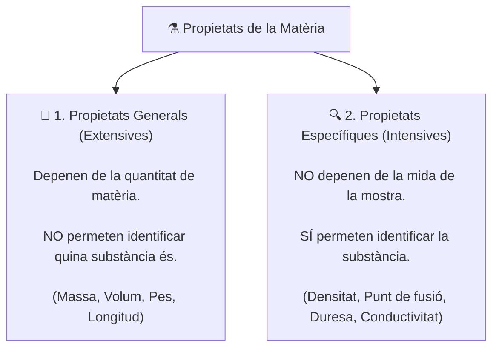

---

layout: default

title: "2.1 Les Propietats de la Matèria — Ciències Naturals · 1r FPB"

course_root: ".."

badge: "1r FPB · Ciències Naturals · UD2"

prev_url: "index.html"

prev_label: "⬅️ UD2 Índex"

next_url: "nat0202.html"

next_label: "2.2 Els Estats de la Matèria ➡️"

---

  

    ⚡ Progrés d'aprenentatge (2.1)

    0 / 12 reptes resolts

  

  

    

  

# 2.1 Les Propietats de la Matèria

En física i química, anomenem **matèria** a tot allò que té **massa** i ocupa un lloc en l'espai (és a dir, té **volum**). Un ordinador portàtil, l'aigua d'una botella, el coure d'un cable elèctric i fins i tot l'aire invisible que respirem dins de l'aula són matèria. En canvi, la llum, el so, la calor, el temps o les idees **no són matèria** perquè no tenen massa ni ocupen espai.

---

## 1. Propietats Generals vs Propietats Específiques

Per descriure i diferenciar els materials que fem servir al taller i a la vida quotidiana, estudiem les seues propietats:

### A) Propietats Generals (o Extensives)

Són comunes a tots els cossos i el seu valor depèn de la quantitat de matèria que tinguem. **No ens serveixen per saber de quin material està fet un objecte** (per exemple, 1 kg de palla té la mateixa massa que 1 kg de ferro):

1. **La Massa (m):** És la quantitat de matèria que té un cos. Es mesura amb la **balança** i la seua unitat al Sistema Internacional (SI) és el **quilogram (kg)**, tot i que per a mostres menudes usem el gram (g, on 1  kg = 1.000  g). La massa d'un cos és constant: val igual a la Terra que a la Lluna.

2. **El Volum (V):** És l'espai tridimensional que ocupa un cos. La seua unitat al Sistema Internacional és el **metre cúbic (m³)**, però en la pràctica diària utilitzem el **litre (L)**, el mil·lilitre (mL) i el centímetre cúbic (cm³).

> [!IMPORTANT]

> ### Equivalències d'Or de Volum i Capacitat

> - **$1\text{ m}^3 = 1.000\text{ litres (L)}$**

> - **$1\text{ dm}^3 = 1\text{ litre (L)}$**

> - **$1\text{ cm}^3 = 1\text{ mil·lilitre (mL)}$**

### B) Propietats Específiques (o Intensives / Característiques)

Tenen un valor propi i constant per a cada substància pura, independentment de si en tenim un gra menut o una tona sencera. **Permeten identificar i distingir una substància d'una altra**:

- **Densitat (d o $

ho$):** Relació entre la massa i el volum d'un cos.

- **Punt de fusió i punt d'ebullició:** Temperatures exactes a les quals una substància es fon o bull (l'aigua pura es fon a 0 °C i bull a 100 °C; el ferro es fon a 1.538 °C).

- **Duresa:** Resistència que oposa un material a ser ratllat per un altre (el diamant és el material natural més dur).

- **Conductivitat elèctrica i tèrmica:** Capacitat de deixar passar l'electricitat o la calor (el coure és conductor; el plàstic PVC és aïllant).

- **Solubilitat, elasticitat, fragilitat, tenacitat, brillantor i color.**

---

## 2. La Densitat: La Clau per Identificar Materials i la Flotabilitat

La **densitat (d)** és la propietat específica més important. Mesura quanta massa hi ha concentrada en cada unitat de volum d'un material:

d = \frac{\text{Massa } (m)}{\text{Volum } (V)}

- **Unitats habituals:** En el laboratori i taller s'expressa en **grams per centímetre cúbic (g/cm³)** o en **quilograms per metre cúbic ($\text{kg/m}^3$)** ($1\text{ g/cm}^3 = 1.000\text{ kg/m}^3$).

| Material / Substància | Densitat (g/cm³) | Què passa si el posem en aigua líquida ($1{,}00\text{ g/cm}^3$)? |
| :--- | :---: | :--- |
| **Suro** | $0{,}24\text{ g/cm}^3$ | **Sura** molt a la superfície (és 4 vegades menys dens que l'aigua). |
| **Oli d'oliva** | $0{,}92\text{ g/cm}^3$ | **Sura** damunt de l'aigua formant una capa superior. |
| **Gel (aigua sòlida)** | $0{,}92\text{ g/cm}^3$ | **Sura** en l'aigua líquida (els icebergs suren al mar). |
| **Aigua pura destil·lada** | **$1{,}00\text{ g/cm}^3$** | Referència patró (1 litre d'aigua té una massa d'1 kg). |
| **Alumini (dissipadors PC)** | $2{,}70\text{ g/cm}^3$ | **S'enfonsa** (és lleuger per ser un metall, però més dens que l'aigua). |
| **Ferro / Acer (xassís)** | $7{,}87\text{ g/cm}^3$ | **S'enfonsa** ràpidament. |
| **Or pur** | $19{,}30\text{ g/cm}^3$ | **S'enfonsa** (un lingot d'1 litre d'or pesa $19{,}3\text{ kg}$!). |

> [!TIP]

> ### 🚢 Per què un vaixell d'acer gegant sura si l'acer és més dens que l'aigua?

> Una bola massissa d'acer ($7{,}87\text{ g/cm}^3$) s'enfonsa a l'acte. Però el buc d'un vaixell és buit per dins i conté un enorme volum d'**aire** ($0{,}0012\text{ g/cm}^3$). Això fa que la **densitat mitjana** de tot el vaixell (acer + aire interior) siga menor que la densitat de l'aigua del mar ($1{,}03\text{ g/cm}^3$), i per això sura segons el Principi d'Arquimedes!

---

> [!NOTE]

> ### 💡 Resum de Conceptes Clau

> - Matèria és tot allò que té massa i ocupa un volum.

> - Les propietats generals (massa i volum) no identifiquen la substància; les específiques (densitat, duresa, conductivitat) sí.

> - La densitat es calcula dividint la massa pel volum ($d = m / V$). L'aigua pura té una densitat d'$1\text{ g/cm}^3$ (1 kg/L).

> - Un cos sura en un líquid si la seua densitat és menor que la del líquid, i s'enfonsa si és major.

---

## 🎯 Activitats i Autoavaluació Interactiva

  

    🎮 <strong>Zona d'Entrenament FPB:</strong> 0 reptes resolts

    ⭐ 0 punts

  

  

### 1. Qüestionari d'Autoavaluació Tipus Test (MCQ)

  
<strong>1. Quina de les següents és una propietat específica o característica que permet saber de quin material està feta una peça del taller?</strong>

  

    <button type="button" class="btn-mcq-opt" data-opt="A">A) La massa mesurada en grams</button>

    <button type="button" class="btn-mcq-opt" data-opt="B">B) El volum mesurat en centímetres cúbics</button>

    <button type="button" class="btn-mcq-opt" data-opt="C">C) La densitat i la temperatura de fusió</button>

    <button type="button" class="btn-mcq-opt" data-opt="D">D) La longitud exterior de la peça</button>

  

  

  
<strong>2. Un bloc metàl·lic d'un dissipador d'ordinador té una massa de 270 grams i ocupa un volum de 100 cm³. Quina és la seua densitat?</strong>

  

    <button type="button" class="btn-mcq-opt" data-opt="A">A) 27.000 g/cm³</button>

    <button type="button" class="btn-mcq-opt" data-opt="B">B) 2,7 g/cm³ (correspon a l'alumini)</button>

    <button type="button" class="btn-mcq-opt" data-opt="C">C) 0,37 g/cm³</button>

    <button type="button" class="btn-mcq-opt" data-opt="D">D) 370 g/cm³</button>

  

  

  
<strong>3. Quina és la unitat fonamental de massa al Sistema Internacional d'Unitats (SI) i amb quin instrument es mesura?</strong>

  

    <button type="button" class="btn-mcq-opt" data-opt="A">A) El litre (L), mesurat amb la proveta</button>

    <button type="button" class="btn-mcq-opt" data-opt="B">B) El quilogram (kg), mesurat amb la balança</button>

    <button type="button" class="btn-mcq-opt" data-opt="C">C) El Newton (N), mesurat amb el termòmetre</button>

    <button type="button" class="btn-mcq-opt" data-opt="D">D) El metre cúbic (m³), mesurat amb la cinta mètrica</button>

  

  

  
<strong>4. Si introduïm en un vas amb aigua líquida (d = 1,00 g/cm³) un tap de suro (0,24 g/cm³) i un cargol de ferro (7,87 g/cm³), què passarà?</strong>

  

    <button type="button" class="btn-mcq-opt" data-opt="A">A) Tots dos s'enfonsaran al fons del vas</button>

    <button type="button" class="btn-mcq-opt" data-opt="B">B) Tots dos suraran a la superfície</button>

    <button type="button" class="btn-mcq-opt" data-opt="C">C) El suro surarà perquè és menys dens que l'aigua i el ferro s'enfonsarà perquè és més dens</button>

    <button type="button" class="btn-mcq-opt" data-opt="D">D) El ferro surarà i el suro s'enfonsarà</button>

  

  

---

### 2. Activitats de Vertader (V) o Fals (F)

  <strong>a) Un quilogram de plom té molta més massa que un quilogram de suro o de palla.</strong>

  

    <button type="button" class="btn-vf" data-opt="V">V</button>

    <button type="button" class="btn-vf" data-opt="F">F</button>

  

  

  <strong>b) L'oli d'oliva sura damunt de l'aigua perquè la densitat de l'oli (0,92 g/cm³) és menor que la de l'aigua (1 g/cm³).</strong>

  

    <button type="button" class="btn-vf" data-opt="V">V</button>

    <button type="button" class="btn-vf" data-opt="F">F</button>

  

  

  <strong>c) La llum d'una llanterna, el so d'un altaveu i la calor es consideren matèria perquè tenen massa i ocupen volum.</strong>

  

    <button type="button" class="btn-vf" data-opt="V">V</button>

    <button type="button" class="btn-vf" data-opt="F">F</button>

  

  

  <strong>d) Un centímetre cúbic (1 cm³) equival exactament a la capacitat d'un mil·lilitre (1 mL).</strong>

  

    <button type="button" class="btn-vf" data-opt="V">V</button>

    <button type="button" class="btn-vf" data-opt="F">F</button>

  

  

---

### 3. Exercicis de Resposta Breu i Vocabulari Tècnic

  
✍️ Com s'anomena la propietat específica que relaciona la massa d'un cos amb el volum que ocupa?

  

    <input type="text" class="quiz-input" placeholder="Escriu la propietat...">

    <button type="button" class="btn-quiz-check">Comprovar</button>

  

  

  
✍️ Quants litres (L) d'aigua caben exactament dins d'un dipòsit d'un metre cúbic (1 m³)?

  

    <input type="text" class="quiz-input" placeholder="Escriu el número...">

    <button type="button" class="btn-quiz-check">Comprovar</button>

  

  

  
✍️ Calcula la densitat (en g/cm³) d'un dau metàl·lic que té una massa de 80 grams i un volum de 10 cm³.

  

    <input type="text" class="quiz-input" placeholder="Escriu la teua resposta...">

    <button type="button" class="btn-quiz-check">Comprovar</button>

  

  

  
✍️ Quants grams (g) de massa té un sac de 3,5 quilograms (kg) de ciment?

  

    <input type="text" class="quiz-input" placeholder="Escriu la teua resposta...">

    <button type="button" class="btn-quiz-check">Comprovar</button>

  

  

---

### 4. Exercicis de Raonament i Desenvolupament Escrit (Tasca d'Aula)

  
✍️ <strong>Comprovació d'autenticitat al taller:</strong> Un client et ven una peça metàl·lica daurada assegurant que és d'or pur (d = 19,3 g/cm³). La peses a la balança i dóna una massa de 170 g, i en mesurar el seu volum veus que ocupa $20\text{ cm}^3$. Calcula la seua densitat real, digues si és d'or pur o és un engany (com llautó, d = 8,5 g/cm³) i explica com ho has descobert.

  <textarea class="open-response-input" rows="4" placeholder="Calcula d = m / V = 170 / 20 i compara el resultat amb la densitat de l'or..."></textarea>

  
✍️ <strong>Exercici 2 (Mètode d'immersió d'Arquimedes al laboratori):</strong> Tens una pedra irregular i vols saber el seu volum exacte. Agafes una proveta graduada amb 50 mL d'aigua, hi introdueixes la pedra i el nivell de l'aigua puja fins a 85 mL. Si la pedra pesa 70 grams a la balança, calcula el seu volum i la seua densitat mostrant tots els passos.

  <textarea class="open-response-input" rows="4" placeholder="Volum de la pedra = 85 mL - 50 mL = ... Densitat = massa / volum = ..."></textarea>

  
✍️ <strong>Exercici 3 (Propietats generals vs específiques al taller):</strong> Explica amb les teues paraules per què la massa i el volum no serveixen per identificar si un cable és d'alumini o de plata, i esmenta tres propietats específiques que sí et permetrien distingir-los.

  <textarea class="open-response-input" rows="4" placeholder="Explica que 10 g d'alumini pesen igual que 10 g de plata, però la densitat, conductivitat i punt de fusió són propis de cada metall..."></textarea>

---

  <h3 style="margin-top:0; color:#0369a1;">📦 Lliurament d'Activitats d'Aules (Act 2.1)</h3>

  
Genera el teu document de tasca d'aquest apartat amb el teu nom i puntuació obtinguda.

  

    <input type="text" class="aules-student-name" placeholder="Cognoms, Nom de l'Alumne/a" style="padding:8px 12px; border:1px solid #94a3b8; border-radius:4px; flex-grow:1; min-width:240px;">

    <button class="btn-generate-aules-pdf" data-unit="NAT02" data-activity="Act01" data-module="CA" style="padding:8px 16px; background:#0284c7; color:#fff; border:none; border-radius:4px; font-weight:600; cursor:pointer;">📄 Descarregar PDF per a Aules</button>

  

