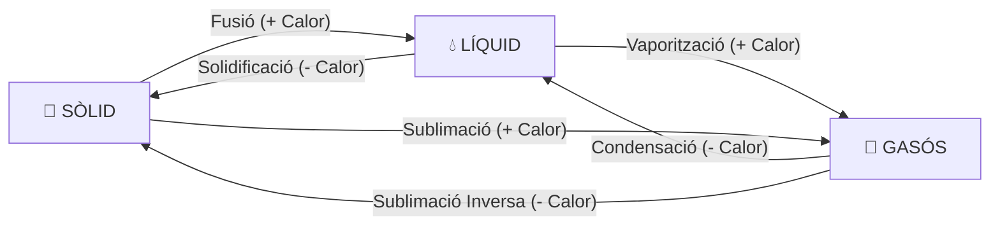

---

layout: default

title: "2.3 Els Canvis d'Estat de la Matèria — Ciències Naturals · 1r FPB"

course_root: ".."

badge: "1r FPB · Ciències Naturals · UD2"

prev_url: "nat0202.html"

prev_label: "⬅️ 2.2 Els Estats de la Matèria"

next_url: "nat0204.html"

next_label: "2.4 Substàncies Pures ➡️"

---

  

    ⚡ Progrés d'aprenentatge (2.3)

    0 / 12 reptes resolts

  

  

    

  

# 2.3 Els Canvis d'Estat de la Matèria

Quan escalfem o refredem una substància (o modifiquem la pressió), l'energia d'agitació de les seues partícules canvia i pot passar d'un estat físic a un altre. Els **canvis d'estat** són transformacions físiques: l'aspecte canvia, però la substància continua sent exactament la mateixa (el gel, l'aigua líquida i el vapor d'aigua continuen sent molècules d'H₂O).

---

## 1. Mapa Complet dels Canvis d'Estat

Distingim entre **canvis d'estat progressius** (es produeixen en **absorbir calor / escalfar**) i **canvis d'estat regressius** (es produeixen en **perdre calor / refredar**):

### A) Canvis d'Estat per Escalfament (Progressius)

1. **Fusió (de Sòlid a Líquid):** Quan escalfem un sòlid, les seues partícules vibren tan fort que trenquen l'estructura rígida i comencen a lliscar. Exemples: un glaçó de gel que es descongela o el fil d'**estany** que fonem amb el soldador elèctric a 232 °C al taller d'electrònica.

2. **Vaporització (de Líquid a Gas):** Pas de l'estat líquid al gasós. Es pot produir de dues maneres molt diferents:

   - **Evaporació:** Ocorre **només a la superfície** del líquid, a poc a poc i a **qualsevol temperatura** (per això s'eixuga la roba estesa al sol o una bassa d'aigua al carrer a 20 °C).

   - **Ebullició:** Ocorre a **tota la massa** del líquid de forma tumultuosa formant bombolles de vapor, i només té lloc a una temperatura fixa anomenada **temperatura o punt d'ebullició** (100 °C en l'aigua pura a nivell del mar).

3. **Sublimació (de Sòlid directament a Gas):** Alguns sòlids passen directament a gas sense fondre's ni passar per líquid. Exemples: el iode sòlid, les boletes de naftalina dels armaris o el gel sec (CO₂ congelat).

### B) Canvis d'Estat per Refredament (Regressius)

1. **Condensació (de Gas a Líquid):** Quan un gas o vapor toca una superfície freda, les seues partícules perden velocitat, s'acosten i es converteixen en gotes líquides. Exemples: el baf que entela l'espill del bany en dutxar-nos, la formació dels núvols i la rosada.

2. **Solidificació (de Líquid a Sòlid):** En refredar un líquid, les partícules perden mobilitat fins a quedar fixades en una xarxa sòlida (congelació de l'aigua a 0 °C o refredament d'un punt d'estany soldat).

3. **Sublimació inversa o regressiva (de Gas directament a Sòlid):** Quan el vapor d'aigua de l'aire en una nit d'hivern sota zero es congela directament sobre els vidres dels cotxes formant el **gebre o gelada**.

---

## 2. Punts de Fusió i Ebullició i Gràfiques d'Escalfament

Cada substància pura té una **temperatura de fusió ($T_f$)** i una **temperatura d'ebullició ($T_e$)** pròpies i constants que permeten identificar-la:

| Substància Pura | Punt de Fusió ($T_f$) | Punt d'Ebullició ($T_e$) | Estat físic a temperatura d'aula (20 °C) |
| :--- | :---: | :---: | :--- |
| **Oxigen (O₂)** | -218 °C | -183 °C | **Gasós** (ja ha bullit molt abans de 20 °C). |
| **Alcohol etílic (etanol)** | -114 °C | 78 °C | **Líquid** (està entre $-114 °Ci78 °C$). |
| **Aigua pura (H₂O)** | **0 °C** | **100 °C** | **Líquid** (està entre $0 °Ci100 °C$). |
| **Estany de soldadura** | 232 °C | 2.602 °C | **Sòlid** (encara no ha arribat a 232 °C). |
| **Ferro (Fe)** | 1.538 °C | 2.861 °C | **Sòlid** (necessita més de 1.538 °C per fondre's). |

> [!IMPORTANT]

> ### 📈 Regla d'Or de les Corbes d'Escalfament

> **Mentre dura un canvi d'estat d'una substància pura, la seua temperatura NO PUJA: es manté totalment constant!**

> Per exemple, mentre un glaçó de gel s'està fonent en un got amb aigua, el termòmetre marca exactament **0 °C** fins que desapareix l'últim tros de gel. I mentre l'aigua d'un cassó està bullint, el termòmetre es queda clavat en **100 °C**, perquè tota l'energia del foc es gasta a trencar les forces d'unió entre les molècules!

---

> [!NOTE]

> ### 💡 Resum de Conceptes Clau

> - Els canvis d'estat per escalfament són la fusió, la vaporització i la sublimació; per refredament són la condensació, la solidificació i la sublimació inversa.

> - L'evaporació ocorre a la superfície a qualsevol temperatura; l'ebullició ocorre a tota la massa a una temperatura fixa ($T_e$).

> - Durant qualsevol canvi d'estat d'una substància pura, la temperatura roman constant (trams horitzontals plans a la gràfica).

---

## 🎯 Activitats i Autoavaluació Interactiva

  

    🎮 <strong>Zona d'Entrenament FPB:</strong> 0 reptes resolts

    ⭐ 0 punts

  

  

### 1. Qüestionari d'Autoavaluació Tipus Test (MCQ)

  
<strong>1. Quin canvi d'estat es produeix quan el vapor d'aigua de la dutxa o del nostre alè toca un espill fred i l'entela formant gotetes líquides?</strong>

  

    <button type="button" class="btn-mcq-opt" data-opt="A">A) Fusió</button>

    <button type="button" class="btn-mcq-opt" data-opt="B">B) Sublimació progressiva</button>

    <button type="button" class="btn-mcq-opt" data-opt="C">C) Condensació (pas de gas a líquid per refredament)</button>

    <button type="button" class="btn-mcq-opt" data-opt="D">D) Solidificació</button>

  

  

  
<strong>2. Quina diferència hi ha entre l'evaporació i l'ebullició d'un líquid?</strong>

  

    <button type="button" class="btn-mcq-opt" data-opt="A">A) L'evaporació ocorre lentament a la superfície a qualsevol temperatura, mentre que l'ebullició ocorre a tota la massa a una temperatura fixa</button>

    <button type="button" class="btn-mcq-opt" data-opt="B">B) L'evaporació només passa a 100 °C i l'ebullició passa a 0 °C</button>

    <button type="button" class="btn-mcq-opt" data-opt="C">C) L'evaporació transforma el líquid en sòlid i l'ebullició en plasma</button>

    <button type="button" class="btn-mcq-opt" data-opt="D">D) No hi ha cap diferència entre totes dues</button>

  

  

  
<strong>3. Si el punt de fusió del ferro és 1.538 °C i el seu punt d'ebullició és 2.861 °C, en quin estat físic es trobarà el ferro dins d'un forn industrial a 2.000 °C?</strong>

  

    <button type="button" class="btn-mcq-opt" data-opt="A">A) En estat sòlid</button>

    <button type="button" class="btn-mcq-opt" data-opt="B">B) En estat líquid (ja s'ha fos però encara no bull)</button>

    <button type="button" class="btn-mcq-opt" data-opt="C">C) En estat gasós</button>

    <button type="button" class="btn-mcq-opt" data-opt="D">D) En estat de sublimació</button>

  

  

  
<strong>4. Com s'anomena el canvi d'estat regressiu pel qual el vapor d'aigua de l'aire en una nit gèlida d'hivern passa directament a cristalls de gel (gebre) sense passar per líquid?</strong>

  

    <button type="button" class="btn-mcq-opt" data-opt="A">A) Fusió</button>

    <button type="button" class="btn-mcq-opt" data-opt="B">B) Vaporització</button>

    <button type="button" class="btn-mcq-opt" data-opt="C">C) Sublimació inversa o regressiva</button>

    <button type="button" class="btn-mcq-opt" data-opt="D">D) Ebullició</button>

  

  

---

### 2. Activitats de Vertader (V) o Fals (F)

  <strong>a) Mentre l'aigua pura està bullint a nivell del mar, la seua temperatura es manté constant a 100 °C encara que pugem la potència del foc.</strong>

  

    <button type="button" class="btn-vf" data-opt="V">V</button>

    <button type="button" class="btn-vf" data-opt="F">F</button>

  

  

  <strong>b) El pas de l'estat sòlid a l'estat líquid quan escalfem un metall amb el soldador s'anomena sublimació.</strong>

  

    <button type="button" class="btn-vf" data-opt="V">V</button>

    <button type="button" class="btn-vf" data-opt="F">F</button>

  

  

  <strong>c) La roba humida estesa al balcó s'eixuga a 18 °C gràcies al fenomen d'evaporació superficial.</strong>

  

    <button type="button" class="btn-vf" data-opt="V">V</button>

    <button type="button" class="btn-vf" data-opt="F">F</button>

  

  

  <strong>d) L'alcohol etílic bull a 78 °C; per tant, a 90 °C a pressió normal l'alcohol es troba en estat sòlid.</strong>

  

    <button type="button" class="btn-vf" data-opt="V">V</button>

    <button type="button" class="btn-vf" data-opt="F">F</button>

  

  

---

### 3. Exercicis de Resposta Breu i Vocabulari Tècnic

  
✍️ Com s'anomena el canvi d'estat pel qual un cos passa de sòlid a líquid en absorbir calor?

  

    <input type="text" class="quiz-input" placeholder="Escriu el canvi d'estat...">

    <button type="button" class="btn-quiz-check">Comprovar</button>

  

  

  
✍️ Quin nom rep el canvi d'estat directe de sòlid a gas sense passar en cap moment per l'estat líquid?

  

    <input type="text" class="quiz-input" placeholder="Escriu el terme...">

    <button type="button" class="btn-quiz-check">Comprovar</button>

  

  

  
✍️ A quina temperatura exacta en graus Celsius (°C) es fon el gel d'aigua pura a pressió atmosfèrica normal?

  

    <input type="text" class="quiz-input" placeholder="Escriu la teua resposta...">

    <button type="button" class="btn-quiz-check">Comprovar</button>

  

  

  
✍️ Com s'anomena el pas de l'estat líquid a l'estat sòlid quan refredem aigua al congelador?

  

    <input type="text" class="quiz-input" placeholder="Escriu la teua resposta...">

    <button type="button" class="btn-quiz-check">Comprovar</button>

  

  

---

### 4. Exercicis de Raonament i Desenvolupament Escrit (Tasca d'Aula)

  
✍️ <strong>Soldadura electrònica amb estany i alcohol isopropílic al taller:</strong> Quan netegem una placa base amb unes gotes d'alcohol isopropílic ($T_e = 82 °C$), veiem que desapareix i s'eixuga sol en pocs segons a la temperatura de l'aula (22 °C). En canvi, quan soldem un cable amb fil d'estany ($T_f = 232 °C$), l'apliquem amb el soldador a 350 °C i en retirar-lo es torna dur a l'instant. Explica quins tres canvis d'estat concrets han tingut lloc en aquestes dues operacions de taller.

  <textarea class="open-response-input" rows="4" placeholder="1. Alcohol isopropílic a 22°C -> ... 2. Estany amb el soldador a 350°C -> ... 3. Estany en retirar el soldador -> ..."></textarea>

  
✍️ <strong>Exercici 2 (Interpretació d'una corba d'escalfament):</strong> Traiem un bloc de gel del congelador a -15 °C i l'escalfem fins a convertir-lo en vapor a 120 °C. Explica per què el termòmetre s'atura durant diversos minuts quan arriba a 0 °C i torna a aturar-se quan arriba a 100 °C tot i que el foc segueix encès.

  <textarea class="open-response-input" rows="4" placeholder="Explica que durant la fusió (0 °C) i l'ebullició (100 °C) tota la calor s'utilitza per trencar les forces de cohesió entre molècules..."></textarea>

  
✍️ <strong>Exercici 3 (Determinació d'estats físics amb taula de dades):</strong> Sabent que l'oxigen té Tf = -218 °C i Te = -183 °C, i que l'estany té Tf = 232 °C i Te = 2.602 °C, justifica raonadament en quin estat físic està cadascun a la temperatura de l'aula (25 °C).

  <textarea class="open-response-input" rows="4" placeholder="Compara 25 °C amb les temperatures de fusió i ebullició de l'oxigen i de l'estany..."></textarea>

---

  <h3 style="margin-top:0; color:#0369a1;">📦 Lliurament d'Activitats d'Aules (Act 2.3)</h3>

  
Genera el teu document de tasca d'aquest apartat amb el teu nom i puntuació obtinguda.

  

    <input type="text" class="aules-student-name" placeholder="Cognoms, Nom de l'Alumne/a" style="padding:8px 12px; border:1px solid #94a3b8; border-radius:4px; flex-grow:1; min-width:240px;">

    <button class="btn-generate-aules-pdf" data-unit="NAT02" data-activity="Act03" data-module="CA" style="padding:8px 16px; background:#0284c7; color:#fff; border:none; border-radius:4px; font-weight:600; cursor:pointer;">📄 Descarregar PDF per a Aules</button>

  

