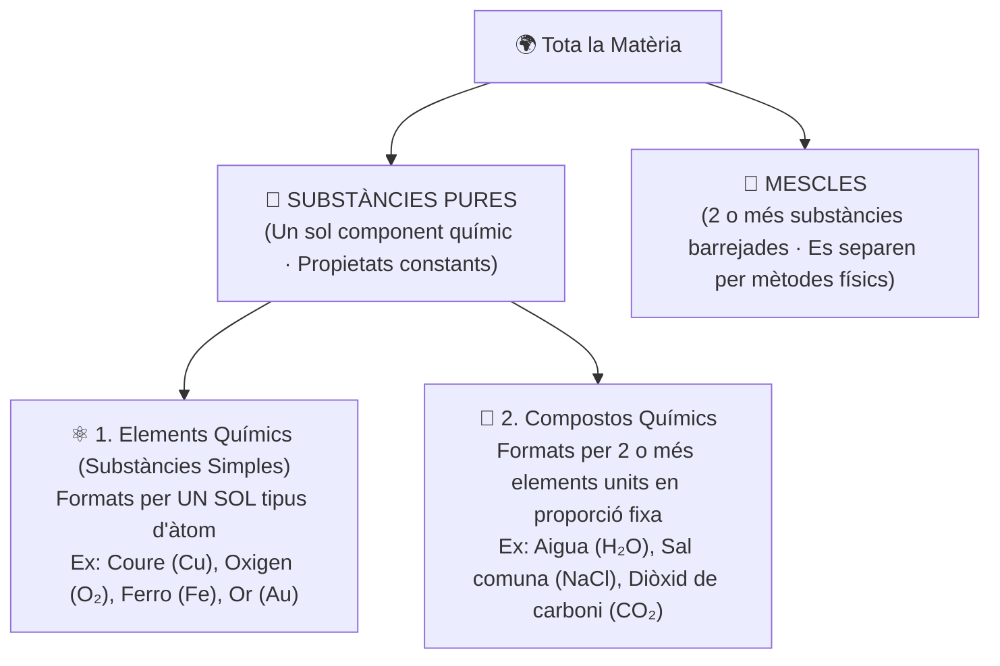

  

    ⚡ Progrés d'aprenentatge (2.4)
    0 / 3 reptes resolts
  

  

    

  

# 2.4 Classificació de la Matèria (I): Substàncies Pures

Si observem els materials que ens envolten, veurem que alguns estan formats per una sola classe de component químic (com el fil de coure pur per dins d'un cable o la sal de cuina pura), mentre que la majoria són combinacions de diverses coses barrejades (com l'aigua de la mar, el granit o la llet).

Per això, els químics classifiquen tota la matèria en dos grans grups: **Substàncies Pures** i **Mescles**. En aquesta sessió estudiarem a fons les **substàncies pures**.

---

## 1. Què és una Substància Pura?

Una **substància pura** és aquella matèria que té una **composició química fixa i invariant** i unes **propietats específiques constants** (com la densitat, el punt de fusió i el punt d'ebullició) que no canvien mai, i que **no es pot separar en altres substàncies mitjançant procediments físics** (com filtrar, decantar o escalfar).

---

## 2. Tipus de Substàncies Pures: Elements vs Compostos

Segons si les seues partícules estan formades per una sola classe d'àtoms o per àtoms diferents enllaçats químicament, dividim les substàncies pures en dos grups:

### A) Elements Químics (o Substàncies Simples)
Són les substàncies pures que estan formades **exclusivament per un sol tipus d'àtom**. No es poden descompondre en altres substàncies més senzilles ni per mètodes físics ni per cap reacció química.
- Tots els elements coneguts (118 en total) estan recollits a la **Taula Periòdica** i es representen amb un **símbol químic** d'una o dues lletres (la primera sempre en majúscula):
  - **Metalls d'ús tecnològic:** Coure ($	ext{Cu}$), Ferro ($	ext{Fe}$), Alumini ($	ext{Al}$), Or ($	ext{Au}$), Argent ($	ext{Ag}$), Liti ($	ext{Li}$, bateries).
  - **No-metalls i gasos simples:** Oxigen gasós ($	ext{O}_2$, format per parelles d'àtoms d'oxigen idèntics), Nitrogen ($	ext{N}_2$), Hidrogen ($	ext{H}_2$), Carboni ($	ext{C}$, que forma tant el grafit del llapis com el diamant) i Silici ($	ext{Si}$, base dels xips).

### B) Compostos Químics
Són substàncies pures formades per la **unió química de dos o més elements diferents combinats en una proporció fixa**. Es representen mitjançant una **fórmula química** que indica quins àtoms els formen i en quina quantitat:

| Compost Químic | Fórmula Química | Proporció d'Àtoms | Propietats i Usos Reals |
| :--- | :---: | :--- | :--- |
| **Aigua pura (destil·lada)** | $	ext{H}_2	ext{O}$ | 2 àtoms d'Hidrogen per cada 1 d'Oxigen | Líquid incolor vital; $T_f = 0^\circ	ext{C}$, $T_e = 100^\circ	ext{C}$, $d = 1	ext{ g/cm}^3$. |
| **Sal comuna (Clorur de sodi)** | $	ext{NaCl}$ | 1 àtom de Sodi per cada 1 de Clor | Cristall blanc comestible i conservant ($T_f = 801^\circ	ext{C}$). |
| **Diòxid de carboni** | $	ext{CO}_2$ | 1 àtom de Carboni i 2 d'Oxigen | Gas expirat en la respiració i usat en extintors d'incendis elèctrics. |
| **Quars / Sílice** | $	ext{SiO}_2$ | 1 àtom de Silici i 2 d'Oxigen | Mineral amb què es fabriquen el vidre i la fibra òptica d'Internet. |
| **Glucosa** | $	ext{C}_6	ext{H}_{12}	ext{O}_6$ | 6 de Carboni, 12 d'Hidrogen i 6 d'Oxigen | Sucre que aporta energia a les nostres cèl·lules. |

> [!TIP]
> ### ⚡ Com es pot descompondre un compost químic?
> Un compost com l'aigua pura ($	ext{H}_2	ext{O}$) no es pot separar en hidrogen i oxigen bullint-la o filtrant-la (si bulls aigua, obtens vapor d'aigua $	ext{H}_2	ext{O}$). Només es pot descompondre mitjançant un **mètode químic** com l'**electròlisi**: fent passar un corrent elèctric continu per l'aigua, els enllaços es trenquen i s'alliberen bombolles de gas hidrogen ($	ext{H}_2$) i gas oxigen ($	ext{O}_2$).

---

> [!NOTE]
> ### 💡 Resum de Conceptes Clau
> - Una substància pura té composició i propietats constants (com la temperatura d'ebullició o la densitat) i no es pot separar per mètodes físics.
> - Els **elements químics** estan formats per un sol tipus d'àtom ($	ext{Fe}, 	ext{Cu}, 	ext{O}_2$) i no es poden descompondre de cap manera.
> - Els **compostos químics** estan formats per àtoms de diferents elements units en proporció fixa ($	ext{H}_2	ext{O}, 	ext{NaCl}, 	ext{CO}_2$) i es representen amb fórmules químiques.

---

## 🎯 Activitats i Autoavaluació Interactiva

  

    🎮 <strong>Zona d'Entrenament FPB:</strong> 0 reptes resolts
    ⭐ 0 punts
  

  

### 1. Qüestionari d'Autoavaluació Tipus Test (MCQ)

  
<strong>1. Com es classifica químicament l'aigua pura destil·lada (H₂O)?</strong>

  

    <button type="button" class="btn-mcq-opt" data-opt="A">A) Com un element químic simple de la taula periòdica</button>
    <button type="button" class="btn-mcq-opt" data-opt="B">B) Com una substància pura de tipus compost químic</button>
    <button type="button" class="btn-mcq-opt" data-opt="C">C) Com una mescla heterogènia de roques i gasos</button>
    <button type="button" class="btn-mcq-opt" data-opt="D">D) Com un aliatge metàl·lic</button>
  

  

  
<strong>2. Quin dels següents grups conté EXCLUSIVAMENT elements químics (substàncies simples)?</strong>

  

    <button type="button" class="btn-mcq-opt" data-opt="A">A) Aigua (H₂O), sal (NaCl) i sucre</button>
    <button type="button" class="btn-mcq-opt" data-opt="B">B) Aire, aigua de mar i granit</button>
    <button type="button" class="btn-mcq-opt" data-opt="C">C) Diòxid de carboni (CO₂) i amoníac (NH₃)</button>
    <button type="button" class="btn-mcq-opt" data-opt="D">D) Coure (Cu), Ferro (Fe), Oxigen (O₂) i Silici (Si)</button>
  

  

---

### 2. Activitats de Vertader (V) o Fals (F)

  <strong>a) Quan fem bullir aigua en una olla a 100 °C, les molècules d'H₂O es trenquen i se separen en gas hidrogen explosiu i gas oxigen.</strong>
  

    <button type="button" class="btn-vf" data-opt="V">V</button>
    <button type="button" class="btn-vf" data-opt="F">F</button>
  

  

  <strong>b) El gas oxigen que respirem (O₂) és una substància simple o element perquè tots els àtoms que formen la seua molècula són idèntics.</strong>
  

    <button type="button" class="btn-vf" data-opt="V">V</button>
    <button type="button" class="btn-vf" data-opt="F">F</button>
  

  

---

### 3. Exercicis de Resposta Breu i Vocabulari Tècnic

  
✍️ Com s'anomena la substància pura constituïda per un sol tipus d'àtom que no es pot descompondre en altres més simples?

  

    <input type="text" class="quiz-input" placeholder="Escriu el terme...">
    <button type="button" class="btn-quiz-check">Comprovar</button>
  

  

  
✍️ Quin nom rep la substància pura formada per la unió química de dos o més elements diferents en una proporció fixa?

  

    <input type="text" class="quiz-input" placeholder="Escriu el terme...">
    <button type="button" class="btn-quiz-check">Comprovar</button>
  

  

---

### 4. Pregunta de Raonament i Desenvolupament Escrit

  
✍️ <strong>La curiositat química de la sal comuna (NaCl):</strong> El sodi pur ($	ext{Na}$) és un metall tou que explota violentament en tocar l'aigua, i el clor pur ($	ext{Cl}_2$) és un gas verdós verinós i mortal si es respira. Tanmateix, quan s'uneixen químicament formen el clorur de sodi ($	ext{NaCl}$), la sal blanca que posem a l'amanida cada dia. Explica per què el compost $	ext{NaCl}$ no és explosiu ni verinós i què ens demostra això sobre les propietats dels compostos químics.

  <textarea class="open-response-input" rows="4" placeholder="Explica com en formar-se un compost químic nou apareixen propietats específiques noves totalment diferents de les dels elements per separat..."></textarea>

---

  <h3 style="margin-top:0; color:#0369a1;">📦 Lliurament d'Activitats d'Aules (Act 2.4)</h3>
  
Genera el teu document de tasca d'aquest apartat amb el teu nom i puntuació obtinguda.

  

    <input type="text" class="aules-student-name" placeholder="Cognoms, Nom de l'Alumne/a" style="padding:8px 12px; border:1px solid #94a3b8; border-radius:4px; flex-grow:1; min-width:240px;">
    <button class="btn-generate-aules-pdf" data-unit="NAT02" data-activity="Act04" data-module="CA" style="padding:8px 16px; background:#0284c7; color:#fff; border:none; border-radius:4px; font-weight:600; cursor:pointer;">📄 Descarregar PDF per a Aules</button>
  

