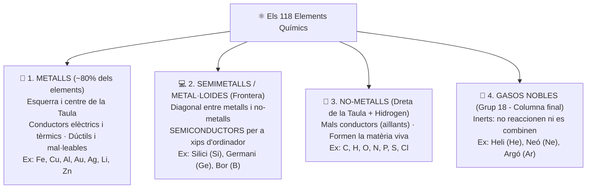

  

    ⚡ Progrés d'aprenentatge (2.6)
    0 / 3 reptes resolts
  

  

    

  

# 2.6 Classificació dels Elements Químics

Segons les seues propietats físiques i químiques (especialment la seua capacitat per conduir el corrent elèctric i la calor, la seua brillantor i el seu comportament mecànic), els 118 elements de la Taula Periòdica es divideixen en **quatre grans categories**: **Metalls**, **No-metalls**, **Semimetalls (o Metal·loides)** i **Gasos Nobles**.

---

## 1. Els Quatre Grans Blocs de la Taula Periòdica

---

## 2. Comparativa Detallada de Propietats i Aplicacions

| Característica | 1. Metalls | 2. No-Metalls | 3. Semimetalls (Metal·loides) | 4. Gasos Nobles |
| :--- | :--- | :--- | :--- | :--- |
| **Posició a la Taula** | Esquerra, centre i part inferior (~90 elements). | Part superior dreta (més l'Hidrogen a dalt a l'esquerra). | Escala diagonal que separa metalls i no-metalls (7 elements). | Columna 18 (extrem dret). |
| **Estat físic a $20^\circ	ext{C}$** | Tots són **sòlids**, excepte el **mercuri ($	ext{Hg}$)** que és líquid. | Poden ser **gasos** ($	ext{O}_2, 	ext{N}_2, 	ext{H}_2, 	ext{Cl}_2$), **sòlids** ($	ext{C}, 	ext{S}, 	ext{P}$) o **líquid** (brom, $	ext{Br}_2$). | Tots són **sòlids** cristal·lins d'aspecte metàl·lic. | Tots són **gasos** monoatòmics. |
| **Conductivitat elèctrica i tèrmica** | **Excel·lents conductors** de l'electricitat i la calor. | **Mals conductors (aïllants)**, excepte el carboni en forma de grafit. | **Semiconductors:** només condueixen sota certes condicions de voltatge o temperatura. | Nul·la (aïllants). |
| **Propietats mecàniques i aspecte** | Tenen **brillantor metàl·lica**, són **dúctils** (es fan fils/cables) i **mal·leables** (es fan làmines). | Sense brillantor metàl·lica; quan són sòlids són **fràgils** (es trenquen en colpejar-los). | Durs però trencadissos com el vidre. | Incolors, inodors i insípids. |

---

## 3. Importància en Tecnologia, Indústria i Biologia

### A) Els Metalls i els Semimetalls al Taller d'Informàtica
- **Ductilitat i conductivitat del Coure ($	ext{Cu}$) i l'Or ($	ext{Au}$):** El coure s'estira en fils finíssims per a tots els cables elèctrics, bobines i pistes de les plaques base. L'or, com que mai s'oxida ni es rovella amb l'aire, recobreix els contactes dels processadors, memòries RAM i connectors RJ-45 o HDMI.
- **Mal·leabilitat i lleugeresa de l'Alumini ($	ext{Al}$):** Es modela en làmines i aletes per als dissipadors de calor que refreden la CPU i la targeta gràfica.
- **La revolució del Silici ($	ext{Si}$):** El silici és el segon element més abundant de l'escorça terrestre (present a la sorra de quars). Com que és un **semimetall semiconductor**, permet fabricar milers de milions de transistors microscòpics dins dels **microprocessadors (CPU/GPU)**, memòries SSD i panells solars fotovoltaics. Sense el silici no existiria la informàtica moderna!

### B) Els No-Metalls i la Vida (Bioelements)
Tot i ser pocs en nombre, els no-metalls són els protagonistes absoluts de la biologia i de l'atmosfera:
- Els sis bioelements primaris (**$	ext{C}, 	ext{H}, 	ext{O}, 	ext{N}, 	ext{P}, 	ext{S}$**) que formen el 96% del cos humà, l'ADN, les proteïnes i l'aigua són tots **no-metalls**!
- L'aire que respirem està compost en un $78\%$ pel no-metall **nitrogen ($	ext{N}_2$)** i en un $21\%$ pel no-metall **oxigen ($	ext{O}_2$)**.

### C) Els Gasos Nobles: Estabilitat Absoluta
Els elements del Grup 18 (**Heli $	ext{He}$**, **Neó $	ext{Ne}$**, **Argó $	ext{Ar}$**, **Kriptó $	ext{Kr}$**, **Xenó $	ext{Xe}$**) tenen la seua última capa d'electrons totalment plena. Per això són **químicament inerts**: no necessiten unir-se amb cap altre àtom. S'usen per a omplir globus aerostàtics segurs que no cremen (heli), rètols lluminosos de colors (neó), atmosferes protectores en soldadura industrial i interior de bombetes i làsers (argó).

---

> [!NOTE]
> ### 💡 Resum de Conceptes Clau
> - **Metalls:** ~80% de la taula; sòlids (excepte el mercuri), brillants, bons conductors de la calor i l'electricitat, dúctils (fils) i mal·leables (làmines).
> - **No-metalls:** mals conductors (aïllants) i fràgils en estat sòlid, però formen l'aire, l'aigua i tots els éssers vius ($	ext{C}, 	ext{H}, 	ext{O}, 	ext{N}$).
> - **Semimetalls (Silici):** tenen propietats intermèdies (**semiconductors**), sent la base de tota la microelectrònica i informàtica.
> - **Gasos nobles (Grup 18):** gasos inerts que no reaccionen químicament amb altres elements.

---

## 🎯 Activitats i Autoavaluació Interactiva

  

    🎮 <strong>Zona d'Entrenament FPB:</strong> 0 reptes resolts
    ⭐ 0 punts
  

  

### 1. Qüestionari d'Autoavaluació Tipus Test (MCQ)

  
<strong>1. Quin element químic classificat com a semimetall (o metal·loide) és indispensable per a fabricar els microprocessadors i xips d'ordinador gràcies a ser semiconductor?</strong>

  

    <button type="button" class="btn-mcq-opt" data-opt="A">A) El calci (Ca)</button>
    <button type="button" class="btn-mcq-opt" data-opt="B">B) L'heli (He)</button>
    <button type="button" class="btn-mcq-opt" data-opt="C">C) El silici (Si)</button>
    <button type="button" class="btn-mcq-opt" data-opt="D">D) El sofre (S)</button>
  

  

  
<strong>2. Com s'anomena la propietat mecànica dels metalls com el coure que permet estirar-los en fils molt fins per a fabricar cables elèctrics sense que es trenquen?</strong>

  

    <button type="button" class="btn-mcq-opt" data-opt="A">A) Fragilitat</button>
    <button type="button" class="btn-mcq-opt" data-opt="B">B) Ductilitat</button>
    <button type="button" class="btn-mcq-opt" data-opt="C">C) Volatilitat</button>
    <button type="button" class="btn-mcq-opt" data-opt="D">D) Inèrcia química</button>
  

  

---

### 2. Activitats de Vertader (V) o Fals (F)

  <strong>a) El mercuri (Hg) és l'únic metall de la Taula Periòdica que es troba en estat líquid a temperatura ambient (20 °C).</strong>
  

    <button type="button" class="btn-vf" data-opt="V">V</button>
    <button type="button" class="btn-vf" data-opt="F">F</button>
  

  

  <strong>b) Els gasos nobles del Grup 18 (com l'heli o l'argó) s'anomenen així perquè són extremadament explosius i reaccionen violentament amb l'aire.</strong>
  

    <button type="button" class="btn-vf" data-opt="V">V</button>
    <button type="button" class="btn-vf" data-opt="F">F</button>
  

  

---

### 3. Exercicis de Resposta Breu i Vocabulari Tècnic

  
✍️ Com s'anomena la propietat dels metalls que permet estendre'ls en làmines o planxes molt fines (com el paper d'alumini o les xapes d'una caixa de PC)?

  

    <input type="text" class="quiz-input" placeholder="Escriu la propietat...">
    <button type="button" class="btn-quiz-check">Comprovar</button>
  

  

  
✍️ A quina de les 4 grans categories d'elements pertanyen el Carboni (C), l'Oxigen (O), el Nitrogen (N) i l'Hidrogen (H) que formen els éssers vius?

  

    <input type="text" class="quiz-input" placeholder="Escriu la categoria...">
    <button type="button" class="btn-quiz-check">Comprovar</button>
  

  

---

### 4. Pregunta de Raonament i Desenvolupament Escrit

  
✍️ <strong>Selecció de materials per a un cable de xarxa i un dissipador:</strong> Explica per quines propietats físiques concretes utilitzem **coure** (metall) per a l'interior d'un cable elèctric, **alumini** (metall) per al dissipador que va sobre el processador i **polímers derivats del carboni i hidrogen** (no-metalls) per a la funda exterior que recobreix el cable. Què passaria si intercanviàrem els materials?

  <textarea class="open-response-input" rows="4" placeholder="Coure -> conductivitat elèctrica i ductilitat; Alumini -> conductivitat tèrmica; Plàstic (no-metalls) -> aïllant elèctric per seguretat..."></textarea>

---

  <h3 style="margin-top:0; color:#0369a1;">📦 Lliurament d'Activitats d'Aules (Act 2.6)</h3>
  
Genera el teu document de tasca d'aquest apartat amb el teu nom i puntuació obtinguda.

  

    <input type="text" class="aules-student-name" placeholder="Cognoms, Nom de l'Alumne/a" style="padding:8px 12px; border:1px solid #94a3b8; border-radius:4px; flex-grow:1; min-width:240px;">
    <button class="btn-generate-aules-pdf" data-unit="NAT02" data-activity="Act06" data-module="CA" style="padding:8px 16px; background:#0284c7; color:#fff; border:none; border-radius:4px; font-weight:600; cursor:pointer;">📄 Descarregar PDF per a Aules</button>
  

