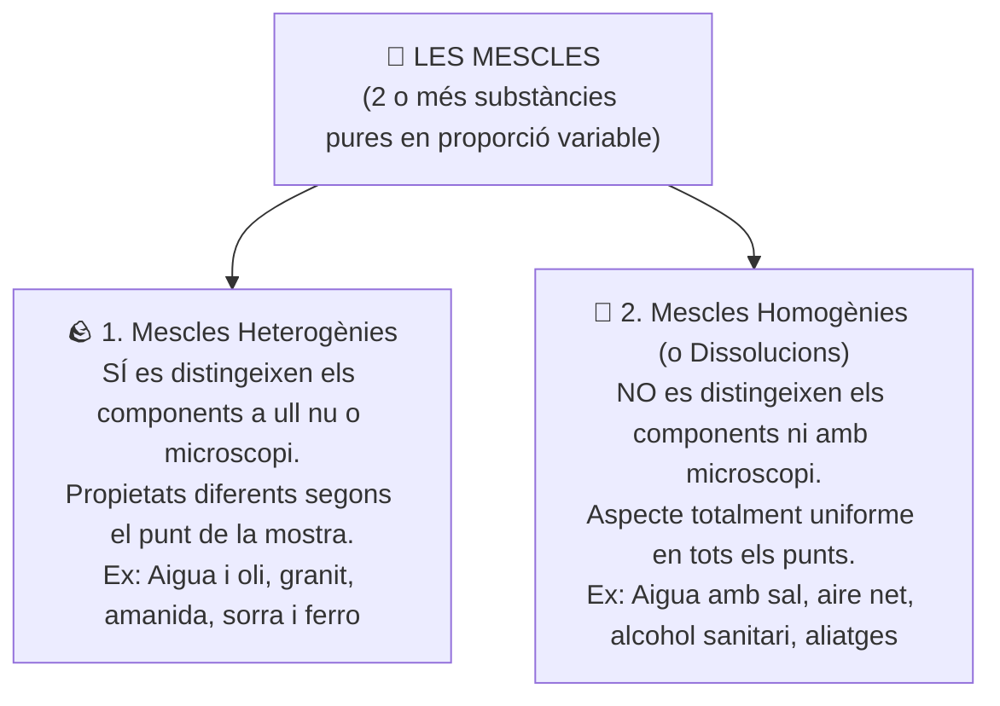

  

    ⚡ Progrés d'aprenentatge (2.7)
    0 / 12 reptes resolts
  

  

    

  

# 2.7 Classificació de la Matèria (II): Les Mescles

A la natura és molt difícil trobar substàncies completament pures. L'aigua que bevem de l'aixeta, l'aire que respirem, la sang de les nostres venes, el formigó d'un edifici o l'acer d'un tornavís són en realitat **mescles**.

Una **mescla** és un sistema material format per la **combinació de dues o més substàncies pures** en proporcions variables, on cada substància conserva la seua identitat química i es poden separar mitjançant procediments físics.

---

## 1. Tipus de Mescles: Heterogènies vs Homogènies (Dissolucions)

Segons si podem distingir o no els seus components a simple vista (o amb un microscopi òptic), dividim les mescles en dos grans grups:

### A) Mescles Heterogènies
Són aquelles en què **es poden distingir els diferents components** a simple vista o amb una lupa/microscopi, perquè no estan distribuïts de manera uniforme:
- **Exemples sòlids:** El **granit** (es veuen clarament grans grisos de quars, blancs o rosats de feldspat i làmines negres de mica), el formigó, una pizza o terra amb llimadures de ferro.
- **Exemples líquids (Suspensions i Emulsions):** Aigua amb oli, aigua amb arena en moviment o sucs de fruita amb polpa (si es deixen reposar, el sòlid sedimenta al fons).
- **Els Col·loides (Cas intermedi):** Mescles com la **llet**, la **maionesa**, la **boira**, l'escuma d'afaitar o la gelatina. A ull nu semblen homogènies, però amb un microscopi potent es veuen gotetes de greix o partícules flotant que dispersen la llum (**efecte Tyndall**, com quan els fars d'un cotxe il·luminen la boira).

---

## 2. Les Mescles Homogènies o Dissolucions

Una **mescla homogènia** o **dissolució** és aquella que té un aspecte i unes propietats totalment uniformes en qualsevol punt: **no es poden distingir els seus components ni amb el microscopi més potent**.

Tota dissolució consta com a mínim de dues parts:
1. **El Dissolvent:** És el component que es troba en **major proporció** i que sol determinar l'estat físic de la dissolució (el dissolvent més habitual a la Terra és l'**aigua**, anomenades *dissolucions aquoses*).
2. **El Solut (o soluts):** És el component o components que es troben en **menor proporció** i que es dispersen dins del dissolvent.

| Estat de la Dissolució | Dissolvent (Majoritari) | Solut (Minoritari) | Exemple Real Quotidià i de Taller |
| :--- | :--- | :--- | :--- |
| **Gasosa** | Nitrogen gasós ($78\%$) | Oxigen ($21\%$), Argó ($0{,}9\%$), $	ext{CO}_2$ | **L'aire pur i sec** que respirem a l'atmosfera. |
| **Líquida** | Aigua líquida | Sals minerals (clorur de sodi, magnesi) | **L'aigua de la mar** o el sèrum fisiològic. |
| **Líquida** | Aigua líquida | Gas diòxid de carboni ($	ext{CO}_2$) i sucre | **Un refresc amb gas** (les bombolles són el solut gasós). |
| **Sòlida (Aliatge)** | Ferro ($	ext{Fe}$, $>98\%$) | Carboni ($	ext{C}$, entre $0{,}1\%$ i $2\%$) | **L'acer** d'eines, xassís de PC i estructures. |
| **Sòlida (Aliatge)** | Coure ($	ext{Cu}$) | Estany ($	ext{Sn}$) o Zinc ($	ext{Zn}$) | **El bronze** ($	ext{Cu}+	ext{Sn}$) i **el llautó** ($	ext{Cu}+	ext{Zn}$). |

---

## 3. Els Aliatges Metàl·lics i la Concentració

### A) Què és un Aliatge?
Un **aliatge** és una **mescla homogènia (dissolució sòlida)** formada per dos o més elements químics, on almenys el majoritari és un **metall** (es fabriquen fonent els components en estat líquid, barrejant-los i deixant-los solidificar):
- **Acer:** Ferro + una petita proporció de Carboni (molt més dur i resistent que el ferro pur). Si s'hi afegeix crom ($	ext{Cr}$) i níquel ($	ext{Ni}$), s'obté l'**acer inoxidable** que no es rovella mai.
- **Estany de soldadura electrònica:** Aliatge d'estany ($	ext{Sn}$) amb una petita part d'argent ($	ext{Ag}$) i coure ($	ext{Cu}$) que es fon a baixa temperatura per unir components a les plaques base.

### B) Concentració d'una Dissolució
La **concentració** indica la quantitat de solut que hi ha dissolta en una quantitat determinada de dissolució:
- **Diluïda:** Té molt poca proporció de solut.
- **Concentrada:** Té una gran quantitat de solut.
- **Saturada:** Ja no admet més solut a eixa temperatura (si n'afegim més, cau al fons sense dissoldre's).

$$	ext{Concentració en g/L} = rac{	ext{Massa de solut (en grams)}}{	ext{Volum de dissolució (en litres)}}$$

---

> [!NOTE]
> ### 💡 Resum de Conceptes Clau
> - Una mescla està formada per dues o més substàncies pures en proporció variable.
> - **Heterogènia:** es distingeixen els components a ull nu o microscopi (granit, aigua i oli).
> - **Homogènia o Dissolució:** aspecte totalment uniforme; formada per **dissolvent** (majoritari) i **solut** (minoritari).
> - Els **aliatges** (acer, bronze, llautó) són dissolucions sòlides de metalls.

---

## 🎯 Activitats i Autoavaluació Interactiva

  

    🎮 <strong>Zona d'Entrenament FPB:</strong> 0 reptes resolts
    ⭐ 0 punts
  

  

### 1. Qüestionari d'Autoavaluació Tipus Test (MCQ)

  
<strong>1. Com es classifica químicament l'acer amb què es fabriquen els tornavisos i les carcasses dels ordinadors?</strong>

  

    <button type="button" class="btn-mcq-opt" data-opt="A">A) És un aliatge (mescla homogènia sòlida) format principalment per ferro i carboni</button>
    <button type="button" class="btn-mcq-opt" data-opt="B">B) És un element químic pur que té casella pròpia a la Taula Periòdica</button>
    <button type="button" class="btn-mcq-opt" data-opt="C">C) És una mescla heterogènia líquida</button>
    <button type="button" class="btn-mcq-opt" data-opt="D">D) És un gas noble del Grup 18</button>
  

  

  
<strong>2. Si dissolem 30 grams de sal (solut) en aigua fins a completar 2 litres de dissolució, quina és la seua concentració en g/L?</strong>

  

    <button type="button" class="btn-mcq-opt" data-opt="A">A) 60 g/L</button>
    <button type="button" class="btn-mcq-opt" data-opt="B">B) 32 g/L</button>
    <button type="button" class="btn-mcq-opt" data-opt="C">C) 15 g/L</button>
    <button type="button" class="btn-mcq-opt" data-opt="D">D) 0,5 g/L</button>
  

  

  
<strong>3. En un got d'aigua amb una cullerada de sucre totalment dissolta, quin component és el dissolvent i quin és el solut?</strong>

  

    <button type="button" class="btn-mcq-opt" data-opt="A">A) El sucre és el dissolvent i l'aigua és el solut</button>
    <button type="button" class="btn-mcq-opt" data-opt="B">B) L'aigua és el dissolvent (majoritari) i el sucre és el solut (minoritari)</button>
    <button type="button" class="btn-mcq-opt" data-opt="C">C) Tots dos són soluts i no hi ha dissolvent</button>
    <button type="button" class="btn-mcq-opt" data-opt="D">D) És una mescla heterogènia</button>
  

  

  
<strong>4. Quins elements metàl·lics formen l'aliatge anomenat bronze i l'aliatge anomenat llautó?</strong>

  

    <button type="button" class="btn-mcq-opt" data-opt="A">A) El bronze és coure + estany, i el llautó és coure + zinc</button>
    <button type="button" class="btn-mcq-opt" data-opt="B">B) Tots dos estan fets només de plàstic i vidre</button>
    <button type="button" class="btn-mcq-opt" data-opt="C">C) El bronze és aigua + sal</button>
    <button type="button" class="btn-mcq-opt" data-opt="D">D) El llautó és or pur sense barrejar</button>
  

  

---

### 2. Activitats de Vertader (V) o Fals (F)

  <strong>a) L'aire pur i sec que respirem és una dissolució gasosa on el nitrogen (78%) actua com a dissolvent i l'oxigen (21%) com a solut.</strong>
  

    <button type="button" class="btn-vf" data-opt="V">V</button>
    <button type="button" class="btn-vf" data-opt="F">F</button>
  

  

  <strong>b) Una roca de granit (on es veuen a ull nu cristalls blancs, grisos i negres) és un exemple perfecte de dissolució homogènia.</strong>
  

    <button type="button" class="btn-vf" data-opt="V">V</button>
    <button type="button" class="btn-vf" data-opt="F">F</button>
  

  

  <strong>c) La llet i la boira són col·loides: a simple vista semblen homogenis però tenen partícules microscòpiques en suspensió que dispersen la llum.</strong>
  

    <button type="button" class="btn-vf" data-opt="V">V</button>
    <button type="button" class="btn-vf" data-opt="F">F</button>
  

  

  <strong>d) Una dissolució saturada és aquella que té molt poca quantitat de solut i gairebé és aigua pura.</strong>
  

    <button type="button" class="btn-vf" data-opt="V">V</button>
    <button type="button" class="btn-vf" data-opt="F">F</button>
  

  

---

### 3. Exercicis de Resposta Breu i Vocabulari Tècnic

  
✍️ Com s'anomena el component que es troba en menor proporció dins d'una dissolució?

  

    <input type="text" class="quiz-input" placeholder="Escriu el terme...">
    <button type="button" class="btn-quiz-check">Comprovar</button>
  

  

  
✍️ Quin nom rep una mescla homogènia sòlida formada per dos o més elements on almenys el principal és un metall?

  

    <input type="text" class="quiz-input" placeholder="Escriu el terme...">
    <button type="button" class="btn-quiz-check">Comprovar</button>
  

  

  
✍️ Si dissolem 20 grams de sucre en aigua fins a tindre 0,5 litres de dissolució, quina és la concentració en g/L?

  

    <input type="text" class="quiz-input" placeholder="Escriu la teua resposta...">
    <button type="button" class="btn-quiz-check">Comprovar</button>
  

  

  
✍️ Com s'anomena el component majoritari d'una dissolució que acull i dispersa el solut?

  

    <input type="text" class="quiz-input" placeholder="Escriu la teua resposta...">
    <button type="button" class="btn-quiz-check">Comprovar</button>
  

  

---

### 4. Exercicis de Raonament i Desenvolupament Escrit (Tasca d'Aula)

  
✍️ <strong>Aigua destil·lada vs Aigua de l'aixeta en bateries i refrigeració líquida de PC:</strong> En els sistemes de refrigeració líquida d'ordinadors d'alt rendiment i en les bateries dels cotxes és obligatori utilitzar **aigua destil·lada** (substància pura $	ext{H}_2	ext{O}$) i està prohibit posar aigua de l'aixeta o aigua mineral. Explica quina és la diferència química entre l'aigua destil·lada i l'aigua de l'aixeta, i per què l'aigua de l'aixeta provocaria curtcircuits i incrustacions de calç si hi haguera una fuita sobre la placa base.

  <textarea class="open-response-input" rows="4" placeholder="Explica que l'aigua de l'aixeta és una dissolució que conté sals minerals i ions conductors..."></textarea>

  
✍️ <strong>Exercici 2 (Càlcul de concentració d'alcohol desinfectant):</strong> Preparem al laboratori 2 litres de solució netejadora barrejant aigua amb 160 grams d'alcohol isopropílic. 1) Indica quin és el solut i quin el dissolvent. 2) Calcula la concentració en g/L. 3) Si omplim un pot menut de 0,25 L amb aquesta mescla, quina concentració tindrà el pot menut?

  <textarea class="open-response-input" rows="4" placeholder="1) Solut i dissolvent... 2) C = 160 g / 2 L = ... 3) La concentració és una propietat intensiva..."></textarea>

  
✍️ <strong>Exercici 3 (Per què s'utilitzen aliatges en compte de metalls purs?):</strong> El ferro pur és relativament tou i es rovella amb molta facilitat, i l'or pur de 24 quirats és tan tou que es deforma amb els dits. Explica com es resol aquest problema en metal·lúrgia i joieria mitjançant els aliatges (com l'acer inoxidable o l'or de 18 quirats).

  <textarea class="open-response-input" rows="4" placeholder="Explica que en afegir carboni, crom i níquel al ferro (o coure i plata a l'or) es millora la duresa i resistència..."></textarea>

---

  <h3 style="margin-top:0; color:#0369a1;">📦 Lliurament d'Activitats d'Aules (Act 2.7)</h3>
  
Genera el teu document de tasca d'aquest apartat amb el teu nom i puntuació obtinguda.

  

    <input type="text" class="aules-student-name" placeholder="Cognoms, Nom de l'Alumne/a" style="padding:8px 12px; border:1px solid #94a3b8; border-radius:4px; flex-grow:1; min-width:240px;">
    <button class="btn-generate-aules-pdf" data-unit="NAT02" data-activity="Act07" data-module="CA" style="padding:8px 16px; background:#0284c7; color:#fff; border:none; border-radius:4px; font-weight:600; cursor:pointer;">📄 Descarregar PDF per a Aules</button>
  

