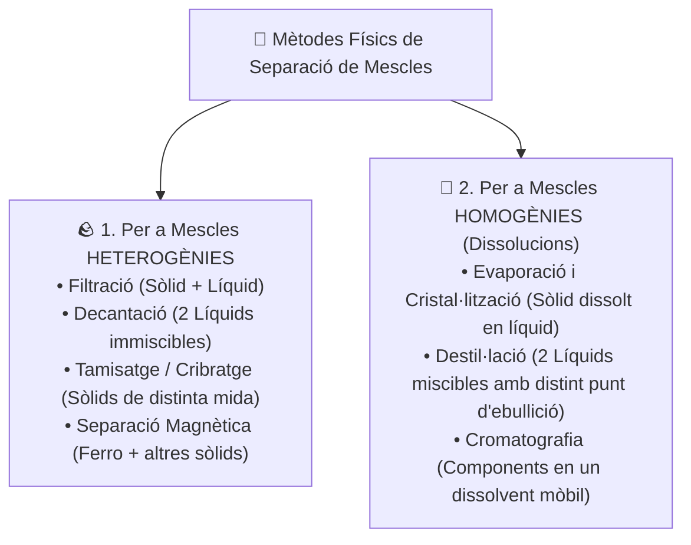

  

    ⚡ Progrés d'aprenentatge (2.8)
    0 / 12 reptes resolts
  

  

    

  

# 2.8 Mètodes de Separació de Mescles

Una de les principals característiques de totes les mescles (tant les heterogènies com les dissolucions homogènies) és que els seus components **es poden separar utilitzant mètodes físics** que aprofiten les diferències en les seues propietats específiques (mida de gra, densitat, magnetisme, solubilitat o punt d'ebullició), sense alterar la naturalesa química de cap substància.

---

## 1. Esquema General de Tècniques de Separació

L'elecció del mètode depèn de si la mescla és **heterogènia** o **homogènia**:

---

## 2. Separació de Mescles Heterogènies

1. **Tamisatge (o Cribratge):**
   - **Per a què serveix:** Separar dos o més **sòlids amb partícules de diferent grandària** (per exemple, grava i arena fina en construcció, o farina i segó).
   - **Propietat física que aprofita:** La diferència de **mida o diàmetre** de les partícules, fent-les passar per una malla o sedàs (**tamís**).
2. **Separació Magnètica (o Imantació):**
   - **Per a què serveix:** Separar una mescla de sòlids quan un d'ells té propietats magnètiques (conté **ferro $	ext{Fe}$**, níquel o cobalt).
   - **Aplicació al taller i reciclatge:** A les plantes de reciclatge de residus electrònics (RAEE) i fem, grans **electroimants** passen per damunt de la cinta transportadora i separen automàticament tots els cargols, xapes d'acer i llaunes de ferro de la resta de plàstics, coure i vidre.
3. **Filtració:**
   - **Per a què serveix:** Separar un **sòlid insoluble** barrejat amb un **líquid** (com aigua amb arena o el cafè mòlt de l'aigua) o partícules de pols suspeses en l'aire.
   - **Com funciona:** Es fa passar la mescla per un medi porós (**paper de filtre** en un embut, colador o filtre antipols dels ventiladors d'un PC): el líquid o l'aire travessa els porus i el sòlid queda retingut al filtre.
4. **Decantació (amb Embut de Decantació):**
   - **Per a què serveix:** Separar **dos líquids immiscibles** (que no es barregen entre si) i que tenen **diferent densitat**, com l'**aigua ($d = 1{,}00	ext{ g/cm}^3$) i l'oli ($d = 0{,}92	ext{ g/cm}^3$)** o aigua i gasolina.
   - **Com funciona:** Es posa la mescla en un **embut de decantació** amb clau a la base i es deixa reposar. El líquid més dens (l'aigua) baixa al fons i el menys dens (l'oli) queda a dalt. S'obre la clau inferior per recollir l'aigua en un vas i es tanca just quan arriba la frontera de l'oli.

---

## 3. Separació de Mescles Homogènies (Dissolucions)

En una dissolució (com l'aigua salada o l'aigua amb alcohol), el solut travessa qualsevol filtre perquè està dissolt a escala molecular. Cal utilitzar canvis d'estat:

| Tècnica Homogènia | Què separa? | Propietat que aprofita | Procediment i Aplicacions |
| :--- | :--- | :--- | :--- |
| **1. Evaporació i Cristal·lització** | Un **sòlid dissolt en un líquid** (ex: sal dissolta en aigua de mar). | El dissolvent líquid s'evapora però el sòlid no. | Es deixa evaporar l'aigua en un cristal·litzador (o al sol a les **salines marines**). Quan l'aigua s'evapora, el solut precipita al fons formant **cristalls sòlids purs** de sal. |
| **2. Destil·lació Simple** | **Dos líquids miscibles** (ex: aigua + alcohol) o recuperar l'aigua pura d'una dissolució salina. | La diferència en el **punt d'ebullició ($T_e$)** de cada líquid. | S'escalfa la mescla en un matràs: l'alcohol bull primer ($78^\circ	ext{C}$) abans que l'aigua ($100^\circ	ext{C}$). El vapor d'alcohol puja i passa per un tub fred (**refrigerant**), on es **condensa** i es recull pur en un altre recipient. |
| **3. Cromatografia** | Mescles complexes amb molts pigments o substàncies en poca quantitat (ex: tinta negra o clorofil·la). | La diferent **velocitat d'arrossegament** de cada component per un dissolvent sobre un suport porós. | Si posem un punt de retolador negre en una tira de paper de filtre amb la punta mullada en alcohol, l'alcohol puja per capil·laritat i separa la tinta negra en bandes de color blau, groc i magenta. |

---

> [!NOTE]
> ### 💡 Resum de Conceptes Clau
> - **Mescles heterogènies:** es separen per **filtració** (sòlid + líquid), **decantació** (2 líquids de distinta densitat com aigua i oli), **tamisatge** (sòlids de distinta mida) i **imantació** (ferro).
> - **Dissolucions homogènies:** es separen per **cristal·lització** (evaporar el líquid per obtindre el sòlid dissolt), **destil·lació** (bullir i condensar dos líquids amb diferent temperatura d'ebullició) i **cromatografia**.

---

## 🎯 Activitats i Autoavaluació Interactiva

  

    🎮 <strong>Zona d'Entrenament FPB:</strong> 0 reptes resolts
    ⭐ 0 punts
  

  

### 1. Qüestionari d'Autoavaluació Tipus Test (MCQ)

  
<strong>1. Quin mètode i instrument utilitzaries al laboratori per separar una mescla heterogènia d'aigua i oli d'oliva?</strong>

  

    <button type="button" class="btn-mcq-opt" data-opt="A">A) Passar-la per un paper de filtre normal</button>
    <button type="button" class="btn-mcq-opt" data-opt="B">B) Decantació utilitzant un embut de decantació amb clau</button>
    <button type="button" class="btn-mcq-opt" data-opt="C">C) Separació magnètica amb un imant potent</button>
    <button type="button" class="btn-mcq-opt" data-opt="D">D) Tamisatge amb un sedàs metàl·lic</button>
  

  

  
<strong>2. Quina tècnica permet separar una dissolució homogènia d'aigua (Te = 100 °C) i alcohol etílic (Te = 78 °C) aprofitant que bullen a temperatures diferents?</strong>

  

    <button type="button" class="btn-mcq-opt" data-opt="A">A) Filtració amb embut</button>
    <button type="button" class="btn-mcq-opt" data-opt="B">B) Cribratge</button>
    <button type="button" class="btn-mcq-opt" data-opt="C">C) Imantació</button>
    <button type="button" class="btn-mcq-opt" data-opt="D">D) Destil·lació</button>
  

  

  
<strong>3. En quin principi físic es basa el filtre d'aire de la caixa d'un ordinador o la mascareta FFP2 d'un operari de taller?</strong>

  

    <button type="button" class="btn-mcq-opt" data-opt="A">A) En la destil·lació per ebullició</button>
    <button type="button" class="btn-mcq-opt" data-opt="B">B) En la filtració mecànica: deixa passar el gas (aire) pels porus però reté les partícules sòlides de pols</button>
    <button type="button" class="btn-mcq-opt" data-opt="C">C) En la decantació de líquids</button>
    <button type="button" class="btn-mcq-opt" data-opt="D">D) En l'electròlisi química</button>
  

  

  
<strong>4. Quin mètode s'utilitza en una planta de reciclatge de residus informàtics per separar ràpidament els cargols i xapes d'acer de les carcasses de plàstic?</strong>

  

    <button type="button" class="btn-mcq-opt" data-opt="A">A) Cromatografia en paper</button>
    <button type="button" class="btn-mcq-opt" data-opt="B">B) Cristal·lització al sol</button>
    <button type="button" class="btn-mcq-opt" data-opt="C">C) Separació magnètica amb electroimants</button>
    <button type="button" class="btn-mcq-opt" data-opt="D">D) Destil·lació simple</button>
  

  

---

### 2. Activitats de Vertader (V) o Fals (F)

  <strong>a) Si fem passar aigua de mar (aigua amb sal dissolta) per un paper de filtre, la sal es queda retinguda al paper i per baix cau aigua dolça.</strong>
  

    <button type="button" class="btn-vf" data-opt="V">V</button>
    <button type="button" class="btn-vf" data-opt="F">F</button>
  

  

  <strong>b) A les salines com les de Santa Pola o Torrevella s'obté la sal marina a partir de l'aigua del mar mitjançant el mètode d'evaporació i cristal·lització.</strong>
  

    <button type="button" class="btn-vf" data-opt="V">V</button>
    <button type="button" class="btn-vf" data-opt="F">F</button>
  

  

  <strong>c) El tamisatge (o cribratge) permet separar dos sòlids amb grans de diferent mida, com grava grossa i arena fina.</strong>
  

    <button type="button" class="btn-vf" data-opt="V">V</button>
    <button type="button" class="btn-vf" data-opt="F">F</button>
  

  

  <strong>d) Per separar aigua i gasolina es pot utilitzar un embut de decantació perquè són dos líquids immiscibles de diferent densitat.</strong>
  

    <button type="button" class="btn-vf" data-opt="V">V</button>
    <button type="button" class="btn-vf" data-opt="F">F</button>
  

  

---

### 3. Exercicis de Resposta Breu i Vocabulari Tècnic

  
✍️ Com s'anomena la tècnica utilitzada per separar un sòlid insoluble (com l'arena) barrejat amb aigua fent servir un medi porós?

  

    <input type="text" class="quiz-input" placeholder="Escriu la tècnica...">
    <button type="button" class="btn-quiz-check">Comprovar</button>
  

  

  
✍️ Quin mètode físic permet separar i descobrir els diferents colors que formen una tinta negra segons la velocitat amb què pugen per un paper porós?

  

    <input type="text" class="quiz-input" placeholder="Escriu el mètode...">
    <button type="button" class="btn-quiz-check">Comprovar</button>
  

  

  
✍️ Com s'anomena l'instrument de vidre amb una clau de pas a la part inferior que s'utilitza per separar l'oli de l'aigua?

  

    <input type="text" class="quiz-input" placeholder="Escriu la teua resposta...">
    <button type="button" class="btn-quiz-check">Comprovar</button>
  

  

  
✍️ Quin mètode físic s'empra a la indústria petroquímica per separar el petroli cru en gasolina, querosè, gasoil i asfalt segons els seus punts d'ebullició?

  

    <input type="text" class="quiz-input" placeholder="Escriu la teua resposta...">
    <button type="button" class="btn-quiz-check">Comprovar</button>
  

  

---

### 4. Exercicis de Raonament i Desenvolupament Escrit (Tasca d'Aula)

  
✍️ <strong>Repte de separació en 3 passos al taller:</strong> Per accident s'ha bolcat al banc de treball un pot que ara conté una mescla de **cargols menuts de ferro**, **serradures d'arena de quars** (insoluble en aigua) i **sal comuna en pols** (soluble en aigua). Explica pas a pas, en ordre lògic (Pas 1, Pas 2 i Pas 3), quines tres tècniques de separació aplicaries per recuperar els cargols de ferro, l'arena i la sal totalment separats.

  <textarea class="open-response-input" rows="4" placeholder="Pas 1 (per traure els cargols de ferro): ... Pas 2 (afegir aigua i separar l'arena): ... Pas 3 (recuperar la sal de l'aigua): ..."></textarea>

  
✍️ <strong>Exercici 2 (Disseny d'un protocol de descontaminació d'aigua):</strong> Arriba a una depuradora aigua bruta d'un taller que conté: 1) Trossos grossos de plàstic, 2) Una capa superior d'oli de motor, 3) Fang fi en suspensió i 4) Sals dissoltes. Indica quina tècnica de separació s'ha d'aplicar en cada fase per deixar l'aigua completament pura.

  <textarea class="open-response-input" rows="4" placeholder="1) Reixes/Tamisatge per als plàstics; 2) Decantació per a l'oli; 3) Filtració per al fang; 4) Destil·lació/Osmosi per a les sals..."></textarea>

  
✍️ <strong>Exercici 3 (Pràctica casolana de cromatografia):</strong> Explica com faries a classe un experiment de cromatografia amb una tira de paper de filtre, un retolador negre i un got amb un dit d'alcohol, i què observaries al cap de 10 minuts.

  <textarea class="open-response-input" rows="4" placeholder="Descriu el muntatge i com l'alcohol puja pel paper arrossegant els pigments de diferents colors a distinta velocitat..."></textarea>

---

  <h3 style="margin-top:0; color:#0369a1;">📦 Lliurament d'Activitats d'Aules (Act 2.8)</h3>
  
Genera el teu document de tasca d'aquest apartat amb el teu nom i puntuació obtinguda.

  

    <input type="text" class="aules-student-name" placeholder="Cognoms, Nom de l'Alumne/a" style="padding:8px 12px; border:1px solid #94a3b8; border-radius:4px; flex-grow:1; min-width:240px;">
    <button class="btn-generate-aules-pdf" data-unit="NAT02" data-activity="Act08" data-module="CA" style="padding:8px 16px; background:#0284c7; color:#fff; border:none; border-radius:4px; font-weight:600; cursor:pointer;">📄 Descarregar PDF per a Aules</button>
  

