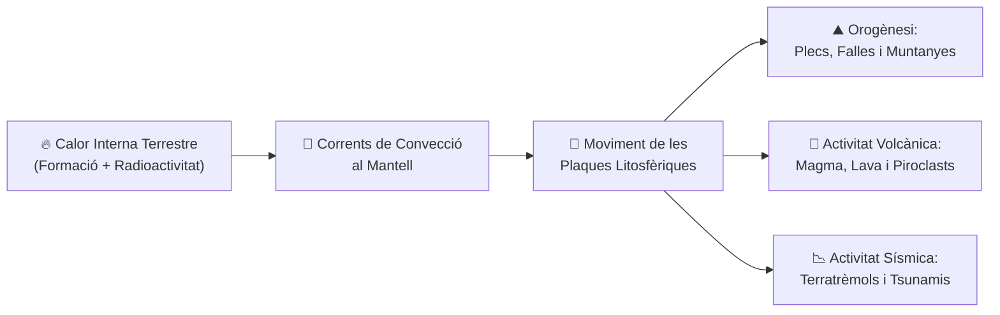

# UD3: Energia Interna del Planeta (Geologia i Dinàmica Terrestre)

  

    

      PDI · Pissarra Digital
      🌋 Geodinàmica Interna: Capes de la Terra, Tectònica, Volcans i Sismes
    

    
Explora els processos geològics interns del nostre planeta amb esquemes visuals, taules comparatives i activitats interactives autocorregibles.

  

  <a href="./nat0301.html" style="background: linear-gradient(135deg, #ea580c, #dc2626); color: #fff !important; font-weight: 800; padding: 10px 18px; border-radius: 10px; text-decoration: none !important; box-shadow: 0 4px 12px rgba(234, 88, 12, 0.3); display: inline-flex; align-items: center; gap: 6px;">
    🚀 Començar UD3
    →
  </a>

Benvingut/da a la **Unitat Didàctica 3** de Ciències Aplicades I (bloc de Geologia i Ciències de la Terra). El nostre planeta no és una roca freda i immòbil: sota els nostres peus batega un motor tèrmic gegantí que mou continents, alça serralades com els Pirineus o l'Himàlaia, fa entrar en erupció volcans com el de La Palma i provoca terratrèmols.

Aquesta unitat està estructurada en **4 sessions didàctiques (1 sessió = 1 apartat del llibre oficial)**, cadascuna amb el seu desenvolupament teòric complet, esquemes conceptuals i bateria d'activitats interactives amb generació d'informe PDF per a Aules.

---

## 📑 Planificació de Subunitats Didàctiques (1 Sessió per Apartat)

| Sessió | Subunitat | Contingut Principal de la Sessió | Bateria d'Activitats | Enllaç Directe |
| :---: | :---: | :--- | :---: | :---: |
| **Sessió 1** | **3.1** | **Energia interna del nostre planeta:** Origen de la calor interna, gradient geotèrmic, capes de la Terra (escorça, mantell, nucli) i corrents de convecció. | MCQ, V/F, Vocabulari, Raonament i Aules | [**📖 Anar a la Sessió 3.1 →**](./nat0301.html) |
| **Sessió 2** | **3.2** | **Formació de muntanyes:** Tectònica de plaques, vores divergents/convergents/transformants, plecs (anticlinal/sinclinal), falles i orogènesi. | MCQ, V/F, Vocabulari, Raonament i Aules | [**📖 Anar a la Sessió 3.2 →**](./nat0302.html) |
| **Sessió 3** | **3.3** | **Els volcans:** Magma vs lava, parts d'un volcà, productes volcànics (gasos, piroclasts i colades), tipus d'erupcions i risc volcànic. | MCQ, V/F, Vocabulari, Raonament i Aules | [**📖 Anar a la Sessió 3.3 →**](./nat0303.html) |
| **Sessió 4** | **3.4** | **Els terratrèmols:** Hipocentre i epicentre, ones sísmiques, sismògraf, magnitud (Richter) vs intensitat (EMS/Mercalli), tsunamis i autoprotecció. | MCQ, V/F, Vocabulari, Raonament i Aules | [**📖 Anar a la Sessió 3.4 →**](./nat0304.html) |

---

## 🧭 Esquema Global de la Unitat 3

---

> [!NOTE]
> ### 🎯 Objectius d'Aprenentatge de la UD3
> 1. Comprendre d'on prové la calor de l'interior de la Terra i com es distribueixen les seues capes concèntriques (escorça, mantell i nucli).
> 2. Explicar el moviment de les plaques tectòniques impulsat pels corrents de convecció i relacionar-lo amb la formació de serralades, plecs i falles.
> 3. Identificar l'anatomia d'un volcà, distingir entre magma, lava i piroclasts (cendres, lapil·li i bombes) i valorar els beneficis i riscos volcànics.
> 4. Diferenciar hipocentre i epicentre, així com magnitud (Richter) i intensitat (Mercalli/EMS), aplicant els protocols de seguretat i autoprotecció davant d'un sisme al centre educatiu o al taller.
