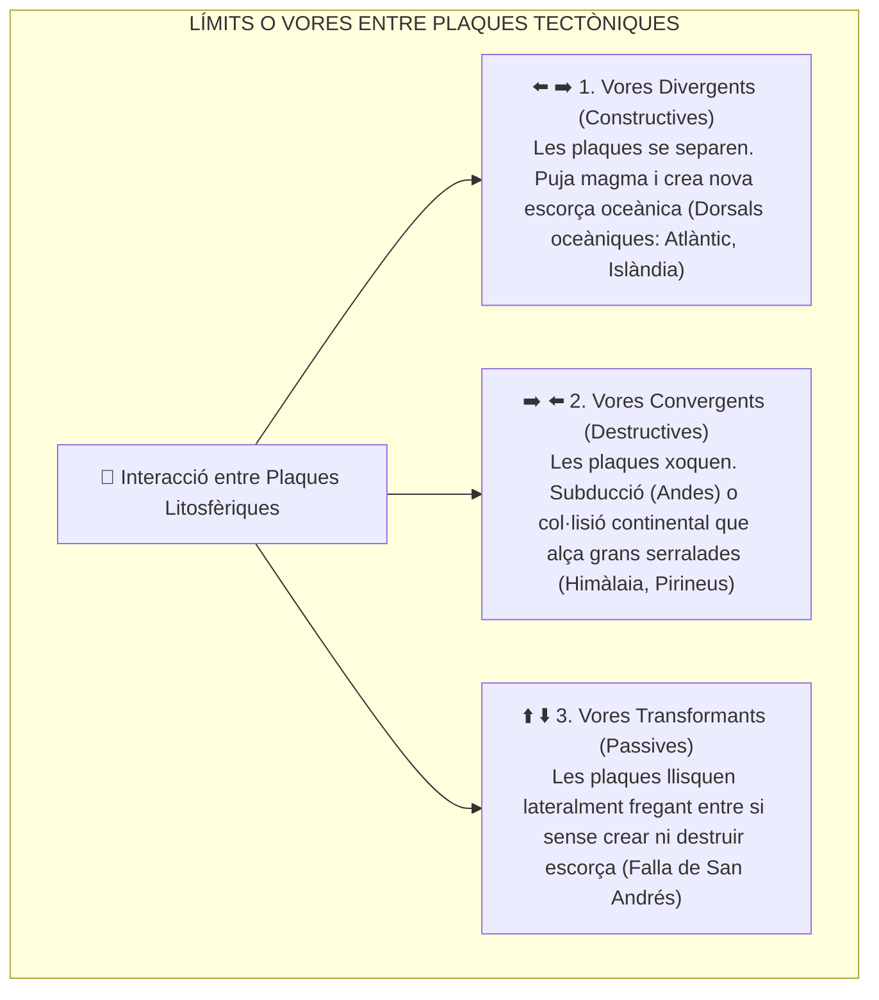
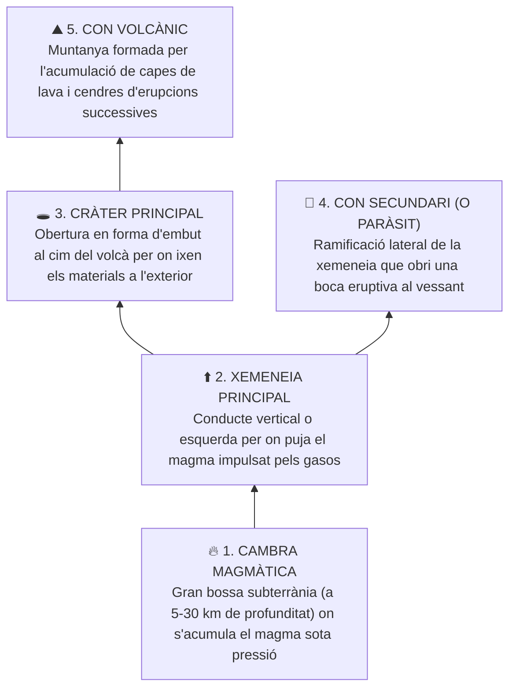
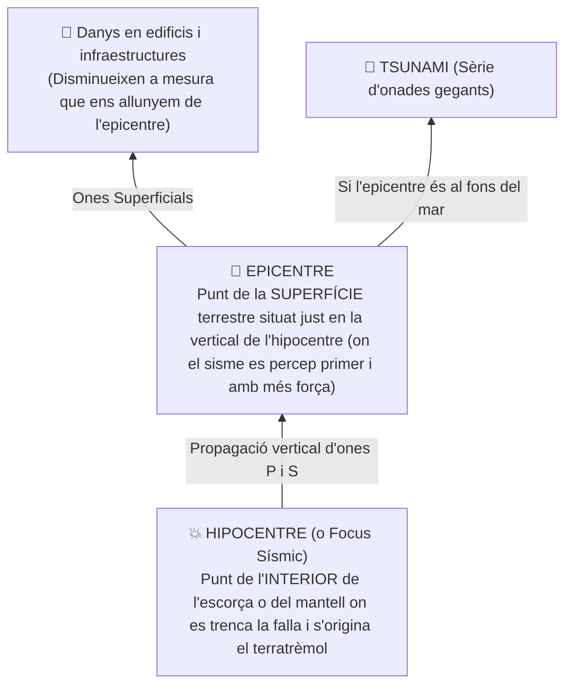

# 🔬 UD3: Energia Interna del Planeta — Temari Complet i Exercicis Diaris per a Aules

En aquesta pàgina tens tant l'**accés directe a cada sessió diària individual** (amb els seus **15 exercicis diaris** i el seu **botó de descàrrega de PDF per a pujar a Aules cada dia**) com la **vista completa de tota la unitat** amb tots els apartats i el **Butlletí Global d'Activitats Finals de la Unitat**.

---

## 📑 Planificació Diària de Sessions i Tasques d'Aules (UD3)

| Sessió | Apartat del Temari Oficial | Tasca Diària per a Aules | Accés Directe |
| :---: | :--- | :---: | :---: |
| **3.1** | **3.1 Energia interna del nostre planeta** | 15 Exercicis Diaris + PDF Aules | [**📖 Teoria + 🎯 15 Exercicis →**](./nat0301.html) · [**🎯 Anar a Exercicis →**](./nat0301.html#activitats) |
| **3.2** | **3.2 Formació de muntanyes** | 15 Exercicis Diaris + PDF Aules | [**📖 Teoria + 🎯 15 Exercicis →**](./nat0302.html) · [**🎯 Anar a Exercicis →**](./nat0302.html#activitats) |
| **3.3** | **3.3 Els volcans** | 15 Exercicis Diaris + PDF Aules | [**📖 Teoria + 🎯 15 Exercicis →**](./nat0303.html) · [**🎯 Anar a Exercicis →**](./nat0303.html#activitats) |
| **3.4** | **3.4 Els terratrèmols** | 15 Exercicis Diaris + PDF Aules | [**📖 Teoria + 🎯 15 Exercicis →**](./nat0304.html) · [**🎯 Anar a Exercicis →**](./nat0304.html#activitats) |
| **** | **📝 3.5 Activitats Finals i Tasca Global de la Unitat 3 (Aules)** | 21 Exercicis Globals + PDF Aules | [**📝 Fer Tasca Global UD →**](./nat0305.html) · [**🎯 Anar a Exercicis →**](./nat0305.html#activitats) |

---

<div class="interactive-progress-tracker" style="background:var(--bg-card); border:1px solid var(--border); border-radius:8px; padding:16px; margin:20px 0;">
  <div style="display:flex; justify-content:space-between; align-items:center;">
    <span style="font-weight:700; color:var(--text-color);">⚡ Progrés d'aprenentatge (3.1)</span>
    <span class="tracker-count" style="font-weight:700; color:#2563eb;">0 / 12 reptes resolts</span>
  </div>
  <div style="background:#e2e8f0; border-radius:999px; height:8px; overflow:hidden; margin-top:10px;">
    <div class="tracker-fill" style="background:#2563eb; width:0%; height:100%; transition:width 0.3s ease;"></div>
  </div>
</div>

## 📌 3.1 Energia interna del nostre planeta {#nat0301}

Quan caminem pel carrer o treballem al taller, el sòl que trepitgem ens sembla fred, rígid i totalment estable. Tanmateix, sota la fina capa superficial de roca sòlida, l'interior del planeta Terra emmagatzema una quantitat colossal d'**energia tèrmica**. Aquesta calor interna és el veritable motor geològic del nostre planeta: mou els continents, provoca les erupcions volcàniques, desencadena els terratrèmols i fins i tot genera l'escut magnètic que ens protegeix de les radiacions espacials.

---

## 1. D'on prové la calor interna de la Terra?

El nucli de la Terra assoleix temperatures pròximes als **5.500 °C - 6.000 °C**, una temperatura semblant a la de la superfície del Sol. Aquesta energia tèrmica té dos orígens fonamentals:

1. **Calor remanent de la formació del planeta (calor primordial):** Fa uns 4.500 milions d'anys, la Terra es va formar per l'**acreció** (xoc i fusió violenta) de milions de meteorits, asteroides i pols còsmica. L'energia cinètica d'aquests impactes gegantins es va transformar en calor, fonent el planeta jove. A més, quan el ferro pesant es va enfonsar cap al centre per formar el nucli, el fregament gravitatori va alliberar encara més calor. Com que les roques de l'escorça actuen com un bon aïllant tèrmic, l'interior encara conserva gran part d'aquella calor original.
2. **Desintegració d'elements radioactius:** Al mantell i a l'escorça terrestre hi ha isòtops inestables d'elements pesants com l'**urani (U)**, el **tori (Th)** i el **potassi radioactiu (K)**. Quan aquests àtoms es desintegren espontàniament, alliberen partícules i radiació que es transformen contínuament en calor, mantenint encès el motor terrestre.

### El Gradient Geotèrmic
Si baixem per una mina subterrània molt profunda (com les mines d'or de Sud-àfrica, que arriben a gairebé 4 km de profunditat) o perforem un pou geològic, comprovem que la temperatura puja de manera constant a mesura que aprofundim. S'anomena **gradient geotèrmic** la variació de temperatura amb la profunditat a l'escorça terrestre:

$$\text{Gradient geotèrmic mitjà} \approx +3^\circ\text{C per cada } 100\text{ m de profunditat } (+30^\circ\text{C per cada } 1\text{ km})$$

### Exemple Pràctic de Càlcul del Gradient Geotèrmic
Imagina que a la superfície d'una explotació minera la temperatura és de 20 °C i volem saber a quina temperatura estaran les roques a 2.000 m (2 km) de profunditat:
1. Calculem quants trams de 100 m hi ha en 2.000 m:
$$\frac{2.000\text{ m}}{100\text{ m}} = 20\text{ trams}$$
2. Multipliquem per $+3 °C$ cada tram:
$$\Delta T = 20 \times 3 °C = +60 °C\text{ d'augment}$$
3. Sumem la temperatura superficial:
$$T_{\text{final}} = 20 °C + 60 °C = \mathbf{80 °C}$$
*(Per això a les mines profundes cal bombar aire refrigerat contínuament perquè els miners puguen treballar!)*

> **Nota:** Aquest ritme d'augment de $+30^\circ\text{C/km}$ es manté només en els primers quilòmetres de l'escorça; a major profunditat (al mantell i al nucli), l'augment és molt més suau, ja que si continuara pujant a $30^\circ\text{C/km}$ fins al centre de la Terra (6.371 km), el nucli superaria els 190.000 °C, cosa que no passa.

---

## 2. L'Estructura Interna de la Terra: Les Tres Capes

L'interior de la Terra s'organitza en **tres capes concèntriques** ordenades per densitat (els materials més lleugers van pujar cap a la superfície i els metalls més pesants es van enfonsar cap al centre):

```mermaid
flowchart TD
  subgraph ESTRUCTURA INTERNA DE LA TERRA (Radi: 6.371 km)
    A["🌍 1. ESCORÇA (0 a 70 km)
Capa superficial fina, rígida i freda de roques silicatades"] --> B["🔥 2. MANTELL (70 a 2.900 km)
Capa intermèdia de roca densa (peridotita) amb corrents de convecció"]
    B --> C["🌊 3A. NUCLI EXTERN (2.900 a 5.150 km)
Ferro i níquel LÍQUIDS en moviment (genera el camp magnètic)"]
    C --> D["⚙️ 3B. NUCLI INTERN (5.150 a 6.371 km)
Esfera SÒLIDA de ferro i níquel a ~6.000 °C per l'enorme pressió"]
  end
```

### 1. L'Escorça (de 0 km a 70 km)
És la capa més superficial, fina i freda del planeta (comparada amb la resta del planeta, és tan fina com la pell d'una poma). Es divideix en dos tipus ben diferenciats:
- **Escorça continental:** Forma els continents i les grans serralades. Té un gruix d'entre **30 km i 70 km**. Està composta principalment per roques lleugeres com el **granit** (riques en silici i alumini) i és molt antiga (algunes roques tenen fins a 4.000 milions d'anys).
- **Escorça oceànica:** Forma el fons dels oceans. És molt més prima, d'entre **5 km i 10 km** de gruix, però més densa i pesant, formada per roques volcàniques fosques com el **basalt** i el gabre. És molt més jove (menys de 200 milions d'anys) perquè es renova contínuament a les dorsals oceàniques.

### 2. El Mantell (de 70 km a 2.900 km)
Separada de l'escorça per la *discontinuïtat de Mohorovičić*, representa prop del **84% del volum total** de la Terra. Està format per roques silicatades molt riques en ferro i magnesi, especialment la **peridotita**, amb temperatures d'entre 1.000 °C i 3.700 °C:
- **Mantell superior:** La seua part més alta s'uneix a l'escorça per formar la **litosfera** (rígida i fragmentada en plaques). Just a sota es troba l'**astenosfera**, on les roques estan a temperatures tan altes que tenen un comportament plàstic i deformable.
- **Mantell inferior:** Sotmès a pressions altíssimes, és més dens però continua experimentant moviments lents de convecció.

### 3. El Nucli (de 2.900 km a 6.371 km)
Separada del mantell per la *discontinuïtat de Gutenberg*, és l'esfera central i més densa del planeta, composta per un aliatge metàl·lic de **ferro (Fe, $\sim 85\%$) i níquel (Ni, $\sim 10\%$)**. Es divideix en:
- **Nucli extern (líquid):** De 2.900 km a 5.150 km. El ferro i el níquel estan **fosos** en estat líquid i s'agiten contínuament. Aquest moviment de metall líquid conductor actua com una dinamo gegant (**efecte geodinamo**) que genera el **camp magnètic terrestre (magnetosfera)**, indispensable per a orientar les brúixoles i desviar el vent solar letal.
- **Nucli intern (sòlid):** De 5.150 km fins al centre (6.371 km). Malgrat estar a gairebé **6.000 °C**, la pressió dels milers de quilòmetres de roca que té a sobre és tan immensa (més de $3{,}5\text{ milions d'atmosferes}$) que obliga els àtoms de ferro a mantenir-se empaquetats en **estat sòlid**.

### Taula Comparativa de les Capes de la Terra

| Capa Terrestre | Profunditat Aproximada | Estat Físic i Materials Principals | Temperatura Mitjana | Funció Geològica Clau |
| :--- | :---: | :--- | :---: | :--- |
| **Escorça (Continental / Oceànica)** | $0 - 70\text{ km}$ | Sòlid rígid (Granit als continents, Basalt als oceans) | 0 °C a 800 °C | Suport de la biosfera i dels continents |
| **Mantell (Superior i Inferior)** | $70 - 2.900\text{ km}$ | Sòlid plàstic deformable (Peridotita rica en Fe i Mg) | 1.000 °C a 3.700 °C | Genera els **corrents de convecció** que mouen les plaques |
| **Nucli Extern** | $2.900 - 5.150\text{ km}$ | **Líquid** metàl·lic en agitació (Ferro i Níquel fosos) | 3.700 °C a 5.000 °C | Crea el **camp magnètic terrestre** protector |
| **Nucli Intern** | $5.150 - 6.371\text{ km}$ | **Sòlid** metàl·lic ultra-comprimit (Ferro i Níquel) | $\sim 5.500 °C - 6.000 °C$ | Reserva tèrmica central del planeta |

---

## 3. Els Corrents de Convecció i les Manifestacions Externes

Com es transmet aquesta calor des del nucli fins a la superfície? De la mateixa manera que bull l'aigua dins d'una cassola al foc, al mantell terrestre es produeixen **corrents de convecció**:

1. Les roques profundes del mantell, en contacte amb el nucli calent, **s'escalfen, es dilaten i perden densitat**.
2. En ser més lleugeres, aquestes columnes de roca molt calenta **ascendeixen lentament** cap a la part superior del mantell.
3. Quan arriben sota l'escorça (litosfera), **es mouen lateralment arrossegant les plaques tectòniques** com si foren cintes transportadores gegants.
4. En refredar-se prop de la superfície, la roca augmenta la seua densitat i **torna a enfonsar-se** cap a les profunditats per tancar el cicle.

### Manifestacions Externes de la Calor Interna
Encara que no puguem viatjar al mantell, observem les proves directes d'aquesta energia interna en la superfície:
- **Aigües termals i balnearis:** Aigua subterrània que s'escalfa en passar prop de roques calentes i brolla a la superfície rica en minerals (com als banys termals de Montanejos a Castelló o Cofrents a València).
- **Gèisers:** Fonts termals volcàniques (com a Islàndia o al Parc Nacional de Yellowstone) que expulsen intermitentment columnes d'aigua bullent i vapor a gran altura quan l'aigua subterrània arriba als 100 °C sota pressió.
- **Fumaroles i solfatares:** Escapaments de vapor d'aigua i gasos sulfurosos per esquerdes volcàniques.
- **Volcans i terratrèmols:** Les manifestacions més violentes de l'alliberament d'energia tèrmica i mecànica de l'interior terrestre.

---

> [!TIP]
> ### 🔍 Aplicació Tecnològica: Climatització Geotèrmica i Energies Netes
> Gràcies al gradient geotèrmic i a la calor interna, en zones volcàniques com Islàndia o les Illes Canàries es perfora el sòl per aprofitar el vapor d'aigua subterrani i moure turbines elèctriques (**centrals geotèrmiques**). A més, en l'edificació moderna s'instal·len **bombes de calor geotèrmiques** que aprofiten que a pocs metres sota terra la temperatura és estable tot l'any per calefactar i refrigerar tallers i habitatges amb un estalvi elèctric de fins al 70%.

---

> [!NOTE]
> ### 💡 Resum de Conceptes Clau
> - La calor interna terrestre prové del **calor remanent de la formació del planeta** i de la **desintegració d'elements radioactius** ($\text{U}, \text{Th}, \text{K}$).
> - El **gradient geotèrmic** indica que la temperatura a l'escorça puja uns **$+3 °C$ cada 100 m** de profunditat.
> - La Terra es divideix en **escorça** (continental de granit i oceànica de basalt), **mantell** (on actuen els corrents de convecció) i **nucli** (de ferro i níquel: extern líquid que crea el camp magnètic i intern sòlid per l'alta pressió).

---

## 🎯 Activitats i Autoavaluació Interactiva

<div class="interactive-progress-tracker">
  <div class="tracker-header">
    <span>🎮 <strong>Zona d'Entrenament FPB:</strong> <span class="tracker-count">0 reptes resolts</span></span>
    <span class="tracker-pts">⭐ 0 punts</span>
  </div>
  <div class="tracker-bar"><div class="tracker-fill" style="width: 0%;"></div></div>
</div>

### 1. Qüestionari d'Autoavaluació Tipus Test (MCQ)

<div class="interactive-mcq" data-quiz-id="ca1_nat3_1_mcq1" data-answer="B" data-hint="El nucli extern està format per ferro i níquel fosos en moviment, fet que genera el camp magnètic terrestre.">
  <p class="mcq-question"><strong>1. Quina capa de l'interior de la Terra es troba en estat líquid i és la responsable de generar el camp magnètic terrestre que ens protegeix?</strong></p>
  <div class="mcq-options">
    <button type="button" class="btn-mcq-opt" data-opt="A">A) L'escorça continental de granit</button>
    <button type="button" class="btn-mcq-opt" data-opt="B">B) El nucli extern, format per ferro i níquel fosos en agitació</button>
    <button type="button" class="btn-mcq-opt" data-opt="C">C) El nucli intern, que està totalment líquid a baixa pressió</button>
    <button type="button" class="btn-mcq-opt" data-opt="D">D) L'atmosfera superior</button>
  </div>
  <div class="quiz-feedback"></div>
</div>

<div class="interactive-mcq" data-quiz-id="ca1_nat3_1_mcq2" data-answer="C" data-hint="El gradient geotèrmic és de +3 °C cada 100 m (+30 °C per cada 1.000 m = 1 km).">
  <p class="mcq-question"><strong>2. Si a la superfície d'una mina la temperatura és de 15 °C i el gradient geotèrmic és de $+3 °C$ cada 100 m, quina temperatura hi haurà a 500 m de profunditat?</strong></p>
  <div class="mcq-options">
    <button type="button" class="btn-mcq-opt" data-opt="A">A) 18 °C</button>
    <button type="button" class="btn-mcq-opt" data-opt="B">B) 500 °C</button>
    <button type="button" class="btn-mcq-opt" data-opt="C">C) 30 °C (perquè puja $5 \times 3 °C = 15 °C$ més sobre els 15 °C inicials)</button>
    <button type="button" class="btn-mcq-opt" data-opt="D">D) 0 °C</button>
  </div>
  <div class="quiz-feedback"></div>
</div>


<div class="interactive-mcq" data-quiz-id="ca1_nat3_1_mcq3" data-answer="B" data-hint="El moviment del ferro líquid al nucli extern actua com una dinamo que genera el camp magnètic terrestre.">
  <p class="mcq-question"><strong>3. Quina capa interna de la Terra està formada per ferro i níquel fosos en moviment i és la responsable de generar el camp magnètic protector del planeta?</strong></p>
  <div class="mcq-options">
    <button type="button" class="btn-mcq-opt" data-opt="A">A) L'escorça continental</button>
    <button type="button" class="btn-mcq-opt" data-opt="B">B) El nucli extern líquid</button>
    <button type="button" class="btn-mcq-opt" data-opt="C">C) La troposfera</button>
    <button type="button" class="btn-mcq-opt" data-opt="D">D) La litosfera superficial</button>
  </div>
  <div class="quiz-feedback"></div>
</div>

<div class="interactive-mcq" data-quiz-id="ca1_nat3_1_mcq4" data-answer="A" data-hint="Els corrents de convecció al mantell són el motor que desplaça les plaques litosfèriques.">
  <p class="mcq-question"><strong>4. Com s'anomena el mecanisme pel qual les roques molt calentes del mantell profund pugen cap a la litosfera i les més fredes baixen, movent les plaques tectòniques?</strong></p>
  <div class="mcq-options">
    <button type="button" class="btn-mcq-opt" data-opt="A">A) Corrents de convecció del mantell</button>
    <button type="button" class="btn-mcq-opt" data-opt="B">B) Erosió eòlica</button>
    <button type="button" class="btn-mcq-opt" data-opt="C">C) Fotosíntesi</button>
    <button type="button" class="btn-mcq-opt" data-opt="D">D) Destil·lació</button>
  </div>
  <div class="quiz-feedback"></div>
</div>
---

### 2. Activitats de Vertader (V) o Fals (F)

<div class="interactive-vf" data-quiz-id="ca1_nat3_1_vf1" data-answer="F" data-hint="FALS: L'escorça continental (30-70 km) és molt més gruixuda que l'escorça oceànica (5-10 km).">
  <span class="vf-statement"><strong>a) L'escorça oceànica és molt més gruixuda (fins a 70 km) que l'escorça continental dels continents.</strong></span>
  <div class="vf-buttons">
    <button type="button" class="btn-vf" data-opt="V">V</button>
    <button type="button" class="btn-vf" data-opt="F">F</button>
  </div>
  <div class="quiz-feedback"></div>
</div>

<div class="interactive-vf" data-quiz-id="ca1_nat3_1_vf2" data-answer="V" data-hint="VERTADER: Els corrents de convecció al mantell fan pujar el material calent i baixar el fred, arrossegant les plaques litosfèriques.">
  <span class="vf-statement"><strong>b) Els corrents de convecció del mantell terrestre funcionen perquè els materials més calents del fons perden densitat i pugen, mentre que els més freds s'enfonsen.</strong></span>
  <div class="vf-buttons">
    <button type="button" class="btn-vf" data-opt="V">V</button>
    <button type="button" class="btn-vf" data-opt="F">F</button>
  </div>
  <div class="quiz-feedback"></div>
</div>


<div class="interactive-vf" data-quiz-id="ca1_nat3_1_vf3" data-answer="V" data-hint="VERTADER: Això equival a uns 30 °C d'augment per cada quilòmetre que baixem a una mina.">
  <span class="vf-statement"><strong>c) El gradient geotèrmic a l'escorça superficial indica que la temperatura augmenta aproximadament 3 °C per cada 100 metres de profunditat.</strong></span>
  <div class="vf-buttons">
    <button type="button" class="btn-vf" data-opt="V">V</button>
    <button type="button" class="btn-vf" data-opt="F">F</button>
  </div>
  <div class="quiz-feedback"></div>
</div>

<div class="interactive-vf" data-quiz-id="ca1_nat3_1_vf4" data-answer="F" data-hint="FALS: És a l'inrevés: l'escorça continental és molt més gruixuda (30-70 km) que l'oceànica (6-10 km).">
  <span class="vf-statement"><strong>d) L'escorça oceànica és molt més gruixuda (70 km) que l'escorça continental (7 km).</strong></span>
  <div class="vf-buttons">
    <button type="button" class="btn-vf" data-opt="V">V</button>
    <button type="button" class="btn-vf" data-opt="F">F</button>
  </div>
  <div class="quiz-feedback"></div>
</div>
---

### 3. Exercicis de Resposta Breu i Vocabulari Tècnic

<div class="interactive-quiz" data-quiz-id="ca1_nat3_1_q1" data-answer="mantell|el mantell" data-hint="És la capa situada entre l'escorça i el nucli, fins als 2.900 km de profunditat.">
  <div class="quiz-question">✍️ Com s'anomena la capa intermèdia de la Terra (entre els 70 km i els 2.900 km de profunditat) que representa el 84% del volum del planeta i on tenen lloc els corrents de convecció?</div>
  <div class="quiz-controls">
    <input type="text" class="quiz-input" placeholder="Escriu el nom de la capa...">
    <button type="button" class="btn-quiz-check">Comprovar</button>
  </div>
  <div class="quiz-feedback"></div>
</div>

<div class="interactive-quiz" data-quiz-id="ca1_nat3_1_q2" data-answer="geiser|gèiser|geisers|gèisers" data-hint="Són sortides intermitents d'aigua bullent i vapor típiques de zones volcàniques com Islàndia.">
  <div class="quiz-question">✍️ Com s'anomena la font termal volcànica que expulsa de manera intermitent un brollador o columna d'aigua bullent i vapor a gran altura?</div>
  <div class="quiz-controls">
    <input type="text" class="quiz-input" placeholder="Escriu el terme geològic...">
    <button type="button" class="btn-quiz-check">Comprovar</button>
  </div>
  <div class="quiz-feedback"></div>
</div>


<div class="interactive-quiz" data-quiz-id="ca1_nat3_1_q3" data-answer="escorça|l'escorça|escorca" data-hint="És la capa exterior que envolta el mantell.">
  <div class="quiz-question">✍️ Quina és la capa més superficial, fina i rígida de la geosfera on vivim (dividida en continental i oceànica)?</div>
  <div class="quiz-controls">
    <input type="text" class="quiz-input" placeholder="Escriu la teua resposta...">
    <button type="button" class="btn-quiz-check">Comprovar</button>
  </div>
  <div class="quiz-feedback"></div>
</div>

<div class="interactive-quiz" data-quiz-id="ca1_nat3_1_q4" data-answer="32|32 °C|32°C" data-hint="400 m són 4 trams de 100 m -> 4 × 3 °C = 12 °C d'augment. 20 + 12 = 32 °C.">
  <div class="quiz-question">✍️ Si en superfície estem a 20 °C i el gradient geotèrmic és de +3 °C cada 100 m, a quina temperatura (°C) estarem a 400 metres de profunditat en una mina?</div>
  <div class="quiz-controls">
    <input type="text" class="quiz-input" placeholder="Escriu la teua resposta...">
    <button type="button" class="btn-quiz-check">Comprovar</button>
  </div>
  <div class="quiz-feedback"></div>
</div>
---

### 4. Exercicis de Raonament i Desenvolupament Escrit (Tasca d'Aula)

<div class="interactive-open-response" data-question-id="ca1_nat3_1_open1">
  <div class="open-question">✍️ <strong>El misteri del nucli intern:</strong> Explica amb les teues paraules per què el nucli intern de la Terra es troba en estat SÒLID tot i estar a gairebé 6.000 °C (més calent que el nucli extern que sí que està líquid), i quins dos metalls el componen principalment.</div>
  <textarea class="open-response-input" rows="4" placeholder="Escriu ací la teua explicació sobre els metalls del nucli i el paper de la pressió..."></textarea>
</div>


<div class="interactive-open-response" data-question-id="ca1_nat3_1_open2">
  <div class="open-question">✍️ <strong>Exercici 2 (Comparativa de les 3 capes de la Geosfera):</strong> Descriu les tres grans capes internes de la Terra (escorça, mantell i nucli) indicant de quins materials estan fetes, quin gruix tenen i quina temperatura assoleix el nucli.</div>
  <textarea class="open-response-input" rows="4" placeholder="Escorça: roques silicatades... Mantell: peridotites... Nucli: ferro i níquel a més de 5.000 °C..."></textarea>
</div>

<div class="interactive-open-response" data-question-id="ca1_nat3_1_open3">
  <div class="open-question">✍️ <strong>Exercici 3 (Aprofitament de l'energia geotèrmica):</strong> Explica com podem aprofitar la calor interna del nostre planeta (energia geotèrmica) per produir electricitat o calefacció en edificis, i posa dos exemples de manifestacions geotèrmiques naturals.</div>
  <textarea class="open-response-input" rows="4" placeholder="Explica la injecció d'aigua per generar vapor, les aigües termals i els geisers..."></textarea>
</div>
---

<div class="aules-delivery-card" style="border:2px dashed #0284c7; border-radius:8px; padding:16px; background:#f0f9ff; margin:24px 0;">
  <h3 style="margin-top:0; color:#0369a1;">📦 Lliurament d'Activitats d'Aules (Act 3.1)</h3>
  <p>Genera el teu document de tasca d'aquest apartat amb el teu nom i puntuació obtinguda.</p>
  <div style="display:flex; gap:12px; align-items:center; flex-wrap:wrap;">
    <input type="text" class="aules-student-name" placeholder="Cognoms, Nom de l'Alumne/a" style="padding:8px 12px; border:1px solid #94a3b8; border-radius:4px; flex-grow:1; min-width:240px;">
    <button class="btn-generate-aules-pdf" data-unit="NAT03" data-activity="Act01" data-module="CA" style="padding:8px 16px; background:#0284c7; color:#fff; border:none; border-radius:4px; font-weight:600; cursor:pointer;">📄 Descarregar PDF per a Aules</button>
  </div>
</div>


---

<div class="interactive-progress-tracker" style="background:var(--bg-card); border:1px solid var(--border); border-radius:8px; padding:16px; margin:20px 0;">
  <div style="display:flex; justify-content:space-between; align-items:center;">
    <span style="font-weight:700; color:var(--text-color);">⚡ Progrés d'aprenentatge (3.2)</span>
    <span class="tracker-count" style="font-weight:700; color:#2563eb;">0 / 12 reptes resolts</span>
  </div>
  <div style="background:#e2e8f0; border-radius:999px; height:8px; overflow:hidden; margin-top:10px;">
    <div class="tracker-fill" style="background:#2563eb; width:0%; height:100%; transition:width 0.3s ease;"></div>
  </div>
</div>

## 📌 3.2 Formació de muntanyes {#nat0302}

Com és possible que al cim de l'Everest (a 8.848 m d'altitud) o als cims dels Pirineus i del Maestrat es troben fòssils d'animals marins que vivien al fons del mar fa milions d'anys? La resposta es troba en la **Tectònica de Plaques**: la superfície terrestre està dividida en grans blocs que xoquen lentament entre si amb una força titànica, plegant, trencant i alçant el fons dels antics oceans fins a convertir-los en grans serralades.

---

## 1. La Teoria de la Tectònica de Plaques

Al començament del segle XX (1912), el científic alemany **Alfred Wegener** va proposar la *Teoria de la Deriva Continental*, observant que les costes d'Amèrica del Sud i d'Àfrica encaixaven com les peces d'un trencaclosques i compartien els mateixos fòssils. Fa uns 250 milions d'anys, tots els continents estaven units en un únic supercontinent anomenat **Pangea**.

En la dècada de 1960, aquesta idea es va completar amb la moderna **Teoria de la Tectònica de Plaques**. S'anomena **litosfera** la capa superficial rígida de la Terra, formada per l'escorça sencera més la part més externa del mantell superior. Aquesta litosfera no és una closca contínua d'una sola peça, sinó que està fragmentada en **plaques tectòniques o litosfèriques** que suren i llisquen sobre el mantell plàstic (astenosfera).

Impulsades pels **corrents de convecció del mantell**, les plaques es desplacen unes respecte a les altres a velocitats d'entre **2 cm i 10 cm per any** (aproximadament la velocitat a la qual ens creixen les ungles). Les principals plaques del planeta són:
- **Placa Euroasiàtica** (on es troba la Península Ibèrica) i **Placa Africana** (el seu xoc amb la nostra placa alça les serralades Bètiques i provoca sismes al sud i est peninsular).
- **Placa Nord-americana**, **Placa Sud-americana**, **Placa de Nazca**, **Placa Pacífica** (la més gran del planeta, envoltada pel *Cinturó de Foc del Pacífic*), **Placa Indoaustraliana** i **Placa Antàrtica**.

### Els Tres Tipus de Vores o Límits entre Plaques
La major part dels volcans, terratrèmols i muntanyes del planeta es concentren just a les **vores o fronteres on contacten dues plaques**:



1. **Vores divergents o constructives ($\leftarrow \rightarrow$):** Dues plaques se separen. Per l'esquerda central (*rift*) ascendeix magma del mantell que es refreda i forma **dorsals oceàniques** (serralades submarines de milers de quilòmetres amb intensa activitat volcànica, com la dorsal Mesoatlàntica que aflora a la superfície a Islàndia). S'anomenen constructives perquè creen nova escorça oceànica i eixamplen els oceans.
2. **Vores convergents o destructives ($\rightarrow \leftarrow$):** Dues plaques xoquen frontalment:
   - **Col·lisió oceànica-continental (Subducció):** La placa oceànica, més prima però més densa i pesant, s'enfonsa (**subdueix**) sota la placa continental cap al mantell, on es fon. Això crea fosses oceàniques profundes i serralades volcàniques com la **serralada dels Andes** (xoc de la placa de Nazca sota la Sud-americana).
   - **Col·lisió continental-continental (Obducció):** Quan xoquen dos continents, cap dels dos pot enfonsar-se al mantell perquè són roques granítiques poc denses. Els sediments marins intermedis s'arruguen, es pleguen i s'alcen cap al cel, formant serralades com l'**Himàlaia** (xoc de l'Índia contra Àsia), els **Alps** o els **Pirineus**.
3. **Vores transformants o de fregament ($\uparrow \downarrow$):** Dues plaques llisquen lateralment una al costat de l'altra en sentits oposats. No es crea ni es destrueix litosfera, però el fregament gegantí provoca terratrèmols molt destructius (com a la **falla de San Andrés**, a Califòrnia).

---

## 2. Deformació de les Roques: Plecs i Falles

Quan les forces tectòniques comprimeixen, estiren o retorcen les roques de l'escorça, aquestes poden respondre de tres maneres diferents segons la seua rigidesa, la temperatura i la durada de l'esforç:

1. **Deformació elàstica (reversible):** La roca es deforma momentàniament quan passa una ona sísmica, però recupera la seua forma original quan cessa la força (com una goma elàstica o una molla).
2. **Deformació plàstica (permanent sense trencament) $\rightarrow$ ELS PLECS:** Si les roques són plàstiques o dúctils (com les argiles o roques sedimentàries sotmeses a alta pressió i temperatura durant milions d'anys), davant d'esforços de **compressió** s'ondulen i es dobleguen sense arribar a trencar-se, formant **plecs**. En un plec distingim la *xarnel·la* (zona de màxima curvatura) i els *flancs* (costats). Hi ha dos tipus bàsics de plecs:
   - **Anticlinal:** Plec convex amb forma de **lletra A** o volta cap amunt; al seu nucli o centre es troben els estrats de roca més antics.
   - **Sinclinal:** Plec còncau amb forma de **lletra V** o cubeta cap avall; al seu nucli es troben els estrats de roca més moderns o joves.
3. **Deformació fràgil (permanent amb ruptura) $\rightarrow$ LES FALLES:** Si les roques són molt rígides (com el granit o les calcàries fredes superficials) i l'esforç supera el seu límit de resistència, la roca es fractura bruscament. Si hi ha desplaçament d'un bloc respecte a l'altre al llarg del pla de fractura, s'anomena **falla** (si s'esquerda sense desplaçament dels blocs, s'anomena *diàclasi*). Tipus de falles:
   - **Falla normal (o directa):** Produïda per forces de **distensió** (estirament $\leftarrow \rightarrow$). El bloc superior (sostre) llisca cap avall pel pla de falla i el terreny s'eixampla.
   - **Falla inversa:** Produïda per forces de **compressió** (aixafament $\rightarrow \leftarrow$). El bloc superior és empès cap amunt sobre l'inferior (mur) i el terreny s'escurça.
   - **Falla de desgarri (o en direcció / transformant):** Produïda per forces de **cisalla** on els blocs es desplacen horitzontalment l'un respecte de l'altre sense pujar ni baixar.

### Taula Comparativa: Plecs vs. Falles

| Característica | Plecs Geològics (Anticlinal i Sinclinal) | Falles Geològiques (Normal, Inversa, Desgarri) |
| :--- | :--- | :--- |
| **Tipus de deformació** | **Plàstica** (la roca es doblega i s'ondula sense trencar-se) | **Fràgil** (la roca es trenca amb desplaçament entre blocs) |
| **Tipus de roca i condicions** | Roques dúctils/sedimentàries, alta pressió i temperatura, esforços lents | Roques rígides i fredes prop de la superfície, esforços bruscos |
| **Esforç tectònic causant** | Esforços de **compressió** ($\rightarrow \leftarrow$) | Compressió (falla inversa), distensió (falla normal) o cisalla (desgarri) |
| **Classificació principal** | **Anticlinal** (forma de A) i **Sinclinal** (forma de V) | **Falla normal**, **falla inversa** i **falla de desgarri** |
| **Risc sísmic associat** | Baix (deformació contínua i progressiva) | Molt alt (el moviment brusc dels blocs d'una falla origina els terratrèmols) |

---

## 3. L'Orogènesi: Com es Formen les Grans Serralades

S'anomena **orogènesi** el conjunt de processos geològics pels quals es forma una serralada o cadena muntanyosa a les vores convergents de les plaques:
- **Serralades per col·lisió continental (Alps, Pirineus, Bètiques, Himàlaia):** Quan dues plaques continentals xoquen, els sediments marins acumulats entre elles es pleguen intensament (formant grans anticlinals i sinclinals) i es fracturen mitjançant falles inverses i encavallaments, elevant-se diversos quilòmetres d'altitud. Els **Pirineus** es van alçar pel xoc de la microplaca Ibèrica contra la placa Euroasiàtica.
- **Serralades per subducció o pericontinentals (Els Andes):** A la costa oest d'Amèrica del Sud, la placa oceànica de Nazca s'enfonsa sota el continent. L'enorme compressió plega els sediments costaners i la fusió de la placa que baixa alimenta una filera de grans volcans actius al cim de les muntanyes.

---

> [!TIP]
> ### 🔍 Observació Geològica a la Comunitat Valenciana
> A les nostres muntanyes (com el Puig Campana, el Benicadell, la Serra de Mariola o el Penyagolosa) podem observar a simple vista estrats de roca calcària totalment inclinats i plegats en forma d'**anticlinals i sinclinals**, plens de fòssils de petxines marines. Això demostra que fa més de 60 milions d'anys gran part del territori valencià estava sota el mar de Tetis i va ser alçat per l'empenta de la placa Africana contra l'Euroasiàtica!

---

> [!NOTE]
> ### 💡 Resum de Conceptes Clau
> - La **litosfera** està dividida en **plaques tectòniques** que interaccionen en tres tipus de vores: **divergents** (es creen dorsals), **convergents** (xoquen i formen muntanyes o fosses per subducció) i **transformants** (fregament lateral).
> - Els **plecs** són deformacions plàstiques per compressió sense ruptura (**anticlinal** en A i **sinclinal** en V).
> - Les **falles** són fractures fràgils amb desplaçament de blocs (**normal** per distensió, **inversa** per compressió i **de desgarri** per cisalla).

---

## 🎯 Activitats i Autoavaluació Interactiva

<div class="interactive-progress-tracker">
  <div class="tracker-header">
    <span>🎮 <strong>Zona d'Entrenament FPB:</strong> <span class="tracker-count">0 reptes resolts</span></span>
    <span class="tracker-pts">⭐ 0 punts</span>
  </div>
  <div class="tracker-bar"><div class="tracker-fill" style="width: 0%;"></div></div>
</div>

### 1. Qüestionari d'Autoavaluació Tipus Test (MCQ)

<div class="interactive-mcq" data-quiz-id="ca1_nat3_2_mcq1" data-answer="A" data-hint="Un anticlinal té forma d'A o volta convexa cap amunt; el sinclinal té forma de V o cubeta.">
  <p class="mcq-question"><strong>1. Quan les roques sedimentàries pateixen una deformació plàstica per compressió sense trencar-se i formen una ondulació amb forma d'arc o lletra A (convexa cap amunt), com s'anomena aquesta estructura?</strong></p>
  <div class="mcq-options">
    <button type="button" class="btn-mcq-opt" data-opt="A">A) Plec anticlinal</button>
    <button type="button" class="btn-mcq-opt" data-opt="B">B) Plec sinclinal</button>
    <button type="button" class="btn-mcq-opt" data-opt="C">C) Falla normal per distensió</button>
    <button type="button" class="btn-mcq-opt" data-opt="D">D) Dorsal oceànica divergent</button>
  </div>
  <div class="quiz-feedback"></div>
</div>

<div class="interactive-mcq" data-quiz-id="ca1_nat3_2_mcq2" data-answer="D" data-hint="A les vores convergents dues plaques xoquen frontalment, alçant serralades com l'Himàlaia o els Andes.">
  <p class="mcq-question"><strong>2. Quin tipus de vora o límit entre plaques tectòniques ha originat grans serralades com l'Himàlaia, els Pirineus o els Andes a causa del xoc frontal entre dues plaques?</strong></p>
  <div class="mcq-options">
    <button type="button" class="btn-mcq-opt" data-opt="A">A) Vora divergent o constructiva</button>
    <button type="button" class="btn-mcq-opt" data-opt="B">B) Vora transformant o passiva</button>
    <button type="button" class="btn-mcq-opt" data-opt="C">C) Diàclasi horitzontal</button>
    <button type="button" class="btn-mcq-opt" data-opt="D">D) Vora convergent (per col·lisió continental o per subducció)</button>
  </div>
  <div class="quiz-feedback"></div>
</div>


<div class="interactive-mcq" data-quiz-id="ca1_nat3_2_mcq3" data-answer="A" data-hint="Quan la roca és plàstica es doblega formant plecs; quan és rígida es trenca i els blocs es desplacen formant una falla.">
  <p class="mcq-question"><strong>3. Quina és la diferència fonamental entre un plec i una falla en les roques de l'escorça?</strong></p>
  <div class="mcq-options">
    <button type="button" class="btn-mcq-opt" data-opt="A">A) El plec és una ondulació plàstica sense trencament, mentre que la falla és una fractura amb desplaçament dels blocs</button>
    <button type="button" class="btn-mcq-opt" data-opt="B">B) El plec és un volcà i la falla és un riu</button>
    <button type="button" class="btn-mcq-opt" data-opt="C">C) Tots dos són exactament iguals</button>
    <button type="button" class="btn-mcq-opt" data-opt="D">D) La falla només es forma als núvols</button>
  </div>
  <div class="quiz-feedback"></div>
</div>

<div class="interactive-mcq" data-quiz-id="ca1_nat3_2_mcq4" data-answer="B" data-hint="Les grans serralades es formen en límits convergents quan dues plaques xoquen i pleguen els sediments.">
  <p class="mcq-question"><strong>4. Com es va formar la serralada de l'Himàlaia (o els Pirineus)?</strong></p>
  <div class="mcq-options">
    <button type="button" class="btn-mcq-opt" data-opt="A">A) Per la separació de dues plaques al fons del mar</button>
    <button type="button" class="btn-mcq-opt" data-opt="B">B) Per la col·lisió convergent de dues plaques continentals (orogènesi)</button>
    <button type="button" class="btn-mcq-opt" data-opt="C">C) Per la caiguda d'un meteorit</button>
    <button type="button" class="btn-mcq-opt" data-opt="D">D) Per l'acció del vent</button>
  </div>
  <div class="quiz-feedback"></div>
</div>
---

### 2. Activitats de Vertader (V) o Fals (F)

<div class="interactive-vf" data-quiz-id="ca1_nat3_2_vf1" data-answer="V" data-hint="VERTADER: En una falla hi ha fractura fràgil i desplaçament relatiu entre els dos blocs de roca separats.">
  <span class="vf-statement"><strong>a) La diferència fonamental entre un plec i una falla és que en el plec la roca es doblega sense trencar-se (deformació plàstica), mentre que en la falla la roca es trenca i els blocs es desplacen (deformació fràgil).</strong></span>
  <div class="vf-buttons">
    <button type="button" class="btn-vf" data-opt="V">V</button>
    <button type="button" class="btn-vf" data-opt="F">F</button>
  </div>
  <div class="quiz-feedback"></div>
</div>

<div class="interactive-vf" data-quiz-id="ca1_nat3_2_vf2" data-answer="F" data-hint="FALS: La falla normal es produeix per forces de distensió (estirament); la que es produeix per compressió és la falla inversa.">
  <span class="vf-statement"><strong>b) Una falla normal es produeix quan el terreny és aixafat per forces de compressió i el bloc superior puja per damunt de l'inferior.</strong></span>
  <div class="vf-buttons">
    <button type="button" class="btn-vf" data-opt="V">V</button>
    <button type="button" class="btn-vf" data-opt="F">F</button>
  </div>
  <div class="quiz-feedback"></div>
</div>


<div class="interactive-vf" data-quiz-id="ca1_nat3_2_vf3" data-answer="V" data-hint="VERTADER: Les forces compressives acurten el terreny i fan cavalcar un bloc sobre l'altre.">
  <span class="vf-statement"><strong>c) En una falla inversa, produïda per forces de compressió que espenten els blocs, el bloc superior puja per damunt de l'inferior.</strong></span>
  <div class="vf-buttons">
    <button type="button" class="btn-vf" data-opt="V">V</button>
    <button type="button" class="btn-vf" data-opt="F">F</button>
  </div>
  <div class="quiz-feedback"></div>
</div>

<div class="interactive-vf" data-quiz-id="ca1_nat3_2_vf4" data-answer="F" data-hint="FALS: Les plaques es desplacen uns centímetres cada any mogudes pels corrents de convecció del mantell.">
  <span class="vf-statement"><strong>d) Les plaques litosfèriques estan completament immòbils i els continents mai han canviat de posició.</strong></span>
  <div class="vf-buttons">
    <button type="button" class="btn-vf" data-opt="V">V</button>
    <button type="button" class="btn-vf" data-opt="F">F</button>
  </div>
  <div class="quiz-feedback"></div>
</div>
---

### 3. Exercicis de Resposta Breu i Vocabulari Tècnic

<div class="interactive-quiz" data-quiz-id="ca1_nat3_2_q1" data-answer="litosfera|la litosfera" data-hint="Està formada per l'escorça i la part superior rígida del mantell.">
  <div class="quiz-question">✍️ Com s'anomena la capa rígida superficial de la Terra (formada per l'escorça i la part més externa del mantell superior) que es troba fragmentada en plaques tectòniques?</div>
  <div class="quiz-controls">
    <input type="text" class="quiz-input" placeholder="Escriu el terme geològic...">
    <button type="button" class="btn-quiz-check">Comprovar</button>
  </div>
  <div class="quiz-feedback"></div>
</div>

<div class="interactive-quiz" data-quiz-id="ca1_nat3_2_q2" data-answer="sinclinal|plec sinclinal" data-hint="És el plec contrari a l'anticlinal, amb forma de V o cubeta còncava.">
  <div class="quiz-question">✍️ Com s'anomena el plec geològic que té forma de cubeta o lletra V (còncau cap amunt) i que conté els estrats més moderns al seu nucli?</div>
  <div class="quiz-controls">
    <input type="text" class="quiz-input" placeholder="Escriu el tipus de plec...">
    <button type="button" class="btn-quiz-check">Comprovar</button>
  </div>
  <div class="quiz-feedback"></div>
</div>


<div class="interactive-quiz" data-quiz-id="ca1_nat3_2_q3" data-answer="litosfera|la litosfera" data-hint="Significa 'esfera de pedra'.">
  <div class="quiz-question">✍️ Com s'anomena la capa rígida formada per l'escorça i la part superior del mantell que està fragmentada en plaques tectòniques?</div>
  <div class="quiz-controls">
    <input type="text" class="quiz-input" placeholder="Escriu la teua resposta...">
    <button type="button" class="btn-quiz-check">Comprovar</button>
  </div>
  <div class="quiz-feedback"></div>
</div>

<div class="interactive-quiz" data-quiz-id="ca1_nat3_2_q4" data-answer="anticlinal|plec anticlinal" data-hint="Contraposat al sinclinal (en forma de 'V' o cubeta).">
  <div class="quiz-question">✍️ Quin nom rep el plec amb forma de volta o lletra 'A' on els estrats més antics queden al nucli central?</div>
  <div class="quiz-controls">
    <input type="text" class="quiz-input" placeholder="Escriu la teua resposta...">
    <button type="button" class="btn-quiz-check">Comprovar</button>
  </div>
  <div class="quiz-feedback"></div>
</div>
---

### 4. Exercicis de Raonament i Desenvolupament Escrit (Tasca d'Aula)

<div class="interactive-open-response" data-question-id="ca1_nat3_2_open1">
  <div class="open-question">✍️ <strong>Fòssils marins al cim de les muntanyes:</strong> Durant una excursió a una serralada a més de 2.000 m d'altitud, un company troba fòssils de petxines marines incrustats a la roca i diu que algú els ha d'haver pujat allà dalt. Explica-li científicament com van arribar aquests fòssils marins al cim de la muntanya utilitzant la teoria de la Tectònica de Plaques i els conceptes de vora convergent, plecs i orogènesi.</div>
  <textarea class="open-response-input" rows="4" placeholder="Explica com l'antic fons marí es va comprimir i elevar pel xoc de dues plaques tectòniques..."></textarea>
</div>


<div class="interactive-open-response" data-question-id="ca1_nat3_2_open2">
  <div class="open-question">✍️ <strong>Exercici 2 (Els tres tipus de límits entre plaques tectòniques):</strong> Explica què passa en un límit divergent (dorsal oceànica), en un límit convergent (subducció o xoc continental) i en un límit transformant (com la falla de San Andrés).</div>
  <textarea class="open-response-input" rows="4" placeholder="Divergent: les plaques se separen i surt magma... Convergent: xoquen i formen muntanyes... Transformant: freguen lateralment..."></textarea>
</div>

<div class="interactive-open-response" data-question-id="ca1_nat3_2_open3">
  <div class="open-question">✍️ <strong>Exercici 3 (Deformació elàstica, plàstica i fràgil amb exemples del taller):</strong> Posa un exemple d'un material del taller que tinga comportament elàstic (com una goma), un de plàstic (com el fil de coure o plastilina) i un de fràgil (com el vidre), i relaciona-ho amb els sismes, els plecs i les falles.</div>
  <textarea class="open-response-input" rows="4" placeholder="Elàstic -> recupera la forma; Plàstic -> queda doblegat (plecs); Fràgil -> es trenca (falles)..."></textarea>
</div>
---

<div class="aules-delivery-card" style="border:2px dashed #0284c7; border-radius:8px; padding:16px; background:#f0f9ff; margin:24px 0;">
  <h3 style="margin-top:0; color:#0369a1;">📦 Lliurament d'Activitats d'Aules (Act 3.2)</h3>
  <p>Genera el teu document de tasca d'aquest apartat amb el teu nom i puntuació obtinguda.</p>
  <div style="display:flex; gap:12px; align-items:center; flex-wrap:wrap;">
    <input type="text" class="aules-student-name" placeholder="Cognoms, Nom de l'Alumne/a" style="padding:8px 12px; border:1px solid #94a3b8; border-radius:4px; flex-grow:1; min-width:240px;">
    <button class="btn-generate-aules-pdf" data-unit="NAT03" data-activity="Act02" data-module="CA" style="padding:8px 16px; background:#0284c7; color:#fff; border:none; border-radius:4px; font-weight:600; cursor:pointer;">📄 Descarregar PDF per a Aules</button>
  </div>
</div>


---

<div class="interactive-progress-tracker" style="background:var(--bg-card); border:1px solid var(--border); border-radius:8px; padding:16px; margin:20px 0;">
  <div style="display:flex; justify-content:space-between; align-items:center;">
    <span style="font-weight:700; color:var(--text-color);">⚡ Progrés d'aprenentatge (3.3)</span>
    <span class="tracker-count" style="font-weight:700; color:#2563eb;">0 / 12 reptes resolts</span>
  </div>
  <div style="background:#e2e8f0; border-radius:999px; height:8px; overflow:hidden; margin-top:10px;">
    <div class="tracker-fill" style="background:#2563eb; width:0%; height:100%; transition:width 0.3s ease;"></div>
  </div>
</div>

## 📌 3.3 Els volcans {#nat0303}

Un **volcà** és una estructura geològica (una obertura o esquerda de l'escorça terrestre) per la qual surten a l'exterior materials rocosos fosos a altíssima temperatura (700 °C a 1.200 °C) i gasos procedents de l'interior del planeta. L'any 2021 vam viure a Espanya un exemple històric en directe amb l'erupció del volcà **Tajogaite (Cumbre Vieja)** a l'illa de **La Palma** (Illes Canàries), que va durar 85 dies i va transformar el paisatge de l'illa.

---

## 1. Quina diferència hi ha entre Magma i Lava?

En el llenguatge quotidià molta gent confon aquests dos termes, però en ciències tenen una diferència exacta segons on es troben i la seua composició:

- **Magma:** És la mescla de **roca fosa, cristalls minerals en suspensió i gran quantitat de gasos dissolts** a alta pressió que es troba **a l'interior de la Terra** (a la base de l'escorça o al mantell superior). Si el magma es refreda lentament a l'interior sense arribar a eixir, forma *roques plutòniques* com el granit.
- **Lava:** És el magma que ja **ha eixit a la superfície terrestre** a través del cràter i **ha perdut la major part dels seus gasos** (desgasificat) en entrar en contacte amb l'atmosfera o l'aigua del mar. Quan la lava es refreda ràpidament a l'exterior i se solidifica, forma **roques magmàtiques volcàniques** com el basalt, l'obsidiana o la pedra tosca (pumita).

---

## 2. Anatomia Completa d'un Volcà

Un aparell volcànic típic està format per cinc parts fonamentals:



1. **Cambra magmàtica:** Bossa o reservori profund situat entre 5 km i 30 km sota la superfície on s'acumula el magma procedent del mantell abans de l'erupció.
2. **Xemeneia principal:** Conducte o fractura vertical que comunica la cambra magmàtica amb l'exterior.
3. **Cràter:** Boca o obertura amb forma d'embut situada al cim de la xemeneia per on s'expulsen els gasos, els piroclasts i la lava. Si després d'una gran erupció la cambra magmàtica es buida i el sostre del volcà s'esfondra, es forma una depressió gegant anomenada **caldera volcànica** (com la Caldera de Las Cañadas al Teide).
4. **Con volcànic:** Elevació o muntanya amb forma de con truncat construïda al voltant del cràter per l'apilament successiu de colades de lava solidificada i capes de piroclasts.
5. **Xemeneies i cons secundaris (o adventicis):** Sovint la pressió del magma obri esquerdes laterals als flancs del volcà, creant petits cons secundaris.

---

## 3. Els Tres Tipus de Productes Volcànics

Durant una erupció, un volcà expulsa materials en els **tres estats físics de la matèria** (gasós, sòlid i líquid):

### 1. Gasos Volcànics (Estat Gasós)
Són el veritable motor de l'erupció, ja que en expandir-se empenyen el magma cap amunt (igual que el gas d'una botella de refresc agitada). Els principals gasos són:
- **Vapor d'aigua (H₂O):** És el més abundant (fins al $70\% - 80\%$ del total) i forma grans columnes blanques de vapor.
- **Diòxid de carboni (CO₂):** Gas d'efecte hivernacle més dens que l'aire; si s'acumula en fondalades o soterranis pot provocar asfíxia per desplaçament de l'oxigen.
- **Diòxid de sofre ($\text{SO}_2$), sulfur d'hidrogen ($\text{H}_2\text{S}$) i monòxid de carboni (CO):** Gasos tòxics i irritants amb olor de sofre o d'ous podrits que poden generar pluja àcida.

### 2. Piroclasts (Estat Sòlid)
El terme **piroclast** significa literalment *"fragment de foc"*. Són fragments de roca sòlida o de lava que es refreda en l'aire en ser llançada violentament cap al cel. Es classifiquen estrictament segons la seua **mida (diàmetre)**:

| Tipus de Piroclast | Diàmetre del Fragment | Característiques i Efectes |
| :--- | :---: | :--- |
| **Cendres volcàniques** | **$< 2\text{ mm}$** | Pols fina de vidre i roca volcànica. El vent pot transportar-la a centenars de quilòmetres, paralitza el trànsit aeri (avions) i pot enfonsar teulades pel seu pes. |
| **Lapil·li (o *picón*)** | **Entre 2 mm i 64 mm** | Petites pedres poroses i lleugeres de la mida d'un cigró o una nou. A les Canàries s'anomena *picón* o *rofe* i s'utilitza en agricultura per retenir la humitat del sòl. |
| **Bombes volcàniques** | **$> 64\text{ mm}$** | Grans blocs de lava incandescents (des d'un puny fins a la mida d'un cotxe) que prenen forma arredonida o de fus en girar per l'aire abans d'impactar prop del cràter. |

### 3. Colades de Lava (Estat Líquid)
Són els rius de roca fosa que brollen pel cràter i baixen pels vessants del volcà. Segons la seua composició química (contingut en sílice, $\text{SiO}_2$) i temperatura, distingim:
- **Laves fluides (basàltiques):** Molt calentes ($>1.000 °C$) i pobres en sílice. Els gasos s'escapen fàcilment sense grans explosions i la lava corre ràpidament formant llargs rius incandescents (laves *pahoehoe* o cordades i laves *aa* o malpaís).
- **Laves viscoses (àcides o silícies):** Més fredes (700 °C - 900 °C) i molt riques en sílice. Són pastoses i espesses, taponen la xemeneia impedint l'eixida dels gasos i acaben provocant explosions devastadores.

---

## 4. Tipus d'Erupcions, Risc Volcànic i Beneficis

Segons la viscositat del magma i la pressió dels gasos, les erupcions es classifiquen des de les més suaus fins a les més violentes:

| Tipus d'Erupció | Viscositat de la Lava | Explosivitat i Risc | Característiques Principals i Exemples |
| :--- | :---: | :---: | :--- |
| **1. Hawaiana** | Molt fluida | Molt baixa (efusiva) | Sense explosions; rius de lava ràpids i volcans en escut de pendent suau (Mauna Loa, Hawaii). |
| **2. Estromboliana** | Fluida-moderada | Moderada | Explosions rítmiques de gasos, projecció de lapil·li i bombes, i colades de lava (**La Palma 2021**, Stromboli). |
| **3. Vulcaniana / Pliniana** | Molt viscosa | Molt alta / Extrema | El magma tapona el cràter; explosions gegants amb columnes de cendra de $>20\text{ km}$ i **núvols ardents** (Vesuvi, St. Helens). |

> [!TIP]
> ### 🔍 Risc Volcànic vs. Beneficis dels Volcans: El Cas de les Illes Canàries i Olot
> Totes les **Illes Canàries** tenen un origen 100% volcànic (amb el **Teide** a Tenerife, el pic més alt d'Espanya amb 3.715 m), i a la Península també hi ha zones volcàniques antigues com la Garrotxa (Olot), Cabo de Gata o el Camp de Calatrava. Com prediuen els vulcanòlegs una erupció per evacuar la població a temps? Instal·lant xarxes de **sismògrafs** (que detecten l'*eixam sísmic* quan el magma trenca roques en pujar), **inclinòmetres i GPS** (que detecten com el terreny s'unfla uns centímetres) i **analitzadors de gasos**. A canvi del risc, els volcans aporten **sòls agrícoles extremadament fèrtils** rics en minerals, recursos d'**energia geotèrmica**, materials de construcció (basalt, puzolana) i un gran atractiu turístic i paisatgístic.

---

> [!NOTE]
> ### 💡 Resum de Conceptes Clau
> - El **magma** està a l'interior de la Terra amb gasos dissolts; quan surt a l'exterior i perd els gasos s'anomena **lava**.
> - Les parts d'un volcà són: **cambra magmàtica**, **xemeneia**, **cràter**, **con volcànic** i **cons secundaris**.
> - Els productes volcànics són **gasos** ($\text{H}_2\text{O}, \text{CO}_2, \text{SO}_2$), **colades de lava** i **piroclasts sòlids**: **cendres** ($<2\text{ mm}$), **lapil·li** ($2-64\text{ mm}$) i **bombes volcàniques** ($>64\text{ mm}$).

---

## 🎯 Activitats i Autoavaluació Interactiva

<div class="interactive-progress-tracker">
  <div class="tracker-header">
    <span>🎮 <strong>Zona d'Entrenament FPB:</strong> <span class="tracker-count">0 reptes resolts</span></span>
    <span class="tracker-pts">⭐ 0 punts</span>
  </div>
  <div class="tracker-bar"><div class="tracker-fill" style="width: 0%;"></div></div>
</div>

### 1. Qüestionari d'Autoavaluació Tipus Test (MCQ)

<div class="interactive-mcq" data-quiz-id="ca1_nat3_3_mcq1" data-answer="B" data-hint="Els piroclasts d'entre 2 mm i 64 mm s'anomenen lapil·li (o picón a les Canàries).">
  <p class="mcq-question"><strong>1. Com es classifiquen els fragments sòlids (piroclasts) llançats per un volcà que tenen una mida intermèdia d'entre 2 mm i 64 mm de diàmetre?</strong></p>
  <div class="mcq-options">
    <button type="button" class="btn-mcq-opt" data-opt="A">A) Cendres volcàniques fines</button>
    <button type="button" class="btn-mcq-opt" data-opt="B">B) Lapil·li (conegut com a picón a les Illes Canàries)</button>
    <button type="button" class="btn-mcq-opt" data-opt="C">C) Bombes volcàniques gegants</button>
    <button type="button" class="btn-mcq-opt" data-opt="D">D) Colades basàltiques líquides</button>
  </div>
  <div class="quiz-feedback"></div>
</div>

<div class="interactive-mcq" data-quiz-id="ca1_nat3_3_mcq2" data-answer="C" data-hint="El magma conté gasos dissolts a l'interior terrestre; la lava ja ha eixit a l'exterior i s'ha desgasificat.">
  <p class="mcq-question"><strong>2. Quina és la diferència científicament exacta entre el magma i la lava?</strong></p>
  <div class="mcq-options">
    <button type="button" class="btn-mcq-opt" data-opt="A">A) El magma és fred i sòlid, mentre que la lava és un gas</button>
    <button type="button" class="btn-mcq-opt" data-opt="B">B) No hi ha cap diferència, són dues paraules exactament sinònimes en tot moment</button>
    <button type="button" class="btn-mcq-opt" data-opt="C">C) El magma es troba a l'interior de la Terra amb gasos dissolts; quan surt a la superfície i perd els gasos s'anomena lava</button>
    <button type="button" class="btn-mcq-opt" data-opt="D">D) La lava només existeix al nucli intern de la Terra</button>
  </div>
  <div class="quiz-feedback"></div>
</div>


<div class="interactive-mcq" data-quiz-id="ca1_nat3_3_mcq3" data-answer="B" data-hint="Les cendres són pols fina (<2 mm), el lapil·li té mida de grava (2-64 mm) i les bombes superen els 64 mm.">
  <p class="mcq-question"><strong>3. Com es classifiquen els piroclasts (fragments sòlids llançats per un volcà) de menor a major grandària?</strong></p>
  <div class="mcq-options">
    <button type="button" class="btn-mcq-opt" data-opt="A">A) 1r Bombes, 2n Lapil·li i 3r Cendres</button>
    <button type="button" class="btn-mcq-opt" data-opt="B">B) 1r Cendres (< 2 mm), 2n Lapil·li (2-64 mm) i 3r Bombes volcàniques (> 64 mm)</button>
    <button type="button" class="btn-mcq-opt" data-opt="C">C) Tots tenen la mateixa mida</button>
    <button type="button" class="btn-mcq-opt" data-opt="D">D) Són gasos invisibles</button>
  </div>
  <div class="quiz-feedback"></div>
</div>

<div class="interactive-mcq" data-quiz-id="ca1_nat3_3_mcq4" data-answer="B" data-hint="L'arxipèlag canari és d'origen volcànic actiu.">
  <p class="mcq-question"><strong>4. Quina comunitat autònoma d'Espanya té origen 100% volcànic i va patir l'erupció del volcà Tajogaite (Cumbre Vieja) en 2021?</strong></p>
  <div class="mcq-options">
    <button type="button" class="btn-mcq-opt" data-opt="A">A) Galícia</button>
    <button type="button" class="btn-mcq-opt" data-opt="B">B) Les Illes Canàries (illa de La Palma)</button>
    <button type="button" class="btn-mcq-opt" data-opt="C">C) Madrid</button>
    <button type="button" class="btn-mcq-opt" data-opt="D">D) Astúries</button>
  </div>
  <div class="quiz-feedback"></div>
</div>
---

### 2. Activitats de Vertader (V) o Fals (F)

<div class="interactive-vf" data-quiz-id="ca1_nat3_3_vf1" data-answer="F" data-hint="FALS: Les laves molt viscoses retenen els gasos i taponen la xemeneia, provocant les erupcions més explosives i perilloses.">
  <span class="vf-statement"><strong>a) Els volcans amb laves molt viscoses i pastoses tenen sempre erupcions molt suaus i tranquil·les sense cap explosió.</strong></span>
  <div class="vf-buttons">
    <button type="button" class="btn-vf" data-opt="V">V</button>
    <button type="button" class="btn-vf" data-opt="F">F</button>
  </div>
  <div class="quiz-feedback"></div>
</div>

<div class="interactive-vf" data-quiz-id="ca1_nat3_3_vf2" data-answer="V" data-hint="VERTADER: El vapor d'aigua i el diòxid de carboni juntament amb el diòxid de sofre són els gasos volcànics més abundants.">
  <span class="vf-statement"><strong>b) El gas més abundant que expulsa un volcà durant una erupció és el vapor d'aigua (H₂O), acompanyat de diòxid de carboni (CO₂) i compostos de sofre ($\text{SO}_2$).</strong></span>
  <div class="vf-buttons">
    <button type="button" class="btn-vf" data-opt="V">V</button>
    <button type="button" class="btn-vf" data-opt="F">F</button>
  </div>
  <div class="quiz-feedback"></div>
</div>


<div class="interactive-vf" data-quiz-id="ca1_nat3_3_vf3" data-answer="V" data-hint="VERTADER: Com més viscosa és la lava, més costa que escapen els gasos i més violenta és l'explosió.">
  <span class="vf-statement"><strong>c) Una lava molt viscosa i rica en sílice reté els gasos fent que les erupcions siguen molt més explosives i perilloses que una lava fluida.</strong></span>
  <div class="vf-buttons">
    <button type="button" class="btn-vf" data-opt="V">V</button>
    <button type="button" class="btn-vf" data-opt="F">F</button>
  </div>
  <div class="quiz-feedback"></div>
</div>

<div class="interactive-vf" data-quiz-id="ca1_nat3_3_vf4" data-answer="F" data-hint="FALS: L'orifici exterior és el cràter; la cambra magmàtica és el dipòsit profund a quilòmetres sota terra on s'acumula el magma.">
  <span class="vf-statement"><strong>d) La cambra magmàtica és l'orifici exterior del cim del volcà per on surt el fum.</strong></span>
  <div class="vf-buttons">
    <button type="button" class="btn-vf" data-opt="V">V</button>
    <button type="button" class="btn-vf" data-opt="F">F</button>
  </div>
  <div class="quiz-feedback"></div>
</div>
---

### 3. Exercicis de Resposta Breu i Vocabulari Tècnic

<div class="interactive-quiz" data-quiz-id="ca1_nat3_3_q1" data-answer="xemeneia|xemeneia principal|la xemeneia" data-hint="És el conducte vertical que connecta la cambra magmàtica amb el cràter.">
  <div class="quiz-question">✍️ Com s'anomena el conducte vertical d'un volcà pel qual ascendeix el magma des de la cambra magmàtica fins al cràter?</div>
  <div class="quiz-controls">
    <input type="text" class="quiz-input" placeholder="Escriu la part del volcà...">
    <button type="button" class="btn-quiz-check">Comprovar</button>
  </div>
  <div class="quiz-feedback"></div>
</div>

<div class="interactive-quiz" data-quiz-id="ca1_nat3_3_q2" data-answer="piroclasts|piroclast" data-hint="El seu nom significa 'fragment de foc' i inclou cendres, lapil·li i bombes.">
  <div class="quiz-question">✍️ Quin nom genèric reben tots els fragments sòlids (cendres, lapil·li i bombes volcàniques) que són llançats a l'aire durant una erupció?</div>
  <div class="quiz-controls">
    <input type="text" class="quiz-input" placeholder="Escriu el terme científic...">
    <button type="button" class="btn-quiz-check">Comprovar</button>
  </div>
  <div class="quiz-feedback"></div>
</div>


<div class="interactive-quiz" data-quiz-id="ca1_nat3_3_q3" data-answer="xemeneia|la xemeneia|xemeneia volcànica" data-hint="Conducte d'ascens del magma.">
  <div class="quiz-question">✍️ Com s'anomena el conducte vertical que comunica la cambra magmàtica profunda amb el cràter exterior d'un volcà?</div>
  <div class="quiz-controls">
    <input type="text" class="quiz-input" placeholder="Escriu la teua resposta...">
    <button type="button" class="btn-quiz-check">Comprovar</button>
  </div>
  <div class="quiz-feedback"></div>
</div>

<div class="interactive-quiz" data-quiz-id="ca1_nat3_3_q4" data-answer="lava|la lava" data-hint="Forma les colades que baixen pel con volcànic.">
  <div class="quiz-question">✍️ Quin nom rep el magma quan ja ha eixit a la superfície pel cràter i ha perdut els seus gasos?</div>
  <div class="quiz-controls">
    <input type="text" class="quiz-input" placeholder="Escriu la teua resposta...">
    <button type="button" class="btn-quiz-check">Comprovar</button>
  </div>
  <div class="quiz-feedback"></div>
</div>
---

### 4. Exercicis de Raonament i Desenvolupament Escrit (Tasca d'Aula)

<div class="interactive-open-response" data-question-id="ca1_nat3_3_open1">
  <div class="open-question">✍️ <strong>Viure prop d'un volcà (El cas de les Canàries):</strong> Explica quins senyals d'alerta vigilen els científics per predir que un volcà entrarà en erupció i evacuar els habitants a temps, i esmenta almenys dos beneficis pels quals l'ésser humà aprofita les zones volcàniques.</div>
  <textarea class="open-response-input" rows="4" placeholder="Explica els senyals previs (terratrèmols, deformació del sòl, gasos) i els beneficis (fertilitat del sòl, geotèrmia)..."></textarea>
</div>


<div class="interactive-open-response" data-question-id="ca1_nat3_3_open2">
  <div class="open-question">✍️ <strong>Exercici 2 (Les 4 parts d'un volcà i els 3 tipus de productes):</strong> Descriu les quatre parts anatòmiques d'un volcà (cambra magmàtica, xemeneia, cràter i con volcànic) i posa dos exemples de productes gasosos, líquids i sòlids que expulsa.</div>
  <textarea class="open-response-input" rows="4" placeholder="Parts del volcà... Productes: gasos (vapor d'aigua, CO₂, SO₂), líquids (colades de lava) i sòlids (cendres, lapil·li, bombes)..."></textarea>
</div>

<div class="interactive-open-response" data-question-id="ca1_nat3_3_open3">
  <div class="open-question">✍️ <strong>Exercici 3 (Senyals precursors d'una erupció volcànica):</strong> Explica quins senyals científics vigilen els vulcanòlegs (com a La Palma o al Teide) per saber dies abans que un volcà entrarà en erupció i poder evacuar la població a temps.</div>
  <textarea class="open-response-input" rows="4" placeholder="Augment d'eixams sísmics, inflor o deformació del terreny per GPS, augment de temperatura i emissió de gasos..."></textarea>
</div>
---

<div class="aules-delivery-card" style="border:2px dashed #0284c7; border-radius:8px; padding:16px; background:#f0f9ff; margin:24px 0;">
  <h3 style="margin-top:0; color:#0369a1;">📦 Lliurament d'Activitats d'Aules (Act 3.3)</h3>
  <p>Genera el teu document de tasca d'aquest apartat amb el teu nom i puntuació obtinguda.</p>
  <div style="display:flex; gap:12px; align-items:center; flex-wrap:wrap;">
    <input type="text" class="aules-student-name" placeholder="Cognoms, Nom de l'Alumne/a" style="padding:8px 12px; border:1px solid #94a3b8; border-radius:4px; flex-grow:1; min-width:240px;">
    <button class="btn-generate-aules-pdf" data-unit="NAT03" data-activity="Act03" data-module="CA" style="padding:8px 16px; background:#0284c7; color:#fff; border:none; border-radius:4px; font-weight:600; cursor:pointer;">📄 Descarregar PDF per a Aules</button>
  </div>
</div>


---

<div class="interactive-progress-tracker" style="background:var(--bg-card); border:1px solid var(--border); border-radius:8px; padding:16px; margin:20px 0;">
  <div style="display:flex; justify-content:space-between; align-items:center;">
    <span style="font-weight:700; color:var(--text-color);">⚡ Progrés d'aprenentatge (3.4)</span>
    <span class="tracker-count" style="font-weight:700; color:#2563eb;">0 / 12 reptes resolts</span>
  </div>
  <div style="background:#e2e8f0; border-radius:999px; height:8px; overflow:hidden; margin-top:10px;">
    <div class="tracker-fill" style="background:#2563eb; width:0%; height:100%; transition:width 0.3s ease;"></div>
  </div>
</div>

## 📌 3.4 Els terratrèmols {#nat0304}

Un **terratrèmol** (també anomenat **sisme** o moviment sísmic) és una sacsejada brusca, breu i violenta de l'escorça terrestre produïda per l'alliberament sobtat d'energia mecànica acumulada a l'interior de la Terra. A la Península Ibèrica, el sud-est (Múrcia, com el destructiu terratrèmol de Llorca de 2011, Granada i el sud de la província d'Alacant com la comarca del Baix Segura i Torrevella) és una zona sísmicament activa pel xoc continu entre la placa Africana i l'Euroasiàtica.

---

## 1. Per què es produeix un Terratrèmol? Anatomia d'un Sisme

Les plaques tectòniques es mouen contínuament, però les roques dels dos costats d'una **falla geològica** són rugoses i queden travades pel fregament. Durant dècades o segles, les roques es van deformant elàsticament acumulant una tensió immensa (com quan dobleguem un regle de plàstic o una branca seca amb les dues mans). Quan la tensió supera el límit de resistència de la roca, aquesta **es trenca bruscament (rebrot elàstic)**, els dos blocs de la falla es desplacen de cop i tota l'energia acumulada s'allibera en pocs segons en forma d'**ones sísmiques**. Després del sisme principal, solen produir-se sacsejades menors anomenades **rèpliques** mentre els blocs de roca acaben d'assentar-se.

### Hipocentre vs. Epicentre: La Diferència Clau
En tot terratrèmol hem de distingir amb exactitud dos punts geomètrics:



- **Hipocentre (o focus sísmic):** És el punt profund de l'**interior de la Terra** on es produeix la ruptura de la falla i s'allibera l'energia. Segons la seua profunditat, els sismes poden ser superficials ($<70\text{ km}$, els més destructius perquè estan molt prop de les ciutats, com va passar a Llorca a només 2 km de profunditat), intermedis ($70 - 300\text{ km}$) o profunds ($>300\text{ km}$).
- **Epicentre:** És el punt de la **superfície terrestre** (o del fons marí) situat **exactament en la vertical de l'hipocentre**. És el lloc de la superfície més pròxim al focus i, per tant, on el terratrèmol es nota abans i sol causar els majors danys. En els mapes sísmics es dibuixen línies anomenades *isòsistes* que uneixen els punts que han patit la mateixa intensitat al voltant de l'epicentre.

### Les Ones Sísmiques
L'energia viatja des de l'hipocentre en totes direccions mitjançant tres tipus d'ones:
1. **Ones P (Primàries o longitudinals):** Són les més ràpides (fins a $8 - 13\text{ km/s}$) i les primeres a arribar als aparells de mesura. Comprimeixen i dilaten les roques en la mateixa direcció d'avanç i es propaguen tant per medis sòlids com per líquids.
2. **Ones S (Secundàries o transversals):** Arriben en segon lloc ($4 - 7\text{ km/s}$), sacsegen el terreny perpendicularment i **no poden travessar líquids** (gràcies a l'ombra d'ones S sabem que el nucli extern de la Terra és líquid!).
3. **Ones Superficials (Love i Rayleigh):** Es generen quan les ones profundes arriben a l'epicentre i viatgen per la superfície com les onades a l'aigua. Són les més lentes, però **les més destructives**, ja que mouen el sòl lateralment i verticalment tombant edificis, ponts i carreteres.

| Tipus d'Ona Sísmica | Lloc d'Origen | Velocitat de Propagació | Medis que Travessa | Efecte sobre el Terreny i Edificis |
| :--- | :---: | :---: | :---: | :--- |
| **Ones P (Primàries)** | Hipocentre | Molt alta ($8 - 13\text{ km/s}$) | Sòlids i líquids | Compressió i dilatació; avisen de l'inici del sisme |
| **Ones S (Secundàries)** | Hipocentre | Intermèdia ($4 - 7\text{ km/s}$) | **Només sòlids** | Sacsejada transversal (de costat a costat) |
| **Ones Superficials (L i R)** | Epicentre | Baixa ($2 - 4\text{ km/s}$) | Superfície terrestre | **Màxima destrucció** en edificis, ponts i canonades |

---

## 2. Com es Mesuren els Terratrèmols: Magnitud vs. Intensitat

L'aparell d'alta precisió que detecta i registra els moviments del sòl s'anomena **sismògraf**, i el gràfic amb les línies en ziga-zaga que dibuixa s'anomena **sismograma**. Per a avaluar un terratrèmol utilitzem dues escales ben diferents que mai s'han de confondre:

| Criteri de Comparació | MAGNITUD (Escala de Richter / Magnitud de Moment) | INTENSITAT (Escala Mercalli / EMS-98) |
| :--- | :--- | :--- |
| **Què mesura exactament?** | La **quantitat total d'energia alliberada** pel terratrèmol a l'hipocentre. | Els **danys materials i efectes destructius** produïts a la superfície sobre edificis i persones. |
| **Com s'obté?** | És una mesura **objectiva i instrumental** calculada a partir dels **sismògrafs**. | És una avaluació **observacional** dels danys reals després del sisme. |
| **Com s'expressa?** | Amb **nombres decimals** (ex: magnitud $5{,}2o7{,}8$). No té límit superior teòric, tot i que a la pràctica no supera $\sim 9{,}5$. | Amb **nombres romans de l'I al XII** (des d'I = no percebut fins a XII = destrucció total). |
| **Varia segons la ciutat o el tipus d'edifici?** | **NO.** Un terratrèmol té una **única magnitud** (allibera una quantitat fixa d'energia). | **SÍ.** La intensitat és màxima prop de l'epicentre o en edificis mal construïts, i disminueix en allunyar-nos-en. |

> **Nota sobre l'Escala de Richter:** És una escala **logarítmica**: cada grau que puja equival a multiplicar per **$\sim 32$ vegades l'energia alliberada**. Així, un sisme de magnitud $7$ allibera 32 vegades més energia que un de magnitud $6$, i unes 1.000 vegades més energia que un de magnitud $5$!

### Exemples de Nivells en l'Escala d'Intensitat EMS / Mercalli (I a XII)
- **Grau $\text{I} - \text{II}$ (Molt feble):** Només el detecten els sismògrafs o persones en repòs als pisos més alts.
- **Grau $\text{IV} - \text{V}$ (Moderat):** Es nota dins de les cases, oscil·len els llums penjants i vibren les finestres, sense danys estructurals.
- **Grau $\text{VII} - \text{VIII}$ (Molt fort / Destructiu):** Esquerdes importants en murs, caiguda de xemeneies i cornises (com al sisme de Llorca de 2011, que va tindre magnitud $5{,}1$ però intensitat VII per ser molt superficial).
- **Grau $\text{X} - \text{XII}$ (Catastròfic):** Col·lapse d'edificis, ponts destruïts i esquerdes visibles al terreny.

---

## 3. Sismes Submarins i Tsunamis

Quan l'epicentre d'un terratrèmol de gran magnitud ($>7{,}0$) es produeix al **fons del mar** i un bloc d'una falla submarina s'alça o s'enfonsa bruscament diversos metres, empeny tota la columna d'aigua que té a sobre. Això genera un **tsunami** (o sisme submarí / maremot):
- En alta mar, les onades del tsunami tenen poca altura ($<1\text{ m}$) i passen gairebé desapercebudes per als vaixells, però viatgen a velocitats d'avió comercial (**$600\text{ a } 800\text{ km/h}$**).
- Quan l'ona arriba a la costa i el fons marí es fa poc profund, l'ona es frena bruscament, s'escurça i tota la seua energia es transforma en una **muralla d'aigua de 10 m a 30 m d'altura** que penetra terra endins arrasant poblacions costaneres.
- **Senyal d'alerta vital a la platja:** Moltes vegades, minuts abans que arribe la gran ona d'un tsunami, **el mar es retira de cop desenes o centenars de metres** deixant el fons marí al descobert. Si sents un terratrèmol a la costa o veus retirar-se el mar anormalment, cal córrer immediatament cap a zones altes!

---

> [!TIP]
> ### 🛡️ Protocol de Seguretat i Autoprotecció al Taller i a l'Aula (Ajupir-se, Cobrir-se i Agafar-se)
> Els terratrèmols **no es poden predir amb data i hora exacta**, però sí prevenir amb **construccions sismoresistents** i protocols d'actuació:
> 1. **DURANT el tremolor (dins de l'aula o del taller):** Mantín la calma i aplica la regla internacional **«Ajupir-se, Cobrir-se i Agafar-se»**: posa't sota una taula o banc de treball resistent (o al costat d'un pilar mestre) protegint el cap i el coll amb els braços. **Allunya't de finestres, prestatgeries d'eines, llums penjants i maquinària en marxa.**
> 2. **Prohibit usar ascensors:** Mai utilitzes l'ascensor durant ni després d'un sisme (es pot tallar la llum o deformar el buit de l'ascensor). No córregues cap a les escales mentre l'edifici tremola.
> 3. **DESPRÉS del tremolor:** Evacua l'edifici amb ordre cap al pati o espai obert (lluny de façanes i cables elèctrics) perquè poden produir-se **rèpliques**, i tanca les claus de pas de gas, aigua i electricitat del taller.

---

> [!NOTE]
> ### 💡 Resum de Conceptes Clau
> - L'**hipocentre** és el focus profund on es trenca la falla; l'**epicentre** és el punt de la superfície situat just a la seua vertical.
> - Els sismes es registren amb el **sismògraf**: la **Magnitud (Richter)** mesura l'energia alliberada en nombres decimals, mentre que la **Intensitat (Mercalli/EMS, d'I a XII)** avalua els danys causats en cada lloc.
> - Un sisme amb epicentre al fons marí pot originar un **tsunami**. Durant un sisme a l'aula cal **ajupir-se, cobrir-se sota una taula forta i no usar mai l'ascensor**.

---

## 🎯 Activitats i Autoavaluació Interactiva

<div class="interactive-progress-tracker">
  <div class="tracker-header">
    <span>🎮 <strong>Zona d'Entrenament FPB:</strong> <span class="tracker-count">0 reptes resolts</span></span>
    <span class="tracker-pts">⭐ 0 punts</span>
  </div>
  <div class="tracker-bar"><div class="tracker-fill" style="width: 0%;"></div></div>
</div>

### 1. Qüestionari d'Autoavaluació Tipus Test (MCQ)

<div class="interactive-mcq" data-quiz-id="ca1_nat3_4_mcq1" data-answer="B" data-hint="L'hipocentre és a l'interior de la Terra i l'epicentre és el punt de la superfície just a la seua vertical.">
  <p class="mcq-question"><strong>1. Com s'anomena el punt de la SUPERFÍCIE terrestre situat just en la vertical del focus sísmic, on el terratrèmol es percep amb més força?</strong></p>
  <div class="mcq-options">
    <button type="button" class="btn-mcq-opt" data-opt="A">A) Hipocentre</button>
    <button type="button" class="btn-mcq-opt" data-opt="B">B) Epicentre</button>
    <button type="button" class="btn-mcq-opt" data-opt="C">C) Cambra magmàtica</button>
    <button type="button" class="btn-mcq-opt" data-opt="D">D) Sismograma</button>
  </div>
  <div class="quiz-feedback"></div>
</div>

<div class="interactive-mcq" data-quiz-id="ca1_nat3_4_mcq2" data-answer="A" data-hint="La regla internacional d'autoprotecció és Ajupir-se, Cobrir-se sota una taula resistent i Agafar-se, lluny de vidres i sense usar l'ascensor.">
  <p class="mcq-question"><strong>2. Quina és l'actuació d'autoprotecció correcta si comença un terratrèmol mentre estàs treballant al taller o a l'aula d'un segon pis?</strong></p>
  <div class="mcq-options">
    <button type="button" class="btn-mcq-opt" data-opt="A">A) Ajupir-se, cobrir-se el cap sota una taula o banc de treball resistent, allunyar-se de finestres i prestatgeries, i evacuar per les escales (mai per l'ascensor) quan pare el tremolor</button>
    <button type="button" class="btn-mcq-opt" data-opt="B">B) Córrer immediatament a agafar l'ascensor per baixar al carrer durant el tremolor</button>
    <button type="button" class="btn-mcq-opt" data-opt="C">C) Posar-se al costat d'una finestra gran de vidre o sota un armari alt ple d'eines pesants</button>
    <button type="button" class="btn-mcq-opt" data-opt="D">D) Encendre foguers de gas per il·luminar l'aula</button>
  </div>
  <div class="quiz-feedback"></div>
</div>


<div class="interactive-mcq" data-quiz-id="ca1_nat3_4_mcq3" data-answer="B" data-hint="El sismògraf detecta i enregistra els moviments del sòl.">
  <p class="mcq-question"><strong>3. Com s'anomena l'aparell de precisió que registra les vibracions de les ones sísmiques dibuixant un gràfic anomenat sismograma?</strong></p>
  <div class="mcq-options">
    <button type="button" class="btn-mcq-opt" data-opt="A">A) Termòmetre</button>
    <button type="button" class="btn-mcq-opt" data-opt="B">B) Sismògraf</button>
    <button type="button" class="btn-mcq-opt" data-opt="C">C) Baròmetre</button>
    <button type="button" class="btn-mcq-opt" data-opt="D">D) Pluviòmetre</button>
  </div>
  <div class="quiz-feedback"></div>
</div>

<div class="interactive-mcq" data-quiz-id="ca1_nat3_4_mcq4" data-answer="B" data-hint="El protocol internacional d'autoprotecció és Ajupir-se, Cobrir-se sota una taula forta i Agafar-se fins que pare el tremolor.">
  <p class="mcq-question"><strong>4. Què s'ha de fer immediatament si ens sorprèn un terratrèmol fort mentre estem a l'aula o al taller d'informàtica?</strong></p>
  <div class="mcq-options">
    <button type="button" class="btn-mcq-opt" data-opt="A">A) Córrer cap a l'ascensor o saltar per la finestra</button>
    <button type="button" class="btn-mcq-opt" data-opt="B">B) Aplicar la regla 'Ajupir-se, Cobrir-se sota una taula resistent i Agafar-se' allunyats de vidres i prestatgeries</button>
    <button type="button" class="btn-mcq-opt" data-opt="C">C) Posar-se sota un armari alt ple d'ordinadors</button>
    <button type="button" class="btn-mcq-opt" data-opt="D">D) Encendre foc amb un encenedor</button>
  </div>
  <div class="quiz-feedback"></div>
</div>
---

### 2. Activitats de Vertader (V) o Fals (F)

<div class="interactive-vf" data-quiz-id="ca1_nat3_4_vf1" data-answer="F" data-hint="FALS: L'escala de Richter mesura la Magnitud (energia alliberada); l'escala que mesura els danys d'I a XII és l'escala d'Intensitat (Mercalli o EMS).">
  <span class="vf-statement"><strong>a) L'escala de Richter mesura la intensitat dels danys visuals en els edificis utilitzant nombres romans de l'I al XII.</strong></span>
  <div class="vf-buttons">
    <button type="button" class="btn-vf" data-opt="V">V</button>
    <button type="button" class="btn-vf" data-opt="F">F</button>
  </div>
  <div class="quiz-feedback"></div>
</div>

<div class="interactive-vf" data-quiz-id="ca1_nat3_4_vf2" data-answer="V" data-hint="VERTADER: Els tsunamis s'originen quan un terratrèmol submarí desplaça verticalment el fons oceànic i empeny l'aigua.">
  <span class="vf-statement"><strong>b) Un tsunami es produeix quan un terratrèmol amb epicentre al fons del mar desplaça bruscament la falla submarina i empeny una gran massa d'aigua cap a les costes.</strong></span>
  <div class="vf-buttons">
    <button type="button" class="btn-vf" data-opt="V">V</button>
    <button type="button" class="btn-vf" data-opt="F">F</button>
  </div>
  <div class="quiz-feedback"></div>
</div>


<div class="interactive-vf" data-quiz-id="ca1_nat3_4_vf3" data-answer="V" data-hint="VERTADER: Els sismes submarins amb desplaçament vertical de falla generen tsunamis.">
  <span class="vf-statement"><strong>c) Un tsunami és una ona marina gegant provocada generalment per un terratrèmol amb epicentre al fons de l'oceà que desplaça bruscament la columna d'aigua.</strong></span>
  <div class="vf-buttons">
    <button type="button" class="btn-vf" data-opt="V">V</button>
    <button type="button" class="btn-vf" data-opt="F">F</button>
  </div>
  <div class="quiz-feedback"></div>
</div>

<div class="interactive-vf" data-quiz-id="ca1_nat3_4_vf4" data-answer="F" data-hint="FALS: L'escala de Richter mesura la Magnitud (energia alliberada); la que mesura els danys d'I a XII és l'escala d'Intensitat EMS o Mercalli.">
  <span class="vf-statement"><strong>d) L'escala de Richter mesura les destrosses visuals en números romans de l'I al XII.</strong></span>
  <div class="vf-buttons">
    <button type="button" class="btn-vf" data-opt="V">V</button>
    <button type="button" class="btn-vf" data-opt="F">F</button>
  </div>
  <div class="quiz-feedback"></div>
</div>
---

### 3. Exercicis de Resposta Breu i Vocabulari Tècnic

<div class="interactive-quiz" data-quiz-id="ca1_nat3_4_q1" data-answer="sismograf|sismògraf|el sismògraf" data-hint="És l'instrument científic que dibuixa el sismograma.">
  <div class="quiz-question">✍️ Com s'anomena l'instrument o aparell d'alta sensibilitat utilitzat pels geòlegs per detectar i registrar les ones sísmiques d'un terratrèmol?</div>
  <div class="quiz-controls">
    <input type="text" class="quiz-input" placeholder="Escriu el nom de l'aparell...">
    <button type="button" class="btn-quiz-check">Comprovar</button>
  </div>
  <div class="quiz-feedback"></div>
</div>

<div class="interactive-quiz" data-quiz-id="ca1_nat3_4_q2" data-answer="hipocentre|focus sismic|focus sísmic" data-hint="És el punt de l'interior de la Terra on es trenca la roca, sota l'epicentre.">
  <div class="quiz-question">✍️ Com s'anomena el punt profund de l'interior de l'escorça terrestre on es trenca la falla i s'origina realment el terratrèmol?</div>
  <div class="quiz-controls">
    <input type="text" class="quiz-input" placeholder="Escriu el terme sísmic...">
    <button type="button" class="btn-quiz-check">Comprovar</button>
  </div>
  <div class="quiz-feedback"></div>
</div>


<div class="interactive-quiz" data-quiz-id="ca1_nat3_4_q3" data-answer="hipocentre|l'hipocentre|focus sísmic" data-hint="Està situat en profunditat, just sota l'epicentre.">
  <div class="quiz-question">✍️ Com s'anomena el punt de l'interior de la Terra on es trenca la falla i s'origina realment el terratrèmol?</div>
  <div class="quiz-controls">
    <input type="text" class="quiz-input" placeholder="Escriu la teua resposta...">
    <button type="button" class="btn-quiz-check">Comprovar</button>
  </div>
  <div class="quiz-feedback"></div>
</div>

<div class="interactive-quiz" data-quiz-id="ca1_nat3_4_q4" data-answer="epicentre|l'epicentre" data-hint="És el punt que s'assenyala als mapes de notícies.">
  <div class="quiz-question">✍️ Com s'anomena el punt de la superfície terrestre situat just en la vertical de l'hipocentre on el sisme es percep primer i amb més força?</div>
  <div class="quiz-controls">
    <input type="text" class="quiz-input" placeholder="Escriu la teua resposta...">
    <button type="button" class="btn-quiz-check">Comprovar</button>
  </div>
  <div class="quiz-feedback"></div>
</div>
---

### 4. Exercicis de Raonament i Desenvolupament Escrit (Tasca d'Aula)

<div class="interactive-open-response" data-question-id="ca1_nat3_4_open1">
  <div class="open-question">✍️ <strong>Magnitud vs. Intensitat en dos països diferents:</strong> Imagina que es produeix un terratrèmol de Magnitud $6{,}5$ al Japó (on els edificis tenen estructures sismoresistents modernes) i un altre terratrèmol exactament de la mateixa Magnitud $6{,}5$ en una zona pobra amb cases de tova sense fonaments i amb un hipocentre molt superficial. Tindran tots dos terratrèmols la mateixa Magnitud? Tindran la mateixa Intensitat (escala EMS/Mercalli)? Raona la resposta.</div>
  <textarea class="open-response-input" rows="4" placeholder="Compara l'energia alliberada (Magnitud) amb els danys produïts als edificis (Intensitat) en cada cas..."></textarea>
</div>


<div class="interactive-open-response" data-question-id="ca1_nat3_4_open2">
  <div class="open-question">✍️ <strong>Exercici 2 (Magnitud de Richter vs Intensitat de Mercalli/EMS):</strong> Explica per què dos terratrèmols amb la mateixa Magnitud (per exemple 6,5 a l'escala de Richter) poden tindre una Intensitat de danys molt baixa al Japó i catastròfica en un país amb cases de fang sense normes sismoresistents.</div>
  <textarea class="open-response-input" rows="4" placeholder="La magnitud mesura l'energia alliberada al focus (és única), mentre que la intensitat depèn de la qualitat dels edificis, distància i tipus de sòl..."></textarea>
</div>

<div class="interactive-open-response" data-question-id="ca1_nat3_4_open3">
  <div class="open-question">✍️ <strong>Exercici 3 (Pla d'emergència sísmica a l'institut):</strong> Redacta 4 normes de seguretat que hem de seguir DURANT el tremolor i 3 normes que hem de seguir DESPRÉS que s'ature el tremolor per evacuar l'edifici amb seguretat.</div>
  <textarea class="open-response-input" rows="4" placeholder="Durant: ajupir-se sota el pupitre, allunyar-se de finestres... Després: tallar gas/llum, eixir per les escales sense usar ascensor..."></textarea>
</div>
---

<div class="aules-delivery-card" style="border:2px dashed #0284c7; border-radius:8px; padding:16px; background:#f0f9ff; margin:24px 0;">
  <h3 style="margin-top:0; color:#0369a1;">📦 Lliurament d'Activitats d'Aules (Act 3.4)</h3>
  <p>Genera el teu document de tasca d'aquest apartat amb el teu nom i puntuació obtinguda.</p>
  <div style="display:flex; gap:12px; align-items:center; flex-wrap:wrap;">
    <input type="text" class="aules-student-name" placeholder="Cognoms, Nom de l'Alumne/a" style="padding:8px 12px; border:1px solid #94a3b8; border-radius:4px; flex-grow:1; min-width:240px;">
    <button class="btn-generate-aules-pdf" data-unit="NAT03" data-activity="Act04" data-module="CA" style="padding:8px 16px; background:#0284c7; color:#fff; border:none; border-radius:4px; font-weight:600; cursor:pointer;">📄 Descarregar PDF per a Aules</button>
  </div>
</div>


---

<div class="interactive-progress-tracker" style="background:var(--bg-card); border:1px solid var(--border); border-radius:8px; padding:16px; margin:20px 0;">
  <div style="display:flex; justify-content:space-between; align-items:center;">
    <span style="font-weight:700; color:var(--text-color);">⚡ Progrés d'Avaluació Global UD3 (3.5)</span>
    <span class="tracker-count" style="font-weight:700; color:#2563eb;">0 / 17 reptes resolts</span>
  </div>
  <div style="background:#e2e8f0; border-radius:999px; height:8px; overflow:hidden; margin-top:10px;">
    <div class="tracker-fill" style="background:#2563eb; width:0%; height:100%; transition:width 0.3s ease;"></div>
  </div>
</div>

## 📌 📝 3.5 Activitats Finals i Tasca Global de la Unitat 3 (Aules) {#nat0305}

Aquest apartat recull la **bateria completa d'exercicis d'autoavaluació, càlcul geotèrmic i síntesi geològica de tota la Unitat 3 (Energia Interna del Planeta)** per preparar l'examen i generar el comprovant global de la unitat per a pujar-lo a **Aules**.

---

## 🎯 Activitats i Autoavaluació Interactiva Global (UD3)

<div class="interactive-progress-tracker">
  <div class="tracker-header">
    <span>🎮 <strong>Examen d'Entrenament UD3 (Energia Interna):</strong> <span class="tracker-count">0 reptes resolts</span></span>
    <span class="tracker-pts">⭐ 0 punts</span>
  </div>
  <div class="tracker-bar"><div class="tracker-fill" style="width: 0%;"></div></div>
</div>

### 1. Qüestionari Global Tipus Test (6 Preguntes MCQ)

<div class="interactive-mcq" data-quiz-id="ca1_nat3_g_mcq1" data-answer="C" data-hint="L'escorça és la capa superficial fina, el mantell és la capa intermèdia que representa el 84% del volum i el nucli és de ferro i níquel.">
  <p class="mcq-question"><strong>1. Quines són les tres capes concèntriques de la Geosfera ordenades des de la superfície cap al centre de la Terra?</strong></p>
  <div class="mcq-options">
    <button type="button" class="btn-mcq-opt" data-opt="A">A) Nucli, atmosfera i hidrosfera</button>
    <button type="button" class="btn-mcq-opt" data-opt="B">B) Mantell, nucli i escorça</button>
    <button type="button" class="btn-mcq-opt" data-opt="C">C) Escorça (superficial), Mantell (intermedi) i Nucli (central, de ferro i níquel)</button>
    <button type="button" class="btn-mcq-opt" data-opt="D">D) Troposfera, estratosfera i mesosfera</button>
  </div>
  <div class="quiz-feedback"></div>
</div>

<div class="interactive-mcq" data-quiz-id="ca1_nat3_g_mcq2" data-answer="B" data-hint="Els corrents de convecció del mantell mouen les plaques litosfèriques provocant l'orogènesi, el vulcanisme i els sismes.">
  <p class="mcq-question"><strong>2. Quin és el motor intern que fa moure les plaques litosfèriques sobre el mantell terrestre?</strong></p>
  <div class="mcq-options">
    <button type="button" class="btn-mcq-opt" data-opt="A">A) La força de les onades del mar</button>
    <button type="button" class="btn-mcq-opt" data-opt="B">B) Els corrents de convecció del mantell impulsats per la calor interna de la Terra</button>
    <button type="button" class="btn-mcq-opt" data-opt="C">C) Els vents huracanats de l'atmosfera</button>
    <button type="button" class="btn-mcq-opt" data-opt="D">D) L'atracció magnètica dels satèl·lits</button>
  </div>
  <div class="quiz-feedback"></div>
</div>

<div class="interactive-mcq" data-quiz-id="ca1_nat3_g_mcq3" data-answer="A" data-hint="Un plec és una deformació plàstica sense ruptura; una falla és una fractura fràgil amb desplaçament de blocs.">
  <p class="mcq-question"><strong>3. Quan les forces tectòniques comprimeixen les roques, quina diferència hi ha entre un plec i una falla?</strong></p>
  <div class="mcq-options">
    <button type="button" class="btn-mcq-opt" data-opt="A">A) En el plec les roques es dobleguen sense trencar-se (deformació plàstica); en la falla la roca es trenca i els blocs es desplacen (deformació fràgil)</button>
    <button type="button" class="btn-mcq-opt" data-opt="B">B) El plec expulsa lava i la falla expulsa aigua</button>
    <button type="button" class="btn-mcq-opt" data-opt="C">C) La falla és una ondulació suau sense trencament</button>
    <button type="button" class="btn-mcq-opt" data-opt="D">D) No tenen cap relació amb les muntanyes</button>
  </div>
  <div class="quiz-feedback"></div>
</div>

<div class="interactive-mcq" data-quiz-id="ca1_nat3_g_mcq4" data-answer="D" data-hint="El magma puja des de la cambra magmàtica per la xemeneia i ix pel cràter transformat en lava, cendres, lapil·li i bombes.">
  <p class="mcq-question"><strong>4. Com s'anomena el dipòsit profund on s'acumula la roca fosa amb gasos sota un volcà abans de pujar per la xemeneia?</strong></p>
  <div class="mcq-options">
    <button type="button" class="btn-mcq-opt" data-opt="A">A) Epicentre</button>
    <button type="button" class="btn-mcq-opt" data-opt="B">B) Cràter exterior</button>
    <button type="button" class="btn-mcq-opt" data-opt="C">C) Sinclinal</button>
    <button type="button" class="btn-mcq-opt" data-opt="D">D) Cambra magmàtica</button>
  </div>
  <div class="quiz-feedback"></div>
</div>

<div class="interactive-mcq" data-quiz-id="ca1_nat3_g_mcq5" data-answer="B" data-hint="L'hipocentre és el focus profund on es trenca la falla; l'epicentre és el punt de la superfície just a dalt.">
  <p class="mcq-question"><strong>5. En un terratrèmol, quina és la diferència entre l'hipocentre i l'epicentre?</strong></p>
  <div class="mcq-options">
    <button type="button" class="btn-mcq-opt" data-opt="A">A) L'hipocentre està a la superfície i l'epicentre al nucli de la Terra</button>
    <button type="button" class="btn-mcq-opt" data-opt="B">B) L'hipocentre és el punt profund de l'interior on s'origina la ruptura, i l'epicentre és el punt de la superfície situat just en la seua vertical</button>
    <button type="button" class="btn-mcq-opt" data-opt="C">C) Són dos tipus de volcans submarins</button>
    <button type="button" class="btn-mcq-opt" data-opt="D">D) L'epicentre és l'aparell que mesura els sismes</button>
  </div>
  <div class="quiz-feedback"></div>
</div>

<div class="interactive-mcq" data-quiz-id="ca1_nat3_g_mcq6" data-answer="C" data-hint="L'escala de Richter mesura la Magnitud (energia alliberada); l'escala EMS o Mercalli (I a XII) mesura la Intensitat (danys).">
  <p class="mcq-question"><strong>6. Quina magnitud física mesura l'escala de Richter i amb quin instrument es registren les ones sísmiques?</strong></p>
  <div class="mcq-options">
    <button type="button" class="btn-mcq-opt" data-opt="A">A) Mesura la temperatura de la lava amb un termòmetre</button>
    <button type="button" class="btn-mcq-opt" data-opt="B">B) Mesura la pressió de l'aire amb un baròmetre</button>
    <button type="button" class="btn-mcq-opt" data-opt="C">C) Mesura la magnitud (energia alliberada pel sisme) a partir de les ones registrades pel sismògraf</button>
    <button type="button" class="btn-mcq-opt" data-opt="D">D) Mesura la velocitat del vent amb un anemòmetre</button>
  </div>
  <div class="quiz-feedback"></div>
</div>

---

### 2. Diagnòstic Global de Vertader (V) o Fals (F) (6 Preguntes)

<div class="interactive-vf" data-quiz-id="ca1_nat3_g_vf1" data-answer="V" data-hint="VERTADER: A mesura que baixem a l'interior de l'escorça, la temperatura puja uns 3 °C cada 100 m (gradient geotèrmic).">
  <span class="vf-statement"><strong>a) La calor interna de la Terra prové de la calor remanent de la formació del planeta i de la desintegració d'elements radioactius com l'urani.</strong></span>
  <div class="vf-buttons">
    <button type="button" class="btn-vf" data-opt="V">V</button>
    <button type="button" class="btn-vf" data-opt="F">F</button>
  </div>
  <div class="quiz-feedback"></div>
</div>

<div class="interactive-vf" data-quiz-id="ca1_nat3_g_vf2" data-answer="V" data-hint="VERTADER: El xoc de plaques continentals als límits convergents plega i eleva les roques formant serralades (orogènesi).">
  <span class="vf-statement"><strong>b) Les grans serralades com els Pirineus, els Alps o l'Himàlaia s'han format per la col·lisió de plaques litosfèriques al llarg de milions d'anys.</strong></span>
  <div class="vf-buttons">
    <button type="button" class="btn-vf" data-opt="V">V</button>
    <button type="button" class="btn-vf" data-opt="F">F</button>
  </div>
  <div class="quiz-feedback"></div>
</div>

<div class="interactive-vf" data-quiz-id="ca1_nat3_g_vf3" data-answer="F" data-hint="FALS: Els piroclasts més menuts (< 2 mm) són les cendres, els mitjans (2-64 mm) són el lapil·li i els més grossos (> 64 mm) són les bombes volcàniques.">
  <span class="vf-statement"><strong>c) Les bombes volcàniques són partícules de pols microscòpica menors de 2 mil·límetres que suren en l'aire.</strong></span>
  <div class="vf-buttons">
    <button type="button" class="btn-vf" data-opt="V">V</button>
    <button type="button" class="btn-vf" data-opt="F">F</button>
  </div>
  <div class="quiz-feedback"></div>
</div>

<div class="interactive-vf" data-quiz-id="ca1_nat3_g_vf4" data-answer="V" data-hint="VERTADER: La ruptura brusca d'una falla submarina desplaça verticalment l'aigua generant onades gegants (tsunamis).">
  <span class="vf-statement"><strong>d) Un terratrèmol fort amb epicentre al fons del mar pot generar un tsunami destructiu a les costes pròximes.</strong></span>
  <div class="vf-buttons">
    <button type="button" class="btn-vf" data-opt="V">V</button>
    <button type="button" class="btn-vf" data-opt="F">F</button>
  </div>
  <div class="quiz-feedback"></div>
</div>

<div class="interactive-vf" data-quiz-id="ca1_nat3_g_vf5" data-answer="F" data-hint="FALS: Durant un terratrèmol està totalment prohibit usar ascensors perquè es pot tallar el corrent o bloquejar-se el buit; cal protegir-se sota una taula.">
  <span class="vf-statement"><strong>e) En cas de terratrèmol dins d'un edifici de diversos pisos, el més segur és ficar-se tots dins de l'ascensor per baixar ràpid.</strong></span>
  <div class="vf-buttons">
    <button type="button" class="btn-vf" data-opt="V">V</button>
    <button type="button" class="btn-vf" data-opt="F">F</button>
  </div>
  <div class="quiz-feedback"></div>
</div>

<div class="interactive-vf" data-quiz-id="ca1_nat3_g_vf6" data-answer="V" data-hint="VERTADER: El sud-est de la Península Ibèrica (Alacant, Múrcia, Granada) és la zona de major activitat sísmica per la fricció entre la placa eurasiàtica i l'africana.">
  <span class="vf-statement"><strong>f) El sud i sud-est de la Península Ibèrica tenen activitat sísmica perquè es troben prop de la frontera de xoc entre la placa eurasiàtica i la placa africana.</strong></span>
  <div class="vf-buttons">
    <button type="button" class="btn-vf" data-opt="V">V</button>
    <button type="button" class="btn-vf" data-opt="F">F</button>
  </div>
  <div class="quiz-feedback"></div>
</div>

---

### 3. Càlculs Geotèrmics i Vocabulari Geològic (5 Exercicis)

<div class="interactive-quiz" data-quiz-id="ca1_nat3_g_q1" data-answer="45" data-hint="1.000 m = 10 trams de 100 m -> 10 × 3 °C = 30 °C d'augment. Temperatura total = 15 °C + 30 °C = 45 °C.">
  <div class="quiz-question">✍️ 1. Si a la superfície hi ha 15 °C i el gradient geotèrmic és de +3 °C cada 100 m, quina temperatura (°C) hi haurà a 1.000 metres de profunditat?</div>
  <div class="quiz-controls">
    <input type="text" class="quiz-input" placeholder="Temperatura en °C...">
    <button type="button" class="btn-quiz-check">Comprovar</button>
  </div>
  <div class="quiz-feedback"></div>
</div>

<div class="interactive-quiz" data-quiz-id="ca1_nat3_g_q2" data-answer="falla|una falla|falles" data-hint="Fractura del terreny on hi ha desplaçament d'un bloc respecte a l'altre.">
  <div class="quiz-question">✍️ 2. Com s'anomena la fractura de les roques rígides de l'escorça al llarg de la qual es produeix el desplaçament de dos blocs rocosos?</div>
  <div class="quiz-controls">
    <input type="text" class="quiz-input" placeholder="Escriu el terme geològic...">
    <button type="button" class="btn-quiz-check">Comprovar</button>
  </div>
  <div class="quiz-feedback"></div>
</div>

<div class="interactive-quiz" data-quiz-id="ca1_nat3_g_q3" data-answer="cràter|crater|el cràter" data-hint="Obertura en forma d'embut situada al cim del con volcànic.">
  <div class="quiz-question">✍️ 3. Quin nom rep la boca o orifici exterior d'un volcà per on s'expulsen la lava, els gasos i els piroclasts?</div>
  <div class="quiz-controls">
    <input type="text" class="quiz-input" placeholder="Escriu la part del volcà...">
    <button type="button" class="btn-quiz-check">Comprovar</button>
  </div>
  <div class="quiz-feedback"></div>
</div>

<div class="interactive-quiz" data-quiz-id="ca1_nat3_g_q4" data-answer="epicentre|l'epicentre" data-hint="Punt de la superfície terrestre on es nota amb més força el terratrèmol.">
  <div class="quiz-question">✍️ 4. Com s'anomena el punt de la superfície terrestre situat just damunt de l'hipocentre d'un terratrèmol?</div>
  <div class="quiz-controls">
    <input type="text" class="quiz-input" placeholder="Escriu el terme sísmic...">
    <button type="button" class="btn-quiz-check">Comprovar</button>
  </div>
  <div class="quiz-feedback"></div>
</div>

<div class="interactive-quiz" data-quiz-id="ca1_nat3_g_q5" data-answer="sismògraf|sismograf|el sismògraf" data-hint="Instrument que dibuixa el sismograma.">
  <div class="quiz-question">✍️ 5. Quin instrument científic serveix per detectar i registrar les ones sísmiques d'un terratrèmol?</div>
  <div class="quiz-controls">
    <input type="text" class="quiz-input" placeholder="Escriu l'aparell...">
    <button type="button" class="btn-quiz-check">Comprovar</button>
  </div>
  <div class="quiz-feedback"></div>
</div>

---

### 4. Problemes de Desenvolupament i Síntesi de la Unitat 3 (4 Casos d'Examen)

<div class="interactive-open-response" data-question-id="ca1_nat3_g_open1">
  <div class="open-question">✍️ <strong>Problema 1 (Estructura Interna i Convecció):</strong> Explica com és l'estructura interna de la Terra (escorça, mantell i nucli) i com els corrents de convecció del mantell converteixen la calor interna en el moviment de les plaques tectòniques.</div>
  <textarea class="open-response-input" rows="4" placeholder="Descriu les 3 capes i el circuit d'ascens de roca calenta i descens de roca freda al mantell..."></textarea>
</div>

<div class="interactive-open-response" data-question-id="ca1_nat3_g_open2">
  <div class="open-question">✍️ <strong>Problema 2 (Plecs, Falles i Orogènesi):</strong> Compara quan es forma un plec (anticlinal/sinclinal) i quan es forma una falla (normal, inversa o de desgarri), i explica com es van aixecar serralades com els Pirineus.</div>
  <textarea class="open-response-input" rows="4" placeholder="Compara el comportament plàstic dels plecs amb el comportament fràgil de les falles..."></textarea>
</div>

<div class="interactive-open-response" data-question-id="ca1_nat3_g_open3">
  <div class="open-question">✍️ <strong>Problema 3 (Anatomia i Productes d'un Volcà):</strong> Enumera les 4 parts d'un volcà i classifica tots els materials que expulsa en gasos, líquids i sòlids (indicant els 3 tipus de piroclasts segons el seu diàmetre).</div>
  <textarea class="open-response-input" rows="4" placeholder="Parts: cambra magmàtica, xemeneia, cràter i con. Productes: gasos, colades de lava i piroclasts (cendres, lapil·li i bombes)..."></textarea>
</div>

<div class="interactive-open-response" data-question-id="ca1_nat3_g_open4">
  <div class="open-question">✍️ <strong>Problema 4 (Anàlisi Sísmica i Autoprotecció):</strong> Diferencia entre hipocentre i epicentre i entre Magnitud (Richter) i Intensitat (Mercalli/EMS), i descriu què hem de fer si comença a tremolar l'aula en aquest precís instant.</div>
  <textarea class="open-response-input" rows="4" placeholder="Hipocentre vs Epicentre... Magnitud vs Intensitat... Protocol Ajupir-se, Cobrir-se i Agafar-se..."></textarea>
</div>

---

<div class="aules-delivery-card" style="border:2px dashed #0284c7; border-radius:8px; padding:16px; background:#f0f9ff; margin:24px 0;">
  <h3 style="margin-top:0; color:#0369a1;">📦 Lliurament Global de la Unitat 3 per a Aules (Tasca Final UD3)</h3>
  <p>Escriu el teu nom i cognoms i descarrega el PDF oficial amb totes les teues respostes i puntuació de la Unitat 3 per adjuntar-lo a Aules.</p>
  <div style="display:flex; gap:12px; align-items:center; flex-wrap:wrap;">
    <input type="text" class="aules-student-name" placeholder="Cognoms, Nom de l'Alumne/a" style="padding:8px 12px; border:1px solid #94a3b8; border-radius:4px; flex-grow:1; min-width:240px;">
    <button class="btn-generate-aules-pdf" data-unit="NAT03" data-activity="ActGlobal" data-module="CA" style="padding:8px 16px; background:#0284c7; color:#fff; border:none; border-radius:4px; font-weight:600; cursor:pointer;">📄 Descarregar PDF Global UD3 per a Aules</button>
  </div>
</div>

