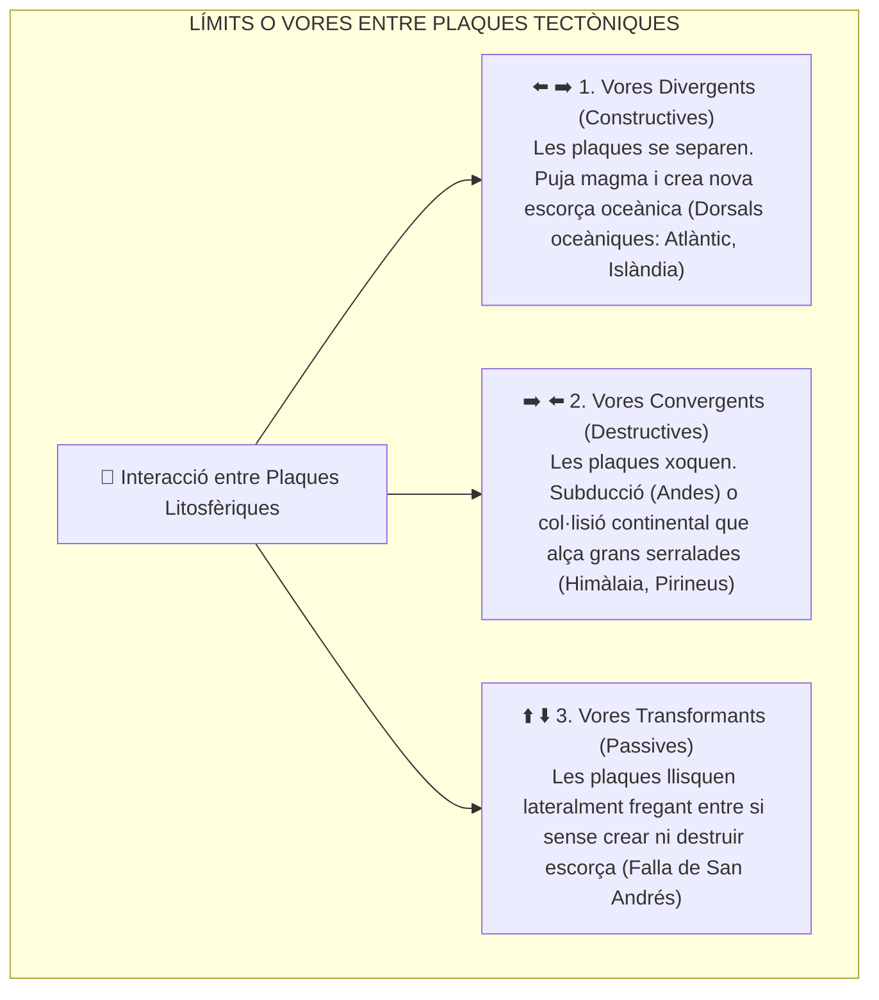

  

    ⚡ Progrés d'aprenentatge (3.2)
    0 / 12 reptes resolts
  

  

    

  

# 3.2 Formació de muntanyes

Com és possible que al cim de l'Everest (a 8.848 m d'altitud) o als cims dels Pirineus i del Maestrat es troben fòssils d'animals marins que vivien al fons del mar fa milions d'anys? La resposta es troba en la **Tectònica de Plaques**: la superfície terrestre està dividida en grans blocs que xoquen lentament entre si amb una força titànica, plegant, trencant i alçant el fons dels antics oceans fins a convertir-los en grans serralades.

---

## 1. La Teoria de la Tectònica de Plaques

Al començament del segle XX (1912), el científic alemany **Alfred Wegener** va proposar la *Teoria de la Deriva Continental*, observant que les costes d'Amèrica del Sud i d'Àfrica encaixaven com les peces d'un trencaclosques i compartien els mateixos fòssils. Fa uns 250 milions d'anys, tots els continents estaven units en un únic supercontinent anomenat **Pangea**.

En la dècada de 1960, aquesta idea es va completar amb la moderna **Teoria de la Tectònica de Plaques**. S'anomena **litosfera** la capa superficial rígida de la Terra, formada per l'escorça sencera més la part més externa del mantell superior. Aquesta litosfera no és una closca contínua d'una sola peça, sinó que està fragmentada en **plaques tectòniques o litosfèriques** que suren i llisquen sobre el mantell plàstic (astenosfera).

Impulsades pels **corrents de convecció del mantell**, les plaques es desplacen unes respecte a les altres a velocitats d'entre **2 cm i 10 cm per any** (aproximadament la velocitat a la qual ens creixen les ungles). Les principals plaques del planeta són:
- **Placa Euroasiàtica** (on es troba la Península Ibèrica) i **Placa Africana** (el seu xoc amb la nostra placa alça les serralades Bètiques i provoca sismes al sud i est peninsular).
- **Placa Nord-americana**, **Placa Sud-americana**, **Placa de Nazca**, **Placa Pacífica** (la més gran del planeta, envoltada pel *Cinturó de Foc del Pacífic*), **Placa Indoaustraliana** i **Placa Antàrtica**.

### Els Tres Tipus de Vores o Límits entre Plaques
La major part dels volcans, terratrèmols i muntanyes del planeta es concentren just a les **vores o fronteres on contacten dues plaques**:

1. **Vores divergents o constructives ($\leftarrow \rightarrow$):** Dues plaques se separen. Per l'esquerda central (*rift*) ascendeix magma del mantell que es refreda i forma **dorsals oceàniques** (serralades submarines de milers de quilòmetres amb intensa activitat volcànica, com la dorsal Mesoatlàntica que aflora a la superfície a Islàndia). S'anomenen constructives perquè creen nova escorça oceànica i eixamplen els oceans.
2. **Vores convergents o destructives ($\rightarrow \leftarrow$):** Dues plaques xoquen frontalment:
   - **Col·lisió oceànica-continental (Subducció):** La placa oceànica, més prima però més densa i pesant, s'enfonsa (**subdueix**) sota la placa continental cap al mantell, on es fon. Això crea fosses oceàniques profundes i serralades volcàniques com la **serralada dels Andes** (xoc de la placa de Nazca sota la Sud-americana).
   - **Col·lisió continental-continental (Obducció):** Quan xoquen dos continents, cap dels dos pot enfonsar-se al mantell perquè són roques granítiques poc denses. Els sediments marins intermedis s'arruguen, es pleguen i s'alcen cap al cel, formant serralades com l'**Himàlaia** (xoc de l'Índia contra Àsia), els **Alps** o els **Pirineus**.
3. **Vores transformants o de fregament ($\uparrow \downarrow$):** Dues plaques llisquen lateralment una al costat de l'altra en sentits oposats. No es crea ni es destrueix litosfera, però el fregament gegantí provoca terratrèmols molt destructius (com a la **falla de San Andrés**, a Califòrnia).

---

## 2. Deformació de les Roques: Plecs i Falles

Quan les forces tectòniques comprimeixen, estiren o retorcen les roques de l'escorça, aquestes poden respondre de tres maneres diferents segons la seua rigidesa, la temperatura i la durada de l'esforç:

1. **Deformació elàstica (reversible):** La roca es deforma momentàniament quan passa una ona sísmica, però recupera la seua forma original quan cessa la força (com una goma elàstica o una molla).
2. **Deformació plàstica (permanent sense trencament) $\rightarrow$ ELS PLECS:** Si les roques són plàstiques o dúctils (com les argiles o roques sedimentàries sotmeses a alta pressió i temperatura durant milions d'anys), davant d'esforços de **compressió** s'ondulen i es dobleguen sense arribar a trencar-se, formant **plecs**. En un plec distingim la *xarnel·la* (zona de màxima curvatura) i els *flancs* (costats). Hi ha dos tipus bàsics de plecs:
   - **Anticlinal:** Plec convex amb forma de **lletra A** o volta cap amunt; al seu nucli o centre es troben els estrats de roca més antics.
   - **Sinclinal:** Plec còncau amb forma de **lletra V** o cubeta cap avall; al seu nucli es troben els estrats de roca més moderns o joves.
3. **Deformació fràgil (permanent amb ruptura) $\rightarrow$ LES FALLES:** Si les roques són molt rígides (com el granit o les calcàries fredes superficials) i l'esforç supera el seu límit de resistència, la roca es fractura bruscament. Si hi ha desplaçament d'un bloc respecte a l'altre al llarg del pla de fractura, s'anomena **falla** (si s'esquerda sense desplaçament dels blocs, s'anomena *diàclasi*). Tipus de falles:
   - **Falla normal (o directa):** Produïda per forces de **distensió** (estirament $\leftarrow \rightarrow$). El bloc superior (sostre) llisca cap avall pel pla de falla i el terreny s'eixampla.
   - **Falla inversa:** Produïda per forces de **compressió** (aixafament $\rightarrow \leftarrow$). El bloc superior és empès cap amunt sobre l'inferior (mur) i el terreny s'escurça.
   - **Falla de desgarri (o en direcció / transformant):** Produïda per forces de **cisalla** on els blocs es desplacen horitzontalment l'un respecte de l'altre sense pujar ni baixar.

### Taula Comparativa: Plecs vs. Falles

| Característica | Plecs Geològics (Anticlinal i Sinclinal) | Falles Geològiques (Normal, Inversa, Desgarri) |
| :--- | :--- | :--- |
| **Tipus de deformació** | **Plàstica** (la roca es doblega i s'ondula sense trencar-se) | **Fràgil** (la roca es trenca amb desplaçament entre blocs) |
| **Tipus de roca i condicions** | Roques dúctils/sedimentàries, alta pressió i temperatura, esforços lents | Roques rígides i fredes prop de la superfície, esforços bruscos |
| **Esforç tectònic causant** | Esforços de **compressió** ($\rightarrow \leftarrow$) | Compressió (falla inversa), distensió (falla normal) o cisalla (desgarri) |
| **Classificació principal** | **Anticlinal** (forma de A) i **Sinclinal** (forma de V) | **Falla normal**, **falla inversa** i **falla de desgarri** |
| **Risc sísmic associat** | Baix (deformació contínua i progressiva) | Molt alt (el moviment brusc dels blocs d'una falla origina els terratrèmols) |

---

## 3. L'Orogènesi: Com es Formen les Grans Serralades

S'anomena **orogènesi** el conjunt de processos geològics pels quals es forma una serralada o cadena muntanyosa a les vores convergents de les plaques:
- **Serralades per col·lisió continental (Alps, Pirineus, Bètiques, Himàlaia):** Quan dues plaques continentals xoquen, els sediments marins acumulats entre elles es pleguen intensament (formant grans anticlinals i sinclinals) i es fracturen mitjançant falles inverses i encavallaments, elevant-se diversos quilòmetres d'altitud. Els **Pirineus** es van alçar pel xoc de la microplaca Ibèrica contra la placa Euroasiàtica.
- **Serralades per subducció o pericontinentals (Els Andes):** A la costa oest d'Amèrica del Sud, la placa oceànica de Nazca s'enfonsa sota el continent. L'enorme compressió plega els sediments costaners i la fusió de la placa que baixa alimenta una filera de grans volcans actius al cim de les muntanyes.

---

> [!TIP]
> ### 🔍 Observació Geològica a la Comunitat Valenciana
> A les nostres muntanyes (com el Puig Campana, el Benicadell, la Serra de Mariola o el Penyagolosa) podem observar a simple vista estrats de roca calcària totalment inclinats i plegats en forma d'**anticlinals i sinclinals**, plens de fòssils de petxines marines. Això demostra que fa més de 60 milions d'anys gran part del territori valencià estava sota el mar de Tetis i va ser alçat per l'empenta de la placa Africana contra l'Euroasiàtica!

---

> [!NOTE]
> ### 💡 Resum de Conceptes Clau
> - La **litosfera** està dividida en **plaques tectòniques** que interaccionen en tres tipus de vores: **divergents** (es creen dorsals), **convergents** (xoquen i formen muntanyes o fosses per subducció) i **transformants** (fregament lateral).
> - Els **plecs** són deformacions plàstiques per compressió sense ruptura (**anticlinal** en A i **sinclinal** en V).
> - Les **falles** són fractures fràgils amb desplaçament de blocs (**normal** per distensió, **inversa** per compressió i **de desgarri** per cisalla).

---

## 🎯 Activitats i Autoavaluació Interactiva

  

    🎮 <strong>Zona d'Entrenament FPB:</strong> 0 reptes resolts
    ⭐ 0 punts
  

  

### 1. Qüestionari d'Autoavaluació Tipus Test (MCQ)

  
<strong>1. Quan les roques sedimentàries pateixen una deformació plàstica per compressió sense trencar-se i formen una ondulació amb forma d'arc o lletra A (convexa cap amunt), com s'anomena aquesta estructura?</strong>

  

    <button type="button" class="btn-mcq-opt" data-opt="A">A) Plec anticlinal</button>
    <button type="button" class="btn-mcq-opt" data-opt="B">B) Plec sinclinal</button>
    <button type="button" class="btn-mcq-opt" data-opt="C">C) Falla normal per distensió</button>
    <button type="button" class="btn-mcq-opt" data-opt="D">D) Dorsal oceànica divergent</button>
  

  

  
<strong>2. Quin tipus de vora o límit entre plaques tectòniques ha originat grans serralades com l'Himàlaia, els Pirineus o els Andes a causa del xoc frontal entre dues plaques?</strong>

  

    <button type="button" class="btn-mcq-opt" data-opt="A">A) Vora divergent o constructiva</button>
    <button type="button" class="btn-mcq-opt" data-opt="B">B) Vora transformant o passiva</button>
    <button type="button" class="btn-mcq-opt" data-opt="C">C) Diàclasi horitzontal</button>
    <button type="button" class="btn-mcq-opt" data-opt="D">D) Vora convergent (per col·lisió continental o per subducció)</button>
  

  

  
<strong>3. Quina és la diferència fonamental entre un plec i una falla en les roques de l'escorça?</strong>

  

    <button type="button" class="btn-mcq-opt" data-opt="A">A) El plec és una ondulació plàstica sense trencament, mentre que la falla és una fractura amb desplaçament dels blocs</button>
    <button type="button" class="btn-mcq-opt" data-opt="B">B) El plec és un volcà i la falla és un riu</button>
    <button type="button" class="btn-mcq-opt" data-opt="C">C) Tots dos són exactament iguals</button>
    <button type="button" class="btn-mcq-opt" data-opt="D">D) La falla només es forma als núvols</button>
  

  

  
<strong>4. Com es va formar la serralada de l'Himàlaia (o els Pirineus)?</strong>

  

    <button type="button" class="btn-mcq-opt" data-opt="A">A) Per la separació de dues plaques al fons del mar</button>
    <button type="button" class="btn-mcq-opt" data-opt="B">B) Per la col·lisió convergent de dues plaques continentals (orogènesi)</button>
    <button type="button" class="btn-mcq-opt" data-opt="C">C) Per la caiguda d'un meteorit</button>
    <button type="button" class="btn-mcq-opt" data-opt="D">D) Per l'acció del vent</button>
  

  

---

### 2. Activitats de Vertader (V) o Fals (F)

  <strong>a) La diferència fonamental entre un plec i una falla és que en el plec la roca es doblega sense trencar-se (deformació plàstica), mentre que en la falla la roca es trenca i els blocs es desplacen (deformació fràgil).</strong>
  

    <button type="button" class="btn-vf" data-opt="V">V</button>
    <button type="button" class="btn-vf" data-opt="F">F</button>
  

  

  <strong>b) Una falla normal es produeix quan el terreny és aixafat per forces de compressió i el bloc superior puja per damunt de l'inferior.</strong>
  

    <button type="button" class="btn-vf" data-opt="V">V</button>
    <button type="button" class="btn-vf" data-opt="F">F</button>
  

  

  <strong>c) En una falla inversa, produïda per forces de compressió que espenten els blocs, el bloc superior puja per damunt de l'inferior.</strong>
  

    <button type="button" class="btn-vf" data-opt="V">V</button>
    <button type="button" class="btn-vf" data-opt="F">F</button>
  

  

  <strong>d) Les plaques litosfèriques estan completament immòbils i els continents mai han canviat de posició.</strong>
  

    <button type="button" class="btn-vf" data-opt="V">V</button>
    <button type="button" class="btn-vf" data-opt="F">F</button>
  

  

---

### 3. Exercicis de Resposta Breu i Vocabulari Tècnic

  
✍️ Com s'anomena la capa rígida superficial de la Terra (formada per l'escorça i la part més externa del mantell superior) que es troba fragmentada en plaques tectòniques?

  

    <input type="text" class="quiz-input" placeholder="Escriu el terme geològic...">
    <button type="button" class="btn-quiz-check">Comprovar</button>
  

  

  
✍️ Com s'anomena el plec geològic que té forma de cubeta o lletra V (còncau cap amunt) i que conté els estrats més moderns al seu nucli?

  

    <input type="text" class="quiz-input" placeholder="Escriu el tipus de plec...">
    <button type="button" class="btn-quiz-check">Comprovar</button>
  

  

  
✍️ Com s'anomena la capa rígida formada per l'escorça i la part superior del mantell que està fragmentada en plaques tectòniques?

  

    <input type="text" class="quiz-input" placeholder="Escriu la teua resposta...">
    <button type="button" class="btn-quiz-check">Comprovar</button>
  

  

  
✍️ Quin nom rep el plec amb forma de volta o lletra 'A' on els estrats més antics queden al nucli central?

  

    <input type="text" class="quiz-input" placeholder="Escriu la teua resposta...">
    <button type="button" class="btn-quiz-check">Comprovar</button>
  

  

---

### 4. Exercicis de Raonament i Desenvolupament Escrit (Tasca d'Aula)

  
✍️ <strong>Fòssils marins al cim de les muntanyes:</strong> Durant una excursió a una serralada a més de 2.000 m d'altitud, un company troba fòssils de petxines marines incrustats a la roca i diu que algú els ha d'haver pujat allà dalt. Explica-li científicament com van arribar aquests fòssils marins al cim de la muntanya utilitzant la teoria de la Tectònica de Plaques i els conceptes de vora convergent, plecs i orogènesi.

  <textarea class="open-response-input" rows="4" placeholder="Explica com l'antic fons marí es va comprimir i elevar pel xoc de dues plaques tectòniques..."></textarea>

  
✍️ <strong>Exercici 2 (Els tres tipus de límits entre plaques tectòniques):</strong> Explica què passa en un límit divergent (dorsal oceànica), en un límit convergent (subducció o xoc continental) i en un límit transformant (com la falla de San Andrés).

  <textarea class="open-response-input" rows="4" placeholder="Divergent: les plaques se separen i surt magma... Convergent: xoquen i formen muntanyes... Transformant: freguen lateralment..."></textarea>

  
✍️ <strong>Exercici 3 (Deformació elàstica, plàstica i fràgil amb exemples del taller):</strong> Posa un exemple d'un material del taller que tinga comportament elàstic (com una goma), un de plàstic (com el fil de coure o plastilina) i un de fràgil (com el vidre), i relaciona-ho amb els sismes, els plecs i les falles.

  <textarea class="open-response-input" rows="4" placeholder="Elàstic -> recupera la forma; Plàstic -> queda doblegat (plecs); Fràgil -> es trenca (falles)..."></textarea>

---

  <h3 style="margin-top:0; color:#0369a1;">📦 Lliurament d'Activitats d'Aules (Act 3.2)</h3>
  
Genera el teu document de tasca d'aquest apartat amb el teu nom i puntuació obtinguda.

  

    <input type="text" class="aules-student-name" placeholder="Cognoms, Nom de l'Alumne/a" style="padding:8px 12px; border:1px solid #94a3b8; border-radius:4px; flex-grow:1; min-width:240px;">
    <button class="btn-generate-aules-pdf" data-unit="NAT03" data-activity="Act02" data-module="CA" style="padding:8px 16px; background:#0284c7; color:#fff; border:none; border-radius:4px; font-weight:600; cursor:pointer;">📄 Descarregar PDF per a Aules</button>
  

