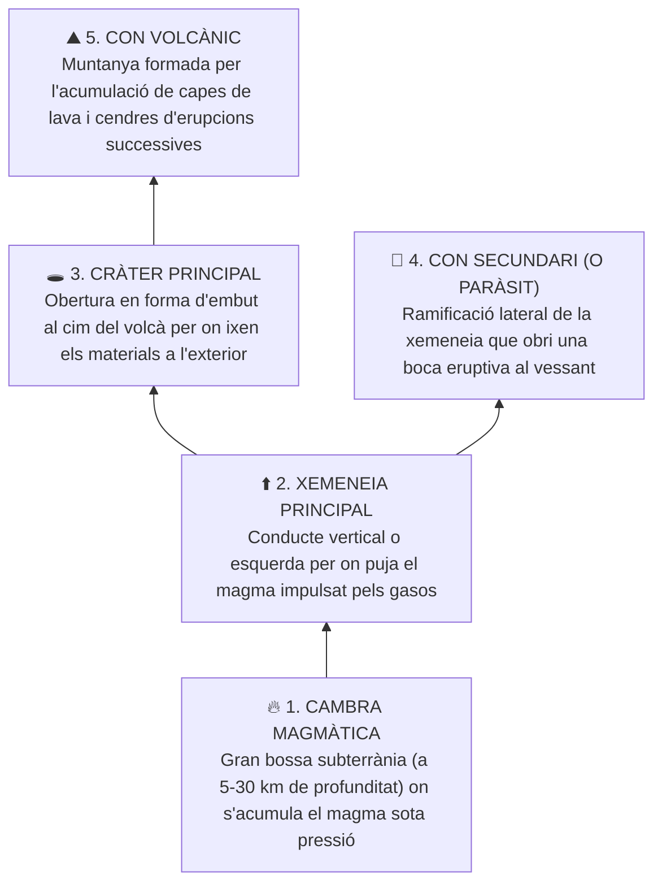

  

    ⚡ Progrés d'aprenentatge (3.3)
    0 / 12 reptes resolts
  

  

    

  

# 3.3 Els volcans

Un **volcà** és una estructura geològica (una obertura o esquerda de l'escorça terrestre) per la qual surten a l'exterior materials rocosos fosos a altíssima temperatura ($700^\circ\text{C}$ a $1.200^\circ\text{C}$) i gasos procedents de l'interior del planeta. L'any 2021 vam viure a Espanya un exemple històric en directe amb l'erupció del volcà **Tajogaite (Cumbre Vieja)** a l'illa de **La Palma** (Illes Canàries), que va durar 85 dies i va transformar el paisatge de l'illa.

---

## 1. Quina diferència hi ha entre Magma i Lava?

En el llenguatge quotidià molta gent confon aquests dos termes, però en ciències tenen una diferència exacta segons on es troben i la seua composició:

- **Magma:** És la mescla de **roca fosa, cristalls minerals en suspensió i gran quantitat de gasos dissolts** a alta pressió que es troba **a l'interior de la Terra** (a la base de l'escorça o al mantell superior). Si el magma es refreda lentament a l'interior sense arribar a eixir, forma *roques plutòniques* com el granit.
- **Lava:** És el magma que ja **ha eixit a la superfície terrestre** a través del cràter i **ha perdut la major part dels seus gasos** (desgasificat) en entrar en contacte amb l'atmosfera o l'aigua del mar. Quan la lava es refreda ràpidament a l'exterior i se solidifica, forma **roques magmàtiques volcàniques** com el basalt, l'obsidiana o la pedra tosca (pumita).

---

## 2. Anatomia Completa d'un Volcà

Un aparell volcànic típic està format per cinc parts fonamentals:

1. **Cambra magmàtica:** Bossa o reservori profund situat entre $5\text{ km}$ i $30\text{ km}$ sota la superfície on s'acumula el magma procedent del mantell abans de l'erupció.
2. **Xemeneia principal:** Conducte o fractura vertical que comunica la cambra magmàtica amb l'exterior.
3. **Cràter:** Boca o obertura amb forma d'embut situada al cim de la xemeneia per on s'expulsen els gasos, els piroclasts i la lava. Si després d'una gran erupció la cambra magmàtica es buida i el sostre del volcà s'esfondra, es forma una depressió gegant anomenada **caldera volcànica** (com la Caldera de Las Cañadas al Teide).
4. **Con volcànic:** Elevació o muntanya amb forma de con truncat construïda al voltant del cràter per l'apilament successiu de colades de lava solidificada i capes de piroclasts.
5. **Xemeneies i cons secundaris (o adventicis):** Sovint la pressió del magma obri esquerdes laterals als flancs del volcà, creant petits cons secundaris.

---

## 3. Els Tres Tipus de Productes Volcànics

Durant una erupció, un volcà expulsa materials en els **tres estats físics de la matèria** (gasós, sòlid i líquid):

### 1. Gasos Volcànics (Estat Gasós)
Són el veritable motor de l'erupció, ja que en expandir-se empenyen el magma cap amunt (igual que el gas d'una botella de refresc agitada). Els principals gasos són:
- **Vapor d'aigua ($\text{H}_2\text{O}$):** És el més abundant (fins al $70\% - 80\%$ del total) i forma grans columnes blanques de vapor.
- **Diòxid de carboni ($\text{CO}_2$):** Gas d'efecte hivernacle més dens que l'aire; si s'acumula en fondalades o soterranis pot provocar asfíxia per desplaçament de l'oxigen.
- **Diòxid de sofre ($\text{SO}_2$), sulfur d'hidrogen ($\text{H}_2\text{S}$) i monòxid de carboni ($\text{CO}$):** Gasos tòxics i irritants amb olor de sofre o d'ous podrits que poden generar pluja àcida.

### 2. Piroclasts (Estat Sòlid)
El terme **piroclast** significa literalment *"fragment de foc"*. Són fragments de roca sòlida o de lava que es refreda en l'aire en ser llançada violentament cap al cel. Es classifiquen estrictament segons la seua **mida (diàmetre)**:

| Tipus de Piroclast | Diàmetre del Fragment | Característiques i Efectes |
| :--- | :---: | :--- |
| **Cendres volcàniques** | **$< 2\text{ mm}$** | Pols fina de vidre i roca volcànica. El vent pot transportar-la a centenars de quilòmetres, paralitza el trànsit aeri (avions) i pot enfonsar teulades pel seu pes. |
| **Lapil·li (o *picón*)** | **Entre $2\text{ mm}$ i $64\text{ mm}$** | Petites pedres poroses i lleugeres de la mida d'un cigró o una nou. A les Canàries s'anomena *picón* o *rofe* i s'utilitza en agricultura per retenir la humitat del sòl. |
| **Bombes volcàniques** | **$> 64\text{ mm}$** | Grans blocs de lava incandescents (des d'un puny fins a la mida d'un cotxe) que prenen forma arredonida o de fus en girar per l'aire abans d'impactar prop del cràter. |

### 3. Colades de Lava (Estat Líquid)
Són els rius de roca fosa que brollen pel cràter i baixen pels vessants del volcà. Segons la seua composició química (contingut en sílice, $\text{SiO}_2$) i temperatura, distingim:
- **Laves fluides (basàltiques):** Molt calentes ($>1.000^\circ\text{C}$) i pobres en sílice. Els gasos s'escapen fàcilment sense grans explosions i la lava corre ràpidament formant llargs rius incandescents (laves *pahoehoe* o cordades i laves *aa* o malpaís).
- **Laves viscoses (àcides o silícies):** Més fredes ($700^\circ\text{C} - 900^\circ\text{C}$) i molt riques en sílice. Són pastoses i espesses, taponen la xemeneia impedint l'eixida dels gasos i acaben provocant explosions devastadores.

---

## 4. Tipus d'Erupcions, Risc Volcànic i Beneficis

Segons la viscositat del magma i la pressió dels gasos, les erupcions es classifiquen des de les més suaus fins a les més violentes:

| Tipus d'Erupció | Viscositat de la Lava | Explosivitat i Risc | Característiques Principals i Exemples |
| :--- | :---: | :---: | :--- |
| **1. Hawaiana** | Molt fluida | Molt baixa (efusiva) | Sense explosions; rius de lava ràpids i volcans en escut de pendent suau (Mauna Loa, Hawaii). |
| **2. Estromboliana** | Fluida-moderada | Moderada | Explosions rítmiques de gasos, projecció de lapil·li i bombes, i colades de lava (**La Palma 2021**, Stromboli). |
| **3. Vulcaniana / Pliniana** | Molt viscosa | Molt alta / Extrema | El magma tapona el cràter; explosions gegants amb columnes de cendra de $>20\text{ km}$ i **núvols ardents** (Vesuvi, St. Helens). |

> [!TIP]
> ### 🔍 Risc Volcànic vs. Beneficis dels Volcans: El Cas de les Illes Canàries i Olot
> Totes les **Illes Canàries** tenen un origen $100\%$ volcànic (amb el **Teide** a Tenerife, el pic més alt d'Espanya amb $3.715\text{ m}$), i a la Península també hi ha zones volcàniques antigues com la Garrotxa (Olot), Cabo de Gata o el Camp de Calatrava. Com prediuen els vulcanòlegs una erupció per evacuar la població a temps? Instal·lant xarxes de **sismògrafs** (que detecten l'*eixam sísmic* quan el magma trenca roques en pujar), **inclinòmetres i GPS** (que detecten com el terreny s'unfla uns centímetres) i **analitzadors de gasos**. A canvi del risc, els volcans aporten **sòls agrícoles extremadament fèrtils** rics en minerals, recursos d'**energia geotèrmica**, materials de construcció (basalt, puzolana) i un gran atractiu turístic i paisatgístic.

---

> [!NOTE]
> ### 💡 Resum de Conceptes Clau
> - El **magma** està a l'interior de la Terra amb gasos dissolts; quan surt a l'exterior i perd els gasos s'anomena **lava**.
> - Les parts d'un volcà són: **cambra magmàtica**, **xemeneia**, **cràter**, **con volcànic** i **cons secundaris**.
> - Els productes volcànics són **gasos** ($\text{H}_2\text{O}, \text{CO}_2, \text{SO}_2$), **colades de lava** i **piroclasts sòlids**: **cendres** ($<2\text{ mm}$), **lapil·li** ($2-64\text{ mm}$) i **bombes volcàniques** ($>64\text{ mm}$).

---

## 🎯 Activitats i Autoavaluació Interactiva

  

    🎮 <strong>Zona d'Entrenament FPB:</strong> 0 reptes resolts
    ⭐ 0 punts
  

  

### 1. Qüestionari d'Autoavaluació Tipus Test (MCQ)

  
<strong>1. Com es classifiquen els fragments sòlids (piroclasts) llançats per un volcà que tenen una mida intermèdia d'entre $2\text{ mm}$ i $64\text{ mm}$ de diàmetre?</strong>

  

    <button type="button" class="btn-mcq-opt" data-opt="A">A) Cendres volcàniques fines</button>
    <button type="button" class="btn-mcq-opt" data-opt="B">B) Lapil·li (conegut com a picón a les Illes Canàries)</button>
    <button type="button" class="btn-mcq-opt" data-opt="C">C) Bombes volcàniques gegants</button>
    <button type="button" class="btn-mcq-opt" data-opt="D">D) Colades basàltiques líquides</button>
  

  

  
<strong>2. Quina és la diferència científicament exacta entre el magma i la lava?</strong>

  

    <button type="button" class="btn-mcq-opt" data-opt="A">A) El magma és fred i sòlid, mentre que la lava és un gas</button>
    <button type="button" class="btn-mcq-opt" data-opt="B">B) No hi ha cap diferència, són dues paraules exactament sinònimes en tot moment</button>
    <button type="button" class="btn-mcq-opt" data-opt="C">C) El magma es troba a l'interior de la Terra amb gasos dissolts; quan surt a la superfície i perd els gasos s'anomena lava</button>
    <button type="button" class="btn-mcq-opt" data-opt="D">D) La lava només existeix al nucli intern de la Terra</button>
  

  

  
<strong>3. Com es classifiquen els piroclasts (fragments sòlids llançats per un volcà) de menor a major grandària?</strong>

  

    <button type="button" class="btn-mcq-opt" data-opt="A">A) 1r Bombes, 2n Lapil·li i 3r Cendres</button>
    <button type="button" class="btn-mcq-opt" data-opt="B">B) 1r Cendres (< 2 mm), 2n Lapil·li (2-64 mm) i 3r Bombes volcàniques (> 64 mm)</button>
    <button type="button" class="btn-mcq-opt" data-opt="C">C) Tots tenen la mateixa mida</button>
    <button type="button" class="btn-mcq-opt" data-opt="D">D) Són gasos invisibles</button>
  

  

  
<strong>4. Quina comunitat autònoma d'Espanya té origen 100% volcànic i va patir l'erupció del volcà Tajogaite (Cumbre Vieja) en 2021?</strong>

  

    <button type="button" class="btn-mcq-opt" data-opt="A">A) Galícia</button>
    <button type="button" class="btn-mcq-opt" data-opt="B">B) Les Illes Canàries (illa de La Palma)</button>
    <button type="button" class="btn-mcq-opt" data-opt="C">C) Madrid</button>
    <button type="button" class="btn-mcq-opt" data-opt="D">D) Astúries</button>
  

  

---

### 2. Activitats de Vertader (V) o Fals (F)

  <strong>a) Els volcans amb laves molt viscoses i pastoses tenen sempre erupcions molt suaus i tranquil·les sense cap explosió.</strong>
  

    <button type="button" class="btn-vf" data-opt="V">V</button>
    <button type="button" class="btn-vf" data-opt="F">F</button>
  

  

  <strong>b) El gas més abundant que expulsa un volcà durant una erupció és el vapor d'aigua ($\text{H}_2\text{O}$), acompanyat de diòxid de carboni ($\text{CO}_2$) i compostos de sofre ($\text{SO}_2$).</strong>
  

    <button type="button" class="btn-vf" data-opt="V">V</button>
    <button type="button" class="btn-vf" data-opt="F">F</button>
  

  

  <strong>c) Una lava molt viscosa i rica en sílice reté els gasos fent que les erupcions siguen molt més explosives i perilloses que una lava fluida.</strong>
  

    <button type="button" class="btn-vf" data-opt="V">V</button>
    <button type="button" class="btn-vf" data-opt="F">F</button>
  

  

  <strong>d) La cambra magmàtica és l'orifici exterior del cim del volcà per on surt el fum.</strong>
  

    <button type="button" class="btn-vf" data-opt="V">V</button>
    <button type="button" class="btn-vf" data-opt="F">F</button>
  

  

---

### 3. Exercicis de Resposta Breu i Vocabulari Tècnic

  
✍️ Com s'anomena el conducte vertical d'un volcà pel qual ascendeix el magma des de la cambra magmàtica fins al cràter?

  

    <input type="text" class="quiz-input" placeholder="Escriu la part del volcà...">
    <button type="button" class="btn-quiz-check">Comprovar</button>
  

  

  
✍️ Quin nom genèric reben tots els fragments sòlids (cendres, lapil·li i bombes volcàniques) que són llançats a l'aire durant una erupció?

  

    <input type="text" class="quiz-input" placeholder="Escriu el terme científic...">
    <button type="button" class="btn-quiz-check">Comprovar</button>
  

  

  
✍️ Com s'anomena el conducte vertical que comunica la cambra magmàtica profunda amb el cràter exterior d'un volcà?

  

    <input type="text" class="quiz-input" placeholder="Escriu la teua resposta...">
    <button type="button" class="btn-quiz-check">Comprovar</button>
  

  

  
✍️ Quin nom rep el magma quan ja ha eixit a la superfície pel cràter i ha perdut els seus gasos?

  

    <input type="text" class="quiz-input" placeholder="Escriu la teua resposta...">
    <button type="button" class="btn-quiz-check">Comprovar</button>
  

  

---

### 4. Exercicis de Raonament i Desenvolupament Escrit (Tasca d'Aula)

  
✍️ <strong>Viure prop d'un volcà (El cas de les Canàries):</strong> Explica quins senyals d'alerta vigilen els científics per predir que un volcà entrarà en erupció i evacuar els habitants a temps, i esmenta almenys dos beneficis pels quals l'ésser humà aprofita les zones volcàniques.

  <textarea class="open-response-input" rows="4" placeholder="Explica els senyals previs (terratrèmols, deformació del sòl, gasos) i els beneficis (fertilitat del sòl, geotèrmia)..."></textarea>

  
✍️ <strong>Exercici 2 (Les 4 parts d'un volcà i els 3 tipus de productes):</strong> Descriu les quatre parts anatòmiques d'un volcà (cambra magmàtica, xemeneia, cràter i con volcànic) i posa dos exemples de productes gasosos, líquids i sòlids que expulsa.

  <textarea class="open-response-input" rows="4" placeholder="Parts del volcà... Productes: gasos (vapor d'aigua, CO₂, SO₂), líquids (colades de lava) i sòlids (cendres, lapil·li, bombes)..."></textarea>

  
✍️ <strong>Exercici 3 (Senyals precursors d'una erupció volcànica):</strong> Explica quins senyals científics vigilen els vulcanòlegs (com a La Palma o al Teide) per saber dies abans que un volcà entrarà en erupció i poder evacuar la població a temps.

  <textarea class="open-response-input" rows="4" placeholder="Augment d'eixams sísmics, inflor o deformació del terreny per GPS, augment de temperatura i emissió de gasos..."></textarea>

---

  <h3 style="margin-top:0; color:#0369a1;">📦 Lliurament d'Activitats d'Aules (Act 3.3)</h3>
  
Genera el teu document de tasca d'aquest apartat amb el teu nom i puntuació obtinguda.

  

    <input type="text" class="aules-student-name" placeholder="Cognoms, Nom de l'Alumne/a" style="padding:8px 12px; border:1px solid #94a3b8; border-radius:4px; flex-grow:1; min-width:240px;">
    <button class="btn-generate-aules-pdf" data-unit="NAT03" data-activity="Act03" data-module="CA" style="padding:8px 16px; background:#0284c7; color:#fff; border:none; border-radius:4px; font-weight:600; cursor:pointer;">📄 Descarregar PDF per a Aules</button>
  

