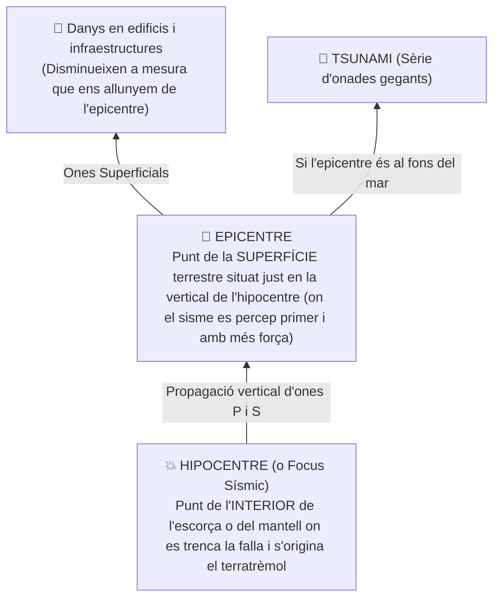

  

    ⚡ Progrés d'aprenentatge (3.4)
    0 / 12 reptes resolts
  

  

    

  

# 3.4 Els terratrèmols

Un **terratrèmol** (també anomenat **sisme** o moviment sísmic) és una sacsejada brusca, breu i violenta de l'escorça terrestre produïda per l'alliberament sobtat d'energia mecànica acumulada a l'interior de la Terra. A la Península Ibèrica, el sud-est (Múrcia, com el destructiu terratrèmol de Llorca de 2011, Granada i el sud de la província d'Alacant com la comarca del Baix Segura i Torrevella) és una zona sísmicament activa pel xoc continu entre la placa Africana i l'Euroasiàtica.

---

## 1. Per què es produeix un Terratrèmol? Anatomia d'un Sisme

Les plaques tectòniques es mouen contínuament, però les roques dels dos costats d'una **falla geològica** són rugoses i queden travades pel fregament. Durant dècades o segles, les roques es van deformant elàsticament acumulant una tensió immensa (com quan dobleguem un regle de plàstic o una branca seca amb les dues mans). Quan la tensió supera el límit de resistència de la roca, aquesta **es trenca bruscament (rebrot elàstic)**, els dos blocs de la falla es desplacen de cop i tota l'energia acumulada s'allibera en pocs segons en forma d'**ones sísmiques**. Després del sisme principal, solen produir-se sacsejades menors anomenades **rèpliques** mentre els blocs de roca acaben d'assentar-se.

### Hipocentre vs. Epicentre: La Diferència Clau
En tot terratrèmol hem de distingir amb exactitud dos punts geomètrics:

- **Hipocentre (o focus sísmic):** És el punt profund de l'**interior de la Terra** on es produeix la ruptura de la falla i s'allibera l'energia. Segons la seua profunditat, els sismes poden ser superficials ($<70\text{ km}$, els més destructius perquè estan molt prop de les ciutats, com va passar a Llorca a només $2\text{ km}$ de profunditat), intermedis ($70 - 300\text{ km}$) o profunds ($>300\text{ km}$).
- **Epicentre:** És el punt de la **superfície terrestre** (o del fons marí) situat **exactament en la vertical de l'hipocentre**. És el lloc de la superfície més pròxim al focus i, per tant, on el terratrèmol es nota abans i sol causar els majors danys. En els mapes sísmics es dibuixen línies anomenades *isòsistes* que uneixen els punts que han patit la mateixa intensitat al voltant de l'epicentre.

### Les Ones Sísmiques
L'energia viatja des de l'hipocentre en totes direccions mitjançant tres tipus d'ones:
1. **Ones P (Primàries o longitudinals):** Són les més ràpides (fins a $8 - 13\text{ km/s}$) i les primeres a arribar als aparells de mesura. Comprimeixen i dilaten les roques en la mateixa direcció d'avanç i es propaguen tant per medis sòlids com per líquids.
2. **Ones S (Secundàries o transversals):** Arriben en segon lloc ($4 - 7\text{ km/s}$), sacsegen el terreny perpendicularment i **no poden travessar líquids** (gràcies a l'ombra d'ones S sabem que el nucli extern de la Terra és líquid!).
3. **Ones Superficials (Love i Rayleigh):** Es generen quan les ones profundes arriben a l'epicentre i viatgen per la superfície com les onades a l'aigua. Són les més lentes, però **les més destructives**, ja que mouen el sòl lateralment i verticalment tombant edificis, ponts i carreteres.

| Tipus d'Ona Sísmica | Lloc d'Origen | Velocitat de Propagació | Medis que Travessa | Efecte sobre el Terreny i Edificis |
| :--- | :---: | :---: | :---: | :--- |
| **Ones P (Primàries)** | Hipocentre | Molt alta ($8 - 13\text{ km/s}$) | Sòlids i líquids | Compressió i dilatació; avisen de l'inici del sisme |
| **Ones S (Secundàries)** | Hipocentre | Intermèdia ($4 - 7\text{ km/s}$) | **Només sòlids** | Sacsejada transversal (de costat a costat) |
| **Ones Superficials (L i R)** | Epicentre | Baixa ($2 - 4\text{ km/s}$) | Superfície terrestre | **Màxima destrucció** en edificis, ponts i canonades |

---

## 2. Com es Mesuren els Terratrèmols: Magnitud vs. Intensitat

L'aparell d'alta precisió que detecta i registra els moviments del sòl s'anomena **sismògraf**, i el gràfic amb les línies en ziga-zaga que dibuixa s'anomena **sismograma**. Per a avaluar un terratrèmol utilitzem dues escales ben diferents que mai s'han de confondre:

| Criteri de Comparació | MAGNITUD (Escala de Richter / Magnitud de Moment) | INTENSITAT (Escala Mercalli / EMS-98) |
| :--- | :--- | :--- |
| **Què mesura exactament?** | La **quantitat total d'energia alliberada** pel terratrèmol a l'hipocentre. | Els **danys materials i efectes destructius** produïts a la superfície sobre edificis i persones. |
| **Com s'obté?** | És una mesura **objectiva i instrumental** calculada a partir dels **sismògrafs**. | És una avaluació **observacional** dels danys reals després del sisme. |
| **Com s'expressa?** | Amb **nombres decimals** (ex: magnitud $5{,}2$ o $7{,}8$). No té límit superior teòric, tot i que a la pràctica no supera $\sim 9{,}5$. | Amb **nombres romans de l'$\text{I}$ al $\text{XII}$** (des d'$\text{I}$ = no percebut fins a $\text{XII}$ = destrucció total). |
| **Varia segons la ciutat o el tipus d'edifici?** | **NO.** Un terratrèmol té una **única magnitud** (allibera una quantitat fixa d'energia). | **SÍ.** La intensitat és màxima prop de l'epicentre o en edificis mal construïts, i disminueix en allunyar-nos-en. |

> **Nota sobre l'Escala de Richter:** És una escala **logarítmica**: cada grau que puja equival a multiplicar per **$\sim 32$ vegades l'energia alliberada**. Així, un sisme de magnitud $7$ allibera $32\text{ vegades}$ més energia que un de magnitud $6$, i unes $1.000\text{ vegades}$ més energia que un de magnitud $5$!

### Exemples de Nivells en l'Escala d'Intensitat EMS / Mercalli ($\text{I}$ a $\text{XII}$)
- **Grau $\text{I} - \text{II}$ (Molt feble):** Només el detecten els sismògrafs o persones en repòs als pisos més alts.
- **Grau $\text{IV} - \text{V}$ (Moderat):** Es nota dins de les cases, oscil·len els llums penjants i vibren les finestres, sense danys estructurals.
- **Grau $\text{VII} - \text{VIII}$ (Molt fort / Destructiu):** Esquerdes importants en murs, caiguda de xemeneies i cornises (com al sisme de Llorca de 2011, que va tindre magnitud $5{,}1$ però intensitat $\text{VII}$ per ser molt superficial).
- **Grau $\text{X} - \text{XII}$ (Catastròfic):** Col·lapse d'edificis, ponts destruïts i esquerdes visibles al terreny.

---

## 3. Sismes Submarins i Tsunamis

Quan l'epicentre d'un terratrèmol de gran magnitud ($>7{,}0$) es produeix al **fons del mar** i un bloc d'una falla submarina s'alça o s'enfonsa bruscament diversos metres, empeny tota la columna d'aigua que té a sobre. Això genera un **tsunami** (o sisme submarí / maremot):
- En alta mar, les onades del tsunami tenen poca altura ($<1\text{ m}$) i passen gairebé desapercebudes per als vaixells, però viatgen a velocitats d'avió comercial (**$600\text{ a } 800\text{ km/h}$**).
- Quan l'ona arriba a la costa i el fons marí es fa poc profund, l'ona es frena bruscament, s'escurça i tota la seua energia es transforma en una **muralla d'aigua de $10\text{ m}$ a $30\text{ m}$ d'altura** que penetra terra endins arrasant poblacions costaneres.
- **Senyal d'alerta vital a la platja:** Moltes vegades, minuts abans que arribe la gran ona d'un tsunami, **el mar es retira de cop desenes o centenars de metres** deixant el fons marí al descobert. Si sents un terratrèmol a la costa o veus retirar-se el mar anormalment, cal córrer immediatament cap a zones altes!

---

> [!TIP]
> ### 🛡️ Protocol de Seguretat i Autoprotecció al Taller i a l'Aula (Ajupir-se, Cobrir-se i Agafar-se)
> Els terratrèmols **no es poden predir amb data i hora exacta**, però sí prevenir amb **construccions sismoresistents** i protocols d'actuació:
> 1. **DURANT el tremolor (dins de l'aula o del taller):** Mantín la calma i aplica la regla internacional **«Ajupir-se, Cobrir-se i Agafar-se»**: posa't sota una taula o banc de treball resistent (o al costat d'un pilar mestre) protegint el cap i el coll amb els braços. **Allunya't de finestres, prestatgeries d'eines, llums penjants i maquinària en marxa.**
> 2. **Prohibit usar ascensors:** Mai utilitzes l'ascensor durant ni després d'un sisme (es pot tallar la llum o deformar el buit de l'ascensor). No córregues cap a les escales mentre l'edifici tremola.
> 3. **DESPRÉS del tremolor:** Evacua l'edifici amb ordre cap al pati o espai obert (lluny de façanes i cables elèctrics) perquè poden produir-se **rèpliques**, i tanca les claus de pas de gas, aigua i electricitat del taller.

---

> [!NOTE]
> ### 💡 Resum de Conceptes Clau
> - L'**hipocentre** és el focus profund on es trenca la falla; l'**epicentre** és el punt de la superfície situat just a la seua vertical.
> - Els sismes es registren amb el **sismògraf**: la **Magnitud (Richter)** mesura l'energia alliberada en nombres decimals, mentre que la **Intensitat (Mercalli/EMS, d'I a XII)** avalua els danys causats en cada lloc.
> - Un sisme amb epicentre al fons marí pot originar un **tsunami**. Durant un sisme a l'aula cal **ajupir-se, cobrir-se sota una taula forta i no usar mai l'ascensor**.

---

## 🎯 Activitats i Autoavaluació Interactiva

  

    🎮 <strong>Zona d'Entrenament FPB:</strong> 0 reptes resolts
    ⭐ 0 punts
  

  

### 1. Qüestionari d'Autoavaluació Tipus Test (MCQ)

  
<strong>1. Com s'anomena el punt de la SUPERFÍCIE terrestre situat just en la vertical del focus sísmic, on el terratrèmol es percep amb més força?</strong>

  

    <button type="button" class="btn-mcq-opt" data-opt="A">A) Hipocentre</button>
    <button type="button" class="btn-mcq-opt" data-opt="B">B) Epicentre</button>
    <button type="button" class="btn-mcq-opt" data-opt="C">C) Cambra magmàtica</button>
    <button type="button" class="btn-mcq-opt" data-opt="D">D) Sismograma</button>
  

  

  
<strong>2. Quina és l'actuació d'autoprotecció correcta si comença un terratrèmol mentre estàs treballant al taller o a l'aula d'un segon pis?</strong>

  

    <button type="button" class="btn-mcq-opt" data-opt="A">A) Ajupir-se, cobrir-se el cap sota una taula o banc de treball resistent, allunyar-se de finestres i prestatgeries, i evacuar per les escales (mai per l'ascensor) quan pare el tremolor</button>
    <button type="button" class="btn-mcq-opt" data-opt="B">B) Córrer immediatament a agafar l'ascensor per baixar al carrer durant el tremolor</button>
    <button type="button" class="btn-mcq-opt" data-opt="C">C) Posar-se al costat d'una finestra gran de vidre o sota un armari alt ple d'eines pesants</button>
    <button type="button" class="btn-mcq-opt" data-opt="D">D) Encendre foguers de gas per il·luminar l'aula</button>
  

  

  
<strong>3. Com s'anomena l'aparell de precisió que registra les vibracions de les ones sísmiques dibuixant un gràfic anomenat sismograma?</strong>

  

    <button type="button" class="btn-mcq-opt" data-opt="A">A) Termòmetre</button>
    <button type="button" class="btn-mcq-opt" data-opt="B">B) Sismògraf</button>
    <button type="button" class="btn-mcq-opt" data-opt="C">C) Baròmetre</button>
    <button type="button" class="btn-mcq-opt" data-opt="D">D) Pluviòmetre</button>
  

  

  
<strong>4. Què s'ha de fer immediatament si ens sorprèn un terratrèmol fort mentre estem a l'aula o al taller d'informàtica?</strong>

  

    <button type="button" class="btn-mcq-opt" data-opt="A">A) Córrer cap a l'ascensor o saltar per la finestra</button>
    <button type="button" class="btn-mcq-opt" data-opt="B">B) Aplicar la regla 'Ajupir-se, Cobrir-se sota una taula resistent i Agafar-se' allunyats de vidres i prestatgeries</button>
    <button type="button" class="btn-mcq-opt" data-opt="C">C) Posar-se sota un armari alt ple d'ordinadors</button>
    <button type="button" class="btn-mcq-opt" data-opt="D">D) Encendre foc amb un encenedor</button>
  

  

---

### 2. Activitats de Vertader (V) o Fals (F)

  <strong>a) L'escala de Richter mesura la intensitat dels danys visuals en els edificis utilitzant nombres romans de l'$\text{I}$ al $\text{XII}$.</strong>
  

    <button type="button" class="btn-vf" data-opt="V">V</button>
    <button type="button" class="btn-vf" data-opt="F">F</button>
  

  

  <strong>b) Un tsunami es produeix quan un terratrèmol amb epicentre al fons del mar desplaça bruscament la falla submarina i empeny una gran massa d'aigua cap a les costes.</strong>
  

    <button type="button" class="btn-vf" data-opt="V">V</button>
    <button type="button" class="btn-vf" data-opt="F">F</button>
  

  

  <strong>c) Un tsunami és una ona marina gegant provocada generalment per un terratrèmol amb epicentre al fons de l'oceà que desplaça bruscament la columna d'aigua.</strong>
  

    <button type="button" class="btn-vf" data-opt="V">V</button>
    <button type="button" class="btn-vf" data-opt="F">F</button>
  

  

  <strong>d) L'escala de Richter mesura les destrosses visuals en números romans de l'I al XII.</strong>
  

    <button type="button" class="btn-vf" data-opt="V">V</button>
    <button type="button" class="btn-vf" data-opt="F">F</button>
  

  

---

### 3. Exercicis de Resposta Breu i Vocabulari Tècnic

  
✍️ Com s'anomena l'instrument o aparell d'alta sensibilitat utilitzat pels geòlegs per detectar i registrar les ones sísmiques d'un terratrèmol?

  

    <input type="text" class="quiz-input" placeholder="Escriu el nom de l'aparell...">
    <button type="button" class="btn-quiz-check">Comprovar</button>
  

  

  
✍️ Com s'anomena el punt profund de l'interior de l'escorça terrestre on es trenca la falla i s'origina realment el terratrèmol?

  

    <input type="text" class="quiz-input" placeholder="Escriu el terme sísmic...">
    <button type="button" class="btn-quiz-check">Comprovar</button>
  

  

  
✍️ Com s'anomena el punt de l'interior de la Terra on es trenca la falla i s'origina realment el terratrèmol?

  

    <input type="text" class="quiz-input" placeholder="Escriu la teua resposta...">
    <button type="button" class="btn-quiz-check">Comprovar</button>
  

  

  
✍️ Com s'anomena el punt de la superfície terrestre situat just en la vertical de l'hipocentre on el sisme es percep primer i amb més força?

  

    <input type="text" class="quiz-input" placeholder="Escriu la teua resposta...">
    <button type="button" class="btn-quiz-check">Comprovar</button>
  

  

---

### 4. Exercicis de Raonament i Desenvolupament Escrit (Tasca d'Aula)

  
✍️ <strong>Magnitud vs. Intensitat en dos països diferents:</strong> Imagina que es produeix un terratrèmol de Magnitud $6{,}5$ al Japó (on els edificis tenen estructures sismoresistents modernes) i un altre terratrèmol exactament de la mateixa Magnitud $6{,}5$ en una zona pobra amb cases de tova sense fonaments i amb un hipocentre molt superficial. Tindran tots dos terratrèmols la mateixa Magnitud? Tindran la mateixa Intensitat (escala EMS/Mercalli)? Raona la resposta.

  <textarea class="open-response-input" rows="4" placeholder="Compara l'energia alliberada (Magnitud) amb els danys produïts als edificis (Intensitat) en cada cas..."></textarea>

  
✍️ <strong>Exercici 2 (Magnitud de Richter vs Intensitat de Mercalli/EMS):</strong> Explica per què dos terratrèmols amb la mateixa Magnitud (per exemple 6,5 a l'escala de Richter) poden tindre una Intensitat de danys molt baixa al Japó i catastròfica en un país amb cases de fang sense normes sismoresistents.

  <textarea class="open-response-input" rows="4" placeholder="La magnitud mesura l'energia alliberada al focus (és única), mentre que la intensitat depèn de la qualitat dels edificis, distància i tipus de sòl..."></textarea>

  
✍️ <strong>Exercici 3 (Pla d'emergència sísmica a l'institut):</strong> Redacta 4 normes de seguretat que hem de seguir DURANT el tremolor i 3 normes que hem de seguir DESPRÉS que s'ature el tremolor per evacuar l'edifici amb seguretat.

  <textarea class="open-response-input" rows="4" placeholder="Durant: ajupir-se sota el pupitre, allunyar-se de finestres... Després: tallar gas/llum, eixir per les escales sense usar ascensor..."></textarea>

---

  <h3 style="margin-top:0; color:#0369a1;">📦 Lliurament d'Activitats d'Aules (Act 3.4)</h3>
  
Genera el teu document de tasca d'aquest apartat amb el teu nom i puntuació obtinguda.

  

    <input type="text" class="aules-student-name" placeholder="Cognoms, Nom de l'Alumne/a" style="padding:8px 12px; border:1px solid #94a3b8; border-radius:4px; flex-grow:1; min-width:240px;">
    <button class="btn-generate-aules-pdf" data-unit="NAT03" data-activity="Act04" data-module="CA" style="padding:8px 16px; background:#0284c7; color:#fff; border:none; border-radius:4px; font-weight:600; cursor:pointer;">📄 Descarregar PDF per a Aules</button>
  

