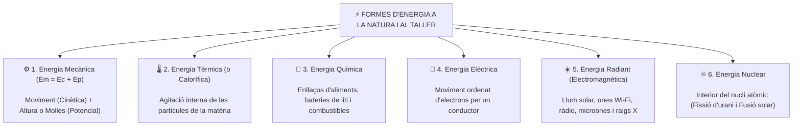
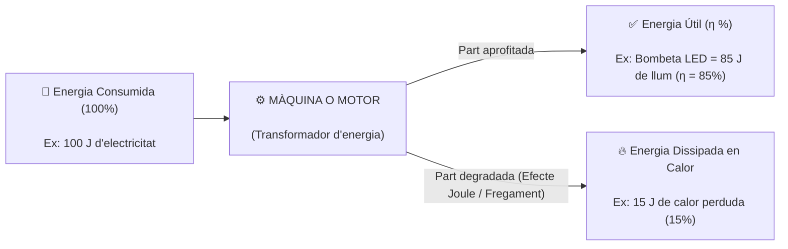
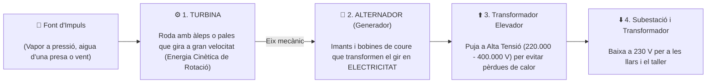

---

layout: default

title: "UD4: L'Energia (Unitat Completa i Exercicis Aules) — Ciències Naturals · 1r FPB"

course_root: ".."

badge: "1r FPB · Ciències Naturals · UD4"

prev_url: "../nat03/index.html"

prev_label: "⬅️ UD3 Energia Interna del Planeta"

next_url: "../nat05/index.html"

next_label: "UD5 La Calor i la Temperatura ➡️"

---


# 🔬 UD4: L'Energia — Temari Complet i Exercicis Diaris per a Aules


En aquesta pàgina tens tant l'**accés directe a cada sessió diària individual** (amb els seus **15 exercicis diaris** i el seu **botó de descàrrega de PDF per a pujar a Aules cada dia**) com la **vista completa de tota la unitat** amb tots els apartats i el **Butlletí Global d'Activitats Finals de la Unitat**.


---


## 📑 Planificació Diària de Sessions i Tasques d'Aules (UD4)


| Sessió | Apartat del Temari Oficial | Tasca Diària per a Aules | Accés Directe |
| :---: | :--- | :---: | :---: |
| **4.1** | **4.1 Tipus d'energia** | 15 Exercicis Diaris + PDF Aules | [**📖 Teoria + 🎯 15 Exercicis →**](./nat0401.html) · [**🎯 Anar a Exercicis →**](./nat0401.html#activitats) |
| **4.2** | **4.2 Propietats de l'energia** | 15 Exercicis Diaris + PDF Aules | [**📖 Teoria + 🎯 15 Exercicis →**](./nat0402.html) · [**🎯 Anar a Exercicis →**](./nat0402.html#activitats) |
| **4.3** | **4.3 Fonts d'energia** | 15 Exercicis Diaris + PDF Aules | [**📖 Teoria + 🎯 15 Exercicis →**](./nat0403.html) · [**🎯 Anar a Exercicis →**](./nat0403.html#activitats) |
| **4.4** | **4.4 L'ús de l'energia** | 15 Exercicis Diaris + PDF Aules | [**📖 Teoria + 🎯 15 Exercicis →**](./nat0404.html) · [**🎯 Anar a Exercicis →**](./nat0404.html#activitats) |
| **** | **📝 4.5 Activitats Finals i Tasca Global de la Unitat 4 (Aules)** | 21 Exercicis Globals + PDF Aules | [**📝 Fer Tasca Global UD →**](./nat0405.html) · [**🎯 Anar a Exercicis →**](./nat0405.html#activitats) |


---


<div class="interactive-progress-tracker" style="background:var(--bg-card); border:1px solid var(--border); border-radius:8px; padding:16px; margin:20px 0;">

  <div style="display:flex; justify-content:space-between; align-items:center;">

    <span style="font-weight:700; color:var(--text-color);">⚡ Progrés d'aprenentatge (4.1)</span>

    <span class="tracker-count" style="font-weight:700; color:#2563eb;">0 / 12 reptes resolts</span>

  </div>

  <div style="background:#e2e8f0; border-radius:999px; height:8px; overflow:hidden; margin-top:10px;">

    <div class="tracker-fill" style="background:#2563eb; width:0%; height:100%; transition:width 0.3s ease;"></div>

  </div>

</div>


## 📌 4.1 Tipus d'energia {#nat0401}


En física i tecnologia definim l'**energia** com la **capacitat que tenen els cossos o sistemes materials per produir canvis en ells mateixos o en altres cossos**, és a dir, per realitzar un treball mecànic, posar un objecte en moviment, deformar-lo, il·luminar-lo o modificar la seua temperatura. L'energia no és un objecte material que puguem tocar ni pesar en una balança, però percebem immediatament els seus efectes quan encenem un trepant al taller, carreguem el telèfon mòbil o escalfem aigua.


---


## 1. En quines Unitats es Mesura l'Energia?


Tot i que al Sistema Internacional d'Unitats (SI) l'energia té una unitat oficial única, en la vida professional utilitzem tres unitats diferents segons l'àmbit (física, nutrició/calor o electricitat):


1. **El Joule (J) — Unitat del Sistema Internacional (SI):** En honor al físic anglès James Prescott Joule. Un Joule (1 J) és l'energia necessària per moure un objecte aplicant una força d'1 Newton al llarg d'1 metre ($1\text{ J} = 1\text{ N}\cdot\text{m}$). Com que 1 J és una quantitat molt menuda, sovint s'utilitza el **quilojoule (1  kJ = 1.000  J)**.

2. **La Caloria (cal) i la Quilocaloria (kcal) — Nutrició i Processos Tèrmics:** Una caloria és la quantitat d'energia necessària per apujar 1 °C la temperatura d'1 gram d'aigua líquida. A les etiquetes dels aliments s'utilitza sempre la **quilocaloria (1  kcal = 1.000  cal)**. L'equivalència exacta és:

$$1\text{ cal} = 4{,}18\text{ J} \quad \Longleftrightarrow \quad 1\text{ kcal} = 4.180\text{ J} = 4{,}18\text{ kJ}$$

3. **El Quilowatt-hora (kWh) — Factura Elèctrica i Consum Domèstic/Industrial:** És l'energia que consumeix una màquina d'1 quilowatt (1.000 W) de potència funcionant durant 1 hora seguida (3.600 segons):

$$1\text{ kWh} = 1.000\text{ W} \times 3.600\text{ s} = 3.600.000\text{ J} = 3{,}6\text{ MJ}$$


| Unitat de Mesura | Símbol | Equivalència en Joules (J) | Àmbit Principal d'Ús Professional |
| :--- | :---: | :---: | :--- |
| **Joule / Quilojoule** | J / kJ | 1  kJ = 1.000  J | Unitat oficial del Sistema Internacional (SI), física i mecànica |
| **Caloria / Quilocaloria** | cal / kcal | $1\text{ cal} = 4{,}18\text{ J}$ (1  kcal = 4.180  J) | Dietètica, etiquetatge d'aliments, calefacció i processos tèrmics |
| **Quilowatt-hora** | kWh | 1  kWh = 3.600.000  J | Comptadors de llum i factures de consum elèctric |


---


## 2. Classificació dels 6 Grans Tipus d'Energia


Segons com es manifesta en la natura i al nostre entorn tecnològic, classifiquem l'energia en sis formes fonamentals:





### 1. Energia Mecànica ($E_m$)

És l'energia relacionada amb la posició i el moviment dels cossos macroscòpics. És la suma de dues energies ($E_m = E_c + E_p$):

- **Energia Cinètica ($E_c$):** És l'energia que posseeix qualsevol cos pel fet d'**estar en moviment** (a una velocitat v). Depèn de la massa (m, en kg) i del quadrat de la velocitat (v, en m/s):

$$E_c = \frac{1}{2} \cdot m \cdot v^2$$

  *Exemple:* Un cotxe circulant per l'autopista, el vent que mou un molí o un martell colpejant un clau. Com que la velocitat va al quadrat, si un vehicle duplica la seua velocitat, la seua energia cinètica d'impacte es multiplica per quatre!

- **Energia Potencial ($E_p$):** És l'energia emmagatzemada per la posició o deformació d'un cos:

  - **Potencial gravitatòria:** La que té un cos per estar situat a una certa **altura (h)** sobre el sòl, sotmès a la gravetat ($g \approx 9{,}8\text{ m/s}^2$):

$$E_p = m \cdot g \cdot h$$

    *Exemple:* L'aigua acumulada a la part alta d'una presa o una caixa d'eines en una prestatgeria alta.

  - **Potencial elàstica:** Emmagatzemada en un cos elàstic deformat, com la molla comprimida d'un amortidor o un arc tensat.


### 2. Energia Tèrmica (o Calorífica)

És l'energia interna deguda al **moviment d'agitació i vibració de les partícules (àtoms i molècules)** que formen un cos. Com més ràpid vibren les partícules, major és la seua temperatura i la seua energia tèrmica. *Exemples:* El soldador d'estany calent al taller d'electrònica, l'aigua d'un radiador de calefacció o el dissipador de calor del microprocessador (CPU).


### 3. Energia Química

És l'energia emmagatzemada en els **enllaços químics** dels àtoms i molècules, que s'allibera quan es produeix una reacció química. *Exemples:*

- Els **aliments** que mengem (la glucosa reacciona amb l'oxigen a les nostres cèl·lules per donar-nos energia).

- Les **bateries d'ió-liti** d'un portàtil, un mòbil o un tornavís elèctric.

- Els **combustibles** com la gasolina, el gasoil, el butà o la fusta quan es cremen (combustió).


### 4. Energia Elèctrica

És l'energia associada al **moviment ordenat de càrregues elèctriques (electrons)** a través d'un material conductor metàl·lic (com un cable de coure) quan hi ha una diferència de potencial (voltatge). És la forma d'energia més versàtil a la indústria i a les llars perquè es transporta fàcilment per cables i alimenta ordinadors, motors, bombetes LED i electrodomèstics.


### 5. Energia Radiant (o Electromagnètica / Lluminosa)

És l'energia que transporten les **ones electromagnètiques**, amb la propietat única que **es pot propagar pel buit** (sense necessitat de cap medi material) a la velocitat de la llum (300.000 km/s). *Exemples:* La llum i la radiació del Sol, les ones d'una xarxa **Wi-Fi** o **Bluetooth**, les ones de ràdio i telefonia 5 G, els raigs infrarojos d'un comandament a distància o les microones.


### 6. Energia Nuclear (o Atòmica)

És l'enorme energia emmagatzemada al **nucli dels àtoms**, que es pot alliberar mitjançant dos processos:

- **Fissió nuclear:** Trencament d'un nucli atòmic molt pesant (com l'**urani-235** o el plutoni) en ser bombardejat amb neutrons; és el procés que s'utilitza actualment a les **centrals nuclears** (com la de Cofrents, a València).

- **Fusió nuclear:** Unió de dos nuclis atòmics molt lleugers (isòtops d'**hidrogen** com el deuteri i el triti) per formar un nucli d'heli a milions de graus; és l'energia que fa brillar el **Sol i les estreles**.


---


> [!TIP]

> ### 🧮 Exemple Resolt de Taller: Càlcul d'Energia Mecànica

> Un operari sosté una caixa d'eines de **$m = 4\text{ kg}$** a una prestatgeria situada a **$h = 2\text{ m}$** d'altura (prenent $g = 10\text{ m/s}^2$ per simplificar).

> - Quina **energia potencial ($E_p$)** té la caixa a la prestatgeria?

>   $$E_p = m \cdot g \cdot h = 4\text{ kg} \cdot 10\text{ m/s}^2 \cdot 2\text{ m} = \mathbf{80\text{ J}}$$

> - Si la caixa cau i abans de tocar a terra porta una velocitat de **$v = 6\text{ m/s}$**, quina és la seua **energia cinètica ($E_c$)** en eixe instant?

>   $$E_c = \frac{1}{2} \cdot m \cdot v^2 = 0{,}5 \cdot 4\text{ kg} \cdot (6\text{ m/s})^2 = 2 \cdot 36 = \mathbf{72\text{ J}}$$


---


> [!NOTE]

> ### 💡 Resum de Conceptes Clau

> - L'**energia** és la capacitat dels cossos per produir canvis o treball. Al SI es mesura en **Joules (J)**, en nutrició en **calories/quilocalories** ($1\text{ cal} = 4{,}18\text{ J}$) i en electricitat en **quilowatts-hora (kWh)**.

> - L'**energia mecànica** és la suma de l'**energia cinètica** del moviment ($E_c = \frac{1}{2}mv^2$) i l'**energia potencial** de l'altura ($E_p = mgh$).

> - Els altres grans tipus són l'energia **tèrmica** (agitació de partícules), **química** (aliments, bateries, combustibles), **elèctrica** (corrent d'electrons), **radiant** (llum i ones Wi-Fi) i **nuclear** (fissió i fusió).


---


## 🎯 Activitats i Autoavaluació Interactiva


<div class="interactive-progress-tracker">

  <div class="tracker-header">

    <span>🎮 <strong>Zona d'Entrenament FPB:</strong> <span class="tracker-count">0 reptes resolts</span></span>

    <span class="tracker-pts">⭐ 0 punts</span>

  </div>

  <div class="tracker-bar"><div class="tracker-fill" style="width: 0%;"></div></div>

</div>


### 1. Qüestionari d'Autoavaluació Tipus Test (MCQ)


<div class="interactive-mcq" data-quiz-id="ca1_nat4_1_mcq1" data-answer="C" data-hint="Les bateries, els aliments i els combustibles emmagatzemen energia química als seus enllaços.">

  <p class="mcq-question"><strong>1. Quin tipus d'energia es troba emmagatzemada a l'interior de la bateria d'un telèfon mòbil apagat i també als aliments que esmorzem abans d'anar a classe?</strong></p>

  <div class="mcq-options">

    <button type="button" class="btn-mcq-opt" data-opt="A">A) Energia nuclear de fissió</button>

    <button type="button" class="btn-mcq-opt" data-opt="B">B) Energia potencial gravitatòria</button>

    <button type="button" class="btn-mcq-opt" data-opt="C">C) Energia química</button>

    <button type="button" class="btn-mcq-opt" data-opt="D">D) Energia radiant electromagnètica</button>

  </div>

  <div class="quiz-feedback"></div>

</div>


<div class="interactive-mcq" data-quiz-id="ca1_nat4_1_mcq2" data-answer="A" data-hint="Aplica la fórmula Ec = 0,5 · m · v² = 0,5 · 2 · (10)² = 1 · 100 = 100 J.">

  <p class="mcq-question"><strong>2. Quant val l'energia cinètica ($E_c = \frac{1}{2}mv^2$) d'un dron de massa $m = 2\text{ kg}$ que vola horitzontalment a una velocitat constant de $v = 10\text{ m/s}$?</strong></p>

  <div class="mcq-options">

    <button type="button" class="btn-mcq-opt" data-opt="A">A) 100 J</button>

    <button type="button" class="btn-mcq-opt" data-opt="B">B) 20 J</button>

    <button type="button" class="btn-mcq-opt" data-opt="C">C) 10 J</button>

    <button type="button" class="btn-mcq-opt" data-opt="D">D) 200 J</button>

  </div>

  <div class="quiz-feedback"></div>

</div>


<div class="interactive-mcq" data-quiz-id="ca1_nat4_1_mcq3" data-answer="B" data-hint="Les bateries, els combustibles i els aliments acumulen energia química.">

  <p class="mcq-question"><strong>3. Quina forma d'energia emmagatzema la bateria de liti d'un telèfon mòbil, la gasolina d'un cotxe o un entrepà que ens mengem?</strong></p>

  <div class="mcq-options">

    <button type="button" class="btn-mcq-opt" data-opt="A">A) Energia nuclear de fusió</button>

    <button type="button" class="btn-mcq-opt" data-opt="B">B) Energia química (emmagatzemada als enllaços de les substàncies)</button>

    <button type="button" class="btn-mcq-opt" data-opt="C">C) Energia potencial gravitatòria</button>

    <button type="button" class="btn-mcq-opt" data-opt="D">D) Energia eòlica</button>

  </div>

  <div class="quiz-feedback"></div>

</div>


<div class="interactive-mcq" data-quiz-id="ca1_nat4_1_mcq4" data-answer="B" data-hint="Com que la velocitat està elevada al quadrat, si dupliques la velocitat d'un cotxe, la seua energia cinètica d'impacte es multiplica per quatre!">

  <p class="mcq-question"><strong>4. De quins dos factors depèn l'energia cinètica (Ec = ½·m·v²) d'un vehicle que circula per la carretera?</strong></p>

  <div class="mcq-options">

    <button type="button" class="btn-mcq-opt" data-opt="A">A) Del color de la carrosseria i la marca</button>

    <button type="button" class="btn-mcq-opt" data-opt="B">B) De la seua massa (m) i del quadrat de la seua velocitat (v)</button>

    <button type="button" class="btn-mcq-opt" data-opt="C">C) Només de l'hora del dia</button>

    <button type="button" class="btn-mcq-opt" data-opt="D">D) De l'altura sobre el nivell del mar</button>

  </div>

  <div class="quiz-feedback"></div>

</div>

---


### 2. Activitats de Vertader (V) o Fals (F)


<div class="interactive-vf" data-quiz-id="ca1_nat4_1_vf1" data-answer="V" data-hint="VERTADER: La unitat oficial d'energia al Sistema Internacional és el Joule (J), i 1 caloria equival a 4,18 Joules.">

  <span class="vf-statement"><strong>a) La unitat d'energia en el Sistema Internacional (SI) és el Joule (J), i una caloria (1 cal) equival aproximadament a $4{,}18\text{ Joules}$.</strong></span>

  <div class="vf-buttons">

    <button type="button" class="btn-vf" data-opt="V">V</button>

    <button type="button" class="btn-vf" data-opt="F">F</button>

  </div>

  <div class="quiz-feedback"></div>

</div>


<div class="interactive-vf" data-quiz-id="ca1_nat4_1_vf2" data-answer="F" data-hint="FALS: L'energia radiant o electromagnètica (com la llum del Sol) és l'única que es pot propagar pel buit de l'espai sense necessitat de matèria.">

  <span class="vf-statement"><strong>b) L'energia radiant o electromagnètica (com la llum solar o les ones de ràdio) no pot viatjar mai pel buit de l'espai exterior.</strong></span>

  <div class="vf-buttons">

    <button type="button" class="btn-vf" data-opt="V">V</button>

    <button type="button" class="btn-vf" data-opt="F">F</button>

  </div>

  <div class="quiz-feedback"></div>

</div>


<div class="interactive-vf" data-quiz-id="ca1_nat4_1_vf3" data-answer="V" data-hint="VERTADER: Em = Ec + Ep.">

  <span class="vf-statement"><strong>c) L'energia mecànica d'un cos és la suma de la seua energia cinètica (moviment) i la seua energia potencial (altura o posició).</strong></span>

  <div class="vf-buttons">

    <button type="button" class="btn-vf" data-opt="V">V</button>

    <button type="button" class="btn-vf" data-opt="F">F</button>

  </div>

  <div class="quiz-feedback"></div>

</div>


<div class="interactive-vf" data-quiz-id="ca1_nat4_1_vf4" data-answer="F" data-hint="FALS: Com que està quiet (v = 0) la seua energia cinètica és zero; té energia potencial gravitatòria per estar a 2 metres d'altura.">

  <span class="vf-statement"><strong>d) Un llibre quiet damunt d'una prestatgeria a 2 metres d'altura té molta energia cinètica i zero energia potencial.</strong></span>

  <div class="vf-buttons">

    <button type="button" class="btn-vf" data-opt="V">V</button>

    <button type="button" class="btn-vf" data-opt="F">F</button>

  </div>

  <div class="quiz-feedback"></div>

</div>

---


### 3. Exercicis de Resposta Breu i Vocabulari Tècnic


<div class="interactive-quiz" data-quiz-id="ca1_nat4_1_q1" data-answer="cinetica|cinètica|energia cinetica|energia cinètica" data-hint="És la part de l'energia mecànica associada a la velocitat i al moviment.">

  <div class="quiz-question">✍️ Com s'anomena el tipus d'energia mecànica que posseeix un cos pel fet d'estar en moviment a una determinada velocitat?</div>

  <div class="quiz-controls">

    <input type="text" class="quiz-input" placeholder="Escriu el tipus d'energia...">

    <button type="button" class="btn-quiz-check">Comprovar</button>

  </div>

  <div class="quiz-feedback"></div>

</div>


<div class="interactive-quiz" data-quiz-id="ca1_nat4_1_q2" data-answer="kwh|quilowatt-hora|quilowatt hora|kilowatt-hora" data-hint="S'escriu abreujadament kWh i apareix cada mes al rebut de la llum.">

  <div class="quiz-question">✍️ Quina unitat d'energia (símbol o nom) s'utilitza en la factura elèctrica de les llars i tallers per mesurar el consum d'electricitat?</div>

  <div class="quiz-controls">

    <input type="text" class="quiz-input" placeholder="Escriu la unitat o el seu símbol (ex: kWh)...">

    <button type="button" class="btn-quiz-check">Comprovar</button>

  </div>

  <div class="quiz-feedback"></div>

</div>


<div class="interactive-quiz" data-quiz-id="ca1_nat4_1_q3" data-answer="Joule|joule|el Joule" data-hint="En honor al físic James Prescott Joule.">

  <div class="quiz-question">✍️ Quina és la unitat oficial d'energia i treball en el Sistema Internacional d'Unitats (símbol J)?</div>

  <div class="quiz-controls">

    <input type="text" class="quiz-input" placeholder="Escriu la teua resposta...">

    <button type="button" class="btn-quiz-check">Comprovar</button>

  </div>

  <div class="quiz-feedback"></div>

</div>


<div class="interactive-quiz" data-quiz-id="ca1_nat4_1_q4" data-answer="3000|3.000" data-hint="Ec = 0,5 × 60 × 100 = 3.000 J.">

  <div class="quiz-question">✍️ Calcula l'energia cinètica (en Joules) d'un patinet elèctric i el seu conductor que tenen una massa total de 60 kg i es mouen a v = 10 m/s (Ec = 0,5 × 60 × 10²):</div>

  <div class="quiz-controls">

    <input type="text" class="quiz-input" placeholder="Escriu la teua resposta...">

    <button type="button" class="btn-quiz-check">Comprovar</button>

  </div>

  <div class="quiz-feedback"></div>

</div>

---


### 4. Exercicis de Raonament i Desenvolupament Escrit (Tasca d'Aula)


<div class="interactive-open-response" data-question-id="ca1_nat4_1_open1">

  <div class="open-question">✍️ <strong>Identificació d'energies al taller d'informàtica:</strong> Observa un ordinador portàtil o un telèfon mòbil mentre està funcionant connectat a la xarxa Wi-Fi i reproduint un vídeo. Identifica i explica on estan presents almenys QUATRE tipus d'energia diferents (química, elèctrica, radiant/lluminosa, tèrmica o sonora/mecànica) en aquest dispositiu.</div>

  <textarea class="open-response-input" rows="4" placeholder="Explica quina part del mòbil o portàtil té energia química, quina té elèctrica, radiant i tèrmica..."></textarea>

</div>


<div class="interactive-open-response" data-question-id="ca1_nat4_1_open2">

  <div class="open-question">✍️ <strong>Exercici 2 (Càlcul d'Energia Potencial i Cinètica al taller):</strong> Una caixa d'eines de 10 kg està situada en una prestatgeria a 3 metres d'altura (g = 9,8 m/s²). 1) Calcula la seua energia potencial gravitatòria (Ep = m·g·h). 2) Si la caixa cau, quina serà la seua energia cinètica just abans de tocar el terra?</div>

  <textarea class="open-response-input" rows="4" placeholder="1) Ep = 10 × 9,8 × 3 = 294 J. 2) Per conservació de l'energia, tota l'Ep s'haurà transformat en Ec = 294 J..."></textarea>

</div>


<div class="interactive-open-response" data-question-id="ca1_nat4_1_open3">

  <div class="open-question">✍️ <strong>Exercici 3 (Seguretat viària: per què és tan perillós duplicar la velocitat?):</strong> Calcula i compara l'energia cinètica d'una moto de 200 kg quan va a 10 m/s (36 km/h) i quan duplica la velocitat a 20 m/s (72 km/h). Per què la distància de frenada es multiplica per quatre?</div>

  <textarea class="open-response-input" rows="4" placeholder="A 10 m/s: Ec = 0,5 × 200 × 100 = 10.000 J. A 20 m/s: Ec = 0,5 × 200 × 400 = 40.000 J (4 vegades més!)..."></textarea>

</div>

---


<div class="aules-delivery-card" style="border:2px dashed #0284c7; border-radius:8px; padding:16px; background:#f0f9ff; margin:24px 0;">

  <h3 style="margin-top:0; color:#0369a1;">📦 Lliurament d'Activitats d'Aules (Act 4.1)</h3>

  <p>Genera el teu document de tasca d'aquest apartat amb el teu nom i puntuació obtinguda.</p>

  <div style="display:flex; gap:12px; align-items:center; flex-wrap:wrap;">

    <input type="text" class="aules-student-name" placeholder="Cognoms, Nom de l'Alumne/a" style="padding:8px 12px; border:1px solid #94a3b8; border-radius:4px; flex-grow:1; min-width:240px;">

    <button class="btn-generate-aules-pdf" data-unit="NAT04" data-activity="Act01" data-module="CA" style="padding:8px 16px; background:#0284c7; color:#fff; border:none; border-radius:4px; font-weight:600; cursor:pointer;">📄 Descarregar PDF per a Aules</button>

  </div>

</div>


---


<div class="interactive-progress-tracker" style="background:var(--bg-card); border:1px solid var(--border); border-radius:8px; padding:16px; margin:20px 0;">

  <div style="display:flex; justify-content:space-between; align-items:center;">

    <span style="font-weight:700; color:var(--text-color);">⚡ Progrés d'aprenentatge (4.2)</span>

    <span class="tracker-count" style="font-weight:700; color:#2563eb;">0 / 12 reptes resolts</span>

  </div>

  <div style="background:#e2e8f0; border-radius:999px; height:8px; overflow:hidden; margin-top:10px;">

    <div class="tracker-fill" style="background:#2563eb; width:0%; height:100%; transition:width 0.3s ease;"></div>

  </div>

</div>


## 📌 4.2 Propietats de l'energia {#nat0402}


Per què necessitem posar ventiladors i dissipadors d'alumini dins de la caixa d'un ordinador? Per què cap motor del món pot funcionar indefinidament sense consumir combustible ni electricitat? Totes aquestes preguntes s'expliquen mitjançant les **cinc propietats fonamentals de l'energia**, que regeixen el funcionament de totes les màquines de l'univers.


---


## 1. Les 5 Propietats Fonamentals de l'Energia


### 1. L'Energia es Transforma

L'energia no roman sempre de la mateixa forma, sinó que **es transforma contínuament d'un tipus en un altre** mitjançant dispositius conversors:

- **En una bombeta LED o pantalla de monitor:** L'energia **elèctrica** es transforma en energia **radiant (lluminosa)** i una petita part en energia **tèrmica**.

- **En el motor elèctric d'un trepant o ventilador:** L'energia **elèctrica** es transforma en energia **mecànica (cinètica de rotació)**, so i calor per fregament.

- **En una placa solar fotovoltaica:** L'energia **radiant** del Sol es transforma directament en energia **elèctrica**.

- **En una bateria mentre es carrega i es descarrega:** En carregar el mòbil, l'energia **elèctrica** es transforma en energia **química**; en usar-lo, l'energia **química** torna a transformar-se en **elèctrica**.

- **En el nostre propi cos (músculs):** L'energia **química** dels aliments es transforma en energia **mecànica** (caminar, treballar) i en energia **tèrmica** (mantenir els 36,5 °C de temperatura corporal).


### 2. L'Energia es Conserva (Principi de Conservació de l'Energia)

És una de les lleis més importants de la física (Primera Llei de la Termodinàmica), enunciada així:


> **«L'energia no es crea ni es destrueix; només es transforma d'unes formes en altres. En qualsevol transformació, la quantitat total d'energia de l'univers roman sempre constant.»**


$$\text{Energia Total Inicial (Consumida)} = \text{Energia Útil Obtinguda} + \text{Energia Dissipada (Calor)}$$


Per exemple, quan deixem caure una pilota des d'una certa altura, a mesura que baixa perd **energia potencial ($E_p$)** perquè té menys altura, però guanya exactament la mateixa quantitat d'**energia cinètica ($E_c$)** perquè cada vegada va més ràpid. Quan xoca contra el sòl i s'acaba aturant, l'energia mecànica tampoc ha desaparegut: s'ha transformat en so i en un lleuger escalfament del paviment i de la pilota.


### 3. L'Energia es Transfereix d'uns Cossos a uns Altres

L'energia pot passar d'un cos a un altre mitjançant dos mecanismes principals:

- **En forma de Treball mecànic (W):** Quan un cos exerceix una força sobre un altre i el desplaça (per exemple, quan la nostra mà empeny un carret d'eines i li transfereix energia cinètica).

- **En forma de Calor (Q):** Quan posem en contacte dos cossos a diferent temperatura, l'energia tèrmica es transfereix espontàniament sempre **des del cos més calent cap al cos més fred** fins que tots dos arriben a la mateixa temperatura (**equilibri tèrmic**).


### 4. L'Energia es pot Transportar i Emmagatzemar

- **Transport:** Podem portar l'energia des del lloc on es produeix fins al lloc on es consumeix a centenars de quilòmetres. Per exemple, l'energia elèctrica viatja pels **cables de les línies d'alta tensió**, i els combustibles viatgen per **oleoductes, gasoductes o camions cisterna**.

- **Emmagatzematge:** Les formes d'energia com la química o la potencial es poden guardar per a usar-les quan calga: en **bateries d'ió-liti**, en dipòsits de gasolina o acumulant aigua al capdamunt d'un **embassament hidroelèctric**. En canvi, la llum o la calor són molt difícils d'emmagatzemar durant molt de temps.


### 5. L'Energia es Degrada

Tot i que la quantitat total d'energia sempre es conserva, **la seua qualitat disminueix** en cada transformació. En qualsevol màquina real, una part de l'energia es transforma inevitablement en **energia tèrmica (calor dissipada a l'ambient)** a causa del **fregament mecànic** entre peces o de l'**efecte Joule** (escalfament dels cables i microxips quan hi passa el corrent elèctric).


Aquesta calor escampada per l'aire de l'habitació ja no es pot tornar a recollir per fer moure el motor ni encendre la pantalla: diem que **l'energia s'ha degradat** (és energia perduda o no aprofitable).


---


## 2. El Rendiment Energètic ($\eta$) d'una Màquina


Com que tota màquina perd una part de l'energia en forma de calor degradada, definim el **rendiment energètic ($\eta$, lletra grega *eta*)** com el percentatge d'energia consumida que es converteix realment en **energia útil**:


$$\eta\,(\%) = \frac{E_{\text{útil}}}{E_{\text{consumida}}} \times 100$$





Com que sempre hi ha pèrdues per calor, el rendiment d'una màquina real **és sempre inferior al 100%** ($\eta < 100\%$). Per això en física és impossible construir un *mòbil perpetu* (una màquina que funcione eternament sense aportació d'energia externa):


| Dispositiu o Màquina | Transformació Principal | Energia Útil ($\eta$) | Energia Degradada en Calor |
| :--- | :--- | :---: | :---: |
| **Bombeta incandescent antiga (de filament)** | Elèctrica $\rightarrow$ Lluminosa | **$5\% - 10\%$** | $90\% - 95\%$ (s'escalfa moltíssim!) |
| **Bombeta o pantalla LED moderna** | Elèctrica $\rightarrow$ Lluminosa | **$80\% - 90\%$** | Només $10\% - 20\%$ |
| **Motor de combustió d'un cotxe de gasolina** | Química $\rightarrow$ Mecànica | **$25\% - 30\%$** | $70\% - 75\%$ (radiador i tub d'escapament) |
| **Motor elèctric d'un vehicle o eina de taller** | Elèctrica $\rightarrow$ Mecànica | **$85\% - 95\%$** | Només $5\% - 15\%$ |


---


> [!TIP]

> ### 🧮 Problema Resolt: Càlcul del Rendiment d'una Font d'Alimentació de PC

> Una font d'alimentació d'un ordinador amb certificació *80 Plus* consumeix **$E_{\text{consumida}} = 500\text{ J}$** de l'endoll de la paret cada segon, i lliura **$E_{\text{útil}} = 425\text{ J}$** d'electricitat contínua útil a la placa base i la targeta gràfica.

> 1. **Quin és el rendiment ($\eta$) de la font d'alimentació?**

>    $$\eta = \frac{E_{\text{útil}}}{E_{\text{consumida}}} \times 100 = \frac{425\text{ J}}{500\text{ J}} \times 100 = 0{,}85 \times 100 = \mathbf{85\%}$$

> 2. **Quanta energia es degrada en forma de calor cada segon?**

>    $$E_{\text{dissipada}} = 500\text{ J} - 425\text{ J} = \mathbf{75\text{ J}}\text{ (que el ventilador ha d'expulsar a l'exterior)}$$


---


> [!NOTE]

> ### 💡 Resum de Conceptes Clau

> - Les 5 propietats de l'energia són: **es transforma**, **es conserva** (la suma total mai canvia), **es transfereix** (com a treball o calor), **es transporta/emmagatzema** i **es degrada** (es perd qualitat en dissipar-se com a calor irrecuperable).

> - El **rendiment energètic** es calcula amb la fórmula $\eta = \frac{E_{\text{útil}}}{E_{\text{consumida}}} \times 100$ i en qualsevol màquina real sempre és menor del 100%.


---


## 🎯 Activitats i Autoavaluació Interactiva


<div class="interactive-progress-tracker">

  <div class="tracker-header">

    <span>🎮 <strong>Zona d'Entrenament FPB:</strong> <span class="tracker-count">0 reptes resolts</span></span>

    <span class="tracker-pts">⭐ 0 punts</span>

  </div>

  <div class="tracker-bar"><div class="tracker-fill" style="width: 0%;"></div></div>

</div>


### 1. Qüestionari d'Autoavaluació Tipus Test (MCQ)


<div class="interactive-mcq" data-quiz-id="ca1_nat4_2_mcq1" data-answer="B" data-hint="Aplica la fórmula: Rendiment = (Energia útil / Energia consumida) × 100 = (160 / 200) × 100 = 80%.">

  <p class="mcq-question"><strong>1. Un motor elèctric del taller consumeix 200 J d'energia elèctrica de la xarxa i produeix 160 J de treball mecànic útil (mentre que els 40 J restants es perden en calor per fregament). Quin és el seu rendiment energètic ($\eta$)?</strong></p>

  <div class="mcq-options">

    <button type="button" class="btn-mcq-opt" data-opt="A">A) 20%</button>

    <button type="button" class="btn-mcq-opt" data-opt="B">B) 80%</button>

    <button type="button" class="btn-mcq-opt" data-opt="C">C) 125%</button>

    <button type="button" class="btn-mcq-opt" data-opt="D">D) 40%</button>

  </div>

  <div class="quiz-feedback"></div>

</div>


<div class="interactive-mcq" data-quiz-id="ca1_nat4_2_mcq2" data-answer="D" data-hint="Quan una part de l'energia es transforma en calor que es dissipa a l'ambient i no es pot recuperar, diem que l'energia es degrada.">

  <p class="mcq-question"><strong>2. Quina propietat de l'energia explica que en qualsevol màquina o ordinador una part de l'energia es transforme sempre en calor que s'escapa a l'aire i ja no es pot aprofitar?</strong></p>

  <div class="mcq-options">

    <button type="button" class="btn-mcq-opt" data-opt="A">A) Que l'energia es crea del no-res</button>

    <button type="button" class="btn-mcq-opt" data-opt="B">B) Que l'energia desapareix de l'univers</button>

    <button type="button" class="btn-mcq-opt" data-opt="C">C) Que l'energia té un rendiment del 200%</button>

    <button type="button" class="btn-mcq-opt" data-opt="D">D) Que l'energia es degrada (perd qualitat en dissipar-se en forma de calor no recuperable)</button>

  </div>

  <div class="quiz-feedback"></div>

</div>


<div class="interactive-mcq" data-quiz-id="ca1_nat4_2_mcq3" data-answer="B" data-hint="El motor elèctric rep corrent elèctric i el converteix en moviment mecànic de rotació.">

  <p class="mcq-question"><strong>3. Quina transformació d'energia principal realitza el motor elèctric d'un ventilador o d'un trepant del taller?</strong></p>

  <div class="mcq-options">

    <button type="button" class="btn-mcq-opt" data-opt="A">A) Transforma energia química en energia nuclear</button>

    <button type="button" class="btn-mcq-opt" data-opt="B">B) Transforma energia elèctrica en energia mecànica cinètica (i una part es degrada en calor)</button>

    <button type="button" class="btn-mcq-opt" data-opt="C">C) Transforma energia lluminosa en fred</button>

    <button type="button" class="btn-mcq-opt" data-opt="D">D) Crea energia del no-res</button>

  </div>

  <div class="quiz-feedback"></div>

</div>


<div class="interactive-mcq" data-quiz-id="ca1_nat4_2_mcq4" data-answer="B" data-hint="Rendiment = (450 / 500) × 100 = 90%.">

  <p class="mcq-question"><strong>4. Si una font d'alimentació de PC amb certificació 80 PLUS consumeix 500 J de la xarxa i lliura 450 J útils als components (perdent 50 J en calor), quin és el seu rendiment energètic?</strong></p>

  <div class="mcq-options">

    <button type="button" class="btn-mcq-opt" data-opt="A">A) 50%</button>

    <button type="button" class="btn-mcq-opt" data-opt="B">B) 90% (450 / 500 × 100)</button>

    <button type="button" class="btn-mcq-opt" data-opt="C">C) 110%</button>

    <button type="button" class="btn-mcq-opt" data-opt="D">D) 10%</button>

  </div>

  <div class="quiz-feedback"></div>

</div>

---


### 2. Activitats de Vertader (V) o Fals (F)


<div class="interactive-vf" data-quiz-id="ca1_nat4_2_vf1" data-answer="V" data-hint="VERTADER: És l'enunciat exacte del Principi de Conservació de l'Energia.">

  <span class="vf-statement"><strong>a) Segons el Principi de Conservació de l'Energia, l'energia no es crea ni es destrueix, només es transforma d'unes formes en altres mantenint constant la quantitat total.</strong></span>

  <div class="vf-buttons">

    <button type="button" class="btn-vf" data-opt="V">V</button>

    <button type="button" class="btn-vf" data-opt="F">F</button>

  </div>

  <div class="quiz-feedback"></div>

</div>


<div class="interactive-vf" data-quiz-id="ca1_nat4_2_vf2" data-answer="F" data-hint="FALS: La calor es transfereix sempre espontàniament des del cos més calent cap al cos més fred, mai a l'inrevés.">

  <span class="vf-statement"><strong>b) Quan posem en contacte un cos fred i un cos calent, la calor passa espontàniament del cos més fred cap al cos més calent.</strong></span>

  <div class="vf-buttons">

    <button type="button" class="btn-vf" data-opt="V">V</button>

    <button type="button" class="btn-vf" data-opt="F">F</button>

  </div>

  <div class="quiz-feedback"></div>

</div>


<div class="interactive-vf" data-quiz-id="ca1_nat4_2_vf3" data-answer="V" data-hint="VERTADER: La calor dissipada a l'ambient és la forma més degradada d'energia.">

  <span class="vf-statement"><strong>c) En qualsevol màquina real, una part de l'energia sempre es degrada i es perd en forma de calor per fregament o efecte Joule, per la qual cosa el rendiment mai arriba al 100%.</strong></span>

  <div class="vf-buttons">

    <button type="button" class="btn-vf" data-opt="V">V</button>

    <button type="button" class="btn-vf" data-opt="F">F</button>

  </div>

  <div class="quiz-feedback"></div>

</div>


<div class="interactive-vf" data-quiz-id="ca1_nat4_2_vf4" data-answer="F" data-hint="FALS: No crea energia del no-res; transforma l'energia radiant lluminosa del Sol en energia elèctrica.">

  <span class="vf-statement"><strong>d) Una placa solar fotovoltaica crea energia elèctrica nova a partir del no-res violant el Principi de Conservació.</strong></span>

  <div class="vf-buttons">

    <button type="button" class="btn-vf" data-opt="V">V</button>

    <button type="button" class="btn-vf" data-opt="F">F</button>

  </div>

  <div class="quiz-feedback"></div>

</div>

---


### 3. Exercicis de Resposta Breu i Vocabulari Tècnic


<div class="interactive-quiz" data-quiz-id="ca1_nat4_2_q1" data-answer="rendiment|rendiment energetic|rendiment energètic" data-hint="Es representa amb la lletra grega eta (η) i s'expressa en percentatge (%).">

  <div class="quiz-question">✍️ Com s'anomena la relació percentual entre l'energia útil que obtenim d'una màquina i l'energia total que ha consumit ($\eta = \frac{E_{\text{útil}}}{E_{\text{consumida}}} \times 100$)?</div>

  <div class="quiz-controls">

    <input type="text" class="quiz-input" placeholder="Escriu el concepte físic...">

    <button type="button" class="btn-quiz-check">Comprovar</button>

  </div>

  <div class="quiz-feedback"></div>

</div>


<div class="interactive-quiz" data-quiz-id="ca1_nat4_2_q2" data-answer="electrica|elèctrica|energia electrica|energia elèctrica" data-hint="Els panells fotovoltaics converteixen la llum solar directament en corrent d'electrons.">

  <div class="quiz-question">✍️ En quin tipus d'energia transforma una placa solar fotovoltaica l'energia radiant que rep del Sol?</div>

  <div class="quiz-controls">

    <input type="text" class="quiz-input" placeholder="Escriu el tipus d'energia...">

    <button type="button" class="btn-quiz-check">Comprovar</button>

  </div>

  <div class="quiz-feedback"></div>

</div>


<div class="interactive-quiz" data-quiz-id="ca1_nat4_2_q3" data-answer="85|85%" data-hint="Rendiment = (85 / 100) × 100 = 85%.">

  <div class="quiz-question">✍️ Calcula el rendiment (%) d'una bombeta LED que consumeix 100 J d'energia elèctrica i produeix 85 J de llum útil (i 15 J de calor):</div>

  <div class="quiz-controls">

    <input type="text" class="quiz-input" placeholder="Escriu la teua resposta...">

    <button type="button" class="btn-quiz-check">Comprovar</button>

  </div>

  <div class="quiz-feedback"></div>

</div>


<div class="interactive-quiz" data-quiz-id="ca1_nat4_2_q4" data-answer="calor|energia tèrmica|termica" data-hint="L'energia degradada sempre es dissipa a l'entorn en forma de calor.">

  <div class="quiz-question">✍️ En quina forma d'energia es degrada i es perd l'energia no aprofitada quan s'escalfa un microprocessador o fregeixen les peces d'un motor?</div>

  <div class="quiz-controls">

    <input type="text" class="quiz-input" placeholder="Escriu la teua resposta...">

    <button type="button" class="btn-quiz-check">Comprovar</button>

  </div>

  <div class="quiz-feedback"></div>

</div>

---


### 4. Exercicis de Raonament i Desenvolupament Escrit (Tasca d'Aula)


<div class="interactive-open-response" data-question-id="ca1_nat4_2_open1">

  <div class="open-question">✍️ <strong>Per què s'escalfa el microprocessador (CPU) d'un ordinador?</strong> Un company afirma que si l'energia es conserva sempre, la bateria d'un portàtil no s'hauria d'acabar mai. Explica-li per què s'esgota la bateria i per què cal posar un ventilador i pasta tèrmica damunt del processador, utilitzant els conceptes de conservació de l'energia, degradació en calor (efecte Joule) i rendiment.</div>

  <textarea class="open-response-input" rows="4" placeholder="Explica on va a parar l'energia química de la bateria i per què es dissipa calor..."></textarea>

</div>


<div class="interactive-open-response" data-question-id="ca1_nat4_2_open2">

  <div class="open-question">✍️ <strong>Exercici 2 (Cadena de transformacions d'energia):</strong> Indica quina energia entra i quina energia útil (i degradada) surt en cadascun d'aquests 4 dispositius: 1) Placa solar fotovoltaica, 2) Bateria de mòbil carregant-se, 3) Altaveu, 4) Estufa elèctrica.</div>

  <textarea class="open-response-input" rows="4" placeholder="1) Placa solar: Radiant -> Elèctrica; 2) Bateria carregant: Elèctrica -> Química..."></textarea>

</div>


<div class="interactive-open-response" data-question-id="ca1_nat4_2_open3">

  <div class="open-question">✍️ <strong>Exercici 3 (Comparació de rendiment: Bombeta incandescent vs Bombeta LED):</strong> Una bombeta antiga de filament consumia 100 J per donar només 10 J de llum i 90 J de calor. Una bombeta LED moderna de 10 W aprofita el 85% en llum. Calcula el rendiment de la bombeta antiga i explica per què es van prohibir a Europa.</div>

  <textarea class="open-response-input" rows="4" placeholder="Rendiment antiga = 10% (el 90% es perdia escalfant l'aire). Amb el LED s'estalvia un 85-90% d'electricitat..."></textarea>

</div>

---


<div class="aules-delivery-card" style="border:2px dashed #0284c7; border-radius:8px; padding:16px; background:#f0f9ff; margin:24px 0;">

  <h3 style="margin-top:0; color:#0369a1;">📦 Lliurament d'Activitats d'Aules (Act 4.2)</h3>

  <p>Genera el teu document de tasca d'aquest apartat amb el teu nom i puntuació obtinguda.</p>

  <div style="display:flex; gap:12px; align-items:center; flex-wrap:wrap;">

    <input type="text" class="aules-student-name" placeholder="Cognoms, Nom de l'Alumne/a" style="padding:8px 12px; border:1px solid #94a3b8; border-radius:4px; flex-grow:1; min-width:240px;">

    <button class="btn-generate-aules-pdf" data-unit="NAT04" data-activity="Act02" data-module="CA" style="padding:8px 16px; background:#0284c7; color:#fff; border:none; border-radius:4px; font-weight:600; cursor:pointer;">📄 Descarregar PDF per a Aules</button>

  </div>

</div>


---


<div class="interactive-progress-tracker" style="background:var(--bg-card); border:1px solid var(--border); border-radius:8px; padding:16px; margin:20px 0;">

  <div style="display:flex; justify-content:space-between; align-items:center;">

    <span style="font-weight:700; color:var(--text-color);">⚡ Progrés d'aprenentatge (4.3)</span>

    <span class="tracker-count" style="font-weight:700; color:#2563eb;">0 / 12 reptes resolts</span>

  </div>

  <div style="background:#e2e8f0; border-radius:999px; height:8px; overflow:hidden; margin-top:10px;">

    <div class="tracker-fill" style="background:#2563eb; width:0%; height:100%; transition:width 0.3s ease;"></div>

  </div>

</div>


## 📌 4.3 Fonts d'energia {#nat0403}


S'anomenen **fonts d'energia** els recursos i fenòmens existents a la natura dels quals la humanitat pot obtenir energia utilitzable per a la indústria, el transport, els tallers i les llars.


Abans de classificar-les, convé distingir entre:

- **Fonts d'energia primària:** Són les que s'obtenen directament de la natura tal com es troben (el Sol, el vent, el carbó, el petroli cru, el gas natural, l'urani o els salts d'aigua).

- **Energies secundàries (o vectors energètics):** Són els productes resultants de transformar les energies primàries en centres de transformació (centrals elèctriques o refineries) perquè els puguem usar als nostres aparells, com l'**electricitat** que ix de l'endoll o la **gasolina i el gasoil** refinats a partir del petroli.


Segons la seua capacitat de regeneració a la natura, dividim totes les fonts d'energia en dos grans blocs: **No Renovables** i **Renovables**.


---


## 1. Fonts d'Energia No Renovables


Es troben a l'escorça terrestre en **quantitats limitades** i es van formar durant centenars de milions d'anys. Com que les consumim a un ritme moltíssim més ràpid del que la natura tarda a generar-les, **s'acabaran esgotant**:


```mermaid

flowchart TD

  subgraph FONTS D'ENERGIA NO RENOVABLES (Limitades i esgotables)

    A["⛽ 1. Combustibles Fòssils

(Restes d'éssers vius soterrats fa milions d'anys)"] --> B["🪨 Carbó

Roca sedimentària vegetal (Centrals tèrmiques i siderúrgia)"]

    A --> C["🛢️ Petroli

Líquid espès de plàncton marí (Gasolina, gasoil, plàstics, asfalt)"]

    A --> D["🔥 Gas Natural

Mescla de gasos (Metà CH4) per a calefacció i cicles combinats"]

    E["⚛️ 2. Energia Nuclear de Fissió"] --> F["☢️ Urani-235

Trencament de l'àtom a les centrals nuclears (zero CO2 però residus radioactius)"]

  end

```


### A) Els Combustibles Fòssils (Carbó, Petroli i Gas Natural)

Procedeixen de la descomposició sense oxigen (anaeròbia) de grans masses de plantes i microorganismes marins soterrats fa milions d'anys:

1. **El Carbó:** Roca sedimentària negra rica en carboni d'origen vegetal (boscos de falgueres prehistòriques del període Carbonífer). S'ha utilitzat històricament en centrals tèrmiques i alts forns d'acer. És el combustible fòssil **més contaminant** (emet molt de CO₂ i diòxid de sofre causant de pluja àcida).

2. **El Petroli:** Líquid oliós, fosc i menys dens que l'aigua, format per la transformació de plàncton marí. A les refineries es destil·la per obtenir **gasolina, gasoil, querosè d'aviació, gas butà, olis lubricants, asfalt** per a carreteres i la matèria primera de tots els **plàstics** i fibres sintètiques.

3. **El Gas Natural:** Format principalment pel gas **metà (CH₄)**, sol trobar-se als mateixos jaciments subterranis que el petroli. És el combustible fòssil menys contaminant dels tres i s'utilitza en calderes domèstiques, forns ceràmics (molt importants a Castelló) i centrals elèctriques de cicle combinat.


### B) L'Energia Nuclear de Fissió (Urani-235)

S'obté bombardejant amb neutrons nuclis d'**urani (U-235)** a l'interior del reactor d'una central nuclear (com la central nuclear de **Cofrents**, a València). La fissió allibera una quantitat immensa de calor que bull aigua per moure turbines de vapor:

- **Avantatge clau:** Una sola pastilla d'urani de la mida d'un dit produeix tanta energia com una tona de carbó, subministra electricitat de manera contínua (les 24 hores) i **no emet diòxid de carboni (CO₂)** a l'atmosfera (el núvol blanc que ix de les torres de refrigeració és únicament vapor d'aigua neta!).

- **Inconvenients greus:** Genera **residus altament radioactius** perillosos durant milers d'anys i comporta el risc d'accidents nuclears greus (com Txernòbil el 1986 o Fukushima el 2011).


---


## 2. Fonts d'Energia Renovables


Són aquelles que provenen de recursos naturals **inesgotables** a escala humana (com la radiació del Sol o el vent) o que es regeneren contínuament de manera natural sense esgotar-se:


1. **Energia Solar:** Aprofita la radiació electromagnètica del Sol mitjançant dues tecnologies molt diferents:

   - **Solar Tèrmica:** Utilitza col·lectors solars o miralls per **escalfar aigua** o un fluid (per a aigua calenta sanitària a les cases o per produir vapor en centrals termosolars).

   - **Solar Fotovoltaica:** Utilitza **panells de silici** (efecte fotoelèctric) que transformen la llum del Sol **directament en corrent elèctric**.

2. **Energia Eòlica:** Aprofita l'energia cinètica del vent per fer girar les pales dels **aerogeneradors** (molins de vent moderns), que mouen un generador elèctric situat a la góndola superior.

3. **Energia Hidràulica (o Hidroelèctrica):** Aprofita l'energia potencial i cinètica de l'aigua dels rius acumulada en **embassaments (preses)**. En obrir les comportes, l'aigua cau amb força i fa girar turbines hidràuliques.

4. **Biomassa:** Aprofita la matèria orgànica d'origen vegetal o animal: restes de poda forestal, pinyols d'oliva, **pèl·lets de fusta prensada** per a estufes, o fems ramaders que fermenten per produir **biogàs** i **biocombustibles** per a vehicles (biodièsel i bioetanol).

5. **Energia Geotèrmica:** Aprofita la **calor interna de la Terra** per escalfar aigua o generar electricitat amb vapor subterrani.

6. **Energia Marina (Mareomotriu i Undimotriu):** Aprofita el moviment d'ascens i descens de les **marees** (mareomotriu) o la força mecànica de les **onades del mar** (undimotriu).


---


## 3. Taula Comparativa: Avantatges i Inconvenients


| Tipus de Font Energètica | Principals Avantatges (Pros) | Principals Inconvenients (Contres) |
| :--- | :--- | :--- |
| **Combustibles Fòssils** (Carbó, Petroli, Gas) | Alta densitat energètica, fàcils d'emmagatzemar i transportar, tecnologia molt madura. | **S'esgoten**, emeten CO₂ que causa l'**escalfament global**, provoquen pluja àcida i dependència exterior. |
| **Nuclear de Fissió** (Urani-235) | Gran producció contínua d'electricitat amb **zero emissions de CO₂** durant l'operació. | **Residus radioactius** de llarga durada, l'urani és limitat i alt impacte en cas d'accident. |
| **Solar i Eòlica** | **Inesgotables, gratuïtes a l'origen, netes** (no emeten CO₂) i autòctones (molt de sol i vent a Espanya). | **Intermitència** (depenen de si fa sol o bufa el vent) i impacte visual als paisatges. |
| **Hidràulica i Biomassa** | Renovables i gestionables (poden produir quan no hi ha sol ni vent); la biomassa neteja els boscos prevenint incendis. | Els grans embassaments inunden valls i alteren rius; la biomassa emet CO₂ en cremar-se (tot i que és neutre pel cicle de les plantes). |


---


> [!TIP]

> ### 🔍 Diferència Clau d'Examen: Placa Solar Tèrmica vs. Placa Solar Fotovoltaica

> Quan mires les teulades del teu poble o ciutat, fixa't bé:

> - Els **col·lectors solars tèrmics** porten canonades d'aigua (i sovint un dipòsit cilíndric al damunt): només serveixen per **escalfar aigua** per a la dutxa o la calefacció.

> - Els **panells solars fotovoltaics** són plaques planes de cel·les de silici blau fosc o negre connectades amb cables elèctrics a un inversor: produeixen **electricitat** per als ordinadors i electrodomèstics!


---


> [!NOTE]

> ### 💡 Resum de Conceptes Clau

> - Les fonts **No Renovables** s'esgoten i inclouen els **combustibles fòssils** (**carbó, petroli i gas natural**, que emeten CO₂) i l'**energia nuclear de fissió** (**urani**, sense CO₂ però amb residus radioactius).

> - Les fonts **Renovables** són inesgotables i netes: **solar** (tèrmica i fotovoltaica), **eòlica**, **hidràulica**, **biomassa**, **geotèrmica** i **marina**.


---


## 🎯 Activitats i Autoavaluació Interactiva


<div class="interactive-progress-tracker">

  <div class="tracker-header">

    <span>🎮 <strong>Zona d'Entrenament FPB:</strong> <span class="tracker-count">0 reptes resolts</span></span>

    <span class="tracker-pts">⭐ 0 punts</span>

  </div>

  <div class="tracker-bar"><div class="tracker-fill" style="width: 0%;"></div></div>

</div>


### 1. Qüestionari d'Autoavaluació Tipus Test (MCQ)


<div class="interactive-mcq" data-quiz-id="ca1_nat4_3_mcq1" data-answer="D" data-hint="El carbó, el petroli, el gas natural i l'urani són no renovables; la biomassa, la solar i l'eòlica són renovables.">

  <p class="mcq-question"><strong>1. Quina de les següents llistes conté ÚNICAMENT fonts d'energia RENOVABLES?</strong></p>

  <div class="mcq-options">

    <button type="button" class="btn-mcq-opt" data-opt="A">A) Carbó, petroli, gas natural i urani</button>

    <button type="button" class="btn-mcq-opt" data-opt="B">B) Energia solar, energia eòlica i gasoil</button>

    <button type="button" class="btn-mcq-opt" data-opt="C">C) Energia hidràulica, carbó mineral i butà</button>

    <button type="button" class="btn-mcq-opt" data-opt="D">D) Energia solar fotovoltaica, eòlica, hidràulica, biomassa i geotèrmica</button>

  </div>

  <div class="quiz-feedback"></div>

</div>


<div class="interactive-mcq" data-quiz-id="ca1_nat4_3_mcq2" data-answer="B" data-hint="Les centrals nuclears no cremen combustibles fòssils (no emeten CO2), però generen residus radioactius.">

  <p class="mcq-question"><strong>2. Quina afirmació és CORRECTA sobre l'energia nuclear de fissió que s'utilitza a les centrals nuclears com la de Cofrents?</strong></p>

  <div class="mcq-options">

    <button type="button" class="btn-mcq-opt" data-opt="A">A) És una energia renovable que funciona amb vent i llum solar</button>

    <button type="button" class="btn-mcq-opt" data-opt="B">B) És una energia no renovable basada en l'urani que no emet CO₂ a l'atmosfera, però genera residus radioactius perillosos</button>

    <button type="button" class="btn-mcq-opt" data-opt="C">C) Funciona cremant milers de tones de carbó i petroli cada dia</button>

    <button type="button" class="btn-mcq-opt" data-opt="D">D) Només pot produir electricitat quan fa sol al migdia</button>

  </div>

  <div class="quiz-feedback"></div>

</div>


<div class="interactive-mcq" data-quiz-id="ca1_nat4_3_mcq3" data-answer="A" data-hint="Els col·lectors solars tèrmics escalfen aigua sanitària; les plaques fotovoltaiques de silici generen electricitat.">

  <p class="mcq-question"><strong>3. Quina és la diferència exacta entre un panell solar tèrmic i un panell solar fotovoltaic?</strong></p>

  <div class="mcq-options">

    <button type="button" class="btn-mcq-opt" data-opt="A">A) El solar tèrmic escalfa aigua circulant per tubs, mentre que el fotovoltaic produeix directament corrent elèctric amb cèl·lules de silici</button>

    <button type="button" class="btn-mcq-opt" data-opt="B">B) El fotovoltaic crema carbó i el tèrmic usa urani</button>

    <button type="button" class="btn-mcq-opt" data-opt="C">C) Tots dos fan exactament el mateix</button>

    <button type="button" class="btn-mcq-opt" data-opt="D">D) Només funcionen de nit</button>

  </div>

  <div class="quiz-feedback"></div>

</div>


<div class="interactive-mcq" data-quiz-id="ca1_nat4_3_mcq4" data-answer="B" data-hint="La fissió nuclear no emet gasos d'efecte hivernacle però genera residus radioactius d'alta activitat.">

  <p class="mcq-question"><strong>4. Quin és el principal avantatge i el principal inconvenient de les centrals nuclears d'urani?</strong></p>

  <div class="mcq-options">

    <button type="button" class="btn-mcq-opt" data-opt="A">A) No produeixen electricitat</button>

    <button type="button" class="btn-mcq-opt" data-opt="B">B) Avantatge: generen molta electricitat contínua sense emetre CO₂; Inconvenient: generen residus radioactius molt perillosos durant milers d'anys</button>

    <button type="button" class="btn-mcq-opt" data-opt="C">C) Són renovables i l'urani no s'acaba mai</button>

    <button type="button" class="btn-mcq-opt" data-opt="D">D) Només funcionen quan fa vent</button>

  </div>

  <div class="quiz-feedback"></div>

</div>

---


### 2. Activitats de Vertader (V) o Fals (F)


<div class="interactive-vf" data-quiz-id="ca1_nat4_3_vf1" data-answer="V" data-hint="VERTADER: La solar fotovoltaica genera electricitat amb cel·les de silici, mentre que la solar tèrmica escalfa aigua.">

  <span class="vf-statement"><strong>a) Els panells solars fotovoltaics de silici transformen directament la llum del Sol en energia elèctrica, mentre que els col·lectors solars tèrmics s'utilitzen per escalfar aigua.</strong></span>

  <div class="vf-buttons">

    <button type="button" class="btn-vf" data-opt="V">V</button>

    <button type="button" class="btn-vf" data-opt="F">F</button>

  </div>

  <div class="quiz-feedback"></div>

</div>


<div class="interactive-vf" data-quiz-id="ca1_nat4_3_vf2" data-answer="F" data-hint="FALS: La gasolina, el gasoil i els plàstics són derivats del petroli, que és un combustible fòssil no renovable.">

  <span class="vf-statement"><strong>b) La gasolina, el gasoil i els plàstics s'obtenen a partir de l'energia eòlica i són recursos 100% renovables i inesgotables.</strong></span>

  <div class="vf-buttons">

    <button type="button" class="btn-vf" data-opt="V">V</button>

    <button type="button" class="btn-vf" data-opt="F">F</button>

  </div>

  <div class="quiz-feedback"></div>

</div>


<div class="interactive-vf" data-quiz-id="ca1_nat4_3_vf3" data-answer="V" data-hint="VERTADER: Sempre que es gestione de forma sostenible replantant els boscos, el CO₂ emès és el mateix que la planta va absorbir en créixer.">

  <span class="vf-statement"><strong>c) La biomassa (com els pèl·lets de fusta o restes agrícoles i forestals) es considera una font d'energia renovable.</strong></span>

  <div class="vf-buttons">

    <button type="button" class="btn-vf" data-opt="V">V</button>

    <button type="button" class="btn-vf" data-opt="F">F</button>

  </div>

  <div class="quiz-feedback"></div>

</div>


<div class="interactive-vf" data-quiz-id="ca1_nat4_3_vf4" data-answer="F" data-hint="FALS: El gas natural i els derivats del petroli són combustibles fòssils no renovables que emeten CO₂ en cremar-se.">

  <span class="vf-statement"><strong>d) El gas natural i el gasoil són energies renovables i netes perquè no produeixen diòxid de carboni quan es cremen.</strong></span>

  <div class="vf-buttons">

    <button type="button" class="btn-vf" data-opt="V">V</button>

    <button type="button" class="btn-vf" data-opt="F">F</button>

  </div>

  <div class="quiz-feedback"></div>

</div>

---


### 3. Exercicis de Resposta Breu i Vocabulari Tècnic


<div class="interactive-quiz" data-quiz-id="ca1_nat4_3_q1" data-answer="biomassa|energia de la biomassa|la biomassa" data-hint="Inclou els pèl·lets de fusta, les restes de poda agrícola i el biogàs.">

  <div class="quiz-question">✍️ Com s'anomena la font d'energia renovable que aprofita les restes de matèria orgànica vegetal o animal (com els pèl·lets de fusta, les restes de poda o el biogàs)?</div>

  <div class="quiz-controls">

    <input type="text" class="quiz-input" placeholder="Escriu la font d'energia...">

    <button type="button" class="btn-quiz-check">Comprovar</button>

  </div>

  <div class="quiz-feedback"></div>

</div>


<div class="interactive-quiz" data-quiz-id="ca1_nat4_3_q2" data-answer="eolica|eòlica|energia eolica|energia eòlica" data-hint="Utilitza grans molins moderns anomenats aerogeneradors.">

  <div class="quiz-question">✍️ Com s'anomena la font d'energia renovable que aprofita la força del vent per fer girar les pales dels aerogeneradors?</div>

  <div class="quiz-controls">

    <input type="text" class="quiz-input" placeholder="Escriu el tipus d'energia...">

    <button type="button" class="btn-quiz-check">Comprovar</button>

  </div>

  <div class="quiz-feedback"></div>

</div>


<div class="interactive-quiz" data-quiz-id="ca1_nat4_3_q3" data-answer="eòlica|energia eòlica|eolica" data-hint="En honor a Èol, déu del vent.">

  <div class="quiz-question">✍️ Com s'anomena l'energia renovable que aprofita la força del vent per fer girar les pales dels aerogeneradors?</div>

  <div class="quiz-controls">

    <input type="text" class="quiz-input" placeholder="Escriu la teua resposta...">

    <button type="button" class="btn-quiz-check">Comprovar</button>

  </div>

  <div class="quiz-feedback"></div>

</div>


<div class="interactive-quiz" data-quiz-id="ca1_nat4_3_q4" data-answer="urani|l'urani|urani-235" data-hint="L'isòtop Urani-235 es trenca alliberant una enorme quantitat de calor.">

  <div class="quiz-question">✍️ Quin element químic radioactiu pesant (símbol U) s'utilitza com a combustible en la fissió de les centrals nuclears?</div>

  <div class="quiz-controls">

    <input type="text" class="quiz-input" placeholder="Escriu la teua resposta...">

    <button type="button" class="btn-quiz-check">Comprovar</button>

  </div>

  <div class="quiz-feedback"></div>

</div>

---


### 4. Exercicis de Raonament i Desenvolupament Escrit (Tasca d'Aula)


<div class="interactive-open-response" data-question-id="ca1_nat4_3_open1">

  <div class="open-question">✍️ <strong>El repte de la transició energètica a la Comunitat Valenciana:</strong> Si l'energia solar i l'energia eòlica són gratuïtes, netes i inesgotables, explica quin és el seu principal inconvenient tècnic (intermitència) quan es fa de nit o no bufa el vent, i proposa com podem combinar diferents fonts renovables o sistemes d'emmagatzematge per garantir que als tallers i hospitals mai falte electricitat.</div>

  <textarea class="open-response-input" rows="4" placeholder="Analitza el problema de quan no fa sol ni vent i com es pot compensar amb bateries, hidràulica o biomassa..."></textarea>

</div>


<div class="interactive-open-response" data-question-id="ca1_nat4_3_open2">

  <div class="open-question">✍️ <strong>Exercici 2 (Taula comparativa Energies Renovables vs No Renovables):</strong> Esmenta 4 fonts d'energia renovables i 4 de no renovables, i explica tres raons per les quals Espanya i la Unió Europea estan substituint el carbó i el petroli per energia solar i eòlica.</div>

  <textarea class="open-response-input" rows="4" placeholder="Renovables: solar, eòlica, hidràulica, geotèrmica/biomassa. No renovables: carbó, petroli, gas natural, urani. Raons: ..."></textarea>

</div>


<div class="interactive-open-response" data-question-id="ca1_nat4_3_open3">

  <div class="open-question">✍️ <strong>Exercici 3 (Per què a la Comunitat Valenciana tenim un potencial solar excel·lent?):</strong> Amb més de 300 dies de sol a l'any a la nostra comarca, explica quin tipus d'instal·lació posaries a la teulada de l'institut o d'una nau industrial per reduir a zero la factura elèctrica diürna dels ordinadors del taller.</div>

  <textarea class="open-response-input" rows="4" placeholder="Explica el funcionament de l'autoconsum solar fotovoltaic amb panells de silici i inversor..."></textarea>

</div>

---


<div class="aules-delivery-card" style="border:2px dashed #0284c7; border-radius:8px; padding:16px; background:#f0f9ff; margin:24px 0;">

  <h3 style="margin-top:0; color:#0369a1;">📦 Lliurament d'Activitats d'Aules (Act 4.3)</h3>

  <p>Genera el teu document de tasca d'aquest apartat amb el teu nom i puntuació obtinguda.</p>

  <div style="display:flex; gap:12px; align-items:center; flex-wrap:wrap;">

    <input type="text" class="aules-student-name" placeholder="Cognoms, Nom de l'Alumne/a" style="padding:8px 12px; border:1px solid #94a3b8; border-radius:4px; flex-grow:1; min-width:240px;">

    <button class="btn-generate-aules-pdf" data-unit="NAT04" data-activity="Act03" data-module="CA" style="padding:8px 16px; background:#0284c7; color:#fff; border:none; border-radius:4px; font-weight:600; cursor:pointer;">📄 Descarregar PDF per a Aules</button>

  </div>

</div>


---


<div class="interactive-progress-tracker" style="background:var(--bg-card); border:1px solid var(--border); border-radius:8px; padding:16px; margin:20px 0;">

  <div style="display:flex; justify-content:space-between; align-items:center;">

    <span style="font-weight:700; color:var(--text-color);">⚡ Progrés d'aprenentatge (4.4)</span>

    <span class="tracker-count" style="font-weight:700; color:#2563eb;">0 / 12 reptes resolts</span>

  </div>

  <div style="background:#e2e8f0; border-radius:999px; height:8px; overflow:hidden; margin-top:10px;">

    <div class="tracker-fill" style="background:#2563eb; width:0%; height:100%; transition:width 0.3s ease;"></div>

  </div>

</div>


## 📌 4.4 L'ús de l'energia {#nat0404}


Quan premem l'interruptor del taller d'informàtica o connectem un carregador a l'endoll de 230 V, l'energia elèctrica arriba a l'instant. Però, com es fabrica exactament aquesta electricitat a les centrals elèctriques, quin impacte té el nostre consum sobre el medi ambient i com podem reduir la factura energètica mitjançant l'**eficiència energètica**?


---


## 1. Com es Genera i Transporta l'Electricitat: Turbina i Alternador


Llevat dels panells solars fotovoltaics (que produeixen electricitat directament de la llum sense peces mòbils), **totes les altres centrals elèctriques del món** (tèrmiques, nuclears, hidroelèctriques, eòliques o termosolars) es basen en l'acoblament de dues màquines fonamentals: la **turbina** i l'**alternador**.





1. **La Turbina:** És una roda dotada de pales o àleps dissenyada per girar quan xoca contra ella un fluid en moviment:

   - A les centrals **tèrmiques, nuclears, de biomassa i geotèrmiques**, s'escalfa aigua fins a obtenir **vapor d'aigua a alta pressió** que fa girar la turbina.

   - A les centrals **hidroelèctriques**, és el raig d'**aigua líquida** de la presa qui mou la turbina.

   - Als parcs **eòlics**, les mateixes pales del molí actuen com a turbina moguda pel **vent**.

2. **L'Alternador (o Generador elèctric):** Està unit a l'eix de la turbina. Conté grans electroimants que giren dins de bobines de fil de coure (inducció electromagnètica descoberta per Michael Faraday), **transformant l'energia mecànica de rotació en energia elèctrica de corrent altern** (50 Hz a Europa).

3. **El Transport per la Xarxa d'Alta Tensió:** Com que l'electricitat no es pot emmagatzemar a gran escala a la xarxa, viatja a l'instant des de la central fins a les ciutats. Un **transformador elevador** apuja el voltatge fins a **$220.000\text{ V} - 400.000\text{ V}$** (Alta Tensió) per reduir la intensitat de corrent i evitar que l'energia es perda en forma de calor pels cables (efecte Joule). Finalment, abans d'entrar als edificis, les subestacions i els transformadors de barri redueixen la tensió als **230 V** monofàsics (o 400 V trifàsics per a maquinària de taller) que tenim als endolls.


---


## 2. Problemes Ambientals Derivats del Consum Energètic


L'extracció, el transport i sobretot la combustió massiva de fonts d'energia no renovables provoquen quatre grans problemes ambientals a escala local i planetària:


1. **Increment de l'Efecte Hivernacle i Escalfament Global:** L'efecte hivernacle natural és beneficiós perquè manté la Terra a una temperatura mitjana habitable ($\sim 15 °C$). Tanmateix, la crema massiva de carbó, petroli i gas natural allibera milers de milions de tones de **diòxid de carboni (CO₂)** i metà (CH₄). Aquests gasos retenen un excés de calor infraroja a l'atmosfera, provocant l'**escalfament global** i el **canvi climàtic** (fosa de glaceres, pujada del nivell del mar, onades de calor, sequeres i fenòmens meteorològics extrems com les DANA).

2. **La Pluja Àcida:** Quan les centrals tèrmiques de carbó i els motors dièsel/gasolina cremen combustibles, emeten **òxids de sofre ($\text{SO}_2$) i òxids de nitrogen ($\text{NO}_x$)**. En reaccionar amb el vapor d'aigua dels núvols, es transformen en **àcid sulfúric ($\text{H}_2\text{SO}_4$) i àcid nítric ($\text{HNO}_3$)**, que cauen amb la pluja cremant les fulles dels boscos, acidificant llacs i corroint la pedra calcària dels monuments i edificis.

3. **Marees Negres i Contaminació d'Aigües:** Els accidents de vaixells petroliers (com el *Prestige*) o plataformes marines vessen milers de tones de petroli cru al mar, creant una capa negra impermeable que destrueix ecosistemes costaners, peixos i aus marines.

4. **Residus Nuclears Radioactius:** Restes d'urani i plutoni gastat que emeten radiacions ionitzants letals i s'han de custodiar en piscines d'aigua i magatzems geològics blindats durant milers d'anys.


---


## 3. L'Eficiència Energètica i l'Etiqueta Europea (A - G)


Fer un ús sostenible de l'energia no significa viure a les fosques ni passar fred, sinó aplicar l'**eficiència energètica**: *obtenir exactament el mateix servei, confort o prestació tecnològica consumint la mínima quantitat d'energia possible*.


### L'Etiqueta Energètica Europea

Tots els electrodomèstics, monitors, televisors, bombetes i sistemes de climatització que es venen a la Unió Europea han de portar obligatòriament l'**etiqueta d'eficiència energètica** (actualitzada el 2021 eliminant les antigues classes $A+, A++, A+++$ per fer-la més clara), que classifica els aparells en una escala de **7 lletres i colors, des de la A fins a la G**:


| Classe i Color | Nivell d'Eficiència | Significat Pràctic per a l'Usuari i el Taller |
| :---: | :--- | :--- |
| **A (Verd Fosc)** | **Màxima eficiència** | Consumeix molt poca electricitat per fer la mateixa faena (màxim estalvi a la factura). |
| **B i C (Verd Clar / Groc-Verd)** | **Alta eficiència** | Baix consum energètic i bon rendiment tecnològic. |
| **D i E (Groc / Taronja)** | **Eficiència mitjana** | Consum moderat; recomanable només si no hi ha alternativa superior. |
| **F i G (Roig Intens)** | **Mínima eficiència** | Aparells molt poc eficients que malbaraten molta energia en calor i encareixen el rebut elèctric. |


### 🧮 Exemple Pràctic de Taller: Quant estalviem canviant a LED?

Imagina que un taller té **10 focus halògens antics de 100 W cadascun** (potència total $= 1.000\text{ W} = 1\text{ kW}$) encesos durant **8 hores al dia**:

- **Consum diari amb halògens (Classe G):**

$$E_{\text{antiga}} = 1\text{ kW} \times 8\text{ h} = \mathbf{8\text{ kWh al dia}}$$

- **Si els substituïm per 10 focus LED equivalents de només 12 W cadascun** (potència total $= 120\text{ W} = 0{,}12\text{ kW}$), donant exactament la mateixa llum:

$$E_{\text{LED}} = 0{,}12\text{ kW} \times 8\text{ h} = \mathbf{0{,}96\text{ kWh al dia}}$$

- **Estalvi aconseguit:** Passem de gastar 8 kWh a menys d'1 kWh diari, un **estalvi del 88%** en la factura d'il·luminació!


---


> [!TIP]

> ### 🌱 Decàleg d'Estalvi Energètic a Casa i al Taller d'Informàtica

> 1. **Apagar el *Stand-by* (consum fantasma):** Els monitors, ordinadors, impressores i televisors deixats en espera amb el pilot roig encès consumeixen fins a un **10% de la factura anual**. Usa regletes amb interruptor general en acabar la jornada!

> 2. **Il·luminació 100% LED i llum natural:** Substituir tubs fluorescents i bombetes antigues per tecnologia LED estalvia fins a un **80% en il·luminació**.

> 3. **Climatització responsable:** Ajustar el termòstat de la calefacció a **20 °C - 21 °C a l'hivern** i l'aire condicionat a **25 °C - 26 °C a l'estiu** (cada grau de diferència augmenta el consum un 7%).

> 4. **Aïllament tèrmic d'edificis:** Finestres amb doble vidre (*Climalit*) i bon aïllament en parets i portes eviten fins al 40% de fugues de calor o fred.

> 5. **Mobilitat sostenible i Regla de les 3R:** Prioritzar el transport públic, la bicicleta o el vehicle elèctric, i aplicar **Reduir, Reutilitzar i Reciclar** (reciclar una llauna d'alumini estalvia el 95% de l'energia de fabricar-la de zero!).


---


> [!NOTE]

> ### 💡 Resum de Conceptes Clau

> - A les centrals elèctriques, la **turbina** gira moguda per vapor, aigua o vent, i l'**alternador** transforma aquest moviment de gir en corrent elèctric.

> - La crema de combustibles fòssils emet **CO₂** (que intensifica l'**efecte hivernacle** i l'escalfament global) i òxids de sofre/nitrogen (que causen la **pluja àcida**).

> - L'**etiqueta energètica europea** classifica els aparells des de la lletra **A (verd fosc, el més eficient)** fins a la **G (roig, el menys eficient)**.


---


## 🎯 Activitats i Autoavaluació Interactiva


<div class="interactive-progress-tracker">

  <div class="tracker-header">

    <span>🎮 <strong>Zona d'Entrenament FPB:</strong> <span class="tracker-count">0 reptes resolts</span></span>

    <span class="tracker-pts">⭐ 0 punts</span>

  </div>

  <div class="tracker-bar"><div class="tracker-fill" style="width: 0%;"></div></div>

</div>


### 1. Qüestionari d'Autoavaluació Tipus Test (MCQ)


<div class="interactive-mcq" data-quiz-id="ca1_nat4_4_mcq1" data-answer="C" data-hint="La turbina gira empesa pel vapor, l'aigua o el vent, i l'alternador transforma eixe gir en electricitat.">

  <p class="mcq-question"><strong>1. Quines dues màquines treballen acoblades a la majoria de les centrals elèctriques per convertir el moviment del vapor, de l'aigua o del vent en energia elèctrica?</strong></p>

  <div class="mcq-options">

    <button type="button" class="btn-mcq-opt" data-opt="A">A) El sismògraf i el termòmetre</button>

    <button type="button" class="btn-mcq-opt" data-opt="B">B) La bateria de liti i la bombeta incandescent</button>

    <button type="button" class="btn-mcq-opt" data-opt="C">C) La turbina (que gira empesa pel fluid) i l'alternador o generador (que converteix el gir en corrent elèctric)</button>

    <button type="button" class="btn-mcq-opt" data-opt="D">D) El cràter i la xemeneia</button>

  </div>

  <div class="quiz-feedback"></div>

</div>


<div class="interactive-mcq" data-quiz-id="ca1_nat4_4_mcq2" data-answer="A" data-hint="L'escala va de la A (verd fosc, màxima eficiència i menor consum) a la G (roig, mínima eficiència i major consum).">

  <p class="mcq-question"><strong>2. Si comprem un monitor d'ordinador o un frigorífic i mirem l'etiqueta energètica europea actual (escala A a G), quina lletra i color indica l'aparell MÉS eficient i que menys electricitat consumeix?</strong></p>

  <div class="mcq-options">

    <button type="button" class="btn-mcq-opt" data-opt="A">A) Classe A (color verd fosc)</button>

    <button type="button" class="btn-mcq-opt" data-opt="B">B) Classe G (color roig intens)</button>

    <button type="button" class="btn-mcq-opt" data-opt="C">C) Classe E (color taronja)</button>

    <button type="button" class="btn-mcq-opt" data-opt="D">D) Totes les lletres consumeixen exactament el mateix</button>

  </div>

  <div class="quiz-feedback"></div>

</div>


<div class="interactive-mcq" data-quiz-id="ca1_nat4_4_mcq3" data-answer="B" data-hint="La turbina gira moguda pel vapor, l'aigua o el vent, i fa girar l'eix de l'alternador, que produeix l'electricitat per inducció electromagnètica.">

  <p class="mcq-question"><strong>3. Quina màquina present a gairebé totes les centrals elèctriques (tèrmiques, nuclears, hidràuliques i eòliques) s'encarrega de transformar el gir de la turbina en corrent elèctric?</strong></p>

  <div class="mcq-options">

    <button type="button" class="btn-mcq-opt" data-opt="A">A) El transformador de baixa</button>

    <button type="button" class="btn-mcq-opt" data-opt="B">B) L'alternador o generador elèctric</button>

    <button type="button" class="btn-mcq-opt" data-opt="C">C) La caldera de carbó</button>

    <button type="button" class="btn-mcq-opt" data-opt="D">D) El comptador digital</button>

  </div>

  <div class="quiz-feedback"></div>

</div>


<div class="interactive-mcq" data-quiz-id="ca1_nat4_4_mcq4" data-answer="B" data-hint="Els òxids de sofre (SO₂) i nitrogen (NOₓ) formen àcid sulfúric i àcid nítric a l'aigua de pluja (pluja àcida).">

  <p class="mcq-question"><strong>4. Quin problema ambiental greu produeixen els òxids de sofre i de nitrogen emesos per les centrals tèrmiques i tubs d'escapament en reaccionar amb l'aigua dels núvols?</strong></p>

  <div class="mcq-options">

    <button type="button" class="btn-mcq-opt" data-opt="A">A) Forat de la capa d'ozó</button>

    <button type="button" class="btn-mcq-opt" data-opt="B">B) La pluja àcida, que crema els boscos, acidifica llacs i corroeix el marbre dels monuments</button>

    <button type="button" class="btn-mcq-opt" data-opt="C">C) Terratrèmols</button>

    <button type="button" class="btn-mcq-opt" data-opt="D">D) Marees vives</button>

  </div>

  <div class="quiz-feedback"></div>

</div>

---


### 2. Activitats de Vertader (V) o Fals (F)


<div class="interactive-vf" data-quiz-id="ca1_nat4_4_vf1" data-answer="V" data-hint="VERTADER: Les emissions massives de CO2 per la crema de carbó, petroli i gas retenen la calor i causen l'escalfament global.">

  <span class="vf-statement"><strong>a) L'augment de l'efecte hivernacle i l'escalfament global del planeta estan provocats principalment per les emissions de diòxid de carboni (CO₂) en cremar combustibles fòssils.</strong></span>

  <div class="vf-buttons">

    <button type="button" class="btn-vf" data-opt="V">V</button>

    <button type="button" class="btn-vf" data-opt="F">F</button>

  </div>

  <div class="quiz-feedback"></div>

</div>


<div class="interactive-vf" data-quiz-id="ca1_nat4_4_vf2" data-answer="F" data-hint="FALS: Deixar els aparells en mode d'espera (stand-by) amb el pilot encès segueix consumint electricitat (consum fantasma).">

  <span class="vf-statement"><strong>b) Deixar els ordinadors, monitors i televisors en mode d'espera (*stand-by*, amb el pilot roig encès) té un consum elèctric exactament igual a zero.</strong></span>

  <div class="vf-buttons">

    <button type="button" class="btn-vf" data-opt="V">V</button>

    <button type="button" class="btn-vf" data-opt="F">F</button>

  </div>

  <div class="quiz-feedback"></div>

</div>


<div class="interactive-vf" data-quiz-id="ca1_nat4_4_vf3" data-answer="V" data-hint="VERTADER: El consum fantasma o stand-by pot suposar fins al 10% de la factura elèctrica anual d'una llar o oficina.">

  <span class="vf-statement"><strong>c) Deixar els monitors, televisors i carregadors en mode d'espera (stand-by, amb el pilot roig encès) consumeix energia elèctrica inútilment les 24 hores (consum fantasma).</strong></span>

  <div class="vf-buttons">

    <button type="button" class="btn-vf" data-opt="V">V</button>

    <button type="button" class="btn-vf" data-opt="F">F</button>

  </div>

  <div class="quiz-feedback"></div>

</div>


<div class="interactive-vf" data-quiz-id="ca1_nat4_4_vf4" data-answer="F" data-hint="FALS: A l'estiu la temperatura recomanada és de 25-26 °C amb portes i finestres tancades; cada grau menys dispara el consum un 8%.">

  <span class="vf-statement"><strong>d) Per estalviar energia a l'estiu, el més recomanable és posar l'aire condicionat de l'aula a 15 °C amb les finestres obertes.</strong></span>

  <div class="vf-buttons">

    <button type="button" class="btn-vf" data-opt="V">V</button>

    <button type="button" class="btn-vf" data-opt="F">F</button>

  </div>

  <div class="quiz-feedback"></div>

</div>

---


### 3. Exercicis de Resposta Breu i Vocabulari Tècnic


<div class="interactive-quiz" data-quiz-id="ca1_nat4_4_q1" data-answer="alternador|generador|l'alternador" data-hint="Està connectat a l'eix de la turbina i converteix l'energia mecànica en elèctrica.">

  <div class="quiz-question">✍️ Com s'anomena la màquina elèctrica d'una central que està unida a l'eix de la turbina i transforma el moviment de rotació en corrent elèctric?</div>

  <div class="quiz-controls">

    <input type="text" class="quiz-input" placeholder="Escriu el nom de la màquina...">

    <button type="button" class="btn-quiz-check">Comprovar</button>

  </div>

  <div class="quiz-feedback"></div>

</div>


<div class="interactive-quiz" data-quiz-id="ca1_nat4_4_q2" data-answer="pluja acida|pluja àcida|la pluja acida|la pluja àcida" data-hint="Es forma quan els òxids de sofre i nitrogen reaccionen amb l'aigua dels núvols.">

  <div class="quiz-question">✍️ Quin problema ambiental es produeix quan els òxids de sofre i de nitrogen emesos per les fàbriques i els vehicles es mesclen amb el vapor d'aigua dels núvols i cauen cremant la vegetació?</div>

  <div class="quiz-controls">

    <input type="text" class="quiz-input" placeholder="Escriu el fenomen ambiental...">

    <button type="button" class="btn-quiz-check">Comprovar</button>

  </div>

  <div class="quiz-feedback"></div>

</div>


<div class="interactive-quiz" data-quiz-id="ca1_nat4_4_q3" data-answer="quilowatt-hora|kWh|kilowatt-hora" data-hint="Equival al consum d'un aparell d'1 kW funcionant durant 1 hora (3,6 milions de Joules).">

  <div class="quiz-question">✍️ Quina unitat d'energia (símbol kWh) utilitzen les companyies elèctriques en el comptador per cobrar-nos el consum mensual a la factura de la llum?</div>

  <div class="quiz-controls">

    <input type="text" class="quiz-input" placeholder="Escriu la teua resposta...">

    <button type="button" class="btn-quiz-check">Comprovar</button>

  </div>

  <div class="quiz-feedback"></div>

</div>


<div class="interactive-quiz" data-quiz-id="ca1_nat4_4_q4" data-answer="diòxid de carboni|dioxid de carboni|CO2|CO₂" data-hint="Fórmula química CO₂.">

  <div class="quiz-question">✍️ Quin gas emès massivament en cremar carbó, gasolina i gas natural és el principal responsable de l'escalfament global per augment de l'efecte hivernacle?</div>

  <div class="quiz-controls">

    <input type="text" class="quiz-input" placeholder="Escriu la teua resposta...">

    <button type="button" class="btn-quiz-check">Comprovar</button>

  </div>

  <div class="quiz-feedback"></div>

</div>

---


### 4. Exercicis de Raonament i Desenvolupament Escrit (Tasca d'Aula)


<div class="interactive-open-response" data-question-id="ca1_nat4_4_open1">

  <div class="open-question">✍️ <strong>Pla d'eficiència energètica al teu centre educatiu:</strong> Com a tècnic/a en formació, et demanen redactar una proposta amb QUATRE mesures concretes per reduir un 30% la factura d'electricitat i calefacció de la teua aula-taller d'informàtica sense passar fred ni deixar d'usar els ordinadors. Quines quatre mesures aplicaries i per què?</div>

  <textarea class="open-response-input" rows="4" placeholder="Proposa mesures sobre il·luminació LED, regletes contra el stand-by, temperatura del termòstat i aïllament..."></textarea>

</div>


<div class="interactive-open-response" data-question-id="ca1_nat4_4_open2">

  <div class="open-question">✍️ <strong>Exercici 2 (Càlcul de la factura elèctrica d'una aula d'informàtica):</strong> En una aula d'FP hi ha 20 ordinadors que consumeixen en total 4 kW (4 quilowatts). Si estan encesos 6 hores al dia durant 20 dies lectius al mes: 1) Calcula quants kWh consumeixen al mes (Energia = Potència × temps). 2) Si el preu de l'electricitat és de 0,20 €/kWh, quant costa al mes l'electricitat de l'aula?</div>

  <textarea class="open-response-input" rows="4" placeholder="1) Energia = 4 kW × 6 h/dia × 20 dies = 480 kWh. 2) Cost = 480 kWh × 0,20 €/kWh = 96 €..."></textarea>

</div>


<div class="interactive-open-response" data-question-id="ca1_nat4_4_open3">

  <div class="open-question">✍️ <strong>Exercici 3 (Pla d'eficiència energètica per al centre educatiu):</strong> Proposa 5 mesures concretes i realistes que podem aplicar entre alumnes i professors a les aules d'informàtica i als passadissos de l'institut per reduir un 30% el consum d'energia elèctrica i calefacció.</div>

  <textarea class="open-response-input" rows="4" placeholder="1. Apagar regletes al final de la jornada (evitar stand-by)... 2. Substituir fluorescents per LED... 3. Climatització a 21°C hivern / 26°C estiu..."></textarea>

</div>

---


<div class="aules-delivery-card" style="border:2px dashed #0284c7; border-radius:8px; padding:16px; background:#f0f9ff; margin:24px 0;">

  <h3 style="margin-top:0; color:#0369a1;">📦 Lliurament d'Activitats d'Aules (Act 4.4)</h3>

  <p>Genera el teu document de tasca d'aquest apartat amb el teu nom i puntuació obtinguda.</p>

  <div style="display:flex; gap:12px; align-items:center; flex-wrap:wrap;">

    <input type="text" class="aules-student-name" placeholder="Cognoms, Nom de l'Alumne/a" style="padding:8px 12px; border:1px solid #94a3b8; border-radius:4px; flex-grow:1; min-width:240px;">

    <button class="btn-generate-aules-pdf" data-unit="NAT04" data-activity="Act04" data-module="CA" style="padding:8px 16px; background:#0284c7; color:#fff; border:none; border-radius:4px; font-weight:600; cursor:pointer;">📄 Descarregar PDF per a Aules</button>

  </div>

</div>


---


<div class="interactive-progress-tracker" style="background:var(--bg-card); border:1px solid var(--border); border-radius:8px; padding:16px; margin:20px 0;">

  <div style="display:flex; justify-content:space-between; align-items:center;">

    <span style="font-weight:700; color:var(--text-color);">⚡ Progrés d'Avaluació Global UD4 (4.5)</span>

    <span class="tracker-count" style="font-weight:700; color:#2563eb;">0 / 17 reptes resolts</span>

  </div>

  <div style="background:#e2e8f0; border-radius:999px; height:8px; overflow:hidden; margin-top:10px;">

    <div class="tracker-fill" style="background:#2563eb; width:0%; height:100%; transition:width 0.3s ease;"></div>

  </div>

</div>


## 📌 📝 4.5 Activitats Finals i Tasca Global de la Unitat 4 (Aules) {#nat0405}


Aquest apartat recull la **bateria completa d'exercicis d'autoavaluació, càlcul energètic, rendiment i sostenibilitat de tota la Unitat 4 (L'Energia)** per preparar l'examen i generar el comprovant global de la unitat per a pujar-lo a **Aules**.


---


## 🎯 Activitats i Autoavaluació Interactiva Global (UD4)


<div class="interactive-progress-tracker">

  <div class="tracker-header">

    <span>🎮 <strong>Examen d'Entrenament UD4 (L'Energia):</strong> <span class="tracker-count">0 reptes resolts</span></span>

    <span class="tracker-pts">⭐ 0 punts</span>

  </div>

  <div class="tracker-bar"><div class="tracker-fill" style="width: 0%;"></div></div>

</div>


### 1. Qüestionari Global Tipus Test (6 Preguntes MCQ)


<div class="interactive-mcq" data-quiz-id="ca1_nat4_g_mcq1" data-answer="A" data-hint="L'energia cinètica depèn de la massa i la velocitat (moviment); la potencial depèn de l'altura o deformació elàstica.">

  <p class="mcq-question"><strong>1. Quina diferència hi ha entre l'energia cinètica i l'energia potencial gravitatòria?</strong></p>

  <div class="mcq-options">

    <button type="button" class="btn-mcq-opt" data-opt="A">A) L'energia cinètica és la que tenen els cossos per estar en moviment (velocitat), mentre que la potencial gravitatòria la tenen per estar situats a una certa altura</button>

    <button type="button" class="btn-mcq-opt" data-opt="B">B) La cinètica només existeix als àtoms d'urani i la potencial als cables</button>

    <button type="button" class="btn-mcq-opt" data-opt="C">C) Són exactament el mateix i es mesuren en graus Celsius</button>

    <button type="button" class="btn-mcq-opt" data-opt="D">D) La cinètica la tenen els cossos quiets i la potencial els que es mouen</button>

  </div>

  <div class="quiz-feedback"></div>

</div>


<div class="interactive-mcq" data-quiz-id="ca1_nat4_g_mcq2" data-answer="C" data-hint="El Principi de Conservació afirma que l'energia ni es crea ni es destrueix, només es transforma d'un tipus en un altre.">

  <p class="mcq-question"><strong>2. Què afirma el Principi de Conservació de l'Energia?</strong></p>

  <div class="mcq-options">

    <button type="button" class="btn-mcq-opt" data-opt="A">A) Que l'energia desapareix cada vegada que apaguem la llum</button>

    <button type="button" class="btn-mcq-opt" data-opt="B">B) Que podem crear energia infinita del no-res amb un imant</button>

    <button type="button" class="btn-mcq-opt" data-opt="C">C) Que l'energia no es crea ni es destrueix, sinó que només es transforma d'una forma en una altra mantenint constant l'energia total</button>

    <button type="button" class="btn-mcq-opt" data-opt="D">D) Que totes les màquines tenen un rendiment del 200%</button>

  </div>

  <div class="quiz-feedback"></div>

</div>


<div class="interactive-mcq" data-quiz-id="ca1_nat4_g_mcq3" data-answer="B" data-hint="La solar, l'eòlica, la hidràulica, la geotèrmica i la biomassa són renovables; el carbó, el petroli, el gas natural i l'urani són no renovables.">

  <p class="mcq-question"><strong>3. Quin dels següents grups inclou EXCLUSIVAMENT fonts d'energia renovables i netes?</strong></p>

  <div class="mcq-options">

    <button type="button" class="btn-mcq-opt" data-opt="A">A) Carbó, petroli, gas natural i urani</button>

    <button type="button" class="btn-mcq-opt" data-opt="B">B) Energia solar, eòlica, hidràulica, geotèrmica i mareomotriu</button>

    <button type="button" class="btn-mcq-opt" data-opt="C">C) Gasoil, gasolina, querosè i fissió nuclear</button>

    <button type="button" class="btn-mcq-opt" data-opt="D">D) Plàstic, piles alcalines i carbó</button>

  </div>

  <div class="quiz-feedback"></div>

</div>


<div class="interactive-mcq" data-quiz-id="ca1_nat4_g_mcq4" data-answer="D" data-hint="El fluid (vapor, aigua o vent) mou les pales de la turbina, i l'eix de la turbina fa girar l'alternador, que produeix el corrent elèctric.">

  <p class="mcq-question"><strong>4. Quines dues màquines treballen juntes a la majoria de centrals elèctriques per convertir el moviment d'un fluid (aigua, vapor o vent) en electricitat?</strong></p>

  <div class="mcq-options">

    <button type="button" class="btn-mcq-opt" data-opt="A">A) Un termòmetre i una balança</button>

    <button type="button" class="btn-mcq-opt" data-opt="B">B) Una bateria i un díode LED</button>

    <button type="button" class="btn-mcq-opt" data-opt="C">C) Un embut i un filtre</button>

    <button type="button" class="btn-mcq-opt" data-opt="D">D) La turbina (que gira amb el fluid) i l'alternador o generador (que produeix el corrent elèctric)</button>

  </div>

  <div class="quiz-feedback"></div>

</div>


<div class="interactive-mcq" data-quiz-id="ca1_nat4_g_mcq5" data-answer="A" data-hint="L'etiqueta europea va de la lletra A (color verd fosc, màxima eficiència i mínim consum) fins a la G (color roig, màxim malbaratament).">

  <p class="mcq-question"><strong>5. En l'etiqueta d'eficiència energètica de la Unió Europea d'un electrodomèstic o monitor, quina lletra i color indiquen el menor consum i la màxima eficiència?</strong></p>

  <div class="mcq-options">

    <button type="button" class="btn-mcq-opt" data-opt="A">A) La lletra A amb franja de color verd fosc</button>

    <button type="button" class="btn-mcq-opt" data-opt="B">B) La lletra G amb franja de color roig</button>

    <button type="button" class="btn-mcq-opt" data-opt="C">C) La lletra Z de color negre</button>

    <button type="button" class="btn-mcq-opt" data-opt="D">D) Totes les lletres consumeixen igual</button>

  </div>

  <div class="quiz-feedback"></div>

</div>


<div class="interactive-mcq" data-quiz-id="ca1_nat4_g_mcq6" data-answer="C" data-hint="La combustió de carbó, petroli i gas allibera CO₂ que reté la calor infraroja a l'atmosfera (escalfament global).">

  <p class="mcq-question"><strong>6. Quin és el principal impacte ambiental planetari provocat per la crema massiva de combustibles fòssils (carbó, petroli i gas natural)?</strong></p>

  <div class="mcq-options">

    <button type="button" class="btn-mcq-opt" data-opt="A">A) El refredament del nucli de la Terra</button>

    <button type="button" class="btn-mcq-opt" data-opt="B">B) L'augment de l'oxigen pur a l'aire</button>

    <button type="button" class="btn-mcq-opt" data-opt="C">C) L'emissió massiva de CO₂ que intensifica l'efecte hivernacle i provoca l'escalfament global i el canvi climàtic</button>

    <button type="button" class="btn-mcq-opt" data-opt="D">D) La desaparició de la gravetat</button>

  </div>

  <div class="quiz-feedback"></div>

</div>


---


### 2. Diagnòstic Global de Vertader (V) o Fals (F) (6 Preguntes)


<div class="interactive-vf" data-quiz-id="ca1_nat4_g_vf1" data-answer="V" data-hint="VERTADER: La unitat oficial del SI és el Joule (J), tot i que per a la calor s'usa la caloria (1 cal = 4,18 J) i per a l'electricitat el kWh.">

  <span class="vf-statement"><strong>a) La unitat d'energia en el Sistema Internacional és el Joule (J), mentre que a la factura elèctrica es mesura en quilowatts-hora (kWh).</strong></span>

  <div class="vf-buttons">

    <button type="button" class="btn-vf" data-opt="V">V</button>

    <button type="button" class="btn-vf" data-opt="F">F</button>

  </div>

  <div class="quiz-feedback"></div>

</div>


<div class="interactive-vf" data-quiz-id="ca1_nat4_g_vf2" data-answer="V" data-hint="VERTADER: En tota transformació real una part de l'energia es dissipa a l'ambient en forma de calor no recuperable (degradació).">

  <span class="vf-statement"><strong>b) La calor dissipada per fregament o per l'escalfament dels cables és la forma en què l'energia es degrada i redueix el rendiment de les màquines.</strong></span>

  <div class="vf-buttons">

    <button type="button" class="btn-vf" data-opt="V">V</button>

    <button type="button" class="btn-vf" data-opt="F">F</button>

  </div>

  <div class="quiz-feedback"></div>

</div>


<div class="interactive-vf" data-quiz-id="ca1_nat4_g_vf3" data-answer="F" data-hint="FALS: Les plaques solars fotovoltaiques no utilitzen turbines ni vapor; converteixen directament la llum solar en corrent elèctric gràcies a l'efecte fotoelèctric al silici.">

  <span class="vf-statement"><strong>c) Les plaques solars fotovoltaiques són l'únic sistema que produeix electricitat directament de la llum amb semiconductors de silici sense necessitat de turbina ni alternador.</strong></span>

  <div class="vf-buttons">

    <button type="button" class="btn-vf" data-opt="V">V</button>

    <button type="button" class="btn-vf" data-opt="F">F</button>

  </div>

  <div class="quiz-feedback"></div>

</div>


<div class="interactive-vf" data-quiz-id="ca1_nat4_g_vf4" data-answer="F" data-hint="FALS: El petroli, el carbó i el gas natural van tardar milions d'anys a formar-se i les seues reserves són limitades (són no renovables).">

  <span class="vf-statement"><strong>d) El petroli i el carbó es consideren energies renovables perquè es regeneren en pocs dies sota terra.</strong></span>

  <div class="vf-buttons">

    <button type="button" class="btn-vf" data-opt="V">V</button>

    <button type="button" class="btn-vf" data-opt="F">F</button>

  </div>

  <div class="quiz-feedback"></div>

</div>


<div class="interactive-vf" data-quiz-id="ca1_nat4_g_vf5" data-answer="V" data-hint="VERTADER: Pujar la tensió a centenars de milers de volts (alta tensió) redueix la intensitat de corrent i evita pèrdues de calor als cables.">

  <span class="vf-statement"><strong>e) L'electricitat es transporta des de les centrals per línies d'alta tensió per reduir les pèrdues d'energia en forma de calor als cables.</strong></span>

  <div class="vf-buttons">

    <button type="button" class="btn-vf" data-opt="V">V</button>

    <button type="button" class="btn-vf" data-opt="F">F</button>

  </div>

  <div class="quiz-feedback"></div>

</div>


<div class="interactive-vf" data-quiz-id="ca1_nat4_g_vf6" data-answer="V" data-hint="VERTADER: Apagar les regletes amb interruptor elimina el consum fantasma (stand-by) d'ordinadors, impressores i monitors.">

  <span class="vf-statement"><strong>f) Connectar els equips informàtics a regletes amb interruptor i apagar-les en acabar la jornada elimina el consum fantasma (stand-by).</strong></span>

  <div class="vf-buttons">

    <button type="button" class="btn-vf" data-opt="V">V</button>

    <button type="button" class="btn-vf" data-opt="F">F</button>

  </div>

  <div class="quiz-feedback"></div>

</div>


---


### 3. Problemes Numèrics d'Energia i Rendiment (5 Exercicis)


<div class="interactive-quiz" data-quiz-id="ca1_nat4_g_q1" data-answer="100" data-hint="Ec = 0,5 × m × v² = 0,5 × 8 kg × (5 m/s)² = 4 × 25 = 100 J.">

  <div class="quiz-question">✍️ 1. Calcula l'energia cinètica (en Joules) d'una bola de bitlles de 8 kg de massa que roda a una velocitat de 5 m/s (Ec = 0,5 × 8 × 5²):</div>

  <div class="quiz-controls">

    <input type="text" class="quiz-input" placeholder="Resultat en J...">

    <button type="button" class="btn-quiz-check">Comprovar</button>

  </div>

  <div class="quiz-feedback"></div>

</div>


<div class="interactive-quiz" data-quiz-id="ca1_nat4_g_q2" data-answer="200" data-hint="Ep = m × g × h = 5 kg × 10 m/s² × 4 m = 200 J.">

  <div class="quiz-question">✍️ 2. Calcula l'energia potencial gravitatòria (en Joules) d'un monitor de 5 kg situat en un prestatge a 4 metres d'altura (prenent g = 10 m/s²):</div>

  <div class="quiz-controls">

    <input type="text" class="quiz-input" placeholder="Resultat en J...">

    <button type="button" class="btn-quiz-check">Comprovar</button>

  </div>

  <div class="quiz-feedback"></div>

</div>


<div class="interactive-quiz" data-quiz-id="ca1_nat4_g_q3" data-answer="80|80%" data-hint="Rendiment = (E_útil / E_consumida) × 100 = (160 / 200) × 100 = 80%.">

  <div class="quiz-question">✍️ 3. Un motor elèctric consumeix 200 J d'energia elèctrica i produeix 160 J de treball mecànic útil (perdent 40 J en calor). Quin és el seu rendiment en %?</div>

  <div class="quiz-controls">

    <input type="text" class="quiz-input" placeholder="Percentatge...">

    <button type="button" class="btn-quiz-check">Comprovar</button>

  </div>

  <div class="quiz-feedback"></div>

</div>


<div class="interactive-quiz" data-quiz-id="ca1_nat4_g_q4" data-answer="15" data-hint="Energia (kWh) = Potència (3 kW) × Temps (5 h) = 15 kWh.">

  <div class="quiz-question">✍️ 4. Quants quilowatts-hora (kWh) consumeix un forn elèctric de 3 kW de potència si funciona durant 5 hores seguides?</div>

  <div class="quiz-controls">

    <input type="text" class="quiz-input" placeholder="kWh consumits...">

    <button type="button" class="btn-quiz-check">Comprovar</button>

  </div>

  <div class="quiz-feedback"></div>

</div>


<div class="interactive-quiz" data-quiz-id="ca1_nat4_g_q5" data-answer="fotovoltaica|solar fotovoltaica" data-hint="Utilitza panells semiconductors de silici que produeixen electricitat directament de la llum del Sol.">

  <div class="quiz-question">✍️ 5. Com s'anomena l'energia solar que transforma directament la llum del Sol en corrent elèctric mitjançant plaques de silici?</div>

  <div class="quiz-controls">

    <input type="text" class="quiz-input" placeholder="Escriu el terme...">

    <button type="button" class="btn-quiz-check">Comprovar</button>

  </div>

  <div class="quiz-feedback"></div>

</div>


---


### 4. Problemes de Desenvolupament i Síntesi de la Unitat 4 (4 Casos d'Examen)


<div class="interactive-open-response" data-question-id="ca1_nat4_g_open1">

  <div class="open-question">✍️ <strong>Problema 1 (Conservació i Transformació de l'Energia):</strong> Un test de 2 kg cau des d'un balcó situat a 10 metres d'altura ($g = 10\text{ m/s}^2$). 1) Calcula quina energia potencial i quina energia cinètica té dalt del balcó abans de caure. 2) Quina energia potencial i quina energia cinètica tindrà just a l'instant abans de xocar contra el terra? En què es transforma l'energia quan xoca?</div>

  <textarea class="open-response-input" rows="4" placeholder="1) Dalt del balcó: Ep = 2 × 10 × 10 = 200 J, Ec = 0 J. 2) Just abans de tocar terra: Ep = 0 J, Ec = 200 J..."></textarea>

</div>


<div class="interactive-open-response" data-question-id="ca1_nat4_g_open2">

  <div class="open-question">✍️ <strong>Problema 2 (Càlcul de Rendiment i Degradació al Taller):</strong> Una font d'alimentació d'un servidor informàtic consumeix 600 W de la xarxa elèctrica, però només subministra 510 W útils a la placa base i als discos durs. 1) Quants watts es perden i en quina forma d'energia es degraden? 2) Calcula el rendiment percentual de la font. 3) Per què aquesta font necessita un ventilador intern?</div>

  <textarea class="open-response-input" rows="4" placeholder="1) Es perden 600 - 510 = 90 W en forma de calor... 2) Rendiment = (510 / 600) × 100 = 85%..."></textarea>

</div>


<div class="interactive-open-response" data-question-id="ca1_nat4_g_open3">

  <div class="open-question">✍️ <strong>Problema 3 (Transició Energètica i Medi Ambient):</strong> Compara una central tèrmica de carbó amb un parc eòlic o solar fotovoltaic pel que fa a: 1) Si la font s'esgota o és inesgotable, 2) Quins gasos contaminants emet cadascuna (efecte hivernacle i pluja àcida) i 3) Com es produeix l'electricitat en cadascuna.</div>

  <textarea class="open-response-input" rows="4" placeholder="Central tèrmica de carbó: no renovable, emet CO₂ i SO₂, crema carbó per fer vapor... Parc solar/eòlic: ..."></textarea>

</div>


<div class="interactive-open-response" data-question-id="ca1_nat4_g_open4">

  <div class="open-question">✍️ <strong>Problema 4 (Estalvi Econòmic amb Il·luminació LED):</strong> En un taller hi ha 10 focus antics de 100 W cadascun (en total 1.000 W = 1 kW) i els substituïm per 10 focus LED que donen la mateixa llum però només consumeixen 15 W cadascun (en total 150 W = 0,15 kW). Si estan encesos 10 hores al dia durant 200 dies a l'any i el kWh costa 0,20 €, calcula quants kWh i quants euros a l'any s'estalvia el taller amb el canvi a LED.</div>

  <textarea class="open-response-input" rows="4" placeholder="Consum antic: 1 kW × 2.000 h = 2.000 kWh (400 €). Consum LED: 0,15 kW × 2.000 h = 300 kWh (60 €). Estalvi = 340 €/any..."></textarea>

</div>


---


<div class="aules-delivery-card" style="border:2px dashed #0284c7; border-radius:8px; padding:16px; background:#f0f9ff; margin:24px 0;">

  <h3 style="margin-top:0; color:#0369a1;">📦 Lliurament Global de la Unitat 4 per a Aules (Tasca Final UD4)</h3>

  <p>Escriu el teu nom i cognoms i descarrega el PDF oficial amb totes les teues respostes i puntuació de la Unitat 4 per adjuntar-lo a Aules.</p>

  <div style="display:flex; gap:12px; align-items:center; flex-wrap:wrap;">

    <input type="text" class="aules-student-name" placeholder="Cognoms, Nom de l'Alumne/a" style="padding:8px 12px; border:1px solid #94a3b8; border-radius:4px; flex-grow:1; min-width:240px;">

    <button class="btn-generate-aules-pdf" data-unit="NAT04" data-activity="ActGlobal" data-module="CA" style="padding:8px 16px; background:#0284c7; color:#fff; border:none; border-radius:4px; font-weight:600; cursor:pointer;">📄 Descarregar PDF Global UD4 per a Aules</button>

  </div>

</div>


