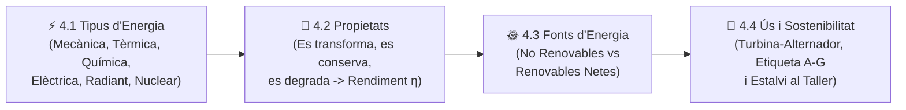

# UD4: L'Energia (Física, Fonts Energètiques i Sostenibilitat)

  

    

      PDI · Pissarra Digital
      ⚡ Física i Tecnologia de l'Energia: Tipus, Conservació, Renovables i Eficiència
    

    
Aprèn a calcular energies mecàniques i rendiments, diferencia les fonts renovables de les fòssils i domina l'estalvi energètic al taller.

  

  <a href="./nat0401.html" style="background: linear-gradient(135deg, #2563eb, #059669); color: #fff !important; font-weight: 800; padding: 10px 18px; border-radius: 10px; text-decoration: none !important; box-shadow: 0 4px 12px rgba(37, 99, 235, 0.3); display: inline-flex; align-items: center; gap: 6px;">
    🚀 Començar UD4
    →
  </a>

Benvingut/da a la **Unitat Didàctica 4** de Ciències Aplicades I. L'**energia** és el concepte més transversal de tota la física, la tecnologia i la indústria: sense energia no funcionarien els ordinadors ni les eines elèctriques del taller, no es mourien els vehicles ni bategaria el nostre propi cor.

Aquesta unitat es desenvolupa en **4 sessions didàctiques (1 sessió = 1 apartat del llibre oficial)**, combinant el rigor científic (fórmules d'energia cinètica, potencial i rendiment energètic) amb exemples pràctics del món professional i l'autoavaluació interactiva per a Aules.

---

## 📑 Planificació de Subunitats Didàctiques (1 Sessió per Apartat)

| Sessió | Subunitat | Contingut Principal de la Sessió | Bateria d'Activitats | Enllaç Directe |
| :---: | :---: | :--- | :---: | :---: |
| **Sessió 1** | **4.1** | **Tipus d'energia:** Definició, unitats ($\text{J}$, $\text{cal}$, $\text{kWh}$), energia mecànica ($E_c$ i $E_p$), tèrmica, química, elèctrica, radiant i nuclear. | MCQ, V/F, Vocabulari, Raonament i Aules | [**📖 Anar a la Sessió 4.1 →**](./nat0401.html) |
| **Sessió 2** | **4.2** | **Propietats de l'energia:** Transformació, conservació, transferència, transport/emmagatzematge, degradació i rendiment ($\eta$). | MCQ, V/F, Vocabulari, Raonament i Aules | [**📖 Anar a la Sessió 4.2 →**](./nat0402.html) |
| **Sessió 3** | **4.3** | **Fonts d'energia:** Primàries vs secundàries, No Renovables (carbó, petroli, gas, nuclear) i Renovables (solar, eòlica, hidràulica, biomassa, geotèrmica, marina). | MCQ, V/F, Vocabulari, Raonament i Aules | [**📖 Anar a la Sessió 4.3 →**](./nat0403.html) |
| **Sessió 4** | **4.4** | **L'ús de l'energia:** Turbina i alternador, xarxa elèctrica, impactes ambientals (efecte hivernacle, pluja àcida), etiqueta energètica (A-G) i estalvi al taller. | MCQ, V/F, Vocabulari, Raonament i Aules | [**📖 Anar a la Sessió 4.4 →**](./nat0404.html) |

---

## 🧭 Esquema Global de la Unitat 4

---

> [!NOTE]
> ### 🎯 Objectius d'Aprenentatge de la UD4
> 1. Definir l'energia, manejar les seues unitats ($\text{J}$, $\text{cal}/\text{kcal}$, $\text{kWh}$) i identificar els 6 grans tipus d'energia en situacions quotidianes i professionals.
> 2. Comprendre el Principi de Conservació de l'Energia i calcular el rendiment energètic ($\eta$) tenint en compte la degradació en forma de calor.
> 3. Comparar críticament els avantatges i inconvenients de les fonts d'energia no renovables i renovables.
> 4. Explicar com es produeix i transporta l'electricitat, analitzar els problemes ambientals del consum energètic i aplicar mesures d'eficiència i estalvi a casa i al taller.
