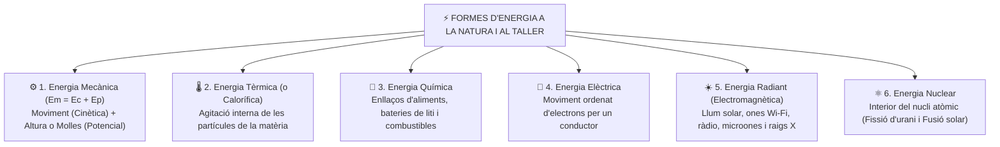

  

    ⚡ Progrés d'aprenentatge (4.1)
    0 / 12 reptes resolts
  

  

    

  

# 4.1 Tipus d'energia

En física i tecnologia definim l'**energia** com la **capacitat que tenen els cossos o sistemes materials per produir canvis en ells mateixos o en altres cossos**, és a dir, per realitzar un treball mecànic, posar un objecte en moviment, deformar-lo, il·luminar-lo o modificar la seua temperatura. L'energia no és un objecte material que puguem tocar ni pesar en una balança, però percebem immediatament els seus efectes quan encenem un trepant al taller, carreguem el telèfon mòbil o escalfem aigua.

---

## 1. En quines Unitats es Mesura l'Energia?

Tot i que al Sistema Internacional d'Unitats (SI) l'energia té una unitat oficial única, en la vida professional utilitzem tres unitats diferents segons l'àmbit (física, nutrició/calor o electricitat):

1. **El Joule (J) — Unitat del Sistema Internacional (SI):** En honor al físic anglès James Prescott Joule. Un Joule (1 J) és l'energia necessària per moure un objecte aplicant una força d'1 Newton al llarg d'1 metre ($1\text{ J} = 1\text{ N}\cdot\text{m}$). Com que 1 J és una quantitat molt menuda, sovint s'utilitza el **quilojoule (1  kJ = 1.000  J)**.
2. **La Caloria (cal) i la Quilocaloria (kcal) — Nutrició i Processos Tèrmics:** Una caloria és la quantitat d'energia necessària per apujar 1 °C la temperatura d'1 gram d'aigua líquida. A les etiquetes dels aliments s'utilitza sempre la **quilocaloria (1  kcal = 1.000  cal)**. L'equivalència exacta és:
$$1\text{ cal} = 4{,}18\text{ J} \quad \Longleftrightarrow \quad 1\text{ kcal} = 4.180\text{ J} = 4{,}18\text{ kJ}$$
3. **El Quilowatt-hora (kWh) — Factura Elèctrica i Consum Domèstic/Industrial:** És l'energia que consumeix una màquina d'1 quilowatt (1.000 W) de potència funcionant durant 1 hora seguida (3.600 segons):
$$1\text{ kWh} = 1.000\text{ W} \times 3.600\text{ s} = 3.600.000\text{ J} = 3{,}6\text{ MJ}$$

| Unitat de Mesura | Símbol | Equivalència en Joules (J) | Àmbit Principal d'Ús Professional |
| :--- | :---: | :---: | :--- |
| **Joule / Quilojoule** | J / kJ | 1  kJ = 1.000  J | Unitat oficial del Sistema Internacional (SI), física i mecànica |
| **Caloria / Quilocaloria** | cal / kcal | $1\text{ cal} = 4{,}18\text{ J}$ (1  kcal = 4.180  J) | Dietètica, etiquetatge d'aliments, calefacció i processos tèrmics |
| **Quilowatt-hora** | kWh | 1  kWh = 3.600.000  J | Comptadors de llum i factures de consum elèctric |

---

## 2. Classificació dels 6 Grans Tipus d'Energia

Segons com es manifesta en la natura i al nostre entorn tecnològic, classifiquem l'energia en sis formes fonamentals:

### 1. Energia Mecànica ($E_m$)
És l'energia relacionada amb la posició i el moviment dels cossos macroscòpics. És la suma de dues energies ($E_m = E_c + E_p$):
- **Energia Cinètica ($E_c$):** És l'energia que posseeix qualsevol cos pel fet d'**estar en moviment** (a una velocitat v). Depèn de la massa (m, en kg) i del quadrat de la velocitat (v, en m/s):
$$E_c = \frac{1}{2} \cdot m \cdot v^2$$
  *Exemple:* Un cotxe circulant per l'autopista, el vent que mou un molí o un martell colpejant un clau. Com que la velocitat va al quadrat, si un vehicle duplica la seua velocitat, la seua energia cinètica d'impacte es multiplica per quatre!
- **Energia Potencial ($E_p$):** És l'energia emmagatzemada per la posició o deformació d'un cos:
  - **Potencial gravitatòria:** La que té un cos per estar situat a una certa **altura (h)** sobre el sòl, sotmès a la gravetat ($g \approx 9{,}8\text{ m/s}^2$):
$$E_p = m \cdot g \cdot h$$
    *Exemple:* L'aigua acumulada a la part alta d'una presa o una caixa d'eines en una prestatgeria alta.
  - **Potencial elàstica:** Emmagatzemada en un cos elàstic deformat, com la molla comprimida d'un amortidor o un arc tensat.

### 2. Energia Tèrmica (o Calorífica)
És l'energia interna deguda al **moviment d'agitació i vibració de les partícules (àtoms i molècules)** que formen un cos. Com més ràpid vibren les partícules, major és la seua temperatura i la seua energia tèrmica. *Exemples:* El soldador d'estany calent al taller d'electrònica, l'aigua d'un radiador de calefacció o el dissipador de calor del microprocessador (CPU).

### 3. Energia Química
És l'energia emmagatzemada en els **enllaços químics** dels àtoms i molècules, que s'allibera quan es produeix una reacció química. *Exemples:*
- Els **aliments** que mengem (la glucosa reacciona amb l'oxigen a les nostres cèl·lules per donar-nos energia).
- Les **bateries d'ió-liti** d'un portàtil, un mòbil o un tornavís elèctric.
- Els **combustibles** com la gasolina, el gasoil, el butà o la fusta quan es cremen (combustió).

### 4. Energia Elèctrica
És l'energia associada al **moviment ordenat de càrregues elèctriques (electrons)** a través d'un material conductor metàl·lic (com un cable de coure) quan hi ha una diferència de potencial (voltatge). És la forma d'energia més versàtil a la indústria i a les llars perquè es transporta fàcilment per cables i alimenta ordinadors, motors, bombetes LED i electrodomèstics.

### 5. Energia Radiant (o Electromagnètica / Lluminosa)
És l'energia que transporten les **ones electromagnètiques**, amb la propietat única que **es pot propagar pel buit** (sense necessitat de cap medi material) a la velocitat de la llum (300.000 km/s). *Exemples:* La llum i la radiació del Sol, les ones d'una xarxa **Wi-Fi** o **Bluetooth**, les ones de ràdio i telefonia 5 G, els raigs infrarojos d'un comandament a distància o les microones.

### 6. Energia Nuclear (o Atòmica)
És l'enorme energia emmagatzemada al **nucli dels àtoms**, que es pot alliberar mitjançant dos processos:
- **Fissió nuclear:** Trencament d'un nucli atòmic molt pesant (com l'**urani-235** o el plutoni) en ser bombardejat amb neutrons; és el procés que s'utilitza actualment a les **centrals nuclears** (com la de Cofrents, a València).
- **Fusió nuclear:** Unió de dos nuclis atòmics molt lleugers (isòtops d'**hidrogen** com el deuteri i el triti) per formar un nucli d'heli a milions de graus; és l'energia que fa brillar el **Sol i les estreles**.

---

> [!TIP]
> ### 🧮 Exemple Resolt de Taller: Càlcul d'Energia Mecànica
> Un operari sosté una caixa d'eines de **$m = 4\text{ kg}$** a una prestatgeria situada a **$h = 2\text{ m}$** d'altura (prenent $g = 10\text{ m/s}^2$ per simplificar).
> - Quina **energia potencial ($E_p$)** té la caixa a la prestatgeria?
>   $$E_p = m \cdot g \cdot h = 4\text{ kg} \cdot 10\text{ m/s}^2 \cdot 2\text{ m} = \mathbf{80\text{ J}}$$
> - Si la caixa cau i abans de tocar a terra porta una velocitat de **$v = 6\text{ m/s}$**, quina és la seua **energia cinètica ($E_c$)** en eixe instant?
>   $$E_c = \frac{1}{2} \cdot m \cdot v^2 = 0{,}5 \cdot 4\text{ kg} \cdot (6\text{ m/s})^2 = 2 \cdot 36 = \mathbf{72\text{ J}}$$

---

> [!NOTE]
> ### 💡 Resum de Conceptes Clau
> - L'**energia** és la capacitat dels cossos per produir canvis o treball. Al SI es mesura en **Joules (J)**, en nutrició en **calories/quilocalories** ($1\text{ cal} = 4{,}18\text{ J}$) i en electricitat en **quilowatts-hora (kWh)**.
> - L'**energia mecànica** és la suma de l'**energia cinètica** del moviment ($E_c = \frac{1}{2}mv^2$) i l'**energia potencial** de l'altura ($E_p = mgh$).
> - Els altres grans tipus són l'energia **tèrmica** (agitació de partícules), **química** (aliments, bateries, combustibles), **elèctrica** (corrent d'electrons), **radiant** (llum i ones Wi-Fi) i **nuclear** (fissió i fusió).

---

## 🎯 Activitats i Autoavaluació Interactiva

  

    🎮 <strong>Zona d'Entrenament FPB:</strong> 0 reptes resolts
    ⭐ 0 punts
  

  

### 1. Qüestionari d'Autoavaluació Tipus Test (MCQ)

  
<strong>1. Quin tipus d'energia es troba emmagatzemada a l'interior de la bateria d'un telèfon mòbil apagat i també als aliments que esmorzem abans d'anar a classe?</strong>

  

    <button type="button" class="btn-mcq-opt" data-opt="A">A) Energia nuclear de fissió</button>
    <button type="button" class="btn-mcq-opt" data-opt="B">B) Energia potencial gravitatòria</button>
    <button type="button" class="btn-mcq-opt" data-opt="C">C) Energia química</button>
    <button type="button" class="btn-mcq-opt" data-opt="D">D) Energia radiant electromagnètica</button>
  

  

  
<strong>2. Quant val l'energia cinètica ($E_c = \frac{1}{2}mv^2$) d'un dron de massa $m = 2\text{ kg}$ que vola horitzontalment a una velocitat constant de $v = 10\text{ m/s}$?</strong>

  

    <button type="button" class="btn-mcq-opt" data-opt="A">A) 100 J</button>
    <button type="button" class="btn-mcq-opt" data-opt="B">B) 20 J</button>
    <button type="button" class="btn-mcq-opt" data-opt="C">C) 10 J</button>
    <button type="button" class="btn-mcq-opt" data-opt="D">D) 200 J</button>
  

  

  
<strong>3. Quina forma d'energia emmagatzema la bateria de liti d'un telèfon mòbil, la gasolina d'un cotxe o un entrepà que ens mengem?</strong>

  

    <button type="button" class="btn-mcq-opt" data-opt="A">A) Energia nuclear de fusió</button>
    <button type="button" class="btn-mcq-opt" data-opt="B">B) Energia química (emmagatzemada als enllaços de les substàncies)</button>
    <button type="button" class="btn-mcq-opt" data-opt="C">C) Energia potencial gravitatòria</button>
    <button type="button" class="btn-mcq-opt" data-opt="D">D) Energia eòlica</button>
  

  

  
<strong>4. De quins dos factors depèn l'energia cinètica (Ec = ½·m·v²) d'un vehicle que circula per la carretera?</strong>

  

    <button type="button" class="btn-mcq-opt" data-opt="A">A) Del color de la carrosseria i la marca</button>
    <button type="button" class="btn-mcq-opt" data-opt="B">B) De la seua massa (m) i del quadrat de la seua velocitat (v)</button>
    <button type="button" class="btn-mcq-opt" data-opt="C">C) Només de l'hora del dia</button>
    <button type="button" class="btn-mcq-opt" data-opt="D">D) De l'altura sobre el nivell del mar</button>
  

  

---

### 2. Activitats de Vertader (V) o Fals (F)

  <strong>a) La unitat d'energia en el Sistema Internacional (SI) és el Joule (J), i una caloria (1 cal) equival aproximadament a $4{,}18\text{ Joules}$.</strong>
  

    <button type="button" class="btn-vf" data-opt="V">V</button>
    <button type="button" class="btn-vf" data-opt="F">F</button>
  

  

  <strong>b) L'energia radiant o electromagnètica (com la llum solar o les ones de ràdio) no pot viatjar mai pel buit de l'espai exterior.</strong>
  

    <button type="button" class="btn-vf" data-opt="V">V</button>
    <button type="button" class="btn-vf" data-opt="F">F</button>
  

  

  <strong>c) L'energia mecànica d'un cos és la suma de la seua energia cinètica (moviment) i la seua energia potencial (altura o posició).</strong>
  

    <button type="button" class="btn-vf" data-opt="V">V</button>
    <button type="button" class="btn-vf" data-opt="F">F</button>
  

  

  <strong>d) Un llibre quiet damunt d'una prestatgeria a 2 metres d'altura té molta energia cinètica i zero energia potencial.</strong>
  

    <button type="button" class="btn-vf" data-opt="V">V</button>
    <button type="button" class="btn-vf" data-opt="F">F</button>
  

  

---

### 3. Exercicis de Resposta Breu i Vocabulari Tècnic

  
✍️ Com s'anomena el tipus d'energia mecànica que posseeix un cos pel fet d'estar en moviment a una determinada velocitat?

  

    <input type="text" class="quiz-input" placeholder="Escriu el tipus d'energia...">
    <button type="button" class="btn-quiz-check">Comprovar</button>
  

  

  
✍️ Quina unitat d'energia (símbol o nom) s'utilitza en la factura elèctrica de les llars i tallers per mesurar el consum d'electricitat?

  

    <input type="text" class="quiz-input" placeholder="Escriu la unitat o el seu símbol (ex: kWh)...">
    <button type="button" class="btn-quiz-check">Comprovar</button>
  

  

  
✍️ Quina és la unitat oficial d'energia i treball en el Sistema Internacional d'Unitats (símbol J)?

  

    <input type="text" class="quiz-input" placeholder="Escriu la teua resposta...">
    <button type="button" class="btn-quiz-check">Comprovar</button>
  

  

  
✍️ Calcula l'energia cinètica (en Joules) d'un patinet elèctric i el seu conductor que tenen una massa total de 60 kg i es mouen a v = 10 m/s (Ec = 0,5 × 60 × 10²):

  

    <input type="text" class="quiz-input" placeholder="Escriu la teua resposta...">
    <button type="button" class="btn-quiz-check">Comprovar</button>
  

  

---

### 4. Exercicis de Raonament i Desenvolupament Escrit (Tasca d'Aula)

  
✍️ <strong>Identificació d'energies al taller d'informàtica:</strong> Observa un ordinador portàtil o un telèfon mòbil mentre està funcionant connectat a la xarxa Wi-Fi i reproduint un vídeo. Identifica i explica on estan presents almenys QUATRE tipus d'energia diferents (química, elèctrica, radiant/lluminosa, tèrmica o sonora/mecànica) en aquest dispositiu.

  <textarea class="open-response-input" rows="4" placeholder="Explica quina part del mòbil o portàtil té energia química, quina té elèctrica, radiant i tèrmica..."></textarea>

  
✍️ <strong>Exercici 2 (Càlcul d'Energia Potencial i Cinètica al taller):</strong> Una caixa d'eines de 10 kg està situada en una prestatgeria a 3 metres d'altura (g = 9,8 m/s²). 1) Calcula la seua energia potencial gravitatòria (Ep = m·g·h). 2) Si la caixa cau, quina serà la seua energia cinètica just abans de tocar el terra?

  <textarea class="open-response-input" rows="4" placeholder="1) Ep = 10 × 9,8 × 3 = 294 J. 2) Per conservació de l'energia, tota l'Ep s'haurà transformat en Ec = 294 J..."></textarea>

  
✍️ <strong>Exercici 3 (Seguretat viària: per què és tan perillós duplicar la velocitat?):</strong> Calcula i compara l'energia cinètica d'una moto de 200 kg quan va a 10 m/s (36 km/h) i quan duplica la velocitat a 20 m/s (72 km/h). Per què la distància de frenada es multiplica per quatre?

  <textarea class="open-response-input" rows="4" placeholder="A 10 m/s: Ec = 0,5 × 200 × 100 = 10.000 J. A 20 m/s: Ec = 0,5 × 200 × 400 = 40.000 J (4 vegades més!)..."></textarea>

---

  <h3 style="margin-top:0; color:#0369a1;">📦 Lliurament d'Activitats d'Aules (Act 4.1)</h3>
  
Genera el teu document de tasca d'aquest apartat amb el teu nom i puntuació obtinguda.

  

    <input type="text" class="aules-student-name" placeholder="Cognoms, Nom de l'Alumne/a" style="padding:8px 12px; border:1px solid #94a3b8; border-radius:4px; flex-grow:1; min-width:240px;">
    <button class="btn-generate-aules-pdf" data-unit="NAT04" data-activity="Act01" data-module="CA" style="padding:8px 16px; background:#0284c7; color:#fff; border:none; border-radius:4px; font-weight:600; cursor:pointer;">📄 Descarregar PDF per a Aules</button>
  

