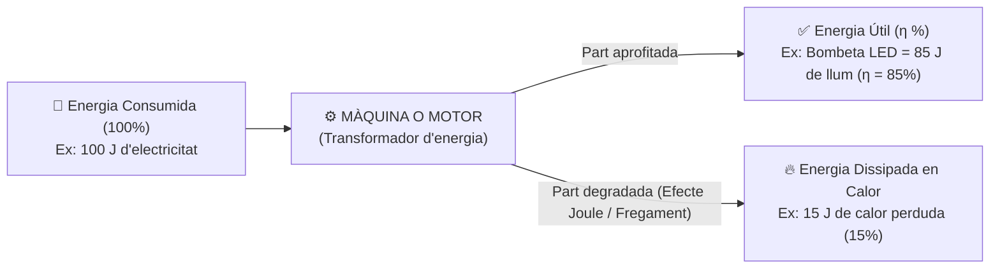

  

    ⚡ Progrés d'aprenentatge (4.2)
    0 / 12 reptes resolts
  

  

    

  

# 4.2 Propietats de l'energia

Per què necessitem posar ventiladors i dissipadors d'alumini dins de la caixa d'un ordinador? Per què cap motor del món pot funcionar indefinidament sense consumir combustible ni electricitat? Totes aquestes preguntes s'expliquen mitjançant les **cinc propietats fonamentals de l'energia**, que regeixen el funcionament de totes les màquines de l'univers.

---

## 1. Les 5 Propietats Fonamentals de l'Energia

### 1. L'Energia es Transforma
L'energia no roman sempre de la mateixa forma, sinó que **es transforma contínuament d'un tipus en un altre** mitjançant dispositius conversors:
- **En una bombeta LED o pantalla de monitor:** L'energia **elèctrica** es transforma en energia **radiant (lluminosa)** i una petita part en energia **tèrmica**.
- **En el motor elèctric d'un trepant o ventilador:** L'energia **elèctrica** es transforma en energia **mecànica (cinètica de rotació)**, so i calor per fregament.
- **En una placa solar fotovoltaica:** L'energia **radiant** del Sol es transforma directament en energia **elèctrica**.
- **En una bateria mentre es carrega i es descarrega:** En carregar el mòbil, l'energia **elèctrica** es transforma en energia **química**; en usar-lo, l'energia **química** torna a transformar-se en **elèctrica**.
- **En el nostre propi cos (músculs):** L'energia **química** dels aliments es transforma en energia **mecànica** (caminar, treballar) i en energia **tèrmica** (mantenir els $36{,}5^\circ\text{C}$ de temperatura corporal).

### 2. L'Energia es Conserva (Principi de Conservació de l'Energia)
És una de les lleis més importants de la física (Primera Llei de la Termodinàmica), enunciada així:

> **«L'energia no es crea ni es destrueix; només es transforma d'unes formes en altres. En qualsevol transformació, la quantitat total d'energia de l'univers roman sempre constant.»**

$$\text{Energia Total Inicial (Consumida)} = \text{Energia Útil Obtinguda} + \text{Energia Dissipada (Calor)}$$

Per exemple, quan deixem caure una pilota des d'una certa altura, a mesura que baixa perd **energia potencial ($E_p$)** perquè té menys altura, però guanya exactament la mateixa quantitat d'**energia cinètica ($E_c$)** perquè cada vegada va més ràpid. Quan xoca contra el sòl i s'acaba aturant, l'energia mecànica tampoc ha desaparegut: s'ha transformat en so i en un lleuger escalfament del paviment i de la pilota.

### 3. L'Energia es Transfereix d'uns Cossos a uns Altres
L'energia pot passar d'un cos a un altre mitjançant dos mecanismes principals:
- **En forma de Treball mecànic ($W$):** Quan un cos exerceix una força sobre un altre i el desplaça (per exemple, quan la nostra mà empeny un carret d'eines i li transfereix energia cinètica).
- **En forma de Calor ($Q$):** Quan posem en contacte dos cossos a diferent temperatura, l'energia tèrmica es transfereix espontàniament sempre **des del cos més calent cap al cos més fred** fins que tots dos arriben a la mateixa temperatura (**equilibri tèrmic**).

### 4. L'Energia es pot Transportar i Emmagatzemar
- **Transport:** Podem portar l'energia des del lloc on es produeix fins al lloc on es consumeix a centenars de quilòmetres. Per exemple, l'energia elèctrica viatja pels **cables de les línies d'alta tensió**, i els combustibles viatgen per **oleoductes, gasoductes o camions cisterna**.
- **Emmagatzematge:** Les formes d'energia com la química o la potencial es poden guardar per a usar-les quan calga: en **bateries d'ió-liti**, en dipòsits de gasolina o acumulant aigua al capdamunt d'un **embassament hidroelèctric**. En canvi, la llum o la calor són molt difícils d'emmagatzemar durant molt de temps.

### 5. L'Energia es Degrada
Tot i que la quantitat total d'energia sempre es conserva, **la seua qualitat disminueix** en cada transformació. En qualsevol màquina real, una part de l'energia es transforma inevitablement en **energia tèrmica (calor dissipada a l'ambient)** a causa del **fregament mecànic** entre peces o de l'**efecte Joule** (escalfament dels cables i microxips quan hi passa el corrent elèctric).

Aquesta calor escampada per l'aire de l'habitació ja no es pot tornar a recollir per fer moure el motor ni encendre la pantalla: diem que **l'energia s'ha degradat** (és energia perduda o no aprofitable).

---

## 2. El Rendiment Energètic ($\eta$) d'una Màquina

Com que tota màquina perd una part de l'energia en forma de calor degradada, definim el **rendiment energètic ($\eta$, lletra grega *eta*)** com el percentatge d'energia consumida que es converteix realment en **energia útil**:

$$\eta\,(\%) = \frac{E_{\text{útil}}}{E_{\text{consumida}}} \times 100$$

Com que sempre hi ha pèrdues per calor, el rendiment d'una màquina real **és sempre inferior al $100\%$** ($\eta < 100\%$). Per això en física és impossible construir un *mòbil perpetu* (una màquina que funcione eternament sense aportació d'energia externa):

| Dispositiu o Màquina | Transformació Principal | Energia Útil ($\eta$) | Energia Degradada en Calor |
| :--- | :--- | :---: | :---: |
| **Bombeta incandescent antiga (de filament)** | Elèctrica $\rightarrow$ Lluminosa | **$5\% - 10\%$** | $90\% - 95\%$ (s'escalfa moltíssim!) |
| **Bombeta o pantalla LED moderna** | Elèctrica $\rightarrow$ Lluminosa | **$80\% - 90\%$** | Només $10\% - 20\%$ |
| **Motor de combustió d'un cotxe de gasolina** | Química $\rightarrow$ Mecànica | **$25\% - 30\%$** | $70\% - 75\%$ (radiador i tub d'escapament) |
| **Motor elèctric d'un vehicle o eina de taller** | Elèctrica $\rightarrow$ Mecànica | **$85\% - 95\%$** | Només $5\% - 15\%$ |

---

> [!TIP]
> ### 🧮 Problema Resolt: Càlcul del Rendiment d'una Font d'Alimentació de PC
> Una font d'alimentació d'un ordinador amb certificació *80 Plus* consumeix **$E_{\text{consumida}} = 500\text{ J}$** de l'endoll de la paret cada segon, i lliura **$E_{\text{útil}} = 425\text{ J}$** d'electricitat contínua útil a la placa base i la targeta gràfica.
> 1. **Quin és el rendiment ($\eta$) de la font d'alimentació?**
>    $$\eta = \frac{E_{\text{útil}}}{E_{\text{consumida}}} \times 100 = \frac{425\text{ J}}{500\text{ J}} \times 100 = 0{,}85 \times 100 = \mathbf{85\%}$$
> 2. **Quanta energia es degrada en forma de calor cada segon?**
>    $$E_{\text{dissipada}} = 500\text{ J} - 425\text{ J} = \mathbf{75\text{ J}}\text{ (que el ventilador ha d'expulsar a l'exterior)}$$

---

> [!NOTE]
> ### 💡 Resum de Conceptes Clau
> - Les 5 propietats de l'energia són: **es transforma**, **es conserva** (la suma total mai canvia), **es transfereix** (com a treball o calor), **es transporta/emmagatzema** i **es degrada** (es perd qualitat en dissipar-se com a calor irrecuperable).
> - El **rendiment energètic** es calcula amb la fórmula $\eta = \frac{E_{\text{útil}}}{E_{\text{consumida}}} \times 100$ i en qualsevol màquina real sempre és menor del $100\%$.

---

## 🎯 Activitats i Autoavaluació Interactiva

  

    🎮 <strong>Zona d'Entrenament FPB:</strong> 0 reptes resolts
    ⭐ 0 punts
  

  

### 1. Qüestionari d'Autoavaluació Tipus Test (MCQ)

  
<strong>1. Un motor elèctric del taller consumeix $200\text{ J}$ d'energia elèctrica de la xarxa i produeix $160\text{ J}$ de treball mecànic útil (mentre que els $40\text{ J}$ restants es perden en calor per fregament). Quin és el seu rendiment energètic ($\eta$)?</strong>

  

    <button type="button" class="btn-mcq-opt" data-opt="A">A) $20\%$</button>
    <button type="button" class="btn-mcq-opt" data-opt="B">B) $80\%$</button>
    <button type="button" class="btn-mcq-opt" data-opt="C">C) $125\%$</button>
    <button type="button" class="btn-mcq-opt" data-opt="D">D) $40\%$</button>
  

  

  
<strong>2. Quina propietat de l'energia explica que en qualsevol màquina o ordinador una part de l'energia es transforme sempre en calor que s'escapa a l'aire i ja no es pot aprofitar?</strong>

  

    <button type="button" class="btn-mcq-opt" data-opt="A">A) Que l'energia es crea del no-res</button>
    <button type="button" class="btn-mcq-opt" data-opt="B">B) Que l'energia desapareix de l'univers</button>
    <button type="button" class="btn-mcq-opt" data-opt="C">C) Que l'energia té un rendiment del $200\%$</button>
    <button type="button" class="btn-mcq-opt" data-opt="D">D) Que l'energia es degrada (perd qualitat en dissipar-se en forma de calor no recuperable)</button>
  

  

  
<strong>3. Quina transformació d'energia principal realitza el motor elèctric d'un ventilador o d'un trepant del taller?</strong>

  

    <button type="button" class="btn-mcq-opt" data-opt="A">A) Transforma energia química en energia nuclear</button>
    <button type="button" class="btn-mcq-opt" data-opt="B">B) Transforma energia elèctrica en energia mecànica cinètica (i una part es degrada en calor)</button>
    <button type="button" class="btn-mcq-opt" data-opt="C">C) Transforma energia lluminosa en fred</button>
    <button type="button" class="btn-mcq-opt" data-opt="D">D) Crea energia del no-res</button>
  

  

  
<strong>4. Si una font d'alimentació de PC amb certificació 80 PLUS consumeix 500 J de la xarxa i lliura 450 J útils als components (perdent 50 J en calor), quin és el seu rendiment energètic?</strong>

  

    <button type="button" class="btn-mcq-opt" data-opt="A">A) 50%</button>
    <button type="button" class="btn-mcq-opt" data-opt="B">B) 90% (450 / 500 × 100)</button>
    <button type="button" class="btn-mcq-opt" data-opt="C">C) 110%</button>
    <button type="button" class="btn-mcq-opt" data-opt="D">D) 10%</button>
  

  

---

### 2. Activitats de Vertader (V) o Fals (F)

  <strong>a) Segons el Principi de Conservació de l'Energia, l'energia no es crea ni es destrueix, només es transforma d'unes formes en altres mantenint constant la quantitat total.</strong>
  

    <button type="button" class="btn-vf" data-opt="V">V</button>
    <button type="button" class="btn-vf" data-opt="F">F</button>
  

  

  <strong>b) Quan posem en contacte un cos fred i un cos calent, la calor passa espontàniament del cos més fred cap al cos més calent.</strong>
  

    <button type="button" class="btn-vf" data-opt="V">V</button>
    <button type="button" class="btn-vf" data-opt="F">F</button>
  

  

  <strong>c) En qualsevol màquina real, una part de l'energia sempre es degrada i es perd en forma de calor per fregament o efecte Joule, per la qual cosa el rendiment mai arriba al 100%.</strong>
  

    <button type="button" class="btn-vf" data-opt="V">V</button>
    <button type="button" class="btn-vf" data-opt="F">F</button>
  

  

  <strong>d) Una placa solar fotovoltaica crea energia elèctrica nova a partir del no-res violant el Principi de Conservació.</strong>
  

    <button type="button" class="btn-vf" data-opt="V">V</button>
    <button type="button" class="btn-vf" data-opt="F">F</button>
  

  

---

### 3. Exercicis de Resposta Breu i Vocabulari Tècnic

  
✍️ Com s'anomena la relació percentual entre l'energia útil que obtenim d'una màquina i l'energia total que ha consumit ($\eta = \frac{E_{\text{útil}}}{E_{\text{consumida}}} \times 100$)?

  

    <input type="text" class="quiz-input" placeholder="Escriu el concepte físic...">
    <button type="button" class="btn-quiz-check">Comprovar</button>
  

  

  
✍️ En quin tipus d'energia transforma una placa solar fotovoltaica l'energia radiant que rep del Sol?

  

    <input type="text" class="quiz-input" placeholder="Escriu el tipus d'energia...">
    <button type="button" class="btn-quiz-check">Comprovar</button>
  

  

  
✍️ Calcula el rendiment (%) d'una bombeta LED que consumeix 100 J d'energia elèctrica i produeix 85 J de llum útil (i 15 J de calor):

  

    <input type="text" class="quiz-input" placeholder="Escriu la teua resposta...">
    <button type="button" class="btn-quiz-check">Comprovar</button>
  

  

  
✍️ En quina forma d'energia es degrada i es perd l'energia no aprofitada quan s'escalfa un microprocessador o fregeixen les peces d'un motor?

  

    <input type="text" class="quiz-input" placeholder="Escriu la teua resposta...">
    <button type="button" class="btn-quiz-check">Comprovar</button>
  

  

---

### 4. Exercicis de Raonament i Desenvolupament Escrit (Tasca d'Aula)

  
✍️ <strong>Per què s'escalfa el microprocessador ($\text{CPU}$) d'un ordinador?</strong> Un company afirma que si l'energia es conserva sempre, la bateria d'un portàtil no s'hauria d'acabar mai. Explica-li per què s'esgota la bateria i per què cal posar un ventilador i pasta tèrmica damunt del processador, utilitzant els conceptes de conservació de l'energia, degradació en calor (efecte Joule) i rendiment.

  <textarea class="open-response-input" rows="4" placeholder="Explica on va a parar l'energia química de la bateria i per què es dissipa calor..."></textarea>

  
✍️ <strong>Exercici 2 (Cadena de transformacions d'energia):</strong> Indica quina energia entra i quina energia útil (i degradada) surt en cadascun d'aquests 4 dispositius: 1) Placa solar fotovoltaica, 2) Bateria de mòbil carregant-se, 3) Altaveu, 4) Estufa elèctrica.

  <textarea class="open-response-input" rows="4" placeholder="1) Placa solar: Radiant -> Elèctrica; 2) Bateria carregant: Elèctrica -> Química..."></textarea>

  
✍️ <strong>Exercici 3 (Comparació de rendiment: Bombeta incandescent vs Bombeta LED):</strong> Una bombeta antiga de filament consumia 100 J per donar només 10 J de llum i 90 J de calor. Una bombeta LED moderna de 10 W aprofita el 85% en llum. Calcula el rendiment de la bombeta antiga i explica per què es van prohibir a Europa.

  <textarea class="open-response-input" rows="4" placeholder="Rendiment antiga = 10% (el 90% es perdia escalfant l'aire). Amb el LED s'estalvia un 85-90% d'electricitat..."></textarea>

---

  <h3 style="margin-top:0; color:#0369a1;">📦 Lliurament d'Activitats d'Aules (Act 4.2)</h3>
  
Genera el teu document de tasca d'aquest apartat amb el teu nom i puntuació obtinguda.

  

    <input type="text" class="aules-student-name" placeholder="Cognoms, Nom de l'Alumne/a" style="padding:8px 12px; border:1px solid #94a3b8; border-radius:4px; flex-grow:1; min-width:240px;">
    <button class="btn-generate-aules-pdf" data-unit="NAT04" data-activity="Act02" data-module="CA" style="padding:8px 16px; background:#0284c7; color:#fff; border:none; border-radius:4px; font-weight:600; cursor:pointer;">📄 Descarregar PDF per a Aules</button>
  

