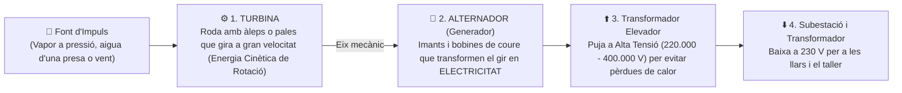

  

    ⚡ Progrés d'aprenentatge (4.4)
    0 / 3 reptes resolts
  

  

    

  

# 4.4 L'ús de l'energia

Quan premem l'interruptor del taller d'informàtica o connectem un carregador a l'endoll de $230\text{ V}$, l'energia elèctrica arriba a l'instant. Però, com es fabrica exactament aquesta electricitat a les centrals elèctriques, quin impacte té el nostre consum sobre el medi ambient i com podem reduir la factura energètica mitjançant l'**eficiència energètica**?

---

## 1. Com es Genera i Transporta l'Electricitat: Turbina i Alternador

Llevat dels panells solars fotovoltaics (que produeixen electricitat directament de la llum sense peces mòbils), **totes les altres centrals elèctriques del món** (tèrmiques, nuclears, hidroelèctriques, eòliques o termosolars) es basen en l'acoblament de dues màquines fonamentals: la **turbina** i l'**alternador**.

1. **La Turbina:** És una roda dotada de pales o àleps dissenyada per girar quan xoca contra ella un fluid en moviment:
   - A les centrals **tèrmiques, nuclears, de biomassa i geotèrmiques**, s'escalfa aigua fins a obtenir **vapor d'aigua a alta pressió** que fa girar la turbina.
   - A les centrals **hidroelèctriques**, és el raig d'**aigua líquida** de la presa qui mou la turbina.
   - Als parcs **eòlics**, les mateixes pales del molí actuen com a turbina moguda pel **vent**.
2. **L'Alternador (o Generador elèctric):** Està unit a l'eix de la turbina. Conté grans electroimants que giren dins de bobines de fil de coure (inducció electromagnètica descoberta per Michael Faraday), **transformant l'energia mecànica de rotació en energia elèctrica de corrent altern** ($50\text{ Hz}$ a Europa).
3. **El Transport per la Xarxa d'Alta Tensió:** Com que l'electricitat no es pot emmagatzemar a gran escala a la xarxa, viatja a l'instant des de la central fins a les ciutats. Un **transformador elevador** apuja el voltatge fins a **$220.000\text{ V} - 400.000\text{ V}$** (Alta Tensió) per reduir la intensitat de corrent i evitar que l'energia es perda en forma de calor pels cables (efecte Joule). Finalment, abans d'entrar als edificis, les subestacions i els transformadors de barri redueixen la tensió als **$230\text{ V}$** monofàsics (o $400\text{ V}$ trifàsics per a maquinària de taller) que tenim als endolls.

---

## 2. Problemes Ambientals Derivats del Consum Energètic

L'extracció, el transport i sobretot la combustió massiva de fonts d'energia no renovables provoquen quatre grans problemes ambientals a escala local i planetària:

1. **Increment de l'Efecte Hivernacle i Escalfament Global:** L'efecte hivernacle natural és beneficiós perquè manté la Terra a una temperatura mitjana habitable ($\sim 15^\circ\text{C}$). Tanmateix, la crema massiva de carbó, petroli i gas natural allibera milers de milions de tones de **diòxid de carboni ($\text{CO}_2$)** i metà ($\text{CH}_4$). Aquests gasos retenen un excés de calor infraroja a l'atmosfera, provocant l'**escalfament global** i el **canvi climàtic** (fosa de glaceres, pujada del nivell del mar, onades de calor, sequeres i fenòmens meteorològics extrems com les DANA).
2. **La Pluja Àcida:** Quan les centrals tèrmiques de carbó i els motors dièsel/gasolina cremen combustibles, emeten **òxids de sofre ($\text{SO}_2$) i òxids de nitrogen ($\text{NO}_x$)**. En reaccionar amb el vapor d'aigua dels núvols, es transformen en **àcid sulfúric ($\text{H}_2\text{SO}_4$) i àcid nítric ($\text{HNO}_3$)**, que cauen amb la pluja cremant les fulles dels boscos, acidificant llacs i corroint la pedra calcària dels monuments i edificis.
3. **Marees Negres i Contaminació d'Aigües:** Els accidents de vaixells petroliers (com el *Prestige*) o plataformes marines vessen milers de tones de petroli cru al mar, creant una capa negra impermeable que destrueix ecosistemes costaners, peixos i aus marines.
4. **Residus Nuclears Radioactius:** Restes d'urani i plutoni gastat que emeten radiacions ionitzants letals i s'han de custodiar en piscines d'aigua i magatzems geològics blindats durant milers d'anys.

---

## 3. L'Eficiència Energètica i l'Etiqueta Europea (A - G)

Fer un ús sostenible de l'energia no significa viure a les fosques ni passar fred, sinó aplicar l'**eficiència energètica**: *obtenir exactament el mateix servei, confort o prestació tecnològica consumint la mínima quantitat d'energia possible*.

### L'Etiqueta Energètica Europea
Tots els electrodomèstics, monitors, televisors, bombetes i sistemes de climatització que es venen a la Unió Europea han de portar obligatòriament l'**etiqueta d'eficiència energètica** (actualitzada el 2021 eliminant les antigues classes $A+, A++, A+++$ per fer-la més clara), que classifica els aparells en una escala de **7 lletres i colors, des de la $\text{A}$ fins a la $\text{G}$**:

| Classe i Color | Nivell d'Eficiència | Significat Pràctic per a l'Usuari i el Taller |
| :---: | :--- | :--- |
| **$\text{A}$ (Verd Fosc)** | **Màxima eficiència** | Consumeix molt poca electricitat per fer la mateixa faena (màxim estalvi a la factura). |
| **$\text{B}$ i $\text{C}$ (Verd Clar / Groc-Verd)** | **Alta eficiència** | Baix consum energètic i bon rendiment tecnològic. |
| **$\text{D}$ i $\text{E}$ (Groc / Taronja)** | **Eficiència mitjana** | Consum moderat; recomanable només si no hi ha alternativa superior. |
| **$\text{F}$ i $\text{G}$ (Roig Intens)** | **Mínima eficiència** | Aparells molt poc eficients que malbaraten molta energia en calor i encareixen el rebut elèctric. |

### 🧮 Exemple Pràctic de Taller: Quant estalviem canviant a LED?
Imagina que un taller té **10 focus halògens antics de $100\text{ W}$ cadascun** (potència total $= 1.000\text{ W} = 1\text{ kW}$) encesos durant **$8\text{ hores}$ al dia**:
- **Consum diari amb halògens (Classe G):**
  $$E_{\text{antiga}} = 1\text{ kW} \times 8\text{ h} = \mathbf{8\text{ kWh al dia}}$$
- **Si els substituïm per 10 focus LED equivalents de només $12\text{ W}$ cadascun** (potència total $= 120\text{ W} = 0{,}12\text{ kW}$), donant exactament la mateixa llum:
  $$E_{\text{LED}} = 0{,}12\text{ kW} \times 8\text{ h} = \mathbf{0{,}96\text{ kWh al dia}}$$
- **Estalvi aconseguit:** Passem de gastar $8\text{ kWh}$ a menys d'$1\text{ kWh}$ diari, un **estalvi del $88\%$** en la factura d'il·luminació!

---

> [!TIP]
> ### 🌱 Decàleg d'Estalvi Energètic a Casa i al Taller d'Informàtica
> 1. **Apagar el *Stand-by* (consum fantasma):** Els monitors, ordinadors, impressores i televisors deixats en espera amb el pilot roig encès consumeixen fins a un **$10\%$ de la factura anual**. Usa regletes amb interruptor general en acabar la jornada!
> 2. **Il·luminació $100\%$ LED i llum natural:** Substituir tubs fluorescents i bombetes antigues per tecnologia LED estalvia fins a un **$80\%$ en il·luminació**.
> 3. **Climatització responsable:** Ajustar el termòstat de la calefacció a **$20^\circ\text{C} - 21^\circ\text{C}$ a l'hivern** i l'aire condicionat a **$25^\circ\text{C} - 26^\circ\text{C}$ a l'estiu** (cada grau de diferència augmenta el consum un $7\%$).
> 4. **Aïllament tèrmic d'edificis:** Finestres amb doble vidre (*Climalit*) i bon aïllament en parets i portes eviten fins al $40\%$ de fugues de calor o fred.
> 5. **Mobilitat sostenible i Regla de les 3R:** Prioritzar el transport públic, la bicicleta o el vehicle elèctric, i aplicar **Reduir, Reutilitzar i Reciclar** (reciclar una llauna d'alumini estalvia el $95\%$ de l'energia de fabricar-la de zero!).

---

> [!NOTE]
> ### 💡 Resum de Conceptes Clau
> - A les centrals elèctriques, la **turbina** gira moguda per vapor, aigua o vent, i l'**alternador** transforma aquest moviment de gir en corrent elèctric.
> - La crema de combustibles fòssils emet **$\text{CO}_2$** (que intensifica l'**efecte hivernacle** i l'escalfament global) i òxids de sofre/nitrogen (que causen la **pluja àcida**).
> - L'**etiqueta energètica europea** classifica els aparells des de la lletra **$\text{A}$ (verd fosc, el més eficient)** fins a la **$\text{G}$ (roig, el menys eficient)**.

---

## 🎯 Activitats i Autoavaluació Interactiva

  

    🎮 <strong>Zona d'Entrenament FPB:</strong> 0 reptes resolts
    ⭐ 0 punts
  

  

### 1. Qüestionari d'Autoavaluació Tipus Test (MCQ)

  
<strong>1. Quines dues màquines treballen acoblades a la majoria de les centrals elèctriques per convertir el moviment del vapor, de l'aigua o del vent en energia elèctrica?</strong>

  

    <button type="button" class="btn-mcq-opt" data-opt="A">A) El sismògraf i el termòmetre</button>
    <button type="button" class="btn-mcq-opt" data-opt="B">B) La bateria de liti i la bombeta incandescent</button>
    <button type="button" class="btn-mcq-opt" data-opt="C">C) La turbina (que gira empesa pel fluid) i l'alternador o generador (que converteix el gir en corrent elèctric)</button>
    <button type="button" class="btn-mcq-opt" data-opt="D">D) El cràter i la xemeneia</button>
  

  

  
<strong>2. Si comprem un monitor d'ordinador o un frigorífic i mirem l'etiqueta energètica europea actual (escala A a G), quina lletra i color indica l'aparell MÉS eficient i que menys electricitat consumeix?</strong>

  

    <button type="button" class="btn-mcq-opt" data-opt="A">A) Classe A (color verd fosc)</button>
    <button type="button" class="btn-mcq-opt" data-opt="B">B) Classe G (color roig intens)</button>
    <button type="button" class="btn-mcq-opt" data-opt="C">C) Classe E (color taronja)</button>
    <button type="button" class="btn-mcq-opt" data-opt="D">D) Totes les lletres consumeixen exactament el mateix</button>
  

  

---

### 2. Activitats de Vertader (V) o Fals (F)

  <strong>a) L'augment de l'efecte hivernacle i l'escalfament global del planeta estan provocats principalment per les emissions de diòxid de carboni ($\text{CO}_2$) en cremar combustibles fòssils.</strong>
  

    <button type="button" class="btn-vf" data-opt="V">V</button>
    <button type="button" class="btn-vf" data-opt="F">F</button>
  

  

  <strong>b) Deixar els ordinadors, monitors i televisors en mode d'espera (*stand-by*, amb el pilot roig encès) té un consum elèctric exactament igual a zero.</strong>
  

    <button type="button" class="btn-vf" data-opt="V">V</button>
    <button type="button" class="btn-vf" data-opt="F">F</button>
  

  

---

### 3. Exercicis de Resposta Breu i Vocabulari Tècnic

  
✍️ Com s'anomena la màquina elèctrica d'una central que està unida a l'eix de la turbina i transforma el moviment de rotació en corrent elèctric?

  

    <input type="text" class="quiz-input" placeholder="Escriu el nom de la màquina...">
    <button type="button" class="btn-quiz-check">Comprovar</button>
  

  

  
✍️ Quin problema ambiental es produeix quan els òxids de sofre i de nitrogen emesos per les fàbriques i els vehicles es mesclen amb el vapor d'aigua dels núvols i cauen cremant la vegetació?

  

    <input type="text" class="quiz-input" placeholder="Escriu el fenomen ambiental...">
    <button type="button" class="btn-quiz-check">Comprovar</button>
  

  

---

### 4. Pregunta de Raonament i Desenvolupament Escrit

  
✍️ <strong>Pla d'eficiència energètica al teu centre educatiu:</strong> Com a tècnic/a en formació, et demanen redactar una proposta amb QUATRE mesures concretes per reduir un $30\%$ la factura d'electricitat i calefacció de la teua aula-taller d'informàtica sense passar fred ni deixar d'usar els ordinadors. Quines quatre mesures aplicaries i per què?

  <textarea class="open-response-input" rows="4" placeholder="Proposa mesures sobre il·luminació LED, regletes contra el stand-by, temperatura del termòstat i aïllament..."></textarea>

---

  <h3 style="margin-top:0; color:#0369a1;">📦 Lliurament d'Activitats d'Aules (Act 4.4)</h3>
  
Genera el teu document de tasca d'aquest apartat amb el teu nom i puntuació obtinguda.

  

    <input type="text" class="aules-student-name" placeholder="Cognoms, Nom de l'Alumne/a" style="padding:8px 12px; border:1px solid #94a3b8; border-radius:4px; flex-grow:1; min-width:240px;">
    <button class="btn-generate-aules-pdf" data-unit="NAT04" data-activity="Act04" data-module="CA" style="padding:8px 16px; background:#0284c7; color:#fff; border:none; border-radius:4px; font-weight:600; cursor:pointer;">📄 Descarregar PDF per a Aules</button>
  

