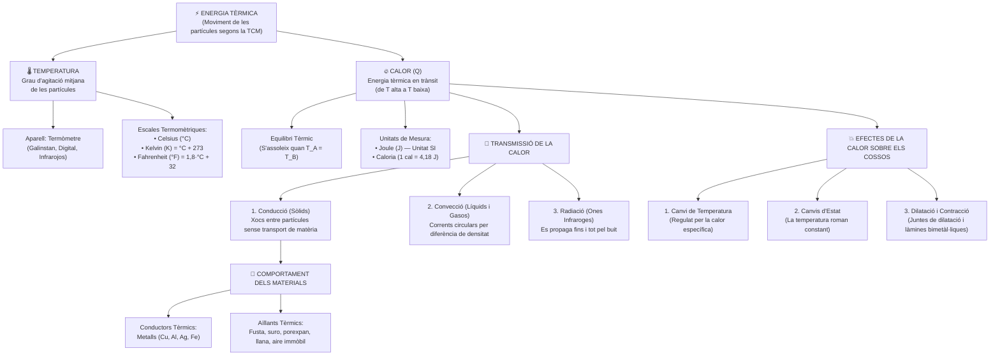

# UD5: La Calor i la Temperatura (Física Tèrmica)

  

    

      FÍSICA APLICADA · 1r FPB
      🌡️ Termodinàmica Quotidiana i Refrigeració al Taller
    

    
Domina la diferència entre calor i temperatura, les escales termomètriques, la transmissió tèrmica i les dilatacions en instal·lacions i equips informàtics.

  

  <a href="./nat0501.html" style="background: linear-gradient(135deg, #ea580c, #d97706); color: #fff !important; font-weight: 800; padding: 10px 18px; border-radius: 10px; text-decoration: none !important; box-shadow: 0 4px 12px rgba(234, 88, 12, 0.3); display: inline-flex; align-items: center; gap: 6px;">
    🚀 Començar Sessió 5.1
    →
  </a>

Benvingut/da a la **Unitat Didàctica 5: La Calor i la Temperatura** del mòdul de **Ciències Aplicades I**. En el llenguatge del carrer sovint confonem els termes *calor* i *temperatura*, però en física i en el món professional del taller representen conceptes ben diferents. Comprendre com es mou l'energia tèrmica et permetrà entendre des de per què cal aplicar pasta tèrmica i un dissipador d'alumini sobre el processador d'un ordinador, fins a per què els ponts i les vies de tren necessiten juntes de dilatació per no deformar-se a l'estiu.

Aquesta unitat està estructurada en **5 sessions teoricopràctiques** (1 sessió = 1 apartat del temari oficial), cadascuna amb explicacions rigoroses, exemples aplicats al taller, esquemes visuals i una bateria interactiva d'autoavaluació amb generació d'informe PDF per a Aules.

---

## 📑 Planificació de Subunitats Didàctiques (5 Sessions)

| Sessió | Subunitat | Contingut Principal de la Sessió | Bateria d'Activitats | Enllaç Directe |
| :---: | :---: | :--- | :---: | :---: |
| **Sessió 1** | **5.1** | **La temperatura i la calor:** Teoria cineticomolecular, agitació tèrmica, calor com a energia en trànsit, equilibri tèrmic, Joule ($\text{J}$) i caloria ($\text{cal}$). | MCQ, V/F, Vocabulari, Raonament i Aules | [**📖 Anar a la Sessió 5.1 →**](./nat0501.html) |
| **Sessió 2** | **5.2** | **El termòmetre:** Engany del sentit del tacte, termòmetres de galinstan, digitals i d'infrarojos, i conversió entre escales Celsius ($^\circ\text{C}$), Kelvin ($\text{K}$) i Fahrenheit ($^\circ\text{F}$). | MCQ, V/F, Vocabulari, Raonament i Aules | [**📖 Anar a la Sessió 5.2 →**](./nat0502.html) |
| **Sessió 3** | **5.3** | **Formes de transmissió de la calor:** Mecanismes de conducció en sòlids, corrents de convecció en fluids (líquids i gasos) i radiació infraroja pel buit. | MCQ, V/F, Vocabulari, Raonament i Aules | [**📖 Anar a la Sessió 5.3 →**](./nat0503.html) |
| **Sessió 4** | **5.4** | **Materials conductors i aïllants:** Conductivitat tèrmica dels metalls, dissipadors i *heat-pipes*, aïllants porosos, aire immòbil, doble vidre i termos de buit. | MCQ, V/F, Vocabulari, Raonament i Aules | [**📖 Anar a la Sessió 5.4 →**](./nat0504.html) |
| **Sessió 5** | **5.5** | **Efectes de la calor sobre els cossos:** Variació de temperatura (calor específica), canvis d'estat a $T$ constant, dilatació/contracció, juntes de dilatació i làmines bimetàl·liques. | MCQ, V/F, Vocabulari, Raonament i Aules | [**📖 Anar a la Sessió 5.5 →**](./nat0505.html) |

---

## 🗺️ Mapa Conceptual de la Unitat Didàctica 5

---

## 🎯 Objectius d'Aprenentatge i Competències Professionals

En finalitzar l'estudi d'aquesta unitat didàctica, seràs capaç de:

1. **Diferenciar amb rigor científic la calor i la temperatura:** Explicar a partir de la teoria cineticomolecular per què els cossos tenen temperatura i energia tèrmica, però no "tenen calor", i predir el sentit del flux tèrmic fins a l'equilibri.
2. **Realitzar conversions d'unitats tèrmiques i termomètriques:** Passar valors entre Joules ($\text{J}$), calories ($\text{cal}$) i kilocalories ($\text{kcal}$), així com transformar temperatures entre les escales Celsius ($^\circ\text{C}$), Kelvin ($\text{K}$) i Fahrenheit ($^\circ\text{F}$).
3. **Seleccionar el termòmetre adequat per a cada tasca:** Comprendre el principi físic dels termòmetres de dilatació líquida, termistors digitals i piròmetres d'infrarojos, i conéixer els motius de salut pública pels quals es va prohibir el mercuri.
4. **Identificar els mecanismes de propagació tèrmica:** Reconéixer la conducció, la convecció i la radiació tant en fenòmens meteorològics i domèstics com en la refrigeració d'equips informàtics i instal·lacions.
5. **Triar materials conductors o aïllants segons la funció tècnica:** Justificar l'ús de coure, alumini i pasta tèrmica per a dissipar calor en electrònica, i l'ús de cambres d'aire, poliestirè expandit o buit per a l'aïllament tèrmic i l'estalvi energètic.
6. **Explicar els efectes físics de la calor en l'enginyeria:** Analitzar el paper de la calor específica de l'aigua, la constància tèrmica durant els canvis d'estat i la importància crítica de les juntes de dilatació i les làmines bimetàl·liques.

---

## 📚 Resum de Fórmules i Equivalències Fonamentals de la UD5

| Magnitud o Conversió | Expressió Matemàtica / Equivalència | Observacions Pràctiques |
| :--- | :---: | :--- |
| **Equivalència Caloria → Joule** | $1\text{ cal} = 4{,}18\text{ J}$ | Per passar de $\text{cal}$ a $\text{J}$, multipliquem per $4{,}18$. |
| **Equivalència Joule → Caloria** | $1\text{ J} \approx 0{,}24\text{ cal}$ | Per passar de $\text{J}$ a $\text{cal}$, dividim entre $4{,}18$ (o multipliquem per $0{,}24$). |
| **Múltiples Energètics** | $1\text{ kcal} = 1\,000\text{ cal} = 4\,180\text{ J}$ | Molt utilitzada en nutrició i climatització. |
| **De Celsius ($^\circ\text{C}$) a Kelvin ($\text{K}$)** | $T(\text{K}) = T(^\circ\text{C}) + 273$ | El zero absolut és $0\text{ K} = -273{,}15^\circ\text{C}$. Mai porta el símbol $^\circ$. |
| **De Kelvin ($\text{K}$) a Celsius ($^\circ\text{C}$)** | $T(^\circ\text{C}) = T(\text{K}) - 273$ | Un augment d'$1^\circ\text{C}$ equival exactament a un augment d'$1\text{ K}$. |
| **De Celsius ($^\circ\text{C}$) a Fahrenheit ($^\circ\text{F}$)** | $T(^\circ\text{F}) = 1{,}8 \cdot T(^\circ\text{C}) + 32$ | L'aigua es congela a $32^\circ\text{F}$ i bull a $212^\circ\text{F}$. |
| **De Fahrenheit ($^\circ\text{F}$) a Celsius ($^\circ\text{C}$)** | $T(^\circ\text{C}) = \dfrac{T(^\circ\text{F}) - 32}{1{,}8}$ | Primer es resta $32$ i el resultat es divideix entre $1{,}8$. |

---

## 🧰 Aplicacions Directes al Taller Professional d'FP Bàsica

* **Manteniment d'Equips Informàtics:** Un microprocessador modern (CPU o GPU) transforma energia elèctrica en calor per efecte Joule. Si no evacuem aquesta calor combinant **conducció** (pasta tèrmica + base de coure + aletes d'alumini) i **convecció forçada** (ventiladors que expulsen l'aire calent per la part superior/posterior de la caixa), la temperatura superarà els $100^\circ\text{C}$ i el sistema patirà *thermal throttling* o s'apagarà per protecció.
* **Instal·lacions Elèctriques i Protecció:** Els interruptors automàtics magnetotèrmics (PIA) del quadre elèctric incorporen una **làmina bimetàl·lica**. Quan connectem massa aparells a un mateix endoll (sobrecàrrega), el cable s'escalfa, la làmina bimetàl·lica es dilata de manera desigual, es corba i talla el circuit abans que es creme l'aïllant de plàstic i es produïsca un incendi.
* **Eficiència Energètica en Edificis:** L'ús de tancaments amb trencament de pont tèrmic, finestres amb doble vidre i aïllants de llana de roca o poliuretà redueix dràsticament les pèrdues de calor a l'hivern i l'entrada de calor a l'estiu, estalviant electricitat i reduint les emissions de $\text{CO}_2$.

---

## 📖 Glossari Essencial de la Unitat

* **Teoria Cineticomolecular (TCM):** Model científic que explica que tota la matèria està formada per partícules minúscules (àtoms, molècules o ions) en moviment o vibració contínua.
* **Temperatura ($T$):** Magnitud física que mesura el grau d'agitació tèrmica o l'energia cinètica mitjana de les partícules d'un cos. No depén de la massa del cos.
* **Calor ($Q$):** Energia tèrmica en trànsit que es transfereix espontàniament d'un cos a major temperatura cap a un altre a menor temperatura.
* **Equilibri tèrmic:** Estat final en què dos o més cossos en contacte igualen les seues temperatures ($T_A = T_B$) i deixa d'haver-hi transferència neta de calor.
* **Zero absolut ($0\text{ K}$):** La temperatura més baixa possible a l'univers ($-273{,}15^\circ\text{C}$), en la qual les partícules deixarien de vibrar per complet.
* **Conductivitat tèrmica:** Propietat física que indica la facilitat amb què un material deixa passar la calor per conducció a través seu.
* **Calor específica ($c_e$):** Quantitat d'energia calorífica necessària per a augmentar en $1^\circ\text{C}$ (o $1\text{ K}$) la temperatura d'$1\text{ kg}$ (o $1\text{ g}$) d'una substància.
* **Dilatació tèrmica:** Augment de les dimensions (longitud, superfície o volum) d'un cos quan augmenta la seua temperatura.

---

## ❓ Preguntes Freqüents i Erades Habituals a Evitar (FAQ de la UD5)

1. **És el mateix dir "aquest cos té molta calor" que "aquest cos té una temperatura alta"?**
   * **No.** Cap cos "té calor" emmagatzemada. Els cossos tenen **energia tèrmica** (la suma de l'energia cinètica de totes les seues partícules) i es troben a una **temperatura** determinada. La **calor** és únicament l'energia tèrmica quan està en trànsit viatjant d'un cos més calent a un altre més fred.
2. **Per què l'escala Kelvin ($\text{K}$) no s'escriu amb el símbol de grau ($^\circ$) ni té números negatius?**
   * Perquè el **kelvin ($\text{K}$)** és una unitat absoluta del Sistema Internacional, no una escala arbitrària relativa com la Celsius o la Fahrenheit. Com que el seu origen ($0\text{ K} = -273{,}15^\circ\text{C}$) és el **zero absolut** —on les partícules s'aturen totalment—, és físicament impossible que existisca cap temperatura inferior a $0\text{ K}$.
3. **Si el metall i la fusta de la meua taula estan tots dos a $20^\circ\text{C}$, per què el metall em pareix gelat en tocar-lo?**
   * Perquè la nostra pell està a uns $35^\circ\text{C}$ i els nostres receptors nerviosos no mesuren la temperatura de l'objecte, sinó la **velocitat a la qual perdem calor**. Com que el metall és un **conductor tèrmic**, roba calor dels nostres dits molt ràpidament; en canvi, la fusta és un **aïllant tèrmic** i gairebé no ens roba calor.
4. **Si un abric o una manta són aïllants tèrmics, per què ens escalfen a l'hivern?**
   * L'abric **no produeix calor**. La veritable estufa és **el teu propi cos** (que es manté a $36{,}5^\circ\text{C}$ gràcies a la respiració cel·lular). El teixit de l'abric reté milions de xicotetes bosses d'**aire immòbil**, que és un excel·lent aïllant, impedint que la calor corporal s'escape cap al carrer.
5. **Per què la temperatura de l'aigua no passa de $100^\circ\text{C}$ mentre bull, encara que apugem el foc al màxim?**
   * Perquè **durant qualsevol canvi d'estat d'una substància pura la temperatura roman constant**. Tota la calor extra que subministrem amb el foc (anomenada *calor latent de vaporització*) s'inverteix a separar les molècules d'aigua líquida per a transformar-les en vapor, i no a augmentar la seua velocitat mitjana.

---

## 🧪 Guia de Pràctiques i Observacions Recomanades al Taller

| Experiència Pràctica | Material Necessari | Fenomen Físic que es Comprova |
| :--- | :--- | :--- |
| **1. L'engany del sentit del tacte** | 3 recipients amb aigua freda ($5^\circ\text{C}$), tèbia ($25^\circ\text{C}$) i calenta ($45^\circ\text{C}$) + termòmetre digital. | La sensació tèrmica de les mans és subjectiva i contradictòria; només el termòmetre dóna una mesura objectiva. |
| **2. Termografia d'un PC en càrrega** | Ordinador de taller executant un test d'estrès + termòmetre d'infrarojos (piròmetre). | Mesura sense contacte de la radiació infraroja a la CPU, dissipador d'alumini, font d'alimentació i reixetes de convecció. |
| **3. Conductors vs. Aïllants** | Cullera d'acer inoxidable, cullera de fusta i cullera de plàstic dins d'un got amb aigua a $70^\circ\text{C}$. | La conducció tèrmica escalfa ràpidament el mànec metàl·lic, mentre la fusta i el plàstic romanen a temperatura ambient. |
| **4. Corrents de convecció visibles** | Vas de precipitats amb aigua sobre placa calefactora + unes gotes de colorant o serradures fines. | S'observen a simple vista els corrents circulars: l'aigua calenta menys densa puja pel centre i l'aigua freda més densa baixa. |
| **5. Dilatació d'anell de Gravesande** | Esfera metàl·lica de llautó amb anell ajustat i bec Bunsen o decapador d'aire calent. | En fred la bola passa just per l'anell; en escalfar-la es dilata i queda encallada fins que es torna a refredar i contraure. |

---

## 📋 Criteris d'Avaluació i Lliurament d'Activitats a Aules

Per a superar amb èxit aquesta Unitat Didàctica 5 en la plataforma **Aules**, recorda seguir aquests passos en cadascuna de les **5 sessions** (`5.1` a `5.5`):

1. **Lectura comprensiva de la teoria:** Revisa els esquemes Mermaid, les taules comparatives i els quadres d'exemples resolts pas a pas.
2. **Resolució de la Zona d'Entrenament FPB:**
   * Respon les **2 preguntes tipus test (MCQ)** seleccionant l'opció més rigorosa.
   * Respon les **2 afirmacions de Vertader o Fals (V/F)** fixant-te en els matisos físics.
   * Completa els **2 exercicis de resposta breu i vocabulari tècnic** escrivint el terme científic exacte i prement el botó *Comprovar*.
   * Redacta amb les teues pròpies paraules la **pregunta de raonament i desenvolupament escrit**, aplicant els conceptes de la sessió a situacions reals del taller o de la llar.
3. **Descàrrega del justificant PDF:** Escriu els teus **Cognoms i Nom** a la targeta blava final (*Lliurament d'Activitats d'Aules*) i prem el botó **📄 Descarregar PDF per a Aules** per a pujar els 5 documents (`Act 5.1` fins a `Act 5.5`) a la tasca corresponent del curs.

---

## 🔄 Connexió amb la Resta del Mòdul de Ciències Aplicades I

Aquesta unitat s'enllaça directament amb les unitats anteriors i següents del temari oficial de **1r d'FP Bàsica**:

* **Relació amb la UD4 (L'Energia):** En la unitat anterior vam estudiar el Principi de Conservació de l'Energia i vam comprovar que en qualsevol transformació energètica una part de l'energia es degrada i es dissipa en forma de **calor** (efecte Joule en circuits elèctrics i fregament mecànic). En aquesta UD5 analitzem en profunditat com es comporta, com es mesura i com es controla aquesta energia tèrmica.
* **Relació amb les Unitats de Matemàtiques (Àlgebra i Equacions):** Per a convertir temperatures entre les escales Celsius ($^\circ\text{C}$), Kelvin ($\text{K}$) i Fahrenheit ($^\circ\text{F}$) o transformar calories en Joules, apliquem fórmules algebraiques, operacions amb nombres decimals i enters negatius (temperatures sota zero fins al zero absolut de $-273{,}15^\circ\text{C}$).
* **Relació amb la UD6 (La Salut):** En la unitat següent utilitzarem el termòmetre clínic per a mesurar la **febre** com a signe clínic objectiu i com a mecanisme defensiu de la 2a línia del nostre sistema immunitari, i veurem com la **homeòstasi** manté la nostra temperatura corporal al voltant de $36{,}5^\circ\text{C}$.

### Itinerari Recomanat de Treball (5 Sessions)
* **Sessió 1 (`nat0501`):** Conceptes de temperatura, energia tèrmica, calor, equilibri tèrmic i pas entre Joules ($\text{J}$) i calories ($\text{cal}$).
* **Sessió 2 (`nat0502`):** Tipus de termòmetres (galinstan, digital, infrarojos) i problemes de conversió entre $^\circ\text{C}$, $\text{K}$ i $^\circ\text{F}$.
* **Sessió 3 (`nat0503`):** Estudi comparat de la conducció en sòlids, la convecció en líquids/gasos i la radiació pel buit.
* **Sessió 4 (`nat0504`):** Selecció de conductors metàl·lics i aïllants tèrmics en informàtica, cuina i construcció.
* **Sessió 5 (`nat0505`):** Calor específica, canvis d'estat a temperatura constant, dilatacions, juntes i làmines bimetàl·liques.

---

> [!TIP]
> ### 💡 Consell d'Estudi per a l'Alumnat
> Completa cada sessió per ordre, revisa els exemples numèrics resolts amb calculadora i respon totes les preguntes interactives al final de cada pàgina. Recorda introduir el teu **Nom i Cognoms** a la targeta final per descarregar el teu **PDF d'Aules** de cada apartat!
