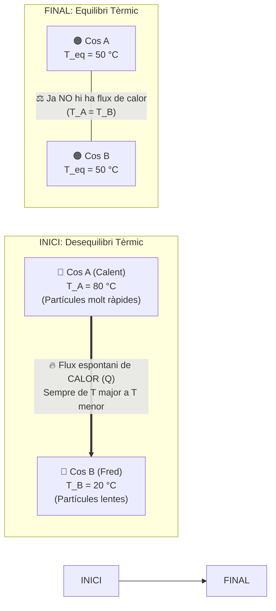
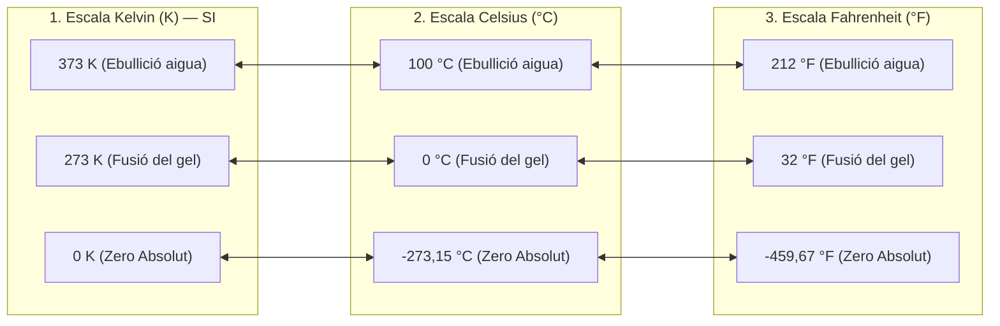
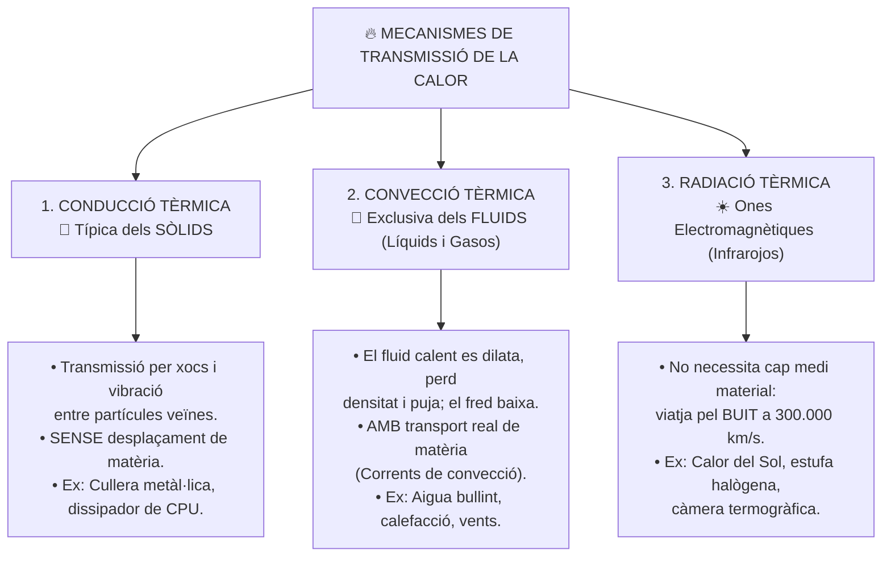
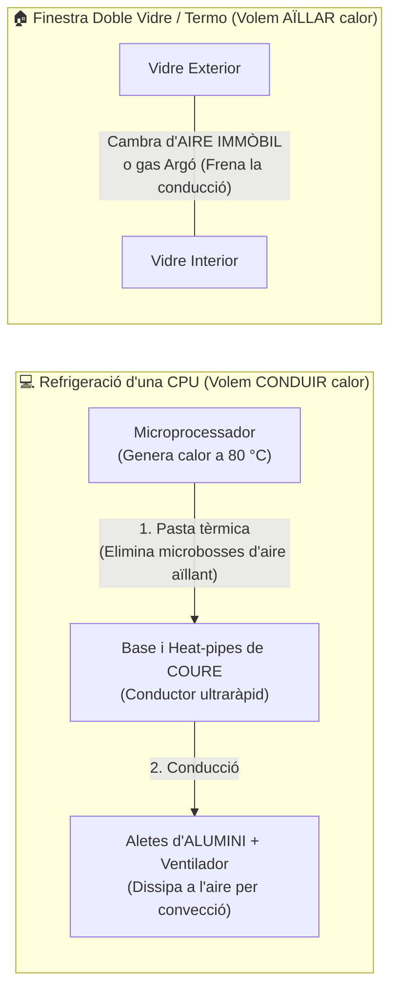
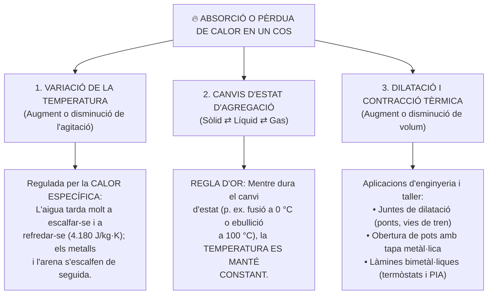

# 🔬 UD5: La Calor i la Temperatura — Temari Complet i Exercicis Diaris per a Aules

En aquesta pàgina tens tant l'**accés directe a cada sessió diària individual** (amb els seus **15 exercicis diaris** i el seu **botó de descàrrega de PDF per a pujar a Aules cada dia**) com la **vista completa de tota la unitat** amb tots els apartats i el **Butlletí Global d'Activitats Finals de la Unitat**.

---

## 📑 Planificació Diària de Sessions i Tasques d'Aules (UD5)

| Sessió | Apartat del Temari Oficial | Tasca Diària per a Aules | Accés Directe |
| :---: | :--- | :---: | :---: |
| **5.1** | **5.1 La temperatura i la calor** | 15 Exercicis Diaris + PDF Aules | [**📖 Teoria + 🎯 15 Exercicis →**](./nat0501.html) · [**🎯 Anar a Exercicis →**](./nat0501.html#activitats) |
| **5.2** | **5.2 El termòmetre** | 15 Exercicis Diaris + PDF Aules | [**📖 Teoria + 🎯 15 Exercicis →**](./nat0502.html) · [**🎯 Anar a Exercicis →**](./nat0502.html#activitats) |
| **5.3** | **5.3 Formes de transmissió de la calor** | 15 Exercicis Diaris + PDF Aules | [**📖 Teoria + 🎯 15 Exercicis →**](./nat0503.html) · [**🎯 Anar a Exercicis →**](./nat0503.html#activitats) |
| **5.4** | **5.4 Materials conductors i aïllants** | 15 Exercicis Diaris + PDF Aules | [**📖 Teoria + 🎯 15 Exercicis →**](./nat0504.html) · [**🎯 Anar a Exercicis →**](./nat0504.html#activitats) |
| **5.5** | **5.5 Efectes de la calor sobre els cossos** | 15 Exercicis Diaris + PDF Aules | [**📖 Teoria + 🎯 15 Exercicis →**](./nat0505.html) · [**🎯 Anar a Exercicis →**](./nat0505.html#activitats) |
| **5.6** | **5.6 Activitats Finals i Tasca Global de la Unitat 5 (Aules)** | 21 Exercicis Globals + PDF Aules | [**📝 Fer Tasca Global UD →**](./nat0506.html) · [**🎯 Anar a Exercicis →**](./nat0506.html#activitats) |

---

  

    ⚡ Progrés d'aprenentatge (5.1)
    0 / 12 reptes resolts
  

  

    

  

## 📌 5.1 La temperatura i la calor {#nat0501}

En la vida quotidiana utilitzem contínuament expressions com *"Fa molta calor"*, *"Tinc fred"*, *"Aquesta sopa crema"* o *"Posa't l'abric que dóna calor"*. Tanmateix, des del punt de vista de la física, la majoria d'aquestes frases contenen errors conceptuals importants. Per a entendre què passa realment a l'interior d'un processador que s'escalfa o d'un got d'aigua al foc, hem de viatjar primer al món microscòpic dels àtoms i les molècules.

---

## 1. La Teoria Cineticomolecular i l'Energia Tèrmica

Segons la **Teoria Cineticomolecular (TCM)** de la matèria, tots els cossos que ens envolten —ja siguen sòlids com una clau anglesa d'acer, líquids com l'aigua o gasos com l'aire de l'aula— estan formats per milions de milions de partícules minúscules (àtoms, molècules o ions) que **mai estan quietes**:
* En un **sòlid**, les partícules estan fortament unides en posicions fixes formant una xarxa, però **vibren** contínuament al voltant de la seua posició com si estigueren lligades amb molles invisibles.
* En un **líquid**, les partícules tenen més llibertat: vibren, giren i llisquen unes sobre les altres.
* En un **gas**, les partícules es mouen lliurement a gran velocitat en línia recta, xocant entre elles i contra les parets del recipient.

Com que totes aquestes partícules estan en moviment, cadascuna d'elles posseeix una xicoteta quantitat d'**energia cinètica** (energia associada al moviment).

* **L'Energia Tèrmica (o interna):** És la **suma total** de l'energia cinètica de **totes** les partícules que formen un cos. Com és una suma total, l'energia tèrmica **sí que depén de la massa o grandària del cos**: a igualtat de temperatura, una piscina olímpica té molta més energia tèrmica que un got d'aigua, perquè la piscina conté bilions de vegades més molècules en moviment.

---

## 2. Què és exactament la Temperatura (T)?

Si l'energia tèrmica és la suma de totes les partícules, com mesurem l'estat d'agitació d'un cos sense que importe si és gran o menut? Ací entra el concepte de **temperatura**:

* **Definició física de Temperatura:** La **temperatura (T)** és una magnitud física que mesura el **grau d'agitació tèrmica** o l'**energia cinètica mitjana** (la velocitat mitjana de vibració o moviment) de les partícules d'un cos.
* **És independent de la grandària del cos (magnitud intensiva):** Si tenim una olla amb 5 litres d'aigua bullint a 100 °C i traiem amb un cullerot una tassa de 200 mL d'eixa mateixa aigua, la tassa també està exactament a 100 °C. Per què? Perquè la velocitat mitjana a la qual es mouen les molècules d'aigua a la tassa i a l'olla és idèntica (tot i que l'olla sencera tinga més energia tèrmica total perquè té més massa).
  * **Cos fred (baixa temperatura):** Les seues partícules es mouen o vibren **lentament** (poca agitació).
  * **Cos calent (alta temperatura):** Les seues partícules es mouen o vibren **molt de pressa** i amb gran violència (molta agitació).

---

## 3. Què és la Calor (Q) i per què no "tenim calor"?

En física, la **calor** no és una cosa que els cossos tinguen guardada a dins com si fóra un líquid, sinó un procés de transferència d'energia:

* **Definició física de Calor:** La **calor (Q)** és l'**energia tèrmica en trànsit** que flueix espontàniament des d'un cos que està a **major temperatura** cap a un altre cos que està a **menor temperatura** quan es posen en contacte (o interactuen tèrmicament).

> [!WARNING]
> ### ❌ Desmuntant mites del llenguatge quotidià amb la Física
> 1. **Per què és incorrecte dir *"Tinc calor"* o *"Aquest ferro té molta calor"*?**
>    Els cossos **no tenen calor**: els cossos tenen **energia tèrmica** i estan a una determinada **temperatura**. La calor només existeix mentre l'energia està viatjant d'un cos calent a un de fred. El que sentim a l'estiu és una temperatura ambiental alta que dificulta que el nostre cos (a 36,5 °C) cedisca calor a l'exterior.
> 2. **Per què és incorrecte dir *"Aquest abric o aquesta manta dóna calor"*?**
>    Un abric de llana no té cap motor ni resistència elèctrica; si emboliques un bloc de gel amb un abric, el gel no es fondrà, sinó que tardarà més a fondre's! La font de calor és **el teu propi cos** (que crema nutrients a les cèl·lules i es manté a 36,5 °C). L'abric és simplement un **aïllant tèrmic** que reté una capa d'aire immòbil i **impedeix que la calor que produeix el teu cos s'escape** cap a l'aire fred del carrer.
> 3. **I el "fred", existeix en física?**
>    No! El "fred" no és cap forma d'energia que entre per la finestra. Quan obris la nevera o una finestra a l'hivern, no "entra fred", sinó que **ix calor** des de l'habitació o des de la teua pell (que estan a major temperatura) cap a l'aire exterior (que està a menor temperatura). El fred és simplement la **pèrdua de calor** o la baixa agitació de les partícules.

---

## 4. El Concepte d'Equilibri Tèrmic

Què ocorre a escala microscòpica quan tirem un ou dur acabat de bullir (90 °C) dins d'un bol amb aigua fresca de l'aixeta (15 °C)?
1. Les partícules de l'ou calent vibren a gran velocitat i xoquen contra les molècules d'aigua freda que l'envolten, que es mouen molt més a poc a poc.
2. En cada xoc, les partícules ràpides de l'ou **cedeixen part de la seua energia cinètica** a les molècules lentes de l'aigua: l'ou es va refredant (la seua temperatura baixa) i l'aigua es va escalfant (la seua temperatura puja).
3. Aquest trànsit d'energia (la **calor**) continua fins que les partícules dels dos cossos arriben exactament a la **mateixa velocitat mitjana d'agitació**, és a dir, assoleixen una **temperatura final comuna ($T_{\text{final}}oT_{\text{eq}}$)** intermèdia (per exemple, 28 °C).
4. En eixe instant s'ha assolit l'**equilibri tèrmic**: com que $T_{\text{ou}} = T_{\text{aigua}}$, **s'atura per complet el flux net de calor** entre ells.

---

## 5. Taula Comparativa: Temperatura vs. Calor

| Característica | 🌡️ Temperatura (T) | 🔥 Calor (Q) |
| :--- | :--- | :--- |
| **Què és físicament?** | La mesura de l'energia cinètica **mitjana** (velocitat de vibració) de les partícules d'un cos. | L'**energia tèrmica en trànsit** que passa d'un cos a major T cap a un altre a menor T. |
| **És una propietat que té el cos?** | **Sí**, tot cos es troba sempre a una temperatura determinada en cada instant. | **No**, els cossos no tenen calor; la calor només apareix mentre es transfereix energia. |
| **Depén de la massa o grandària?** | **No** (magnitud intensiva): una gota i una piscina de la mateixa aigua tenen la mateixa T. | **Sí** (magnitud extensiva): escalfar 100 L d'aigua requereix molta més calor que escalfar 1 L. |
| **Aparell de mesura** | El **termòmetre**. | El **calorímetre**. |
| **Unitat del Sistema Internacional (SI)** | El **Kelvin (K)** (i habitualment el grau Celsius, $^\circ\text{C}$). | El **Joule (J)** (i tradicionalment la caloria, cal). |

---

## 6. Unitats de Mesura de la Calor: El Joule (J) i la Caloria (cal)

Com que la calor és una forma d'**energia** en trànsit, en el **Sistema Internacional d'Unitats (SI)** es mesura amb la mateixa unitat que totes les altres energies i que el treball mecànic: el **Joule (J)**, en honor al físic anglès James Prescott Joule. Per a quantitats grans s'utilitza el **kilojoule (kJ)**, on $1\text{ kJ} = 1\,000\text{ J}$.

No obstant això, per raons històriques i en àmbits com la nutrició, la medicina i la climatització, es continua utilitzant moltíssim una unitat tradicional específica per a la calor: la **caloria (cal)**.

* **Què és una caloria (1 cal)?** És la quantitat de calor que cal subministrar a **1 gram d'aigua líquida pura** per a fer que la seua temperatura augmente exactament **1 °C** (concretament de 14,5 °C a 15,5 °C a pressió atmosfèrica normal).
* El seu múltiple de mil és la **kilocaloria (kcal)**: $1\text{ kcal} = 1\,000\text{ cal}$ (que en les etiquetes dels aliments s'anomena sovint "Caloria gran" amb majúscula).

### Equivalència Matemàtica (Equivalent Mecànic de la Calor)
James P. Joule va demostrar experimentalment que la calor i el treball mecànic són equivalents i va establir el factor de conversió exacte entre ambdues unitats:

1\text{ cal} = 4{,}18\text{ J} \qquad \Longleftrightarrow \qquad 1\text{ J} = \frac{1}{4{,}18}\text{ cal} \approx 0{,}24\text{ cal}

* **Per a passar de calories (cal) a Joules (J):** **Multipliquem per $4{,}18$**.
* **Per a passar de Joules (J) a calories (cal):** **Dividim entre $4{,}18$** (o multipliquem per $0{,}24$).

> [!TIP]
> ### 🧮 Exemples Resolts Pas a Pas de Conversió d'Unitats de Calor
> **Exemple 1:** Un dissipador de CPU evacua 500 cal de calor en pocs segons. Quants Joules (J) d'energia tèrmica ha dissipat?
> * **Solució:** Multipliquem les calories per $4{,}18$:
>   $$Q = 500\text{ cal} \cdot 4{,}18\text{ J/cal} = \mathbf{2\,090\text{ J}} \quad (2{,}09\text{ kJ})$$
>
> **Exemple 2:** Una resistència elèctrica d'una estufa allibera $8\,360\text{ J}$ de calor. A quantes calories (cal) i kilocalories (kcal) equival?
> * **Solució:** Dividim els Joules entre $4{,}18$:
>   $$Q = \frac{8\,360\text{ J}}{4{,}18\text{ J/cal}} = \mathbf{2\,000\text{ cal}} = \mathbf{2\text{ kcal}}

---

> [!NOTE]
> ### 💡 Resum de Conceptes Clau (Sessió 5.1)
> - L'**energia tèrmica** és la suma de l'energia cinètica de totes les partícules d'un cos (depén de la massa).
> - La **temperatura (T)** mesura la velocitat mitjana d'agitació de les partícules (no depén de la massa).
> - La **calor (Q)** és energia tèrmica en trànsit que viatja sempre del cos de major temperatura al de menor temperatura fins assolir l'**equilibri tèrmic** ($T_{\text{final}}$ comuna).
> - Unitats de calor: **Joule (J)** en el SI i **caloria (cal)**, amb l'equivalència fonamental **$1\text{ cal} = 4{,}18\text{ J}$**.

---

## 🎯 Activitats i Autoavaluació Interactiva

  

    🎮 <strong>Zona d'Entrenament FPB:</strong> 0 reptes resolts
    ⭐ 0 punts
  

  

### 1. Qüestionari d'Autoavaluació Tipus Test (MCQ)

  
<strong>1. Segons la física, quina de les definicions següents explica correctament què és la calor?</strong>

  

    <button type="button" class="btn-mcq-opt" data-opt="A">A) És la velocitat mitjana a la qual vibren els àtoms dins d'un cos sòlid</button>
    <button type="button" class="btn-mcq-opt" data-opt="B">B) És l'energia tèrmica en trànsit que flueix espontàniament des d'un cos a major temperatura cap a un altre a menor temperatura</button>
    <button type="button" class="btn-mcq-opt" data-opt="C">C) És una substància invisible que els abrics de llana fabriquen i donen al cos humà</button>
    <button type="button" class="btn-mcq-opt" data-opt="D">D) És l'energia que flueix espontàniament des del cos més fred cap al cos més calent</button>
  

  

  
<strong>2. Si una reacció química allibera exactament $1\,000\text{ calories}$ (1 kcal) de calor, a quants Joules (J) del Sistema Internacional equival?</strong>

  

    <button type="button" class="btn-mcq-opt" data-opt="A">A) 240 J</button>
    <button type="button" class="btn-mcq-opt" data-opt="B">B) $1\,000\text{ J}$</button>
    <button type="button" class="btn-mcq-opt" data-opt="C">C) $4\,180\text{ J}$</button>
    <button type="button" class="btn-mcq-opt" data-opt="D">D) $41{,}8\text{ J}$</button>
  

  

  
<strong>3. Comparem un got amb 200 mL d'aigua a 60 °C i una banyera amb 100 L d'aigua també a 60 °C. Quina afirmació és física i científicament certa?</strong>

  

    <button type="button" class="btn-mcq-opt" data-opt="A">A) Tots dos tenen exactament la mateixa temperatura (60 °C), però la banyera té molta més energia tèrmica total perquè conté moltes més molècules en moviment</button>
    <button type="button" class="btn-mcq-opt" data-opt="B">B) La banyera té molta més temperatura que el got perquè és més gran</button>
    <button type="button" class="btn-mcq-opt" data-opt="C">C) El got té més energia tèrmica total que la banyera</button>
    <button type="button" class="btn-mcq-opt" data-opt="D">D) Si els posem en contacte, passarà calor del got a la banyera</button>
  

  

  
<strong>4. Al taller submergim una peça d'acer acabada de mecanitzar que està a 90 °C dins d'un poal d'aigua a 20 °C. Què passarà fins a assolir l'equilibri tèrmic?</strong>

  

    <button type="button" class="btn-mcq-opt" data-opt="A">A) L'aigua passarà fred a la peça d'acer fins que totes dues queden a 0 °C</button>
    <button type="button" class="btn-mcq-opt" data-opt="B">B) L'aigua cedirà calor a l'acer fins que l'acer arribe a 110 °C</button>
    <button type="button" class="btn-mcq-opt" data-opt="C">C) No hi haurà cap transferència d'energia perquè l'acer és sòlid i l'aigua és líquida</button>
    <button type="button" class="btn-mcq-opt" data-opt="D">D) Fluirà calor des de la peça d'acer cap a l'aigua fins que tots dos cossos tinguen la mateixa temperatura intermèdia d'equilibri</button>
  

  

---

### 2. Activitats de Vertader (V) o Fals (F)

  <strong>a) Si traiem un got d'aigua d'una olla on l'aigua bull a 100 °C, l'aigua del got tindrà menys temperatura perquè té menys massa.</strong>
  

    <button type="button" class="btn-vf" data-opt="V">V</button>
    <button type="button" class="btn-vf" data-opt="F">F</button>
  

  

  <strong>b) Quan dos cossos en contacte assoleixen l'equilibri tèrmic, les seues temperatures s'igualen i cessa el flux de calor entre ells.</strong>
  

    <button type="button" class="btn-vf" data-opt="V">V</button>
    <button type="button" class="btn-vf" data-opt="F">F</button>
  

  

  <strong>c) Des del punt de vista físic és correcte dir que un abric de llana dóna calor perquè les seues fibres fabriquen energia tèrmica.</strong>
  

    <button type="button" class="btn-vf" data-opt="V">V</button>
    <button type="button" class="btn-vf" data-opt="F">F</button>
  

  

  <strong>d) Una caloria (1 cal) es defineix com la quantitat de calor necessària per a elevar en 1 °C la temperatura d'1 gram d'aigua líquida.</strong>
  

    <button type="button" class="btn-vf" data-opt="V">V</button>
    <button type="button" class="btn-vf" data-opt="F">F</button>
  

  

---

### 3. Exercicis de Resposta Breu, Vocabulari Tècnic i Càlcul

  
✍️ <strong>1.</strong> Com s'anomena la magnitud física que mesura el grau d'agitació o l'energia cinètica mitjana de les partícules d'un cos?

  

    <input type="text" class="quiz-input" placeholder="Escriu la magnitud...">
    <button type="button" class="btn-quiz-check">Comprovar</button>
  

  

  
✍️ <strong>2.</strong> Quina és la unitat oficial del Sistema Internacional (SI) per a mesurar la calor i qualsevol altra forma d'energia?

  

    <input type="text" class="quiz-input" placeholder="Escriu la unitat del SI...">
    <button type="button" class="btn-quiz-check">Comprovar</button>
  

  

  
✍️ <strong>3. Càlcul:</strong> Si un xip electrònic dissipa 200 cal de calor, quants Joules (J) d'energia tèrmica ha alliberat? (Escriu només el número)

  

    <input type="text" class="quiz-input" placeholder="Resultat en Joules...">
    <button type="button" class="btn-quiz-check">Comprovar</button>
  

  

  
✍️ <strong>4.</strong> Com s'anomena l'estat físic que s'assoleix quan dos cossos en contacte igualen les seues temperatures?

  

    <input type="text" class="quiz-input" placeholder="Escriu el concepte ( dues paraules)...">
    <button type="button" class="btn-quiz-check">Comprovar</button>
  

  

---

### 4. Exercicis de Raonament i Desenvolupament Escrit (Tasca d'Aula)

  
✍️ <strong>1. Física en la vida diària:</strong> A l'hivern un company et diu: <em>"Tanca la porta del taller que està entrant molt de fred, i posa't aquesta jaqueta polar perquè dóna molta calor"</em>. Explica amb vocabulari físic per què aquestes dues afirmacions són incorrectes i què és el que passa realment amb la calor en tots dos casos.

  <textarea class="open-response-input" rows="4" placeholder="Explica en quin sentit viatja la calor per la porta oberta i quina és la veritable funció aïllant de la jaqueta polar..."></textarea>

  
✍️ <strong>2. Problemes de conversió entre Joules i calories:</strong> Resol pas a pas: a) Una beguda energètica aporta 150 kcal ($150\,000\text{ cal}$). Quants Joules (J) i kilojoules (kJ) representa aquesta energia? b) Una font d'alimentació de PC dissipa $12\,540\text{ J}$ de calor. A quantes calories (cal) i kilocalories (kcal) equival?

  <textarea class="open-response-input" rows="4" placeholder="a) Multiplica les calories per 4,18... b) Divideix els Joules entre 4,18..."></textarea>

  
✍️ <strong>3. La Teoria Cineticomolecular i l'equilibri tèrmic:</strong> Explica què ocorre a escala microscòpica amb el moviment i els xocs de les partícules quan barregem en un got llet molt calenta a 80 °C amb café fred a 15 °C fins que la mescla queda tèbia.

  <textarea class="open-response-input" rows="4" placeholder="Descriu com estan les partícules de la llet a 80 °C, com estan les del café a 15 °C, què passa quan xoquen i quan s'atura el procés..."></textarea>

---

  <h3 style="margin-top:0; color:#0369a1;">📦 Lliurament d'Activitats d'Aules (Act 5.1)</h3>
  
Genera el teu document de tasca d'aquest apartat amb el teu nom i puntuació obtinguda.

  

    <input type="text" class="aules-student-name" placeholder="Cognoms, Nom de l'Alumne/a" style="padding:8px 12px; border:1px solid #94a3b8; border-radius:4px; flex-grow:1; min-width:240px;">
    <button class="btn-generate-aules-pdf" data-unit="NAT05" data-activity="Act01" data-module="CA" style="padding:8px 16px; background:#0284c7; color:#fff; border:none; border-radius:4px; font-weight:600; cursor:pointer;">📄 Descarregar PDF per a Aules</button>
  

---

  

    ⚡ Progrés d'aprenentatge (5.2)
    0 / 12 reptes resolts
  

  

    

  

## 📌 5.2 El termòmetre {#nat0502}

Per a saber si un pacient té febre, si una cambra frigorífica conserva bé els aliments o si el microprocessador d'un servidor està a punt de cremar-se, necessitem mesurar la temperatura amb precisió. Però per què no podem refiar-nos simplement de tocar els objectes amb la mà?

---

## 1. Per què el nostre sentit del tacte ens enganya?

La pell humana conté receptors nerviosos tèrmics (corpuscles de Krause per al fred i de Ruffini per a la calor), però aquests receptors **no mesuren la temperatura real** dels objectes: només detecten la **rapidesa amb què la nostra pell guanya o perd calor**, i a més depenen de la temperatura que tenia la nostra mà just abans.

### L'Experiment Clàssic dels Tres Recipients
Imagina que col·loquem tres bols d'aigua sobre el banc del taller:
1. **Bol Esquerre:** Aigua molt freda amb gel (5 °C).
2. **Bol Dret:** Aigua calenta (45 °C).
3. **Bol Central:** Aigua tèbia a temperatura ambient (25 °C).

Si fiques la **mà esquerra en l'aigua freda** i la **mà dreta en l'aigua calenta** durant un minut i, a continuació, fiques **totes dues mans alhora dins del bol central d'aigua tèbia (25 °C)**:
* La teua **mà esquerra** (que venia de 5 °C) absorbirà calor de l'aigua tèbia i el teu cervell et dirà: *"Aquesta aigua està molt calenta!"*
* La teua **mà dreta** (que venia de 45 °C) cedirà calor a la mateixa aigua tèbia i el teu cervell et dirà: *"Aquesta aigua està gelada!"*

Com que una mateixa aigua a 25 °C no pot estar calenta i freda alhora, queda demostrat que la **sensació tèrmica és subjectiva i enganyosa**. Per a obtindre una mesura **objectiva, fiable i reproduïble** necessitem un instrument científic: el **termòmetre**.

---

## 2. Què és el Termòmetre i quins Tipus existeixen?

Un **termòmetre** és un instrument dissenyat per a mesurar la temperatura d'un cos o d'un ambient aprofitant alguna propietat física d'un material (el seu volum, la seua resistència elèctrica o la radiació que emet) que canvia de manera regular amb la temperatura.

### A) Termòmetre de dilatació de líquid (Alcohol acolorit o Galinstan)
Consisteix en un tub de vidre molt fi anomenat **tub capil·lar** amb un depòsit o bulb a l'extrem inferior ple d'un líquid. Quan el bulb es posa en contacte amb el cos que volem mesurar, arriba a l'**equilibri tèrmic** amb ell; el líquid s'escalfa, **es dilata** (augmenta de volum) i puja pel tub capil·lar fins a marcar la temperatura sobre una escala graduada.
* **Termòmetres d'alcohol acolorit:** Contenen etanol tenyit de roig o blau; s'usen molt en meteorologia i laboratoris escolars perquè l'alcohol es congela a $-114 °C$.
* **Termòmetres clínics de Galinstan:** Utilitzen un aliatge metàl·lic líquid no tòxic format per **gal·li, indi i estany** (*Galinstan*).

> [!CAUTION]
> ### ☣️ Per què es van prohibir els termòmetres de Mercuri (Hg)?
> Durant segles els termòmetres clínics es fabricaven amb **mercuri (Hg)**, l'únic metall líquid a temperatura ambient. No obstant això, des de l'any **2009 la Unió Europea va prohibir la venda de termòmetres de mercuri** al públic. Per què? Quan un termòmetre de vidre es trencava a casa, el mercuri es dividia en boletes que s'evaporaven a temperatura ambient. Inhalar vapors de mercuri o abocar-lo al medi ambient provoca una intoxicació greu anomenada **hidrargirisme**, que danya de forma irreversible el **sistema nerviós central (cervell)**, els ronyons i el desenvolupament fetal, a més de bioacumular-se en els peixos que després mengem.

### B) Termòmetre digital electrònic (Termistor o Termoparell)
Són els més habituals hui a les farmàcies, llars, automòbils i plaques base d'ordinador. A la punta metàl·lica no porten cap líquid, sinó un xicotet sensor semiconductor anomenat **termistor** (com una resistència NTC).
* **Com funciona?** Quan canvia la temperatura de la punta, varia la **resistència elèctrica** del semiconductor. Un microxip intern mesura el canvi de corrent elèctric i mostra el valor exacte en una pantalla LCD en pocs segons, avisant amb un xiulet quan s'ha assolit l'equilibri tèrmic.

### C) Termòmetre d'infrarojos o Piròmetre (Sense contacte)
Qualsevol cos que estiga a una temperatura superior al zero absolut emet contínuament radiació electromagnètica invisible en la banda dels **infrarojos (IR)**, i com més calent està el cos, més intensa és aquesta radiació.
* **Com funciona?** El termòmetre d'infrarojos (o la **càmera termogràfica**) incorpora una lent òptica que capta la radiació infraroja que emet l'objecte **a distància i sense tocar-lo**, calculant la temperatura en menys d'un segon.
* **Aplicacions professionals:**
  * **Medicina:** Termòmetres frontals o timpànics (d'oïda), ideals per a mesurar la febre de xiquets o pacients sense risc de contagi.
  * **Taller d'informàtica, electricitat i indústria:** Permet apuntar amb un punter làser a una placa base, una font d'alimentació, un quadre elèctric o l'interior d'un forn industrial a $1\,500 °C$ per a detectar components sobreescalfats sense perill de cremar-se ni d'electrocutar-se.

---

## 3. Les Tres Escales Termomètriques

Per a graduar un termòmetre cal triar dos punts de referència fixos (com la congelació i l'ebullició de l'aigua a nivell del mar, a 1 atm de pressió) i dividir l'interval en parts iguals. Al món s'utilitzen tres escales principals:

### 1. Escala Celsius o Centígrada ($^\circ\text{C}$)
Proposada en 1742 per l'astrònom suec **Anders Celsius**, és l'escala d'ús quotidià a Espanya i a la major part del món:
* Assigna el valor **0 °C** a la temperatura de **congelació (o fusió) de l'aigua pura**.
* Assigna el valor **100 °C** a la temperatura d'**ebullició de l'aigua pura** (a 1 atm).
* L'interval entre tots dos punts es divideix en **$100$ parts iguals** (per això s'anomena *centígrada*), on cada divisió és 1 °C. Admet valors negatius per a temperatures sota zero (p. ex. $-18 °C$ en un congelador).

### 2. Escala Kelvin o Absoluta (K) — Unitat del Sistema Internacional
Creada pel físic britànic William Thomson (**Lord Kelvin**) en 1848, és la **unitat oficial de temperatura en el Sistema Internacional (SI)** i la que s'utilitza en totes les fórmules científiques:
* **Què és el Zero Absolut (0 K)?** És la temperatura més baixa que pot existir físicament a l'univers i equival a **$-273{,}15 °C$** (que arrodonim habitualment a **$-273 °C$**). A 0 K, les partícules de la matèria perdrien tota la seua energia cinètica i **s'aturaria tota vibració atòmica**. Per tant, **en l'escala Kelvin no existeixen temperatures negatives**.
* La mida d'1 K és idèntica a la d'1 °C (hi ha $100$ divisions entre la congelació de l'aigua a **273 K** i l'ebullició a **373 K**). Nota ortogràfica: els kelvins s'escriuen amb la lletra **K sense el símbol de grau ($^\circ$)**.
* **Fórmules de conversió entre Celsius i Kelvin:**
$$T(\text{K}) = T(^\circ\text{C}) + 273 \qquad \Longleftrightarrow \qquad T(^\circ\text{C}) = T(\text{K}) - 273

### 3. Escala Fahrenheit ($^\circ\text{F}$)
Creada en 1724 per Daniel Gabriel Fahrenheit, s'utilitza oficialment als **Estats Units** i en alguns països anglosaxons (i apareix sovint en programari, BIOS d'ordinadors i manuals tècnics americans):
* En aquesta escala, l'aigua es congela a **$32^\circ\text{F}$** i bull a **$212^\circ\text{F}$** (l'interval està dividit en **$180$ parts**, de manera que cada 1 °C equival a $1{,}8^\circ\text{F}$).
* **Fórmules de conversió entre Celsius i Fahrenheit:**
$$T(^\circ\text{F}) = 1{,}8 \cdot T(^\circ\text{C}) + 32 \qquad \Longleftrightarrow \qquad T(^\circ\text{C}) = \frac{T(^\circ\text{F}) - 32}{1{,}8}

---

## 4. Taula Comparativa i Exemples Resolts de Conversió

| Fenomen o Punt de Referència | Escala Celsius ($^\circ\text{C}$) | Escala Kelvin (K) | Escala Fahrenheit ($^\circ\text{F}$) |
| :--- | :---: | :---: | :---: |
| **Zero absolut (aturada atòmica)** | $-273{,}15 °C$ | 0 K | $-459{,}67^\circ\text{F}$ |
| **Punt de fusió del gel (congelació aigua)** | 0 °C | 273 K | $32^\circ\text{F}$ |
| **Temperatura ambient confortable d'aula** | 20 °C | 293 K | $68^\circ\text{F}$ |
| **Temperatura normal del cos humà sa** | $36{,}5 °C \text{ -- } 37 °C$ | $309{,}5\text{ K} \text{ -- } 310\text{ K}$ | $97{,}7^\circ\text{F} \text{ -- } 98{,}6^\circ\text{F}$ |
| **Punt d'ebullició de l'aigua (1 atm)** | 100 °C | 373 K | $212^\circ\text{F}$ |

> [!TIP]
> ### 🧮 Exemples Resolts Pas a Pas (Conversions Termomètriques)
> **Problema 1:** A la BIOS d'un ordinador portàtil veiem que el processador treballa a 60 °C. Expressa aquesta temperatura en **Kelvin (K)** i en **graus Fahrenheit ($^\circ\text{F}$)**.
> * **a) Pas a Kelvin (K):** Sumem $273$ a la temperatura en Celsius:
>   $$T(\text{K}) = 60 + 273 = \mathbf{333\text{ K}}$$
> * **b) Pas a Fahrenheit ($^\circ\text{F}$):** Multipliquem per $1{,}8$ i al resultat li sumem $32$:
>   $$T(^\circ\text{F}) = 1{,}8 \cdot 60 + 32 = 108 + 32 = \mathbf{140^\circ\text{F}}$$
>
> **Problema 2:** Un manual tècnic nord-americà indica que una bateria de liti no ha de superar els $113^\circ\text{F}$. A quants **graus Celsius ($^\circ\text{C}$)** equival aquest límit?
> * **Solució:** Primer restem $32$ i després dividim el resultat entre $1{,}8$:
>   $$T(^\circ\text{C}) = \frac{113 - 32}{1{,}8} = \frac{81}{1{,}8} = \mathbf{45 °C}

---

> [!NOTE]
> ### 💡 Resum de Conceptes Clau (Sessió 5.2)
> - El **tacte és subjectiu** i ens enganya; per a mesurar la temperatura amb precisió usem el **termòmetre**.
> - Tipus de termòmetres: de **dilatació líquida** (alcohol o galinstan, que substitueixen el **mercuri** tòxic), **digitals** (termistor) i **piròmetres d'infrarojos** (sense contacte).
> - Les tres escales són **Celsius ($^\circ\text{C}$)**, **Kelvin (K, unitat SI)** amb $T(\text{K}) = T(^\circ\text{C}) + 273$, i **Fahrenheit ($^\circ\text{F}$)** amb $T(^\circ\text{F}) = 1{,}8 \cdot T(^\circ\text{C}) + 32$.

---

## 🎯 Activitats i Autoavaluació Interactiva

  

    🎮 <strong>Zona d'Entrenament FPB:</strong> 0 reptes resolts
    ⭐ 0 punts
  

  

### 1. Qüestionari d'Autoavaluació Tipus Test (MCQ)

  
<strong>1. Si el termòmetre del taller d'informàtica marca una temperatura ambient de 25 °C, quin és el seu valor en l'escala Kelvin (K) del Sistema Internacional?</strong>

  

    <button type="button" class="btn-mcq-opt" data-opt="A">A) 125 K</button>
    <button type="button" class="btn-mcq-opt" data-opt="B">B) $-248\text{ K}$</button>
    <button type="button" class="btn-mcq-opt" data-opt="C">C) 298 K</button>
    <button type="button" class="btn-mcq-opt" data-opt="D">D) 77 K</button>
  

  

  
<strong>2. Quin tipus de termòmetre utilitzaries al taller per a mesurar a distància i sense contacte físic la temperatura d'un xip d'una placa base que està connectada al corrent elèctric?</strong>

  

    <button type="button" class="btn-mcq-opt" data-opt="A">A) Un termòmetre clínic antic de mercuri</button>
    <button type="button" class="btn-mcq-opt" data-opt="B">B) Un termòmetre meteorològic d'alcohol tenyit</button>
    <button type="button" class="btn-mcq-opt" data-opt="C">C) Un termòmetre clínic d'aixella de galinstan</button>
    <button type="button" class="btn-mcq-opt" data-opt="D">D) Un termòmetre d'infrarojos (piròmetre) o càmera termogràfica</button>
  

  

 1,8 · 100 + 32 = 180 + 32 = 212 °F.">
  
<strong>3. Quina temperatura marca un termòmetre graduat en l'escala anglosaxona Fahrenheit ($^\circ\text{F}$) quan es submergeix en aigua bullint a 100 °C (a nivell del mar)?</strong>

  

    <button type="button" class="btn-mcq-opt" data-opt="A">A) $100^\circ\text{F}$</button>
    <button type="button" class="btn-mcq-opt" data-opt="B">B) $212^\circ\text{F}$</button>
    <button type="button" class="btn-mcq-opt" data-opt="C">C) $32^\circ\text{F}$</button>
    <button type="button" class="btn-mcq-opt" data-opt="D">D) $373^\circ\text{F}$</button>
  

  

  
<strong>4. En quin principi físic es basa el funcionament dels termòmetres de vidre actuals d'alcohol acolorit o de galinstan?</strong>

  

    <button type="button" class="btn-mcq-opt" data-opt="A">A) En la dilatació tèrmica del líquid quan s'escalfa i puja pel tub capil·lar</button>
    <button type="button" class="btn-mcq-opt" data-opt="B">B) En la variació de la resistència elèctrica d'un xip semiconductor</button>
    <button type="button" class="btn-mcq-opt" data-opt="C">C) En la captació d'ones de ràdio per una antena interna</button>
    <button type="button" class="btn-mcq-opt" data-opt="D">D) En la congelació del vidre exterior a temperatura ambient</button>
  

  

---

### 2. Activitats de Vertader (V) o Fals (F)

  <strong>a) El zero absolut (0 K, que equival a $-273{,}15 °C$) és el límit inferior de temperatura de l'univers on s'atura tota vibració atòmica.</strong>
  

    <button type="button" class="btn-vf" data-opt="V">V</button>
    <button type="button" class="btn-vf" data-opt="F">F</button>
  

  

  <strong>b) En l'escala anglosaxona Fahrenheit ($^\circ\text{F}$), l'aigua es congela a $0^\circ\text{F}$ i bull a $100^\circ\text{F}$.</strong>
  

    <button type="button" class="btn-vf" data-opt="V">V</button>
    <button type="button" class="btn-vf" data-opt="F">F</button>
  

  

  <strong>c) Els termòmetres digitals electrònics funcionen mesurant com canvia la resistència elèctrica d'un sensor semiconductor (termistor) amb la temperatura.</strong>
  

    <button type="button" class="btn-vf" data-opt="V">V</button>
    <button type="button" class="btn-vf" data-opt="F">F</button>
  

  

  <strong>d) En l'escala Kelvin (K) és molt habitual mesurar temperatures negatives com $-50\text{ K}$ durant l'hivern polar.</strong>
  

    <button type="button" class="btn-vf" data-opt="V">V</button>
    <button type="button" class="btn-vf" data-opt="F">F</button>
  

  

---

### 3. Exercicis de Resposta Breu, Vocabulari Tècnic i Càlcul

  
✍️ <strong>1.</strong> Quina és l'escala i unitat oficial de temperatura en el Sistema Internacional (SI)?

  

    <input type="text" class="quiz-input" placeholder="Escriu el nom de l'escala...">
    <button type="button" class="btn-quiz-check">Comprovar</button>
  

  

  
✍️ <strong>2.</strong> Quin metall líquid altament tòxic per al sistema nerviós i el medi ambient es va prohibir en la fabricació de termòmetres clínics?

  

    <input type="text" class="quiz-input" placeholder="Escriu el nom del metall...">
    <button type="button" class="btn-quiz-check">Comprovar</button>
  

  

  
✍️ <strong>3. Càlcul:</strong> La targeta gràfica d'un PC arriba a 80 °C jugant. Quina és la seua temperatura en Kelvin (K)? (Escriu només el número)

  

    <input type="text" class="quiz-input" placeholder="Resultat en K...">
    <button type="button" class="btn-quiz-check">Comprovar</button>
  

  

  
✍️ <strong>4. Càlcul:</strong> L'aula taller està a 20 °C. A quants graus Fahrenheit ($^\circ\text{F}$) equival aquesta temperatura? (Escriu només el número)

  

    <input type="text" class="quiz-input" placeholder="Resultat en °F...">
    <button type="button" class="btn-quiz-check">Comprovar</button>
  

  

---

### 4. Exercicis de Raonament i Desenvolupament Escrit (Tasca d'Aula)

  
✍️ <strong>1. Càlcul i raonament termomètric clínic:</strong> Un turista nord-americà arriba a urgències i diu que el seu fill té una temperatura corporal de $104^\circ\text{F}$. Calcula pas a pas a quants graus Celsius ($^\circ\text{C}$) i a quants Kelvin (K) equival aquesta temperatura, i indica raonadament si el xiquet té febre alta o no.

  <textarea class="open-response-input" rows="4" placeholder="Aplica primer T(°C) = (T(°F) - 32) / 1,8 i després passa el resultat a Kelvin sumant 273..."></textarea>

  
✍️ <strong>2. L'experiment dels tres recipients i el sentit del tacte:</strong> Descriu com es realitza l'experiment dels tres bols d'aigua (freda, calenta i tèbia) i explica per què demostra que el nostre sentit del tacte no serveix com a termòmetre fiable.

  <textarea class="open-response-input" rows="4" placeholder="Explica què nota la mà que ve de l'aigua freda i què nota la mà que ve de l'aigua calenta en tocar totes dues la mateixa aigua tèbia..."></textarea>

  
✍️ <strong>3. Conversions al laboratori i al taller:</strong> Completa els càlculs següents indicant la fórmula utilitzada: a) Passa 300 K a $^\circ\text{C}$ i a $^\circ\text{F}$; b) Un congelador industrial està a $-18 °C$, expressa la seua temperatura en Kelvin (K).

  <textarea class="open-response-input" rows="4" placeholder="a) T(°C) = 300 - 273 = ... i després T(°F) = ... b) T(K) = -18 + 273 = ..."></textarea>

---

  <h3 style="margin-top:0; color:#0369a1;">📦 Lliurament d'Activitats d'Aules (Act 5.2)</h3>
  
Genera el teu document de tasca d'aquest apartat amb el teu nom i puntuació obtinguda.

  

    <input type="text" class="aules-student-name" placeholder="Cognoms, Nom de l'Alumne/a" style="padding:8px 12px; border:1px solid #94a3b8; border-radius:4px; flex-grow:1; min-width:240px;">
    <button class="btn-generate-aules-pdf" data-unit="NAT05" data-activity="Act02" data-module="CA" style="padding:8px 16px; background:#0284c7; color:#fff; border:none; border-radius:4px; font-weight:600; cursor:pointer;">📄 Descarregar PDF per a Aules</button>
  

---

  

    ⚡ Progrés d'aprenentatge (5.3)
    0 / 12 reptes resolts
  

  

    

  

## 📌 5.3 Formes de transmissió de la calor {#nat0503}

Ja sabem que la calor viatja sempre espontàniament des de la zona de major temperatura cap a la de menor temperatura. Però, **com ho fa exactament?** Per què ens cremem els dits si deixem una cullera metàl·lica dins d'una sopa bullint, per què l'aire calent d'una habitació s'acumula prop del sostre i com pot arribar la calor del Sol fins a la Terra travessant milions de quilòmetres d'espai buit?

En la naturalesa i en la tecnologia existeixen exactament **tres mecanismes físics** pels quals es propaga la calor: la **conducció**, la **convecció** i la **radiació**.

---

## 1. La Conducció Tèrmica (Típica dels Sòlids)

Imagina que subjectes amb la mà l'extrem d'una vareta de ferro i poses l'altre extrem sobre la flama d'un bec de gas o la punta d'un soldador d'estany al taller. Al cap d'uns segons, notaràs que la calor arriba fins als teus dits, tot i que el ferro és sòlid i els àtoms de la punta calenta no han caminat fins a la teua mà.

* **Què és la conducció tèrmica?** És el mecanisme de transmissió de la calor característic dels **cossos sòlids**, en el qual l'energia tèrmica passa de la zona més calenta a la més freda per contacte directe entre partícules veïnes, **sense que hi haja desplaçament net de matèria**.
* **Explicació microscòpica (Teoria Cineticomolecular):**
  1. Quan escalfem un extrem del sòlid, els àtoms d'aquella zona absorbeixen energia i comencen a **vibrar amb molta més rapidesa i amplitud**.
  2. Com que en un sòlid les partícules estan molt juntes, aquests àtoms tan agitats **xoquen i espenten les partícules veïnes** immediates, fent que aquestes també comencen a vibrar més fort.
  3. Com una fila de fitxes de dòmino o una cadena humana que es passa poals d'aigua sense moure's del lloc, la vibració tèrmica es va contagiant d'àtom a àtom al llarg de tota la barra fins a arribar a l'altre extrem.
* **Exemples quotidians i de taller:**
  * Una **cullera metàl·lica** oblidada dins d'un plat de brou calent o una paella sobre una placa vitroceràmica.
  * La punta d'un **soldador elèctric d'estany** que fon el metall en tocar la pota d'un component electrònic.
  * El contacte directe entre el xip d'un **microprocessador (CPU)** i la base de coure o alumini del seu **dissipador tèrmic**.

---

## 2. La Convecció Tèrmica (Exclusiva dels Fluids: Líquids i Gasos)

Els líquids (com l'aigua) i els gasos (com l'aire) condueixen molt malament la calor si estan quiets, però tenen una propietat que els sòlids no tenen: són **fluids**, és a dir, les seues partícules poden desplaçar-se lliurement d'un lloc a un altre.

* **Què és la convecció tèrmica?** És el mecanisme de transmissió de la calor exclusiu dels **fluids (líquids i gasos)**, en el qual la calor es propaga mitjançant el **moviment i transport real de matèria** que puja i baixa formant circuits circulars anomenats **corrents de convecció**.
* **Com es formen els corrents de convecció? (El cicle físic en 4 passos):**
  1. **Escalfament i dilatació a la base:** Quan escalfem un líquid o un gas per la part inferior (per exemple, l'aigua del fons d'una cassola al foc o l'aire que toca un radiador), el fluid d'eixa zona s'escalfa i **es dilata** (ocupa més volum).
  2. **Ascens del fluid calent (menor densitat):** En ocupar més volum amb la mateixa massa, el fluid calent es torna **menys dens (més lleuger)** que el fluid fred que té damunt i, per tant, **puja cap a la part superior**.
  3. **Descens del fluid fred (major densitat):** El fluid de la part superior, que està més fred, és **més dens (més pesant)** i baixa per gravetat cap al fons per a ocupar el buit que ha deixat el fluid calent.
  4. **Cicle continu:** En arribar al fons, aquest fluid fred s'escalfa al seu torn i torna a pujar, establint un moviment circular continu (**corrent de convecció**) que reparteix la calor per tota la massa del líquid o del gas.

> [!TIP]
> ### 🏠 Aplicacions Pràctiques de la Convecció a Casa, a la Natura i al Taller
> 1. **Per què els radiadors de calefacció es col·loquen sempre arran de terra i els aparells d'aire condicionat a la part alta de la paret?**
>    * El **radiador es posa baix** perquè l'aire calent és menys dens i **puja sol** cap al sostre, escalfant tota l'habitació per convecció. Si posàrem el radiador al sostre, l'aire calent es quedaria dalt i tindríem els peus gelats!
>    * L'**aire condicionat es posa dalt** perquè l'aire fred és més dens (pesa més) i **baixa sol** cap a terra, refrescant tota l'estança.
> 2. **Els vents atmosfèrics i el moviment dels continents:** Les brises marines i els vents es produeixen perquè el Sol escalfa la terra, l'aire calent ascendeix (baixa pressió) i l'aire fresc del mar entra a ocupar el seu lloc. Fins i tot les plaques tectòniques de la Terra es mouen sobre els corrents de convecció del magma del mantell terrestre!
> 3. **Convecció natural vs. Convecció forçada en una torre de PC:** En l'interior d'un ordinador, l'aire calent tendeix a pujar (per això les reixetes d'extracció es posen a la part superior/posterior i l'entrada d'aire fresc a la part frontal/inferior). Com que la convecció natural no és suficient per a un PC potent, s'utilitzen **ventiladors** que impulsen l'aire a gran velocitat: això s'anomena **convecció forçada**.

---

## 3. La Radiació Tèrmica (Ones Electromagnètiques pel Buit)

Entre el Sol i la Terra hi ha uns 150 milions de quilòmetres d'espai exterior on regna el **buit absolut**: no hi ha cap sòlid perquè la calor viatge per conducció, ni hi ha aire ni aigua perquè viatge per convecció. Com ens arriba aleshores la calor del Sol que manté viva la Terra, o com notem la calor d'una foguera a la cara des de tres metres de distància encara que l'aire calent de la flama se'n vaja cap amunt?

* **Què és la radiació tèrmica?** És la transmissió de calor mitjançant l'emissió d'**ones electromagnètiques** —principalment **radiació infraroja (IR)**, tot i que si el cos està molt calent, com el Sol o una barra de ferro roent, també emet llum visible—.
* **Característiques úniques de la radiació:**
  * **No necessita cap medi material per a propagar-se:** És l'únic mecanisme de transmissió de la calor capaç de viatjar a través del **buit** (i també a través de medis transparents com l'aire o el vidre).
  * **Viatja a la velocitat de la llum:** Es propaga en línia recta a $300\,000\text{ km/s}$ en el buit.
  * **Tots els cossos emeten radiació:** Qualsevol cos amb una temperatura superior al zero absolut (0 K) emet radiació infraroja contínuament (el nostre propi cos a 36,5 °C n'emet, i per això ens poden veure en la foscor total amb ulleres de visió tèrmica o càmeres termogràfiques!). Com més alta és la temperatura del cos, molta més energia radia.

### El paper del color de les superfícies davant la radiació
Quan la radiació tèrmica xoca contra un objecte, pot ser **absorbida** (escalfant l'objecte) o **reflectida** (rebotant com en un espill):
* **Superfícies negres i mates:** **Absorbeixen** quasi tota la radiació solar i infraroja que reben, escalfant-se molt ràpidament (per això a l'hivern es porta roba fosca i els panells solars tèrmics per a escalfar aigua són negres).
* **Superfícies blanques, platejades i brillants:** **Reflecteixen** la major part de la radiació tèrmica i a penes s'escalfen (per això les cases mediterrànies s'emblanquinen amb calç, a l'estiu vestim roba clara i els bombers o satèl·lits espacials usen mantes tèrmiques metal·litzades).

---

## 4. Taula Resum Comparativa dels Tres Mecanismes

| Característica | 🧱 Conducció | 🌊 Convecció | ☀️ Radiació |
| :--- | :--- | :--- | :--- |
| **En quin medi predomina?** | En els **sòlids** (especialment metalls). | Exclusiva dels **fluids (líquids i gasos)**. | En el **buit** i a través de gasos/medis transparents. |
| **Necessita matèria per a viatjar?** | **Sí** (contacte entre partícules). | **Sí** (moviment de massa fluida). | **No** (pot viatjar pel buit espacial). |
| **Hi ha desplaçament de matèria?** | **No** (les partícules sols vibren al seu lloc). | **Sí** (corrents circulars d'ascens i descens). | **No** (viatgen ones electromagnètiques). |
| **Velocitat de propagació** | Lenta (depén de la conductivitat). | Moderada (més ràpida si és forçada amb ventilador). | Instantània: velocitat de la llum ($300\,000\text{ km/s}$). |
| **Exemple característic** | Mànec metàl·lic d'una paella, base d'un dissipador. | Aigua bullint en una olla, calefacció d'una aula. | Calor del Sol, braser, estufa halògena d'infrarojos. |

---

> [!NOTE]
> ### 💡 Resum de Conceptes Clau (Sessió 5.3)
> - **Conducció (sòlids):** Transmissió de la vibració tèrmica de partícula a partícula per xocs directes **sense transport de matèria**.
> - **Convecció (líquids i gasos):** Transmissió **amb transport de matèria** mitjançant **corrents de convecció** (el fluid calent es dilata, és menys dens i puja; el fluid fred és més dens i baixa).
> - **Radiació:** Transmissió per **ones electromagnètiques infraroges** que viatgen a la velocitat de la llum i **no necessiten cap medi material (travessen el buit)**.

---

## 🎯 Activitats i Autoavaluació Interactiva

  

    🎮 <strong>Zona d'Entrenament FPB:</strong> 0 reptes resolts
    ⭐ 0 punts
  

  

### 1. Qüestionari d'Autoavaluació Tipus Test (MCQ)

  
<strong>1. Quin és l'únic mecanisme de transmissió de la calor que no necessita cap medi material i permet que l'energia tèrmica del Sol arribe a la Terra travessant el buit de l'espai?</strong>

  

    <button type="button" class="btn-mcq-opt" data-opt="A">A) La conducció tèrmica</button>
    <button type="button" class="btn-mcq-opt" data-opt="B">B) La convecció natural</button>
    <button type="button" class="btn-mcq-opt" data-opt="C">C) La radiació tèrmica (ones electromagnètiques infraroges)</button>
    <button type="button" class="btn-mcq-opt" data-opt="D">D) La convecció forçada</button>
  

  

  
<strong>2. Per què en posar en marxa un radiador a la part baixa d'una habitació s'acaba escalfant tot l'aire de l'aula fins al sostre?</strong>

  

    <button type="button" class="btn-mcq-opt" data-opt="A">A) Perquè l'aire és un sòlid molt bon conductor de la calor</button>
    <button type="button" class="btn-mcq-opt" data-opt="B">B) Per convecció: l'aire calent es dilata, disminueix la seua densitat i puja, mentre l'aire fred més dens baixa creant corrents de convecció</button>
    <button type="button" class="btn-mcq-opt" data-opt="C">C) Perquè l'aire fred és menys dens i flota sempre damunt de l'aire calent</button>
    <button type="button" class="btn-mcq-opt" data-opt="D">D) Perquè dins de l'habitació hi ha el buit absolut</button>
  

  

  
<strong>3. Quan un tècnic d'electrònica recolza la punta metàl·lica calenta d'un soldador sobre la pota de coure d'un component per a fondre l'estany, quin mecanisme de transmissió predomina?</strong>

  

    <button type="button" class="btn-mcq-opt" data-opt="A">A) La conducció tèrmica per contacte directe entre sòlids</button>
    <button type="button" class="btn-mcq-opt" data-opt="B">B) La convecció marina de l'aigua</button>
    <button type="button" class="btn-mcq-opt" data-opt="C">C) La radiació solar</button>
    <button type="button" class="btn-mcq-opt" data-opt="D">D) El transport d'àtoms de coure a través del buit</button>
  

  

  
<strong>4. Per què els col·lectors solars tèrmics que s'instal·len als terrats per a escalfar aigua són de color negre mat, mentre que les façanes de les cases mediterrànies es pinten de blanc?</strong>

  

    <button type="button" class="btn-mcq-opt" data-opt="A">A) Per simple moda estètica sense cap relació amb la física</button>
    <button type="button" class="btn-mcq-opt" data-opt="B">B) Perquè el color blanc absorbeix tota la radiació i el negre la reflecteix</button>
    <button type="button" class="btn-mcq-opt" data-opt="C">C) Perquè la pintura negra impedeix la conducció de l'aigua</button>
    <button type="button" class="btn-mcq-opt" data-opt="D">D) Perquè les superfícies negres absorbeixen el màxim de radiació solar, mentre que les blanques la reflecteixen mantenint la casa fresca</button>
  

  

---

### 2. Activitats de Vertader (V) o Fals (F)

  <strong>a) En la conducció tèrmica a través d'una barra metàl·lica sòlida, la calor es transmet per vibració i xocs entre partícules veïnes sense que hi haja desplaçament de matèria.</strong>
  

    <button type="button" class="btn-vf" data-opt="V">V</button>
    <button type="button" class="btn-vf" data-opt="F">F</button>
  

  

  <strong>b) Els corrents de convecció es produeixen principalment a l'interior dels metalls sòlids com el ferro o el coure a temperatura ambient.</strong>
  

    <button type="button" class="btn-vf" data-opt="V">V</button>
    <button type="button" class="btn-vf" data-opt="F">F</button>
  

  

  <strong>c) Tots els cossos que estan a una temperatura superior al zero absolut (0 K) emeten radiació infraroja, fet que permet veure persones en la foscor amb càmeres termogràfiques.</strong>
  

    <button type="button" class="btn-vf" data-opt="V">V</button>
    <button type="button" class="btn-vf" data-opt="F">F</button>
  

  

  <strong>d) L'ús de ventiladors dins d'una caixa d'ordinador per a impulsar l'aire calent a través del dissipador és un exemple de convecció forçada.</strong>
  

    <button type="button" class="btn-vf" data-opt="V">V</button>
    <button type="button" class="btn-vf" data-opt="F">F</button>
  

  

---

### 3. Exercicis de Resposta Breu, Vocabulari Tècnic i Càlcul

  
✍️ <strong>1.</strong> Com s'anomena el mecanisme de transmissió de la calor pel qual es calenta el mànec metàl·lic d'una paella posada sobre el foc?

  

    <input type="text" class="quiz-input" placeholder="Escriu el mecanisme...">
    <button type="button" class="btn-quiz-check">Comprovar</button>
  

  

  
✍️ <strong>2.</strong> Com s'anomena el mecanisme de propagació de la calor exclusiu dels líquids i dels gasos basat en diferències de densitat?

  

    <input type="text" class="quiz-input" placeholder="Escriu el mecanisme...">
    <button type="button" class="btn-quiz-check">Comprovar</button>
  

  

  
✍️ <strong>3.</strong> Quin mecanisme de transmissió de la calor emet una estufa halògena o el Sol a través d'ones electromagnètiques infraroges?

  

    <input type="text" class="quiz-input" placeholder="Escriu el mecanisme...">
    <button type="button" class="btn-quiz-check">Comprovar</button>
  

  

  
✍️ <strong>4.</strong> Per quin medi sense cap partícula material pot viatjar la radiació tèrmica, però mai la conducció ni la convecció?

  

    <input type="text" class="quiz-input" placeholder="Escriu la paraula...">
    <button type="button" class="btn-quiz-check">Comprovar</button>
  

  

---

### 4. Exercicis de Raonament i Desenvolupament Escrit (Tasca d'Aula)

  
✍️ <strong>1. Disseny tèrmic d'instal·lacions i PC:</strong> Explica raonadament: a) Per què en una vivenda els aparells d'aire condicionat s'instal·len sempre a la part alta de la paret mentre que els radiadors de calefacció s'instal·len a la part baixa; i b) Per què en una torre d'ordinador el ventilador que expulsa l'aire calent es col·loca a la part superior/posterior de la caixa.

  <textarea class="open-response-input" rows="4" placeholder="Relaciona la teua resposta amb la dilatació de l'aire, els canvis de densitat i els corrents de convecció..."></textarea>

  
✍️ <strong>2. Els tres mecanismes en una mateixa escena:</strong> Imagina que estàs al camp escalfant una cassola metàl·lica amb aigua sobre una foguera de llenya. Identifica i explica en quina part exacta d'aquesta escena s'està produint <strong>conducció</strong>, en quina part es produeix <strong>convecció</strong> i en quina part es produeix <strong>radiació</strong>.

  <textarea class="open-response-input" rows="4" placeholder="1) Conducció es produeix a... 2) Convecció es produeix dins de... 3) Radiació es nota quan..."></textarea>

  
✍️ <strong>3. La brisa marina i els vents:</strong> Durant un dia assolellat d'estiu a la costa, l'arena de la platja s'escalfa molt més ràpidament que l'aigua del mar. Explica com es forma un corrent de convecció gegant (la brisa marina) que fa que bufe aire fresc des del mar cap a la platja.

  <textarea class="open-response-input" rows="4" placeholder="Explica què fa l'aire calent que està damunt de l'arena i quin aire entra des del mar per a ocupar el seu lloc..."></textarea>

---

  <h3 style="margin-top:0; color:#0369a1;">📦 Lliurament d'Activitats d'Aules (Act 5.3)</h3>
  
Genera el teu document de tasca d'aquest apartat amb el teu nom i puntuació obtinguda.

  

    <input type="text" class="aules-student-name" placeholder="Cognoms, Nom de l'Alumne/a" style="padding:8px 12px; border:1px solid #94a3b8; border-radius:4px; flex-grow:1; min-width:240px;">
    <button class="btn-generate-aules-pdf" data-unit="NAT05" data-activity="Act03" data-module="CA" style="padding:8px 16px; background:#0284c7; color:#fff; border:none; border-radius:4px; font-weight:600; cursor:pointer;">📄 Descarregar PDF per a Aules</button>
  

---

  

    ⚡ Progrés d'aprenentatge (5.4)
    0 / 12 reptes resolts
  

  

    

  

## 📌 5.4 Materials conductors i aïllants {#nat0504}

Quan cuinem amb una paella, volem que la base transmeta la calor del foc cap al menjar el més ràpid possible, però alhora necessitem que el mànec no es calente per a poder agafar-la sense cremar-nos la mà. De la mateixa manera, en un ordinador volem evacuar a tota velocitat la calor del microprocessador, mentre que en les parets de la nostra casa volem impedir que la calor de la calefacció s'escape al carrer.

La propietat física que mesura la facilitat o rapidesa amb què un material deixa passar la calor per conducció s'anomena **conductivitat tèrmica**. Segons aquesta propietat, classifiquem tots els materials en dos grans grups: **conductors tèrmics** i **aïllants tèrmics**.

---

## 1. Els Materials Conductors Tèrmics

* **Definició:** Els **conductors tèrmics** són aquells materials que tenen una **alta conductivitat tèrmica** i deixen passar la calor a través seu amb molta rapidesa i facilitat.
* **Quins són els millors conductors?** Amb molta diferència, **tots els metalls i els seus aliatges**. Per què els metalls condueixen tan bé la calor (i també l'electricitat)? Perquè en l'enllaç metàl·lic els àtoms alliberen electrons que es mouen lliurement per tot el metall (**electrons lliures**), transportant l'energia cinètica d'un extrem a l'altre a gran velocitat.
* **Rànquing dels metalls conductors més utilitzats:**
  1. **Argent o plata (Ag):** El metall amb major conductivitat tèrmica, però massa car per a fer peces grans (s'usa en pastes tèrmiques d'alta gamma per a PC).
  2. **Coure (Cu):** Excel·lent conductor tèrmic; s'utilitza en la base dels dissipadors de CPU, tubs de calor (*heat-pipes*), canonades de calefacció i bases de cassoles.
  3. **Or (Au):** Molt bon conductor i inoxidable (contactes de microprocessadors).
  4. **Alumini (Al):** Molt bon conductor, lleuger, fàcil de mecanitzar i més econòmic que el coure; és el rei de les aletes de dissipadors informàtics, radiadors i xassís de portàtils.
  5. **Ferro (Fe) i Acer:** Bons conductors i molt resistents mecànicament (paelles, planxes, radiadors d'aigua i motors).

> [!IMPORTANT]
> ### 🥶 El Gran Enigma del Tacte: Per què el metall sembla més fred que la fusta?
> Fes la prova ara mateix a l'aula: toca amb una mà la pota metàl·lica de la teua cadira (o la carcassa d'alumini d'un ordinador) i amb l'altra mà toca el tauler de fusta del pupitre. **El metall se sent molt més fred que la fusta!**
> Tanmateix, si hi poses un termòmetre d'infrarojos, descobriràs una sorpresa: **tant el metall com la fusta estan exactament a la mateixa temperatura** (la temperatura ambient de l'aula, per exemple 20 °C, perquè porten hores en equilibri tèrmic amb l'aire!).
> * **Per què ens enganya la mà?** La teua pell està a uns $34\text{--}36 °C$. Quan toques el metall (que és un **excel·lent conductor tèrmic**), aquest **et roba calor dels dits a gran velocitat** i l'escampa per tota la barra metàl·lica; en perdre calor tan de pressa, els receptors de la pell envien al cervell un senyal intens de "fred". En canvi, quan toques la fusta (que és un **aïllant tèrmic**), la calor de la teua mà a penes pot entrar en la fusta; com que gairebé no perds calor, la sents tèbia!

---

## 2. Els Materials Aïllants Tèrmics

* **Definició:** Els **aïllants tèrmics** són aquells materials amb una **baixa conductivitat tèrmica** que dificulten, frenen o impedeixen gairebé del tot el pas de la calor a través seu.
* **Exemples principals de materials aïllants:**
  * **Naturals i orgànics:** La **fusta**, el **suro** (escorça d'alzina surera), la **llana**, el cotó, les **plomes** d'aus i el pèl dels mamífers ( i el greix subcutani).
  * **Minerals i ceràmics:** El **vidre**, la **ceràmica**, el maó foradat, la **llana de roca** i la **fibra de vidre** (molt usades a l'interior de les parets i falsos sostres dels edificis).
  * **Polímers i plàstics sintètics:** Els plàstics termoestables com la **baquelita** (mànecs de paelles, cassoles i carcdasses d'eines elèctriques), el **PVC** (perfils de finestres), l'escuma de **poliuretà**, el **poliestirè expandit** (conegut com a **porexpan** o "suro blanc" de les caixes de gelats i peix) i el **neoprè** (vestits de busseig).
  * **L'aïllant rei: L'aire immòbil (estancat) i el buit:** Els gasos com l'**aire**, quan estan tancats en cavitats xicotetes on **no poden moure's ni formar corrents de convecció**, tenen una conductivitat tèrmica extremadament baixa (quasi 10.000 vegades menor que la del coure!). I el **buit** és l'aïllant perfecte contra la conducció i la convecció perquè no té partícules.

### Per què el porexpan, el suro, la llana de roca i els anoracs de plomes aïllen tan bé?
Si mires amb lupa un tros de **porexpan** (poliestirè expandit), de suro, de llana de roca o el farcit d'un **anorac d'hivern**, veuràs que són **materials porosos o fibrosos** que contenen en el seu interior fins a un 95% d'**aire atrapat en milions de microcel·les o bombolles minúscules**. Com que l'aire està tancat i **immòbil**, no pot fer convecció i actua com una barrera formidable contra el pas de la calor!

---

## 3. Aplicacions Tecnològiques al Taller, la Llar i la Construcció

### A) La Refrigeració d'un Microprocessador (CPU/GPU) al Taller d'Informàtica
En el muntatge i manteniment d'ordinadors s'utilitza una enginyeria tèrmica de precisió:
1. **Per què és obligatòria la pasta tèrmica?** Encara que el metall del processador i la base del dissipador semblen llisos a simple vista, al microscopi tenen rugositats i ratlles plenes d'**aire**. Com que l'aire és un gran **aïllant tèrmic**, impediria que la calor passara al dissipador i el processador es cremaria! La **pasta tèrmica** (composta per silicona amb micropartícules conductores d'òxids metàl·lics, ceràmica o plata) ompli eixes microfissures expulsant l'aire aïllant i garantint una conducció perfecta.
2. **Tubs de coure (*heat-pipes*) i aletes d'alumini:** Els tubs de **coure** recullen la calor de la base a gran velocitat i la reparteixen cap a desenes de làmines fines d'**alumini**, d'on el ventilador l'evacua.

### B) Les Finestres de Doble Vidre i els Termos de Buit
* **Finestres de doble vidre (tipus Climalit):** Estan formades per dues làmines de vidre separades per una **cambra estanca d'aire deshidratat o gas argó immòbil**. A l'**hivern** impedeixen que la calor de la calefacció isca cap al carrer, i a l'**estiu** impedeixen que la calor de l'aire exterior entre a la casa.
* **Com funciona un termo de buit (vas Dewar) per a mantindre el café calent o l'aigua gelada?** El termo és una obra mestra que bloqueja els **tres mecanismes** de transmissió de la calor alhora:
  1. Té una **doble paret amb el buit** a l'interior: com que no hi ha matèria en el buit, **impedeix la conducció i la convecció**.
  2. Les seues parets internes estan **platejades com un espill**: així **reflecteixen la radiació infraroja** cap a dins (si la beguda és calenta) o cap a fora (si la beguda és freda).
  3. El tap és de **plàstic o suro** (aïllant) i tanca hermèticament perquè no s'escape l'aire calent per convecció.

---

## 4. Taula Comparativa de Conductivitat Tèrmica i Usos

| Material | Classificació Tèrmica | Conductivitat ($\text{W/(m}\cdot\text{K)}$) | Aplicació Tècnica o Quotidiana |
| :--- | :---: | :---: | :--- |
| **Argent (Ag) i Coure (Cu)** | **Conductor excel·lent** | $400 \text{ -- } 429$ | *Heat-pipes*, bases de dissipadors de CPU, cables i cassoles. |
| **Alumini (Al)** | **Conductor molt bo** | $237$ | Aletes de dissipadors informàtics, xassís, radiadors i llaunes. |
| **Ferro (Fe) i Acer** | **Conductor bo** | $50 \text{ -- } 80$ | Paelles, motors, planxes i estructures metàl·liques. |
| **Vidre i Maó ceràmic** | **Aïllant moderat** | $0{,}8$ | Tancaments d'edificis, vasos i recipients de laboratori. |
| **Fusta i Suro natural** | **Bon aïllant** | $0{,}04 \text{ -- } 0{,}15$ | Mànecs d'eines, estalvis de taula, revestiments tèrmics. |
| **Llana de roca i Porexpan** | **Aïllant excel·lent** | $0{,}03 \text{ -- } 0{,}04$ | Aïllament de façanes, neveres portàtils i embalatges tèrmics. |
| **Aire immòbil (estancat)** | **Aïllant extrem** | $0{,}024$ | Cambra de finestres de doble vidre, roba d'abric, porus del suro. |

---

> [!NOTE]
> ### 💡 Resum de Conceptes Clau (Sessió 5.4)
> - Els **conductors tèrmics** (tots els **metalls**: argent, coure, alumini, ferro) transmeten la calor molt ràpidament; al tacte semblen més freds perquè roben calor de la nostra mà a gran velocitat.
> - Els **aïllants tèrmics** (fusta, suro, plàstic, vidre, llana de roca, porexpan i sobretot l'**aire immòbil** i el **buit**) frenen el pas de la calor; aïllen tant del fred a l'hivern com de la calor a l'estiu.

---

## 🎯 Activitats i Autoavaluació Interactiva

  

    🎮 <strong>Zona d'Entrenament FPB:</strong> 0 reptes resolts
    ⭐ 0 punts
  

  

### 1. Qüestionari d'Autoavaluació Tipus Test (MCQ)

  
<strong>1. En una aula que es troba a 20 °C, per què en tocar la pota de ferro del pupitre la sentim molt més freda que el tauler de fusta?</strong>

  

    <button type="button" class="btn-mcq-opt" data-opt="A">A) Tots dos estan exactament a 20 °C, però el ferro és un bon conductor tèrmic i roba calor de la nostra mà molt més de pressa que la fusta</button>
    <button type="button" class="btn-mcq-opt" data-opt="B">B) Perquè el ferro sempre té una temperatura real 10 °C més baixa que l'aire que l'envolta</button>
    <button type="button" class="btn-mcq-opt" data-opt="C">C) Perquè la fusta fabrica calor pròpia contínuament</button>
    <button type="button" class="btn-mcq-opt" data-opt="D">D) Perquè el ferro és un aïllant tèrmic i la fusta és un metall conductor</button>
  

  

  
<strong>2. Quina és la funció física d'aplicar una fina capa de pasta tèrmica entre el microprocessador (CPU) i el dissipador metàl·lic d'un ordinador?</strong>

  

    <button type="button" class="btn-mcq-opt" data-opt="A">A) Actuar com una cola extraforta perquè el ventilador no caiga</button>
    <button type="button" class="btn-mcq-opt" data-opt="B">B) Aïllar el processador perquè la calor no passe cap al dissipador d'alumini</button>
    <button type="button" class="btn-mcq-opt" data-opt="C">C) Omplir les microrugositats i eliminar les bosses d'aire aïllant entre les dues superfícies per a facilitar la conducció de la calor</button>
    <button type="button" class="btn-mcq-opt" data-opt="D">D) Refredar el processador mitjançant una reacció química de congelació</button>
  

  

  
<strong>3. Quins dos metalls s'utilitzen universalment per a fabricar els tubs de calor (*heat-pipes*) i les aletes dels dissipadors informàtics per la seua altíssima conductivitat tèrmica?</strong>

  

    <button type="button" class="btn-mcq-opt" data-opt="A">A) El plom i el mercuri</button>
    <button type="button" class="btn-mcq-opt" data-opt="B">B) El coure (Cu) i l'alumini (Al)</button>
    <button type="button" class="btn-mcq-opt" data-opt="C">C) El suro i la baquelita</button>
    <button type="button" class="btn-mcq-opt" data-opt="D">D) El vidre i el poliestirè expandit</button>
  

  

  
<strong>4. Quina de les llistes següents conté EXCLUSIVAMENT materials aïllants tèrmics?</strong>

  

    <button type="button" class="btn-mcq-opt" data-opt="A">A) Coure, argent, alumini i ferro</button>
    <button type="button" class="btn-mcq-opt" data-opt="B">B) Fusta, suro, acer inoxidable i llautó</button>
    <button type="button" class="btn-mcq-opt" data-opt="C">C) Porexpan, llana de roca, or i coure</button>
    <button type="button" class="btn-mcq-opt" data-opt="D">D) Fusta, suro, poliestirè expandit (porexpan), llana de roca, neoprè i aire immòbil</button>
  

  

---

### 2. Activitats de Vertader (V) o Fals (F)

  <strong>a) Els materials porosos com el suro, el poliestirè expandit (porexpan) o la llana de roca són excel·lents aïllants tèrmics perquè tanquen aire immòbil dins dels seus porus.</strong>
  

    <button type="button" class="btn-vf" data-opt="V">V</button>
    <button type="button" class="btn-vf" data-opt="F">F</button>
  

  

  <strong>b) Una finestra de doble vidre amb cambra d'aire o un termo de buit serveixen tant per a mantindre la calor a l'hivern com per a conservar la frescor a l'estiu.</strong>
  

    <button type="button" class="btn-vf" data-opt="V">V</button>
    <button type="button" class="btn-vf" data-opt="F">F</button>
  

  

  <strong>c) Si emboliquem un bloc de gel tret del congelador amb una manta grossa de llana, el gel es fondrà molt més ràpidament que si el deixem descobert a l'aire.</strong>
  

    <button type="button" class="btn-vf" data-opt="V">V</button>
    <button type="button" class="btn-vf" data-opt="F">F</button>
  

  

  <strong>d) Tots els metalls són bons conductors de la calor gràcies als electrons lliures de la seua estructura atòmica.</strong>
  

    <button type="button" class="btn-vf" data-opt="V">V</button>
    <button type="button" class="btn-vf" data-opt="F">F</button>
  

  

---

### 3. Exercicis de Resposta Breu, Vocabulari Tècnic i Càlcul

  
✍️ <strong>1.</strong> Com s'anomenen els materials (com el coure, l'argent o l'alumini) que deixen passar la calor a través seu amb molta rapidesa?

  

    <input type="text" class="quiz-input" placeholder="Escriu el tipus de material...">
    <button type="button" class="btn-quiz-check">Comprovar</button>
  

  

  
✍️ <strong>2.</strong> Com s'anomenen els materials que dificulten o frenen el pas de la calor i s'utilitzen en els mànecs de les paelles i en les parets dels edificis?

  

    <input type="text" class="quiz-input" placeholder="Escriu el tipus de material...">
    <button type="button" class="btn-quiz-check">Comprovar</button>
  

  

  
✍️ <strong>3.</strong> Quin gas, quan es manté immòbil o estancat dins de la cambra d'una finestra de doble vidre o dins dels porus del porexpan, actua com un aïllant tèrmic extraordinari?

  

    <input type="text" class="quiz-input" placeholder="Escriu el nom del gas...">
    <button type="button" class="btn-quiz-check">Comprovar</button>
  

  

  
✍️ <strong>4.</strong> Quin compost conductor s'aplica sobre el microprocessador d'un PC per eliminar l'aire de les microrugositats entre el xip i el dissipador?

  

    <input type="text" class="quiz-input" placeholder="Escriu el nom del compost (dues paraules)...">
    <button type="button" class="btn-quiz-check">Comprovar</button>
  

  

---

### 4. Exercicis de Raonament i Desenvolupament Escrit (Tasca d'Aula)

  
✍️ <strong>1. Enginyeria d'un termo i d'una paella:</strong> Explica: a) Quins materials triaries per a fabricar el cos d'una paella de cuina i el seu mànec, justificant el motiu físic de cada elecció; i b) Com aconsegueix un termo de begudes bloquejar alhora la conducció, la convecció i la radiació.

  <textarea class="open-response-input" rows="4" placeholder="a) Per al cos de la paella usaria... i per al mànec... b) El termo bloqueja la conducció i convecció gràcies a... i la radiació gràcies a..."></textarea>

  
✍️ <strong>2. Muntatge d'un dissipador al taller d'informàtica:</strong> Un company del taller munta un dissipador d'alumini nou sobre una CPU però s'oblida de posar-li pasta tèrmica i, a més, deixa el plàstic protector transparent pegat a la base del dissipador. Explica què passarà amb la temperatura del processador quan encenga l'ordinador i per què.

  <textarea class="open-response-input" rows="4" placeholder="Analitza el paper aïllant tant de l'aire atrapat en les microrugositats com de la làmina de plàstic..."></textarea>

  
✍️ <strong>3. Estalvi energètic en l'habitatge i en la natura:</strong> Explica: a) Per què els ocells a l'hivern estarrufen les plomes per a protegir-se del fred; i b) Com ajuda a estalviar diners en calefacció i aire condicionat instal·lar finestres de doble vidre i llana de roca a les parets d'una casa.

  <textarea class="open-response-input" rows="4" placeholder="a) En estarrufar les plomes atrapen una capa d'... b) El doble vidre i la llana de roca redueixen les pèrdues de calor perquè..."></textarea>

---

  <h3 style="margin-top:0; color:#0369a1;">📦 Lliurament d'Activitats d'Aules (Act 5.4)</h3>
  
Genera el teu document de tasca d'aquest apartat amb el teu nom i puntuació obtinguda.

  

    <input type="text" class="aules-student-name" placeholder="Cognoms, Nom de l'Alumne/a" style="padding:8px 12px; border:1px solid #94a3b8; border-radius:4px; flex-grow:1; min-width:240px;">
    <button class="btn-generate-aules-pdf" data-unit="NAT05" data-activity="Act04" data-module="CA" style="padding:8px 16px; background:#0284c7; color:#fff; border:none; border-radius:4px; font-weight:600; cursor:pointer;">📄 Descarregar PDF per a Aules</button>
  

---

  

    ⚡ Progrés d'aprenentatge (5.5)
    0 / 12 reptes resolts
  

  

    

  

## 📌 5.5 Efectes de la calor sobre els cossos {#nat0505}

Quan un cos absorbeix calor (rep energia tèrmica) o cedeix calor (perd energia tèrmica), les seues partícules modifiquen el seu estat d'agitació i l'estructura de la matèria respon. En física comprovem que la calor produeix **tres grans efectes** sobre els cossos:
1. **Variació de la temperatura.**
2. **Canvis d'estat d'agregació.**
3. **Dilatació i contracció tèrmica (canvi de dimensions o volum).**

---

## 1. Primer Efecte: La Variació de la Temperatura i la Calor Específica

Si un cos absorbeix calor sense canviar d'estat, les seues partícules es mouen més de pressa i la seua **temperatura augmenta**; si cedeix calor a l'entorn, la seua **temperatura disminueix**.

Però, **tots els materials s'escalfen igual de ràpid quan reben la mateixa quantitat de calor?** Pensa en un dia d'agost a les dues del migdia en una platja mediterrània. El Sol porta tot el matí enviant exactament la mateixa radiació sobre l'arena i sobre l'aigua del mar. Tanmateix, **l'arena crema tant que no pots caminar descalç (pot superar els 50 °C), mentre que l'aigua del mar està fresqueta (24 °C)!** I a la mitjanit passa el contrari: l'arena s'ha quedat freda de seguida i l'aigua del mar continua tèbia. Per què ocorre això?

* **La Calor Específica ($c_e$):** És la quantitat de calor que necessita absorbir **1 kg** (o 1 g) d'una substància perquè la seua temperatura puge exactament **1 °C** (o 1 K).
  * **L'aigua líquida té una calor específica extraordinàriament alta** ($4\,180\text{ J/(kg}\cdot\text{K)}o1\text{ cal/(g}\cdot^\circ\text{C)}$): necessita absorbir **moltíssima calor** per a pujar només 1 °C, i quan es refreda, allibera moltíssima calor a poc a poc.
  * **L'arena, les roques i sobretot els metalls (com el ferro o el coure) tenen una calor específica molt baixa** (de $5a10$ vegades menor que l'aigua): amb molt poqueta calor la seua temperatura es dispara de seguida, i també es refreden immediatament.
* **Importància pràctica de l'alta calor específica de l'aigua:**
  * **Regulador climàtic:** El mar suavitza el clima de les zones costaneres (hiverns menys freds i estius menys extrems que a l'interior) i l'aigua del nostre cos (70%) evita que la nostra temperatura corporal canvie bruscament.
  * **Líquid refrigerant ideal:** Per això utilitzem aigua (amb additius anticongelants) en els radiadors dels cotxes, en la calefacció domèstica i en els sistemes de **refrigeració líquida (*watercooling*)** d'ordinadors d'alt rendiment.

---

## 2. Segon Efecte: Els Canvis d'Estat d'Agregació

Quan subministrem o retirem prou calor a una substància, podem fer que canvie d'un estat físic a un altre:
* **Canvis progressius (absorbeixen calor):** **Fusió** (de sòlid a líquid, com el gel que es fon), **Vaporització** (de líquid a gas, per *ebullició* a tota la massa o per *evaporació* a la superfície) i **Sublimació** (de sòlid directament a gas).
* **Canvis regressius (alliberen calor):** **Condensació** (de gas a líquid, com el baf a l'espill del bany), **Solidificació** (de líquid a sòlid, congelació) i **Sublimació inversa** (de gas a sòlid, com el gebre).

> [!IMPORTANT]
> ### 🧊 Regla Fonamental de la Física: Durant un canvi d'estat, la temperatura NO canvia!
> Si poses un got amb glaçons de gel a $-10 °C$ a escalfar i mesures la temperatura amb un termòmetre cada minut:
> 1. Primer la temperatura del gel puja des de $-10 °C$ fins a arribar a **0 °C** (punt de fusió).
> 2. En el moment en què comença a fondre's el primer glaçó, **el termòmetre es queda clavat a 0 °C durant tota l'estona que dura la fusió**, encara que el foc estiga encés al màxim! Fins que no s'ha fos l'últim trosset de gel, la temperatura de l'aigua no puja ni una dècima de grau.
> 3. Després, l'aigua líquida puja de 0 °C fins a **100 °C** (punt d'ebullició), i **mentre bull es torna a quedar clavada a 100 °C**.
> * **Per què es manté constant la temperatura durant el canvi d'estat?** Perquè tota la calor que rep la substància (anomenada **calor latent**) s'inverteix íntegrament a **trencar les forces d'unió entre les partícules** per a canviar d'estat, en lloc d'augmentar la seua velocitat de vibració!

---

## 3. Tercer Efecte: La Dilatació i la Contracció Tèrmica

Què passa amb la mida d'un cos quan l'escalfem o el refredem?
* **La Dilatació tèrmica:** És l'**augment de longitud, superfície o volum** que experimenta un cos quan **augmenta la seua temperatura**.
  * *Explicació microscòpica:* En escalfar el cos, les seues partícules no es fan més grans ni n'apareixen de noves (la **massa es conserva constant**), però com que **vibren amb molta més força i amplitud**, xoquen i necessiten més espai al seu voltant, **separant-se més unes de les altres**. Com a conseqüència, el cos sencer s'expandeix.
* **La Contracció tèrmica:** És el fenomen invers: quan un cos **es refreda**, les seues partícules vibren més a poc a poc, s'acosten entre elles i el volum del cos **disminueix** (s'encongeix). *(Nota: L'única excepció famosa és la dilatació anòmala de l'aigua quan es congela a 0 °C: en formar l'estructura cristal·lina hexagonal del gel, s'expandeix un 9%, i per això una botella plena d'aigua rebenta si la deixes al congelador!).*

### Comparació de la dilatació en Sòlids, Líquids i Gasos
1. **En els sòlids:** Com que les forces d'atracció entre partícules són molt intenses, es dilaten **poc** (pocs mil·límetres per cada metre de barra), però amb una força imparable capaç de rebentar parets o doblar ponts. Pot ser dilatació **lineal** (en cables, bigues i rails), **superficial** (en xapes i rajoles) o **cúbica** (en peces tridimensionals).
2. **En els líquids:** Les partícules estan menys lligades i es dilaten **més que els sòlids** (propietat que aprofiten els termòmetres d'alcohol o galinstan).
3. **En els gasos:** Com que gairebé no hi ha forces d'atracció entre molècules, són els que **es dilaten moltíssim més** en escalfar-se (per exemple, en escalfar l'aire d'un globus aerostàtic amb un cremador, l'aire es dilata tant que part d'ell ix del globus, la resta pesa molt menys i el globus s'enlaira!).

---

## 4. Aplicacions Fonamentals de la Dilatació en Enginyeria, Construcció i Taller

### A) Les Juntes de Dilatació en Ponts, Edificis, Voreres i Vies de Tren
Si t'has fixat mai en creuar un pont o viaducte d'autopista, hauràs vist unes **estructures metàl·liques amb dents en forma de pinta** que separen un tram del pont del següent. També hauràs vist espais entre les rajoles de les voreres, ranures reblertes de massilla elàstica a les façanes dels edificis i xicotetes separacions entre els trams dels **rails d'acer del tren** (que produeixen el clàssic so *"trac-trac"* en passar les rodes).
* **Què són i per a què serveixen les juntes de dilatació?** Són espais o folgances calculades pels enginyers perquè els materials de construcció (acer, ferro, formigó, ceràmica) **tinguen espai lliure on estirar-se quan es dilaten a l'estiu** amb la calor del Sol i encongir-se a l'hivern.
* **Què passaria si NO es deixaren juntes de dilatació?** Un rail d'acer de 100 m o un pont de formigó que passa de 0 °C a l'hivern a 45 °C al sol d'agost s'allarga diversos centímetres. Si els extrems estigueren soldats sense cap espai, l'empenta descomunal de la dilatació faria que **els rails del tren es torceren i s'ondularen com una serp (*pandeig*), provocant el descarrilament del tren**, que les rajoles del sòl saltaren pels aires o que els pilars del pont s'esquerdaren!
* **I en les línies elèctriques d'alta tensió?** Els instal·ladors mai deixen els cables metàl·lics totalment tibants a l'estiu: a l'estiu els cables estan dilatats i pengen amb més panxa (sageta), perquè si els instal·laren tibants al juliol, quan arribara el fred de gener es **contraurien** tant que es trencarien o tombarien les torres elèctriques!

### B) Com obrir un pot de vidre amb la tapa metàl·lica encallada (i muntatge d'eixos al taller)
Quan la tapa de llauna o alumini d'un pot de conserva de vidre està tan dura que no hi ha manera de desenroscar-la, quin és el truc infal·lible basat en la física?
* **Posar la tapa metàl·lica uns segons sota un raig d'aigua calenta!** Per què funciona? Perquè el **metall és millor conductor i té un coeficient de dilatació molt major que el vidre**: en rebre l'aigua calenta, la tapa metàl·lica **es dilata més i més ràpidament que el coll de vidre del pot**, es fa una miqueta més ampla, deixa de prémer la rosca i s'obri sense cap esforç! (En els tallers mecànics es fa el mateix per a encaixar rodaments i engranatges d'acer a pressió: s'escalfa l'anell exterior perquè es dilate, s'introdueix l'eix fred i, en refredar-se, queda travat amb una força indestructible).

### C) Les Làmines Bimetàl·liques: El Cor dels Termòstats i dels Magnetotèrmics
Una **làmina bimetàl·lica** està formada per dues tires de **dos metalls diferents** amb distint coeficient de dilatació (per exemple, una làmina de **coure o llautó**, que es dilata molt, i una làmina de **ferro o acer invar**, que es dilata poc) soldades longitudinalment l'una contra l'altra.
* **Com funciona?** A temperatura normal la làmina està recta. Però quan s'escalfa, com que el coure s'allarga més que el ferro i estan soldats junts, **la làmina es veu obligada a corbar-se sola** cap al costat del ferro! I quan es refreda, recupera la forma recta.
* **On s'utilitzen?**
  1. **Termòstats mecànics** de planxes de roba, forns, estufes i cafeteres: quan l'aparell arriba a la temperatura marcada, la làmina bimetàl·lica es corba i obri el contacte elèctric tallant el corrent; quan es refreda, es redreça i torna a connectar la resistència.
  2. **Protecció tèrmica dels Interruptors Magnetotèrmics (PIA)** del quadre elèctric de casa i del taller: si hi ha una sobrecàrrega al circuit, el corrent excessiu escalfa una làmina bimetàl·lica interna que es corba i **dispara la palanca de l'interruptor**, evitant que els cables de la paret s'incendie!

---

> [!NOTE]
> ### 💡 Resum de Conceptes Clau (Sessió 5.5)
> - Els 3 efectes de la calor són: **variació de temperatura**, **canvis d'estat** i **dilatació/contracció**.
> - L'**aigua** té una **calor específica** molt elevada ($4\,180\text{ J/(kg}\cdot\text{K)}$): tarda molt a escalfar-se i a refredar-se en comparació amb l'arena o els metalls.
> - **Mentre dura un canvi d'estat** d'una substància pura (p. ex. fusió del gel a 0 °C), **la temperatura es manté constant**.
> - En escalfar un cos, les partícules es separen i el volum augmenta (**dilatació**); per això calen **juntes de dilatació** en ponts i rails, i s'usen **làmines bimetàl·liques** en termòstats i interruptors magnetotèrmics.

---

## 🎯 Activitats i Autoavaluació Interactiva

  

    🎮 <strong>Zona d'Entrenament FPB:</strong> 0 reptes resolts
    ⭐ 0 punts
  

  

### 1. Qüestionari d'Autoavaluació Tipus Test (MCQ)

  
<strong>1. Què ocorre amb la temperatura d'un bloc de gel pur que es troba a 0 °C mentre s'està fonent dins d'un got al qual continuem donant calor?</strong>

  

    <button type="button" class="btn-mcq-opt" data-opt="A">A) La temperatura puja ràpidament fins a 50 °C mentre encara queden glaçons</button>
    <button type="button" class="btn-mcq-opt" data-opt="B">B) La temperatura es manté totalment constant a 0 °C fins que s'acaba de fondre tot el gel, perquè la calor s'inverteix a trencar les unions entre molècules</button>
    <button type="button" class="btn-mcq-opt" data-opt="C">C) La temperatura baixa fins a $-20 °C$</button>
    <button type="button" class="btn-mcq-opt" data-opt="D">D) El gel passa directament a 100 °C sense passar per l'estat líquid</button>
  

  

  
<strong>2. Per quin motiu els enginyers deixen ranures o espais anomenats "juntes de dilatació" entre els trams dels ponts i entre els rails de les vies del tren?</strong>

  

    <button type="button" class="btn-mcq-opt" data-opt="A">A) Únicament per estalviar diners gastant menys acer i formigó</button>
    <button type="button" class="btn-mcq-opt" data-opt="B">B) Perquè el tren faça soroll i avise els vianants que s'acosta</button>
    <button type="button" class="btn-mcq-opt" data-opt="C">C) Perquè amb la calor de l'estiu els metalls es contrauen i es fan més curts</button>
    <button type="button" class="btn-mcq-opt" data-opt="D">D) Perquè amb la calor de l'estiu els materials es dilaten (augmenten de longitud) i necessiten espai lliure per a no corbar-se ni esquerdar l'estructura</button>
  

  

  
<strong>3. Si escalfem en 50 °C tres mostres del mateix volum inicial: una barra d'acer (sòlid), aigua (líquid) i aire (gas), quin dels tres estats de la matèria experimentarà una major dilatació?</strong>

  

    <button type="button" class="btn-mcq-opt" data-opt="A">A) El sòlid (l'acer)</button>
    <button type="button" class="btn-mcq-opt" data-opt="B">B) El líquid (l'aigua)</button>
    <button type="button" class="btn-mcq-opt" data-opt="C">C) El gas (l'aire es dilata moltíssim més que els líquids i els sòlids)</button>
    <button type="button" class="btn-mcq-opt" data-opt="D">D) Cap dels tres es dilata</button>
  

  

  
<strong>4. Com funciona una làmina bimetàl·lica a l'interior del termòstat d'una planxa o d'un interruptor magnetotèrmic (PIA) del quadre elèctric?</strong>

  

    <button type="button" class="btn-mcq-opt" data-opt="A">A) Està formada per dos metalls diferents soldats; en escalfar-se, un es dilata més que l'altre i la làmina es corba obrint el circuit elèctric</button>
    <button type="button" class="btn-mcq-opt" data-opt="B">B) Es fon com la cera d'una espelma cada vegada que s'encén la planxa</button>
    <button type="button" class="btn-mcq-opt" data-opt="C">C) Conté mercuri líquid que explota en passar el corrent</button>
    <button type="button" class="btn-mcq-opt" data-opt="D">D) Funciona mitjançant un panell solar intern</button>
  

  

---

### 2. Activitats de Vertader (V) o Fals (F)

  <strong>a) A la platja, l'aigua del mar tarda molt més a escalfar-se al sol que l'arena perquè l'aigua té una calor específica molt més elevada.</strong>
  

    <button type="button" class="btn-vf" data-opt="V">V</button>
    <button type="button" class="btn-vf" data-opt="F">F</button>
  

  

  <strong>b) Quan una bola de ferro s'escalfa i es dilata, la seua massa en grams augmenta perquè es creen nous àtoms de ferro en el seu interior.</strong>
  

    <button type="button" class="btn-vf" data-opt="V">V</button>
    <button type="button" class="btn-vf" data-opt="F">F</button>
  

  

  <strong>c) Mentre l'aigua d'una cassola està bullint (ebullició a 1 atm), la seua temperatura es manté constant a 100 °C encara que apugem la potència del foc.</strong>
  

    <button type="button" class="btn-vf" data-opt="V">V</button>
    <button type="button" class="btn-vf" data-opt="F">F</button>
  

  

  <strong>d) La disminució de volum que experimenta un cos quan es refreda i baixa la seua temperatura s'anomena contracció tèrmica.</strong>
  

    <button type="button" class="btn-vf" data-opt="V">V</button>
    <button type="button" class="btn-vf" data-opt="F">F</button>
  

  

---

### 3. Exercicis de Resposta Breu, Vocabulari Tècnic i Càlcul

  
✍️ <strong>1.</strong> Com s'anomena l'augment de longitud, superfície o volum que experimenta un cos quan augmenta la seua temperatura?

  

    <input type="text" class="quiz-input" placeholder="Escriu el fenomen físic...">
    <button type="button" class="btn-quiz-check">Comprovar</button>
  

  

  
✍️ <strong>2.</strong> Com s'anomena la peça formada per dos metalls diferents soldats junts que es corba en escalfar-se i fa funcionar els termòstats i els interruptors magnetotèrmics? (Làmina...)

  

    <input type="text" class="quiz-input" placeholder="Escriu l'adjectiu: làmina...">
    <button type="button" class="btn-quiz-check">Comprovar</button>
  

  

  
✍️ <strong>3.</strong> Com s'anomena la magnitud física que indica la quantitat de calor que cal donar a 1 kg d'una substància per a apujar la seua temperatura 1 °C?

  

    <input type="text" class="quiz-input" placeholder="Escriu les dues paraules...">
    <button type="button" class="btn-quiz-check">Comprovar</button>
  

  

  
✍️ <strong>4.</strong> Com es manté la temperatura d'una substància pura mentre està experimentant un canvi d'estat (com la fusió o l'ebullició)?

  

    <input type="text" class="quiz-input" placeholder="Escriu una paraula (p. ex. constant)...">
    <button type="button" class="btn-quiz-check">Comprovar</button>
  

  

---

### 4. Exercicis de Raonament i Desenvolupament Escrit (Tasca d'Aula)

  
✍️ <strong>1. Física aplicada a casa i a les línies elèctriques:</strong> Explica amb les teues paraules: a) Per què quan no podem obrir la tapa metàl·lica d'un pot de vidre, si posem la tapa sota un raig d'aigua calenta s'obri fàcilment; i b) Per què els tècnics que instal·len cables d'alta tensió a l'estiu han de deixar els cables un poc fluixos (penjant) en lloc de deixar-los totalment tibants.

  <textarea class="open-response-input" rows="4" placeholder="a) En posar la tapa metàl·lica sota aigua calenta... b) Si instal·laren els cables tibants a l'estiu, quan arribara el fred de l'hivern..."></textarea>

  
✍️ <strong>2. La calor específica de l'aigua i el clima costaner:</strong> Explica per què una ciutat situada a la vora del mar (com València o Alacant) té estius menys sufocants i hiverns molt més suaus que una ciutat situada a l'interior de la península lluny del mar.

  <textarea class="open-response-input" rows="4" placeholder="Relaciona la resposta amb l'alta calor específica de l'aigua del mar (4.180 J/kg·K) com a regulador tèrmic..."></textarea>

  
✍️ <strong>3. Protecció elèctrica al taller amb làmines bimetàl·liques:</strong> Explica pas a pas què passa dins d'un interruptor automàtic magnetotèrmic (PIA) del quadre elèctric del taller quan endollem massa estufes i màquines al mateix circuit i els cables es comencen a sobreescalfar.

  <textarea class="open-response-input" rows="4" placeholder="Explica com el corrent excessiu escalfa la làmina bimetàl·lica, com es dilaten els dos metalls i com talla el corrent..."></textarea>

---

  <h3 style="margin-top:0; color:#0369a1;">📦 Lliurament d'Activitats d'Aules (Act 5.5)</h3>
  
Genera el teu document de tasca d'aquest apartat amb el teu nom i puntuació obtinguda.

  

    <input type="text" class="aules-student-name" placeholder="Cognoms, Nom de l'Alumne/a" style="padding:8px 12px; border:1px solid #94a3b8; border-radius:4px; flex-grow:1; min-width:240px;">
    <button class="btn-generate-aules-pdf" data-unit="NAT05" data-activity="Act05" data-module="CA" style="padding:8px 16px; background:#0284c7; color:#fff; border:none; border-radius:4px; font-weight:600; cursor:pointer;">📄 Descarregar PDF per a Aules</button>
  

---

  

    🏆 Progrés de la Tasca Global UD5 (5.6)
    0 / 17 reptes resolts
  

  

    

  

## 📌 5.6 Activitats Finals i Tasca Global de la Unitat 5 (Aules) {#nat0506}

Has arribat a la sessió de síntesi i avaluació global de la **Unitat Didàctica 5: La Calor i la Temperatura**. Aquesta pàgina integra tots els continguts treballats en les cinc sessions anteriors (`5.1` a `5.5`) a través d'un **repàs executiu de fórmules i conceptes** seguit d'una **bateria global de 21 exercicis** (6 preguntes tipus test, 6 de Vertader/Fals, 5 reptes de càlcul i vocabulari tècnic i 4 casos pràctics de síntesi al taller) per a generar el teu informe final `ActGlobal` per a **Aules**.

---

## 📋 Taula Executiva de Repàs i Formulari de la UD5

| Apartat | Conceptes Fonamentals | Fórmules, Unitats i Exemples Clau |
| :--- | :--- | :--- |
| **5.1 Temperatura i Calor** | • **Temperatura (T):** Velocitat mitjana d'agitació de les partícules (no depén de la massa). • **Calor (Q):** Energia tèrmica en trànsit de $T_{\text{alta}}aT_{\text{baixa}}$ fins a l'**equilibri tèrmic**. | • Unitat SI de calor: **Joule (J)**. • Equivalència: **$1\text{ cal} = 4{,}18\text{ J}$** ($1\text{ kcal} = 4\,180\text{ J}$). • De cal a J: $\times 4{,}18$ · De J a cal: $\div 4{,}18$. |
| **5.2 El Termòmetre** | • El tacte és subjectiu; el termòmetre és objectiu. • Tipus: dilatació líquida (**galinstan** o alcohol; el **mercuri** fou prohibit per toxicitat), digital (**termistor**) i **infrarojos** (sense contacte). | • **Kelvin (SI):** $T(\text{K}) = T(^\circ\text{C}) + 273$ (Zero absolut: $0\text{ K} = -273{,}15 °C$). • **Fahrenheit:** $T(^\circ\text{F}) = 1{,}8 \cdot T(^\circ\text{C}) + 32iT(^\circ\text{C}) = \dfrac{T(^\circ\text{F}) - 32}{1{,}8}$. |
| **5.3 Transmissió de la Calor** | • **Conducció:** En **sòlids**, per xocs entre partícules sense transport de matèria. • **Convecció:** En **fluids (líquids/gasos)**, per **corrents de convecció** (el calent menys dens puja; el fred baixa). • **Radiació:** Ones **infraroges** que viatgen fins i tot pel **buit**. | • Radiador de calefacció $\rightarrow$ baix (l'aire calent puja). • Aire condicionat $\rightarrow$ dalt (l'aire fred baixa). • Color negre absorbeix radiació; blanc/espill la reflecteix. |
| **5.4 Conductors i Aïllants** | • **Conductors:** Tots els **metalls** ($\text{Ag}, \text{Cu}, \text{Al}, \text{Fe}$); semblen més freds al tacte perquè ens roben calor ràpid. • **Aïllants:** Fusta, suro, plàstic, porexpan, llana de roca i **aire immòbil**. | • Dissipador de CPU: **pasta tèrmica** (elimina l'aire) + *heat-pipes* de coure + aletes d'alumini. • Finestra doble vidre i **termo de buit**. |
| **5.5 Efectes de la Calor** | • **1. Canvi de T:** Regulat per la **calor específica** (molt alta en l'aigua: $4\,180\text{ J/(kg}\cdot\text{K)}$). • **2. Canvis d'estat:** Mentre duren, la **T és constant**. • **3. Dilatació/Contracció:** Augment/disminució de volum. | • **Juntes de dilatació** en ponts i vies de tren. • Tapa metàl·lica encallada sota aigua calenta. • **Làmines bimetàl·liques** en termòstats i magnetotèrmics (PIA). |

---

## 🎯 Bateria Global d'Avaluació Final de la Unitat 5

  

    🎮 <strong>Avaluació Global UD5:</strong> 0 reptes resolts
    ⭐ 0 punts
  

  

### 1. Qüestionari Global Tipus Test (6 Preguntes MCQ)

  
<strong>1. (5.1) Introduïm una cullera d'acer que està a 20 °C dins d'una tassa de te que es troba a 75 °C. Què passa des del punt de vista físic?</strong>

  

    <button type="button" class="btn-mcq-opt" data-opt="A">A) La cullera transfereix fred al te fins que tots dos es congelen</button>
    <button type="button" class="btn-mcq-opt" data-opt="B">B) Passa temperatura de la cullera cap al te</button>
    <button type="button" class="btn-mcq-opt" data-opt="C">C) Flueix calor (energia tèrmica en trànsit) des del te cap a la cullera fins que tots dos arriben a la mateixa temperatura d'equilibri tèrmic</button>
    <button type="button" class="btn-mcq-opt" data-opt="D">D) El te puja fins a 95 °C en sumar-se les dues temperatures</button>
  

  

  
<strong>2. (5.2) El sensor de la placa base d'un servidor marca una temperatura de 50 °C. Quins són els valors equivalents d'aquesta temperatura en l'escala Kelvin (K) i en l'escala Fahrenheit ($^\circ\text{F}$)?</strong>

  

    <button type="button" class="btn-mcq-opt" data-opt="A">A) 223 K i $82^\circ\text{F}$</button>
    <button type="button" class="btn-mcq-opt" data-opt="B">B) 323 K i $122^\circ\text{F}$</button>
    <button type="button" class="btn-mcq-opt" data-opt="C">C) 373 K i $212^\circ\text{F}$</button>
    <button type="button" class="btn-mcq-opt" data-opt="D">D) 50 K i $50^\circ\text{F}$</button>
  

  

  
<strong>3. (5.3) En el sistema de refrigeració d'un ordinador, la calor passa primer del xip del processador a la base de coure del dissipador, i després les aletes d'alumini escalfen l'aire impulsat pel ventilador. Quins dos mecanismes actuen successivament?</strong>

  

    <button type="button" class="btn-mcq-opt" data-opt="A">A) Primer conducció (entre sòlids en contacte) i després convecció forçada (en l'aire impulsat pel ventilador)</button>
    <button type="button" class="btn-mcq-opt" data-opt="B">B) Primer convecció i després congelació</button>
    <button type="button" class="btn-mcq-opt" data-opt="C">C) Únicament radiació a través del buit espacial</button>
    <button type="button" class="btn-mcq-opt" data-opt="D">D) Sublimació inversa de l'alumini</button>
  

  

  
<strong>4. (5.4) Per què un termo de buit (vas Dewar) és capaç de conservar un brou molt calent o un refresc molt fred durant tantes hores?</strong>

  

    <button type="button" class="btn-mcq-opt" data-opt="A">A) Perquè porta una bateria oculta que escalfa o refreda el líquid</button>
    <button type="button" class="btn-mcq-opt" data-opt="B">B) Perquè està fet íntegrament de coure massís</button>
    <button type="button" class="btn-mcq-opt" data-opt="C">C) Perquè deixa entrar l'aire exterior lliurement</button>
    <button type="button" class="btn-mcq-opt" data-opt="D">D) Perquè té una doble paret amb buit (que impedeix la conducció i la convecció) i parets emmirallades platejades (que reflecteixen la radiació)</button>
  

  

  
<strong>5. (5.5) Quina propietat física de l'aigua fa que siga un excel·lent líquid refrigerant per als motors d'automòbils i per a la refrigeració líquida d'ordinadors?</strong>

  

    <button type="button" class="btn-mcq-opt" data-opt="A">A) Que es congela a 100 °C</button>
    <button type="button" class="btn-mcq-opt" data-opt="B">B) Que és un metall sòlid a temperatura ambient</button>
    <button type="button" class="btn-mcq-opt" data-opt="C">C) La seua elevada calor específica ($4\,180\text{ J/(kg}\cdot\text{K)}$), que li permet absorbir grans quantitats de calor augmentant molt poc la seua temperatura</button>
    <button type="button" class="btn-mcq-opt" data-opt="D">D) Que no es dilata ni canvia mai d'estat</button>
  

  

  
<strong>6. (5.5) Si la tapa metàl·lica d'un pot de conserva de vidre està encallada, per què s'obri fàcilment després de posar la tapa uns segons sota un raig d'aigua calenta?</strong>

  

    <button type="button" class="btn-mcq-opt" data-opt="A">A) Perquè el vidre es fon amb l'aigua de l'aixeta</button>
    <button type="button" class="btn-mcq-opt" data-opt="B">B) Perquè el metall és millor conductor i es dilata més que el vidre en escalfar-se, fent que la tapa augmente lleugerament de diàmetre i es desaprete</button>
    <button type="button" class="btn-mcq-opt" data-opt="C">C) Perquè la tapa metàl·lica es contrau amb l'aigua calenta</button>
    <button type="button" class="btn-mcq-opt" data-opt="D">D) Perquè l'aigua calenta augmenta el buit interior del pot</button>
  

  

---

### 2. Activitats Globals de Vertader (V) o Fals (F) (6 Afirmacions)

  <strong>a) (5.1) Si posem en contacte un clau de ferro roent a 200 °C amb un poal gran d'aigua a 25 °C, fluirà calor des de l'aigua cap al clau perquè hi ha més aigua.</strong>
  

    <button type="button" class="btn-vf" data-opt="V">V</button>
    <button type="button" class="btn-vf" data-opt="F">F</button>
  

  

  <strong>b) (5.2) Un augment de temperatura de 10 °C equival exactament a un augment de temperatura de 10 K perquè la mida d'un grau Celsius és idèntica a la d'un Kelvin.</strong>
  

    <button type="button" class="btn-vf" data-opt="V">V</button>
    <button type="button" class="btn-vf" data-opt="F">F</button>
  

  

  <strong>c) (5.2/5.3) Els termòmetres d'infrarojos (piròmetres) mesuren la temperatura a distància captant la radiació infraroja que emet la superfície de l'objecte.</strong>
  

    <button type="button" class="btn-vf" data-opt="V">V</button>
    <button type="button" class="btn-vf" data-opt="F">F</button>
  

  

  <strong>d) (5.4) La fusta, el suro i el plàstic baquelita s'utilitzen per a fabricar mànecs de paelles perquè són excel·lents conductors tèrmics.</strong>
  

    <button type="button" class="btn-vf" data-opt="V">V</button>
    <button type="button" class="btn-vf" data-opt="F">F</button>
  

  

  <strong>e) (5.5) Durant tot el temps que dura un canvi d'estat d'una substància pura (com la fusió del gel a 0 °C o l'ebullició de l'aigua a 100 °C), la temperatura es manté constant.</strong>
  

    <button type="button" class="btn-vf" data-opt="V">V</button>
    <button type="button" class="btn-vf" data-opt="F">F</button>
  

  

  <strong>f) (5.5) Les juntes de dilatació dels ponts i de les vies del tren es poden eliminar sense cap problema perquè els metalls sòlids no es dilaten mai amb la calor de l'estiu.</strong>
  

    <button type="button" class="btn-vf" data-opt="V">V</button>
    <button type="button" class="btn-vf" data-opt="F">F</button>
  

  

---

### 3. Reptes Globals de Càlcul i Vocabulari Tècnic (5 Exercicis)

  
✍️ <strong>1. Càlcul d'Energia (cal → J):</strong> Quants Joules (J) d'energia calorífica són necessaris per a aportar 500 calories a un cos? (Recorda: $1\text{ cal} = 4{,}18\text{ J}$; escriu només el número)

  

    <input type="text" class="quiz-input" placeholder="Resultat en Joules...">
    <button type="button" class="btn-quiz-check">Comprovar</button>
  

  

  
✍️ <strong>2. Càlcul d'Energia (J → cal):</strong> Un dissipador evacua $4\,180\text{ J}$ de calor del processador. A quantes calories (cal) equival aquesta energia? (Escriu només el número)

  

    <input type="text" class="quiz-input" placeholder="Resultat en calories...">
    <button type="button" class="btn-quiz-check">Comprovar</button>
  

  

 37 + 273 = 310 K.">
  
✍️ <strong>3. Conversió Celsius → Kelvin:</strong> La temperatura normal del cos humà és de 37 °C. Expressa aquest valor en Kelvin (K). (Escriu només el número)

  

    <input type="text" class="quiz-input" placeholder="Resultat en Kelvin...">
    <button type="button" class="btn-quiz-check">Comprovar</button>
  

  

  
✍️ <strong>4. Conversió Celsius → Fahrenheit:</strong> En un dia calorós d'estiu a València el termòmetre marca 35 °C. A quants graus Fahrenheit ($^\circ\text{F}$) equival? (Escriu només el número)

  

    <input type="text" class="quiz-input" placeholder="Resultat en °F...">
    <button type="button" class="btn-quiz-check">Comprovar</button>
  

  

  
✍️ <strong>5. Conversió Fahrenheit → Celsius:</strong> Un termòmetre dels Estats Units marca $86^\circ\text{F}$. Quina és la temperatura en graus Celsius ($^\circ\text{C}$)? (Escriu només el número)

  

    <input type="text" class="quiz-input" placeholder="Resultat en °C...">
    <button type="button" class="btn-quiz-check">Comprovar</button>
  

  

---

### 4. Casos Pràctics de Síntesi i Desenvolupament Escrit (4 Problemes Globals)

  
✍️ <strong>Cas Pràctic 1 (5.1 i 5.2) — Auditoria tèrmica i conversions al taller:</strong> Durant una prova d'estrès d'un servidor informàtic, la CPU arriba a una temperatura de $176^\circ\text{F}$ i dissipa $20\,900\text{ J}$ d'energia tèrmica cada minut. Calcula pas a pas: a) Quina és la temperatura de la CPU en graus Celsius ($^\circ\text{C}$) i en Kelvin (K); b) Quantes calories (cal) i kilocalories (kcal) dissipa cada minut; i c) Quin tipus de termòmetre usaries per a mesurar la temperatura de la placa base sense tocar-la.

  <textarea class="open-response-input" rows="4" placeholder="a) T(°C) = (176 - 32) / 1,8 = ... i T(K) = ... b) Q(cal) = 20.900 / 4,18 = ... c) Usaria un termòmetre..."></textarea>

  
✍️ <strong>Cas Pràctic 2 (5.3 i 5.4) — Disseny del sistema de refrigeració d'un PC:</strong> Un client et porta un ordinador que s'apaga sol per sobreescalfament. Explica de forma completa com viatja la calor des del nucli del processador fins a l'exterior de l'habitació, indicant la funció exacta de: 1) la <strong>pasta tèrmica</strong>, 2) els tubs de <strong>coure (*heat-pipes*) i aletes d'alumini</strong> (quin mecanisme de transmissió usen i per què són metalls), i 3) els <strong>ventiladors de la caixa</strong> (quin mecanisme usen i per què l'extractor es posa dalt).

  <textarea class="open-response-input" rows="4" placeholder="1) La pasta tèrmica elimina l'aire aïllant... 2) El coure i l'alumini són conductors que transmeten per conducció... 3) Els ventiladors creen convecció forçada..."></textarea>

  
✍️ <strong>Cas Pràctic 3 (5.4) — Aïllament tèrmic i la paradoxa del tacte:</strong> Respon raonadament: a) Per què si deixem al pati de l'institut a l'hivern (8 °C) un banc de ferro i un banc de fusta, en seure sentim el banc de ferro molt més gelat tot i estar tots dos a 8 °C? b) Per què materials com el porexpan, la llana de roca, les finestres de doble vidre i els anoracs de plomes són tan bons aïllants tèrmics?

  <textarea class="open-response-input" rows="4" placeholder="a) Tots dos bancs estan en equilibri tèrmic a 8 °C, però el ferro és conductor i... b) El secret d'aquests aïllants és que retenen..."></textarea>

  
✍️ <strong>Cas Pràctic 4 (5.5) — Efectes de la calor en l'enginyeria i la natura:</strong> Explica física i detalladament: a) Per què l'aigua d'una cassola no supera els 100 °C mentre està bullint; b) Què passaria a l'estiu amb un pont o una via de tren si no tinguera <strong>juntes de dilatació</strong>; i c) Com funciona la <strong>làmina bimetàl·lica</strong> d'un termòstat o d'un interruptor magnetotèrmic.

  <textarea class="open-response-input" rows="4" placeholder="a) Durant un canvi d'estat... b) Sense juntes de dilatació... c) La làmina bimetàl·lica està formada per dos metalls que..."></textarea>

---

  <h3 style="margin-top:0; color:#0369a1;">📦 Lliurament de la Tasca Global UD5 d'Aules (ActGlobal)</h3>
  
Genera el teu informe global d'avaluació de tota la Unitat Didàctica 5 amb el teu nom i puntuació total.

  

    <input type="text" class="aules-student-name" placeholder="Cognoms, Nom de l'Alumne/a" style="padding:8px 12px; border:1px solid #94a3b8; border-radius:4px; flex-grow:1; min-width:240px;">
    <button class="btn-generate-aules-pdf" data-unit="NAT05" data-activity="ActGlobal" data-module="CA" style="padding:8px 16px; background:#0284c7; color:#fff; border:none; border-radius:4px; font-weight:600; cursor:pointer;">📄 Descarregar PDF Global UD5 per a Aules</button>
  

