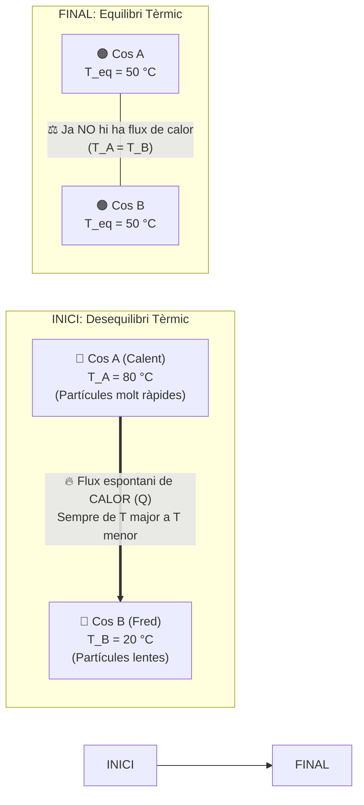

  

    ⚡ Progrés d'aprenentatge (5.1)
    0 / 7 reptes resolts
  

  

    

  

# 5.1 La temperatura i la calor

En la vida quotidiana utilitzem contínuament expressions com *"Fa molta calor"*, *"Tinc fred"*, *"Aquesta sopa crema"* o *"Posa't l'abric que dóna calor"*. Tanmateix, des del punt de vista de la física, la majoria d'aquestes frases contenen errors conceptuals importants. Per a entendre què passa realment a l'interior d'un processador que s'escalfa o d'un got d'aigua al foc, hem de viatjar primer al món microscòpic dels àtoms i les molècules.

---

## 1. La Teoria Cineticomolecular i l'Energia Tèrmica

Segons la **Teoria Cineticomolecular (TCM)** de la matèria, tots els cossos que ens envolten —ja siguen sòlids com una clau anglesa d'acer, líquids com l'aigua o gasos com l'aire de l'aula— estan formats per milions de milions de partícules minúscules (àtoms, molècules o ions) que **mai estan quietes**:
* En un **sòlid**, les partícules estan fortament unides en posicions fixes formant una xarxa, però **vibren** contínuament al voltant de la seua posició com si estigueren lligades amb molles invisibles.
* En un **líquid**, les partícules tenen més llibertat: vibren, giren i llisquen unes sobre les altres.
* En un **gas**, les partícules es mouen lliurement a gran velocitat en línia recta, xocant entre elles i contra les parets del recipient.

Com que totes aquestes partícules estan en moviment, cadascuna d'elles posseeix una xicoteta quantitat d'**energia cinètica** (energia associada al moviment).

* **L'Energia Tèrmica (o interna):** És la **suma total** de l'energia cinètica de **totes** les partícules que formen un cos. Com és una suma total, l'energia tèrmica **sí que depén de la massa o grandària del cos**: a igualtat de temperatura, una piscina olímpica té molta més energia tèrmica que un got d'aigua, perquè la piscina conté bilions de vegades més molècules en moviment.

---

## 2. Què és exactament la Temperatura ($T$)?

Si l'energia tèrmica és la suma de totes les partícules, com mesurem l'estat d'agitació d'un cos sense que importe si és gran o menut? Ací entra el concepte de **temperatura**:

* **Definició física de Temperatura:** La **temperatura ($T$)** és una magnitud física que mesura el **grau d'agitació tèrmica** o l'**energia cinètica mitjana** (la velocitat mitjana de vibració o moviment) de les partícules d'un cos.
* **És independent de la grandària del cos (magnitud intensiva):** Si tenim una olla amb $5\text{ litres}$ d'aigua bullint a $100^\circ\text{C}$ i traiem amb un cullerot una tassa de $200\text{ mL}$ d'eixa mateixa aigua, la tassa també està exactament a $100^\circ\text{C}$. Per què? Perquè la velocitat mitjana a la qual es mouen les molècules d'aigua a la tassa i a l'olla és idèntica (tot i que l'olla sencera tinga més energia tèrmica total perquè té més massa).
  * **Cos fred (baixa temperatura):** Les seues partícules es mouen o vibren **lentament** (poca agitació).
  * **Cos calent (alta temperatura):** Les seues partícules es mouen o vibren **molt de pressa** i amb gran violència (molta agitació).

---

## 3. Què és la Calor ($Q$) i per què no "tenim calor"?

En física, la **calor** no és una cosa que els cossos tinguen guardada a dins com si fóra un líquid, sinó un procés de transferència d'energia:

* **Definició física de Calor:** La **calor ($Q$)** és l'**energia tèrmica en trànsit** que flueix espontàniament des d'un cos que està a **major temperatura** cap a un altre cos que està a **menor temperatura** quan es posen en contacte (o interactuen tèrmicament).

> [!WARNING]
> ### ❌ Desmuntant mites del llenguatge quotidià amb la Física
> 1. **Per què és incorrecte dir *"Tinc calor"* o *"Aquest ferro té molta calor"*?**
>    Els cossos **no tenen calor**: els cossos tenen **energia tèrmica** i estan a una determinada **temperatura**. La calor només existeix mentre l'energia està viatjant d'un cos calent a un de fred. El que sentim a l'estiu és una temperatura ambiental alta que dificulta que el nostre cos (a $36{,}5^\circ\text{C}$) cedisca calor a l'exterior.
> 2. **Per què és incorrecte dir *"Aquest abric o aquesta manta dóna calor"*?**
>    Un abric de llana no té cap motor ni resistència elèctrica; si emboliques un bloc de gel amb un abric, el gel no es fondrà, sinó que tardarà més a fondre's! La font de calor és **el teu propi cos** (que crema nutrients a les cèl·lules i es manté a $36{,}5^\circ\text{C}$). L'abric és simplement un **aïllant tèrmic** que reté una capa d'aire immòbil i **impedeix que la calor que produeix el teu cos s'escape** cap a l'aire fred del carrer.
> 3. **I el "fred", existeix en física?**
>    No! El "fred" no és cap forma d'energia que entre per la finestra. Quan obris la nevera o una finestra a l'hivern, no "entra fred", sinó que **ix calor** des de l'habitació o des de la teua pell (que estan a major temperatura) cap a l'aire exterior (que està a menor temperatura). El fred és simplement la **pèrdua de calor** o la baixa agitació de les partícules.

---

## 4. El Concepte d'Equilibri Tèrmic

Què ocorre a escala microscòpica quan tirem un ou dur acabat de bullir ($90^\circ\text{C}$) dins d'un bol amb aigua fresca de l'aixeta ($15^\circ\text{C}$)?
1. Les partícules de l'ou calent vibren a gran velocitat i xoquen contra les molècules d'aigua freda que l'envolten, que es mouen molt més a poc a poc.
2. En cada xoc, les partícules ràpides de l'ou **cedeixen part de la seua energia cinètica** a les molècules lentes de l'aigua: l'ou es va refredant (la seua temperatura baixa) i l'aigua es va escalfant (la seua temperatura puja).
3. Aquest trànsit d'energia (la **calor**) continua fins que les partícules dels dos cossos arriben exactament a la **mateixa velocitat mitjana d'agitació**, és a dir, assoleixen una **temperatura final comuna ($T_{\text{final}}$ o $T_{\text{eq}}$)** intermèdia (per exemple, $28^\circ\text{C}$).
4. En eixe instant s'ha assolit l'**equilibri tèrmic**: com que $T_{\text{ou}} = T_{\text{aigua}}$, **s'atura per complet el flux net de calor** entre ells.

---

## 5. Taula Comparativa: Temperatura vs. Calor

| Característica | 🌡️ Temperatura ($T$) | 🔥 Calor ($Q$) |
| :--- | :--- | :--- |
| **Què és físicament?** | La mesura de l'energia cinètica **mitjana** (velocitat de vibració) de les partícules d'un cos. | L'**energia tèrmica en trànsit** que passa d'un cos a major $T$ cap a un altre a menor $T$. |
| **És una propietat que té el cos?** | **Sí**, tot cos es troba sempre a una temperatura determinada en cada instant. | **No**, els cossos no tenen calor; la calor només apareix mentre es transfereix energia. |
| **Depén de la massa o grandària?** | **No** (magnitud intensiva): una gota i una piscina de la mateixa aigua tenen la mateixa $T$. | **Sí** (magnitud extensiva): escalfar $100\text{ L}$ d'aigua requereix molta més calor que escalfar $1\text{ L}$. |
| **Aparell de mesura** | El **termòmetre**. | El **calorímetre**. |
| **Unitat del Sistema Internacional (SI)** | El **Kelvin ($\text{K}$)** (i habitualment el grau Celsius, $^\circ\text{C}$). | El **Joule ($\text{J}$)** (i tradicionalment la caloria, $\text{cal}$). |

---

## 6. Unitats de Mesura de la Calor: El Joule ($\text{J}$) i la Caloria ($\text{cal}$)

Com que la calor és una forma d'**energia** en trànsit, en el **Sistema Internacional d'Unitats (SI)** es mesura amb la mateixa unitat que totes les altres energies i que el treball mecànic: el **Joule ($\text{J}$)**, en honor al físic anglès James Prescott Joule. Per a quantitats grans s'utilitza el **kilojoule ($\text{kJ}$)**, on $1\text{ kJ} = 1\,000\text{ J}$.

No obstant això, per raons històriques i en àmbits com la nutrició, la medicina i la climatització, es continua utilitzant moltíssim una unitat tradicional específica per a la calor: la **caloria ($\text{cal}$)**.

* **Què és una caloria ($1\text{ cal}$)?** És la quantitat de calor que cal subministrar a **$1\text{ gram}$ d'aigua líquida pura** per a fer que la seua temperatura augmente exactament **$1^\circ\text{C}$** (concretament de $14{,}5^\circ\text{C}$ a $15{,}5^\circ\text{C}$ a pressió atmosfèrica normal).
* El seu múltiple de mil és la **kilocaloria ($\text{kcal}$)**: $1\text{ kcal} = 1\,000\text{ cal}$ (que en les etiquetes dels aliments s'anomena sovint "Caloria gran" amb majúscula).

### Equivalència Matemàtica (Equivalent Mecànic de la Calor)
James P. Joule va demostrar experimentalment que la calor i el treball mecànic són equivalents i va establir el factor de conversió exacte entre ambdues unitats:

$$1\text{ cal} = 4{,}18\text{ J} \qquad \Longleftrightarrow \qquad 1\text{ J} = \frac{1}{4{,}18}\text{ cal} \approx 0{,}24\text{ cal}$$

* **Per a passar de calories ($\text{cal}$) a Joules ($\text{J}$):** **Multipliquem per $4{,}18$**.
* **Per a passar de Joules ($\text{J}$) a calories ($\text{cal}$):** **Dividim entre $4{,}18$** (o multipliquem per $0{,}24$).

> [!TIP]
> ### 🧮 Exemples Resolts Pas a Pas de Conversió d'Unitats de Calor
> **Exemple 1:** Un dissipador de CPU evacua $500\text{ cal}$ de calor en pocs segons. Quants Joules ($\text{J}$) d'energia tèrmica ha dissipat?
> * **Solució:** Multipliquem les calories per $4{,}18$:
>   $$Q = 500\text{ cal} \cdot 4{,}18\text{ J/cal} = \mathbf{2\,090\text{ J}} \quad (2{,}09\text{ kJ})$$
>
> **Exemple 2:** Una resistència elèctrica d'una estufa allibera $8\,360\text{ J}$ de calor. A quantes calories ($\text{cal}$) i kilocalories ($\text{kcal}$) equival?
> * **Solució:** Dividim els Joules entre $4{,}18$:
>   $$Q = \frac{8\,360\text{ J}}{4{,}18\text{ J/cal}} = \mathbf{2\,000\text{ cal}} = \mathbf{2\text{ kcal}}$$

---

> [!NOTE]
> ### 💡 Resum de Conceptes Clau (Sessió 5.1)
> - L'**energia tèrmica** és la suma de l'energia cinètica de totes les partícules d'un cos (depén de la massa).
> - La **temperatura ($T$)** mesura la velocitat mitjana d'agitació de les partícules (no depén de la massa).
> - La **calor ($Q$)** és energia tèrmica en trànsit que viatja sempre del cos de major temperatura al de menor temperatura fins assolir l'**equilibri tèrmic** ($T_{\text{final}}$ comuna).
> - Unitats de calor: **Joule ($\text{J}$)** en el SI i **caloria ($\text{cal}$)**, amb l'equivalència fonamental **$1\text{ cal} = 4{,}18\text{ J}$**.

---

## 🎯 Activitats i Autoavaluació Interactiva

  

    🎮 <strong>Zona d'Entrenament FPB:</strong> 0 reptes resolts
    ⭐ 0 punts
  

  

### 1. Qüestionari d'Autoavaluació Tipus Test (MCQ)

  
<strong>1. Segons la física, quina de les definicions següents explica correctament què és la calor?</strong>

  

    <button type="button" class="btn-mcq-opt" data-opt="A">A) És la velocitat mitjana a la qual vibren els àtoms dins d'un cos sòlid</button>
    <button type="button" class="btn-mcq-opt" data-opt="B">B) És l'energia tèrmica en trànsit que flueix espontàniament des d'un cos a major temperatura cap a un altre a menor temperatura</button>
    <button type="button" class="btn-mcq-opt" data-opt="C">C) És una substància invisible que els abrics de llana fabriquen i donen al cos humà</button>
    <button type="button" class="btn-mcq-opt" data-opt="D">D) És l'energia que flueix des del cos més fred cap al cos més calent</button>
  

  

  
<strong>2. Si una reacció química allibera exactament $1\,000\text{ calories}$ ($1\text{ kcal}$) de calor, a quants Joules ($\text{J}$) del Sistema Internacional equival?</strong>

  

    <button type="button" class="btn-mcq-opt" data-opt="A">A) $240\text{ J}$</button>
    <button type="button" class="btn-mcq-opt" data-opt="B">B) $1\,000\text{ J}$</button>
    <button type="button" class="btn-mcq-opt" data-opt="C">C) $4\,180\text{ J}$</button>
    <button type="button" class="btn-mcq-opt" data-opt="D">D) $41{,}8\text{ J}$</button>
  

  

---

### 2. Activitats de Vertader (V) o Fals (F)

  <strong>a) Si traiem un got d'aigua d'una olla on l'aigua bull a $100^\circ\text{C}$, l'aigua del got tindrà menys temperatura perquè té menys massa.</strong>
  

    <button type="button" class="btn-vf" data-opt="V">V</button>
    <button type="button" class="btn-vf" data-opt="F">F</button>
  

  

  <strong>b) Quan dos cossos en contacte assoleixen l'equilibri tèrmic, les seues temperatures s'igualen i cessa el flux de calor entre ells.</strong>
  

    <button type="button" class="btn-vf" data-opt="V">V</button>
    <button type="button" class="btn-vf" data-opt="F">F</button>
  

  

---

### 3. Exercicis de Resposta Breu i Vocabulari Tècnic

  
✍️ Com s'anomena la magnitud física que mesura el grau d'agitació o l'energia cinètica mitjana de les partícules d'un cos?

  

    <input type="text" class="quiz-input" placeholder="Escriu la magnitud...">
    <button type="button" class="btn-quiz-check">Comprovar</button>
  

  

  
✍️ Quina és la unitat oficial del Sistema Internacional (SI) per a mesurar la calor i qualsevol altra forma d'energia?

  

    <input type="text" class="quiz-input" placeholder="Escriu la unitat del SI...">
    <button type="button" class="btn-quiz-check">Comprovar</button>
  

  

---

### 4. Pregunta de Raonament i Desenvolupament Escrit

  
✍️ <strong>Física en la vida diària:</strong> A l'hivern un company et diu: <em>"Tanca la porta del taller que està entrant molt de fred, i posa't aquesta jaqueta polar perquè dóna molta calor"</em>. Explica amb vocabulari físic per què aquestes dues afirmacions són incorrectes i què és el que passa realment amb la calor en tots dos casos.

  <textarea class="open-response-input" rows="4" placeholder="Explica en quin sentit viatja la calor per la porta oberta i quina és la veritable funció aïllant de la jaqueta polar..."></textarea>

---

  <h3 style="margin-top:0; color:#0369a1;">📦 Lliurament d'Activitats d'Aules (Act 5.1)</h3>
  
Genera el teu document de tasca d'aquest apartat amb el teu nom i puntuació obtinguda.

  

    <input type="text" class="aules-student-name" placeholder="Cognoms, Nom de l'Alumne/a" style="padding:8px 12px; border:1px solid #94a3b8; border-radius:4px; flex-grow:1; min-width:240px;">
    <button class="btn-generate-aules-pdf" data-unit="NAT05" data-activity="Act01" data-module="CA" style="padding:8px 16px; background:#0284c7; color:#fff; border:none; border-radius:4px; font-weight:600; cursor:pointer;">📄 Descarregar PDF per a Aules</button>
  

