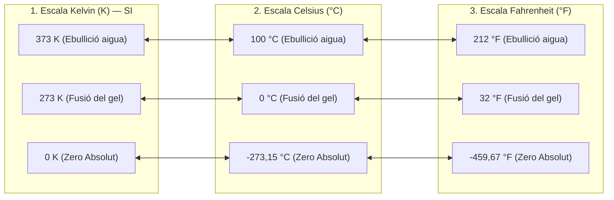

  

    ⚡ Progrés d'aprenentatge (5.2)
    0 / 7 reptes resolts
  

  

    

  

# 5.2 El termòmetre

Per a saber si un pacient té febre, si una cambra frigorífica conserva bé els aliments o si el microprocessador d'un servidor està a punt de cremar-se, necessitem mesurar la temperatura amb precisió. Però per què no podem refiar-nos simplement de tocar els objectes amb la mà?

---

## 1. Per què el nostre sentit del tacte ens enganya?

La pell humana conté receptors nerviosos tèrmics (corpuscles de Krause per al fred i de Ruffini per a la calor), però aquests receptors **no mesuren la temperatura real** dels objectes: només detecten la **rapidesa amb què la nostra pell guanya o perd calor**, i a més depenen de la temperatura que tenia la nostra mà just abans.

### L'Experiment Clàssic dels Tres Recipients
Imagina que col·loquem tres bols d'aigua sobre el banc del taller:
1. **Bol Esquerre:** Aigua molt freda amb gel ($5^\circ\text{C}$).
2. **Bol Dret:** Aigua calenta ($45^\circ\text{C}$).
3. **Bol Central:** Aigua tèbia a temperatura ambient ($25^\circ\text{C}$).

Si fiques la **mà esquerra en l'aigua freda** i la **mà dreta en l'aigua calenta** durant un minut i, a continuació, fiques **totes dues mans alhora dins del bol central d'aigua tèbia ($25^\circ\text{C}$)**:
* La teua **mà esquerra** (que venia de $5^\circ\text{C}$) absorbirà calor de l'aigua tèbia i el teu cervell et dirà: *"Aquesta aigua està molt calenta!"*
* La teua **mà dreta** (que venia de $45^\circ\text{C}$) cedirà calor a la mateixa aigua tèbia i el teu cervell et dirà: *"Aquesta aigua està gelada!"*

Com que una mateixa aigua a $25^\circ\text{C}$ no pot estar calenta i freda alhora, queda demostrat que la **sensació tèrmica és subjectiva i enganyosa**. Per a obtindre una mesura **objectiva, fiable i reproduïble** necessitem un instrument científic: el **termòmetre**.

---

## 2. Què és el Termòmetre i quins Tipus existeixen?

Un **termòmetre** és un instrument dissenyat per a mesurar la temperatura d'un cos o d'un ambient aprofitant alguna propietat física d'un material (el seu volum, la seua resistència elèctrica o la radiació que emet) que canvia de manera regular amb la temperatura.

### A) Termòmetre de dilatació de líquid (Alcohol acolorit o Galinstan)
Consisteix en un tub de vidre molt fi anomenat **tub capil·lar** amb un depòsit o bulb a l'extrem inferior ple d'un líquid. Quan el bulb es posa en contacte amb el cos que volem mesurar, arriba a l'**equilibri tèrmic** amb ell; el líquid s'escalfa, **es dilata** (augmenta de volum) i puja pel tub capil·lar fins a marcar la temperatura sobre una escala graduada.
* **Termòmetres d'alcohol acolorit:** Contenen etanol tenyit de roig o blau; s'usen molt en meteorologia i laboratoris escolars perquè l'alcohol es congela a $-114^\circ\text{C}$.
* **Termòmetres clínics de Galinstan:** Utilitzen un aliatge metàl·lic líquid no tòxic format per **gal·li, indi i estany** (*Galinstan*).

> [!CAUTION]
> ### ☣️ Per què es van prohibir els termòmetres de Mercuri ($\text{Hg}$)?
> Durant segles els termòmetres clínics es fabricaven amb **mercuri ($\text{Hg}$)**, l'únic metall líquid a temperatura ambient. No obstant això, des de l'any **2009 la Unió Europea va prohibir la venda de termòmetres de mercuri** al públic. Per què? Quan un termòmetre de vidre es trencava a casa, el mercuri es dividia en boletes que s'evaporaven a temperatura ambient. Inhalar vapors de mercuri o abocar-lo al medi ambient provoca una intoxicació greu anomenada **hidrargirisme**, que danya de forma irreversible el **sistema nerviós central (cervell)**, els ronyons i el desenvolupament fetal, a més de bioacumular-se en els peixos que després mengem.

### B) Termòmetre digital electrònic (Termistor o Termoparell)
Són els més habituals hui a les farmàcies, llars, automòbils i plaques base d'ordinador. A la punta metàl·lica no porten cap líquid, sinó un xicotet sensor semiconductor anomenat **termistor** (com una resistència NTC).
* **Com funciona?** Quan canvia la temperatura de la punta, varia la **resistència elèctrica** del semiconductor. Un microxip intern mesura el canvi de corrent elèctric i mostra el valor exacte en una pantalla LCD en pocs segons, avisant amb un xiulet quan s'ha assolit l'equilibri tèrmic.

### C) Termòmetre d'infrarojos o Piròmetre (Sense contacte)
Qualsevol cos que estiga a una temperatura superior al zero absolut emet contínuament radiació electromagnètica invisible en la banda dels **infrarojos (IR)**, i com més calent està el cos, més intensa és aquesta radiació.
* **Com funciona?** El termòmetre d'infrarojos (o la **càmera termogràfica**) incorpora una lent òptica que capta la radiació infraroja que emet l'objecte **a distància i sense tocar-lo**, calculant la temperatura en menys d'un segon.
* **Aplicacions professionals:**
  * **Medicina:** Termòmetres frontals o timpànics (d'oïda), ideals per a mesurar la febre de xiquets o pacients sense risc de contagi.
  * **Taller d'informàtica, electricitat i indústria:** Permet apuntar amb un punter làser a una placa base, una font d'alimentació, un quadre elèctric o l'interior d'un forn industrial a $1\,500^\circ\text{C}$ per a detectar components sobreescalfats sense perill de cremar-se ni d'electrocutar-se.

---

## 3. Les Tres Escales Termomètriques

Per a graduar un termòmetre cal triar dos punts de referència fixos (com la congelació i l'ebullició de l'aigua a nivell del mar, a $1\text{ atm}$ de pressió) i dividir l'interval en parts iguals. Al món s'utilitzen tres escales principals:

### 1. Escala Celsius o Centígrada ($^\circ\text{C}$)
Proposada en 1742 per l'astrònom suec **Anders Celsius**, és l'escala d'ús quotidià a Espanya i a la major part del món:
* Assigna el valor **$0^\circ\text{C}$** a la temperatura de **congelació (o fusió) de l'aigua pura**.
* Assigna el valor **$100^\circ\text{C}$** a la temperatura d'**ebullició de l'aigua pura** (a $1\text{ atm}$).
* L'interval entre tots dos punts es divideix en **$100$ parts iguals** (per això s'anomena *centígrada*), on cada divisió és $1^\circ\text{C}$. Admet valors negatius per a temperatures sota zero (p. ex. $-18^\circ\text{C}$ en un congelador).

### 2. Escala Kelvin o Absoluta ($\text{K}$) — Unitat del Sistema Internacional
Creada pel físic britànic William Thomson (**Lord Kelvin**) en 1848, és la **unitat oficial de temperatura en el Sistema Internacional (SI)** i la que s'utilitza en totes les fórmules científiques:
* **Què és el Zero Absolut ($0\text{ K}$)?** És la temperatura més baixa que pot existir físicament a l'univers i equival a **$-273{,}15^\circ\text{C}$** (que arrodonim habitualment a **$-273^\circ\text{C}$**). A $0\text{ K}$, les partícules de la matèria perdrien tota la seua energia cinètica i **s'aturaria tota vibració atòmica**. Per tant, **en l'escala Kelvin no existeixen temperatures negatives**.
* La mida d'$1\text{ K}$ és idèntica a la d'$1^\circ\text{C}$ (hi ha $100$ divisions entre la congelació de l'aigua a **$273\text{ K}$** i l'ebullició a **$373\text{ K}$**). Nota ortogràfica: els kelvins s'escriuen amb la lletra **$\text{K}$ sense el símbol de grau ($^\circ$)**.
* **Fórmules de conversió entre Celsius i Kelvin:**
  $$T(\text{K}) = T(^\circ\text{C}) + 273 \qquad \Longleftrightarrow \qquad T(^\circ\text{C}) = T(\text{K}) - 273$$

### 3. Escala Fahrenheit ($^\circ\text{F}$)
Creada en 1724 per Daniel Gabriel Fahrenheit, s'utilitza oficialment als **Estats Units** i en alguns països anglosaxons (i apareix sovint en programari, BIOS d'ordinadors i manuals tècnics americans):
* En aquesta escala, l'aigua es congela a **$32^\circ\text{F}$** i bull a **$212^\circ\text{F}$** (l'interval està dividit en **$180$ parts**, de manera que cada $1^\circ\text{C}$ equival a $1{,}8^\circ\text{F}$).
* **Fórmules de conversió entre Celsius i Fahrenheit:**
  $$T(^\circ\text{F}) = 1{,}8 \cdot T(^\circ\text{C}) + 32 \qquad \Longleftrightarrow \qquad T(^\circ\text{C}) = \frac{T(^\circ\text{F}) - 32}{1{,}8}$$

---

## 4. Taula Comparativa i Exemples Resolts de Conversió

| Fenomen o Punt de Referència | Escala Celsius ($^\circ\text{C}$) | Escala Kelvin ($\text{K}$) | Escala Fahrenheit ($^\circ\text{F}$) |
| :--- | :---: | :---: | :---: |
| **Zero absolut (aturada atòmica)** | $-273{,}15^\circ\text{C}$ | $0\text{ K}$ | $-459{,}67^\circ\text{F}$ |
| **Punt de fusió del gel (congelació aigua)** | $0^\circ\text{C}$ | $273\text{ K}$ | $32^\circ\text{F}$ |
| **Temperatura ambient confortable d'aula** | $20^\circ\text{C}$ | $293\text{ K}$ | $68^\circ\text{F}$ |
| **Temperatura normal del cos humà sa** | $36{,}5^\circ\text{C} \text{ -- } 37^\circ\text{C}$ | $309{,}5\text{ K} \text{ -- } 310\text{ K}$ | $97{,}7^\circ\text{F} \text{ -- } 98{,}6^\circ\text{F}$ |
| **Punt d'ebullició de l'aigua ($1\text{ atm}$)** | $100^\circ\text{C}$ | $373\text{ K}$ | $212^\circ\text{F}$ |

> [!TIP]
> ### 🧮 Exemples Resolts Pas a Pas (Conversions Termomètriques)
> **Problema 1:** A la BIOS d'un ordinador portàtil veiem que el processador treballa a $60^\circ\text{C}$. Expressa aquesta temperatura en **Kelvin ($\text{K}$)** i en **graus Fahrenheit ($^\circ\text{F}$)**.
> * **a) Pas a Kelvin ($\text{K}$):** Sumem $273$ a la temperatura en Celsius:
>   $$T(\text{K}) = 60 + 273 = \mathbf{333\text{ K}}$$
> * **b) Pas a Fahrenheit ($^\circ\text{F}$):** Multipliquem per $1{,}8$ i al resultat li sumem $32$:
>   $$T(^\circ\text{F}) = 1{,}8 \cdot 60 + 32 = 108 + 32 = \mathbf{140^\circ\text{F}}$$
>
> **Problema 2:** Un manual tècnic nord-americà indica que una bateria de liti no ha de superar els $113^\circ\text{F}$. A quants **graus Celsius ($^\circ\text{C}$)** equival aquest límit?
> * **Solució:** Primer restem $32$ i després dividim el resultat entre $1{,}8$:
>   $$T(^\circ\text{C}) = \frac{113 - 32}{1{,}8} = \frac{81}{1{,}8} = \mathbf{45^\circ\text{C}}$$

---

> [!NOTE]
> ### 💡 Resum de Conceptes Clau (Sessió 5.2)
> - El **tacte és subjectiu** i ens enganya; per a mesurar la temperatura amb precisió usem el **termòmetre**.
> - Tipus de termòmetres: de **dilatació líquida** (alcohol o galinstan, que substitueixen el **mercuri** tòxic), **digitals** (termistor) i **piròmetres d'infrarojos** (sense contacte).
> - Les tres escales són **Celsius ($^\circ\text{C}$)**, **Kelvin ($\text{K}$, unitat SI)** amb $T(\text{K}) = T(^\circ\text{C}) + 273$, i **Fahrenheit ($^\circ\text{F}$)** amb $T(^\circ\text{F}) = 1{,}8 \cdot T(^\circ\text{C}) + 32$.

---

## 🎯 Activitats i Autoavaluació Interactiva

  

    🎮 <strong>Zona d'Entrenament FPB:</strong> 0 reptes resolts
    ⭐ 0 punts
  

  

### 1. Qüestionari d'Autoavaluació Tipus Test (MCQ)

  
<strong>1. Si el termòmetre del taller d'informàtica marca una temperatura ambient de $25^\circ\text{C}$, quin és el seu valor en l'escala Kelvin ($\text{K}$) del Sistema Internacional?</strong>

  

    <button type="button" class="btn-mcq-opt" data-opt="A">A) $125\text{ K}$</button>
    <button type="button" class="btn-mcq-opt" data-opt="B">B) $-248\text{ K}$</button>
    <button type="button" class="btn-mcq-opt" data-opt="C">C) $298\text{ K}$</button>
    <button type="button" class="btn-mcq-opt" data-opt="D">D) $77\text{ K}$</button>
  

  

  
<strong>2. Quin tipus de termòmetre utilitzaries al taller per a mesurar a distància i sense contacte físic la temperatura d'un xip d'una placa base que està connectada al corrent elèctric?</strong>

  

    <button type="button" class="btn-mcq-opt" data-opt="A">A) Un termòmetre clínic antic de mercuri</button>
    <button type="button" class="btn-mcq-opt" data-opt="B">B) Un termòmetre meteorològic d'alcohol tenyit</button>
    <button type="button" class="btn-mcq-opt" data-opt="C">C) Un termòmetre clínic d'aixella de galinstan</button>
    <button type="button" class="btn-mcq-opt" data-opt="D">D) Un termòmetre d'infrarojos (piròmetre) o càmera termogràfica</button>
  

  

---

### 2. Activitats de Vertader (V) o Fals (F)

  <strong>a) El zero absolut ($0\text{ K}$, que equival a $-273{,}15^\circ\text{C}$) és el límit inferior de temperatura de l'univers on s'atura tota vibració atòmica.</strong>
  

    <button type="button" class="btn-vf" data-opt="V">V</button>
    <button type="button" class="btn-vf" data-opt="F">F</button>
  

  

  <strong>b) En l'escala anglosaxona Fahrenheit ($^\circ\text{F}$), l'aigua es congela a $0^\circ\text{F}$ i bull a $100^\circ\text{F}$.</strong>
  

    <button type="button" class="btn-vf" data-opt="V">V</button>
    <button type="button" class="btn-vf" data-opt="F">F</button>
  

  

---

### 3. Exercicis de Resposta Breu i Vocabulari Tècnic

  
✍️ Quina és l'escala i unitat oficial de temperatura en el Sistema Internacional (SI)?

  

    <input type="text" class="quiz-input" placeholder="Escriu el nom de l'escala...">
    <button type="button" class="btn-quiz-check">Comprovar</button>
  

  

  
✍️ Quin metall líquid altament tòxic per al sistema nerviós i el medi ambient es va prohibir en la fabricació de termòmetres clínics?

  

    <input type="text" class="quiz-input" placeholder="Escriu el nom del metall...">
    <button type="button" class="btn-quiz-check">Comprovar</button>
  

  

---

### 4. Pregunta de Raonament i Desenvolupament Escrit

  
✍️ <strong>Càlcul i raonament termomètric:</strong> Un turista nord-americà arriba a urgències i diu que el seu fill té una temperatura corporal de $104^\circ\text{F}$. Calcula pas a pas a quants graus Celsius ($^\circ\text{C}$) i a quants Kelvin ($\text{K}$) equival aquesta temperatura, i indica raonadament si el xiquet té febre alta o no.

  <textarea class="open-response-input" rows="4" placeholder="Aplica primer T(°C) = (T(°F) - 32) / 1,8 i després passa el resultat a Kelvin sumant 273..."></textarea>

---

  <h3 style="margin-top:0; color:#0369a1;">📦 Lliurament d'Activitats d'Aules (Act 5.2)</h3>
  
Genera el teu document de tasca d'aquest apartat amb el teu nom i puntuació obtinguda.

  

    <input type="text" class="aules-student-name" placeholder="Cognoms, Nom de l'Alumne/a" style="padding:8px 12px; border:1px solid #94a3b8; border-radius:4px; flex-grow:1; min-width:240px;">
    <button class="btn-generate-aules-pdf" data-unit="NAT05" data-activity="Act02" data-module="CA" style="padding:8px 16px; background:#0284c7; color:#fff; border:none; border-radius:4px; font-weight:600; cursor:pointer;">📄 Descarregar PDF per a Aules</button>
  

