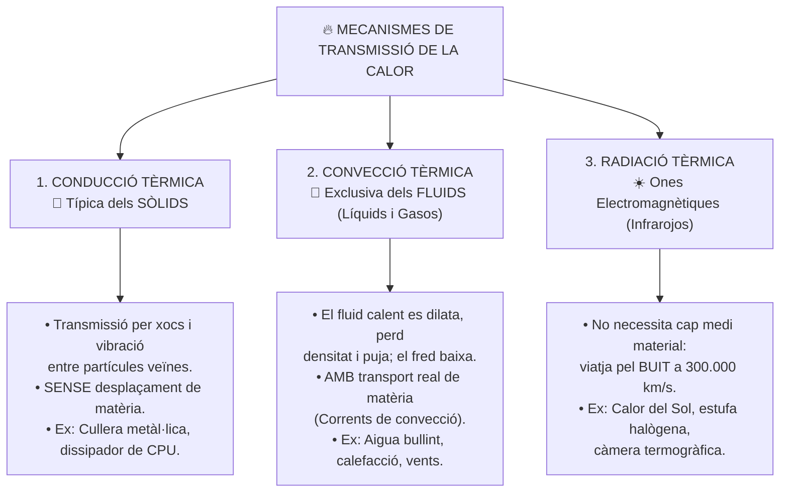

  

    ⚡ Progrés d'aprenentatge (5.3)
    0 / 12 reptes resolts
  

  

    

  

# 5.3 Formes de transmissió de la calor

Ja sabem que la calor viatja sempre espontàniament des de la zona de major temperatura cap a la de menor temperatura. Però, **com ho fa exactament?** Per què ens cremem els dits si deixem una cullera metàl·lica dins d'una sopa bullint, per què l'aire calent d'una habitació s'acumula prop del sostre i com pot arribar la calor del Sol fins a la Terra travessant milions de quilòmetres d'espai buit?

En la naturalesa i en la tecnologia existeixen exactament **tres mecanismes físics** pels quals es propaga la calor: la **conducció**, la **convecció** i la **radiació**.

---

## 1. La Conducció Tèrmica (Típica dels Sòlids)

Imagina que subjectes amb la mà l'extrem d'una vareta de ferro i poses l'altre extrem sobre la flama d'un bec de gas o la punta d'un soldador d'estany al taller. Al cap d'uns segons, notaràs que la calor arriba fins als teus dits, tot i que el ferro és sòlid i els àtoms de la punta calenta no han caminat fins a la teua mà.

* **Què és la conducció tèrmica?** És el mecanisme de transmissió de la calor característic dels **cossos sòlids**, en el qual l'energia tèrmica passa de la zona més calenta a la més freda per contacte directe entre partícules veïnes, **sense que hi haja desplaçament net de matèria**.
* **Explicació microscòpica (Teoria Cineticomolecular):**
  1. Quan escalfem un extrem del sòlid, els àtoms d'aquella zona absorbeixen energia i comencen a **vibrar amb molta més rapidesa i amplitud**.
  2. Com que en un sòlid les partícules estan molt juntes, aquests àtoms tan agitats **xoquen i espenten les partícules veïnes** immediates, fent que aquestes també comencen a vibrar més fort.
  3. Com una fila de fitxes de dòmino o una cadena humana que es passa poals d'aigua sense moure's del lloc, la vibració tèrmica es va contagiant d'àtom a àtom al llarg de tota la barra fins a arribar a l'altre extrem.
* **Exemples quotidians i de taller:**
  * Una **cullera metàl·lica** oblidada dins d'un plat de brou calent o una paella sobre una placa vitroceràmica.
  * La punta d'un **soldador elèctric d'estany** que fon el metall en tocar la pota d'un component electrònic.
  * El contacte directe entre el xip d'un **microprocessador (CPU)** i la base de coure o alumini del seu **dissipador tèrmic**.

---

## 2. La Convecció Tèrmica (Exclusiva dels Fluids: Líquids i Gasos)

Els líquids (com l'aigua) i els gasos (com l'aire) condueixen molt malament la calor si estan quiets, però tenen una propietat que els sòlids no tenen: són **fluids**, és a dir, les seues partícules poden desplaçar-se lliurement d'un lloc a un altre.

* **Què és la convecció tèrmica?** És el mecanisme de transmissió de la calor exclusiu dels **fluids (líquids i gasos)**, en el qual la calor es propaga mitjançant el **moviment i transport real de matèria** que puja i baixa formant circuits circulars anomenats **corrents de convecció**.
* **Com es formen els corrents de convecció? (El cicle físic en 4 passos):**
  1. **Escalfament i dilatació a la base:** Quan escalfem un líquid o un gas per la part inferior (per exemple, l'aigua del fons d'una cassola al foc o l'aire que toca un radiador), el fluid d'eixa zona s'escalfa i **es dilata** (ocupa més volum).
  2. **Ascens del fluid calent (menor densitat):** En ocupar més volum amb la mateixa massa, el fluid calent es torna **menys dens (més lleuger)** que el fluid fred que té damunt i, per tant, **puja cap a la part superior**.
  3. **Descens del fluid fred (major densitat):** El fluid de la part superior, que està més fred, és **més dens (més pesant)** i baixa per gravetat cap al fons per a ocupar el buit que ha deixat el fluid calent.
  4. **Cicle continu:** En arribar al fons, aquest fluid fred s'escalfa al seu torn i torna a pujar, establint un moviment circular continu (**corrent de convecció**) que reparteix la calor per tota la massa del líquid o del gas.

> [!TIP]
> ### 🏠 Aplicacions Pràctiques de la Convecció a Casa, a la Natura i al Taller
> 1. **Per què els radiadors de calefacció es col·loquen sempre arran de terra i els aparells d'aire condicionat a la part alta de la paret?**
>    * El **radiador es posa baix** perquè l'aire calent és menys dens i **puja sol** cap al sostre, escalfant tota l'habitació per convecció. Si posàrem el radiador al sostre, l'aire calent es quedaria dalt i tindríem els peus gelats!
>    * L'**aire condicionat es posa dalt** perquè l'aire fred és més dens (pesa més) i **baixa sol** cap a terra, refrescant tota l'estança.
> 2. **Els vents atmosfèrics i el moviment dels continents:** Les brises marines i els vents es produeixen perquè el Sol escalfa la terra, l'aire calent ascendeix (baixa pressió) i l'aire fresc del mar entra a ocupar el seu lloc. Fins i tot les plaques tectòniques de la Terra es mouen sobre els corrents de convecció del magma del mantell terrestre!
> 3. **Convecció natural vs. Convecció forçada en una torre de PC:** En l'interior d'un ordinador, l'aire calent tendeix a pujar (per això les reixetes d'extracció es posen a la part superior/posterior i l'entrada d'aire fresc a la part frontal/inferior). Com que la convecció natural no és suficient per a un PC potent, s'utilitzen **ventiladors** que impulsen l'aire a gran velocitat: això s'anomena **convecció forçada**.

---

## 3. La Radiació Tèrmica (Ones Electromagnètiques pel Buit)

Entre el Sol i la Terra hi ha uns 150 milions de quilòmetres d'espai exterior on regna el **buit absolut**: no hi ha cap sòlid perquè la calor viatge per conducció, ni hi ha aire ni aigua perquè viatge per convecció. Com ens arriba aleshores la calor del Sol que manté viva la Terra, o com notem la calor d'una foguera a la cara des de tres metres de distància encara que l'aire calent de la flama se'n vaja cap amunt?

* **Què és la radiació tèrmica?** És la transmissió de calor mitjançant l'emissió d'**ones electromagnètiques** —principalment **radiació infraroja (IR)**, tot i que si el cos està molt calent, com el Sol o una barra de ferro roent, també emet llum visible—.
* **Característiques úniques de la radiació:**
  * **No necessita cap medi material per a propagar-se:** És l'únic mecanisme de transmissió de la calor capaç de viatjar a través del **buit** (i també a través de medis transparents com l'aire o el vidre).
  * **Viatja a la velocitat de la llum:** Es propaga en línia recta a $300\,000\text{ km/s}$ en el buit.
  * **Tots els cossos emeten radiació:** Qualsevol cos amb una temperatura superior al zero absolut (0 K) emet radiació infraroja contínuament (el nostre propi cos a 36,5 °C n'emet, i per això ens poden veure en la foscor total amb ulleres de visió tèrmica o càmeres termogràfiques!). Com més alta és la temperatura del cos, molta més energia radia.

### El paper del color de les superfícies davant la radiació
Quan la radiació tèrmica xoca contra un objecte, pot ser **absorbida** (escalfant l'objecte) o **reflectida** (rebotant com en un espill):
* **Superfícies negres i mates:** **Absorbeixen** quasi tota la radiació solar i infraroja que reben, escalfant-se molt ràpidament (per això a l'hivern es porta roba fosca i els panells solars tèrmics per a escalfar aigua són negres).
* **Superfícies blanques, platejades i brillants:** **Reflecteixen** la major part de la radiació tèrmica i a penes s'escalfen (per això les cases mediterrànies s'emblanquinen amb calç, a l'estiu vestim roba clara i els bombers o satèl·lits espacials usen mantes tèrmiques metal·litzades).

---

## 4. Taula Resum Comparativa dels Tres Mecanismes

| Característica | 🧱 Conducció | 🌊 Convecció | ☀️ Radiació |
| :--- | :--- | :--- | :--- |
| **En quin medi predomina?** | En els **sòlids** (especialment metalls). | Exclusiva dels **fluids (líquids i gasos)**. | En el **buit** i a través de gasos/medis transparents. |
| **Necessita matèria per a viatjar?** | **Sí** (contacte entre partícules). | **Sí** (moviment de massa fluida). | **No** (pot viatjar pel buit espacial). |
| **Hi ha desplaçament de matèria?** | **No** (les partícules sols vibren al seu lloc). | **Sí** (corrents circulars d'ascens i descens). | **No** (viatgen ones electromagnètiques). |
| **Velocitat de propagació** | Lenta (depén de la conductivitat). | Moderada (més ràpida si és forçada amb ventilador). | Instantània: velocitat de la llum ($300\,000\text{ km/s}$). |
| **Exemple característic** | Mànec metàl·lic d'una paella, base d'un dissipador. | Aigua bullint en una olla, calefacció d'una aula. | Calor del Sol, braser, estufa halògena d'infrarojos. |

---

> [!NOTE]
> ### 💡 Resum de Conceptes Clau (Sessió 5.3)
> - **Conducció (sòlids):** Transmissió de la vibració tèrmica de partícula a partícula per xocs directes **sense transport de matèria**.
> - **Convecció (líquids i gasos):** Transmissió **amb transport de matèria** mitjançant **corrents de convecció** (el fluid calent es dilata, és menys dens i puja; el fluid fred és més dens i baixa).
> - **Radiació:** Transmissió per **ones electromagnètiques infraroges** que viatgen a la velocitat de la llum i **no necessiten cap medi material (travessen el buit)**.

---

## 🎯 Activitats i Autoavaluació Interactiva

  

    🎮 <strong>Zona d'Entrenament FPB:</strong> 0 reptes resolts
    ⭐ 0 punts
  

  

### 1. Qüestionari d'Autoavaluació Tipus Test (MCQ)

  
<strong>1. Quin és l'únic mecanisme de transmissió de la calor que no necessita cap medi material i permet que l'energia tèrmica del Sol arribe a la Terra travessant el buit de l'espai?</strong>

  

    <button type="button" class="btn-mcq-opt" data-opt="A">A) La conducció tèrmica</button>
    <button type="button" class="btn-mcq-opt" data-opt="B">B) La convecció natural</button>
    <button type="button" class="btn-mcq-opt" data-opt="C">C) La radiació tèrmica (ones electromagnètiques infraroges)</button>
    <button type="button" class="btn-mcq-opt" data-opt="D">D) La convecció forçada</button>
  

  

  
<strong>2. Per què en posar en marxa un radiador a la part baixa d'una habitació s'acaba escalfant tot l'aire de l'aula fins al sostre?</strong>

  

    <button type="button" class="btn-mcq-opt" data-opt="A">A) Perquè l'aire és un sòlid molt bon conductor de la calor</button>
    <button type="button" class="btn-mcq-opt" data-opt="B">B) Per convecció: l'aire calent es dilata, disminueix la seua densitat i puja, mentre l'aire fred més dens baixa creant corrents de convecció</button>
    <button type="button" class="btn-mcq-opt" data-opt="C">C) Perquè l'aire fred és menys dens i flota sempre damunt de l'aire calent</button>
    <button type="button" class="btn-mcq-opt" data-opt="D">D) Perquè dins de l'habitació hi ha el buit absolut</button>
  

  

  
<strong>3. Quan un tècnic d'electrònica recolza la punta metàl·lica calenta d'un soldador sobre la pota de coure d'un component per a fondre l'estany, quin mecanisme de transmissió predomina?</strong>

  

    <button type="button" class="btn-mcq-opt" data-opt="A">A) La conducció tèrmica per contacte directe entre sòlids</button>
    <button type="button" class="btn-mcq-opt" data-opt="B">B) La convecció marina de l'aigua</button>
    <button type="button" class="btn-mcq-opt" data-opt="C">C) La radiació solar</button>
    <button type="button" class="btn-mcq-opt" data-opt="D">D) El transport d'àtoms de coure a través del buit</button>
  

  

  
<strong>4. Per què els col·lectors solars tèrmics que s'instal·len als terrats per a escalfar aigua són de color negre mat, mentre que les façanes de les cases mediterrànies es pinten de blanc?</strong>

  

    <button type="button" class="btn-mcq-opt" data-opt="A">A) Per simple moda estètica sense cap relació amb la física</button>
    <button type="button" class="btn-mcq-opt" data-opt="B">B) Perquè el color blanc absorbeix tota la radiació i el negre la reflecteix</button>
    <button type="button" class="btn-mcq-opt" data-opt="C">C) Perquè la pintura negra impedeix la conducció de l'aigua</button>
    <button type="button" class="btn-mcq-opt" data-opt="D">D) Perquè les superfícies negres absorbeixen el màxim de radiació solar, mentre que les blanques la reflecteixen mantenint la casa fresca</button>
  

  

---

### 2. Activitats de Vertader (V) o Fals (F)

  <strong>a) En la conducció tèrmica a través d'una barra metàl·lica sòlida, la calor es transmet per vibració i xocs entre partícules veïnes sense que hi haja desplaçament de matèria.</strong>
  

    <button type="button" class="btn-vf" data-opt="V">V</button>
    <button type="button" class="btn-vf" data-opt="F">F</button>
  

  

  <strong>b) Els corrents de convecció es produeixen principalment a l'interior dels metalls sòlids com el ferro o el coure a temperatura ambient.</strong>
  

    <button type="button" class="btn-vf" data-opt="V">V</button>
    <button type="button" class="btn-vf" data-opt="F">F</button>
  

  

  <strong>c) Tots els cossos que estan a una temperatura superior al zero absolut (0 K) emeten radiació infraroja, fet que permet veure persones en la foscor amb càmeres termogràfiques.</strong>
  

    <button type="button" class="btn-vf" data-opt="V">V</button>
    <button type="button" class="btn-vf" data-opt="F">F</button>
  

  

  <strong>d) L'ús de ventiladors dins d'una caixa d'ordinador per a impulsar l'aire calent a través del dissipador és un exemple de convecció forçada.</strong>
  

    <button type="button" class="btn-vf" data-opt="V">V</button>
    <button type="button" class="btn-vf" data-opt="F">F</button>
  

  

---

### 3. Exercicis de Resposta Breu, Vocabulari Tècnic i Càlcul

  
✍️ <strong>1.</strong> Com s'anomena el mecanisme de transmissió de la calor pel qual es calenta el mànec metàl·lic d'una paella posada sobre el foc?

  

    <input type="text" class="quiz-input" placeholder="Escriu el mecanisme...">
    <button type="button" class="btn-quiz-check">Comprovar</button>
  

  

  
✍️ <strong>2.</strong> Com s'anomena el mecanisme de propagació de la calor exclusiu dels líquids i dels gasos basat en diferències de densitat?

  

    <input type="text" class="quiz-input" placeholder="Escriu el mecanisme...">
    <button type="button" class="btn-quiz-check">Comprovar</button>
  

  

  
✍️ <strong>3.</strong> Quin mecanisme de transmissió de la calor emet una estufa halògena o el Sol a través d'ones electromagnètiques infraroges?

  

    <input type="text" class="quiz-input" placeholder="Escriu el mecanisme...">
    <button type="button" class="btn-quiz-check">Comprovar</button>
  

  

  
✍️ <strong>4.</strong> Per quin medi sense cap partícula material pot viatjar la radiació tèrmica, però mai la conducció ni la convecció?

  

    <input type="text" class="quiz-input" placeholder="Escriu la paraula...">
    <button type="button" class="btn-quiz-check">Comprovar</button>
  

  

---

### 4. Exercicis de Raonament i Desenvolupament Escrit (Tasca d'Aula)

  
✍️ <strong>1. Disseny tèrmic d'instal·lacions i PC:</strong> Explica raonadament: a) Per què en una vivenda els aparells d'aire condicionat s'instal·len sempre a la part alta de la paret mentre que els radiadors de calefacció s'instal·len a la part baixa; i b) Per què en una torre d'ordinador el ventilador que expulsa l'aire calent es col·loca a la part superior/posterior de la caixa.

  <textarea class="open-response-input" rows="4" placeholder="Relaciona la teua resposta amb la dilatació de l'aire, els canvis de densitat i els corrents de convecció..."></textarea>

  
✍️ <strong>2. Els tres mecanismes en una mateixa escena:</strong> Imagina que estàs al camp escalfant una cassola metàl·lica amb aigua sobre una foguera de llenya. Identifica i explica en quina part exacta d'aquesta escena s'està produint <strong>conducció</strong>, en quina part es produeix <strong>convecció</strong> i en quina part es produeix <strong>radiació</strong>.

  <textarea class="open-response-input" rows="4" placeholder="1) Conducció es produeix a... 2) Convecció es produeix dins de... 3) Radiació es nota quan..."></textarea>

  
✍️ <strong>3. La brisa marina i els vents:</strong> Durant un dia assolellat d'estiu a la costa, l'arena de la platja s'escalfa molt més ràpidament que l'aigua del mar. Explica com es forma un corrent de convecció gegant (la brisa marina) que fa que bufe aire fresc des del mar cap a la platja.

  <textarea class="open-response-input" rows="4" placeholder="Explica què fa l'aire calent que està damunt de l'arena i quin aire entra des del mar per a ocupar el seu lloc..."></textarea>

---

  <h3 style="margin-top:0; color:#0369a1;">📦 Lliurament d'Activitats d'Aules (Act 5.3)</h3>
  
Genera el teu document de tasca d'aquest apartat amb el teu nom i puntuació obtinguda.

  

    <input type="text" class="aules-student-name" placeholder="Cognoms, Nom de l'Alumne/a" style="padding:8px 12px; border:1px solid #94a3b8; border-radius:4px; flex-grow:1; min-width:240px;">
    <button class="btn-generate-aules-pdf" data-unit="NAT05" data-activity="Act03" data-module="CA" style="padding:8px 16px; background:#0284c7; color:#fff; border:none; border-radius:4px; font-weight:600; cursor:pointer;">📄 Descarregar PDF per a Aules</button>
  

