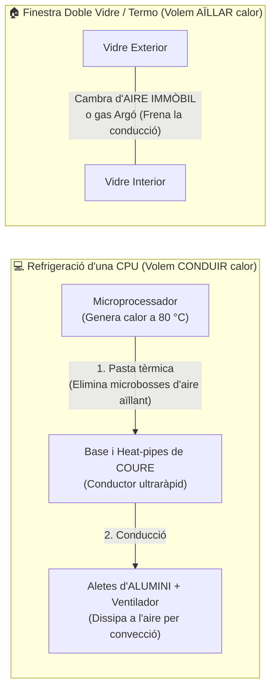

  

    ⚡ Progrés d'aprenentatge (5.4)
    0 / 12 reptes resolts
  

  

    

  

# 5.4 Materials conductors i aïllants

Quan cuinem amb una paella, volem que la base transmeta la calor del foc cap al menjar el més ràpid possible, però alhora necessitem que el mànec no es calente per a poder agafar-la sense cremar-nos la mà. De la mateixa manera, en un ordinador volem evacuar a tota velocitat la calor del microprocessador, mentre que en les parets de la nostra casa volem impedir que la calor de la calefacció s'escape al carrer.

La propietat física que mesura la facilitat o rapidesa amb què un material deixa passar la calor per conducció s'anomena **conductivitat tèrmica**. Segons aquesta propietat, classifiquem tots els materials en dos grans grups: **conductors tèrmics** i **aïllants tèrmics**.

---

## 1. Els Materials Conductors Tèrmics

* **Definició:** Els **conductors tèrmics** són aquells materials que tenen una **alta conductivitat tèrmica** i deixen passar la calor a través seu amb molta rapidesa i facilitat.
* **Quins són els millors conductors?** Amb molta diferència, **tots els metalls i els seus aliatges**. Per què els metalls condueixen tan bé la calor (i també l'electricitat)? Perquè en l'enllaç metàl·lic els àtoms alliberen electrons que es mouen lliurement per tot el metall (**electrons lliures**), transportant l'energia cinètica d'un extrem a l'altre a gran velocitat.
* **Rànquing dels metalls conductors més utilitzats:**
  1. **Argent o plata ($\text{Ag}$):** El metall amb major conductivitat tèrmica, però massa car per a fer peces grans (s'usa en pastes tèrmiques d'alta gamma per a PC).
  2. **Coure ($\text{Cu}$):** Excel·lent conductor tèrmic; s'utilitza en la base dels dissipadors de CPU, tubs de calor (*heat-pipes*), canonades de calefacció i bases de cassoles.
  3. **Or ($\text{Au}$):** Molt bon conductor i inoxidable (contactes de microprocessadors).
  4. **Alumini ($\text{Al}$):** Molt bon conductor, lleuger, fàcil de mecanitzar i més econòmic que el coure; és el rei de les aletes de dissipadors informàtics, radiadors i xassís de portàtils.
  5. **Ferro ($\text{Fe}$) i Acer:** Bons conductors i molt resistents mecànicament (paelles, planxes, radiadors d'aigua i motors).

> [!IMPORTANT]
> ### 🥶 El Gran Enigma del Tacte: Per què el metall sembla més fred que la fusta?
> Fes la prova ara mateix a l'aula: toca amb una mà la pota metàl·lica de la teua cadira (o la carcassa d'alumini d'un ordinador) i amb l'altra mà toca el tauler de fusta del pupitre. **El metall se sent molt més fred que la fusta!**
> Tanmateix, si hi poses un termòmetre d'infrarojos, descobriràs una sorpresa: **tant el metall com la fusta estan exactament a la mateixa temperatura** (la temperatura ambient de l'aula, per exemple $20^\circ\text{C}$, perquè porten hores en equilibri tèrmic amb l'aire!).
> * **Per què ens enganya la mà?** La teua pell està a uns $34\text{--}36^\circ\text{C}$. Quan toques el metall (que és un **excel·lent conductor tèrmic**), aquest **et roba calor dels dits a gran velocitat** i l'escampa per tota la barra metàl·lica; en perdre calor tan de pressa, els receptors de la pell envien al cervell un senyal intens de "fred". En canvi, quan toques la fusta (que és un **aïllant tèrmic**), la calor de la teua mà a penes pot entrar en la fusta; com que gairebé no perds calor, la sents tèbia!

---

## 2. Els Materials Aïllants Tèrmics

* **Definició:** Els **aïllants tèrmics** són aquells materials amb una **baixa conductivitat tèrmica** que dificulten, frenen o impedeixen gairebé del tot el pas de la calor a través seu.
* **Exemples principals de materials aïllants:**
  * **Naturals i orgànics:** La **fusta**, el **suro** (escorça d'alzina surera), la **llana**, el cotó, les **plomes** d'aus i el pèl dels mamífers ( i el greix subcutani).
  * **Minerals i ceràmics:** El **vidre**, la **ceràmica**, el maó foradat, la **llana de roca** i la **fibra de vidre** (molt usades a l'interior de les parets i falsos sostres dels edificis).
  * **Polímers i plàstics sintètics:** Els plàstics termoestables com la **baquelita** (mànecs de paelles, cassoles i carcdasses d'eines elèctriques), el **PVC** (perfils de finestres), l'escuma de **poliuretà**, el **poliestirè expandit** (conegut com a **porexpan** o "suro blanc" de les caixes de gelats i peix) i el **neoprè** (vestits de busseig).
  * **L'aïllant rei: L'aire immòbil (estancat) i el buit:** Els gasos com l'**aire**, quan estan tancats en cavitats xicotetes on **no poden moure's ni formar corrents de convecció**, tenen una conductivitat tèrmica extremadament baixa (quasi 10.000 vegades menor que la del coure!). I el **buit** és l'aïllant perfecte contra la conducció i la convecció perquè no té partícules.

### Per què el porexpan, el suro, la llana de roca i els anoracs de plomes aïllen tan bé?
Si mires amb lupa un tros de **porexpan** (poliestirè expandit), de suro, de llana de roca o el farcit d'un **anorac d'hivern**, veuràs que són **materials porosos o fibrosos** que contenen en el seu interior fins a un $95\%$ d'**aire atrapat en milions de microcel·les o bombolles minúscules**. Com que l'aire està tancat i **immòbil**, no pot fer convecció i actua com una barrera formidable contra el pas de la calor!

---

## 3. Aplicacions Tecnològiques al Taller, la Llar i la Construcció

### A) La Refrigeració d'un Microprocessador (CPU/GPU) al Taller d'Informàtica
En el muntatge i manteniment d'ordinadors s'utilitza una enginyeria tèrmica de precisió:
1. **Per què és obligatòria la pasta tèrmica?** Encara que el metall del processador i la base del dissipador semblen llisos a simple vista, al microscopi tenen rugositats i ratlles plenes d'**aire**. Com que l'aire és un gran **aïllant tèrmic**, impediria que la calor passara al dissipador i el processador es cremaria! La **pasta tèrmica** (composta per silicona amb micropartícules conductores d'òxids metàl·lics, ceràmica o plata) ompli eixes microfissures expulsant l'aire aïllant i garantint una conducció perfecta.
2. **Tubs de coure (*heat-pipes*) i aletes d'alumini:** Els tubs de **coure** recullen la calor de la base a gran velocitat i la reparteixen cap a desenes de làmines fines d'**alumini**, d'on el ventilador l'evacua.

### B) Les Finestres de Doble Vidre i els Termos de Buit
* **Finestres de doble vidre (tipus Climalit):** Estan formades per dues làmines de vidre separades per una **cambra estanca d'aire deshidratat o gas argó immòbil**. A l'**hivern** impedeixen que la calor de la calefacció isca cap al carrer, i a l'**estiu** impedeixen que la calor de l'aire exterior entre a la casa.
* **Com funciona un termo de buit (vas Dewar) per a mantindre el café calent o l'aigua gelada?** El termo és una obra mestra que bloqueja els **tres mecanismes** de transmissió de la calor alhora:
  1. Té una **doble paret amb el buit** a l'interior: com que no hi ha matèria en el buit, **impedeix la conducció i la convecció**.
  2. Les seues parets internes estan **platejades com un espill**: així **reflecteixen la radiació infraroja** cap a dins (si la beguda és calenta) o cap a fora (si la beguda és freda).
  3. El tap és de **plàstic o suro** (aïllant) i tanca hermèticament perquè no s'escape l'aire calent per convecció.

---

## 4. Taula Comparativa de Conductivitat Tèrmica i Usos

| Material | Classificació Tèrmica | Conductivitat ($\text{W/(m}\cdot\text{K)}$) | Aplicació Tècnica o Quotidiana |
| :--- | :---: | :---: | :--- |
| **Argent ($\text{Ag}$) i Coure ($\text{Cu}$)** | **Conductor excel·lent** | $400 \text{ -- } 429$ | *Heat-pipes*, bases de dissipadors de CPU, cables i cassoles. |
| **Alumini ($\text{Al}$)** | **Conductor molt bo** | $237$ | Aletes de dissipadors informàtics, xassís, radiadors i llaunes. |
| **Ferro ($\text{Fe}$) i Acer** | **Conductor bo** | $50 \text{ -- } 80$ | Paelles, motors, planxes i estructures metàl·liques. |
| **Vidre i Maó ceràmic** | **Aïllant moderat** | $0{,}8$ | Tancaments d'edificis, vasos i recipients de laboratori. |
| **Fusta i Suro natural** | **Bon aïllant** | $0{,}04 \text{ -- } 0{,}15$ | Mànecs d'eines, estalvis de taula, revestiments tèrmics. |
| **Llana de roca i Porexpan** | **Aïllant excel·lent** | $0{,}03 \text{ -- } 0{,}04$ | Aïllament de façanes, neveres portàtils i embalatges tèrmics. |
| **Aire immòbil (estancat)** | **Aïllant extrem** | $0{,}024$ | Cambra de finestres de doble vidre, roba d'abric, porus del suro. |

---

> [!NOTE]
> ### 💡 Resum de Conceptes Clau (Sessió 5.4)
> - Els **conductors tèrmics** (tots els **metalls**: argent, coure, alumini, ferro) transmeten la calor molt ràpidament; al tacte semblen més freds perquè roben calor de la nostra mà a gran velocitat.
> - Els **aïllants tèrmics** (fusta, suro, plàstic, vidre, llana de roca, porexpan i sobretot l'**aire immòbil** i el **buit**) frenen el pas de la calor; aïllen tant del fred a l'hivern com de la calor a l'estiu.

---

## 🎯 Activitats i Autoavaluació Interactiva

  

    🎮 <strong>Zona d'Entrenament FPB:</strong> 0 reptes resolts
    ⭐ 0 punts
  

  

### 1. Qüestionari d'Autoavaluació Tipus Test (MCQ)

  
<strong>1. En una aula que es troba a $20^\circ\text{C}$, per què en tocar la pota de ferro del pupitre la sentim molt més freda que el tauler de fusta?</strong>

  

    <button type="button" class="btn-mcq-opt" data-opt="A">A) Tots dos estan exactament a $20^\circ\text{C}$, però el ferro és un bon conductor tèrmic i roba calor de la nostra mà molt més de pressa que la fusta</button>
    <button type="button" class="btn-mcq-opt" data-opt="B">B) Perquè el ferro sempre té una temperatura real $10^\circ\text{C}$ més baixa que l'aire que l'envolta</button>
    <button type="button" class="btn-mcq-opt" data-opt="C">C) Perquè la fusta fabrica calor pròpia contínuament</button>
    <button type="button" class="btn-mcq-opt" data-opt="D">D) Perquè el ferro és un aïllant tèrmic i la fusta és un metall conductor</button>
  

  

  
<strong>2. Quina és la funció física d'aplicar una fina capa de pasta tèrmica entre el microprocessador (CPU) i el dissipador metàl·lic d'un ordinador?</strong>

  

    <button type="button" class="btn-mcq-opt" data-opt="A">A) Actuar com una cola extraforta perquè el ventilador no caiga</button>
    <button type="button" class="btn-mcq-opt" data-opt="B">B) Aïllar el processador perquè la calor no passe cap al dissipador d'alumini</button>
    <button type="button" class="btn-mcq-opt" data-opt="C">C) Omplir les microrugositats i eliminar les bosses d'aire aïllant entre les dues superfícies per a facilitar la conducció de la calor</button>
    <button type="button" class="btn-mcq-opt" data-opt="D">D) Refredar el processador mitjançant una reacció química de congelació</button>
  

  

  
<strong>3. Quins dos metalls s'utilitzen universalment per a fabricar els tubs de calor (*heat-pipes*) i les aletes dels dissipadors informàtics per la seua altíssima conductivitat tèrmica?</strong>

  

    <button type="button" class="btn-mcq-opt" data-opt="A">A) El plom i el mercuri</button>
    <button type="button" class="btn-mcq-opt" data-opt="B">B) El coure ($\text{Cu}$) i l'alumini ($\text{Al}$)</button>
    <button type="button" class="btn-mcq-opt" data-opt="C">C) El suro i la baquelita</button>
    <button type="button" class="btn-mcq-opt" data-opt="D">D) El vidre i el poliestirè expandit</button>
  

  

  
<strong>4. Quina de les llistes següents conté EXCLUSIVAMENT materials aïllants tèrmics?</strong>

  

    <button type="button" class="btn-mcq-opt" data-opt="A">A) Coure, argent, alumini i ferro</button>
    <button type="button" class="btn-mcq-opt" data-opt="B">B) Fusta, suro, acer inoxidable i llautó</button>
    <button type="button" class="btn-mcq-opt" data-opt="C">C) Porexpan, llana de roca, or i coure</button>
    <button type="button" class="btn-mcq-opt" data-opt="D">D) Fusta, suro, poliestirè expandit (porexpan), llana de roca, neoprè i aire immòbil</button>
  

  

---

### 2. Activitats de Vertader (V) o Fals (F)

  <strong>a) Els materials porosos com el suro, el poliestirè expandit (porexpan) o la llana de roca són excel·lents aïllants tèrmics perquè tanquen aire immòbil dins dels seus porus.</strong>
  

    <button type="button" class="btn-vf" data-opt="V">V</button>
    <button type="button" class="btn-vf" data-opt="F">F</button>
  

  

  <strong>b) Una finestra de doble vidre amb cambra d'aire o un termo de buit serveixen tant per a mantindre la calor a l'hivern com per a conservar la frescor a l'estiu.</strong>
  

    <button type="button" class="btn-vf" data-opt="V">V</button>
    <button type="button" class="btn-vf" data-opt="F">F</button>
  

  

  <strong>c) Si emboliquem un bloc de gel tret del congelador amb una manta grossa de llana, el gel es fondrà molt més ràpidament que si el deixem descobert a l'aire.</strong>
  

    <button type="button" class="btn-vf" data-opt="V">V</button>
    <button type="button" class="btn-vf" data-opt="F">F</button>
  

  

  <strong>d) Tots els metalls són bons conductors de la calor gràcies als electrons lliures de la seua estructura atòmica.</strong>
  

    <button type="button" class="btn-vf" data-opt="V">V</button>
    <button type="button" class="btn-vf" data-opt="F">F</button>
  

  

---

### 3. Exercicis de Resposta Breu, Vocabulari Tècnic i Càlcul

  
✍️ <strong>1.</strong> Com s'anomenen els materials (com el coure, l'argent o l'alumini) que deixen passar la calor a través seu amb molta rapidesa?

  

    <input type="text" class="quiz-input" placeholder="Escriu el tipus de material...">
    <button type="button" class="btn-quiz-check">Comprovar</button>
  

  

  
✍️ <strong>2.</strong> Com s'anomenen els materials que dificulten o frenen el pas de la calor i s'utilitzen en els mànecs de les paelles i en les parets dels edificis?

  

    <input type="text" class="quiz-input" placeholder="Escriu el tipus de material...">
    <button type="button" class="btn-quiz-check">Comprovar</button>
  

  

  
✍️ <strong>3.</strong> Quin gas, quan es manté immòbil o estancat dins de la cambra d'una finestra de doble vidre o dins dels porus del porexpan, actua com un aïllant tèrmic extraordinari?

  

    <input type="text" class="quiz-input" placeholder="Escriu el nom del gas...">
    <button type="button" class="btn-quiz-check">Comprovar</button>
  

  

  
✍️ <strong>4.</strong> Quin compost conductor s'aplica sobre el microprocessador d'un PC per eliminar l'aire de les microrugositats entre el xip i el dissipador?

  

    <input type="text" class="quiz-input" placeholder="Escriu el nom del compost (dues paraules)...">
    <button type="button" class="btn-quiz-check">Comprovar</button>
  

  

---

### 4. Exercicis de Raonament i Desenvolupament Escrit (Tasca d'Aula)

  
✍️ <strong>1. Enginyeria d'un termo i d'una paella:</strong> Explica: a) Quins materials triaries per a fabricar el cos d'una paella de cuina i el seu mànec, justificant el motiu físic de cada elecció; i b) Com aconsegueix un termo de begudes bloquejar alhora la conducció, la convecció i la radiació.

  <textarea class="open-response-input" rows="4" placeholder="a) Per al cos de la paella usaria... i per al mànec... b) El termo bloqueja la conducció i convecció gràcies a... i la radiació gràcies a..."></textarea>

  
✍️ <strong>2. Muntatge d'un dissipador al taller d'informàtica:</strong> Un company del taller munta un dissipador d'alumini nou sobre una CPU però s'oblida de posar-li pasta tèrmica i, a més, deixa el plàstic protector transparent pegat a la base del dissipador. Explica què passarà amb la temperatura del processador quan encenga l'ordinador i per què.

  <textarea class="open-response-input" rows="4" placeholder="Analitza el paper aïllant tant de l'aire atrapat en les microrugositats com de la làmina de plàstic..."></textarea>

  
✍️ <strong>3. Estalvi energètic en l'habitatge i en la natura:</strong> Explica: a) Per què els ocells a l'hivern estarrufen les plomes per a protegir-se del fred; i b) Com ajuda a estalviar diners en calefacció i aire condicionat instal·lar finestres de doble vidre i llana de roca a les parets d'una casa.

  <textarea class="open-response-input" rows="4" placeholder="a) En estarrufar les plomes atrapen una capa d'... b) El doble vidre i la llana de roca redueixen les pèrdues de calor perquè..."></textarea>

---

  <h3 style="margin-top:0; color:#0369a1;">📦 Lliurament d'Activitats d'Aules (Act 5.4)</h3>
  
Genera el teu document de tasca d'aquest apartat amb el teu nom i puntuació obtinguda.

  

    <input type="text" class="aules-student-name" placeholder="Cognoms, Nom de l'Alumne/a" style="padding:8px 12px; border:1px solid #94a3b8; border-radius:4px; flex-grow:1; min-width:240px;">
    <button class="btn-generate-aules-pdf" data-unit="NAT05" data-activity="Act04" data-module="CA" style="padding:8px 16px; background:#0284c7; color:#fff; border:none; border-radius:4px; font-weight:600; cursor:pointer;">📄 Descarregar PDF per a Aules</button>
  

