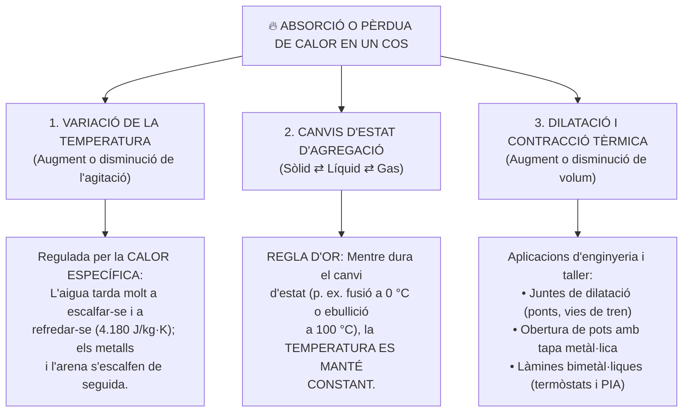

  

    ⚡ Progrés d'aprenentatge (5.5)
    0 / 12 reptes resolts
  

  

    

  

# 5.5 Efectes de la calor sobre els cossos

Quan un cos absorbeix calor (rep energia tèrmica) o cedeix calor (perd energia tèrmica), les seues partícules modifiquen el seu estat d'agitació i l'estructura de la matèria respon. En física comprovem que la calor produeix **tres grans efectes** sobre els cossos:
1. **Variació de la temperatura.**
2. **Canvis d'estat d'agregació.**
3. **Dilatació i contracció tèrmica (canvi de dimensions o volum).**

---

## 1. Primer Efecte: La Variació de la Temperatura i la Calor Específica

Si un cos absorbeix calor sense canviar d'estat, les seues partícules es mouen més de pressa i la seua **temperatura augmenta**; si cedeix calor a l'entorn, la seua **temperatura disminueix**.

Però, **tots els materials s'escalfen igual de ràpid quan reben la mateixa quantitat de calor?** Pensa en un dia d'agost a les dues del migdia en una platja mediterrània. El Sol porta tot el matí enviant exactament la mateixa radiació sobre l'arena i sobre l'aigua del mar. Tanmateix, **l'arena crema tant que no pots caminar descalç (pot superar els $50^\circ\text{C}$), mentre que l'aigua del mar està fresqueta ($24^\circ\text{C}$)!** I a la mitjanit passa el contrari: l'arena s'ha quedat freda de seguida i l'aigua del mar continua tèbia. Per què ocorre això?

* **La Calor Específica ($c_e$):** És la quantitat de calor que necessita absorbir **$1\text{ kg}$** (o $1\text{ g}$) d'una substància perquè la seua temperatura puge exactament **$1^\circ\text{C}$** (o $1\text{ K}$).
  * **L'aigua líquida té una calor específica extraordinàriament alta** ($4\,180\text{ J/(kg}\cdot\text{K)}$ o $1\text{ cal/(g}\cdot^\circ\text{C)}$): necessita absorbir **moltíssima calor** per a pujar només $1^\circ\text{C}$, i quan es refreda, allibera moltíssima calor a poc a poc.
  * **L'arena, les roques i sobretot els metalls (com el ferro o el coure) tenen una calor específica molt baixa** (de $5$ a $10$ vegades menor que l'aigua): amb molt poqueta calor la seua temperatura es dispara de seguida, i també es refreden immediatament.
* **Importància pràctica de l'alta calor específica de l'aigua:**
  * **Regulador climàtic:** El mar suavitza el clima de les zones costaneres (hiverns menys freds i estius menys extrems que a l'interior) i l'aigua del nostre cos ($70\%$) evita que la nostra temperatura corporal canvie bruscament.
  * **Líquid refrigerant ideal:** Per això utilitzem aigua (amb additius anticongelants) en els radiadors dels cotxes, en la calefacció domèstica i en els sistemes de **refrigeració líquida (*watercooling*)** d'ordinadors d'alt rendiment.

---

## 2. Segon Efecte: Els Canvis d'Estat d'Agregació

Quan subministrem o retirem prou calor a una substància, podem fer que canvie d'un estat físic a un altre:
* **Canvis progressius (absorbeixen calor):** **Fusió** (de sòlid a líquid, com el gel que es fon), **Vaporització** (de líquid a gas, per *ebullició* a tota la massa o per *evaporació* a la superfície) i **Sublimació** (de sòlid directament a gas).
* **Canvis regressius (alliberen calor):** **Condensació** (de gas a líquid, com el baf a l'espill del bany), **Solidificació** (de líquid a sòlid, congelació) i **Sublimació inversa** (de gas a sòlid, com el gebre).

> [!IMPORTANT]
> ### 🧊 Regla Fonamental de la Física: Durant un canvi d'estat, la temperatura NO canvia!
> Si poses un got amb glaçons de gel a $-10^\circ\text{C}$ a escalfar i mesures la temperatura amb un termòmetre cada minut:
> 1. Primer la temperatura del gel puja des de $-10^\circ\text{C}$ fins a arribar a **$0^\circ\text{C}$** (punt de fusió).
> 2. En el moment en què comença a fondre's el primer glaçó, **el termòmetre es queda clavat a $0^\circ\text{C}$ durant tota l'estona que dura la fusió**, encara que el foc estiga encés al màxim! Fins que no s'ha fos l'últim trosset de gel, la temperatura de l'aigua no puja ni una dècima de grau.
> 3. Després, l'aigua líquida puja de $0^\circ\text{C}$ fins a **$100^\circ\text{C}$** (punt d'ebullició), i **mentre bull es torna a quedar clavada a $100^\circ\text{C}$**.
> * **Per què es manté constant la temperatura durant el canvi d'estat?** Perquè tota la calor que rep la substància (anomenada **calor latent**) s'inverteix íntegrament a **trencar les forces d'unió entre les partícules** per a canviar d'estat, en lloc d'augmentar la seua velocitat de vibració!

---

## 3. Tercer Efecte: La Dilatació i la Contracció Tèrmica

Què passa amb la mida d'un cos quan l'escalfem o el refredem?
* **La Dilatació tèrmica:** És l'**augment de longitud, superfície o volum** que experimenta un cos quan **augmenta la seua temperatura**.
  * *Explicació microscòpica:* En escalfar el cos, les seues partícules no es fan més grans ni n'apareixen de noves (la **massa es conserva constant**), però com que **vibren amb molta més força i amplitud**, xoquen i necessiten més espai al seu voltant, **separant-se més unes de les altres**. Com a conseqüència, el cos sencer s'expandeix.
* **La Contracció tèrmica:** És el fenomen invers: quan un cos **es refreda**, les seues partícules vibren més a poc a poc, s'acosten entre elles i el volum del cos **disminueix** (s'encongeix). *(Nota: L'única excepció famosa és la dilatació anòmala de l'aigua quan es congela a $0^\circ\text{C}$: en formar l'estructura cristal·lina hexagonal del gel, s'expandeix un $9\%$, i per això una botella plena d'aigua rebenta si la deixes al congelador!).*

### Comparació de la dilatació en Sòlids, Líquids i Gasos
1. **En els sòlids:** Com que les forces d'atracció entre partícules són molt intenses, es dilaten **poc** (pocs mil·límetres per cada metre de barra), però amb una força imparable capaç de rebentar parets o doblar ponts. Pot ser dilatació **lineal** (en cables, bigues i rails), **superficial** (en xapes i rajoles) o **cúbica** (en peces tridimensionals).
2. **En els líquids:** Les partícules estan menys lligades i es dilaten **més que els sòlids** (propietat que aprofiten els termòmetres d'alcohol o galinstan).
3. **En els gasos:** Com que gairebé no hi ha forces d'atracció entre molècules, són els que **es dilaten moltíssim més** en escalfar-se (per exemple, en escalfar l'aire d'un globus aerostàtic amb un cremador, l'aire es dilata tant que part d'ell ix del globus, la resta pesa molt menys i el globus s'enlaira!).

---

## 4. Aplicacions Fonamentals de la Dilatació en Enginyeria, Construcció i Taller

### A) Les Juntes de Dilatació en Ponts, Edificis, Voreres i Vies de Tren
Si t'has fixat mai en creuar un pont o viaducte d'autopista, hauràs vist unes **estructures metàl·liques amb dents en forma de pinta** que separen un tram del pont del següent. També hauràs vist espais entre les rajoles de les voreres, ranures reblertes de massilla elàstica a les façanes dels edificis i xicotetes separacions entre els trams dels **rails d'acer del tren** (que produeixen el clàssic so *"trac-trac"* en passar les rodes).
* **Què són i per a què serveixen les juntes de dilatació?** Són espais o folgances calculades pels enginyers perquè els materials de construcció (acer, ferro, formigó, ceràmica) **tinguen espai lliure on estirar-se quan es dilaten a l'estiu** amb la calor del Sol i encongir-se a l'hivern.
* **Què passaria si NO es deixaren juntes de dilatació?** Un rail d'acer de $100\text{ m}$ o un pont de formigó que passa de $0^\circ\text{C}$ a l'hivern a $45^\circ\text{C}$ al sol d'agost s'allarga diversos centímetres. Si els extrems estigueren soldats sense cap espai, l'empenta descomunal de la dilatació faria que **els rails del tren es torceren i s'ondularen com una serp (*pandeig*), provocant el descarrilament del tren**, que les rajoles del sòl saltaren pels aires o que els pilars del pont s'esquerdaren!
* **I en les línies elèctriques d'alta tensió?** Els instal·ladors mai deixen els cables metàl·lics totalment tibants a l'estiu: a l'estiu els cables estan dilatats i pengen amb més panxa (sageta), perquè si els instal·laren tibants al juliol, quan arribara el fred de gener es **contraurien** tant que es trencarien o tombarien les torres elèctriques!

### B) Com obrir un pot de vidre amb la tapa metàl·lica encallada (i muntatge d'eixos al taller)
Quan la tapa de llauna o alumini d'un pot de conserva de vidre està tan dura que no hi ha manera de desenroscar-la, quin és el truc infal·lible basat en la física?
* **Posar la tapa metàl·lica uns segons sota un raig d'aigua calenta!** Per què funciona? Perquè el **metall és millor conductor i té un coeficient de dilatació molt major que el vidre**: en rebre l'aigua calenta, la tapa metàl·lica **es dilata més i més ràpidament que el coll de vidre del pot**, es fa una miqueta més ampla, deixa de prémer la rosca i s'obri sense cap esforç! (En els tallers mecànics es fa el mateix per a encaixar rodaments i engranatges d'acer a pressió: s'escalfa l'anell exterior perquè es dilate, s'introdueix l'eix fred i, en refredar-se, queda travat amb una força indestructible).

### C) Les Làmines Bimetàl·liques: El Cor dels Termòstats i dels Magnetotèrmics
Una **làmina bimetàl·lica** està formada per dues tires de **dos metalls diferents** amb distint coeficient de dilatació (per exemple, una làmina de **coure o llautó**, que es dilata molt, i una làmina de **ferro o acer invar**, que es dilata poc) soldades longitudinalment l'una contra l'altra.
* **Com funciona?** A temperatura normal la làmina està recta. Però quan s'escalfa, com que el coure s'allarga més que el ferro i estan soldats junts, **la làmina es veu obligada a corbar-se sola** cap al costat del ferro! I quan es refreda, recupera la forma recta.
* **On s'utilitzen?**
  1. **Termòstats mecànics** de planxes de roba, forns, estufes i cafeteres: quan l'aparell arriba a la temperatura marcada, la làmina bimetàl·lica es corba i obri el contacte elèctric tallant el corrent; quan es refreda, es redreça i torna a connectar la resistència.
  2. **Protecció tèrmica dels Interruptors Magnetotèrmics (PIA)** del quadre elèctric de casa i del taller: si hi ha una sobrecàrrega al circuit, el corrent excessiu escalfa una làmina bimetàl·lica interna que es corba i **dispara la palanca de l'interruptor**, evitant que els cables de la paret s'incendie!

---

> [!NOTE]
> ### 💡 Resum de Conceptes Clau (Sessió 5.5)
> - Els 3 efectes de la calor són: **variació de temperatura**, **canvis d'estat** i **dilatació/contracció**.
> - L'**aigua** té una **calor específica** molt elevada ($4\,180\text{ J/(kg}\cdot\text{K)}$): tarda molt a escalfar-se i a refredar-se en comparació amb l'arena o els metalls.
> - **Mentre dura un canvi d'estat** d'una substància pura (p. ex. fusió del gel a $0^\circ\text{C}$), **la temperatura es manté constant**.
> - En escalfar un cos, les partícules es separen i el volum augmenta (**dilatació**); per això calen **juntes de dilatació** en ponts i rails, i s'usen **làmines bimetàl·liques** en termòstats i interruptors magnetotèrmics.

---

## 🎯 Activitats i Autoavaluació Interactiva

  

    🎮 <strong>Zona d'Entrenament FPB:</strong> 0 reptes resolts
    ⭐ 0 punts
  

  

### 1. Qüestionari d'Autoavaluació Tipus Test (MCQ)

  
<strong>1. Què ocorre amb la temperatura d'un bloc de gel pur que es troba a $0^\circ\text{C}$ mentre s'està fonent dins d'un got al qual continuem donant calor?</strong>

  

    <button type="button" class="btn-mcq-opt" data-opt="A">A) La temperatura puja ràpidament fins a $50^\circ\text{C}$ mentre encara queden glaçons</button>
    <button type="button" class="btn-mcq-opt" data-opt="B">B) La temperatura es manté totalment constant a $0^\circ\text{C}$ fins que s'acaba de fondre tot el gel, perquè la calor s'inverteix a trencar les unions entre molècules</button>
    <button type="button" class="btn-mcq-opt" data-opt="C">C) La temperatura baixa fins a $-20^\circ\text{C}$</button>
    <button type="button" class="btn-mcq-opt" data-opt="D">D) El gel passa directament a $100^\circ\text{C}$ sense passar per l'estat líquid</button>
  

  

  
<strong>2. Per quin motiu els enginyers deixen ranures o espais anomenats "juntes de dilatació" entre els trams dels ponts i entre els rails de les vies del tren?</strong>

  

    <button type="button" class="btn-mcq-opt" data-opt="A">A) Únicament per estalviar diners gastant menys acer i formigó</button>
    <button type="button" class="btn-mcq-opt" data-opt="B">B) Perquè el tren faça soroll i avise els vianants que s'acosta</button>
    <button type="button" class="btn-mcq-opt" data-opt="C">C) Perquè amb la calor de l'estiu els metalls es contrauen i es fan més curts</button>
    <button type="button" class="btn-mcq-opt" data-opt="D">D) Perquè amb la calor de l'estiu els materials es dilaten (augmenten de longitud) i necessiten espai lliure per a no corbar-se ni esquerdar l'estructura</button>
  

  

  
<strong>3. Si escalfem en $50^\circ\text{C}$ tres mostres del mateix volum inicial: una barra d'acer (sòlid), aigua (líquid) i aire (gas), quin dels tres estats de la matèria experimentarà una major dilatació?</strong>

  

    <button type="button" class="btn-mcq-opt" data-opt="A">A) El sòlid (l'acer)</button>
    <button type="button" class="btn-mcq-opt" data-opt="B">B) El líquid (l'aigua)</button>
    <button type="button" class="btn-mcq-opt" data-opt="C">C) El gas (l'aire es dilata moltíssim més que els líquids i els sòlids)</button>
    <button type="button" class="btn-mcq-opt" data-opt="D">D) Cap dels tres es dilata</button>
  

  

  
<strong>4. Com funciona una làmina bimetàl·lica a l'interior del termòstat d'una planxa o d'un interruptor magnetotèrmic (PIA) del quadre elèctric?</strong>

  

    <button type="button" class="btn-mcq-opt" data-opt="A">A) Està formada per dos metalls diferents soldats; en escalfar-se, un es dilata més que l'altre i la làmina es corba obrint el circuit elèctric</button>
    <button type="button" class="btn-mcq-opt" data-opt="B">B) Es fon com la cera d'una espelma cada vegada que s'encén la planxa</button>
    <button type="button" class="btn-mcq-opt" data-opt="C">C) Conté mercuri líquid que explota en passar el corrent</button>
    <button type="button" class="btn-mcq-opt" data-opt="D">D) Funciona mitjançant un panell solar intern</button>
  

  

---

### 2. Activitats de Vertader (V) o Fals (F)

  <strong>a) A la platja, l'aigua del mar tarda molt més a escalfar-se al sol que l'arena perquè l'aigua té una calor específica molt més elevada.</strong>
  

    <button type="button" class="btn-vf" data-opt="V">V</button>
    <button type="button" class="btn-vf" data-opt="F">F</button>
  

  

  <strong>b) Quan una bola de ferro s'escalfa i es dilata, la seua massa en grams augmenta perquè es creen nous àtoms de ferro en el seu interior.</strong>
  

    <button type="button" class="btn-vf" data-opt="V">V</button>
    <button type="button" class="btn-vf" data-opt="F">F</button>
  

  

  <strong>c) Mentre l'aigua d'una cassola està bullint (ebullició a $1\text{ atm}$), la seua temperatura es manté constant a $100^\circ\text{C}$ encara que apugem la potència del foc.</strong>
  

    <button type="button" class="btn-vf" data-opt="V">V</button>
    <button type="button" class="btn-vf" data-opt="F">F</button>
  

  

  <strong>d) La disminució de volum que experimenta un cos quan es refreda i baixa la seua temperatura s'anomena contracció tèrmica.</strong>
  

    <button type="button" class="btn-vf" data-opt="V">V</button>
    <button type="button" class="btn-vf" data-opt="F">F</button>
  

  

---

### 3. Exercicis de Resposta Breu, Vocabulari Tècnic i Càlcul

  
✍️ <strong>1.</strong> Com s'anomena l'augment de longitud, superfície o volum que experimenta un cos quan augmenta la seua temperatura?

  

    <input type="text" class="quiz-input" placeholder="Escriu el fenomen físic...">
    <button type="button" class="btn-quiz-check">Comprovar</button>
  

  

  
✍️ <strong>2.</strong> Com s'anomena la peça formada per dos metalls diferents soldats junts que es corba en escalfar-se i fa funcionar els termòstats i els interruptors magnetotèrmics? (Làmina...)

  

    <input type="text" class="quiz-input" placeholder="Escriu l'adjectiu: làmina...">
    <button type="button" class="btn-quiz-check">Comprovar</button>
  

  

  
✍️ <strong>3.</strong> Com s'anomena la magnitud física que indica la quantitat de calor que cal donar a $1\text{ kg}$ d'una substància per a apujar la seua temperatura $1^\circ\text{C}$?

  

    <input type="text" class="quiz-input" placeholder="Escriu les dues paraules...">
    <button type="button" class="btn-quiz-check">Comprovar</button>
  

  

  
✍️ <strong>4.</strong> Com es manté la temperatura d'una substància pura mentre està experimentant un canvi d'estat (com la fusió o l'ebullició)?

  

    <input type="text" class="quiz-input" placeholder="Escriu una paraula (p. ex. constant)...">
    <button type="button" class="btn-quiz-check">Comprovar</button>
  

  

---

### 4. Exercicis de Raonament i Desenvolupament Escrit (Tasca d'Aula)

  
✍️ <strong>1. Física aplicada a casa i a les línies elèctriques:</strong> Explica amb les teues paraules: a) Per què quan no podem obrir la tapa metàl·lica d'un pot de vidre, si posem la tapa sota un raig d'aigua calenta s'obri fàcilment; i b) Per què els tècnics que instal·len cables d'alta tensió a l'estiu han de deixar els cables un poc fluixos (penjant) en lloc de deixar-los totalment tibants.

  <textarea class="open-response-input" rows="4" placeholder="a) En posar la tapa metàl·lica sota aigua calenta... b) Si instal·laren els cables tibants a l'estiu, quan arribara el fred de l'hivern..."></textarea>

  
✍️ <strong>2. La calor específica de l'aigua i el clima costaner:</strong> Explica per què una ciutat situada a la vora del mar (com València o Alacant) té estius menys sufocants i hiverns molt més suaus que una ciutat situada a l'interior de la península lluny del mar.

  <textarea class="open-response-input" rows="4" placeholder="Relaciona la resposta amb l'alta calor específica de l'aigua del mar (4.180 J/kg·K) com a regulador tèrmic..."></textarea>

  
✍️ <strong>3. Protecció elèctrica al taller amb làmines bimetàl·liques:</strong> Explica pas a pas què passa dins d'un interruptor automàtic magnetotèrmic (PIA) del quadre elèctric del taller quan endollem massa estufes i màquines al mateix circuit i els cables es comencen a sobreescalfar.

  <textarea class="open-response-input" rows="4" placeholder="Explica com el corrent excessiu escalfa la làmina bimetàl·lica, com es dilaten els dos metalls i com talla el corrent..."></textarea>

---

  <h3 style="margin-top:0; color:#0369a1;">📦 Lliurament d'Activitats d'Aules (Act 5.5)</h3>
  
Genera el teu document de tasca d'aquest apartat amb el teu nom i puntuació obtinguda.

  

    <input type="text" class="aules-student-name" placeholder="Cognoms, Nom de l'Alumne/a" style="padding:8px 12px; border:1px solid #94a3b8; border-radius:4px; flex-grow:1; min-width:240px;">
    <button class="btn-generate-aules-pdf" data-unit="NAT05" data-activity="Act05" data-module="CA" style="padding:8px 16px; background:#0284c7; color:#fff; border:none; border-radius:4px; font-weight:600; cursor:pointer;">📄 Descarregar PDF per a Aules</button>
  

