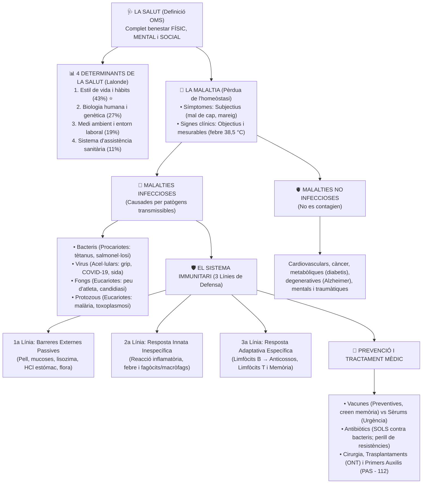

# UD6: La Salut i el Sistema Immunitari (Biologia i Ciències de la Salut)

  

    

      SALUT I PREVENCIÓ · 1r FPB
      🩺 Salut Integral, Patògens, Defenses i Medicina
    

    
Descobreix els determinants de la salut segons l'OMS, la diferència entre bacteris i virus, les 3 línies del sistema immunitari, les vacunes, els antibiòtics i la conducta PAS al taller.

  

  <a href="./nat0601.html" style="background: linear-gradient(135deg, #059669, #0d9488); color: #fff !important; font-weight: 800; padding: 10px 18px; border-radius: 10px; text-decoration: none !important; box-shadow: 0 4px 12px rgba(5, 150, 105, 0.3); display: inline-flex; align-items: center; gap: 6px;">
    🚀 Començar Sessió 6.1
    →
  </a>

Benvingut/da a la **Unitat Didàctica 6: La Salut** del mòdul de **Ciències Aplicades I**. Comprendre què és la salut, com es transmeten les malalties infeccioses, com ens defensa el nostre sistema immunitari i per què és tan perillós automedicar-se amb antibiòtics és una de les competències més útils per a la teua vida personal i per a la seguretat i prevenció de riscos laborals al taller.

Aquesta unitat està organitzada en **4 sessions teoricopràctiques** (1 sessió = 1 apartat oficial), cadascuna amb esquemes visuals, taules comparatives, connexions amb el món laboral i la seua bateria d'activitats interactives amb lliurament en PDF per a Aules.

---

## 📑 Planificació de Subunitats Didàctiques (4 Sessions)

| Sessió | Subunitat | Contingut Principal de la Sessió | Bateria d'Activitats | Enllaç Directe |
| :---: | :---: | :--- | :---: | :---: |
| **Sessió 1** | **6.1** | **La salut i la malaltia:** Definició de l'OMS (benestar físic, mental i social), homeòstasi, els 4 determinants de Lalonde, símptomes vs signes clínics i esperança de vida. | MCQ, V/F, Vocabulari, Raonament i Aules | [**📖 Anar a la Sessió 6.1 →**](./nat0601.html) |
| **Sessió 2** | **6.2** | **Tipus de malalties:** Agudes vs cròniques, endèmia/epidèmia/pandèmia, infeccioses (bacteris, virus, fongs i protozous; contagi i fases) i no infeccioses. | MCQ, V/F, Vocabulari, Raonament i Aules | [**📖 Anar a la Sessió 6.2 →**](./nat0602.html) |
| **Sessió 3** | **6.3** | **El sistema immunitari:** Les 3 línies de defensa (1a barreres físiques/químiques/flora, 2a inflamació i fagòcits, 3a limfòcits B i T, antígens, anticossos i memòria), al·lèrgies i autoimmunitat. | MCQ, V/F, Vocabulari, Raonament i Aules | [**📖 Anar a la Sessió 6.3 →**](./nat0603.html) |
| **Sessió 4** | **6.4** | **Tractament de les malalties:** Vacunes vs sèrums, antibiòtics (Fleming, ineficàcia contra virus i resistències bacterianes), cirurgia, trasplantaments (ONT) i conducta PAS (112). | MCQ, V/F, Vocabulari, Raonament i Aules | [**📖 Anar a la Sessió 6.4 →**](./nat0604.html) |

---

## 🗺️ Mapa Conceptual de la Unitat Didàctica 6

---

## 🎯 Objectius d'Aprenentatge i Competències de la Unitat

En finalitzar l'estudi d'aquesta unitat didàctica, seràs capaç de:

1. **Valorar el concepte integral de salut de l'OMS:** Reconéixer la interdependència entre el benestar físic, mental i social, analitzar com l'estil de vida és el factor més determinant sobre la salut i distingir entre símptomes subjectius i signes clínics objectius.
2. **Classificar les malalties i els agents infecciosos:** Diferenciar malalties agudes i cròniques, esporàdiques, endèmiques, epidèmiques i pandèmiques, i distingir l'estructura i els exemples de malalties causades per bacteris, virus, fongs i protozous.
3. **Explicar les tres línies de defensa de l'organisme:** Descriure com actuen les barreres externes (pell, lisozima, àcid gàstric, microbiota), la resposta inflamatòria amb els fagòcits i la resposta específica dels limfòcits B (anticossos) i T (memòria immunitària).
4. **Fer un ús responsable de les vacunes i dels medicaments:** Argumentar científicament per què les vacunes salven milions de vides mitjançant la memòria immunitària i la immunitat de grup, i per què els antibiòtics mai s'han de prendre contra infeccions víriques ni abandonar a meitat de tractament.
5. **Conéixer el valor solidari dels trasplantaments i aplicar primers auxilis:** Comprendre el procés de donació d'òrgans i sang (i el rebuig immunitari) i aplicar el protocol **PAS (Protegir, Avisar al 112, Socórrer)** davant d'un accident al taller.

---

## 🔬 Quadre Sinòptic d'Urgència: Microorganismes Patògens i Tractament

| Agent Patogen | Tipus Cel·lular | És un ésser viu autònom? | Exemples de Malalties Humanes | Fàrmac Específic |
| :--- | :---: | :---: | :--- | :--- |
| **Bacteris** | Unicel·lular **Procariota** | **Sí** (es divideix sol) | Tètanus, salmonel·losi, tuberculosi, còlera, pneumònia. | **Antibiòtics** (p. ex. penicil·lina, amoxicil·lina). |
| **Virus** | **Acel·lular** (ADN/ARN + càpsida) | **No** (paràsit obligatori) | Grip, refredat, COVID-19, xarampió, varicel·la, sida (VIH). | **Antivirals** i simptomàtics (**MAI antibiòtics!**). |
| **Fongs** | Eucariota (llevats/floridures) | **Sí** | Peu d'atleta (tinya), candidiasi, micosis d'ungles. | **Antifúngics** (o antimicòtics). |
| **Protozous** | Unicel·lular **Eucariota** | **Sí** | Malària (paludisme per *Plasmodium*), toxoplasmosi. | **Antiprotozoaris** (p. ex. antipalúdics). |

---

## 🧰 Prevenció de Riscos Laborals i Salut al Taller d'FP Bàsica

* **Higiene i protecció davant ferides amb eines (Prevenció del Tètanus):** El bacteri *Clostridium tetani* forma espores molt resistents que viuen a la pols, la terra i sobre eines o ferros oxidats del taller. Si et fas un tall profund amb un cúter, una xapa metàl·lica o un tornavís brut, cal rentar immediatament la ferida amb aigua i sabó, desinfectar-la amb antisèptic (clorhexidina o povidona iodada) i comprovar que tens al dia la **vacuna antitetànica**.
* **Ergonomia i salut postural davant l'ordinador i al banc de treball:** Moltes malalties professionals no són infeccioses, sinó **musculoesquelètiques** (lumbàlgies, tendinitis, síndrome del túnel carpià) o visuals. Mantindre l'esquena recolzada, la pantalla a l'altura dels ulls i alçar càrregues pesants doblegant els genolls (i mai l'esquena) protegeix la teua salut física a llarg termini.
* **Protocol PAS davant d'accidents elèctrics o mecànics:** En cas d'electrocució al taller, la primera regla de la conducta **PAS** és **Protegir**: mai toques directament la víctima amb les mans nues mentre seguisca en contacte amb el cable; baixa primer l'interruptor general o el diferencial del quadre elèctric!

---

## 📖 Glossari Essencial de la Unitat

* **Homeòstasi:** Equilibri intern estable de les condicions físiques i químiques de l'organisme (temperatura de $36{,}5^\circ\text{C}$, glucosa en sang, pH) necessari per a la vida.
* **Patogen:** Microorganisme o agent biològic (bacteri, virus, fong, protozou) capaç de penetrar en un altre ésser viu i provocar-li una malaltia infecciosa.
* **Vector epidemiològic:** Animal (generalment un artròpode com el mosquit *Anopheles*, una paparra o una puça) que transporta un patogen d'un hoste malalt a un altre de sa en picar-lo.
* **Fagocitosi:** Procés de la 2a línia immunitària en què glòbuls blancs especialitzats (**fagòcits** com neutròfils i macròfags) envolten, engoleixen i digereixen microbis invasors.
* **Antigen:** Molècula estranya (com una proteïna de la coberta d'un virus o bacteri) que desencadena la resposta immunitària específica en ser detectada pels limfòcits.
* **Anticòs (Immunoglobulina):** Proteïna defensiva amb forma de "Y" fabricada pels **limfòcits B** que s'uneix específicament a un antigen concret per a neutralitzar-lo.
* **Resistència bacteriana:** Capacitat que adquireixen certs bacteris mutats per a sobreviure a l'acció dels antibiòtics, afavorida pel mal ús o l'abandó prematur dels tractaments.

---

## ❓ Preguntes Freqüents i Erades Habituals a Evitar (FAQ de la UD6)

1. **Si no em fa mal res i no tinc cap infecció, ja tinc una salut perfecta segons l'OMS?**
   * **No necessàriament.** L'Organització Mundial de la Salut (OMS) defineix la salut com l'estat de complet benestar **físic, mental i social**, i no sols l'absència de malaltia. Si una persona pateix estrès crònic, depressió o aïllament social, la seua salut està alterada encara que els seus òrgans físics estiguen sans.
2. **Com puc distingir fàcilment en un examen entre un símptoma i un signe clínic?**
   * Fes-te aquesta pregunta: *"Ho pot mesurar o veure el metge amb un aparell sense que el pacient parle?"* Si la resposta és **NO** (com el mal de cap, el mareig, les nàusees o el cansament), és un **símptoma (subjectiu)**. Si la resposta és **SÍ** (com $38{,}5^\circ\text{C}$ de febre al termòmetre, $150/95$ de tensió arterial, una granellada a la pell o una placa de rajos X), és un **signe clínic (objectiu)**.
3. **Per què un antibiòtic cura unes angines bacterianes o una infecció d'orina, però no fa absolutament res contra la grip o la COVID-19?**
   * Perquè els **antibiòtics** estan dissenyats per a destruir l'estructura cel·lular dels **bacteris** (que són cèl·lules procariotes vives). En canvi, la grip, el refredat i la COVID-19 estan causats per **virus**, que són formes acel·lulars sense paret bacteriana ni metabolisme propi. Contra un virus, l'antibiòtic és totalment inútil!
4. **Quina diferència hi ha entre posar-se una vacuna i rebre un sèrum a urgències?**
   * La **vacuna és preventiva**: s'administra quan estàs **sa**, conté **antígens** inofensius i ensenya els teus limfòcits a fabricar els teus propis anticossos i **cèl·lules de memòria** per a protegir-te durant anys. El **sèrum és curatiu d'urgència**: s'administra quan el patogen o verí **ja ha entrat al cos**, conté **anticossos ja fabricats** que actuen a l'instant, però no deixa memòria immunitària.
5. **Si un company del taller pateix una descàrrega elèctrica i queda enganxat a un cable, per què no he d'acostar-me corrent a agarrar-lo per a ajudar-lo?**
   * Perquè el cos humà és conductor de l'electricitat i, si el toques mentre segueix connectat al corrent, **t'electrocutaràs tu també** i hi haurà dues víctimes en lloc d'una! Seguint la **conducta PAS**, el primer pas és sempre **1r Protegir** (tallar l'interruptor general o el diferencial del quadre elèctric abans de tocar-lo), després **2n Avisar al 112** i finalment **3r Socórrer**.

---

## 🧪 Casos Pràctics d'Anàlisi Clínica i Prevenció al Taller

| Situació Real a l'Aula o al Taller | Agent o Mecanisme Implicat | Protocol Correcte d'Actuació i Prevenció |
| :--- | :--- | :--- |
| **1. Tall profund amb una xapa o eina oxidada** | Risc d'entrada d'espores del bacteri *Clostridium tetani* (**Tètanus**). | Rentar amb aigua i sabó, aplicar antisèptic, acudir al centre de salut per valorar **sèrum antitetànic** i recordatori de la **vacuna**. |
| **2. Company amb febre alta, tos i malestar general** | Infecció respiratòria vírica aguda (**Grip** o **COVID-19**) per gotes de saliva. | Repòs, hidratació, medicaments **simptomàtics** (analgèsics/antipirètics com paracetamol), ventilació i **MAI prendre antibiòtics**. |
| **3. Picor, enrogiment i clivelles entre els dits dels peus** | Infecció per fongs (**micosi**: *peu d'atleta*) adquirida en dutxes o piscines. | Usar xancletes en vestidors públics, eixugar bé els peus i aplicar una crema amb fàrmac **antifúngic (antimicòtic)**. |
| **4. Reacció al·lèrgica greu per picada o aliment** | Resposta immunitària exagerada (**xoc anafilàctic**) davant d'un al·lergen. | Avisar immediatament al **112** i, si el pacient disposa d'autoinjector d'urgència (**adrenalina**), administrar-lo a la cuixa. |
| **5. Accident amb pèrdua de consciència al taller** | Risc vital per traumatisme, asfíxia o parada cardiorespiratòria. | Aplicar l'ordre estricte de la **conducta PAS**: **1. Protegir** l'entorn, **2. Avisar al 112**, **3. Socórrer** (PLS si respira o RCP si no respira). |

---

## 📋 Criteris d'Avaluació i Lliurament d'Activitats a Aules

Per a superar amb èxit aquesta Unitat Didàctica 6 en la plataforma **Aules**, recorda completar les **4 sessions** (`6.1` a `6.4`):

1. **Estudi dels continguts:** Llig amb atenció el desenvolupament teòric, els diagrames Mermaid de les línies defensives i les taules comparatives.
2. **Resolució de la Zona d'Entrenament FPB:**
   * Contesta les **2 preguntes tipus test (MCQ)** d'opció múltiple.
   * Resol les **2 qüestions de Vertader o Fals (V/F)**.
   * Completa els **2 exercicis de resposta breu i vocabulari tècnic** i verifica la resposta amb el botó *Comprovar*.
   * Desenvolupa per escrit la **pregunta de raonament clínic i prevenció**.
3. **Generació de l'informe en PDF:** Introdueix els teus **Cognoms i Nom** a la targeta final (*Lliurament d'Activitats d'Aules*) i fes clic en **📄 Descarregar PDF per a Aules** per obtindre els 4 documents (`Act 6.1` fins a `Act 6.4`).

---

## 🔄 Connexió amb la Resta del Mòdul de Ciències Aplicades I

Aquesta Unitat Didàctica 6 obri el bloc de **Biologia Humana i Salut** de **1r d'FP Bàsica** i es relaciona estretament amb les unitats anteriors i posteriors:

* **Relació amb la UD5 (La Calor i la Temperatura):** Apliquem l'ús del termòmetre clínic (de galinstan, digital o d'infrarojos) per a quantificar la **febre** com a signe clínic objectiu i comprendre la termorregulació dins de l'homeòstasi corporal ($36{,}5^\circ\text{C} \text{ -- } 37^\circ\text{C}$).
* **Relació amb la UD7 (La Nutrició Humana) i la UD8 (La Funció de Relació i Reproducció):** En estudiar els determinants de la salut segons l'Informe Lalonde, comprovem que l'**estil de vida ($43\%$)** es basa fonamentalment en una alimentació i nutrició saludable (que estudiarem en detall a la UD7) i en la cura del sistema nerviós, endocrí i reproductor (incloent-hi la prevenció d'infeccions de transmissió sexual com el VIH).
* **Relació amb el Mòdul de Prevenció de Riscos Laborals al Taller:** Els conceptes d'higiene, desinfecció de ferides, vacunació antitetànica, ergonomia postural i l'aplicació immediata de la **conducta PAS (Protegir, Avisar al 112, Socórrer)** són pilars essencials per a treballar amb seguretat en qualsevol taller professional.

### Itinerari Recomanat de Treball (4 Sessions)
* **Sessió 1 (`nat0601`):** Definició integral de salut de l'OMS, homeòstasi, els 4 determinants de Lalonde i distinció entre símptomes i signes clínics.
* **Sessió 2 (`nat0602`):** Classificació epidemiològica (endèmia, epidèmia, pandèmia), els 4 tipus de patògens (bacteris, virus, fongs, protozous), vies de contagi, fases d'infecció i malalties no infeccioses.
* **Sessió 3 (`nat0603`):** Funcionament detallat de les 3 línies de defensa del sistema immunitari (barreres externes, inflamació/fagòcits i limfòcits B i T amb anticossos i memòria), al·lèrgies i malalties autoimmunes.
* **Sessió 4 (`nat0604`):** Prevenció i tractament: vacunes vs sèrums, ús racional dels antibiòtics per evitar resistències bacterianes, cirurgia, trasplantaments (ONT) i primers auxilis (PAS - 112).

### Decàleg d'Or de Salut i Seguretat per a l'Alumnat d'FP Bàsica
1. **Cuida el teu estil de vida (43% de la teua salut):** Segueix una dieta mediterrània variada, beu aigua i evita l'excés de sucres i ultraprocessats.
2. **Mou-te cada dia:** Practica almenys $30\text{--}60\text{ minuts}$ d'activitat física moderada i mantín una postura ergonòmica al taller i davant l'ordinador.
3. **Descansa prou:** Dorm entre $7$ i $8\text{ hores}$ diàries per a permetre la recuperació del sistema nerviós i del sistema immunitari.
4. **Higiene de mans i ferides:** Renta't les mans amb aigua i sabó abans de menjar i desinfecta immediatament qualsevol tall o rascada al taller.
5. **Evita tòxics i addiccions:** No fumes, evita l'alcohol i qualsevol altra droga que destruïsca la teua salut física, mental i social.
6. **Mantín el teu calendari vacunal al dia:** Especialment la vacuna antitetànica, imprescindible en qualsevol entorn de taller mecànic, elèctric o informàtic.
7. **Mai t'automediques amb antibiòtics:** Recorda que els antibiòtics sols serveixen contra bacteris (mai per a grip o refredat) i que sempre cal acabar el tractament receptat pel metge.
8. **En cas d'emergència, aplica la conducta PAS:** **1r Protegir** la zona (tallar el corrent), **2n Avisar al 112** i **3r Socórrer** sense posar-te en perill.

---

> [!TIP]
> ### 💡 Consell d'Estudi per a l'Alumnat
> Estudia cada apartat fixant-te especialment en les **taules comparatives** (Símptomes vs Signes, Bacteris vs Virus, 1a/2a/3a Línia de Defensa, i Vacunes vs Sèrums). Completa els reptes interactius de les 4 sessions i descarrega els teus informes PDF per a Aules!
