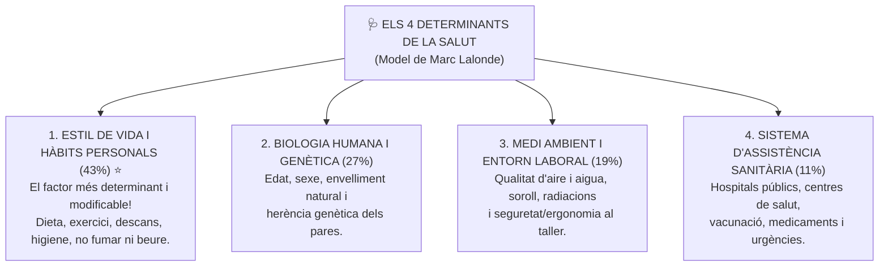
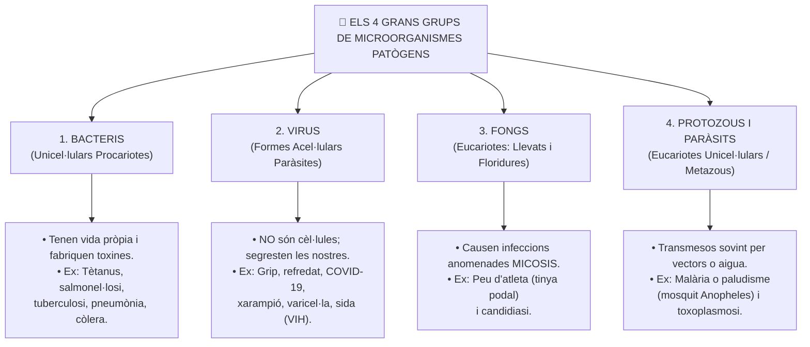
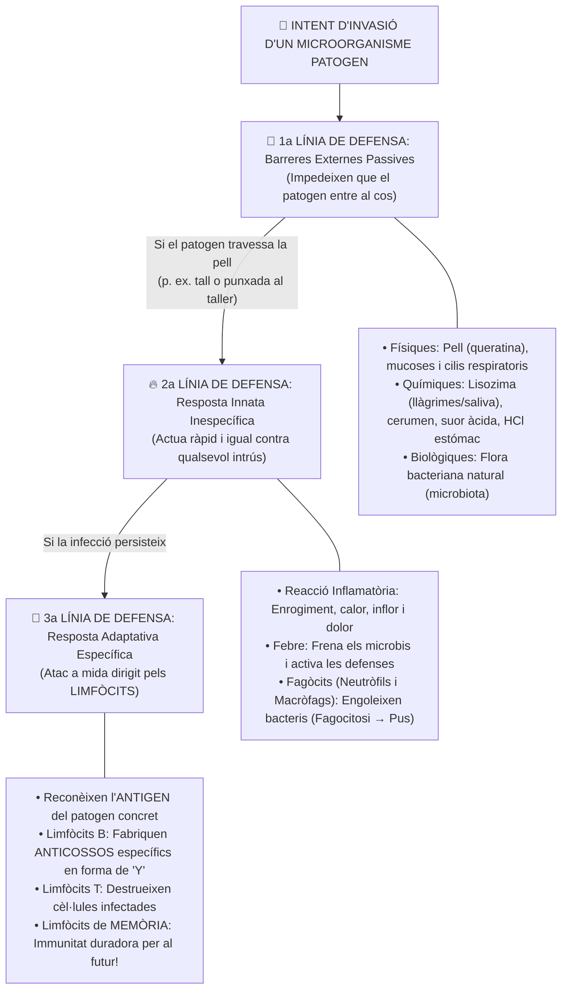
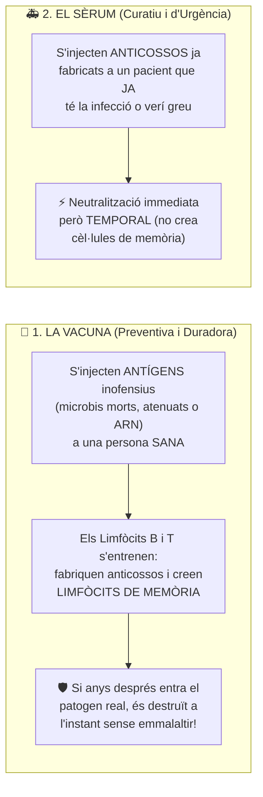

# 🔬 UD6: La Salut — Temari Complet i Exercicis Diaris per a Aules

En aquesta pàgina tens tant l'**accés directe a cada sessió diària individual** (amb els seus **15 exercicis diaris** i el seu **botó de descàrrega de PDF per a pujar a Aules cada dia**) com la **vista completa de tota la unitat** amb tots els apartats i el **Butlletí Global d'Activitats Finals de la Unitat**.

---

## 📑 Planificació Diària de Sessions i Tasques d'Aules (UD6)

| Sessió | Apartat del Temari Oficial | Tasca Diària per a Aules | Accés Directe |
| :---: | :--- | :---: | :---: |
| **6.1** | **6.1 La salut i la malaltia** | 15 Exercicis Diaris + PDF Aules | [**📖 Teoria + 🎯 15 Exercicis →**](./nat0601.html) · [**🎯 Anar a Exercicis →**](./nat0601.html#activitats) |
| **6.2** | **6.2 Tipus de malalties** | 15 Exercicis Diaris + PDF Aules | [**📖 Teoria + 🎯 15 Exercicis →**](./nat0602.html) · [**🎯 Anar a Exercicis →**](./nat0602.html#activitats) |
| **6.3** | **6.3 El sistema immunitari** | 15 Exercicis Diaris + PDF Aules | [**📖 Teoria + 🎯 15 Exercicis →**](./nat0603.html) · [**🎯 Anar a Exercicis →**](./nat0603.html#activitats) |
| **6.4** | **6.4 Tractament de les malalties** | 15 Exercicis Diaris + PDF Aules | [**📖 Teoria + 🎯 15 Exercicis →**](./nat0604.html) · [**🎯 Anar a Exercicis →**](./nat0604.html#activitats) |
| **6.5** | **6.5 Activitats Finals i Tasca Global de la Unitat 6 (Aules)** | 21 Exercicis Globals + PDF Aules | [**📝 Fer Tasca Global UD →**](./nat0605.html) · [**🎯 Anar a Exercicis →**](./nat0605.html#activitats) |

---

  

    ⚡ Progrés d'aprenentatge (6.1)
    0 / 12 reptes resolts
  

  

    

  

## 📌 6.1 La salut i la malaltia {#nat0601}

Durant molt de temps es va pensar que "estar sa" consistia simplement a no tindre cap dolor físic ni cap infecció. Hui sabem que un ésser humà és molt més que un conjunt d'òrgans: una persona pot tindre unes analítiques de sang perfectes i, tanmateix, patir una depressió severa, ansietat laboral o un aïllament social extrem que li impedisquen portar una vida plena.

---

## 1. Definició Oficial de Salut segons l'OMS i Concepte de Malaltia

L'any 1948, l'**Organització Mundial de la Salut (OMS)** —l'agència de les Nacions Unides especialitzada en salut pública mundial— va establir la definició oficial i universal de **salut**:

> *"La **salut** és l'estat de complet benestar **físic, mental i social**, i no sols l'absència d'afeccions o malalties."*

Per tant, per a gaudir d'una salut integral han d'estar en equilibri **tres dimensions fonamentals**:
1. **Benestar Físic (Biològic):** Tots els nostres òrgans, aparells i sistemes funcionen de manera fisiològica, coordinada i sense lesions ni infeccions.
2. **Benestar Mental (Psicològic i Emocional):** La persona gaudeix d'equilibri emocional, bona autoestima, absència de trastorns psíquics i és capaç d'afrontar l'estrès normal de la vida, aprendre i desenvolupar les seues capacitats.
3. **Benestar Social:** La persona viu integrada positivament en la seua comunitat (família, amistats, institut, entorn laboral), en un ambient de respecte, sense patir assetjament, violència ni exclusió, i amb les necessitats vitals cobertes.

### Què és aleshores la Malaltia?
El nostre cos treballa les 24 hores del dia per a mantindre estables les seues condicions internes (temperatura al voltant de 36,5 °C, nivell de glucosa i oxigen en sang, pressió arterial, hidratació): aquest equilibri intern s'anomena **homeòstasi**.
* **Definició de Malaltia:** És qualsevol **alteració més o menys greu de l'equilibri (homeòstasi) físic, mental o social** de l'organisme que impedeix el seu funcionament normal de manera temporal o permanent.

---

## 2. Els 4 Determinants de la Salut (Informe Lalonde)

De què depén que una persona o una població visca molts anys amb bona salut? L'any 1974, el ministre de Sanitat del Canadà, **Marc Lalonde**, va publicar un estudi històric que va demostrar que la salut humana depén de **quatre grans factors o determinants**:

| Determinant de la Salut | Pes Aproximat | En què consisteix? | Es pot modificar per nosaltres? |
| :--- | :---: | :--- | :--- |
| **1. Estil de vida i hàbits** | **~43%** | Conductes diàries: alimentació mediterrània, esport, higiene, dormir 8 h, evitar tabac, alcohol i drogues, conducció segura. | **SÍ (Totalment):** Depén directament de les nostres decisions personals diàries! |
| **2. Biologia humana** | **~27%** | Constitució física interna, edat, envelliment cel·lular i gens heretats (predisposició familiar a certes malalties). | **Molt poc:** No podem canviar la nostra edat ni els nostres gens, però sí fer revisions preventives. |
| **3. Medi ambient i treball** | **~19%** | Factors físics (soroll, radiacions), químics (contaminació, tòxics), biològics (aigua potable) i **prevenció de riscos al taller**. | **Sí (Col·lectivament i laboralment):** Usant EPIs al taller, cuidant el medi ambient i la higiene. |
| **4. Sistema sanitari** | **~11%** | Qualitat, rapidesa, gratuïtat i cobertura de la xarxa d'hospitals, centres d'atenció primària i campanyes de vacunació. | **Sí (Socialment):** Mantenint un sistema de salut públic universal i eficient. |

> [!IMPORTANT]
> ### 🌟 La Gran Lliçó de l'Informe Lalonde
> Observa les dades: tot i que als països desenvolupats gastem la majoria dels recursos econòmics en hospitals i medicaments (el sistema sanitari, que influeix un 11%), **quasi la meitat de la nostra salut (43%) depén del nostre propi Estil de Vida!** Portar una dieta sana, fer exercici, dormir bé, no fumar ni consumir alcohol i usar els equips de protecció al taller fa molt més per salvar la teua vida que qualsevol medicament.

---

## 3. Vocabulari Clínic Fonamental: Símptomes vs. Signes Clínics

Quan una persona emmalalteix i acudeix a la consulta mèdica, el metge o metgessa ha d'identificar quina malaltia pateix. Per a fer-ho, recull dos tipus de manifestacions que **mai hem de confondre**: els **símptomes** i els **signes clínics**.

* **1. Els Símptomes (Subjectius):** Són les **sensacions o molèsties subjectives** que **només sent i percep el propi pacient** en el seu interior, i que un observador extern no pot veure ni mesurar directament amb cap aparell. El metge només els coneix perquè el pacient li'ls explica durant l'entrevista (*anamnesi*).
  * *Exemples de símptomes:* **Mal de cap (cefalea)**, mal de panxa o de queixal, **mareig**, **cansament o fatiga (astènia)**, **nàusees** (ganes de vomitar), picor, calfreds, ansietat o tristesa.
* **2. Els Signes Clínics (Objectius i Mesurables):** Són les **dades físiques, químiques o biològiques objectives, visibles i mesurables** que el metge o infermer pot comprovar i quantificar directament mitjançant l'exploració física o proves diagnòstiques, independentment del que diga el pacient.
  * *Exemples de signes clínics:* **Febre de 38,5 °C** (mesurada amb un termòmetre), **tensió arterial de $150/95\text{ mmHg}$** (mesurada amb un tensiòmetre), **freqüència cardíaca de 115 pulsacions/min**, **vòmit** real, **tos**, **inflamació o erupció cutània** (granellada a la pell), o una fractura vista en una **radiografia** i un excés de glucosa en una **analítica de sang**.

### Taula Comparativa: Símptomes vs. Signes Clínics

| Característica | 💬 Símptoma | 🌡️ Signe Clínic |
| :--- | :--- | :--- |
| **Caràcter de la dada** | **Subjectiu** (depén de la percepció interna del malalt). | **Objectiu** (visible, comprovable i mesurable des de fora). |
| **Qui el detecta?** | **Només el pacient** (el metge no pot veure'l si el pacient no li'l conta). | **El personal sanitari** (i qualsevol observador o aparell mèdic). |
| **Es pot mesurar amb instruments?** | **No** (no existeix cap "dolorímetre" ni "marejómetre"). | **Sí** (termòmetre, tensiòmetre, fonendoscopi, analítica, rajos X). |
| **Exemples clàssics** | Mal de cap, mareig, nàusees, cansament, dolor muscular, picor. | Febre (39 °C), hipertensió, erupció a la pell, vòmit, inflamació. |

### Altres Termes Clínics que has de conéixer
* **Diagnòstic:** Identificació exacta de la malaltia que pateix el pacient a partir de l'estudi dels seus símptomes, signes clínics i proves complementàries (analítiques, ecografies, TAC).
* **Pronòstic:** Predicció mèdica sobre com evolucionarà la malaltia en el futur (lleu, greu, reservat) i quines probabilitats de curació té.
* **Tractament (o Teràpia):** Conjunt de mesures mèdiques, farmacològiques, quirúrgiques o d'hàbits que es prescriuen per a curar la malaltia o alleujar-ne els símptomes.
* **Seqüela:** Lesió o alteració permanent que queda en l'organisme com a conseqüència d'haver patit una malaltia o un accident un cop ja ha passat la fase aguda.

---

## 4. Esperança de Vida i Qualitat de Vida

Per a avaluar el nivell de salut d'un país o d'una comunitat s'utilitzen dos grans indicadors demogràfics:
* **Esperança de vida al nàixer:** És la mitjana d'anys que s'espera que visca una persona nascuda en un país determinat si es mantenen les condicions sanitàries i socials actuals. A Espanya l'esperança de vida és una de les més altes del món (**més de 83 anys** de mitjana), gràcies a la dieta mediterrània, l'aigua potable, les vacunes i el sistema públic de salut, mentre que en alguns països en desenvolupament sense accés a aigua neta ni sanitat a penes supera els $55\text{--}60\text{ anys}$.
* **Qualitat de vida (i Esperança de vida en bona salut):** No es tracta només de viure molts anys (*donar més anys a la vida*), sinó de viure'ls amb autonomia física, lucidesa mental i benestar (*donar més vida als anys*), lliures de discapacitat o dependència severa.

---

> [!NOTE]
> ### 💡 Resum de Conceptes Clau (Sessió 6.1)
> - Segons l'**OMS**, la **salut** és l'estat de complet benestar **físic, mental i social**, i no sols l'absència de malaltia (alteració de l'**homeòstasi**).
> - Els **4 determinants de la salut (Lalonde)** són: **Estil de vida** (43%, el més important i modificable), **Biologia humana** (27%), **Medi ambient** (19%) i **Sistema sanitari** (11%).
> - Els **símptomes** són sensacions **subjectives** del pacient (mal de cap, mareig, cansament); els **signes clínics** són dades **objectives i mesurables** pel metge (febre de 38,5 °C, tensió arterial, radiografia).

---

## 🎯 Activitats i Autoavaluació Interactiva

  

    🎮 <strong>Zona d'Entrenament FPB:</strong> 0 reptes resolts
    ⭐ 0 punts
  

  

### 1. Qüestionari d'Autoavaluació Tipus Test (MCQ)

  
<strong>1. Segons l'Informe Lalonde sobre els quatre determinants de la salut, quin és el factor que més influeix en la nostra salut i que més podem modificar amb les nostres decisions?</strong>

  

    <button type="button" class="btn-mcq-opt" data-opt="A">A) L'herència genètica i l'edat biològica</button>
    <button type="button" class="btn-mcq-opt" data-opt="B">B) El nombre d'ambulàncies i hospitals privats d'una ciutat</button>
    <button type="button" class="btn-mcq-opt" data-opt="C">C) L'estil de vida i els hàbits saludables (alimentació, exercici, descans, higiene i evitar drogues)</button>
    <button type="button" class="btn-mcq-opt" data-opt="D">D) El grup sanguini amb què naixem</button>
  

  

  
<strong>2. Un alumne acudeix al centre de salut. Quina de les manifestacions següents és un SIGNE CLÍNIC (i NO un símptoma)?</strong>

  

    <button type="button" class="btn-mcq-opt" data-opt="A">A) Sentir mal de cap i punxades al front</button>
    <button type="button" class="btn-mcq-opt" data-opt="B">B) Tindre una temperatura corporal de 38,8 °C comprovada amb un termòmetre i una erupció rogenca a la pell</button>
    <button type="button" class="btn-mcq-opt" data-opt="C">C) Notar sensació de mareig i nàusees en alçar-se del llit</button>
    <button type="button" class="btn-mcq-opt" data-opt="D">D) Sentir molt de cansament i tristesa</button>
  

  

  
<strong>3. Com s'anomena en biologia l'estat d'equilibri intern estable de l'organisme (temperatura al voltant de 36,5 °C, glucosa en sang, pressió arterial) l'alteració del qual provoca la malaltia?</strong>

  

    <button type="button" class="btn-mcq-opt" data-opt="A">A) Homeòstasi</button>
    <button type="button" class="btn-mcq-opt" data-opt="B">B) Convalescència</button>
    <button type="button" class="btn-mcq-opt" data-opt="C">C) Seqüela</button>
    <button type="button" class="btn-mcq-opt" data-opt="D">D) Pronòstic</button>
  

  

  
<strong>4. Quan al taller d'FP Bàsica utilitzem ulleres de protecció, guants, extracció de fums de soldadura i cadires ergonòmiques, sobre quin dels 4 determinants de Lalonde estem actuant directament?</strong>

  

    <button type="button" class="btn-mcq-opt" data-opt="A">A) Sobre l'herència genètica dels nostres cromosomes</button>
    <button type="button" class="btn-mcq-opt" data-opt="B">B) Sobre la cirurgia hospitalària</button>
    <button type="button" class="btn-mcq-opt" data-opt="C">C) Sobre l'envelliment biològic</button>
    <button type="button" class="btn-mcq-opt" data-opt="D">D) Sobre el medi ambient laboral i l'estil de vida preventiu</button>
  

  

---

### 2. Activitats de Vertader (V) o Fals (F)

  <strong>a) Segons l'Organització Mundial de la Salut (OMS), la salut és l'estat de complet benestar físic, mental i social, i no sols l'absència de malaltia.</strong>
  

    <button type="button" class="btn-vf" data-opt="V">V</button>
    <button type="button" class="btn-vf" data-opt="F">F</button>
  

  

  <strong>b) El mal de cap i la sensació de mareig són signes clínics objectius perquè el metge els pot mesurar amb un termòmetre.</strong>
  

    <button type="button" class="btn-vf" data-opt="V">V</button>
    <button type="button" class="btn-vf" data-opt="F">F</button>
  

  

  <strong>c) Una tensió arterial de $150/95\text{ mmHg}$ i una fractura observada en una radiografia són signes clínics objectius.</strong>
  

    <button type="button" class="btn-vf" data-opt="V">V</button>
    <button type="button" class="btn-vf" data-opt="F">F</button>
  

  

  <strong>d) L'esperança de vida al nàixer és exactament el mateix que la qualitat de vida, sense importar si la persona viu amb dependència greu o amb bona salut.</strong>
  

    <button type="button" class="btn-vf" data-opt="V">V</button>
    <button type="button" class="btn-vf" data-opt="F">F</button>
  

  

---

### 3. Exercicis de Resposta Breu, Vocabulari Tècnic i Càlcul

  
✍️ <strong>1.</strong> Com s'anomena la manifestació subjectiva d'una malaltia (com el dolor, el mareig o les nàusees) que només sent el propi pacient?

  

    <input type="text" class="quiz-input" placeholder="Escriu el terme clínic...">
    <button type="button" class="btn-quiz-check">Comprovar</button>
  

  

  
✍️ <strong>2.</strong> Com s'anomena el procediment pel qual el metge identifica quina malaltia concreta pateix un pacient a partir dels seus símptomes, signes i proves?

  

    <input type="text" class="quiz-input" placeholder="Escriu el terme mèdic...">
    <button type="button" class="btn-quiz-check">Comprovar</button>
  

  

  
✍️ <strong>3.</strong> Com s'anomena qualsevol dada objectiva, visible i mesurable d'una malaltia (com la febre de 38,5 °C o una erupció a la pell) que el metge pot comprovar?

  

    <input type="text" class="quiz-input" placeholder="Escriu el terme clínic...">
    <button type="button" class="btn-quiz-check">Comprovar</button>
  

  

  
✍️ <strong>4.</strong> Quina organització internacional de les Nacions Unides (escriu les seues sigles de 3 lletres) va definir la salut com el complet benestar físic, mental i social?

  

    <input type="text" class="quiz-input" placeholder="Escriu les sigles...">
    <button type="button" class="btn-quiz-check">Comprovar</button>
  

  

---

### 4. Exercicis de Raonament i Desenvolupament Escrit (Tasca d'Aula)

  
✍️ <strong>1. Anàlisi d'un cas clínic i estil de vida:</strong> Una pacient va al metge i diu: <em>"Doctor, em fa molt de mal la gola en engolir, estic molt cansada i tinc nàusees"</em>. El metge l'examina i anota: <em>"Temperatura: 39,1 °C; pulsacions: 105 ppm; plaques blanques de pus a les amígdales"</em>. Classifica raonadament quines dades d'aquest cas són <strong>símptomes</strong> i quines són <strong>signes clínics</strong>, i proposa 4 hàbits d'estil de vida per a cuidar la salut diària.

  <textarea class="open-response-input" rows="4" placeholder="Són símptomes subjectius:... Són signes clínics objectius:... Quatre hàbits saludables d'estil de vida són:..."></textarea>

  
✍️ <strong>2. Les tres dimensions de la salut (Física, Mental i Social):</strong> Posa un exemple concret de com un problema en la <strong>salut social</strong> (per exemple, patir assetjament escolar o laboral *bullying/mobbing* o aïllament) acaba afectant la <strong>salut mental</strong> i la <strong>salut física</strong> d'un jove.

  <textarea class="open-response-input" rows="4" placeholder="Explica com l'assetjament o aïllament social provoca primer alteracions mentals (ansietat, insomni...) i després símptomes físics..."></textarea>

  
✍️ <strong>3. Els 4 determinants de Lalonde en la pràctica:</strong> Imagina que en una ciutat augmenten molt els casos d'asma i malalties respiratòries. Indica una mesura concreta relacionada amb cadascun dels 4 determinants de Lalonde (1. Biologia, 2. Medi ambient, 3. Estil de vida i 4. Sistema sanitari) per a reduir aquest problema.

  <textarea class="open-response-input" rows="4" placeholder="1. Biologia:... 2. Medi ambient:... 3. Estil de vida (p. ex. tabac):... 4. Sistema sanitari:..."></textarea>

---

  <h3 style="margin-top:0; color:#0369a1;">📦 Lliurament d'Activitats d'Aules (Act 6.1)</h3>
  
Genera el teu document de tasca d'aquest apartat amb el teu nom i puntuació obtinguda.

  

    <input type="text" class="aules-student-name" placeholder="Cognoms, Nom de l'Alumne/a" style="padding:8px 12px; border:1px solid #94a3b8; border-radius:4px; flex-grow:1; min-width:240px;">
    <button class="btn-generate-aules-pdf" data-unit="NAT06" data-activity="Act01" data-module="CA" style="padding:8px 16px; background:#0284c7; color:#fff; border:none; border-radius:4px; font-weight:600; cursor:pointer;">📄 Descarregar PDF per a Aules</button>
  

---

  

    ⚡ Progrés d'aprenentatge (6.2)
    0 / 12 reptes resolts
  

  

    

  

## 📌 6.2 Tipus de malalties {#nat0602}

Existeixen milers de malalties diferents que poden afectar l'ésser humà: des d'un simple refredat de tres dies o un tall al dit treballant al taller, fins a una diabetis que dura tota la vida o una infecció global com la COVID-19. Per a estudiar-les i combatre-les amb eficàcia, la medicina les classifica segons **tres grans criteris**: la seua **durada**, la seua **distribució en la població** i, sobretot, el seu **origen o causa**.

---

## 1. Classificació segons la Durada i segons la Distribució Epidemiològica

### A) Segons la rapidesa d'aparició i la durada
* **Malalties Agudes:** Apareixen de manera sobtada i ràpida, presenten símptomes intensos i tenen una **durada curta** (pocs dies o poques setmanes), acabant generalment amb la curació. *Exemples:* la grip, un refredat, una gastroenteritis aguda o una apendicitis.
* **Malalties Cròniques:** S'instauren sovint de manera lenta i progressiva i tenen una **llarga durada** (mesos, anys o fins i tot **tota la vida** del pacient), requerint tractament i control mèdic continuat. *Exemples:* la diabetis, la hipertensió arterial, l'asma bronquial o l'Alzheimer.

### B) Segons la distribució i freqüència en la població (Epidemiologia)
* **Esporàdiques:** Afecten molt poques persones de manera aïllada i ocasional en una població, sense relació entre un cas i un altre (*exemple:* un ictus o una malaltia genètica rara).
* **Endèmiques (Endèmia):** Malalties infeccioses que estan presents de manera **habitual, constant i exclusiva en una regió geogràfica concreta** a causa del seu clima o d'un insecte transmissor (*exemple:* la malària o paludisme i la febre groga en zones tropicals).
* **Epidèmiques (Epidèmia):** Augment sobtat, ràpid i extraordinari del nombre de casos d'una malaltia infecciosa en una **regió o país concret durant una època determinada** (*exemple:* l'ona d'epidèmia de grip que es produeix cada hivern a Espanya).
* **Pandèmiques (Pandèmia):** Quan una epidèmia altament contagiosa traspassa fronteres i **s'estén per diversos continents o per tot el planeta Terra** afectant milions de persones (*exemples:* la pandèmia de COVID-19 en 2020, la sida o la grip de 1918).

---

## 2. Classificació segons l'Origen: A) Malalties Infeccioses o Transmissibles

Les **malalties infeccioses (o infectocontagioses)** són aquelles provocades per l'entrada, invasió i multiplicació dins del nostre cos d'un microorganisme o agent biològic anomenat **patogen**. Es poden **transmetre (contagiar)** d'una persona malalta a una de sana.

### Els 4 Grans Grups de Microorganismes Patògens

| Agent Patogen | Característiques Biològiques | Exemples de Malalties que Provoquen |
| :--- | :--- | :--- |
| **1. Bacteris** | Organismes **unicel·lulars procariotes** (cèl·lules molt menudes sense nucli definit). Tenen vida autònoma, es reprodueixen sols a gran velocitat i danyen els teixits directament o segregant verins molt potents anomenats **toxines**. *(Nota: La majoria de bacteris del planeta són beneficiosos, i sols una minoria són patògens).* | • **Tètanus** (*Clostridium tetani* en ferides amb ferros oxidats o terra) • **Salmonel·losi** (*Salmonella* en ous o maioneses en mal estat) • **Tuberculosi** i **Pneumònia bacteriana** (pulmons) • **Còlera** (aigua contaminada), meningitis i càries dental. |
| **2. Virus** | **Formes acel·lulars** (extremadament menuts, visibles sols al microscopi electrònic). **NO són cèl·lules** ni éssers vius complets: són una simple càpsula de proteïnes (**càpsida**) amb material genètic (ADN o ARN) a dins. Són **paràsits intracel·lulars obligatoris**: s'introdueixen dins de les nostres cèl·lules i les obliguen a fabricar milers de còpies del virus fins a destruir-les. | • **Grip** i **Refredat comú** • **COVID-19** (coronavirus SARS-CoV-2) • **Xarampió**, **Varicel·la**, galteres i rubèola • **Sida** (virus VIH que destrueix els limfòcits) • **Hepatitis vírica**, herpes, èbola i ràbia. |
| **3. Fongs** | Organismes **eucariotes** (unicel·lulars com els llevats o pluricel·lulars filamentosos com les floridures). Proliferen en zones càlides i humides de la pell, les ungles o les mucoses provocant infeccions anomenades **micosis**. | • **Peu d'atleta** (*tinya podal*, molt contagiosa per caminar descalç en dutxes de gimnasos i piscines) • **Candidiasi** (en mucoses pel llevat *Candida albicans*). |
| **4. Protozous (i paràsits)** | Els **protozous** són organismes **unicel·lulars eucariotes** microscòpics que viuen en aigua o sang. *(També existeixen paràsits pluricel·lulars com cucs intestinals —tènia, oxiürs— o àcars com el de la sarna).* | • **Malària o paludisme** (causada pel protozou *Plasmodium*, que destrueix els glòbuls rojos i mata centenars de milers de persones l'any) • **Toxoplasmosi**, disenteria amebiana i malaltia de la son. |

---

## 3. Vies de Contagi i les 3 Fases d'una Malaltia Infecciosa

### Com entren els patògens al nostre cos? (Vies de transmissió)
1. **Contagi Directe (de persona a persona):** El patogen passa directament de l'individu malalt (o portador asimptomàtic) al sa sense intermediaris:
   * **Per l'aire (via respiratòria):** En tossir, esternudar o parlar expulsant microgotes de saliva i aerosols carregats de virus o bacteris (*grip, refredat, COVID-19, tuberculosi*).
   * **Per contacte físic directe o via sexual:** Petons, contacte pell amb pell, relacions sexuals sense preservatiu (*sida, sífilis, gonorrea, herpes*) o de mare a fill durant l'embaràs.
2. **Contagi Indirecte (a través d'un vehicle o intermediari):**
   * **Aigua o aliments contaminats (via digestiva):** Beure aigua no potable o menjar aliments mal conservats o manipulats amb les mans brutes (*còlera, salmonel·losi, gastroenteritis*).
   * **Objectes inerts contaminats (fòmits) i ferides a la pell (via cutània):** Tallar-se al taller amb una eina bruta o xafar un clau oxidat (*tètanus*), compartir tovalloles o caminar descalç en vestidors (*peu d'atleta*) o agulles contaminades.
   * **Vectors animals:** Insectes o altres animals que piquen una persona o animal malalt i després piquen una persona sana injectant-li el patogen. L'exemple més important del món és la femella del **mosquit *Anopheles***, vector que transmet el protozou de la **malària**, o les paparres i puces.

### Les 3 Fases d'una Infecció
Des que el microbi entra al cos fins que ens curem, tota malaltia infecciosa passa per tres etapes:
1. **Fase o Període d'Incubació:** Temps que transcorre des de l'entrada del patogen al cos fins que apareixen els primers símptomes. Durant aquesta fase el microbi s'està multiplicant en silenci i la persona encara es troba bé, però **ja pot contagiar els altres**!
2. **Fase de Desenvolupament (o Període d'Estat):** La infecció arriba al seu punt àlgid. Apareixen clarament tots els símptomes i signes clínics (febre, dolor, inflamació, tos) mentre el nostre sistema immunitari lliura una batalla total per eliminar l'invasor.
3. **Fase de Convalescència:** El patogen ha sigut derrotat. Els símptomes desapareixen, però el cos ha quedat esgotat i necessita uns dies de repòs i bona nutrició per a reparar els teixits i recuperar la salut completa.

---

## 4. B) Malalties No Infeccioses (No Transmissibles)

Són aquelles malalties que **NO estan causades per cap microorganisme patogen** i, per tant, **NO es contagien mai** d'una persona a una altra. Representen hui la principal causa de mortalitat i baixa laboral als països desenvolupats:

* **1. Malalties Cardiovasculars:** Afecten el cor i els vasos sanguinis (infart agut de miocardi, ictus o embòlia cerebral, hipertensió arterial, aterosclerosi per colesterol). Molt lligades al tabac, l'obesitat i el sedentarisme.
* **2. Càncer i Tumors (Oncològiques):** Es produeixen quan unes cèl·lules del propi cos pateixen mutacions en el seu ADN i comencen a dividir-se de manera descontrolada envaint altres teixits.
* **3. Malalties Endocrines, Nutricionals i Metabòliques:** Fallades en la producció d'hormones o en l'ús dels nutrients, com la **diabetis mellitus** (excés de glucosa en sang per falta d'insulina), l'obesitat o l'anèmia.
* **4. Malalties Neurodegeneratives:** Mort progressiva de les neurones del cervell amb l'edat, com la malaltia d'**Alzheimer** (pèrdua de memòria) o el **Parkinson** (tremolors i rigidesa motora).
* **5. Malalties Genètiques i Congènites:** Causades per alteracions en els gens o cromosomes des del naixement (hemofília, fibrosi quística, daltonisme).
* **6. Malalties Mentals i Psicològiques:** Alteracions de l'estat d'ànim, el pensament o la conducta (**depressió**, trastorns d'**ansietat**, esquizofrènia, anorèxia i bulímia nerviosa).
* **7. Malalties Traumàtiques i Accidents:** Lesions físiques brusques (fractures òssies, traumatismes cranioencefàlics, cremades, talls, electrocucions) causades per **accidents de trànsit, esportius, domèstics o accidents laborals al taller**.

---

> [!NOTE]
> ### 💡 Resum de Conceptes Clau (Sessió 6.2)
> - Les malalties es classifiquen per durada (**agudes** vs **cròniques**), distribució (**esporàdiques, endèmiques, epidèmies i pandèmies**) i origen (**infeccioses** vs **no infeccioses**).
> - Els 4 grups de patògens infecciosos són: **bacteris** (procariotes: tètanus, salmonel·losi), **virus** (acel·lulars: grip, COVID-19, sida), **fongs** (micosi: peu d'atleta) i **protozous** (eucariotes: malària pel mosquit *Anopheles*).
> - Tota infecció té 3 fases: **incubació**, **desenvolupament** i **convalescència**.

---

## 🎯 Activitats i Autoavaluació Interactiva

  

    🎮 <strong>Zona d'Entrenament FPB:</strong> 0 reptes resolts
    ⭐ 0 punts
  

  

### 1. Qüestionari d'Autoavaluació Tipus Test (MCQ)

  
<strong>1. Quin tipus d'agent patogen NO està format per cèl·lules (és acel·lular), necessita parasitar obligatòriament les nostres cèl·lules per a multiplicar-se i causa malalties com la grip, la COVID-19 o la sida?</strong>

  

    <button type="button" class="btn-mcq-opt" data-opt="A">A) Els virus</button>
    <button type="button" class="btn-mcq-opt" data-opt="B">B) Els bacteris procariotes</button>
    <button type="button" class="btn-mcq-opt" data-opt="C">C) Els fongs pluricel·lulars</button>
    <button type="button" class="btn-mcq-opt" data-opt="D">D) Els protozous eucariotes</button>
  

  

  
<strong>2. Quina de les relacions següents entre una malaltia infecciosa i el microorganisme patogen que la provoca és totalment CORRECTA?</strong>

  

    <button type="button" class="btn-mcq-opt" data-opt="A">A) Peu d'atleta → provocat per un virus respiratori</button>
    <button type="button" class="btn-mcq-opt" data-opt="B">B) Grip comuna → provocada per un fong microscòpic</button>
    <button type="button" class="btn-mcq-opt" data-opt="C">C) Diabetis i Alzheimer → provocades per protozous contagiosos</button>
    <button type="button" class="btn-mcq-opt" data-opt="D">D) Tètanus i salmonel·losi → provocades per bacteris; Malària → provocada per un protozou</button>
  

  

  
<strong>3. Com es classifica des del punt de vista epidemiològic una malaltia infecciosa com la malària (paludisme), que es manté de forma permanent i habitual únicament en determinades regions tropicals i subtropicals?</strong>

  

    <button type="button" class="btn-mcq-opt" data-opt="A">A) Malaltia traumàtica laboral</button>
    <button type="button" class="btn-mcq-opt" data-opt="B">B) Malaltia endèmica (endèmia)</button>
    <button type="button" class="btn-mcq-opt" data-opt="C">C) Malaltia degenerativa no infecciosa</button>
    <button type="button" class="btn-mcq-opt" data-opt="D">D) Pandèmia universal</button>
  

  

  
<strong>4. Quan el protozou *Plasmodium* causant de la malària passa a una persona sana a través de la picada de la femella del mosquit *Anopheles*, quin paper juga el mosquit i quin tipus de contagi és?</strong>

  

    <button type="button" class="btn-mcq-opt" data-opt="A">A) Contagi directe per gotes de saliva humana</button>
    <button type="button" class="btn-mcq-opt" data-opt="B">B) Malaltia hereditària genètica</button>
    <button type="button" class="btn-mcq-opt" data-opt="C">C) Contagi indirecte a través d'un animal transmissor anomenat vector</button>
    <button type="button" class="btn-mcq-opt" data-opt="D">D) Infecció per fongs a través de l'aire</button>
  

  

---

### 2. Activitats de Vertader (V) o Fals (F)

  <strong>a) Quan una malaltia infecciosa epidèmica traspassa fronteres i s'estén per diversos continents o per tot el planeta s'anomena pandèmia.</strong>
  

    <button type="button" class="btn-vf" data-opt="V">V</button>
    <button type="button" class="btn-vf" data-opt="F">F</button>
  

  

  <strong>b) Les malalties cardiovasculars (com l'infart) i les metabòliques (com la diabetis) són malalties infeccioses que es contagien per l'aire en esternudar.</strong>
  

    <button type="button" class="btn-vf" data-opt="V">V</button>
    <button type="button" class="btn-vf" data-opt="F">F</button>
  

  

  <strong>c) Durant el període d'incubació d'una malaltia infecciosa, el pacient encara no nota símptomes però els microorganismes ja s'estan multiplicant i pot contagiar altres persones.</strong>
  

    <button type="button" class="btn-vf" data-opt="V">V</button>
    <button type="button" class="btn-vf" data-opt="F">F</button>
  

  

  <strong>d) Les malalties cròniques són aquelles que es desenvolupen lentament i duren mesos, anys o tota la vida del pacient.</strong>
  

    <button type="button" class="btn-vf" data-opt="V">V</button>
    <button type="button" class="btn-vf" data-opt="F">F</button>
  

  

---

### 3. Exercicis de Resposta Breu, Vocabulari Tècnic i Càlcul

  
✍️ <strong>1.</strong> Quin grup de microorganismes unicel·lulars procariotes (sense nucli) provoca malalties com el tètanus, la tuberculosi o la salmonel·losi?

  

    <input type="text" class="quiz-input" placeholder="Escriu el grup de microorganismes...">
    <button type="button" class="btn-quiz-check">Comprovar</button>
  

  

  
✍️ <strong>2.</strong> Com s'anomena la primera fase d'una malaltia infecciosa, que comprén des que el patogen entra al cos fins que apareixen els primers símptomes? (Període d'...)

  

    <input type="text" class="quiz-input" placeholder="Escriu el nom de la fase...">
    <button type="button" class="btn-quiz-check">Comprovar</button>
  

  

  
✍️ <strong>3.</strong> Quin grup d'organismes eucariotes (llevats i floridures) provoca infeccions a la pell i mucoses anomenades micosis, com el peu d'atleta?

  

    <input type="text" class="quiz-input" placeholder="Escriu el grup d'organismes...">
    <button type="button" class="btn-quiz-check">Comprovar</button>
  

  

  
✍️ <strong>4.</strong> Com s'anomena la tercera i última fase d'una malaltia infecciosa, en la qual el patogen ja ha sigut vençut i l'organisme es recupera fins a tornar a la salut total?

  

    <input type="text" class="quiz-input" placeholder="Escriu el nom de la fase...">
    <button type="button" class="btn-quiz-check">Comprovar</button>
  

  

---

### 4. Exercicis de Raonament i Desenvolupament Escrit (Tasca d'Aula)

  
✍️ <strong>1. Prevenció d'infeccions al taller i en la vida diària:</strong> Explica per a cadascuna d'aquestes tres malalties quin tipus de patogen la causa, per quina via es contagia i quina mesura d'higiene o prevenció evitaria el contagi: a) El <strong>tètanus</strong> al taller; b) La <strong>salmonel·losi</strong> a la cuina; i c) El <strong>peu d'atleta</strong> als vestidors del gimnàs.

  <textarea class="open-response-input" rows="4" placeholder="a) Tètanus: causat per..., es contagia per..., es previndria amb... b) Salmonel·losi:... c) Peu d'atleta:..."></textarea>

  
✍️ <strong>2. Diferències biològiques entre un bacteri i un virus:</strong> Explica amb rigor científic per què els biòlegs diuen que un <strong>bacteri</strong> és un ésser viu complet i autònom mentre que un <strong>virus</strong> no és una cèl·lula i és un paràsit intracel·lular obligatori. Posa tres exemples de malalties bacterianes i tres de víriques.

  <textarea class="open-response-input" rows="4" placeholder="El bacteri és una cèl·lula procariota que..., mentre que el virus és acel·lular i necessita... Exemples:..."></textarea>

  
✍️ <strong>3. Malalties no infeccioses i prevenció:</strong> Les malalties cardiovasculars (infarts, ictus), el càncer de pulmó i la diabetis tipus 2 causen la majoria de morts a Espanya. Explica per què es classifiquen com a <strong>no infeccioses</strong> i quins factors de risc de l'estil de vida les provoquen.

  <textarea class="open-response-input" rows="4" placeholder="Són no infeccioses perquè no estan causades per cap patogen ni es contagien... Els factors de risc evitables són..."></textarea>

---

  <h3 style="margin-top:0; color:#0369a1;">📦 Lliurament d'Activitats d'Aules (Act 6.2)</h3>
  
Genera el teu document de tasca d'aquest apartat amb el teu nom i puntuació obtinguda.

  

    <input type="text" class="aules-student-name" placeholder="Cognoms, Nom de l'Alumne/a" style="padding:8px 12px; border:1px solid #94a3b8; border-radius:4px; flex-grow:1; min-width:240px;">
    <button class="btn-generate-aules-pdf" data-unit="NAT06" data-activity="Act02" data-module="CA" style="padding:8px 16px; background:#0284c7; color:#fff; border:none; border-radius:4px; font-weight:600; cursor:pointer;">📄 Descarregar PDF per a Aules</button>
  

---

  

    ⚡ Progrés d'aprenentatge (6.3)
    0 / 12 reptes resolts
  

  

    

  

## 📌 6.3 El sistema immunitari {#nat0603}

Cada vegada que respirem, toquem el teclat d'un ordinador, mengem o ens fem una rascada al taller, milions de bacteris, virus i espores de fongs intenten envair el nostre organisme, que per a ells és un paradís calent (36,5 °C) i ple de nutrients. Si estem envoltats de tants patògens, **com és que la major part del temps estem sans?**

La resposta és que posseïm un exèrcit defensiu extraordinàriament perfeccionat: el **sistema immunitari**, que protegeix el cos mitjançant **tres línies de defensa successives** (com les muralles, la guàrdia interior i les forces especials d'un castell).

---

## 1. Primera Línia de Defensa: Les Barreres Externes Passives (Primàries)

La primera estratègia del cos és **impedir que els microbis entren**. Són barreres **passives i inespecífiques** (frenen qualsevol patogen per igual) que recobreixen tota la superfície externa i les obertures del cos:

1. **Barreres Físiques (o Mecàniques):**
   * **La pell:** És una muralla gairebé infranquejable mentre estiga sana i **sense ferides**. La seua capa superficial (*epidermis*) està formada per cèl·lules mortes carregades de **queratina** impermeable que es descamen contínuament, arrossegant els microbis. Per això una cremada o un tall al taller és tan perillós: obri una bretxa directa a la muralla!
   * **Les mucoses i els cilis respiratoris:** En les obertures naturals on no hi ha pell (nas, boca, pulmons, tub digestiu, vies urinàries), les parets estan tapissades per **mucoses** que segreguen **moc** viscos per a atrapar la pols i els microbis com un paper atrapamosques. A la tràquea i als bronquis, milions de pèls microscòpics mòbils anomenats **cilis respiratoris** escombren el moc cap a la gola (i la tos o l'esternut l'expulsen a gran velocitat).
2. **Barreres Químiques:**
   * **El lisozima de les llàgrimes, la saliva i el moc nasal:** És un enzim bactericida natural que trenca i dissol la paret cel·lular dels bacteris que entren als ulls o a la boca.
   * **La suor àcida, el seu sebaci i el cerumen de l'oïda:** Creen un pH àcid i una pel·lícula greixosa a la pell i al conducte auditiu que impedeix el creixement de fongs i bacteris.
   * **L'àcid clorhídric (HCl) de l'estómac:** El suc gàstric és extremadament àcid ($\text{pH } 1{,}5$) i crema químicament la gran majoria dels microorganismes que engolim amb els aliments.
3. **Barreres Biològiques (La Flora Bacteriana o Microbiota):**
   * Sobre la nostra pell, a la boca i sobretot a l'interior del nostre **intestí gros** viuen bilions de **bacteris beneficiosos simbiòtics** (la **flora bacteriana autòctona**). Aquests "bons veïns" ocupen tot l'espai disponible, consumeixen els nutrients i segreguen substàncies que impedeixen que els bacteris patògens invasors puguen instal·lar-se.

---

## 2. Segona Línia de Defensa: La Resposta Immunitària Inespecífica o Innata

Què passa quan et claves una estella de fusta o et talles amb una xapa metàl·lica al taller i els bacteris travessen la pell? Immediatament s'activa la **2a línia de defensa**. S'anomena **innata** (naixem amb ella) i **inespecífica** perquè actua sempre de la mateixa manera i a l'instant contra qualsevol cos estrany, sense importar quin microbi siga. Comprén tres mecanismes:

### A) La Reacció Inflamatòria
Quan les cèl·lules de la pell són danyades pels bacteris, donen la veu d'alarma alliberant substàncies químiques (com la **histamina**). Aquestes substàncies provoquen que els capil·lars sanguinis de la zona **es dilaten (vasodilatació)** perquè hi arribe molta més sang i es tornen **més permeables** perquè el plasma i els glòbuls blancs puguen eixir del vas sanguini cap a la ferida. Això produeix els **4 signes clàssics de la inflamació**:
1. **Enrogiment (rubor)** i **2. Calor local:** Per l'augment del flux de sang calenta a la ferida.
3. **Inflor (tumor o edema):** Per l'acumulació de líquid (plasma) i glòbuls blancs entre els teixits.
4. **Dolor:** Perquè la inflor pressiona les terminacions nervioses, obligant-nos a protegir la zona ferida.

### B) Els Fagòcits i la Fagocitosi (Què és el pus?)
Els soldats protagonistes de la 2a línia són un tipus de glòbuls blancs (leucòcits) anomenats **fagòcits** (principalment els **neutròfils** i els grans **macròfags**). Els fagòcits ixen dels capil·lars, rastregen els bacteris invasors, els envolten amb prolongacions de la seua membrana (*pseudòpodes*), **els engoleixen sencers i els trituren químicament amb enzims digestius**: aquest procés s'anomena **fagocitosi**.
* **Què és el pus?** El líquid espés i blanquinós o groguenc que ix d'un gra o d'una ferida infectada és el "camp de batalla": està format per milions de **fagòcits morts** després d'haver-se sacrificat engolint bacteris, restes de microbis destruïts i cèl·lules danyades.

### C) La Febre
Si la infecció és important, els glòbuls blancs envien un senyal a l'hipotàlem del cervell perquè apuge el "termòstat" corporal per damunt dels $37{,}5 °C\text{--}38 °C$. La **febre moderada és un mecanisme de defensa**: a eixa temperatura els bacteris i virus es reprodueixen molt més malament, mentre que els nostres glòbuls blancs treballen més de pressa!

---

## 3. Tercera Línia de Defensa: La Resposta Immunitària Específica o Adaptativa

Si els fagòcits de la 2a línia es veuen desbordats per un virus o bacteri molt agressiu, entra en joc el cos d'elit de l'organisme: la **3a línia de defensa**, dirigida per un altre tipus de glòbuls blancs especialitzats anomenats **limfòcits**. Aquesta resposta tarda uns dies a posar-se al màxim rendiment, però té dues propietats prodigioses: és **totalment específica** (dissenya armes exclusives contra un patogen concret) i té **memòria immunitària**.

### Conceptes Fonamentals: Antigen, Limfòcits B, Anticossos i Limfòcits T
* **Què és un Antigen?** És qualsevol molècula estranya al nostre cos (generalment una proteïna o polisacàrid de la coberta externa d'un virus, d'un bacteri o d'una toxina) que funciona com la "matrícula d'identitat" de l'intrús i activa els nostres limfòcits.
* **1. Els Limfòcits B i els Anticossos (Resposta humoral):** Quan un **limfòcit B** identifica l'antigen d'un invasor, es multiplica i es transforma en una fàbrica que llança a la sang milions de proteïnes defensives amb forma de lletra **"Y"** anomenades **anticossos (o immunoglobulines)**.
  * **Com actuen els anticossos?** Cada anticòs està dissenyat a mida i **encaixa únicament amb el seu antigen específic com una clau en el seu pany** (l'anticòs de la varicel·la no serveix contra la grip!). En unir-se als antígens del virus o bacteri, els anticossos **el neutralitzen** (li impedeixen entrar a les cèl·lules), els aglutinen en paquets i els marquen amb un "cartell lluminós" perquè els macròfags vinguen i se'ls mengen.
* **2. Els Limfòcits T (Resposta cel·lular):** Els virus s'amaguen *dins* de les nostres pròpies cèl·lules, on els anticossos de la sang no poden arribar. Els **limfòcits T citotòxics** patrullen el cos, detecten quines cèl·lules nostres estan infectades per un virus (o s'han tornat canceroses) i **les destrueixen directament** per evitar que el virus es multiplique. Alhora, els **limfòcits T col·laboradors** dirigeixen i coordinen tota l'operació immunitària.
* **3. Els Limfòcits de Memòria (El secret de la immunitat):** Un cop derrotada la infecció, la majoria dels limfòcits moren, però un grup de **limfòcits B i T de memòria** es queda vigilant a la sang i als ganglis limfàtics durant dècades o **durant tota la vida**, guardant la "fitxa policial" d'aquell antigen. Si anys després el mateix virus o bacteri torna a entrar al teu cos, les cèl·lules de memòria el reconeixen a l'instant i fabriquen milions d'anticossos en poques hores, **eliminant el patogen abans que arribes a tindre cap símptoma**. Per això malalties com el xarampió, la varicel·la o la rubèola només es passen una vegada a la vida!

---

## 4. Taula Comparativa de les 3 Línies i Trastorns del Sistema Immunitari

| Línia de Defensa | Components Principals | Tipus de Resposta | Velocitat i Memòria |
| :--- | :--- | :---: | :--- |
| **1a Línia: Barreres Externes** | Pell, mucoses, cilis, lisozima (llàgrimes/saliva), HCl gàstric, flora bacteriana. | **Inespecífica** (passiva) | Permanent (impedeix l'entrada). Sense memòria. |
| **2a Línia: Sistema Innat** | Reacció inflamatòria, febre i **fagòcits** (neutròfils i macròfags). | **Inespecífica** (activa) | Molt ràpida (minuts/hores). Sense memòria. |
| **3a Línia: Sistema Adaptatiu** | **Limfòcits B** (**anticossos**), **Limfòcits T** i cèl·lules de memòria. | **Específica** (contra un antigen concret) | Tarda diversos dies el primer cop, però **crea memòria duradora**. |

### Què ocorre quan el sistema immunitari falla o s'equivoca?
1. **Les Al·lèrgies (Hipersensibilitat):** És una **reacció exagerada i desproporcionada** del sistema immunitari contra substàncies externes totalment inofensives anomenades **al·lèrgens** (grans de pol·len de plantes, àcars de la pols, pèl d'animals, aliments com cacauets o marisc, o verí d'abella). El cos allibera quantitats massives d'histamina causant esternuts, asma, urticària o, en casos extrems, un **xoc anafilàctic** (inflamació de la gola i baixada de tensió que requereix injectar adrenalina d'urgència).
2. **Les Malalties Autoimmunes:** El sistema immunitari perd la capacitat de distingir allò propi d'allò aliè i **ataca per error cèl·lules i òrgans sans del nostre propi cos** (*exemples:* la diabetis tipus 1, l'esclerosi múltiple, l'artritis reumatoide, el lupus o la celiaquia).
3. **Les Immunodeficiències:** Quan el sistema immunitari està debilitat o no funciona, deixant el cos indefens davant qualsevol infecció. Pot ser congènita (de naixement) o adquirida, com la **sida (Síndrome d'Immunodeficiència Adquirida)**, provocada pel virus **VIH** que infecta i destrueix precisament els limfòcits T.

---

> [!NOTE]
> ### 💡 Resum de Conceptes Clau (Sessió 6.3)
> - **1a Línia (Barreres externes):** Pell, mucoses/cilis, lisozima de llàgrimes i saliva, àcid de l'estómac i flora bacteriana.
> - **2a Línia (Resposta innata inespecífica):** Reacció inflamatòria, febre i **fagòcits** (macròfags i neutròfils que engoleixen bacteris per **fagocitosi**, formant el pus).
> - **3a Línia (Resposta adaptativa específica):** Els **limfòcits B** reconeixen l'**antigen** i fabriquen **anticossos** a mida; els **limfòcits T** destrueixen cèl·lules infectades i es creen **limfòcits de memòria**.

---

## 🎯 Activitats i Autoavaluació Interactiva

  

    🎮 <strong>Zona d'Entrenament FPB:</strong> 0 reptes resolts
    ⭐ 0 punts
  

  

### 1. Qüestionari d'Autoavaluació Tipus Test (MCQ)

  
<strong>1. Quines cèl·lules de la tercera línia de defensa (resposta immunitària específica) s'encarreguen de reconéixer l'antigen d'un patogen i fabricar proteïnes defensives a mida anomenades anticossos?</strong>

  

    <button type="button" class="btn-mcq-opt" data-opt="A">A) Els glòbuls rojos o eritròcits</button>
    <button type="button" class="btn-mcq-opt" data-opt="B">B) Les plaquetes o trombòcits</button>
    <button type="button" class="btn-mcq-opt" data-opt="C">C) Els limfòcits B (que també generen cèl·lules de memòria)</button>
    <button type="button" class="btn-mcq-opt" data-opt="D">D) Les cèl·lules mortes amb queratina de la pell</button>
  

  

  
<strong>2. Quan et punxes un dit amb una estella al taller, la zona es posa roja, calenta i unflada, i uns glòbuls blancs acudeixen a engolir els bacteris formant pus. A quina línia de defensa correspon aquest mecanisme?</strong>

  

    <button type="button" class="btn-mcq-opt" data-opt="A">A) A la 1a línia de defensa (barreres químiques com el lisozima de les llàgrimes)</button>
    <button type="button" class="btn-mcq-opt" data-opt="B">B) A la 2a línia de defensa (resposta innata inespecífica: reacció inflamatòria i fagòcits)</button>
    <button type="button" class="btn-mcq-opt" data-opt="C">C) A una malaltia autoimmune degenerativa</button>
    <button type="button" class="btn-mcq-opt" data-opt="D">D) A una al·lèrgia al pol·len de les flors</button>
  

  

  
<strong>3. Quina és la funció principal dels limfòcits T dins de la tercera línia de defensa immunitària?</strong>

  

    <button type="button" class="btn-mcq-opt" data-opt="A">A) Destruir directament les cèl·lules del nostre cos que ja han sigut infectades per un virus (o cèl·lules tumorals) i coordinar tota la resposta immunitària</button>
    <button type="button" class="btn-mcq-opt" data-opt="B">B) Segregar cera a l'oïda i àcid clorhídric a l'estómac</button>
    <button type="button" class="btn-mcq-opt" data-opt="C">C) Transportar oxigen des dels pulmons fins als músculs</button>
    <button type="button" class="btn-mcq-opt" data-opt="D">D) Provocar la coagulació de la sang formant crostes</button>
  

  

  
<strong>4. Com s'anomena el trastorn del sistema immunitari en el qual les nostres pròpies defenses s'equivoquen, deixen de reconéixer com a pròpies certes cèl·lules sanes del nostre cos i les ataquen (com ocorre en l'esclerosi múltiple o la diabetis tipus 1)?</strong>

  

    <button type="button" class="btn-mcq-opt" data-opt="A">A) Fagocitosi bacteriana</button>
    <button type="button" class="btn-mcq-opt" data-opt="B">B) Barrera primària de queratina</button>
    <button type="button" class="btn-mcq-opt" data-opt="C">C) Epidèmia estacional</button>
    <button type="button" class="btn-mcq-opt" data-opt="D">D) Malaltia autoimmune</button>
  

  

---

### 2. Activitats de Vertader (V) o Fals (F)

  <strong>a) La pell, el lisozima de les llàgrimes i la saliva, l'àcid clorhídric de l'estómac i la flora bacteriana formen part de la primera línia de defensa (barreres externes).</strong>
  

    <button type="button" class="btn-vf" data-opt="V">V</button>
    <button type="button" class="btn-vf" data-opt="F">F</button>
  

  

  <strong>b) Un mateix tipus d'anticòs és inespecífic i serveix per a neutralitzar qualsevol virus o bacteri que existisca a la natura.</strong>
  

    <button type="button" class="btn-vf" data-opt="V">V</button>
    <button type="button" class="btn-vf" data-opt="F">F</button>
  

  

  <strong>c) El pus blanquinós que apareix en una ferida infectada està format per milions de glòbuls blancs (fagòcits) morts i restes de bacteris destruïts.</strong>
  

    <button type="button" class="btn-vf" data-opt="V">V</button>
    <button type="button" class="btn-vf" data-opt="F">F</button>
  

  

  <strong>d) Les al·lèrgies són reaccions exagerades del sistema immunitari davant de substàncies externes generalment innòcues anomenades al·lèrgens (com el pol·len o els àcars).</strong>
  

    <button type="button" class="btn-vf" data-opt="V">V</button>
    <button type="button" class="btn-vf" data-opt="F">F</button>
  

  

---

### 3. Exercicis de Resposta Breu, Vocabulari Tècnic i Càlcul

  
✍️ <strong>1.</strong> Com s'anomenen els glòbuls blancs de la segona línia de defensa (com els macròfags i neutròfils) que engoleixen i digereixen els bacteris invasors?

  

    <input type="text" class="quiz-input" placeholder="Escriu el nom d'aquests glòbuls blancs...">
    <button type="button" class="btn-quiz-check">Comprovar</button>
  

  

  
✍️ <strong>2.</strong> Com s'anomenen les proteïnes defensives amb forma de "Y" que fabriquen els limfòcits B per a unir-se específicament als antígens i neutralitzar-los?

  

    <input type="text" class="quiz-input" placeholder="Escriu el nom de les proteïnes...">
    <button type="button" class="btn-quiz-check">Comprovar</button>
  

  

  
✍️ <strong>3.</strong> Com s'anomena qualsevol molècula estranya d'un microbi patogen que és reconeguda com a invasora pels nostres limfòcits i desencadena la fabricació d'anticossos?

  

    <input type="text" class="quiz-input" placeholder="Escriu el terme immunològic...">
    <button type="button" class="btn-quiz-check">Comprovar</button>
  

  

  
✍️ <strong>4.</strong> Com s'anomena l'enzim bactericida natural present a les nostres llàgrimes i a la saliva que destrueix la paret dels bacteris a la 1a línia de defensa?

  

    <input type="text" class="quiz-input" placeholder="Escriu el nom de l'enzim...">
    <button type="button" class="btn-quiz-check">Comprovar</button>
  

  

---

### 4. Exercicis de Raonament i Desenvolupament Escrit (Tasca d'Aula)

  
✍️ <strong>1. La memòria immunitària i les al·lèrgies:</strong> Explica: a) Per què quan un xiquet passa la varicel·la o el xarampió una vegada, ja no torna a patir eixa malaltia durant la resta de la seua vida encara que estiga en contacte amb el virus; i b) Quina diferència hi ha entre una <strong>al·lèrgia</strong> i una <strong>malaltia autoimmune</strong>.

  <textarea class="open-response-input" rows="4" placeholder="a) No torna a patir la malaltia perquè els limfòcits creen... b) En una al·lèrgia el sistema immunitari reacciona contra..., mentre que en una malaltia autoimmune ataca..."></textarea>

  
✍️ <strong>2. Les tres línies de defensa davant d'un accident al taller:</strong> Un alumne es fa un tall al braç amb una serra al taller i entren bacteris a la ferida. Descriu de manera ordenada quina barrera de la <strong>1a línia</strong> s'ha trencat, què passa en la <strong>2a línia</strong> (els 4 signes de la inflamació i els fagòcits) i com actuaria la <strong>3a línia</strong> si la infecció continuara avançant.

  <textarea class="open-response-input" rows="4" placeholder="1a línia: s'ha trencat la barrera física de... 2a línia: s'activa la inflamació (enrogiment, calor, inflor, dolor) i els fagòcits... 3a línia: els limfòcits B i T..."></textarea>

  
✍️ <strong>3. La importància de la flora bacteriana (microbiota) i la febre:</strong> Explica per què no tots els bacteris són roïns descrivint com ens protegeix la nostra <strong>flora bacteriana intestinal</strong>, i explica per què tindre una **febre moderada (38 °C)** durant una infecció ajuda el nostre cos a curar-se.

  <textarea class="open-response-input" rows="4" placeholder="La flora bacteriana ens defensa competint amb els patògens per... La febre moderada ajuda perquè frena... i accelera..."></textarea>

---

  <h3 style="margin-top:0; color:#0369a1;">📦 Lliurament d'Activitats d'Aules (Act 6.3)</h3>
  
Genera el teu document de tasca d'aquest apartat amb el teu nom i puntuació obtinguda.

  

    <input type="text" class="aules-student-name" placeholder="Cognoms, Nom de l'Alumne/a" style="padding:8px 12px; border:1px solid #94a3b8; border-radius:4px; flex-grow:1; min-width:240px;">
    <button class="btn-generate-aules-pdf" data-unit="NAT06" data-activity="Act03" data-module="CA" style="padding:8px 16px; background:#0284c7; color:#fff; border:none; border-radius:4px; font-weight:600; cursor:pointer;">📄 Descarregar PDF per a Aules</button>
  

---

  

    ⚡ Progrés d'aprenentatge (6.4)
    0 / 12 reptes resolts
  

  

    

  

## 📌 6.4 Tractament de les malalties {#nat0604}

Al llarg de la història, la medicina científica ha aconseguit duplicar l'esperança de vida humana gràcies a dues grans estratègies complementàries: la **medicina preventiva** (que evita que arribem a emmalaltir mitjançant la higiene, l'aigua potable i, sobretot, les **vacunes**) i la **medicina curativa o terapèutica** (que actua quan la malaltia ja ha aparegut, mitjançant els **medicaments**, la **cirurgia**, els **trasplantaments** i els primers auxilis).

---

## 1. Les Vacunes vs. Els Sèrums (Immunització Artificial)

Com vam veure en l'apartat anterior, quan passem una infecció el nostre cos crea **limfòcits de memòria** que ens fan immunes per al futur. Però passar una malaltia real com el tètanus, la meningitis, la pòlio o la ràbia pot ser mortal! Com podem entrenar el nostre sistema immunitari **sense patir la malaltia**? Gràcies a les **vacunes** (desenvolupades per pioners com **Edward Jenner** en 1796 contra la pigota o verola —la primera malaltia humana totalment erradicada del planeta en 1980— i **Louis Pasteur** en 1885).

### A) Què és una Vacuna i com funciona? (Immunització Activa Preventiva)
* **Què conté una vacuna?** És un preparat mèdic que conté els **antígens** d'un patogen (**microorganismes morts o inactivats, microorganismes vius però atenuats/debilitats, toxines inactivades o fragments proteics/ARN missatger**) que **han perdut la capacitat de provocar la malaltia**, però conserven intacta la seua "matrícula" (els antígens).
* **Com actua en el cos?** Quan ens vacunen estant **sans**, el nostre sistema immunitari detecta aquells antígens com si foren un atac real: els **limfòcits B** fabriquen anticossos i es generen **limfòcits de memòria**. Tarda uns $10\text{--}15\text{ dies}$ a fer efecte, però la protecció dura **anys o tota la vida**.
* **La Immunitat de Grup (o de Ramat):** Quan més del $90\text{--}95\%$ d'una població està vacunada, el virus o bacteri no troba hostes on multiplicar-se i la cadena de contagi es talla. Així, vacunant-nos nosaltres, protegim també els nadons, els ancians i els malalts de càncer o immunodeprimits que no poden vacunar-se!

### B) Què és un Sèrum o Antitoxina? (Immunització Passiva Curativa)
Imagina que un operari que **no està vacunat** es clava un ferro oxidat profund al taller (risc de tètanus) o que a un excursionista el mossega una serp escurçó. No podem posar-li només una vacuna i esperar 15 dies que el seu cos fabrique anticossos, perquè la toxina el mataria abans!
* En aquestes urgències s'administra un **sèrum (o antitoxina / immunoglobulina)**: un preparat que conté **els anticossos ja fabricats** (extrets del plasma de donants humans o d'animals com cavalls immunitzats). El sèrum actua **a l'instant** salvant la vida del pacient, però la seua protecció és **temporal** (els anticossos injectats desapareixen en poques setmanes i **no deixen limfòcits de memòria**).

| Característica | 💉 Vacuna | 🚑 Sèrum (o Antitoxina) |
| :--- | :--- | :--- |
| **Finalitat mèdica** | **Preventiva** (s'administra a persones **sanes** abans del contagi). | **Curativa d'urgència** (s'administra a persones **ja infectades o enverinades**). |
| **Què conté el preparat?** | **Antígens** inofensius (patògens morts, atenuats o fragments). | **Anticossos ja fabricats** llestos per a actuar. |
| **Qui fabrica els anticossos?** | El **propi sistema immunitari** de la persona vacunada (immunització activa). | Un donant extern; el pacient els rep ja fets (immunització passiva). |
| **Velocitat i Durada** | Tarda uns dies a fer efecte, però és **molt duradora (crea memòria)**. | Efecte **immediat**, però **temporal (no crea memòria)**. |

---

## 2. Els Medicaments i l'Ús Racional dels Antibiòtics

Quan la prevenció no ha sigut possible i emmalaltim, la medicina utilitza **medicaments**, que contenen una o més substàncies químiques actives anomenades **fàrmacs (o principis actius)**.

### A) Els Antibiòtics: El descobriment de Fleming i la Regla d'Or
L'any **1928**, el metge i microbiòleg escocès **Alexander Fleming** va observar al seu laboratori de Londres que un fong microscòpic (*Penicillium notatum*) havia contaminat accidentalment una placa de cultiu de bacteris i havia creat un cercle al seu voltant on tots els bacteris havien mort. Fleming acabava de descobrir la **penicil·lina**, el primer **antibiòtic** de la història, que des d'aleshores ha salvat centenars de milions de vides.

* **Què és un antibiòtic?** És un fàrmac capaç de **matar (bactericida)** o **impedir la reproducció (bacteriostàtic)** exclusivament dels **bacteris** (destruint la seua paret cel·lular procariota o bloquejant els seus ribosomes sense danyar les nostres cèl·lules eucariotes).

> [!CAUTION]
> ### 🚫 Regla d'Or Mèdica: Els Antibiòtics NO serveixen absolutament per a res contra els VIRUS!
> * **Els antibiòtics actuen EXCLUSIVAMENT contra BACTERIS** (com una pneumònia bacteriana, una infecció d'orina, unes angines bacterianes o una ferida infectada).
> * **Els antibiòtics són TOTALMENT INÚTILS contra els VIRUS** (com la **grip**, el **refredat comú** o la **COVID-19**), perquè els virus no són cèl·lules i no tenen ni paret bacteriana ni metabolisme propi que l'antibiòtic puga atacar! Prendre amoxicil·lina per a una grip o un refredat no et curarà ni un minut abans, i a més destruirà la teua flora bacteriana intestinal beneficiosa.
> * **El greu perill mundial de les Resistències Bacterianes ("Superbacteris"):**
>   Què passa si prenem antibiòtics sense recepta mèdica o si **abandonem el tractament als 2 o 3 dies perquè ja ens trobem millor**, en lloc de prendre les pastilles durant els $7$ o 10 dies complets que ha pautat el metge?
>   En els primers dies moren els bacteris més dèbils, però **els bacteris més forts i resistents sobreviuen**. Si deixes de prendre l'antibiòtic abans d'hora, aquests bacteris supervivents es multipliquen sense competència, muten i passen el gen de resistència a la seua descendència, creant **bacteris multiresistents ("superbacteris")** contra els quals els antibiòtics deixen de funcionar! L'OMS adverteix que les resistències bacterianes són una de les majors amenaces sanitàries del segle XXI.

### B) Altres Tipus de Medicaments Habituals
* **Antivirals:** Fàrmacs que dificulten la multiplicació de certs **virus** dins de les cèl·lules (usats contra el VIH de la sida, l'hepatitis C, l'herpes o casos greus de grip).
* **Antifúngics (o Antimicòtics):** Fàrmacs específics per a eliminar infeccions causades per **fongs** (com les pomades per al peu d'atleta o la candidiasi).
* **Medicaments Simptomàtics** (no eliminen la causa de la malaltia, però alleugen els símptomes i el malestar mentre el cos es cura):
  * **Analgèsics:** Calmen o eliminen el **dolor** (p. ex. paracetamol, metamizol).
  * **Antipirètics (o Antitèrmics):** Baixen la **febre** excessiva (p. ex. paracetamol, aspirina).
  * **Antiinflamatoris:** Redueixen la **inflamació** i el dolor (p. ex. ibuprofèn o corticoides).
  * **Antihistamínics:** Bloquegen la histamina per a alleujar els símptomes de les **al·lèrgies**.

---

## 3. Cirurgia, Trasplantaments i Primers Auxilis al Taller (Conducta PAS)

### A) La Cirurgia i els Trasplantaments (El paper de l'ONT)
* **La Cirurgia:** Quan els medicaments no basten (una apendicitis, una fractura complexa, unes cataractes, un tumor o una artèria obstruïda), cal intervindre quirúrgicament. Hui en dia moltes operacions es fan mitjançant **cirurgia mínimament invasiva o laparoscòpica/endoscòpica** (introduint càmeres de fibra òptica i microinstruments per incisions d'1 cm), reduint el dolor i el risc d'infecció.
* **Els Trasplantaments d'Òrgans, Teixits i Cèl·lules:** Consisteixen a substituir un òrgan o teixit malalt irreversiblement per un altre de sa procedent d'un **donant** (viu o mort cerebralment): trasplantaments de **ronyó, fetge, cor, pulmó, pàncrees, còrnia, medul·la òssia** i **transfusions de sang**.
  * **Espanya, líder mundial en donació:** A través de l'**Organització Nacional de Trasplantaments (ONT)**, el sistema públic espanyol és referent mundial des de fa més de 30 anys gràcies a un model basat en la donació **voluntària, altruista, solidària, anònima i gratuïta**.
  * **El problema del rebuig immunitari:** Com que les cèl·lules de l'òrgan del donant tenen els seus propis antígens, el sistema immunitari del pacient receptor pot confondre el nou òrgan amb un intrús i atacar-lo (**rebuig**). Per a evitar-ho, abans del trasplantament es comprova l'alta **compatibilitat (histocompatibilitat)** entre donant i receptor, i el pacient ha de prendre fàrmacs **immunosupressors** que moderen l'activitat dels seus limfòcits.

### B) Primers Auxilis al Taller i en la Vida Diària: La Conducta PAS
Davant de qualsevol accident al taller d'FP Bàsica (electrocució, tall profund, cremada, caiguda o pèrdua de coneixement), mai hem de perdre la calma ni actuar a la babalà. Cal aplicar sempre en **ordre estricte les tres fases del protocol internacional PAS**:

1. **1r PROTEGIR (P):** Abans de tocar la víctima, **assegura el lloc de l'accident** per a evitar nous perills per a tu mateix i per al ferit. Si un company s'està electrocutant al taller, **MAI el toques directament**: talla primer l'interruptor general o el diferencial del quadre elèctric! Si és a la carretera, posa't l'armilla reflectora i senyalitza.
2. **2n AVISAR (A):** Telefona immediatament al **telèfon únic i gratuït d'emergències `112`** (funciona a tota la Unió Europea fins i tot sense saldo). Indica amb claredat: **on** ha ocorregut l'accident (adreça exacta), **què** ha passat, **quantes** víctimes hi ha i en quin **estat** es troben (si estan conscients, si respiren o si sagnen).
3. **3r SOCÓRRER (S):** Atén la víctima mentre arriba l'ambulància seguint dues regles vitals: **no mogues mai un accidentat amb possible lesió de columna** ( ni li lleves el casc a un motorista!), comprimeix les hemorràgies amb gasa neta, col·loca'l en **Posició Lateral de Seguretat (PLS)** si està inconscient però respira, o inicia la reanimació cardiopulmonar (**RCP**: $30$ compressions toràciques / $2$ insuflacions) si està en parada cardiorespiratòria.

---

> [!NOTE]
> ### 💡 Resum de Conceptes Clau (Sessió 6.4)
> - Les **vacunes** són **preventives** (contenen antígens inofensius que entrenen el cos i creen **limfòcits de memòria** de llarga durada); els **sèrums** són **curatius d'urgència** (contenen anticossos ja fabricats d'efecte immediat però temporal).
> - Els **antibiòtics** (com la penicil·lina descoberta per Fleming en 1928) actuen **sols contra bacteris** i són **inútils contra virus**; automedicar-se o no acabar el tractament crea **resistències bacterianes**.
> - Davant d'un accident al taller cal seguir l'ordre de la **conducta PAS**: **1. Protegir**, **2. Avisar al 112** i **3. Socórrer**.

---

## 🎯 Activitats i Autoavaluació Interactiva

  

    🎮 <strong>Zona d'Entrenament FPB:</strong> 0 reptes resolts
    ⭐ 0 punts
  

  

### 1. Qüestionari d'Autoavaluació Tipus Test (MCQ)

  
<strong>1. Quina és la diferència fonamental entre una vacuna i un sèrum (o antitoxina)?</strong>

  

    <button type="button" class="btn-mcq-opt" data-opt="A">A) La vacuna només es dóna quan el pacient ja està molt greu a l'UCI, i el sèrum es dóna als nadons sans</button>
    <button type="button" class="btn-mcq-opt" data-opt="B">B) La vacuna és un antibiòtic químic i el sèrum és un analgèsic per al mal de cap</button>
    <button type="button" class="btn-mcq-opt" data-opt="C">C) El sèrum crea cèl·lules de memòria per a tota la vida i la vacuna dura només dues hores</button>
    <button type="button" class="btn-mcq-opt" data-opt="D">D) La vacuna és preventiva (conté antígens inofensius que estimulen el cos a crear anticossos i cèl·lules de memòria), mentre que el sèrum és curatiu d'urgència (conté anticossos ja fabricats d'acció immediata però temporal)</button>
  

  

  
<strong>2. Per què és un greu error mèdic prendre un antibiòtic pel nostre compte quan tenim una grip o un refredat comú?</strong>

  

    <button type="button" class="btn-mcq-opt" data-opt="A">A) Perquè la grip i el refredat estan causats per virus, i els antibiòtics actuen exclusivament contra bacteris (sent inútils contra virus i afavorint l'aparició de bacteris resistents)</button>
    <button type="button" class="btn-mcq-opt" data-opt="B">B) Perquè els antibiòtics només serveixen per a curar fractures d'ossos</button>
    <button type="button" class="btn-mcq-opt" data-opt="C">C) Perquè la grip està causada per un fong i cal prendre un antifúngic</button>
    <button type="button" class="btn-mcq-opt" data-opt="D">D) Perquè els antibiòtics provoquen que la temperatura del cos baixe a 0 K</button>
  

  

  
<strong>3. Quin tipus de medicaments simptomàtics utilitzem respectivament per a: 1) calmar el dolor, 2) baixar la febre alta i 3) reduir la inflamació?</strong>

  

    <button type="button" class="btn-mcq-opt" data-opt="A">A) 1) Vacunes, 2) Sèrums i 3) Antibiòtics</button>
    <button type="button" class="btn-mcq-opt" data-opt="B">B) 1) Antifúngics, 2) Antivirals i 3) Immunosupressors</button>
    <button type="button" class="btn-mcq-opt" data-opt="C">C) 1) Analgèsics, 2) Antipirètics (o antitèrmics) i 3) Antiinflamatoris</button>
    <button type="button" class="btn-mcq-opt" data-opt="D">D) 1) Antihistamínics, 2) Anestèsics i 3) Penicil·lina</button>
  

  

  
<strong>4. En un trasplantament de ronyó o de cor coordinat per l'ONT, per què és imprescindible buscar una alta compatibilitat entre donant i receptor i administrar fàrmacs immunosupressors al pacient?</strong>

  

    <button type="button" class="btn-mcq-opt" data-opt="A">A) Perquè l'òrgan trasplantat no es dilate amb la calor del cos</button>
    <button type="button" class="btn-mcq-opt" data-opt="B">B) Per a evitar el rebuig immunitari, en el qual els limfòcits del receptor reconeixerien l'òrgan nou com un antigen estrany i el destruirien</button>
    <button type="button" class="btn-mcq-opt" data-opt="C">C) Perquè a Espanya la donació d'òrgans és un negoci de compravenda privada</button>
    <button type="button" class="btn-mcq-opt" data-opt="D">D) Perquè els immunosupressors fabriquen més glòbuls rojos</button>
  

  

---

### 2. Activitats de Vertader (V) o Fals (F)

  <strong>a) Quan el metge ens recepta un antibiòtic durant 7 dies per a una infecció bacteriana, hem de deixar de prendre'l al tercer dia tan bon punt ens trobem millor.</strong>
  

    <button type="button" class="btn-vf" data-opt="V">V</button>
    <button type="button" class="btn-vf" data-opt="F">F</button>
  

  

  <strong>b) Davant d'un accident al taller, la conducta de primers auxilis PAS indica que el primer pas és Protegir la zona (per exemple tallant el corrent), el segon és Avisar al 112 i el tercer és Socórrer.</strong>
  

    <button type="button" class="btn-vf" data-opt="V">V</button>
    <button type="button" class="btn-vf" data-opt="F">F</button>
  

  

  <strong>c) El primer antibiòtic de la història va ser la penicil·lina, descoberta per Alexander Fleming l'any 1928 a partir del fong *Penicillium*.</strong>
  

    <button type="button" class="btn-vf" data-opt="V">V</button>
    <button type="button" class="btn-vf" data-opt="F">F</button>
  

  

  <strong>d) A Espanya, la donació de sang, medul·la òssia i òrgans coordinada per l'ONT és sempre voluntària, altruista, anònima i gratuïta.</strong>
  

    <button type="button" class="btn-vf" data-opt="V">V</button>
    <button type="button" class="btn-vf" data-opt="F">F</button>
  

  

---

### 3. Exercicis de Resposta Breu, Vocabulari Tècnic i Càlcul

  
✍️ <strong>1.</strong> Com s'anomenen els medicaments (com la penicil·lina descoberta per Fleming) que maten o impedeixen la reproducció exclusivament dels bacteris?

  

    <input type="text" class="quiz-input" placeholder="Escriu el tipus de medicament...">
    <button type="button" class="btn-quiz-check">Comprovar</button>
  

  

  
✍️ <strong>2.</strong> Quin preparat mèdic preventiu s'administra a persones sanes per a entrenar els seus limfòcits i generar cèl·lules de memòria abans del contagi real?

  

    <input type="text" class="quiz-input" placeholder="Escriu el nom del preparat...">
    <button type="button" class="btn-quiz-check">Comprovar</button>
  

  

  
✍️ <strong>3.</strong> Quin preparat curatiu d'urgència conté anticossos ja fabricats per a neutralitzar immediatament una infecció o toxina greu en un pacient no vacunat?

  

    <input type="text" class="quiz-input" placeholder="Escriu el nom del preparat...">
    <button type="button" class="btn-quiz-check">Comprovar</button>
  

  

  
✍️ <strong>4.</strong> A quin número telefònic gratuït de 3 xifres hem de telefonar a Espanya i a tota la Unió Europea en la fase "Avisar" de la conducta PAS?

  

    <input type="text" class="quiz-input" placeholder="Escriu el número de 3 xifres...">
    <button type="button" class="btn-quiz-check">Comprovar</button>
  

  

---

### 4. Exercicis de Raonament i Desenvolupament Escrit (Tasca d'Aula)

  
✍️ <strong>1. Salut pública i emergències al taller:</strong> Respon raonadament a dues qüestions: a) Què són les <strong>resistències bacterianes</strong>, per què es produeixen quan la gent s'automedica o no acaba el tractament antibiòtic i quin perill suposen per a la humanitat; i b) Com actuaries pas a pas seguint la <strong>conducta PAS</strong> si veus que un company del taller cau a terra electrocutat mentre toca un cable pelat.

  <textarea class="open-response-input" rows="4" placeholder="a) Les resistències bacterianes apareixen quan... b) Seguint la conducta PAS: Primer (Protegir)..., Segon (Avisar)..., Tercer (Socórrer)..."></textarea>

  
✍️ <strong>2. Comparativa clínica entre Vacuna i Sèrum (Immunitat de grup):</strong> Explica les quatre diferències principals entre una <strong>vacuna</strong> i un <strong>sèrum</strong> (finalitat, contingut, velocitat i durada/memòria), i explica per què quan ens vacunem protegim també els companys que no es poden vacunar (immunitat de grup).

  <textarea class="open-response-input" rows="4" placeholder="La vacuna és preventiva, conté antígens i crea memòria, mentre que el sèrum... La immunitat de grup consisteix en..."></textarea>

  
✍️ <strong>3. La solidaritat en la donació de sang i d'òrgans:</strong> Explica per què la sang i els òrgans no es poden fabricar artificialment en una fàbrica, quins requisits o principis regeixen la donació a Espanya a través de l'ONT, i com es resol el problema del rebuig immunitari en els pacients trasplantats.

  <textarea class="open-response-input" rows="4" placeholder="La donació és essencial perquè... Els principis de l'ONT són... Per evitar el rebuig immunitari es busca... i es prenen..."></textarea>

---

  <h3 style="margin-top:0; color:#0369a1;">📦 Lliurament d'Activitats d'Aules (Act 6.4)</h3>
  
Genera el teu document de tasca d'aquest apartat amb el teu nom i puntuació obtinguda.

  

    <input type="text" class="aules-student-name" placeholder="Cognoms, Nom de l'Alumne/a" style="padding:8px 12px; border:1px solid #94a3b8; border-radius:4px; flex-grow:1; min-width:240px;">
    <button class="btn-generate-aules-pdf" data-unit="NAT06" data-activity="Act04" data-module="CA" style="padding:8px 16px; background:#0284c7; color:#fff; border:none; border-radius:4px; font-weight:600; cursor:pointer;">📄 Descarregar PDF per a Aules</button>
  

---

  

    🏆 Progrés de la Tasca Global UD6 (6.5)
    0 / 17 reptes resolts
  

  

    

  

## 📌 6.5 Activitats Finals i Tasca Global de la Unitat 6 (Aules) {#nat0605}

Benvingut/da a la sessió final de síntesi i avaluació global de la **Unitat Didàctica 6: La Salut**. En aquesta pàgina posaràs a prova el teu domini sobre el concepte integral de salut de l'OMS, el diagnòstic clínic (símptomes i signes), els microorganismes patògens, les tres línies de defensa del sistema immunitari, l'ús responsable de vacunes i antibiòtics i el protocol de primers auxilis al taller (**PAS - 112**).

Completa la **bateria global de 21 exercicis** (6 preguntes tipus test, 6 de Vertader/Fals, 5 reptes de diagnòstic clínic i vocabulari mèdic i 4 casos clínics de síntesi) i descarrega el teu informe final `ActGlobal` de la UD6 per a **Aules**.

---

## 📋 Quadre Executiu de Repàs de la Unitat Didàctica 6

| Apartat | Conceptes Essencials | Dades i Exemples Clau per a l'Examen |
| :--- | :--- | :--- |
| **6.1 La Salut i la Malaltia** | • **Salut (OMS):** Complet benestar **físic, mental i social**. • **Malaltia:** Alteració de l'equilibri intern (**homeòstasi**). • **4 Determinants (Lalonde):** Estil de vida (43%), Biologia (27%), Medi ambient/treball (19%), Sistema sanitari (11%). | • **Símptoma (Subjectiu):** Només el sent el pacient (mal de cap, mareig, nàusees, cansament). • **Signe clínic (Objectiu):** Mesurable pel metge (febre 38,5 °C, tensió arterial, erupció, radiografia). |
| **6.2 Tipus de Malalties** | • Durada: **Agudes** (curtes) vs **Cròniques** (llargues). • Distribució: **Esporàdica, Endèmia, Epidèmia, Pandèmia**. • Origen: **Infeccioses** (patògens) vs **No infeccioses** (infart, càncer, diabetis, Alzheimer, accidents). | • **Bacteris (Procariotes):** Tètanus, salmonel·losi, tuberculosi, còlera. • **Virus (Acel·lulars):** Grip, refredat, COVID-19, xarampió, sida. • **Fongs (Micosi):** Peu d'atleta, candidiasi. • **Protozous (Eucariotes):** Malària (vector: mosquit *Anopheles*). |
| **6.3 El Sistema Immunitari** | • **1a Línia (Barreres externes):** Pell (queratina), mucoses/cilis, **lisozima** (llàgrimes/saliva), HCl estómac i flora bacteriana. • **2a Línia (Innata inespecífica):** Inflamació, febre i **fagòcits** (macròfags/neutròfils $\rightarrow$ fagocitosi $\rightarrow$ pus). | • **3a Línia (Adaptativa específica):** Reconeix l'**antigen**. • **Limfòcits B:** Fabriquen **anticossos** en forma de "Y". • **Limfòcits T:** Destrueixen cèl·lules infectades. • **Limfòcits de memòria**, al·lèrgies i malalties autoimmunes. |
| **6.4 Tractament i Prevenció** | • **Vacuna:** Preventiva (antígens inofensius $\rightarrow$ crea memòria). • **Sèrum:** Curatiu d'urgència (anticossos ja fets $\rightarrow$ immediat). • **Antibiòtics (Fleming, 1928):** **EXCLUSIUS contra bacteris** (inútils contra virus!). Perill de **resistències bacterianes**. | • Simptomàtics: **analgèsics** (dolor), **antipirètics** (febre), **antiinflamatoris**. • Trasplantaments (**ONT**): donació altruista i control del rebuig. • Primers auxilis al taller: **Conducta PAS** (1. Protegir, 2. Avisar al **112**, 3. Socórrer). |

---

## 🎯 Bateria Global d'Avaluació Final de la Unitat 6

  

    🎮 <strong>Avaluació Global UD6:</strong> 0 reptes resolts
    ⭐ 0 punts
  

  

### 1. Qüestionari Global Tipus Test (6 Preguntes MCQ)

  
<strong>1. (6.1) En una consulta mèdica d'urgències, quina de les opcions següents distingeix correctament entre un SÍMPTOMA i un SIGNE CLÍNIC?</strong>

  

    <button type="button" class="btn-mcq-opt" data-opt="A">A) La febre de 39 °C és un símptoma subjectiu, i el mal de cap és un signe clínic mesurable</button>
    <button type="button" class="btn-mcq-opt" data-opt="B">B) El mal de cap, el mareig i el cansament són símptomes subjectius que només sent el pacient; la febre de 39 °C i la tensió de $150/95$ són signes clínics objectius i mesurables</button>
    <button type="button" class="btn-mcq-opt" data-opt="C">C) Tant el dolor com la tristesa es poden mesurar amb un termòmetre d'infrarojos</button>
    <button type="button" class="btn-mcq-opt" data-opt="D">D) Els signes clínics només apareixen en les malalties mentals</button>
  

  

  
<strong>2. (6.2) Quina és la diferència estructural fonamental entre els bacteris (com el del tètanus o la salmonel·losi) i els virus (com el de la grip o la COVID-19)?</strong>

  

    <button type="button" class="btn-mcq-opt" data-opt="A">A) Els virus són cèl·lules eucariotes gegants i els bacteris són insectes vectors</button>
    <button type="button" class="btn-mcq-opt" data-opt="B">B) Tant els bacteris com els virus són fongs pluricel·lulars</button>
    <button type="button" class="btn-mcq-opt" data-opt="C">C) Els bacteris són organismes unicel·lulars procariotes amb vida pròpia, mentre que els virus són formes acel·lulars que necessiten parasitar l'interior d'una cèl·lula per a multiplicar-se</button>
    <button type="button" class="btn-mcq-opt" data-opt="D">D) Els virus es curen amb penicil·lina i els bacteris no tenen cap tractament</button>
  

  

  
<strong>3. (6.2) Quin és l'ordre cronològic correcte de les tres fases per les quals passa una malaltia infecciosa des que el patogen entra al cos fins a la recuperació completa?</strong>

  

    <button type="button" class="btn-mcq-opt" data-opt="A">A) 1r Període d'incubació → 2n Període de desenvolupament (o d'estat) → 3r Període de convalescència</button>
    <button type="button" class="btn-mcq-opt" data-opt="B">B) 1r Convalescència → 2n Incubació → 3r Diagnòstic</button>
    <button type="button" class="btn-mcq-opt" data-opt="C">C) 1r Desenvolupament → 2n Autoimmunitat → 3r Incubació</button>
    <button type="button" class="btn-mcq-opt" data-opt="D">D) 1r Vacunació → 2n Pandèmia → 3r Homeòstasi</button>
  

  

  
<strong>4. (6.3) Quina de les associacions següents entre cada línia de defensa del sistema immunitari i els seus elements protagonistes és totalment CORRECTA?</strong>

  

    <button type="button" class="btn-mcq-opt" data-opt="A">A) 1a Línia: Anticossos · 2a Línia: Pell i llàgrimes · 3a Línia: Cera de l'oïda</button>
    <button type="button" class="btn-mcq-opt" data-opt="B">B) 1a Línia: Limfòcits T · 2a Línia: Flora bacteriana · 3a Línia: Suor àcida</button>
    <button type="button" class="btn-mcq-opt" data-opt="C">C) Totes tres línies fabriquen anticossos específics des del primer segon</button>
    <button type="button" class="btn-mcq-opt" data-opt="D">D) 1a Línia: Barreres externes (pell, mucoses, lisozima, HCl gàstric, flora) · 2a Línia: Inflamació i fagòcits (inespecífica) · 3a Línia: Limfòcits B i T, anticossos i memòria (específica)</button>
  

  

  
<strong>5. (6.4) Quina conseqüència greu provoca el fet d'automedicar-se amb antibiòtics o abandonar un tractament antibiòtic als 2 o 3 dies abans de completar la pauta receptada pel metge?</strong>

  

    <button type="button" class="btn-mcq-opt" data-opt="A">A) Que els virus de la grip es transformen en fongs</button>
    <button type="button" class="btn-mcq-opt" data-opt="B">B) Cap conseqüència, és millor guardar la meitat de la caixa per a l'any que ve</button>
    <button type="button" class="btn-mcq-opt" data-opt="C">C) Que els bacteris més forts sobreviuen, muten i es multipliquen creant resistències bacterianes ("superbacteris") contra els quals els antibiòtics deixen de funcionar</button>
    <button type="button" class="btn-mcq-opt" data-opt="D">D) Que el cos produeix un excés de vitamina C</button>
  

  

  
<strong>6. (6.4) Estàs treballant al taller i veus que un company queda enganxat a una màquina elèctrica amb un cable pelat patint una electrocució. Segons la conducta PAS, quina és la PRIMERA acció que has de fer?</strong>

  

    <button type="button" class="btn-mcq-opt" data-opt="A">A) PROTEGIR: No tocar mai el company directament amb les mans i tallar immediatament l'interruptor general o diferencial del quadre elèctric (i després Avisar al 112 i Socórrer)</button>
    <button type="button" class="btn-mcq-opt" data-opt="B">B) Agarrar el company amb les dues mans nues per estirar-lo mentre segueix passant el corrent</button>
    <button type="button" class="btn-mcq-opt" data-opt="C">C) Donar-li aigua freda i un antibiòtic per la boca</button>
    <button type="button" class="btn-mcq-opt" data-opt="D">D) Alçar-lo a pes i portar-lo corrent per les escales</button>
  

  

---

### 2. Activitats Globals de Vertader (V) o Fals (F) (6 Afirmacions)

  <strong>a) (6.1) Segons l'Informe Lalonde, l'estil de vida i els hàbits saludables són el determinant que més influeix en la salut d'una persona (prop del 43%).</strong>
  

    <button type="button" class="btn-vf" data-opt="V">V</button>
    <button type="button" class="btn-vf" data-opt="F">F</button>
  

  

  <strong>b) (6.2) La malària o paludisme és una malaltia no infecciosa hereditària causada per la falta de ferro a la dieta.</strong>
  

    <button type="button" class="btn-vf" data-opt="V">V</button>
    <button type="button" class="btn-vf" data-opt="F">F</button>
  

  

  <strong>c) (6.3) Tant les barreres externes (1a línia) com els fagòcits i la reacció inflamatòria (2a línia) són mecanismes inespecífics que actuen igual contra qualsevol tipus de patogen.</strong>
  

    <button type="button" class="btn-vf" data-opt="V">V</button>
    <button type="button" class="btn-vf" data-opt="F">F</button>
  

  

  <strong>d) (6.4) Les vacunes són preparats preventius que contenen antígens inofensius per a estimular el cos a fabricar anticossos i limfòcits de memòria abans del contagi real.</strong>
  

    <button type="button" class="btn-vf" data-opt="V">V</button>
    <button type="button" class="btn-vf" data-opt="F">F</button>
  

  

  <strong>e) (6.4) Els antibiòtics com la penicil·lina o l'amoxicil·lina són el tractament més eficaç per a matar els virus de la grip, del refredat i de la COVID-19.</strong>
  

    <button type="button" class="btn-vf" data-opt="V">V</button>
    <button type="button" class="btn-vf" data-opt="F">F</button>
  

  

  <strong>f) (6.4) A diferència de la vacuna, un sèrum (o antitoxina) conté anticossos ja fabricats per a actuar immediatament en una urgència, però la seua protecció és temporal i no deixa memòria.</strong>
  

    <button type="button" class="btn-vf" data-opt="V">V</button>
    <button type="button" class="btn-vf" data-opt="F">F</button>
  

  

---

### 3. Reptes Globals de Diagnòstic Clínic i Vocabulari Mèdic (5 Exercicis)

  
✍️ <strong>1. Diagnòstic Clínic (6.1):</strong> Un metge comprova amb el termòmetre que un pacient té 39,2 °C de febre i observa amb una llanterna plaques de pus a la gola. Com es classifiquen aquestes dades objectives i mesurables: símptomes o signes clínics?

  

    <input type="text" class="quiz-input" placeholder="Escriu: símptoma o signe clínic...">
    <button type="button" class="btn-quiz-check">Comprovar</button>
  

  

  
✍️ <strong>2. Diagnòstic Microbiologia (6.2):</strong> Un operari es clava un clau oxidat i contrau el tètanus, mentre un altre menja maionesa en mal estat i contrau salmonel·losi. Quin grup dels 4 microorganismes patògens (bacteris, virus, fongs o protozous) ha causat totes dues malalties?

  

    <input type="text" class="quiz-input" placeholder="Escriu el tipus de patogen...">
    <button type="button" class="btn-quiz-check">Comprovar</button>
  

  

  
✍️ <strong>3. Immunologia (6.3):</strong> Quin tipus concret de glòbuls blancs de la 3a línia de defensa (incloent la seua lletra identificativa) fabrica els anticossos específics en forma de "Y"?

  

    <input type="text" class="quiz-input" placeholder="Escriu el nom i la lletra...">
    <button type="button" class="btn-quiz-check">Comprovar</button>
  

  

  
✍️ <strong>4. Prescripció Farmacològica (6.4):</strong> Un pacient té una grip vírica amb febre i mal de cap. Quin medicament simptomàtic li donaries per a baixar la febre i calmar el dolor (recordant que MAI s'ha de donar un antibiòtic contra un virus)?

  

    <input type="text" class="quiz-input" placeholder="Escriu el tipus de fàrmac (p. ex. antipirètic / analgèsic)...">
    <button type="button" class="btn-quiz-check">Comprovar</button>
  

  

  
✍️ <strong>5. Emergències al Taller (6.4):</strong> Quines són les sigles de 3 lletres del protocol internacional de primers auxilis que ordena: 1r Protegir, 2n Avisar al 112 i 3r Socórrer?

  

    <input type="text" class="quiz-input" placeholder="Escriu les 3 sigles...">
    <button type="button" class="btn-quiz-check">Comprovar</button>
  

  

---

### 4. Casos Clínics de Síntesi i Desenvolupament Escrit (4 Problemes Globals)

  
✍️ <strong>Cas Clínic 1 (6.1 i 6.2) — De l'entrevista mèdica al diagnòstic epidemiològic:</strong> Un pacient acudeix a urgències a l'hivern dient que sent calfreds, mal de cap intens, dolor muscular i molta fatiga. El metge comprova que té 39,0 °C de febre i li diagnostica <strong>grip estacional</strong>. Respon: a) Quines dades de l'enunciat són <strong>símptomes</strong> i quines són <strong>signes clínics</strong>? b) Quin tipus de patogen causa la grip, per quina via es contagia i per què es classifica com una malaltia <strong>aguda i epidèmica</strong>?

  <textarea class="open-response-input" rows="4" placeholder="a) Símptomes:... Signes clínics:... b) Està causada per un virus que es contagia per... i és aguda i epidèmica perquè..."></textarea>

  
✍️ <strong>Cas Clínic 2 (6.3) — El desplegament complet del sistema immunitari:</strong> Explica detalladament com funcionen i en què es diferencien les **tres línies de defensa** del nostre cos: 1) Esmenta quatre barreres de la <strong>1a línia</strong> (físiques, químiques i biològiques); 2) Explica com actuen la inflamació i els <strong>fagòcits</strong> en la <strong>2a línia</strong>; i 3) Explica com col·laboren els <strong>limfòcits B (anticossos)</strong>, els <strong>limfòcits T</strong> i les <strong>cèl·lules de memòria</strong> en la <strong>3a línia</strong>.

  <textarea class="open-response-input" rows="4" placeholder="1a Línia (barreres externes):... 2a Línia (innata inespecífica):... 3a Línia (adaptativa específica):..."></textarea>

  
✍️ <strong>Cas Clínic 3 (6.4) — Ferida al taller: Vacuna, Sèrum i Antibiòtics:</strong> Un treballador que no recorda si està vacunat del tètanus pateix una ferida profunda amb un ferro oxidat i brut al taller. Al centre de salut li netegen la ferida, li injecten <strong>sèrum antitetànic</strong>, una dosi de la <strong>vacuna antitetànica</strong> i li recepten un <strong>antibiòtic durant 8 dies</strong>. Explica: a) Per què li posen alhora el sèrum (efecte immediat) i la vacuna (efecte futur)? b) Per què en aquest cas sí que és útil l'antibiòtic i què passaria si deixara de prendre'l al tercer dia?

  <textarea class="open-response-input" rows="4" placeholder="a) Li posen el sèrum perquè conté anticossos ja fets per a actuar ja, i la vacuna perquè... b) L'antibiòtic és útil perquè el tètanus és un bacteri; si l'abandona al 3r dia..."></textarea>

  
✍️ <strong>Cas Clínic 4 (6.1 i 6.4) — Prevenció integral, donació d'òrgans (ONT) i Primers Auxilis (PAS):</strong> Redacta una síntesi final explicant: a) Per què l'<strong>estil de vida</strong> és el determinant més important de la nostra salut segons Lalonde; b) Quina és la importància social de la donació de sang i d'òrgans (ONT); i c) Quins són els tres passos exactes de la <strong>conducta PAS</strong> davant d'un accident greu al taller.

  <textarea class="open-response-input" rows="4" placeholder="a) L'estil de vida representa el 43% perquè... b) La donació a través de l'ONT... c) Els tres passos de la conducta PAS són: 1. Protegir..., 2. Avisar al 112..., 3. Socórrer..."></textarea>

---

  <h3 style="margin-top:0; color:#0369a1;">📦 Lliurament de la Tasca Global UD6 d'Aules (ActGlobal)</h3>
  
Genera el teu informe global d'avaluació de tota la Unitat Didàctica 6 amb el teu nom i puntuació total.

  

    <input type="text" class="aules-student-name" placeholder="Cognoms, Nom de l'Alumne/a" style="padding:8px 12px; border:1px solid #94a3b8; border-radius:4px; flex-grow:1; min-width:240px;">
    <button class="btn-generate-aules-pdf" data-unit="NAT06" data-activity="ActGlobal" data-module="CA" style="padding:8px 16px; background:#0284c7; color:#fff; border:none; border-radius:4px; font-weight:600; cursor:pointer;">📄 Descarregar PDF Global UD6 per a Aules</button>
  

