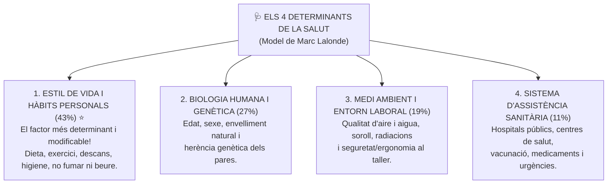

  

    ⚡ Progrés d'aprenentatge (6.1)
    0 / 12 reptes resolts
  

  

    

  

# 6.1 La salut i la malaltia

Durant molt de temps es va pensar que "estar sa" consistia simplement a no tindre cap dolor físic ni cap infecció. Hui sabem que un ésser humà és molt més que un conjunt d'òrgans: una persona pot tindre unes analítiques de sang perfectes i, tanmateix, patir una depressió severa, ansietat laboral o un aïllament social extrem que li impedisquen portar una vida plena.

---

## 1. Definició Oficial de Salut segons l'OMS i Concepte de Malaltia

L'any 1948, l'**Organització Mundial de la Salut (OMS)** —l'agència de les Nacions Unides especialitzada en salut pública mundial— va establir la definició oficial i universal de **salut**:

> *"La **salut** és l'estat de complet benestar **físic, mental i social**, i no sols l'absència d'afeccions o malalties."*

Per tant, per a gaudir d'una salut integral han d'estar en equilibri **tres dimensions fonamentals**:
1. **Benestar Físic (Biològic):** Tots els nostres òrgans, aparells i sistemes funcionen de manera fisiològica, coordinada i sense lesions ni infeccions.
2. **Benestar Mental (Psicològic i Emocional):** La persona gaudeix d'equilibri emocional, bona autoestima, absència de trastorns psíquics i és capaç d'afrontar l'estrès normal de la vida, aprendre i desenvolupar les seues capacitats.
3. **Benestar Social:** La persona viu integrada positivament en la seua comunitat (família, amistats, institut, entorn laboral), en un ambient de respecte, sense patir assetjament, violència ni exclusió, i amb les necessitats vitals cobertes.

### Què és aleshores la Malaltia?
El nostre cos treballa les 24 hores del dia per a mantindre estables les seues condicions internes (temperatura al voltant de $36{,}5^\circ\text{C}$, nivell de glucosa i oxigen en sang, pressió arterial, hidratació): aquest equilibri intern s'anomena **homeòstasi**.
* **Definició de Malaltia:** És qualsevol **alteració més o menys greu de l'equilibri (homeòstasi) físic, mental o social** de l'organisme que impedeix el seu funcionament normal de manera temporal o permanent.

---

## 2. Els 4 Determinants de la Salut (Informe Lalonde)

De què depén que una persona o una població visca molts anys amb bona salut? L'any 1974, el ministre de Sanitat del Canadà, **Marc Lalonde**, va publicar un estudi històric que va demostrar que la salut humana depén de **quatre grans factors o determinants**:

| Determinant de la Salut | Pes Aproximat | En què consisteix? | Es pot modificar per nosaltres? |
| :--- | :---: | :--- | :--- |
| **1. Estil de vida i hàbits** | **~43%** | Conductes diàries: alimentació mediterrània, esport, higiene, dormir 8 h, evitar tabac, alcohol i drogues, conducció segura. | **SÍ (Totalment):** Depén directament de les nostres decisions personals diàries! |
| **2. Biologia humana** | **~27%** | Constitució física interna, edat, envelliment cel·lular i gens heretats (predisposició familiar a certes malalties). | **Molt poc:** No podem canviar la nostra edat ni els nostres gens, però sí fer revisions preventives. |
| **3. Medi ambient i treball** | **~19%** | Factors físics (soroll, radiacions), químics (contaminació, tòxics), biològics (aigua potable) i **prevenció de riscos al taller**. | **Sí (Col·lectivament i laboralment):** Usant EPIs al taller, cuidant el medi ambient i la higiene. |
| **4. Sistema sanitari** | **~11%** | Qualitat, rapidesa, gratuïtat i cobertura de la xarxa d'hospitals, centres d'atenció primària i campanyes de vacunació. | **Sí (Socialment):** Mantenint un sistema de salut públic universal i eficient. |

> [!IMPORTANT]
> ### 🌟 La Gran Lliçó de l'Informe Lalonde
> Observa les dades: tot i que als països desenvolupats gastem la majoria dels recursos econòmics en hospitals i medicaments (el sistema sanitari, que influeix un $11\%$), **quasi la meitat de la nostra salut ($43\%$) depén del nostre propi Estil de Vida!** Portar una dieta sana, fer exercici, dormir bé, no fumar ni consumir alcohol i usar els equips de protecció al taller fa molt més per salvar la teua vida que qualsevol medicament.

---

## 3. Vocabulari Clínic Fonamental: Símptomes vs. Signes Clínics

Quan una persona emmalalteix i acudeix a la consulta mèdica, el metge o metgessa ha d'identificar quina malaltia pateix. Per a fer-ho, recull dos tipus de manifestacions que **mai hem de confondre**: els **símptomes** i els **signes clínics**.

* **1. Els Símptomes (Subjectius):** Són les **sensacions o molèsties subjectives** que **només sent i percep el propi pacient** en el seu interior, i que un observador extern no pot veure ni mesurar directament amb cap aparell. El metge només els coneix perquè el pacient li'ls explica durant l'entrevista (*anamnesi*).
  * *Exemples de símptomes:* **Mal de cap (cefalea)**, mal de panxa o de queixal, **mareig**, **cansament o fatiga (astènia)**, **nàusees** (ganes de vomitar), picor, calfreds, ansietat o tristesa.
* **2. Els Signes Clínics (Objectius i Mesurables):** Són les **dades físiques, químiques o biològiques objectives, visibles i mesurables** que el metge o infermer pot comprovar i quantificar directament mitjançant l'exploració física o proves diagnòstiques, independentment del que diga el pacient.
  * *Exemples de signes clínics:* **Febre de $38{,}5^\circ\text{C}$** (mesurada amb un termòmetre), **tensió arterial de $150/95\text{ mmHg}$** (mesurada amb un tensiòmetre), **freqüència cardíaca de $115\text{ pulsacions/min}$**, **vòmit** real, **tos**, **inflamació o erupció cutània** (granellada a la pell), o una fractura vista en una **radiografia** i un excés de glucosa en una **analítica de sang**.

### Taula Comparativa: Símptomes vs. Signes Clínics

| Característica | 💬 Símptoma | 🌡️ Signe Clínic |
| :--- | :--- | :--- |
| **Caràcter de la dada** | **Subjectiu** (depén de la percepció interna del malalt). | **Objectiu** (visible, comprovable i mesurable des de fora). |
| **Qui el detecta?** | **Només el pacient** (el metge no pot veure'l si el pacient no li'l conta). | **El personal sanitari** (i qualsevol observador o aparell mèdic). |
| **Es pot mesurar amb instruments?** | **No** (no existeix cap "dolorímetre" ni "marejómetre"). | **Sí** (termòmetre, tensiòmetre, fonendoscopi, analítica, rajos X). |
| **Exemples clàssics** | Mal de cap, mareig, nàusees, cansament, dolor muscular, picor. | Febre ($39^\circ\text{C}$), hipertensió, erupció a la pell, vòmit, inflamació. |

### Altres Termes Clínics que has de conéixer
* **Diagnòstic:** Identificació exacta de la malaltia que pateix el pacient a partir de l'estudi dels seus símptomes, signes clínics i proves complementàries (analítiques, ecografies, TAC).
* **Pronòstic:** Predicció mèdica sobre com evolucionarà la malaltia en el futur (lleu, greu, reservat) i quines probabilitats de curació té.
* **Tractament (o Teràpia):** Conjunt de mesures mèdiques, farmacològiques, quirúrgiques o d'hàbits que es prescriuen per a curar la malaltia o alleujar-ne els símptomes.
* **Seqüela:** Lesió o alteració permanent que queda en l'organisme com a conseqüència d'haver patit una malaltia o un accident un cop ja ha passat la fase aguda.

---

## 4. Esperança de Vida i Qualitat de Vida

Per a avaluar el nivell de salut d'un país o d'una comunitat s'utilitzen dos grans indicadors demogràfics:
* **Esperança de vida al nàixer:** És la mitjana d'anys que s'espera que visca una persona nascuda en un país determinat si es mantenen les condicions sanitàries i socials actuals. A Espanya l'esperança de vida és una de les més altes del món (**més de $83\text{ anys}$** de mitjana), gràcies a la dieta mediterrània, l'aigua potable, les vacunes i el sistema públic de salut, mentre que en alguns països en desenvolupament sense accés a aigua neta ni sanitat a penes supera els $55\text{--}60\text{ anys}$.
* **Qualitat de vida (i Esperança de vida en bona salut):** No es tracta només de viure molts anys (*donar més anys a la vida*), sinó de viure'ls amb autonomia física, lucidesa mental i benestar (*donar més vida als anys*), lliures de discapacitat o dependència severa.

---

> [!NOTE]
> ### 💡 Resum de Conceptes Clau (Sessió 6.1)
> - Segons l'**OMS**, la **salut** és l'estat de complet benestar **físic, mental i social**, i no sols l'absència de malaltia (alteració de l'**homeòstasi**).
> - Els **4 determinants de la salut (Lalonde)** són: **Estil de vida** ($43\%$, el més important i modificable), **Biologia humana** ($27\%$), **Medi ambient** ($19\%$) i **Sistema sanitari** ($11\%$).
> - Els **símptomes** són sensacions **subjectives** del pacient (mal de cap, mareig, cansament); els **signes clínics** són dades **objectives i mesurables** pel metge (febre de $38{,}5^\circ\text{C}$, tensió arterial, radiografia).

---

## 🎯 Activitats i Autoavaluació Interactiva

  

    🎮 <strong>Zona d'Entrenament FPB:</strong> 0 reptes resolts
    ⭐ 0 punts
  

  

### 1. Qüestionari d'Autoavaluació Tipus Test (MCQ)

  
<strong>1. Segons l'Informe Lalonde sobre els quatre determinants de la salut, quin és el factor que més influeix en la nostra salut i que més podem modificar amb les nostres decisions?</strong>

  

    <button type="button" class="btn-mcq-opt" data-opt="A">A) L'herència genètica i l'edat biològica</button>
    <button type="button" class="btn-mcq-opt" data-opt="B">B) El nombre d'ambulàncies i hospitals privats d'una ciutat</button>
    <button type="button" class="btn-mcq-opt" data-opt="C">C) L'estil de vida i els hàbits saludables (alimentació, exercici, descans, higiene i evitar drogues)</button>
    <button type="button" class="btn-mcq-opt" data-opt="D">D) El grup sanguini amb què naixem</button>
  

  

  
<strong>2. Un alumne acudeix al centre de salut. Quina de les manifestacions següents és un SIGNE CLÍNIC (i NO un símptoma)?</strong>

  

    <button type="button" class="btn-mcq-opt" data-opt="A">A) Sentir mal de cap i punxades al front</button>
    <button type="button" class="btn-mcq-opt" data-opt="B">B) Tindre una temperatura corporal de $38{,}8^\circ\text{C}$ comprovada amb un termòmetre i una erupció rogenca a la pell</button>
    <button type="button" class="btn-mcq-opt" data-opt="C">C) Notar sensació de mareig i nàusees en alçar-se del llit</button>
    <button type="button" class="btn-mcq-opt" data-opt="D">D) Sentir molt de cansament i tristesa</button>
  

  

  
<strong>3. Com s'anomena en biologia l'estat d'equilibri intern estable de l'organisme (temperatura al voltant de $36{,}5^\circ\text{C}$, glucosa en sang, pressió arterial) l'alteració del qual provoca la malaltia?</strong>

  

    <button type="button" class="btn-mcq-opt" data-opt="A">A) Homeòstasi</button>
    <button type="button" class="btn-mcq-opt" data-opt="B">B) Convalescència</button>
    <button type="button" class="btn-mcq-opt" data-opt="C">C) Seqüela</button>
    <button type="button" class="btn-mcq-opt" data-opt="D">D) Pronòstic</button>
  

  

  
<strong>4. Quan al taller d'FP Bàsica utilitzem ulleres de protecció, guants, extracció de fums de soldadura i cadires ergonòmiques, sobre quin dels 4 determinants de Lalonde estem actuant directament?</strong>

  

    <button type="button" class="btn-mcq-opt" data-opt="A">A) Sobre l'herència genètica dels nostres cromosomes</button>
    <button type="button" class="btn-mcq-opt" data-opt="B">B) Sobre la cirurgia hospitalària</button>
    <button type="button" class="btn-mcq-opt" data-opt="C">C) Sobre l'envelliment biològic</button>
    <button type="button" class="btn-mcq-opt" data-opt="D">D) Sobre el medi ambient laboral i l'estil de vida preventiu</button>
  

  

---

### 2. Activitats de Vertader (V) o Fals (F)

  <strong>a) Segons l'Organització Mundial de la Salut (OMS), la salut és l'estat de complet benestar físic, mental i social, i no sols l'absència de malaltia.</strong>
  

    <button type="button" class="btn-vf" data-opt="V">V</button>
    <button type="button" class="btn-vf" data-opt="F">F</button>
  

  

  <strong>b) El mal de cap i la sensació de mareig són signes clínics objectius perquè el metge els pot mesurar amb un termòmetre.</strong>
  

    <button type="button" class="btn-vf" data-opt="V">V</button>
    <button type="button" class="btn-vf" data-opt="F">F</button>
  

  

  <strong>c) Una tensió arterial de $150/95\text{ mmHg}$ i una fractura observada en una radiografia són signes clínics objectius.</strong>
  

    <button type="button" class="btn-vf" data-opt="V">V</button>
    <button type="button" class="btn-vf" data-opt="F">F</button>
  

  

  <strong>d) L'esperança de vida al nàixer és exactament el mateix que la qualitat de vida, sense importar si la persona viu amb dependència greu o amb bona salut.</strong>
  

    <button type="button" class="btn-vf" data-opt="V">V</button>
    <button type="button" class="btn-vf" data-opt="F">F</button>
  

  

---

### 3. Exercicis de Resposta Breu, Vocabulari Tècnic i Càlcul

  
✍️ <strong>1.</strong> Com s'anomena la manifestació subjectiva d'una malaltia (com el dolor, el mareig o les nàusees) que només sent el propi pacient?

  

    <input type="text" class="quiz-input" placeholder="Escriu el terme clínic...">
    <button type="button" class="btn-quiz-check">Comprovar</button>
  

  

  
✍️ <strong>2.</strong> Com s'anomena el procediment pel qual el metge identifica quina malaltia concreta pateix un pacient a partir dels seus símptomes, signes i proves?

  

    <input type="text" class="quiz-input" placeholder="Escriu el terme mèdic...">
    <button type="button" class="btn-quiz-check">Comprovar</button>
  

  

  
✍️ <strong>3.</strong> Com s'anomena qualsevol dada objectiva, visible i mesurable d'una malaltia (com la febre de $38{,}5^\circ\text{C}$ o una erupció a la pell) que el metge pot comprovar?

  

    <input type="text" class="quiz-input" placeholder="Escriu el terme clínic...">
    <button type="button" class="btn-quiz-check">Comprovar</button>
  

  

  
✍️ <strong>4.</strong> Quina organització internacional de les Nacions Unides (escriu les seues sigles de 3 lletres) va definir la salut com el complet benestar físic, mental i social?

  

    <input type="text" class="quiz-input" placeholder="Escriu les sigles...">
    <button type="button" class="btn-quiz-check">Comprovar</button>
  

  

---

### 4. Exercicis de Raonament i Desenvolupament Escrit (Tasca d'Aula)

  
✍️ <strong>1. Anàlisi d'un cas clínic i estil de vida:</strong> Una pacient va al metge i diu: <em>"Doctor, em fa molt de mal la gola en engolir, estic molt cansada i tinc nàusees"</em>. El metge l'examina i anota: <em>"Temperatura: 39,1 °C; pulsacions: 105 ppm; plaques blanques de pus a les amígdales"</em>. Classifica raonadament quines dades d'aquest cas són <strong>símptomes</strong> i quines són <strong>signes clínics</strong>, i proposa 4 hàbits d'estil de vida per a cuidar la salut diària.

  <textarea class="open-response-input" rows="4" placeholder="Són símptomes subjectius:... Són signes clínics objectius:... Quatre hàbits saludables d'estil de vida són:..."></textarea>

  
✍️ <strong>2. Les tres dimensions de la salut (Física, Mental i Social):</strong> Posa un exemple concret de com un problema en la <strong>salut social</strong> (per exemple, patir assetjament escolar o laboral *bullying/mobbing* o aïllament) acaba afectant la <strong>salut mental</strong> i la <strong>salut física</strong> d'un jove.

  <textarea class="open-response-input" rows="4" placeholder="Explica com l'assetjament o aïllament social provoca primer alteracions mentals (ansietat, insomni...) i després símptomes físics..."></textarea>

  
✍️ <strong>3. Els 4 determinants de Lalonde en la pràctica:</strong> Imagina que en una ciutat augmenten molt els casos d'asma i malalties respiratòries. Indica una mesura concreta relacionada amb cadascun dels 4 determinants de Lalonde (1. Biologia, 2. Medi ambient, 3. Estil de vida i 4. Sistema sanitari) per a reduir aquest problema.

  <textarea class="open-response-input" rows="4" placeholder="1. Biologia:... 2. Medi ambient:... 3. Estil de vida (p. ex. tabac):... 4. Sistema sanitari:..."></textarea>

---

  <h3 style="margin-top:0; color:#0369a1;">📦 Lliurament d'Activitats d'Aules (Act 6.1)</h3>
  
Genera el teu document de tasca d'aquest apartat amb el teu nom i puntuació obtinguda.

  

    <input type="text" class="aules-student-name" placeholder="Cognoms, Nom de l'Alumne/a" style="padding:8px 12px; border:1px solid #94a3b8; border-radius:4px; flex-grow:1; min-width:240px;">
    <button class="btn-generate-aules-pdf" data-unit="NAT06" data-activity="Act01" data-module="CA" style="padding:8px 16px; background:#0284c7; color:#fff; border:none; border-radius:4px; font-weight:600; cursor:pointer;">📄 Descarregar PDF per a Aules</button>
  

