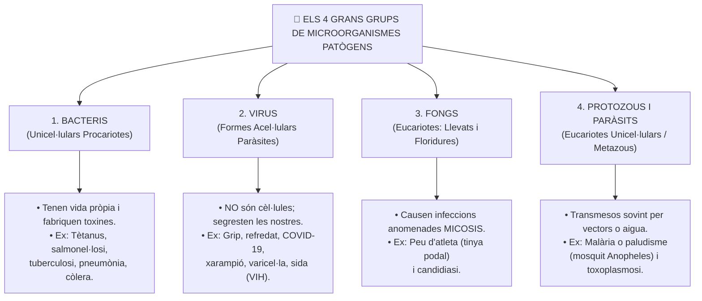

  

    ⚡ Progrés d'aprenentatge (6.2)
    0 / 12 reptes resolts
  

  

    

  

# 6.2 Tipus de malalties

Existeixen milers de malalties diferents que poden afectar l'ésser humà: des d'un simple refredat de tres dies o un tall al dit treballant al taller, fins a una diabetis que dura tota la vida o una infecció global com la COVID-19. Per a estudiar-les i combatre-les amb eficàcia, la medicina les classifica segons **tres grans criteris**: la seua **durada**, la seua **distribució en la població** i, sobretot, el seu **origen o causa**.

---

## 1. Classificació segons la Durada i segons la Distribució Epidemiològica

### A) Segons la rapidesa d'aparició i la durada
* **Malalties Agudes:** Apareixen de manera sobtada i ràpida, presenten símptomes intensos i tenen una **durada curta** (pocs dies o poques setmanes), acabant generalment amb la curació. *Exemples:* la grip, un refredat, una gastroenteritis aguda o una apendicitis.
* **Malalties Cròniques:** S'instauren sovint de manera lenta i progressiva i tenen una **llarga durada** (mesos, anys o fins i tot **tota la vida** del pacient), requerint tractament i control mèdic continuat. *Exemples:* la diabetis, la hipertensió arterial, l'asma bronquial o l'Alzheimer.

### B) Segons la distribució i freqüència en la població (Epidemiologia)
* **Esporàdiques:** Afecten molt poques persones de manera aïllada i ocasional en una població, sense relació entre un cas i un altre (*exemple:* un ictus o una malaltia genètica rara).
* **Endèmiques (Endèmia):** Malalties infeccioses que estan presents de manera **habitual, constant i exclusiva en una regió geogràfica concreta** a causa del seu clima o d'un insecte transmissor (*exemple:* la malària o paludisme i la febre groga en zones tropicals).
* **Epidèmiques (Epidèmia):** Augment sobtat, ràpid i extraordinari del nombre de casos d'una malaltia infecciosa en una **regió o país concret durant una època determinada** (*exemple:* l'ona d'epidèmia de grip que es produeix cada hivern a Espanya).
* **Pandèmiques (Pandèmia):** Quan una epidèmia altament contagiosa traspassa fronteres i **s'estén per diversos continents o per tot el planeta Terra** afectant milions de persones (*exemples:* la pandèmia de COVID-19 en 2020, la sida o la grip de 1918).

---

## 2. Classificació segons l'Origen: A) Malalties Infeccioses o Transmissibles

Les **malalties infeccioses (o infectocontagioses)** són aquelles provocades per l'entrada, invasió i multiplicació dins del nostre cos d'un microorganisme o agent biològic anomenat **patogen**. Es poden **transmetre (contagiar)** d'una persona malalta a una de sana.

### Els 4 Grans Grups de Microorganismes Patògens

| Agent Patogen | Característiques Biològiques | Exemples de Malalties que Provoquen |
| :--- | :--- | :--- |
| **1. Bacteris** | Organismes **unicel·lulars procariotes** (cèl·lules molt menudes sense nucli definit). Tenen vida autònoma, es reprodueixen sols a gran velocitat i danyen els teixits directament o segregant verins molt potents anomenats **toxines**. *(Nota: La majoria de bacteris del planeta són beneficiosos, i sols una minoria són patògens).* | • **Tètanus** (*Clostridium tetani* en ferides amb ferros oxidats o terra) • **Salmonel·losi** (*Salmonella* en ous o maioneses en mal estat) • **Tuberculosi** i **Pneumònia bacteriana** (pulmons) • **Còlera** (aigua contaminada), meningitis i càries dental. |
| **2. Virus** | **Formes acel·lulars** (extremadament menuts, visibles sols al microscopi electrònic). **NO són cèl·lules** ni éssers vius complets: són una simple càpsula de proteïnes (**càpsida**) amb material genètic ($\text{ADN}$ o $\text{ARN}$) a dins. Són **paràsits intracel·lulars obligatoris**: s'introdueixen dins de les nostres cèl·lules i les obliguen a fabricar milers de còpies del virus fins a destruir-les. | • **Grip** i **Refredat comú** • **COVID-19** (coronavirus SARS-CoV-2) • **Xarampió**, **Varicel·la**, galteres i rubèola • **Sida** (virus $\text{VIH}$ que destrueix els limfòcits) • **Hepatitis vírica**, herpes, èbola i ràbia. |
| **3. Fongs** | Organismes **eucariotes** (unicel·lulars com els llevats o pluricel·lulars filamentosos com les floridures). Proliferen en zones càlides i humides de la pell, les ungles o les mucoses provocant infeccions anomenades **micosis**. | • **Peu d'atleta** (*tinya podal*, molt contagiosa per caminar descalç en dutxes de gimnasos i piscines) • **Candidiasi** (en mucoses pel llevat *Candida albicans*). |
| **4. Protozous (i paràsits)** | Els **protozous** són organismes **unicel·lulars eucariotes** microscòpics que viuen en aigua o sang. *(També existeixen paràsits pluricel·lulars com cucs intestinals —tènia, oxiürs— o àcars com el de la sarna).* | • **Malària o paludisme** (causada pel protozou *Plasmodium*, que destrueix els glòbuls rojos i mata centenars de milers de persones l'any) • **Toxoplasmosi**, disenteria amebiana i malaltia de la son. |

---

## 3. Vies de Contagi i les 3 Fases d'una Malaltia Infecciosa

### Com entren els patògens al nostre cos? (Vies de transmissió)
1. **Contagi Directe (de persona a persona):** El patogen passa directament de l'individu malalt (o portador asimptomàtic) al sa sense intermediaris:
   * **Per l'aire (via respiratòria):** En tossir, esternudar o parlar expulsant microgotes de saliva i aerosols carregats de virus o bacteris (*grip, refredat, COVID-19, tuberculosi*).
   * **Per contacte físic directe o via sexual:** Petons, contacte pell amb pell, relacions sexuals sense preservatiu (*sida, sífilis, gonorrea, herpes*) o de mare a fill durant l'embaràs.
2. **Contagi Indirecte (a través d'un vehicle o intermediari):**
   * **Aigua o aliments contaminats (via digestiva):** Beure aigua no potable o menjar aliments mal conservats o manipulats amb les mans brutes (*còlera, salmonel·losi, gastroenteritis*).
   * **Objectes inerts contaminats (fòmits) i ferides a la pell (via cutània):** Tallar-se al taller amb una eina bruta o xafar un clau oxidat (*tètanus*), compartir tovalloles o caminar descalç en vestidors (*peu d'atleta*) o agulles contaminades.
   * **Vectors animals:** Insectes o altres animals que piquen una persona o animal malalt i després piquen una persona sana injectant-li el patogen. L'exemple més important del món és la femella del **mosquit *Anopheles***, vector que transmet el protozou de la **malària**, o les paparres i puces.

### Les 3 Fases d'una Infecció
Des que el microbi entra al cos fins que ens curem, tota malaltia infecciosa passa per tres etapes:
1. **Fase o Període d'Incubació:** Temps que transcorre des de l'entrada del patogen al cos fins que apareixen els primers símptomes. Durant aquesta fase el microbi s'està multiplicant en silenci i la persona encara es troba bé, però **ja pot contagiar els altres**!
2. **Fase de Desenvolupament (o Període d'Estat):** La infecció arriba al seu punt àlgid. Apareixen clarament tots els símptomes i signes clínics (febre, dolor, inflamació, tos) mentre el nostre sistema immunitari lliura una batalla total per eliminar l'invasor.
3. **Fase de Convalescència:** El patogen ha sigut derrotat. Els símptomes desapareixen, però el cos ha quedat esgotat i necessita uns dies de repòs i bona nutrició per a reparar els teixits i recuperar la salut completa.

---

## 4. B) Malalties No Infeccioses (No Transmissibles)

Són aquelles malalties que **NO estan causades per cap microorganisme patogen** i, per tant, **NO es contagien mai** d'una persona a una altra. Representen hui la principal causa de mortalitat i baixa laboral als països desenvolupats:

* **1. Malalties Cardiovasculars:** Afecten el cor i els vasos sanguinis (infart agut de miocardi, ictus o embòlia cerebral, hipertensió arterial, aterosclerosi per colesterol). Molt lligades al tabac, l'obesitat i el sedentarisme.
* **2. Càncer i Tumors (Oncològiques):** Es produeixen quan unes cèl·lules del propi cos pateixen mutacions en el seu ADN i comencen a dividir-se de manera descontrolada envaint altres teixits.
* **3. Malalties Endocrines, Nutricionals i Metabòliques:** Fallades en la producció d'hormones o en l'ús dels nutrients, com la **diabetis mellitus** (excés de glucosa en sang per falta d'insulina), l'obesitat o l'anèmia.
* **4. Malalties Neurodegeneratives:** Mort progressiva de les neurones del cervell amb l'edat, com la malaltia d'**Alzheimer** (pèrdua de memòria) o el **Parkinson** (tremolors i rigidesa motora).
* **5. Malalties Genètiques i Congènites:** Causades per alteracions en els gens o cromosomes des del naixement (hemofília, fibrosi quística, daltonisme).
* **6. Malalties Mentals i Psicològiques:** Alteracions de l'estat d'ànim, el pensament o la conducta (**depressió**, trastorns d'**ansietat**, esquizofrènia, anorèxia i bulímia nerviosa).
* **7. Malalties Traumàtiques i Accidents:** Lesions físiques brusques (fractures òssies, traumatismes cranioencefàlics, cremades, talls, electrocucions) causades per **accidents de trànsit, esportius, domèstics o accidents laborals al taller**.

---

> [!NOTE]
> ### 💡 Resum de Conceptes Clau (Sessió 6.2)
> - Les malalties es classifiquen per durada (**agudes** vs **cròniques**), distribució (**esporàdiques, endèmiques, epidèmies i pandèmies**) i origen (**infeccioses** vs **no infeccioses**).
> - Els 4 grups de patògens infecciosos són: **bacteris** (procariotes: tètanus, salmonel·losi), **virus** (acel·lulars: grip, COVID-19, sida), **fongs** (micosi: peu d'atleta) i **protozous** (eucariotes: malària pel mosquit *Anopheles*).
> - Tota infecció té 3 fases: **incubació**, **desenvolupament** i **convalescència**.

---

## 🎯 Activitats i Autoavaluació Interactiva

  

    🎮 <strong>Zona d'Entrenament FPB:</strong> 0 reptes resolts
    ⭐ 0 punts
  

  

### 1. Qüestionari d'Autoavaluació Tipus Test (MCQ)

  
<strong>1. Quin tipus d'agent patogen NO està format per cèl·lules (és acel·lular), necessita parasitar obligatòriament les nostres cèl·lules per a multiplicar-se i causa malalties com la grip, la COVID-19 o la sida?</strong>

  

    <button type="button" class="btn-mcq-opt" data-opt="A">A) Els virus</button>
    <button type="button" class="btn-mcq-opt" data-opt="B">B) Els bacteris procariotes</button>
    <button type="button" class="btn-mcq-opt" data-opt="C">C) Els fongs pluricel·lulars</button>
    <button type="button" class="btn-mcq-opt" data-opt="D">D) Els protozous eucariotes</button>
  

  

  
<strong>2. Quina de les relacions següents entre una malaltia infecciosa i el microorganisme patogen que la provoca és totalment CORRECTA?</strong>

  

    <button type="button" class="btn-mcq-opt" data-opt="A">A) Peu d'atleta → provocat per un virus respiratori</button>
    <button type="button" class="btn-mcq-opt" data-opt="B">B) Grip comuna → provocada per un fong microscòpic</button>
    <button type="button" class="btn-mcq-opt" data-opt="C">C) Diabetis i Alzheimer → provocades per protozous contagiosos</button>
    <button type="button" class="btn-mcq-opt" data-opt="D">D) Tètanus i salmonel·losi → provocades per bacteris; Malària → provocada per un protozou</button>
  

  

  
<strong>3. Com es classifica des del punt de vista epidemiològic una malaltia infecciosa com la malària (paludisme), que es manté de forma permanent i habitual únicament en determinades regions tropicals i subtropicals?</strong>

  

    <button type="button" class="btn-mcq-opt" data-opt="A">A) Malaltia traumàtica laboral</button>
    <button type="button" class="btn-mcq-opt" data-opt="B">B) Malaltia endèmica (endèmia)</button>
    <button type="button" class="btn-mcq-opt" data-opt="C">C) Malaltia degenerativa no infecciosa</button>
    <button type="button" class="btn-mcq-opt" data-opt="D">D) Pandèmia universal</button>
  

  

  
<strong>4. Quan el protozou *Plasmodium* causant de la malària passa a una persona sana a través de la picada de la femella del mosquit *Anopheles*, quin paper juga el mosquit i quin tipus de contagi és?</strong>

  

    <button type="button" class="btn-mcq-opt" data-opt="A">A) Contagi directe per gotes de saliva humana</button>
    <button type="button" class="btn-mcq-opt" data-opt="B">B) Malaltia hereditària genètica</button>
    <button type="button" class="btn-mcq-opt" data-opt="C">C) Contagi indirecte a través d'un animal transmissor anomenat vector</button>
    <button type="button" class="btn-mcq-opt" data-opt="D">D) Infecció per fongs a través de l'aire</button>
  

  

---

### 2. Activitats de Vertader (V) o Fals (F)

  <strong>a) Quan una malaltia infecciosa epidèmica traspassa fronteres i s'estén per diversos continents o per tot el planeta s'anomena pandèmia.</strong>
  

    <button type="button" class="btn-vf" data-opt="V">V</button>
    <button type="button" class="btn-vf" data-opt="F">F</button>
  

  

  <strong>b) Les malalties cardiovasculars (com l'infart) i les metabòliques (com la diabetis) són malalties infeccioses que es contagien per l'aire en esternudar.</strong>
  

    <button type="button" class="btn-vf" data-opt="V">V</button>
    <button type="button" class="btn-vf" data-opt="F">F</button>
  

  

  <strong>c) Durant el període d'incubació d'una malaltia infecciosa, el pacient encara no nota símptomes però els microorganismes ja s'estan multiplicant i pot contagiar altres persones.</strong>
  

    <button type="button" class="btn-vf" data-opt="V">V</button>
    <button type="button" class="btn-vf" data-opt="F">F</button>
  

  

  <strong>d) Les malalties cròniques són aquelles que es desenvolupen lentament i duren mesos, anys o tota la vida del pacient.</strong>
  

    <button type="button" class="btn-vf" data-opt="V">V</button>
    <button type="button" class="btn-vf" data-opt="F">F</button>
  

  

---

### 3. Exercicis de Resposta Breu, Vocabulari Tècnic i Càlcul

  
✍️ <strong>1.</strong> Quin grup de microorganismes unicel·lulars procariotes (sense nucli) provoca malalties com el tètanus, la tuberculosi o la salmonel·losi?

  

    <input type="text" class="quiz-input" placeholder="Escriu el grup de microorganismes...">
    <button type="button" class="btn-quiz-check">Comprovar</button>
  

  

  
✍️ <strong>2.</strong> Com s'anomena la primera fase d'una malaltia infecciosa, que comprén des que el patogen entra al cos fins que apareixen els primers símptomes? (Període d'...)

  

    <input type="text" class="quiz-input" placeholder="Escriu el nom de la fase...">
    <button type="button" class="btn-quiz-check">Comprovar</button>
  

  

  
✍️ <strong>3.</strong> Quin grup d'organismes eucariotes (llevats i floridures) provoca infeccions a la pell i mucoses anomenades micosis, com el peu d'atleta?

  

    <input type="text" class="quiz-input" placeholder="Escriu el grup d'organismes...">
    <button type="button" class="btn-quiz-check">Comprovar</button>
  

  

  
✍️ <strong>4.</strong> Com s'anomena la tercera i última fase d'una malaltia infecciosa, en la qual el patogen ja ha sigut vençut i l'organisme es recupera fins a tornar a la salut total?

  

    <input type="text" class="quiz-input" placeholder="Escriu el nom de la fase...">
    <button type="button" class="btn-quiz-check">Comprovar</button>
  

  

---

### 4. Exercicis de Raonament i Desenvolupament Escrit (Tasca d'Aula)

  
✍️ <strong>1. Prevenció d'infeccions al taller i en la vida diària:</strong> Explica per a cadascuna d'aquestes tres malalties quin tipus de patogen la causa, per quina via es contagia i quina mesura d'higiene o prevenció evitaria el contagi: a) El <strong>tètanus</strong> al taller; b) La <strong>salmonel·losi</strong> a la cuina; i c) El <strong>peu d'atleta</strong> als vestidors del gimnàs.

  <textarea class="open-response-input" rows="4" placeholder="a) Tètanus: causat per..., es contagia per..., es previndria amb... b) Salmonel·losi:... c) Peu d'atleta:..."></textarea>

  
✍️ <strong>2. Diferències biològiques entre un bacteri i un virus:</strong> Explica amb rigor científic per què els biòlegs diuen que un <strong>bacteri</strong> és un ésser viu complet i autònom mentre que un <strong>virus</strong> no és una cèl·lula i és un paràsit intracel·lular obligatori. Posa tres exemples de malalties bacterianes i tres de víriques.

  <textarea class="open-response-input" rows="4" placeholder="El bacteri és una cèl·lula procariota que..., mentre que el virus és acel·lular i necessita... Exemples:..."></textarea>

  
✍️ <strong>3. Malalties no infeccioses i prevenció:</strong> Les malalties cardiovasculars (infarts, ictus), el càncer de pulmó i la diabetis tipus 2 causen la majoria de morts a Espanya. Explica per què es classifiquen com a <strong>no infeccioses</strong> i quins factors de risc de l'estil de vida les provoquen.

  <textarea class="open-response-input" rows="4" placeholder="Són no infeccioses perquè no estan causades per cap patogen ni es contagien... Els factors de risc evitables són..."></textarea>

---

  <h3 style="margin-top:0; color:#0369a1;">📦 Lliurament d'Activitats d'Aules (Act 6.2)</h3>
  
Genera el teu document de tasca d'aquest apartat amb el teu nom i puntuació obtinguda.

  

    <input type="text" class="aules-student-name" placeholder="Cognoms, Nom de l'Alumne/a" style="padding:8px 12px; border:1px solid #94a3b8; border-radius:4px; flex-grow:1; min-width:240px;">
    <button class="btn-generate-aules-pdf" data-unit="NAT06" data-activity="Act02" data-module="CA" style="padding:8px 16px; background:#0284c7; color:#fff; border:none; border-radius:4px; font-weight:600; cursor:pointer;">📄 Descarregar PDF per a Aules</button>
  

