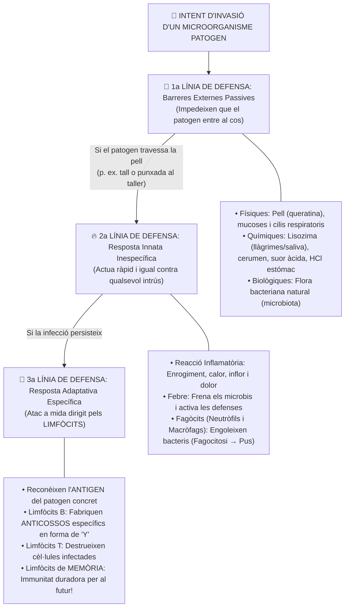

  

    ⚡ Progrés d'aprenentatge (6.3)
    0 / 12 reptes resolts
  

  

    

  

# 6.3 El sistema immunitari

Cada vegada que respirem, toquem el teclat d'un ordinador, mengem o ens fem una rascada al taller, milions de bacteris, virus i espores de fongs intenten envair el nostre organisme, que per a ells és un paradís calent (36,5 °C) i ple de nutrients. Si estem envoltats de tants patògens, **com és que la major part del temps estem sans?**

La resposta és que posseïm un exèrcit defensiu extraordinàriament perfeccionat: el **sistema immunitari**, que protegeix el cos mitjançant **tres línies de defensa successives** (com les muralles, la guàrdia interior i les forces especials d'un castell).

---

## 1. Primera Línia de Defensa: Les Barreres Externes Passives (Primàries)

La primera estratègia del cos és **impedir que els microbis entren**. Són barreres **passives i inespecífiques** (frenen qualsevol patogen per igual) que recobreixen tota la superfície externa i les obertures del cos:

1. **Barreres Físiques (o Mecàniques):**
   * **La pell:** És una muralla gairebé infranquejable mentre estiga sana i **sense ferides**. La seua capa superficial (*epidermis*) està formada per cèl·lules mortes carregades de **queratina** impermeable que es descamen contínuament, arrossegant els microbis. Per això una cremada o un tall al taller és tan perillós: obri una bretxa directa a la muralla!
   * **Les mucoses i els cilis respiratoris:** En les obertures naturals on no hi ha pell (nas, boca, pulmons, tub digestiu, vies urinàries), les parets estan tapissades per **mucoses** que segreguen **moc** viscos per a atrapar la pols i els microbis com un paper atrapamosques. A la tràquea i als bronquis, milions de pèls microscòpics mòbils anomenats **cilis respiratoris** escombren el moc cap a la gola (i la tos o l'esternut l'expulsen a gran velocitat).
2. **Barreres Químiques:**
   * **El lisozima de les llàgrimes, la saliva i el moc nasal:** És un enzim bactericida natural que trenca i dissol la paret cel·lular dels bacteris que entren als ulls o a la boca.
   * **La suor àcida, el seu sebaci i el cerumen de l'oïda:** Creen un pH àcid i una pel·lícula greixosa a la pell i al conducte auditiu que impedeix el creixement de fongs i bacteris.
   * **L'àcid clorhídric (HCl) de l'estómac:** El suc gàstric és extremadament àcid ($\text{pH } 1{,}5$) i crema químicament la gran majoria dels microorganismes que engolim amb els aliments.
3. **Barreres Biològiques (La Flora Bacteriana o Microbiota):**
   * Sobre la nostra pell, a la boca i sobretot a l'interior del nostre **intestí gros** viuen bilions de **bacteris beneficiosos simbiòtics** (la **flora bacteriana autòctona**). Aquests "bons veïns" ocupen tot l'espai disponible, consumeixen els nutrients i segreguen substàncies que impedeixen que els bacteris patògens invasors puguen instal·lar-se.

---

## 2. Segona Línia de Defensa: La Resposta Immunitària Inespecífica o Innata

Què passa quan et claves una estella de fusta o et talles amb una xapa metàl·lica al taller i els bacteris travessen la pell? Immediatament s'activa la **2a línia de defensa**. S'anomena **innata** (naixem amb ella) i **inespecífica** perquè actua sempre de la mateixa manera i a l'instant contra qualsevol cos estrany, sense importar quin microbi siga. Comprén tres mecanismes:

### A) La Reacció Inflamatòria
Quan les cèl·lules de la pell són danyades pels bacteris, donen la veu d'alarma alliberant substàncies químiques (com la **histamina**). Aquestes substàncies provoquen que els capil·lars sanguinis de la zona **es dilaten (vasodilatació)** perquè hi arribe molta més sang i es tornen **més permeables** perquè el plasma i els glòbuls blancs puguen eixir del vas sanguini cap a la ferida. Això produeix els **4 signes clàssics de la inflamació**:
1. **Enrogiment (rubor)** i **2. Calor local:** Per l'augment del flux de sang calenta a la ferida.
3. **Inflor (tumor o edema):** Per l'acumulació de líquid (plasma) i glòbuls blancs entre els teixits.
4. **Dolor:** Perquè la inflor pressiona les terminacions nervioses, obligant-nos a protegir la zona ferida.

### B) Els Fagòcits i la Fagocitosi (Què és el pus?)
Els soldats protagonistes de la 2a línia són un tipus de glòbuls blancs (leucòcits) anomenats **fagòcits** (principalment els **neutròfils** i els grans **macròfags**). Els fagòcits ixen dels capil·lars, rastregen els bacteris invasors, els envolten amb prolongacions de la seua membrana (*pseudòpodes*), **els engoleixen sencers i els trituren químicament amb enzims digestius**: aquest procés s'anomena **fagocitosi**.
* **Què és el pus?** El líquid espés i blanquinós o groguenc que ix d'un gra o d'una ferida infectada és el "camp de batalla": està format per milions de **fagòcits morts** després d'haver-se sacrificat engolint bacteris, restes de microbis destruïts i cèl·lules danyades.

### C) La Febre
Si la infecció és important, els glòbuls blancs envien un senyal a l'hipotàlem del cervell perquè apuge el "termòstat" corporal per damunt dels $37{,}5 °C\text{--}38 °C$. La **febre moderada és un mecanisme de defensa**: a eixa temperatura els bacteris i virus es reprodueixen molt més malament, mentre que els nostres glòbuls blancs treballen més de pressa!

---

## 3. Tercera Línia de Defensa: La Resposta Immunitària Específica o Adaptativa

Si els fagòcits de la 2a línia es veuen desbordats per un virus o bacteri molt agressiu, entra en joc el cos d'elit de l'organisme: la **3a línia de defensa**, dirigida per un altre tipus de glòbuls blancs especialitzats anomenats **limfòcits**. Aquesta resposta tarda uns dies a posar-se al màxim rendiment, però té dues propietats prodigioses: és **totalment específica** (dissenya armes exclusives contra un patogen concret) i té **memòria immunitària**.

### Conceptes Fonamentals: Antigen, Limfòcits B, Anticossos i Limfòcits T
* **Què és un Antigen?** És qualsevol molècula estranya al nostre cos (generalment una proteïna o polisacàrid de la coberta externa d'un virus, d'un bacteri o d'una toxina) que funciona com la "matrícula d'identitat" de l'intrús i activa els nostres limfòcits.
* **1. Els Limfòcits B i els Anticossos (Resposta humoral):** Quan un **limfòcit B** identifica l'antigen d'un invasor, es multiplica i es transforma en una fàbrica que llança a la sang milions de proteïnes defensives amb forma de lletra **"Y"** anomenades **anticossos (o immunoglobulines)**.
  * **Com actuen els anticossos?** Cada anticòs està dissenyat a mida i **encaixa únicament amb el seu antigen específic com una clau en el seu pany** (l'anticòs de la varicel·la no serveix contra la grip!). En unir-se als antígens del virus o bacteri, els anticossos **el neutralitzen** (li impedeixen entrar a les cèl·lules), els aglutinen en paquets i els marquen amb un "cartell lluminós" perquè els macròfags vinguen i se'ls mengen.
* **2. Els Limfòcits T (Resposta cel·lular):** Els virus s'amaguen *dins* de les nostres pròpies cèl·lules, on els anticossos de la sang no poden arribar. Els **limfòcits T citotòxics** patrullen el cos, detecten quines cèl·lules nostres estan infectades per un virus (o s'han tornat canceroses) i **les destrueixen directament** per evitar que el virus es multiplique. Alhora, els **limfòcits T col·laboradors** dirigeixen i coordinen tota l'operació immunitària.
* **3. Els Limfòcits de Memòria (El secret de la immunitat):** Un cop derrotada la infecció, la majoria dels limfòcits moren, però un grup de **limfòcits B i T de memòria** es queda vigilant a la sang i als ganglis limfàtics durant dècades o **durant tota la vida**, guardant la "fitxa policial" d'aquell antigen. Si anys després el mateix virus o bacteri torna a entrar al teu cos, les cèl·lules de memòria el reconeixen a l'instant i fabriquen milions d'anticossos en poques hores, **eliminant el patogen abans que arribes a tindre cap símptoma**. Per això malalties com el xarampió, la varicel·la o la rubèola només es passen una vegada a la vida!

---

## 4. Taula Comparativa de les 3 Línies i Trastorns del Sistema Immunitari

| Línia de Defensa | Components Principals | Tipus de Resposta | Velocitat i Memòria |
| :--- | :--- | :---: | :--- |
| **1a Línia: Barreres Externes** | Pell, mucoses, cilis, lisozima (llàgrimes/saliva), HCl gàstric, flora bacteriana. | **Inespecífica** (passiva) | Permanent (impedeix l'entrada). Sense memòria. |
| **2a Línia: Sistema Innat** | Reacció inflamatòria, febre i **fagòcits** (neutròfils i macròfags). | **Inespecífica** (activa) | Molt ràpida (minuts/hores). Sense memòria. |
| **3a Línia: Sistema Adaptatiu** | **Limfòcits B** (**anticossos**), **Limfòcits T** i cèl·lules de memòria. | **Específica** (contra un antigen concret) | Tarda diversos dies el primer cop, però **crea memòria duradora**. |

### Què ocorre quan el sistema immunitari falla o s'equivoca?
1. **Les Al·lèrgies (Hipersensibilitat):** És una **reacció exagerada i desproporcionada** del sistema immunitari contra substàncies externes totalment inofensives anomenades **al·lèrgens** (grans de pol·len de plantes, àcars de la pols, pèl d'animals, aliments com cacauets o marisc, o verí d'abella). El cos allibera quantitats massives d'histamina causant esternuts, asma, urticària o, en casos extrems, un **xoc anafilàctic** (inflamació de la gola i baixada de tensió que requereix injectar adrenalina d'urgència).
2. **Les Malalties Autoimmunes:** El sistema immunitari perd la capacitat de distingir allò propi d'allò aliè i **ataca per error cèl·lules i òrgans sans del nostre propi cos** (*exemples:* la diabetis tipus 1, l'esclerosi múltiple, l'artritis reumatoide, el lupus o la celiaquia).
3. **Les Immunodeficiències:** Quan el sistema immunitari està debilitat o no funciona, deixant el cos indefens davant qualsevol infecció. Pot ser congènita (de naixement) o adquirida, com la **sida (Síndrome d'Immunodeficiència Adquirida)**, provocada pel virus **VIH** que infecta i destrueix precisament els limfòcits T.

---

> [!NOTE]
> ### 💡 Resum de Conceptes Clau (Sessió 6.3)
> - **1a Línia (Barreres externes):** Pell, mucoses/cilis, lisozima de llàgrimes i saliva, àcid de l'estómac i flora bacteriana.
> - **2a Línia (Resposta innata inespecífica):** Reacció inflamatòria, febre i **fagòcits** (macròfags i neutròfils que engoleixen bacteris per **fagocitosi**, formant el pus).
> - **3a Línia (Resposta adaptativa específica):** Els **limfòcits B** reconeixen l'**antigen** i fabriquen **anticossos** a mida; els **limfòcits T** destrueixen cèl·lules infectades i es creen **limfòcits de memòria**.

---

## 🎯 Activitats i Autoavaluació Interactiva

  

    🎮 <strong>Zona d'Entrenament FPB:</strong> 0 reptes resolts
    ⭐ 0 punts
  

  

### 1. Qüestionari d'Autoavaluació Tipus Test (MCQ)

  
<strong>1. Quines cèl·lules de la tercera línia de defensa (resposta immunitària específica) s'encarreguen de reconéixer l'antigen d'un patogen i fabricar proteïnes defensives a mida anomenades anticossos?</strong>

  

    <button type="button" class="btn-mcq-opt" data-opt="A">A) Els glòbuls rojos o eritròcits</button>
    <button type="button" class="btn-mcq-opt" data-opt="B">B) Les plaquetes o trombòcits</button>
    <button type="button" class="btn-mcq-opt" data-opt="C">C) Els limfòcits B (que també generen cèl·lules de memòria)</button>
    <button type="button" class="btn-mcq-opt" data-opt="D">D) Les cèl·lules mortes amb queratina de la pell</button>
  

  

  
<strong>2. Quan et punxes un dit amb una estella al taller, la zona es posa roja, calenta i unflada, i uns glòbuls blancs acudeixen a engolir els bacteris formant pus. A quina línia de defensa correspon aquest mecanisme?</strong>

  

    <button type="button" class="btn-mcq-opt" data-opt="A">A) A la 1a línia de defensa (barreres químiques com el lisozima de les llàgrimes)</button>
    <button type="button" class="btn-mcq-opt" data-opt="B">B) A la 2a línia de defensa (resposta innata inespecífica: reacció inflamatòria i fagòcits)</button>
    <button type="button" class="btn-mcq-opt" data-opt="C">C) A una malaltia autoimmune degenerativa</button>
    <button type="button" class="btn-mcq-opt" data-opt="D">D) A una al·lèrgia al pol·len de les flors</button>
  

  

  
<strong>3. Quina és la funció principal dels limfòcits T dins de la tercera línia de defensa immunitària?</strong>

  

    <button type="button" class="btn-mcq-opt" data-opt="A">A) Destruir directament les cèl·lules del nostre cos que ja han sigut infectades per un virus (o cèl·lules tumorals) i coordinar tota la resposta immunitària</button>
    <button type="button" class="btn-mcq-opt" data-opt="B">B) Segregar cera a l'oïda i àcid clorhídric a l'estómac</button>
    <button type="button" class="btn-mcq-opt" data-opt="C">C) Transportar oxigen des dels pulmons fins als músculs</button>
    <button type="button" class="btn-mcq-opt" data-opt="D">D) Provocar la coagulació de la sang formant crostes</button>
  

  

  
<strong>4. Com s'anomena el trastorn del sistema immunitari en el qual les nostres pròpies defenses s'equivoquen, deixen de reconéixer com a pròpies certes cèl·lules sanes del nostre cos i les ataquen (com ocorre en l'esclerosi múltiple o la diabetis tipus 1)?</strong>

  

    <button type="button" class="btn-mcq-opt" data-opt="A">A) Fagocitosi bacteriana</button>
    <button type="button" class="btn-mcq-opt" data-opt="B">B) Barrera primària de queratina</button>
    <button type="button" class="btn-mcq-opt" data-opt="C">C) Epidèmia estacional</button>
    <button type="button" class="btn-mcq-opt" data-opt="D">D) Malaltia autoimmune</button>
  

  

---

### 2. Activitats de Vertader (V) o Fals (F)

  <strong>a) La pell, el lisozima de les llàgrimes i la saliva, l'àcid clorhídric de l'estómac i la flora bacteriana formen part de la primera línia de defensa (barreres externes).</strong>
  

    <button type="button" class="btn-vf" data-opt="V">V</button>
    <button type="button" class="btn-vf" data-opt="F">F</button>
  

  

  <strong>b) Un mateix tipus d'anticòs és inespecífic i serveix per a neutralitzar qualsevol virus o bacteri que existisca a la natura.</strong>
  

    <button type="button" class="btn-vf" data-opt="V">V</button>
    <button type="button" class="btn-vf" data-opt="F">F</button>
  

  

  <strong>c) El pus blanquinós que apareix en una ferida infectada està format per milions de glòbuls blancs (fagòcits) morts i restes de bacteris destruïts.</strong>
  

    <button type="button" class="btn-vf" data-opt="V">V</button>
    <button type="button" class="btn-vf" data-opt="F">F</button>
  

  

  <strong>d) Les al·lèrgies són reaccions exagerades del sistema immunitari davant de substàncies externes generalment innòcues anomenades al·lèrgens (com el pol·len o els àcars).</strong>
  

    <button type="button" class="btn-vf" data-opt="V">V</button>
    <button type="button" class="btn-vf" data-opt="F">F</button>
  

  

---

### 3. Exercicis de Resposta Breu, Vocabulari Tècnic i Càlcul

  
✍️ <strong>1.</strong> Com s'anomenen els glòbuls blancs de la segona línia de defensa (com els macròfags i neutròfils) que engoleixen i digereixen els bacteris invasors?

  

    <input type="text" class="quiz-input" placeholder="Escriu el nom d'aquests glòbuls blancs...">
    <button type="button" class="btn-quiz-check">Comprovar</button>
  

  

  
✍️ <strong>2.</strong> Com s'anomenen les proteïnes defensives amb forma de "Y" que fabriquen els limfòcits B per a unir-se específicament als antígens i neutralitzar-los?

  

    <input type="text" class="quiz-input" placeholder="Escriu el nom de les proteïnes...">
    <button type="button" class="btn-quiz-check">Comprovar</button>
  

  

  
✍️ <strong>3.</strong> Com s'anomena qualsevol molècula estranya d'un microbi patogen que és reconeguda com a invasora pels nostres limfòcits i desencadena la fabricació d'anticossos?

  

    <input type="text" class="quiz-input" placeholder="Escriu el terme immunològic...">
    <button type="button" class="btn-quiz-check">Comprovar</button>
  

  

  
✍️ <strong>4.</strong> Com s'anomena l'enzim bactericida natural present a les nostres llàgrimes i a la saliva que destrueix la paret dels bacteris a la 1a línia de defensa?

  

    <input type="text" class="quiz-input" placeholder="Escriu el nom de l'enzim...">
    <button type="button" class="btn-quiz-check">Comprovar</button>
  

  

---

### 4. Exercicis de Raonament i Desenvolupament Escrit (Tasca d'Aula)

  
✍️ <strong>1. La memòria immunitària i les al·lèrgies:</strong> Explica: a) Per què quan un xiquet passa la varicel·la o el xarampió una vegada, ja no torna a patir eixa malaltia durant la resta de la seua vida encara que estiga en contacte amb el virus; i b) Quina diferència hi ha entre una <strong>al·lèrgia</strong> i una <strong>malaltia autoimmune</strong>.

  <textarea class="open-response-input" rows="4" placeholder="a) No torna a patir la malaltia perquè els limfòcits creen... b) En una al·lèrgia el sistema immunitari reacciona contra..., mentre que en una malaltia autoimmune ataca..."></textarea>

  
✍️ <strong>2. Les tres línies de defensa davant d'un accident al taller:</strong> Un alumne es fa un tall al braç amb una serra al taller i entren bacteris a la ferida. Descriu de manera ordenada quina barrera de la <strong>1a línia</strong> s'ha trencat, què passa en la <strong>2a línia</strong> (els 4 signes de la inflamació i els fagòcits) i com actuaria la <strong>3a línia</strong> si la infecció continuara avançant.

  <textarea class="open-response-input" rows="4" placeholder="1a línia: s'ha trencat la barrera física de... 2a línia: s'activa la inflamació (enrogiment, calor, inflor, dolor) i els fagòcits... 3a línia: els limfòcits B i T..."></textarea>

  
✍️ <strong>3. La importància de la flora bacteriana (microbiota) i la febre:</strong> Explica per què no tots els bacteris són roïns descrivint com ens protegeix la nostra <strong>flora bacteriana intestinal</strong>, i explica per què tindre una **febre moderada (38 °C)** durant una infecció ajuda el nostre cos a curar-se.

  <textarea class="open-response-input" rows="4" placeholder="La flora bacteriana ens defensa competint amb els patògens per... La febre moderada ajuda perquè frena... i accelera..."></textarea>

---

  <h3 style="margin-top:0; color:#0369a1;">📦 Lliurament d'Activitats d'Aules (Act 6.3)</h3>
  
Genera el teu document de tasca d'aquest apartat amb el teu nom i puntuació obtinguda.

  

    <input type="text" class="aules-student-name" placeholder="Cognoms, Nom de l'Alumne/a" style="padding:8px 12px; border:1px solid #94a3b8; border-radius:4px; flex-grow:1; min-width:240px;">
    <button class="btn-generate-aules-pdf" data-unit="NAT06" data-activity="Act03" data-module="CA" style="padding:8px 16px; background:#0284c7; color:#fff; border:none; border-radius:4px; font-weight:600; cursor:pointer;">📄 Descarregar PDF per a Aules</button>
  

