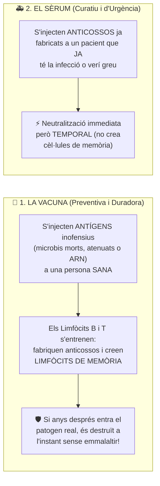

  

    ⚡ Progrés d'aprenentatge (6.4)
    0 / 7 reptes resolts
  

  

    

  

# 6.4 Tractament de les malalties

Al llarg de la història, la medicina científica ha aconseguit duplicar l'esperança de vida humana gràcies a dues grans estratègies complementàries: la **medicina preventiva** (que evita que arribem a emmalaltir mitjançant la higiene, l'aigua potable i, sobretot, les **vacunes**) i la **medicina curativa o terapèutica** (que actua quan la malaltia ja ha aparegut, mitjançant els **medicaments**, la **cirurgia**, els **trasplantaments** i els primers auxilis).

---

## 1. Les Vacunes vs. Els Sèrums (Immunització Artificial)

Com vam veure en l'apartat anterior, quan passem una infecció el nostre cos crea **limfòcits de memòria** que ens fan immunes per al futur. Però passar una malaltia real com el tètanus, la meningitis, la pòlio o la ràbia pot ser mortal! Com podem entrenar el nostre sistema immunitari **sense patir la malaltia**? Gràcies a les **vacunes** (desenvolupades per pioners com **Edward Jenner** en 1796 contra la pigota o verola —la primera malaltia humana totalment erradicada del planeta en 1980— i **Louis Pasteur** en 1885).

### A) Què és una Vacuna i com funciona? (Immunització Activa Preventiva)
* **Què conté una vacuna?** És un preparat mèdic que conté els **antígens** d'un patogen (**microorganismes morts o inactivats, microorganismes vius però atenuats/debilitats, toxines inactivades o fragments proteics/ARN missatger**) que **han perdut la capacitat de provocar la malaltia**, però conserven intacta la seua "matrícula" (els antígens).
* **Com actua en el cos?** Quan ens vacunen estant **sans**, el nostre sistema immunitari detecta aquells antígens com si foren un atac real: els **limfòcits B** fabriquen anticossos i es generen **limfòcits de memòria**. Tarda uns $10\text{--}15\text{ dies}$ a fer efecte, però la protecció dura **anys o tota la vida**.
* **La Immunitat de Grup (o de Ramat):** Quan més del $90\text{--}95\%$ d'una població està vacunada, el virus o bacteri no troba hostes on multiplicar-se i la cadena de contagi es talla. Així, vacunant-nos nosaltres, protegim també els nadons, els ancians i els malalts de càncer o immunodeprimits que no poden vacunar-se!

### B) Què és un Sèrum o Antitoxina? (Immunització Passiva Curativa)
Imagina que un operari que **no està vacunat** es clava un ferro oxidat profund al taller (risc de tètanus) o que a un excursionista el mossega una serp escurçó. No podem posar-li només una vacuna i esperar $15\text{ dies}$ que el seu cos fabrique anticossos, perquè la toxina el mataria abans!
* En aquestes urgències s'administra un **sèrum (o antitoxina / immunoglobulina)**: un preparat que conté **els anticossos ja fabricats** (extrets del plasma de donants humans o d'animals com cavalls immunitzats). El sèrum actua **a l'instant** salvant la vida del pacient, però la seua protecció és **temporal** (els anticossos injectats desapareixen en poques setmanes i **no deixen limfòcits de memòria**).

| Característica | 💉 Vacuna | 🚑 Sèrum (o Antitoxina) |
| :--- | :--- | :--- |
| **Finalitat mèdica** | **Preventiva** (s'administra a persones **sanes** abans del contagi). | **Curativa d'urgència** (s'administra a persones **ja infectades o enverinades**). |
| **Què conté el preparat?** | **Antígens** inofensius (patògens morts, atenuats o fragments). | **Anticossos ja fabricats** llestos per a actuar. |
| **Qui fabrica els anticossos?** | El **propi sistema immunitari** de la persona vacunada (immunització activa). | Un donant extern; el pacient els rep ja fets (immunització passiva). |
| **Velocitat i Durada** | Tarda uns dies a fer efecte, però és **molt duradora (crea memòria)**. | Efecte **immediat**, però **temporal (no crea memòria)**. |

---

## 2. Els Medicaments i l'Ús Racional dels Antibiòtics

Quan la prevenció no ha sigut possible i emmalaltim, la medicina utilitza **medicaments**, que contenen una o més substàncies químiques actives anomenades **fàrmacs (o principis actius)**.

### A) Els Antibiòtics: El descobriment de Fleming i la Regla d'Or
L'any **1928**, el metge i microbiòleg escocès **Alexander Fleming** va observar al seu laboratori de Londres que un fong microscòpic (*Penicillium notatum*) havia contaminat accidentalment una placa de cultiu de bacteris i havia creat un cercle al seu voltant on tots els bacteris havien mort. Fleming acabava de descobrir la **penicil·lina**, el primer **antibiòtic** de la història, que des d'aleshores ha salvat centenars de milions de vides.

* **Què és un antibiòtic?** És un fàrmac capaç de **matar (bactericida)** o **impedir la reproducció (bacteriostàtic)** exclusivament dels **bacteris** (destruint la seua paret cel·lular procariota o bloquejant els seus ribosomes sense danyar les nostres cèl·lules eucariotes).

> [!CAUTION]
> ### 🚫 Regla d'Or Mèdica: Els Antibiòtics NO serveixen absolutament per a res contra els VIRUS!
> * **Els antibiòtics actuen EXCLUSIVAMENT contra BACTERIS** (com una pneumònia bacteriana, una infecció d'orina, unes angines bacterianes o una ferida infectada).
> * **Els antibiòtics són TOTALMENT INÚTILS contra els VIRUS** (com la **grip**, el **refredat comú** o la **COVID-19**), perquè els virus no són cèl·lules i no tenen ni paret bacteriana ni metabolisme propi que l'antibiòtic puga atacar! Prendre amoxicil·lina per a una grip o un refredat no et curarà ni un minut abans, i a més destruirà la teua flora bacteriana intestinal beneficiosa.
> * **El greu perill mundial de les Resistències Bacterianes ("Superbacteris"):**
>   Què passa si prenem antibiòtics sense recepta mèdica o si **abandonem el tractament als 2 o 3 dies perquè ja ens trobem millor**, en lloc de prendre les pastilles durant els $7$ o $10\text{ dies}$ complets que ha pautat el metge?
>   En els primers dies moren els bacteris més dèbils, però **els bacteris més forts i resistents sobreviuen**. Si deixes de prendre l'antibiòtic abans d'hora, aquests bacteris supervivents es multipliquen sense competència, muten i passen el gen de resistència a la seua descendència, creant **bacteris multiresistents ("superbacteris")** contra els quals els antibiòtics deixen de funcionar! L'OMS adverteix que les resistències bacterianes són una de les majors amenaces sanitàries del segle XXI.

### B) Altres Tipus de Medicaments Habituals
* **Antivirals:** Fàrmacs que dificulten la multiplicació de certs **virus** dins de les cèl·lules (usats contra el $\text{VIH}$ de la sida, l'hepatitis C, l'herpes o casos greus de grip).
* **Antifúngics (o Antimicòtics):** Fàrmacs específics per a eliminar infeccions causades per **fongs** (com les pomades per al peu d'atleta o la candidiasi).
* **Medicaments Simptomàtics** (no eliminen la causa de la malaltia, però alleugen els símptomes i el malestar mentre el cos es cura):
  * **Analgèsics:** Calmen o eliminen el **dolor** (p. ex. paracetamol, metamizol).
  * **Antipirètics (o Antitèrmics):** Baixen la **febre** excessiva (p. ex. paracetamol, aspirina).
  * **Antiinflamatoris:** Redueixen la **inflamació** i el dolor (p. ex. ibuprofèn o corticoides).
  * **Antihistamínics:** Bloquegen la histamina per a alleujar els símptomes de les **al·lèrgies**.

---

## 3. Cirurgia, Trasplantaments i Primers Auxilis al Taller (Conducta PAS)

### A) La Cirurgia i els Trasplantaments (El paper de l'ONT)
* **La Cirurgia:** Quan els medicaments no basten (una apendicitis, una fractura complexa, unes cataractes, un tumor o una artèria obstruïda), cal intervindre quirúrgicament. Hui en dia moltes operacions es fan mitjançant **cirurgia mínimament invasiva o laparoscòpica/endoscòpica** (introduint càmeres de fibra òptica i microinstruments per incisions d'$1\text{ cm}$), reduint el dolor i el risc d'infecció.
* **Els Trasplantaments d'Òrgans, Teixits i Cèl·lules:** Consisteixen a substituir un òrgan o teixit malalt irreversiblement per un altre de sa procedent d'un **donant** (viu o mort cerebralment): trasplantaments de **ronyó, fetge, cor, pulmó, pàncrees, còrnia, medul·la òssia** i **transfusions de sang**.
  * **Espanya, líder mundial en donació:** A través de l'**Organització Nacional de Trasplantaments (ONT)**, el sistema públic espanyol és referent mundial des de fa més de 30 anys gràcies a un model basat en la donació **voluntària, altruista, solidària, anònima i gratuïta**.
  * **El problema del rebuig immunitari:** Com que les cèl·lules de l'òrgan del donant tenen els seus propis antígens, el sistema immunitari del pacient receptor pot confondre el nou òrgan amb un intrús i atacar-lo (**rebuig**). Per a evitar-ho, abans del trasplantament es comprova l'alta **compatibilitat (histocompatibilitat)** entre donant i receptor, i el pacient ha de prendre fàrmacs **immunosupressors** que moderen l'activitat dels seus limfòcits.

### B) Primers Auxilis al Taller i en la Vida Diària: La Conducta PAS
Davant de qualsevol accident al taller d'FP Bàsica (electrocució, tall profund, cremada, caiguda o pèrdua de coneixement), mai hem de perdre la calma ni actuar a la babalà. Cal aplicar sempre en **ordre estricte les tres fases del protocol internacional PAS**:

1. **1r PROTEGIR (P):** Abans de tocar la víctima, **assegura el lloc de l'accident** per a evitar nous perills per a tu mateix i per al ferit. Si un company s'està electrocutant al taller, **MAI el toques directament**: talla primer l'interruptor general o el diferencial del quadre elèctric! Si és a la carretera, posa't l'armilla reflectora i senyalitza.
2. **2n AVISAR (A):** Telefona immediatament al **telèfon únic i gratuït d'emergències `112`** (funciona a tota la Unió Europea fins i tot sense saldo). Indica amb claredat: **on** ha ocorregut l'accident (adreça exacta), **què** ha passat, **quantes** víctimes hi ha i en quin **estat** es troben (si estan conscients, si respiren o si sagnen).
3. **3r SOCÓRRER (S):** Atén la víctima mentre arriba l'ambulància seguint dues regles vitals: **no mogues mai un accidentat amb possible lesió de columna** ( ni li lleves el casc a un motorista!), comprimeix les hemorràgies amb gasa neta, col·loca'l en **Posició Lateral de Seguretat (PLS)** si està inconscient però respira, o inicia la reanimació cardiopulmonar (**RCP**: $30$ compressions toràciques / $2$ insuflacions) si està en parada cardiorespiratòria.

---

> [!NOTE]
> ### 💡 Resum de Conceptes Clau (Sessió 6.4)
> - Les **vacunes** són **preventives** (contenen antígens inofensius que entrenen el cos i creen **limfòcits de memòria** de llarga durada); els **sèrums** són **curatius d'urgència** (contenen anticossos ja fabricats d'efecte immediat però temporal).
> - Els **antibiòtics** (com la penicil·lina descoberta per Fleming en 1928) actuen **sols contra bacteris** i són **inútils contra virus**; automedicar-se o no acabar el tractament crea **resistències bacterianes**.
> - Davant d'un accident al taller cal seguir l'ordre de la **conducta PAS**: **1. Protegir**, **2. Avisar al 112** i **3. Socórrer**.

---

## 🎯 Activitats i Autoavaluació Interactiva

  

    🎮 <strong>Zona d'Entrenament FPB:</strong> 0 reptes resolts
    ⭐ 0 punts
  

  

### 1. Qüestionari d'Autoavaluació Tipus Test (MCQ)

  
<strong>1. Quina és la diferència fonamental entre una vacuna i un sèrum (o antitoxina)?</strong>

  

    <button type="button" class="btn-mcq-opt" data-opt="A">A) La vacuna només es dóna quan el pacient ja està molt greu a l'UCI, i el sèrum es dóna als nadons sans</button>
    <button type="button" class="btn-mcq-opt" data-opt="B">B) La vacuna és un antibiòtic químic i el sèrum és un analgèsic per al mal de cap</button>
    <button type="button" class="btn-mcq-opt" data-opt="C">C) El sèrum crea cèl·lules de memòria per a tota la vida i la vacuna dura només dues hores</button>
    <button type="button" class="btn-mcq-opt" data-opt="D">D) La vacuna és preventiva (conté antígens inofensius que estimulen el cos a crear anticossos i cèl·lules de memòria), mentre que el sèrum és curatiu d'urgència (conté anticossos ja fabricats d'acció immediata però temporal)</button>
  

  

  
<strong>2. Per què és un greu error mèdic prendre un antibiòtic pel nostre compte quan tenim una grip o un refredat comú?</strong>

  

    <button type="button" class="btn-mcq-opt" data-opt="A">A) Perquè la grip i el refredat estan causats per virus, i els antibiòtics actuen exclusivament contra bacteris (sent inútils contra virus i afavorint l'aparició de bacteris resistents)</button>
    <button type="button" class="btn-mcq-opt" data-opt="B">B) Perquè els antibiòtics només serveixen per a curar fractures d'ossos</button>
    <button type="button" class="btn-mcq-opt" data-opt="C">C) Perquè la grip està causada per un fong i cal prendre un antifúngic</button>
    <button type="button" class="btn-mcq-opt" data-opt="D">D) Perquè els antibiòtics provoquen que la temperatura del cos baixe a 0 K</button>
  

  

---

### 2. Activitats de Vertader (V) o Fals (F)

  <strong>a) Quan el metge ens recepta un antibiòtic durant 7 dies per a una infecció bacteriana, hem de deixar de prendre'l al tercer dia tan bon punt ens trobem millor.</strong>
  

    <button type="button" class="btn-vf" data-opt="V">V</button>
    <button type="button" class="btn-vf" data-opt="F">F</button>
  

  

  <strong>b) Davant d'un accident al taller, la conducta de primers auxilis PAS indica que el primer pas és Protegir la zona (per exemple tallant el corrent), el segon és Avisar al 112 i el tercer és Socórrer.</strong>
  

    <button type="button" class="btn-vf" data-opt="V">V</button>
    <button type="button" class="btn-vf" data-opt="F">F</button>
  

  

---

### 3. Exercicis de Resposta Breu i Vocabulari Tècnic

  
✍️ Com s'anomenen els medicaments (com la penicil·lina descoberta per Fleming) que maten o impedeixen la reproducció exclusivament dels bacteris?

  

    <input type="text" class="quiz-input" placeholder="Escriu el tipus de medicament...">
    <button type="button" class="btn-quiz-check">Comprovar</button>
  

  

  
✍️ Quin preparat mèdic preventiu s'administra a persones sanes per a entrenar els seus limfòcits i generar cèl·lules de memòria abans del contagi real?

  

    <input type="text" class="quiz-input" placeholder="Escriu el nom del preparat...">
    <button type="button" class="btn-quiz-check">Comprovar</button>
  

  

---

### 4. Pregunta de Raonament i Desenvolupament Escrit

  
✍️ <strong>Salut pública i emergències al taller:</strong> Respon raonadament a dues qüestions: 1) Què són les <strong>resistències bacterianes</strong>, per què es produeixen quan la gent s'automedica o no acaba el tractament antibiòtic i quin perill suposen per a la humanitat; i 2) Com actuaries pas a pas seguint la <strong>conducta PAS</strong> si veus que un company del taller cau a terra electrocutat mentre toca un cable pelat.

  <textarea class="open-response-input" rows="4" placeholder="1) Les resistències bacterianes apareixen quan... 2) Seguint la conducta PAS: Primer (Protegir)..., Segon (Avisar)..., Tercer (Socórrer)..."></textarea>

---

  <h3 style="margin-top:0; color:#0369a1;">📦 Lliurament d'Activitats d'Aules (Act 6.4)</h3>
  
Genera el teu document de tasca d'aquest apartat amb el teu nom i puntuació obtinguda.

  

    <input type="text" class="aules-student-name" placeholder="Cognoms, Nom de l'Alumne/a" style="padding:8px 12px; border:1px solid #94a3b8; border-radius:4px; flex-grow:1; min-width:240px;">
    <button class="btn-generate-aules-pdf" data-unit="NAT06" data-activity="Act04" data-module="CA" style="padding:8px 16px; background:#0284c7; color:#fff; border:none; border-radius:4px; font-weight:600; cursor:pointer;">📄 Descarregar PDF per a Aules</button>
  

