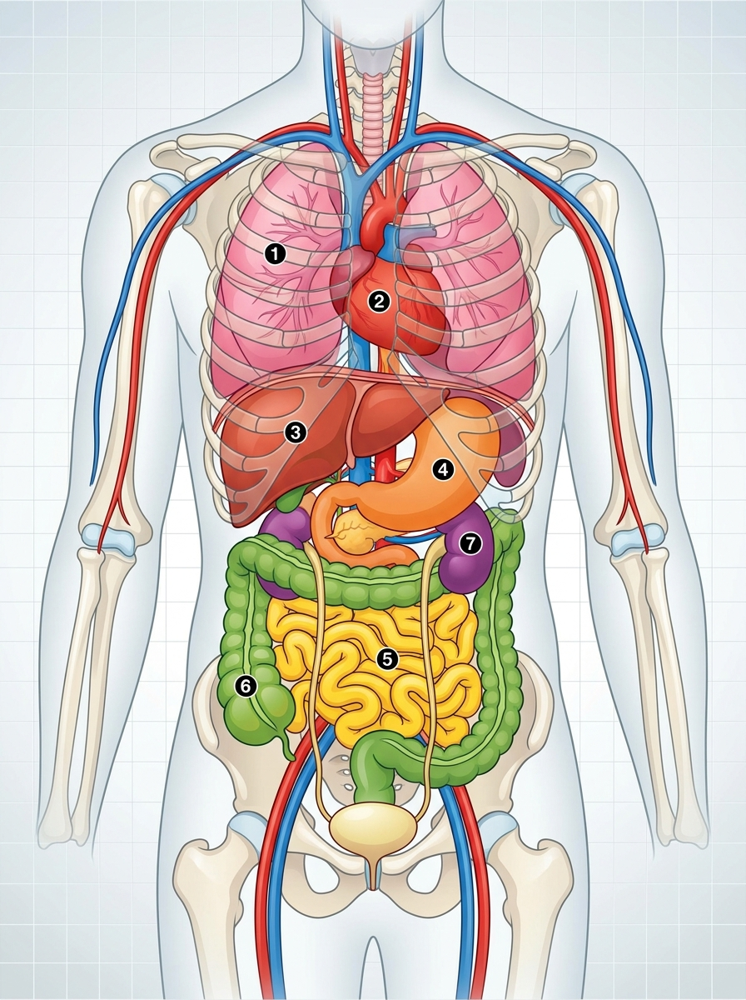

# 🥗 UD7: La Nutrició Humana (Ciències Naturals)

Benvingut/da a la **Unitat 7 del bloc de Ciències Naturals**. Aquesta unitat segueix exactament els **6 apartats del temari oficial**, dedicant una sessió completa a cada bloc amb teoria ampliada i la seua bateria d'activitats interactives i lliurament per a Aules.

---

## 📑 Índex d'Apartats de la Unitat 7

| Apartat | Títol de la Sessió | Bateria d'Activitats | Accés Directe |
| :---: | :--- | :---: | :---: |
| **7.1** | **Alimentació i nutrició:** Diferència conceptual, tipus de nutrients (glúcids, lípids, proteïnes, vitamines, sals i aigua) i funcions. | MCQ, V/F, Vocabulari, Raonament i Aules | [**📖 Obrir 7.1 →**](./nat0701.html) |
| **7.2** | **La dieta:** Dieta saludable i equilibrada, roda dels aliments, Dieta Mediterrània, mètode del plat i lectura d'etiquetes. | MCQ, V/F, Vocabulari, Raonament i Aules | [**📖 Obrir 7.2 →**](./nat0702.html) |
| **7.3** | **La nutrició humana: aparell digestiu:** Tub digestiu, glàndules annexes, bol, quim, quil i absorció a les microvellositats. | MCQ, V/F, Vocabulari, Raonament i Aules | [**📖 Obrir 7.3 →**](./nat0703.html) |
| **7.4** | **La nutrició humana: aparell respiratori:** Vies respiratòries, pulmons, hematosi als alvèols i mecànica del diafragma. | MCQ, V/F, Vocabulari, Raonament i Aules | [**📖 Obrir 7.4 →**](./nat0704.html) |
| **7.5** | **La nutrició: aparell circulatori:** Sang, artèries, venes, capil·lars, anatomia del cor, cicle cardíac i doble circulació. | MCQ, V/F, Vocabulari, Raonament i Aules | [**📖 Obrir 7.5 →**](./nat0705.html) |
| **7.6** | **La nutrició: aparell excretor:** Excreció vs defecació, ronyons, fisiologia de la nefrona, vies urinàries i suor. | MCQ, V/F, Vocabulari, Raonament i Aules | [**📖 Obrir 7.6 →**](./nat0706.html) |

---

  
  
<em>Integració dels quatre aparells implicats en la funció de nutrició: digestiu, respiratori, circulatori i excretor</em>

