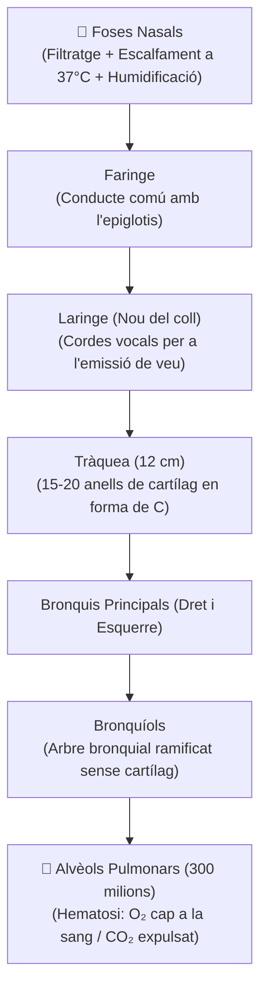

<div class="interactive-progress-tracker" style="background:var(--bg-card); border:1px solid var(--border); border-radius:8px; padding:16px; margin:20px 0;">
  <div style="display:flex; justify-content:space-between; align-items:center;">
    <span style="font-weight:700; color:var(--text-color);">⚡ Progrés d'aprenentatge (7.4)</span>
    <span class="tracker-count" style="font-weight:700; color:#2563eb;">0 / 12 reptes resolts</span>
  </div>
  <div style="background:#e2e8f0; border-radius:999px; height:8px; overflow:hidden; margin-top:10px;">
    <div class="tracker-fill" style="background:#2563eb; width:0%; height:100%; transition:width 0.3s ease;"></div>
  </div>
</div>

# 7.4 La Nutrició Humana: Aparell Respiratori

Un ésser humà pot sobreviure setmanes sense menjar i dies sense beure aigua, però només aguanta entre 3 i 5 minuts sense oxigen abans de patir danys cerebrals irreversibles o la mort.

Les cèl·lules del nostre organisme necessiten un flux continu d'**oxigen gasós** ($	ext{O}_2$) per a cremar glucosa a l'interior dels mitocondris i sintetitzar molècules d'energia ($	ext{ATP}$). Com a resultat d'aquesta combustió s'allibera un gas de rebuig tòxic: el **diòxid de carboni** ($	ext{CO}_2$). L'**aparell respiratori** s'encarrega d'agafar l'oxigen de l'aire exterior, transferir-lo a la sang i recollir el diòxid de carboni per expulsar-lo a l'atmosfera.

---

## 1. Ventilació Pulmonar vs Respiració Cel·lular

És clau diferenciar aquests dos nivells del procés:
- **Ventilació pulmonar (o mecànica respiratòria):** És el moviment físic d'entrada d'aire fresc als pulmons (**inspiració**) i eixida d'aire carregat de residus (**expiració**).
- **Hematosi:** L'intercanvi físic de gasos per difusió simple que té lloc entre l'aire dels alvèols pulmonars i els capil·lars sanguinis.
- **Respiració cel·lular:** El procés químic intern que té lloc dins dels mitocondris de cada cèl·lula, on s'utilitza l'oxigen per obtindre energia:
$$	ext{Glucosa } (	ext{C}_6	ext{H}_{12}	ext{O}_6) + 6\,	ext{O}_2 \longrightarrow 6\,	ext{CO}_2 + 6\,	ext{H}_2	ext{O} + 	ext{Energia } (	ext{ATP})$$

---

## 2. Anatomia de les Vies Respiratòries

L'aparell respiratori humà està format per dues estructures: les **vies respiratòries** (el circuit de canonades d'entrada i condicionament de l'aire) i els **pulmons** (on es produeix l'hematosi).



### El Recorregut de l'Aire Pas a Pas
1. **Foses nasals:** L'aire ha d'entrar **sempre pel nas**. La cavitat nasal està condicionada per:
   - **Pèls nasals i moc:** Retenen partícules de pols, pol·len i gèrmens.
   - **Cilis vibràtils:** Milions de pestanyes microscòpiques que mouen el moc cap a la faringe per a ser engolit i destruït pels àcids de l'estómac.
   - **Xarxa capil·lar (pituitària roja):** Una densa xarxa de vasos sanguinis a flor de pell que **escalfa l'aire fred** fins a $37^\circ	ext{C}$ i l'**humiteja** abans que arribe als delicats pulmons. Respirar per la boca resseca i irrita la gola.
2. **Faringe:** Zona de pas comú. A la seua base hi ha les amígdales, que actuen com a filtres de defensa immunitària.
3. **Laringe:** Tub curt format per cartílags articulats (el més prominent és el **cartílag tiroide**, conegut com la nou del coll). Conté les **cordes vocals**, dos plecs musculosos que vibren amb l'aire expirat produint la veu, modulada després per la llengua i els llavis.
4. **Tràquea:** Conducte d'uns 12 cm de longitud i 2 cm de diàmetre que baixa pel coll per davant de l'esòfag. Està reforçada per **15 a 20 anells de cartílag en forma de 'C'**:
   - La part rígida davantera impedeix que el tub s'aixafe o col·lapse quan inspirem amb força.
   - La part posterior és tova i muscular, permetent que l'esòfag situat al darrere es dilate quan engolim un tros gran de menjar.
5. **Bronquis i Bronquíols:** A l'entrada del tòrax, la tràquea es bifurca en dos **bronquis principals** (el dret és més ample i vertical que l'esquerre). Dins dels pulmons, els bronquis es ramifiquen en tubs cada vegada més fins anomenats **bronquíols**, que perden el cartílag i guanyen múscul llis (quan aquest múscul s'espasma per una al·lèrgia es produeix un atac d'**asma**).

---

## 3. Els Pulmons i els Alvèols: La Joia de l'Intercanvi de Gasos

Els **pulmons** són dos òrgans tous, esponjosos i rosats situats a la cavitat toràcica, a banda i banda del cor, protegits per les costelles i l'esternó:
- El **pulmó dret** és més voluminós i té **3 lòbuls**; el **pulmó esquerre** és més menut i només en té **2**, ja que fa espai a la caixa toràcica per a allotjar la punta del cor.
- Els pulmons estan recoberts per una doble bossa protectora anomenada **pleura** (pleura visceral i pleura parietal). Entre totes dues hi ha una capa fina de **líquid pleural** que fa que els pulmons llisquen suaument contra les costelles en respirar sense desgastar-se.

### L'Hematosi als Alvèols Pulmonars
A l'extrem final de cada bronquíol s'agrupen petits sacs microscòpics anomenats **alvèols pulmonars**. En tenim més de **300 milions** a cada pulmó:
- Si estenguérem tots els alvèols sobre el terra, ocuparien una superfície d'intercanvi de més de **$100	ext{ m}^2$** (la mida d'un pis sencer).
- La paret de l'alvèol és ultrafina (d'una sola cèl·lula) i està completament embolicada per una xarxa de capil·lars sanguinis.
- **L'intercanvi de gasos:** Es produeix de forma passiva per **difusió simple**:
  - L'**oxigen** ($	ext{O}_2$), que està molt concentrat a l'alvèol, travessa la membrana cap a la sang i s'uneix ràpidament a l'hemoglobina dels glòbuls vermells.
  - El **diòxid de carboni** ($	ext{CO}_2$), que viatja dissolt a la sang de rebuig de tot el cos, abandona els capil·lars i entra a l'alvèol per a ser expulsat en la següent expiració.

---

## 4. La Mecànica Ventilatòria: Inspiració i Expiració

Com que els pulmons són masses esponjoses mancades de teixit muscular propi, no es poden inflar ni desinflar per si mateixos. Es mouen exclusivament pels canvis de volum i pressió de la caixa toràcica generats pel **diafragma** (un gran múscul amb forma de cúpula que separa el tòrax de l'abdomen) i els **músculs intercostals**:

```mermaid
flowchart TD
  subgraph INSPIRACIÓ (Entrada d'Aire - Moviment Actiu)
    I1["Diafragma es CONTRAU i BAIXA"] --> I2["Músculs intercostals eleven les costelles"]
    I2 --> I3["Volum del tòrax AUGMENTA"]
    I3 --> I4["Pressió interna BAIXA (pressió negativa)"]
    I4 --> I5["L'aire exterior ENTRA als pulmons"]
  end
  subgraph EXPIRACIÓ (Eixida d'Aire - Moviment Passiu)
    E1["Diafragma es RELAXA i PUJA"] --> E2["Costelles baixen per gravetat i elasticitat"]
    E2 --> E3["Volum del tòrax DISMINUEIX"]
    E3 --> E4["Pressió interna PUJA"]
    E4 --> E5["L'aire interior surt EXPULSAT"]
  end
```

---

> [!NOTE]
> ### 💡 Resum de Conceptes Clau
> - Respirar pel nas neteja, escalfa ($37^\circ	ext{C}$) i humiteja l'aire; respirar per la boca irrita la faringe.
> - La tràquea té anells incomplets de cartílag en forma de C per mantindre's oberta sense col·lapsar.
> - L'hematosi (intercanvi d'oxigen i diòxid de carboni) té lloc exclusivament a la membrana dels alvèols pulmonars.
> - La inspiració és un moviment muscular actiu (el diafragma es contrau i baixa); l'expiració en repòs és una relaxació passiva.

---

## 🎯 Activitats i Autoavaluació Interactiva

<div class="interactive-progress-tracker">
  <div class="tracker-header">
    <span>🎮 <strong>Zona d'Entrenament FPB:</strong> <span class="tracker-count">0 reptes resolts</span></span>
    <span class="tracker-pts">⭐ 0 punts</span>
  </div>
  <div class="tracker-bar"><div class="tracker-fill" style="width: 0%;"></div></div>
</div>

### 1. Qüestionari d'Autoavaluació Tipus Test (MCQ)

<div class="interactive-mcq" data-quiz-id="ca1_u2_5_mcq1" data-answer="C" data-hint="Els alvèols són sacs microscòpics rodejats de capil·lars on es produeix l'hematosi.">
  <p class="mcq-question"><strong>1. A quina estructura microscòpica dels pulmons té lloc el pas de l'oxigen cap a la sang i la recollida del CO₂?</strong></p>
  <div class="mcq-options">
    <button type="button" class="btn-mcq-opt" data-opt="A">A) A les cordes vocals de la laringe</button>
    <button type="button" class="btn-mcq-opt" data-opt="B">B) Als anells de cartílag de la tràquea</button>
    <button type="button" class="btn-mcq-opt" data-opt="C">C) Als alvèols pulmonars en contacte directe amb els capil·lars sanguinis</button>
    <button type="button" class="btn-mcq-opt" data-opt="D">D) A la membrana pleural que recobreix les costelles</button>
  </div>
  <div class="quiz-feedback"></div>
</div>

<div class="interactive-mcq" data-quiz-id="ca1_u2_5_mcq2" data-answer="A" data-hint="En contraure's, el diafragma baixa i crea una succió que omple els pulmons.">
  <p class="mcq-question"><strong>2. Què ocorre amb el diafragma durant la fase d'inspiració quan agafem aire?</strong></p>
  <div class="mcq-options">
    <button type="button" class="btn-mcq-opt" data-opt="A">A) Es contrau i es desplaça cap avall, engrandint la caixa toràcica</button>
    <button type="button" class="btn-mcq-opt" data-opt="B">B) Es relaxa i puja pressionant els pulmons per buidar-los</button>
    <button type="button" class="btn-mcq-opt" data-opt="C">C) Es tanca completament per no deixar entrar pols</button>
    <button type="button" class="btn-mcq-opt" data-opt="D">D) El diafragma només funciona durant la digestió del menjar</button>
  </div>
  <div class="quiz-feedback"></div>
</div>


<div class="interactive-mcq" data-quiz-id="ca1_nat7_4_mcq3" data-answer="A" data-hint="Els anells cartilaginosos mantenen el conducte aeri obert permanentment.">
  <p class="mcq-question"><strong>3. Per què la tràquea està reforçada amb 15-20 anells de cartílag en forma de 'C'?</strong></p>
  <div class="mcq-options">
    <button type="button" class="btn-mcq-opt" data-opt="A">A) Perquè quede sempre oberta i no es tanque ni s'aixafe quan agafem aire</button>
    <button type="button" class="btn-mcq-opt" data-opt="B">B) Per digerir el menjar</button>
    <button type="button" class="btn-mcq-opt" data-opt="C">C) Per bombejar la sang a pressió</button>
    <button type="button" class="btn-mcq-opt" data-opt="D">D) Per filtrar l'orina</button>
  </div>
  <div class="quiz-feedback"></div>
</div>

<div class="interactive-mcq" data-quiz-id="ca1_nat7_4_mcq4" data-answer="B" data-hint="La respiració cel·lular (Glucosa + O₂ -> CO₂ + H₂O + ATP) té lloc als mitocondris.">
  <p class="mcq-question"><strong>4. En quin orgànul de les nostres cèl·lules s'utilitza finalment l'oxigen que hem respirat per cremar la glucosa i obtindre energia (ATP)?</strong></p>
  <div class="mcq-options">
    <button type="button" class="btn-mcq-opt" data-opt="A">A) Als ribosomes</button>
    <button type="button" class="btn-mcq-opt" data-opt="B">B) Als mitocondris (respiració cel·lular)</button>
    <button type="button" class="btn-mcq-opt" data-opt="C">C) A la paret de cel·lulosa</button>
    <button type="button" class="btn-mcq-opt" data-opt="D">D) Als cloroplasts</button>
  </div>
  <div class="quiz-feedback"></div>
</div>
---

### 2. Activitats de Vertader (V) o Fals (F)

<div class="interactive-vf" data-quiz-id="ca1_u2_5_vf1" data-answer="V" data-hint="VERTADER: Les foses nasals tenen vellositats i mucositat que retenen partícules i pituitària que tempera l'aire.">
  <span class="vf-statement"><strong>a) Respirar pel nas és molt més saludable que per la boca perquè l'aire s'escalfa, s'humiteja i es filtra abans d'arribar als pulmons.</strong></span>
  <div class="vf-buttons">
    <button type="button" class="btn-vf" data-opt="V">V</button>
    <button type="button" class="btn-vf" data-opt="F">F</button>
  </div>
  <div class="quiz-feedback"></div>
</div>

<div class="interactive-vf" data-quiz-id="ca1_u2_5_vf2" data-answer="F" data-hint="FALS: L'aire expirat conté aproximadament un 16% d'oxigen i un 4% de diòxid de carboni; no és tot pur CO₂.">
  <span class="vf-statement"><strong>b) L'aire que expirem conté únicament i exclusivament un 100% de diòxid de carboni pur sense gens d'oxigen.</strong></span>
  <div class="vf-buttons">
    <button type="button" class="btn-vf" data-opt="V">V</button>
    <button type="button" class="btn-vf" data-opt="F">F</button>
  </div>
  <div class="quiz-feedback"></div>
</div>


<div class="interactive-vf" data-quiz-id="ca1_nat7_4_vf3" data-answer="V" data-hint="VERTADER: La laringe és l'òrgan fonador situat entre la faringe i la tràquea.">
  <span class="vf-statement"><strong>c) A la laringe es troben les cordes vocals, que vibren amb el pas de l'aire durant l'expiració per produir la veu.</strong></span>
  <div class="vf-buttons">
    <button type="button" class="btn-vf" data-opt="V">V</button>
    <button type="button" class="btn-vf" data-opt="F">F</button>
  </div>
  <div class="quiz-feedback"></div>
</div>

<div class="interactive-vf" data-quiz-id="ca1_nat7_4_vf4" data-answer="F" data-hint="FALS: El pulmó dret té 3 lòbuls i és més gran; l'esquerre només en té 2 perquè cedeix espai al cor.">
  <span class="vf-statement"><strong>d) El pulmó esquerre és més gran que el pulmó dret perquè té 4 lòbuls.</strong></span>
  <div class="vf-buttons">
    <button type="button" class="btn-vf" data-opt="V">V</button>
    <button type="button" class="btn-vf" data-opt="F">F</button>
  </div>
  <div class="quiz-feedback"></div>
</div>
---

### 3. Exercicis de Resposta Breu i Vocabulari Tècnic

<div class="interactive-quiz" data-quiz-id="ca1_u2_5_q1" data-answer="diafragma|el diafragma" data-hint="Múscul gran en forma de cúpula situat davall dels pulmons.">
  <div class="quiz-question">✍️ Quin és el múscul principal de la respiració que separa la cavitat toràcica de la cavitat abdominal?</div>
  <div class="quiz-controls">
    <input type="text" class="quiz-input" placeholder="Escriu el nom del múscul...">
    <button type="button" class="btn-quiz-check">Comprovar</button>
  </div>
  <div class="quiz-feedback"></div>
</div>

<div class="interactive-quiz" data-quiz-id="ca1_u2_5_q2" data-answer="alvèols|alvèol|alveols|alveol" data-hint="Sacs terminals microscòpics on es produeix l'hematosi.">
  <div class="quiz-question">✍️ Com s'anomenen els xicotets sacs terminals dels pulmons on té lloc l'intercanvi de gasos amb la sang?</div>
  <div class="quiz-controls">
    <input type="text" class="quiz-input" placeholder="Escriu el terme...">
    <button type="button" class="btn-quiz-check">Comprovar</button>
  </div>
  <div class="quiz-feedback"></div>
</div>


<div class="interactive-quiz" data-quiz-id="ca1_nat7_4_q3" data-answer="pleura|la pleura" data-hint="Membrana que recobreix els pulmons dins de la caixa toràcica.">
  <div class="quiz-question">✍️ Com s'anomena la doble membrana protectora amb líquid lubricant que envolta els pulmons i evita que freguen amb les costelles?</div>
  <div class="quiz-controls">
    <input type="text" class="quiz-input" placeholder="Escriu la teua resposta...">
    <button type="button" class="btn-quiz-check">Comprovar</button>
  </div>
  <div class="quiz-feedback"></div>
</div>

<div class="interactive-quiz" data-quiz-id="ca1_nat7_4_q4" data-answer="diòxid de carboni|dioxid de carboni|CO2|CO₂" data-hint="Fórmula química CO₂.">
  <div class="quiz-question">✍️ Quin gas residual tòxic produït per les cèl·lules passa de la sang als alvèols per ser expulsat a l'exterior en cada expiració?</div>
  <div class="quiz-controls">
    <input type="text" class="quiz-input" placeholder="Escriu la teua resposta...">
    <button type="button" class="btn-quiz-check">Comprovar</button>
  </div>
  <div class="quiz-feedback"></div>
</div>
---

### 4. Exercicis de Raonament i Desenvolupament Escrit (Tasca d'Aula)

<div class="interactive-open-response" data-question-id="ca1_u2_5_open1">
  <div class="open-question">✍️ <strong>Tabaquisme, vapeig i rendiment físic:</strong> El fum del tabac i les substàncies dels cigarrets electrònics paralitzen els cilis de la tràquea i destrueixen la paret dels alvèols pulmonars (emfisema). Com afecta aquest dany a la capacitat d'oxigenació de la sang i per què un jove fumador es cansa molt més ràpid pujant escales o fent esport?</div>
  <textarea class="open-response-input" rows="4" placeholder="Explica la pèrdua de superfície d'intercanvi als alvèols i la manca d'oxigen als músculs..."></textarea>
</div>


<div class="interactive-open-response" data-question-id="ca1_nat7_4_open2">
  <div class="open-question">✍️ <strong>Exercici 2 (Comparativa Inspiració vs Expiració):</strong> Explica detalladament què fan el múscul diafragma i les costelles durant la INSPIRACIÓ i durant l'EXPIRACIÓ, i com canvia el volum de la caixa toràcica en cada fase.</div>
  <textarea class="open-response-input" rows="4" placeholder="Inspiració: el diafragma es contrau i baixa, les costelles pugen, el volum augmenta i l'aire entra... Expiració: ..."></textarea>
</div>

<div class="interactive-open-response" data-question-id="ca1_nat7_4_open3">
  <div class="open-question">✍️ <strong>Exercici 3 (Seguretat laboral al taller: pols i vapors tòxics):</strong> En un taller on es lixa fusta, fibra de vidre o s'usen dissolvents, per què les foses nasals no són suficients per frenar totes les micropartícules i per què és obligatori usar mascareta de protecció (EPI) i extracció de fums?</div>
  <textarea class="open-response-input" rows="4" placeholder="Explica com les partícules menudes (< 5 micres) arriben fins als alvèols pulmonars i s'hi acumulen..."></textarea>
</div>
---

<div class="aules-delivery-card" style="border:2px dashed #0284c7; border-radius:8px; padding:16px; background:#f0f9ff; margin:24px 0;">
  <h3 style="margin-top:0; color:#0369a1;">📦 Lliurament d'Activitats d'Aules (Act 7.4)</h3>
  <p>Genera el teu document de tasca d'aquest apartat amb el teu nom i puntuació obtinguda.</p>
  <div style="display:flex; gap:12px; align-items:center; flex-wrap:wrap;">
    <input type="text" class="aules-student-name" placeholder="Cognoms, Nom de l'Alumne/a" style="padding:8px 12px; border:1px solid #94a3b8; border-radius:4px; flex-grow:1; min-width:240px;">
    <button class="btn-generate-aules-pdf" data-unit="NAT07" data-activity="Act04" data-module="CA" style="padding:8px 16px; background:#0284c7; color:#fff; border:none; border-radius:4px; font-weight:600; cursor:pointer;">📄 Descarregar PDF per a Aules</button>
  </div>
</div>
