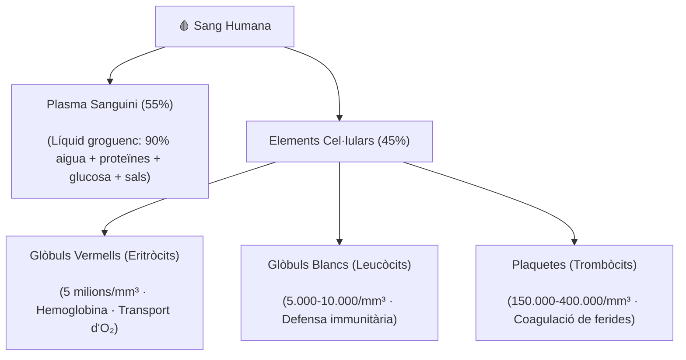
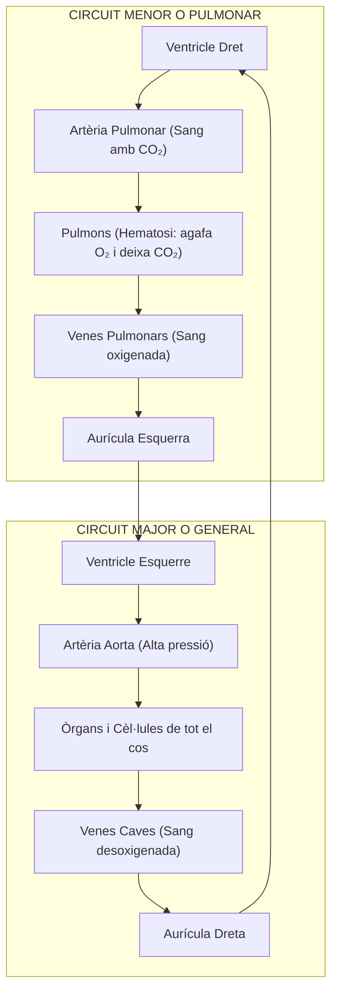

---

layout: default

title: "7.5 La Nutrició: Aparell Circulatori — Ciències Naturals · 1r FPB"

course_root: ".."

badge: "1r FPB · Ciències Naturals · UD7"

prev_url: "nat0704.html"

prev_label: "⬅️ 7.4 Aparell Respiratori"

next_url: "nat0706.html"

next_label: "7.6 Aparell Excretor ➡️"

---

  

    ⚡ Progrés d'aprenentatge (7.5)

    0 / 12 reptes resolts

  

  

    

  

# 7.5 La Nutrició: Aparell Circulatori

El cos humà conté més de **30 bilions de cèl·lules**, i cap d'elles pot desplaçar-se per anar a buscar aliment o aire. Cadascuna necessita rebre contínuament oxigen i nutrients a la seua porta, i alhora desfer-se dels residus tòxics que produeix abans que l'enverinen.

L'**aparell cardiovascular** és la gran xarxa de logística i transport intern del nostre organisme. Està format per tres elements fonamentals:

1. Un fluid de transport especialitzat: la **sang**.

2. Una xarxa de canonades de distribució: els **vasos sanguinis** (artèries, venes i capil·lars).

3. Una bomba mecànica impel·lent central: el **cor**.

---

## 1. La Sang: El Líquid Vital

En el cos d'una persona adulta circulen entre **5 i 6 litres de sang** a una velocitat impressionant: una gota de sang completa tot el circuit corporal en menys d'un minut. Si centrifugem un tub de sang en una màquina de laboratori, se separa clarament en dues fraccions:

### Components de la Sang al Detall

1. **El Plasma Sanguini (55% del volum):** Un líquid groguenc translúcid format en un 90% per aigua. Conté dissoltes substàncies vitals:

   - **Proteïnes plasmàtiques:** L'**albúmina** (regula la pressió oncòtica perquè l'aigua no s'escape dels vasos inflant els teixits), les **immunoglobulines o anticossos** (defensa) i el **fibrinogen** (proteïna clau de la coagulació).

   - **Nutrients i residus:** Glucosa, aminoàcids, àcids grassos, sals minerals ($\text{Na}^+, \text{K}^+, \text{Ca}^{2+}$), hormones i residus cel·lulars en trànsit cap als ronyons (urea i àcid úric).

2. **Glòbuls vermells (Eritròcits o Hematies):** Cèl·lules en forma de disc bicòncau (amb les dues cares enfonsades com una pastilla d'aspirina). Durant la seua maduració perden el nucli per guanyar espai per a allotjar més de **280 milions de molècules d'hemoglobina**:

   - L'**hemoglobina** és una proteïna amb 4 àtoms de ferro (Fe) al seu interior. El ferro s'uneix de forma reversible a l'oxigen (O₂), donant a la sang la seua intensa tonalitat roja brillant quan està oxigenada i roig fosc quan està desoxigenada.

   - Viuen uns **120 dies**, després dels quals són reciclats a la melsa i al fetge.

3. **Glòbuls blancs (Leucòcits):** Cèl·lules vives amb nucli complet que actuen com l'exèrcit de defensa del cos:

   - **Neutròfils i Monòcits (Macròfags):** Són cèl·lules patrulla que capturen i "es mengen" bacteris invasors (**fagocitosi**).

   - **Limfòcits (B i T):** Fabriquen anticossos específics i destrueixen cèl·lules infectades per virus o cèl·lules tumorals.

4. **Plaquetes (Trombòcits):** No són cèl·lules completes, sinó petits fragments cel·lulars procedents d'una cèl·lula gegant de la medul·la òssia (megacariòcit). Quan un vas sanguini es trenca per un tall al taller, les plaquetes s'adhereixen a les vores de la ferida, s'agreguen formant un tap provisional i activen el fibrinogen per a teixir una malla de xarxa insoluble (**coàgul de fibrina**) que atura l'hemorràgia.

---

## 2. Els Vasos Sanguinis: Artèries, Venes i Capil·lars

Si unint tots els vasos sanguinis d'una sola persona en línia recta, farien més de **100.000 quilòmetres**, suficient per donar dues voltes i mitja a tot el planeta Terra!

| Característica | Artèries | Venes | Capil·lars |
| :--- | :--- | :--- | :--- |
| **Sentit del flux** | **Surten del cor** cap als òrgans perifèrics | **Tornen al cor** des dels teixits | Connecten arterioles i vènules als teixits |
| **Paret del vas** | Molt **gruixuda, muscular i elàstica** per a suportar la gran empenta del batec | Paret més **prima i distensible**; la seua llum interna és més gran | **Ultrafina**: formada per una sola capa de cèl·lules endotelials |
| **Pressió sanguínia** | **Molt alta** ($120 - 80\text{ mmHg}$) | Baixa ($5 - 10\text{ mmHg}$) | Molt baixa ($15 - 30\text{ mmHg}$) |
| **Estructures especials** | Dilatació elàstica (onada de **pols arterial**) | Posseeixen **vàlvules antiretorn** (en niu d'oreneta) | Porus microscòpics que permeten l'intercanvi de líquids |

### Com puja la sang des dels peus en contra de la gravetat?

Quan estem dempeus, la sang de les cames ha de pujar més d'un metre cap al cor. Com que a les venes la pressió és molt baixa, el cos utilitza dos trucs d'enginyeria:

1. **La bomba muscular:** En caminar o moure les cames, els músculs bessons es contrauen i aixafen les venes profundes, empenyent la sang cap amunt.

2. **Les vàlvules venoses:** S'obren quan la sang puja i es tanquen hermèticament si la sang intenta caure cap avall. Si una persona passa moltes hores dempeus sense moure's, aquestes vàlvules poden fallar i dilatar-se, provocant **varius**.

---

## 3. El Cor Humà: Una Bomba Mecànica Incansable

El **cor** és un òrgan buit fet de potentíssim múscul estriat cardíac (**miocardi**), d'uns 300 grams de pes (la mida d'un puny tancat), situat al mig del pit (mediastí) lleugerament inclinat cap a l'esquerra:

- Batega aproximadament **70 vegades per minut** en repòs: això suposa més de **100.000 batecs al dia** i més de 2.500 milions de batecs al llarg d'una vida sense parar ni un sol segon!

### Les 4 Cambres del Cor

Està dividit per un septe intern impermeable en dues meitats (dreta i esquerra) que mai es comuniquen directament:

- **Part Dreta (Sang Desoxigenada):**

  - **Aurícula Dreta:** Rep sang carregada de CO₂ de tot el cos a través de les venes caves superior i inferior.

  - La sang passa al **Ventricle Dret** a través de la vàlvula **tricúspide**.

  - El ventricle dret impulsa la sang cap als pulmons a través de l'**artèria pulmonar**.

- **Part Esquerra (Sang Oxigenada):**

  - **Aurícula Esquerra:** Rep sang rica en O₂ procedent dels pulmons a través de les 4 **venes pulmonars**.

  - Passa al **Ventricle Esquerre** a través de la vàlvula **mitral** (o bicúspide).

  - El ventricle esquerre té la paret miocàrdica 3 vegades més gruixuda perquè ha d'impulsar la sang amb gran pressió cap a l'**artèria aorta**, que la distribueix a tot el cos.

### El Cicle Cardíac: Sístole i Diàstole

1. **Sístole auricular:** Les dues aurícules es contrauen a la vegada i buiden la seua sang als ventricles.

2. **Sístole ventricular:** Els ventricles es contrauen amb gran força. Les vàlvules mitral i tricúspide es tanquen de cop amb un so sec (**1r soroll cardíac**: "LUB") per evitar que la sang torne enrere, i la sang surt disparada per l'aorta i l'artèria pulmonar.

3. **Diàstole general:** El cor es relaxa. Les vàlvules sigmoides o semilunars d'eixida es tanquen (**2n soroll cardíac**: "DUB"), i les aurícules es tornen a omplir de sang relaxadament.

---

## 4. Com és la Circulació Humana? Tancada, Doble i Completa

1. **Tancada:** La sang viatja sempre per l'interior del circuit tancat de vasos sanguinis; no s'aboca lliurement als teixits.

2. **Doble:** Té dos circuits complets consecutius:

   - **Circuit Menor o Pulmonar:** Ventricle dret $

ightarrow$ Pulmons $

ightarrow$ Aurícula esquerra. La seua funció és exclusivament **oxigenar la sang**.

   - **Circuit Major o General:** Ventricle esquerre $

ightarrow$ Tot l'organisme (cervell, músculs, fetge, ronyons) $

ightarrow$ Aurícula dreta. Reparteix oxigen i nutrients a totes les cèl·lules.

3. **Completa:** Gràcies al septe interventricular del cor, la sang rica en oxigen de la banda esquerra **mai es barreja** amb la sang bruta de la banda dreta.

---

## 5. Els Grups Sanguinis: El Sistema AB0 i el Factor Rh

A la superfície dels glòbuls vermells hi ha unes proteïnes de reconeixement immunitari anomenades **antígens**:

- **Grup A:** Té antigen A als glòbuls vermells i anticossos anti-B al plasma.

- **Grup B:** Té antigen B i anticossos anti-A.

- **Grup AB:** Té tant l'antigen A com el B. Com que no té cap anticòs, és el **Receptor Universal** (pot rebre sang de qualsevol grup).

- **Grup 0:** No té cap antigen. Com que no té marcadors que puguen ser atacats, és el **Donant Universal** (la seua sang serveix per a tothom). Però com que el seu plasma conté anticossos anti-A i anti-B, una persona del grup 0 **només pot rebre sang d'una altra persona del grup 0**.

- **Factor Rh:** Si tens l'antigen D ets $\text{Rh}^+$; si no el tens ets $\text{Rh}^-$. Una persona $\text{Rh}^-$ no pot rebre sang $\text{Rh}^+$ perquè fabricaria anticossos contra ella.

---

> [!NOTE]

> ### 💡 Resum de Conceptes Clau

> - La sang està formada per plasma líquid (55%) i cèl·lules (glòbuls vermells amb hemoglobina, glòbuls blancs i plaquetes).

> - Les artèries surten del cor a gran pressió; les venes tornen al cor amb vàlvules antiretorn; els capil·lars fan l'intercanvi.

> - El cor té 4 cavitats (2 aurícules i 2 ventricles) i funciona alternant sístole (buidat) i diàstole (ompliment).

> - La circulació és tancada, doble i completa.

> - El grup 0⁻ és el donant universal; el grup AB⁺ és el receptor universal.

---

## 🎯 Activitats i Autoavaluació Interactiva

  

    🎮 <strong>Zona d'Entrenament FPB:</strong> 0 reptes resolts

    ⭐ 0 punts

  

  

### 1. Qüestionari d'Autoavaluació Tipus Test (MCQ)

  
<strong>1. Per què es defineix la circulació sanguínia humana com a 'completa'?</strong>

  

    <button type="button" class="btn-mcq-opt" data-opt="A">A) Perquè la sang viatja per tot el cos en menys d'un segon</button>

    <button type="button" class="btn-mcq-opt" data-opt="B">B) Perquè la sang oxigenada i la sang rica en CO₂ mai es barregen a l'interior del cor</button>

    <button type="button" class="btn-mcq-opt" data-opt="C">C) Perquè tots els humans tenim el mateix grup sanguini</button>

    <button type="button" class="btn-mcq-opt" data-opt="D">D) Perquè conté un 100% de cèl·lules i gens de líquid</button>

  

  

  
<strong>2. Quins elements de la sang són fragments cel·lulars responsables de tapar una ferida formant un coàgul protector?</strong>

  

    <button type="button" class="btn-mcq-opt" data-opt="A">A) Els glòbuls vermells (eritròcits)</button>

    <button type="button" class="btn-mcq-opt" data-opt="B">B) Els leucòcits defensius</button>

    <button type="button" class="btn-mcq-opt" data-opt="C">C) El plasma líquid</button>

    <button type="button" class="btn-mcq-opt" data-opt="D">D) Les plaquetes o trombòcits</button>

  

  

  
<strong>3. Quina diferència estructural hi ha entre les artèries i les venes?</strong>

  

    <button type="button" class="btn-mcq-opt" data-opt="A">A) Les artèries surten del cor i tenen parets gruixudes i elàstiques; les venes tornen al cor i tenen vàlvules internes</button>

    <button type="button" class="btn-mcq-opt" data-opt="B">B) Les artèries porten orina i les venes porten aire</button>

    <button type="button" class="btn-mcq-opt" data-opt="C">C) Les venes surten dels ventricles a gran pressió</button>

    <button type="button" class="btn-mcq-opt" data-opt="D">D) No hi ha cap diferència entre elles</button>

  

  

  
<strong>4. Quina cavitat del cor té la paret muscular (miocardi) més gruixuda i potent perquè ha d'impulsar la sang oxigenada per l'artèria aorta cap a tot el cos?</strong>

  

    <button type="button" class="btn-mcq-opt" data-opt="A">A) L'aurícula dreta</button>

    <button type="button" class="btn-mcq-opt" data-opt="B">B) El ventricle esquerre</button>

    <button type="button" class="btn-mcq-opt" data-opt="C">C) L'aurícula esquerra</button>

    <button type="button" class="btn-mcq-opt" data-opt="D">D) La vena cava</button>

  

  

---

### 2. Activitats de Vertader (V) o Fals (F)

  <strong>a) Les venes tenen petites vàlvules al seu interior que impedeixen el retrocés de la sang quan puja cap al cor en contra de la gravetat.</strong>

  

    <button type="button" class="btn-vf" data-opt="V">V</button>

    <button type="button" class="btn-vf" data-opt="F">F</button>

  

  

  <strong>b) Una persona amb grup sanguini 0⁻ pot rebre una transfusió de sang de qualsevol persona del món sense cap perill.</strong>

  

    <button type="button" class="btn-vf" data-opt="V">V</button>

    <button type="button" class="btn-vf" data-opt="F">F</button>

  

  

  <strong>c) Els glòbuls blancs (leucòcits) són les cèl·lules sanguínies encarregades de defensar l'organisme contra infeccions produïdes per bacteris i virus.</strong>

  

    <button type="button" class="btn-vf" data-opt="V">V</button>

    <button type="button" class="btn-vf" data-opt="F">F</button>

  

  

  <strong>d) A la meitat dreta del cor humà circula sang rica en oxigen i a la meitat esquerra circula sang bruta amb diòxid de carboni.</strong>

  

    <button type="button" class="btn-vf" data-opt="V">V</button>

    <button type="button" class="btn-vf" data-opt="F">F</button>

  

  

---

### 3. Exercicis de Resposta Breu i Vocabulari Tècnic

  
✍️ Com s'anomena la proteïna present als glòbuls vermells encarregada de fixar i transportar les molècules d'oxigen?

  

    <input type="text" class="quiz-input" placeholder="Escriu la proteïna...">

    <button type="button" class="btn-quiz-check">Comprovar</button>

  

  

  
✍️ Quin nom rep la fase mecànica en què el múscul cardíac es contrau amb força per expulsar la sang cap a les artèries?

  

    <input type="text" class="quiz-input" placeholder="Escriu la fase cardíaca...">

    <button type="button" class="btn-quiz-check">Comprovar</button>

  

  

  
✍️ Com s'anomenen els vasos sanguinis més fins (d'una sola capa de cèl·lules) on es produeix l'intercanvi d'oxigen i nutrients amb els teixits?

  

    <input type="text" class="quiz-input" placeholder="Escriu la teua resposta...">

    <button type="button" class="btn-quiz-check">Comprovar</button>

  

  

  
✍️ Quin nom rep la fase de relaxació del múscul cardíac en què el cor s'omple de sang?

  

    <input type="text" class="quiz-input" placeholder="Escriu la teua resposta...">

    <button type="button" class="btn-quiz-check">Comprovar</button>

  

  

---

### 4. Exercicis de Raonament i Desenvolupament Escrit (Tasca d'Aula)

  
✍️ <strong>Freqüència cardíaca i esforç al taller:</strong> Un treballador té un pols de 70 pulsacions per minut en repòs. En carregar caixes pesades, el seu pols puja a 140 pulsacions per minut. Explica per quin motiu fisiològic el cor ha de bategar el doble de ràpid durant l'esforç i què li passaria a les cèl·lules musculars si no ho fera.

  <textarea class="open-response-input" rows="4" placeholder="Explica la demanda urgent d'oxigen i glucosa pels músculs i l'eliminació de residus..."></textarea>

  
✍️ <strong>Exercici 2 (Recorregut dels dos circuits: Menor i Major):</strong> Explica el recorregut exacte que fa la sang en el Circuit Menor o Pulmonar (des de quin ventricle surt, on va i a quina aurícula torna) i en el Circuit Major o General.

  <textarea class="open-response-input" rows="4" placeholder="Circuit Menor: Ventricle dret -> artèria pulmonar -> pulmons (s'oxigena) -> venes pulmonars -> aurícula esquerra. Circuit Major: ..."></textarea>

  
✍️ <strong>Exercici 3 (Anàlisi d'una analítica de sang):</strong> Un pacient es fa una anàlisi de sang i li ixen els glòbuls vermells molt baixos (3 milions/mm³) i els glòbuls blancs molt alts (18.000/mm³). Quines dues coses li estan passant al seu organisme i quins símptomes notarà?

  <textarea class="open-response-input" rows="4" placeholder="Glòbuls vermells baixos -> anèmia i cansament per falta d'oxigen; Glòbuls blancs alts -> infecció activa..."></textarea>

---

  <h3 style="margin-top:0; color:#0369a1;">📦 Lliurament d'Activitats d'Aules (Act 7.5)</h3>

  
Genera el teu document de tasca d'aquest apartat amb el teu nom i puntuació obtinguda.

  

    <input type="text" class="aules-student-name" placeholder="Cognoms, Nom de l'Alumne/a" style="padding:8px 12px; border:1px solid #94a3b8; border-radius:4px; flex-grow:1; min-width:240px;">

    <button class="btn-generate-aules-pdf" data-unit="NAT07" data-activity="Act05" data-module="CA" style="padding:8px 16px; background:#0284c7; color:#fff; border:none; border-radius:4px; font-weight:600; cursor:pointer;">📄 Descarregar PDF per a Aules</button>

  

