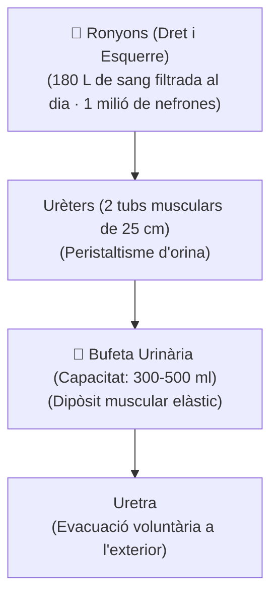
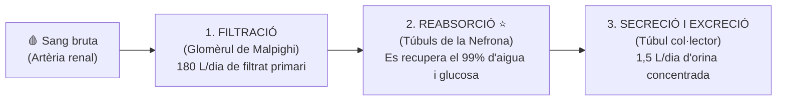

  

    ⚡ Progrés d'aprenentatge (7.6)
    0 / 3 reptes resolts
  

  

    

  

# 7.6 La Nutrició: Aparell Excretor

El funcionament continuat dels bilions de cèl·lules del nostre cos genera una gran quantitat de residus químics. Quan les cèl·lules degraden proteïnes per a obtindre energia o reparar estructures, s'allibera nitrogen en forma d'**amoníac** ($	ext{NH}_3$), una substància altament tòxica per al sistema nerviós. El fetge transforma ràpidament l'amoníac en un compost menys perillós anomenat **urea**, que passa a la sang.

Si la urea, l'**àcid úric** i l'excés de sals minerals s'acumularen a la sang, ens intoxicarien de mort en menys de 48 hores. L'**aparell excretor** actua com la planta de depuració d'aigües residuals d'alta precisió del nostre organisme: s'encarrega de filtrar contínuament la sang, regular la quantitat d'aigua i sals del cos i expulsar els tòxics en forma d'**orina**.

---

## 1. Concepte Biològic d'Excreció: Excretar vs Defecar

En ciències és clau no confondre aquests dos processos biològics tan diferents:
- **Defecació (Aparell Digestiu):** És l'expulsió a l'exterior de substàncies que **mai han format part del nostre medi intern**. Són restes d'aliments que no s'han pogut pair (com la fibra vegetal) que han recorregut el tub digestiu com per un túnel sense travessar mai la paret intestinal ni arribar a la sang.
- **Excreció (Aparell Excretor):** És l'eliminació de residus metabòlics que **han produït les pròpies cèl·lules** en funcionar, que han passat a la sang i que han de ser filtrats i expulsats químicament.

---

## 2. Anatomia de l'Aparell Urinari

L'aparell urinari està format per dos òrgans filtradors (els **ronyons**) i les **vies urinàries** (que condueixen i emmagatzemen l'orina fins a la seua evacuació).

### A) Els Ronyons: Les Depuradores Centrals
Són dos òrgans de color marró vermellós amb forma de fava o mongeta gegant, d'uns $12	ext{ cm}$ de llarg, situats a la part posterior de l'abdomen, a banda i banda de la columna vertebral, protegits per les últimes costelles i embolicats en una capa gruixuda de greix protector (càpsula adiposa):
- El ronyó dret està situat lleugerament més baix que l'esquerre perquè fa lloc al fetge.
- Cada ronyó rep sang neta d'oxigen però bruta de residus a través de l'**artèria renal** (que transporta el 20% de tot el cabal cardíac del cos). La sang depurada torna a la circulació general per la **vena renal**.
- En un tall longitudinal d'un ronyó s'aprecien 3 regions:
  1. **Escorça renal (zona externa granulosa):** On s'allotgen els filtres microscòpics (glomèruls).
  2. **Medul·la renal (zona intermèdia):** Formada per estructures triangulars dites **piràmides de Malpighi**, que contenen els túbuls col·lectors d'orina.
  3. **Pelvis renal (embut central):** Cavitat blanca on conflueix tota l'orina abans d'entrar a l'urèter.

---

## 3. La Nefrona: La Fàbrica Microscòpica de l'Orina

Cada ronyó conté a la seua escorça més d'**un milió** de diminutes unitats funcionals anomenades **nefrones**. La formació de l'orina a la nefrona és un procés d'enginyeria biològica prodigiós dividit en tres etapes consecutives:

### Etapa 1: La Filtració Glomerular (Neteja Bruta)
- Té lloc al **glomèrul de Malpighi**, un cabdell de capil·lars sanguinis a molt alta pressió tancat dins d'una copa de doble paret anomenada **càpsula de Bowman**.
- La pressió empeny l'aigua i les molècules menudes (glucosa, aminoàcids, sals minerals, urea) a travessar les parets dels capil·lars cap a l'interior de la nefrona, actuant com un sedàs molt fi.
- Les cèl·lules sanguínies (glòbuls vermells i blancs) i les proteïnes grans de la sang **no poden passar** perquè són massa grosses.
- Cada dia, els dos ronyons generen **180 litres de filtrat primari**. Si expulsàrem aquest líquid tal qual, moriríem per deshidratació en menys d'una hora!

### Etapa 2: La Reabsorció Tubular (Recuperació de Recursos)
- El líquid filtrat comença a recórrer el llarg **túbul renal** (format pel túbul contort proximal, la nansa de Henle en forma de 'U' i el túbul contort distal).
- En aquest recorregut, les cèl·lules de la nefrona realitzen una tasca de triatge magistral: **reabsorbeixen cap als capil·lars sanguinis el 99% de l'aigua** filtrada, així com el **100% de la glucosa** i dels **aminoàcids**, i la quantitat exacta de sals que el cos necessita.
- Aquest procés està regulat per hormones: quan fa molta calor o bevem poca aigua, el cervell allibera l'hormona **antidiürètica (ADH)**, que fa que la nefrona reabsorbisca encara més aigua, produint una orina molt concentrada i fosca per a protegir-nos de la deshidratació.

### Etapa 3: La Secreció Tubular i l'Orina Definitiva
- Des de la sang s'aboquen activament al túbul substàncies que no s'havien filtrat inicialment: restes de fàrmacs (com antibiòtics o ibuprofèn), drogues, toxines i ions potassi o hidrogen (regulant el pH sanguini en un valor estable de 7,4).
- El líquid restant (aproximadament **1,5 litres al dia**) és l'**orina definitiva**: un 95% d'aigua que transporta dissolts un 2,5% d'urea, àcid úric i sals minerals sobrants.

---

## 4. Les Vies Urinàries: Conducció i Evacuació

1. **Els Urèters:** Dos tubs musculars d'uns 25 cm de longitud i pocs mil·límetres de diàmetre. Conduïxen l'orina des de la pelvis de cada ronyó fins a la bufeta mitjançant moviments peristàltics continus (una gota cada 10-15 segons).
2. **La Bufeta Urinària:** Bossa muscular buida i molt elàstica (formada pel múscul detrusor) situada a la pelvis. Actua com a dipòsit temporal d'emmagatzematge amb una capacitat mitjana de **300 a 500 ml**:
   - Quan s'omple fins a uns 250 ml, uns receptors de tensió de la paret envien senyals nerviosos al cervell generant el **desig d'orinar** (reflex de micció).
3. **La Uretra:** Conducte que comunica la base de la bufeta amb l'exterior. Compta amb dos esfínters: un esfínter intern involuntari i un **esfínter extern voluntari** que controlem conscientment per aguantar o buidar l'orina.
   - En les dones és curta ($3-4	ext{ cm}$) i desemboca just per davant de la vagina.
   - En els homes és molt més llarga ($18-20	ext{ cm}$), travessa la pròstata i el penis, i és compartida amb l'aparell reproductor (expulsió de semen).

---

## 5. Altres Òrgans amb Funció Excretora

Els ronyons no estan sols en la tasca de depuració; col·laboren amb altres tres òrgans:
* **Glàndules Sudorípares (Pell):** Tenim més de 2 milions repartides per tot el cos. Fabriquen la **suor**, que té una composició química idèntica a l'orina però molt diluïda (99% aigua, sals minerals i urea). La seua funció principal és la **termoregulació**: en suar, l'aigua s'evapora sobre la pell robant calor al cos i evitant cops de calor al taller a l'estiu.
* **Pulmons:** Eliminen en cada expiració el gas tòxic **$	ext{CO}_2$** procedent de la respiració cel·lular i vapor d'aigua.
* **Fetge:** Neutralitza i descompon substàncies tòxiques (alcohol, pesticides, medicaments) i aboca amb la bilis els pigments procedents de la destrucció de glòbuls vermells vells (bilirubina), que donen el color marró a les femtes.

---

> [!NOTE]
> ### 💡 Resum de Conceptes Clau
> - L'excreció elimina de la sang els residus metabòlics cel·lulars (urea, àcid úric); la defecació expulsa el menjar no digerit pel tub digestiu.
> - La nefrona és la unitat filtradora del ronyó: filtra 180 litres al dia i en reabsorbeix el 99% d'aigua útil.
> - El camí de l'orina és: Ronyons $
ightarrow$ Urèters $
ightarrow$ Bufeta (emmagatzematge) $
ightarrow$ Uretra (expulsió).
> - La suor, els pulmons ($	ext{CO}_2$) i el fetge també col·laboren decisivament en l'eliminació de toxines.

---

## 🎯 Activitats i Autoavaluació Interactiva

  

    🎮 <strong>Zona d'Entrenament FPB:</strong> 0 reptes resolts
    ⭐ 0 punts
  

  

### 1. Qüestionari d'Autoavaluació Tipus Test (MCQ)

  
<strong>1. Quina és la unitat microscòpica funcional de filtració que es troba per milions a l'interior de cada ronyó?</strong>

  

    <button type="button" class="btn-mcq-opt" data-opt="A">A) L'alvèol renal</button>
    <button type="button" class="btn-mcq-opt" data-opt="B">B) La neurona urinària</button>
    <button type="button" class="btn-mcq-opt" data-opt="C">C) La nefrona</button>
    <button type="button" class="btn-mcq-opt" data-opt="D">D) L'adipòcit de protecció</button>
  

  

  
<strong>2. Quina importància té la fase de reabsorció que realitza la nefrona als seus túbuls?</strong>

  

    <button type="button" class="btn-mcq-opt" data-opt="A">A) Retorna a la sang el 99% de l'aigua filtrada i substàncies útils com la glucosa evitant la deshidratació</button>
    <button type="button" class="btn-mcq-opt" data-opt="B">B) Converteix l'orina en sang fresca</button>
    <button type="button" class="btn-mcq-opt" data-opt="C">C) Genera gas oxigen per als pulmons</button>
    <button type="button" class="btn-mcq-opt" data-opt="D">D) Destrueix els glòbuls blancs vells</button>
  

  

---

### 2. Activitats de Vertader (V) o Fals (F)

  <strong>a) Els urèters són dos conductes que transporten l'orina des de cada ronyó fins a la bufeta urinària on s'emmagatzema.</strong>
  

    <button type="button" class="btn-vf" data-opt="V">V</button>
    <button type="button" class="btn-vf" data-opt="F">F</button>
  

  

  <strong>b) La bufeta urinària és l'òrgan que filtra directament la sang i fabrica l'orina contínuament.</strong>
  

    <button type="button" class="btn-vf" data-opt="V">V</button>
    <button type="button" class="btn-vf" data-opt="F">F</button>
  

  

---

### 3. Exercicis de Resposta Breu i Vocabulari Tècnic

  
✍️ Quin conducte anatòmic permet l'evacuació de l'orina acumulada a la bufeta cap a l'exterior del cos?

  

    <input type="text" class="quiz-input" placeholder="Escriu el conducte...">
    <button type="button" class="btn-quiz-check">Comprovar</button>
  

  

  
✍️ Esmenta la principal substància residual tòxica rica en nitrogen que els ronyons eliminen de la sang dissolta en l'orina.

  

    <input type="text" class="quiz-input" placeholder="Escriu la substància...">
    <button type="button" class="btn-quiz-check">Comprovar</button>
  

  

---

### 4. Pregunta de Raonament i Desenvolupament Escrit

  
✍️ <strong>Hidratació, calor i color de l'orina:</strong> Durant un dia de molta calor a l'estiu treballant a un taller, un operari sua molt i beu poca aigua. En anar al lavabo observa que la seua orina és molt escassa i d'un color groc fosc intens. Explica què han fet les seues nefrones per protegir-lo i per què aquest és un senyal d'alerta de deshidratació.

  <textarea class="open-response-input" rows="4" placeholder="Explica com el ronyó reabsorbeix màxima aigua per mantindre la pressió sanguínia i concentra els residus..."></textarea>

---

  <h3 style="margin-top:0; color:#0369a1;">📦 Lliurament d'Activitats d'Aules (Act 7.6)</h3>
  
Genera el teu document de tasca d'aquest apartat amb el teu nom i puntuació obtinguda.

  

    <input type="text" class="aules-student-name" placeholder="Cognoms, Nom de l'Alumne/a" style="padding:8px 12px; border:1px solid #94a3b8; border-radius:4px; flex-grow:1; min-width:240px;">
    <button class="btn-generate-aules-pdf" data-unit="NAT07" data-activity="Act06" data-module="CA" style="padding:8px 16px; background:#0284c7; color:#fff; border:none; border-radius:4px; font-weight:600; cursor:pointer;">📄 Descarregar PDF per a Aules</button>
  

