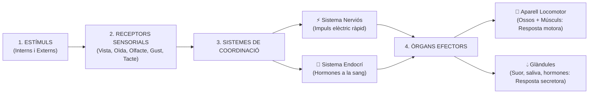

# UD8: La Relació Humana (Ciències Naturals)

Benvingut/da a la **Unitat Didàctica 8** de Ciències Aplicades I (bloc de Ciències Naturals). En aquesta unitat estudiarem com l'ésser humà capta la informació de l'entorn i del seu propi interior, la processa i executa respostes precises per sobreviure i mantindre l'**homeòstasi**. La unitat s'organitza en **5 sessions didàctiques**, cadascuna amb teoria detallada, esquemes conceptuals i una bateria completa d'activitats interactives i lliurament en PDF per a Aules.

---

## 📑 Planificació de Subunitats Didàctiques (1 Sessió per Apartat)

| Sessió | Subunitat | Contingut Principal de la Sessió | Bateria d'Activitats | Enllaç Directe |
| :---: | :---: | :--- | :---: | :---: |
| **Sessió 1** | **8.1** | **La funció de relació:** Homeòstasi, circuit estímul-receptor-coordinador-efector, la neurona i la sinapsi. | MCQ, V/F, Vocabulari, Raonament i Aules | [**📖 Anar a la Sessió 8.1 →**](./nat0801.html) |
| **Sessió 2** | **8.2** | **Receptors sensorials:** Tipus de receptors i anatomia dels 5 òrgans dels sentits (vista, oïda i equilibri, olfacte, gust i tacte). | MCQ, V/F, Vocabulari, Raonament i Aules | [**📖 Anar a la Sessió 8.2 →**](./nat0802.html) |
| **Sessió 3** | **8.3** | **El sistema nerviós:** SNC (encèfal i medul·la espinal), SNP (somàtic i autònom simpàtic/parasimpàtic), actes voluntaris i reflexos. | MCQ, V/F, Vocabulari, Raonament i Aules | [**📖 Anar a la Sessió 8.3 →**](./nat0803.html) |
| **Sessió 4** | **8.4** | **L'aparell locomotor:** Sistema esquelètic (206 ossos i articulacions), sistema muscular (600 músculs i parelles antagòniques), lesions i ergonomia. | MCQ, V/F, Vocabulari, Raonament i Aules | [**📖 Anar a la Sessió 8.4 →**](./nat0804.html) |
| **Sessió 5** | **8.5** | **El sistema endocrí:** Glàndules endocrines, hormones i cèl·lules diana (hipòfisi, tiroide, pàncrees/insulina, suprarenals i gònades). | MCQ, V/F, Vocabulari, Raonament i Aules | [**📖 Anar a la Sessió 8.5 →**](./nat0805.html) |

---

## 🧠 Mapa Conceptual General de la Unitat 8

---

> [!IMPORTANT]
> ### 🎯 Objectius d'Aprenentatge de la UD8
> 1. Comprendre el mecanisme d'**homeòstasi** i identificar els quatre elements del circuit de la funció de relació humana.
> 2. Conéixer l'estructura de la **neurona** (soma, dendrites i axó amb mielina) i el funcionament electroquímic de la **sinapsi**.
> 3. Identificar les parts anatòmiques de l'**ull** i l'**orella**, així com els receptors del tacte, el gust i l'olfacte.
> 4. Diferenciar el **Sistema Nerviós Central** del **Perifèric**, i explicar per què un **acte reflex** medul·lar és més ràpid que un **acte voluntari** cerebral.
> 5. Analitzar com cooperen ossos, articulacions, lligaments, músculs i tendons en l'**aparell locomotor**, aplicant normes d'**ergonomia postural** al taller.
> 6. Relacionar les principals **glàndules endocrines** amb les seues **hormones** i comprendre malalties com la **diabetis mellitus** o les alteracions del tiroide.
