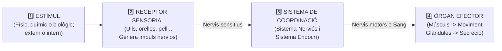
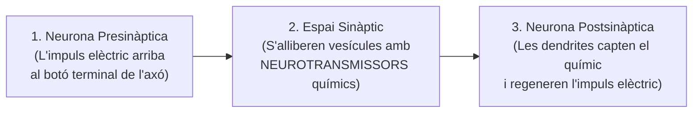
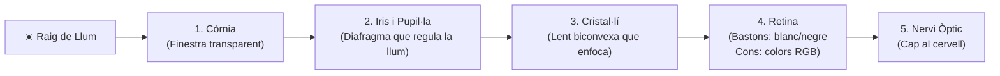
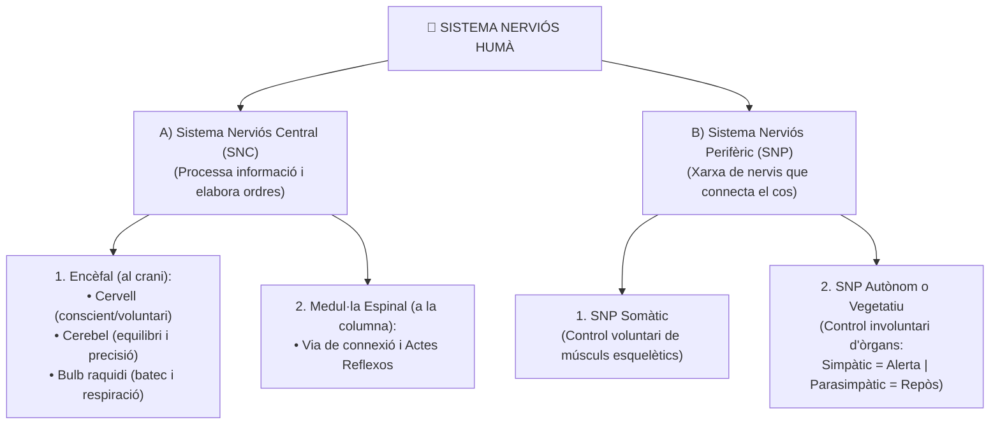
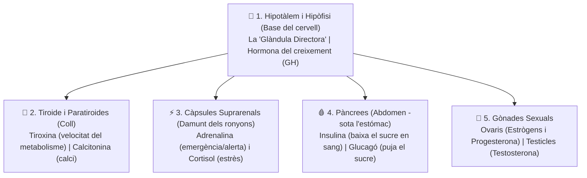

# 🔬 UD8: La Relació Humana — Temari Complet i Exercicis Diaris per a Aules

En aquesta pàgina tens tant l'**accés directe a cada sessió diària individual** (amb els seus **15 exercicis diaris** i el seu **botó de descàrrega de PDF per a pujar a Aules cada dia**) com la **vista completa de tota la unitat** amb tots els apartats i el **Butlletí Global d'Activitats Finals de la Unitat**.

---

## 📑 Planificació Diària de Sessions i Tasques d'Aules (UD8)

| Sessió | Apartat del Temari Oficial | Tasca Diària per a Aules | Accés Directe |
| :---: | :--- | :---: | :---: |
| **8.1** | **8.1 La funció de relació** | 15 Exercicis Diaris + PDF Aules | [**📖 Teoria + 🎯 15 Exercicis →**](./nat0801.html) · [**🎯 Anar a Exercicis →**](./nat0801.html#activitats) |
| **8.2** | **8.2 Receptors sensorials** | 15 Exercicis Diaris + PDF Aules | [**📖 Teoria + 🎯 15 Exercicis →**](./nat0802.html) · [**🎯 Anar a Exercicis →**](./nat0802.html#activitats) |
| **8.3** | **8.3 El sistema nerviós** | 15 Exercicis Diaris + PDF Aules | [**📖 Teoria + 🎯 15 Exercicis →**](./nat0803.html) · [**🎯 Anar a Exercicis →**](./nat0803.html#activitats) |
| **8.4** | **8.4 L'aparell locomotor** | 15 Exercicis Diaris + PDF Aules | [**📖 Teoria + 🎯 15 Exercicis →**](./nat0804.html) · [**🎯 Anar a Exercicis →**](./nat0804.html#activitats) |
| **8.5** | **8.5 El sistema endocrí** | 15 Exercicis Diaris + PDF Aules | [**📖 Teoria + 🎯 15 Exercicis →**](./nat0805.html) · [**🎯 Anar a Exercicis →**](./nat0805.html#activitats) |
| **8.6** | **8.6 Activitats Finals i Tasca Global de la Unitat 8 (Aules)** | 21 Exercicis Globals + PDF Aules | [**📝 Fer Tasca Global UD →**](./nat0806.html) · [**🎯 Anar a Exercicis →**](./nat0806.html#activitats) |

---

<div class="interactive-progress-tracker" style="background:var(--bg-card); border:1px solid var(--border); border-radius:8px; padding:16px; margin:20px 0;">
  <div style="display:flex; justify-content:space-between; align-items:center;">
    <span style="font-weight:700; color:var(--text-color);">⚡ Progrés d'aprenentatge (8.1)</span>
    <span class="tracker-count" style="font-weight:700; color:#2563eb;">0 / 12 reptes resolts</span>
  </div>
  <div style="background:#e2e8f0; border-radius:999px; height:8px; overflow:hidden; margin-top:10px;">
    <div class="tracker-fill" style="background:#2563eb; width:0%; height:100%; transition:width 0.3s ease;"></div>
  </div>
</div>

## 📌 8.1 La funció de relació {#nat0801}

Cap ésser viu pot sobreviure aïllat del que passa al seu voltant ni desconnectat del seu propi interior. Si un operari al taller no sentira l'olor de fum d'un curtcircuit, si no poguera retirar la mà en tocar una xapa metàl·lica roent, o si el seu cos no sabera regular la temperatura quan fa $40^\circ\text{C}$ a l'estiu, la seua vida correria un perill immediat.

La **funció de relació** és la funció vital mitjançant la qual l'ésser humà capta informació dels canvis que es produeixen a l'exterior o a l'interior del cos (**estímuls**), integra i analitza aquesta informació en els **sistemes de coordinació**, i elabora **respostes** adequades per adaptar-se i sobreviure.

---

## 1. Supervivència i Homeòstasi: L'Equilibri Intern

La funció de relació té dues grans finalitats biològiques:
1. **L'adaptació al medi extern:** Ens permet desplaçar-nos, alimentar-nos, comunicar-nos amb altres persones, aprendre un ofici i fugir o protegir-nos dels perills físics (foc, caigudes, trànsit, sorolls intensos).
2. **L'homeòstasi (equilibri del medi intern):** És el conjunt de mecanismes d'autoregulació que mantenen constants les condicions físiques i químiques internes del nostre organisme, independentment dels canvis bruscos de l'exterior. Exemples clau d'homeòstasi són:
   - **Temperatura corporal constant:** Es manté sempre entre **$36{,}5^\circ\text{C}$ i $37^\circ\text{C}$**. Si fa molta calor, suem per refredar la pell; si fa molt de fred, tremolem per produir calor muscular.
   - **Glucèmia (nivell de sucre a la sang):** Es manté al voltant de $70-100\text{ mg/dL}$ en dejú gràcies a hormones com la insulina i el glucagó.
   - **Tensió arterial i equilibri hídric:** Regulació de la quantitat d'aigua i sals minerals a la sang i l'orina.

---

## 2. El Circuit de la Funció de Relació en 4 Passos

Tota acció de relació —des de parar un penal jugant a futbol fins a segregar adrenalina en un esglai— segueix sempre un circuit ordenat de **quatre etapes fonamentals**:



### Pas 1: L'Estímul
Un **estímul** és qualsevol canvi físic, químic o biològic, tant de l'entorn exterior com de l'interior del nostre cos, que és capaç de desencadenar una resposta en l'organisme.
- **Segons la seua naturalesa:**
  - **Estímuls físics:** La llum, el so (ones sonores), la temperatura (fred o calor), la pressió mecànica o la gravetat.
  - **Estímuls químics:** Les substàncies volàtils de l'aire (olors), les molècules dissoltes als aliments (sabors) o la concentració d'$\text{O}_2$, $\text{CO}_2$ i glucosa a la sang.
  - **Estímuls biològics o biòtics:** La presència d'altres éssers vius (una altra persona que ens parla, un gos que borda, una infecció).
- **Segons la seua procedència:**
  - **Estímuls externs:** Provenen de fora del cos (el so d'una alarma al taller, la llum d'un semàfor).
  - **Estímuls interns:** Provenen del propi organisme (la sensació de fam a l'estómac buit, la set per falta d'aigua, el dolor d'una contractura muscular).

### Pas 2: Els Receptors Sensorials
Són cèl·lules nervioses especialitzades o òrgans complexos (els **òrgans dels sentits**: vista, oïda, olfacte, gust i tacte) que detecten un tipus concret d'estímul i el tradueixen en un senyal elèctric anomenat **impuls nerviós**, que viatja pels **nervis sensitius** cap als centres de coordinació.

### Pas 3: Els Sistemes de Coordinació
Reben la informació dels receptors, la interpreten i decideixen quina és la resposta més adequada. L'ésser humà disposa de dos sistemes coordinadors que treballen en equip:
- **El Sistema Nerviós:** Utilitza **impulsos elèctrics** que viatgen a gran velocitat (fins a $100\text{ m/s}$) al llarg dels nervis. Proporciona respostes **molt ràpides, precises i de curta durada** (com moure la mà o parpellejar).
- **El Sistema Endocrí (o Hormonal):** Utilitza missatgers químics anomenats **hormones**, que viatgen dissoltes per la sang. Proporciona respostes **més lentes, però molt duradores i sostingudes en el temps** (com el creixement corporal, la pubertat o el control del metabolisme).

### Pas 4: Els Òrgans Efectors i l'Execució de la Resposta
Són els òrgans encarregats d'executar l'ordre enviada pels sistemes de coordinació. Hi ha dos tipus de resposta:

| Tipus de Resposta | Òrgan Efector | Mecanisme i Exemples Pràctics |
| :--- | :--- | :--- |
| **Resposta Motora (Moviment)** | **Músculs i ossos** de l'**aparell locomotor** | Els músculs reben l'ordre pels nervis motors, es contrauen i estiren els ossos produint un moviment (caminar, escriure, retirar la mà del foc, bategar el cor). |
| **Resposta Secretora (Secreció)** | **Glàndules** (exocrines o endocrines) | Les glàndules fabriquen i alliberen substàncies químiques líquides: **saliva** en vore menjar, **suor** quan tenim calor, **llàgrimes** per protegir l'ull o **hormones** a la sang. |

---

## 3. La Neurona i l'Impuls Nerviós

La unitat cel·lular bàsica del sistema nerviós és la **neurona**. Són cèl·lules altament especialitzades a generar i conduir corrents elèctrics febles (impulsos nerviosos). Com que les neurones adultes gairebé no es poden dividir ni reproduir, estan acompanyades i nodrides per les **cèl·lules de la glia (neuroglia)**, que les protegeixen i aïllen.

### Anatomia de la Neurona (3 parts)
1. **Soma o cos cel·lular:** És la part central i més ampla de la neurona. Conté el **nucli** (amb l'ADN) i la majoria d'orgànuls (com els mitocondris que fabriquen l'energia necessària). És el centre metabòlic de la cèl·lula.
2. **Dendrites:** Són prolongacions curtes, molt nombroses i ramificades com les branques d'un arbre que ixen del soma. Actuen com a **antenes receptores**: capten els impulsos nerviosos procedents d'altres neurones o dels receptors sensorials.
3. **Axó (o neurita):** És una única prolongació llarga i cilíndrica que ix del soma (pot mesurar des de mil·límetres fins a més d'un metre, com l'axó del nervi ciàtic que va de la columna al peu!). Condueix l'impuls nerviós des del soma fins a la següent neurona o fins a un múscul.
   - **Beina de mielina:** Molts axons estan recoberts per una funda aïllant de greix blanquinós anomenada **mielina** (formada per les cèl·lules de Schwann). Igual que el plàstic aïllant d'un cable elèctric de coure, la mielina evita que el senyal es perda i fa que l'impuls nerviós viatge a salts ultraràpids (**conducció saltatòria**).

---

## 4. La Sinapsi i els Neurotransmissors

Les neurones **no es toquen físicament entre si**; entre el final de l'axó d'una neurona i les dendrites de la següent hi ha una separació microscòpica. Aquesta zona de comunicació funcional entre dues neurones (o entre una neurona i un múscul) s'anomena **sinapsi**.



### Com funciona la transmissió sinàptica?
L'impuls nerviós és sempre **unidireccional** (va sempre des de les dendrites $\rightarrow$ soma $\rightarrow$ axó) i combina electricitat i química:
1. **Neurona presinàptica (emissora):** L'impuls elèctric recorre l'axó i arriba als **botons terminals** de l'extrem.
2. **Espai o fenedura sinàptica:** Com que el corrent elèctric no pot saltar el buit, el botó terminal allibera a l'espai sinàptic unes substàncies químiques emmagatzemades en vesícules anomenades **neurotransmissors**.
3. **Neurona postsinàptica (receptora):** Els neurotransmissors creuen l'espai sinàptic i encaixen com una clau en el seu pany en els receptors de la membrana de les dendrites de la següent neurona, fet que genera un nou impuls elèctric.

> [!TIP]
> ### 🧪 Principals Neurotransmissors del Cos Humà
> - **Acetilcolina:** És el neurotransmissor que connecta les neurones motores amb els músculs esquelètics per ordenar la **contracció muscular**, i participa en l'atenció i la memòria.
> - **Dopamina:** Regula la coordinació motora, la motivació i el sistema de plaer i recompensa del cervell.
> - **Serotonina:** Regula l'estat d'ànim, les emocions, la gana i el cicle de la son (un dèficit s'associa a la depressió).
> - **Adrenalina i Noradrenalina:** Activen l'estat d'alerta màxima, la concentració i la resposta de lluita o fugida davant d'un perill.

---

> [!NOTE]
> ### 💡 Resum de Conceptes Clau
> - La **funció de relació** ens permet adaptar-nos a l'exterior i mantindre l'**homeòstasi** (equilibri intern de temperatura a $36{,}5-37^\circ\text{C}$, glucosa, etc.).
> - El circuit consta sempre de 4 fases: **1) Estímul $\rightarrow$ 2) Receptor sensorial $\rightarrow$ 3) Sistema coordinador (Nerviós o Endocrí) $\rightarrow$ 4) Efector (múscul o glàndula)**.
> - La **neurona** consta de **dendrites** (reben el senyal), **soma** (cos amb nucli) i **axó** recobert de **mielina** (transmet el senyal).
> - La **sinapsi** és la comunicació sense contacte físic entre neurones mitjançant missatgers químics anomenats **neurotransmissors**.

---

## 🎯 Activitats i Autoavaluació Interactiva (15 Exercicis Diaris)

<div class="interactive-progress-tracker">
  <div class="tracker-header">
    <span>🎮 <strong>Zona d'Entrenament FPB:</strong> <span class="tracker-count">0 / 12 reptes resolts</span></span>
    <span class="tracker-pts">⭐ 0 punts</span>
  </div>
  <div class="tracker-bar"><div class="tracker-fill" style="width: 0%;"></div></div>
</div>

### 1. Qüestionari d'Autoavaluació Tipus Test (MCQ)

<div class="interactive-mcq" data-quiz-id="nat0801_mcq1" data-answer="B" data-hint="Recorda l'ordre lògic des que es produeix el canvi a l'entorn fins que el múscul o la glàndula executa l'acció.">
  <p class="mcq-question"><strong>1. Quin és l'ordre correcte dels quatre elements que intervenen en el circuit de la funció de relació?</strong></p>
  <div class="mcq-options">
    <button type="button" class="btn-mcq-opt" data-opt="A">A) Òrgan efector → Sistema coordinador → Estímul → Receptor sensorial</button>
    <button type="button" class="btn-mcq-opt" data-opt="B">B) Estímul → Receptor sensorial → Sistema de coordinació → Òrgan efector</button>
    <button type="button" class="btn-mcq-opt" data-opt="C">C) Receptor sensorial → Estímul → Òrgan efector → Sistema de coordinació</button>
    <button type="button" class="btn-mcq-opt" data-opt="D">D) Estímul → Òrgan efector → Receptor sensorial → Glàndula</button>
  </div>
  <div class="quiz-feedback"></div>
</div>

<div class="interactive-mcq" data-quiz-id="nat0801_mcq2" data-answer="C" data-hint="Les dendrites són les antenes d'entrada i l'axó és el cable llarg d'eixida recobert de mielina.">
  <p class="mcq-question"><strong>2. En quin sentit viatja sempre l'impuls nerviós per l'interior d'una neurona i com passa a la neurona següent?</strong></p>
  <div class="mcq-options">
    <button type="button" class="btn-mcq-opt" data-opt="A">A) Entra per l'axó, passa al soma i ix per les dendrites tocant físicament l'altra neurona</button>
    <button type="button" class="btn-mcq-opt" data-opt="B">B) Viatja per la sang des de la mielina fins al nucli</button>
    <button type="button" class="btn-mcq-opt" data-opt="C">C) Entra per les dendrites, travessa el soma, recorre l'axó i creua l'espai sinàptic mitjançant neurotransmissors químics</button>
    <button type="button" class="btn-mcq-opt" data-opt="D">D) Pot viatjar en qualsevol direcció sense necessitat de neurotransmissors</button>
  </div>
  <div class="quiz-feedback"></div>
</div>

<div class="interactive-mcq" data-quiz-id="nat0801_mcq3" data-answer="A" data-hint="Funciona igual que la funda de plàstic d'un cable elèctric i permet la conducció saltatòria.">
  <p class="mcq-question"><strong>3. Quina és la funció principal de la beina de mielina que envolta l'axó de moltes neurones?</strong></p>
  <div class="mcq-options">
    <button type="button" class="btn-mcq-opt" data-opt="A">A) Actuar com a aïllant elèctric i accelerar la velocitat de transmissió de l'impuls nerviós fins a 100 m/s</button>
    <button type="button" class="btn-mcq-opt" data-opt="B">B) Fabricar glòbuls vermells i anticossos per a la sang</button>
    <button type="button" class="btn-mcq-opt" data-opt="C">C) Frenar l'impuls nerviós perquè no arribe als músculs</button>
    <button type="button" class="btn-mcq-opt" data-opt="D">D) Substituir el nucli cel·lular del soma</button>
  </div>
  <div class="quiz-feedback"></div>
</div>

<div class="interactive-mcq" data-quiz-id="nat0801_mcq4" data-answer="D" data-hint="Fixa't en quin és l'òrgan efector que executa l'ordre en cada cas: múscul o glàndula.">
  <p class="mcq-question"><strong>4. Quina diferència hi ha entre una resposta motora i una resposta secretora?</strong></p>
  <div class="mcq-options">
    <button type="button" class="btn-mcq-opt" data-opt="A">A) La resposta motora la fan les glàndules i la secretora la fan els ossos</button>
    <button type="button" class="btn-mcq-opt" data-opt="B">B) La resposta motora és sempre involuntària i la secretora és sempre voluntària</button>
    <button type="button" class="btn-mcq-opt" data-opt="C">C) No hi ha cap diferència entre totes dues respostes</button>
    <button type="button" class="btn-mcq-opt" data-opt="D">D) La resposta motora l'executen els músculs produint moviment, mentre que la resposta secretora l'executen les glàndules alliberant substàncies (suor, saliva, hormones)</button>
  </div>
  <div class="quiz-feedback"></div>
</div>

---

### 2. Activitats de Vertader (V) o Fals (F)

<div class="interactive-vf" data-quiz-id="nat0801_vf1" data-answer="V" data-hint="VERTADER: Quan l'òrgan efector és una glàndula que segrega saliva, suor o hormones parlem de resposta secretora.">
  <span class="vf-statement"><strong>a) Quan sentim olor de menjar en tindre fam i les nostres glàndules salivals comencen a fabricar saliva, s'està produint una resposta secretora.</strong></span>
  <div class="vf-buttons">
    <button type="button" class="btn-vf" data-opt="V">V</button>
    <button type="button" class="btn-vf" data-opt="F">F</button>
  </div>
  <div class="quiz-feedback"></div>
</div>

<div class="interactive-vf" data-quiz-id="nat0801_vf2" data-answer="F" data-hint="FALS: En la sinapsi les neurones NO es toquen físicament; estan separades per l'espai sinàptic i es comuniquen alliberant neurotransmissors químics.">
  <span class="vf-statement"><strong>b) En la sinapsi, l'axó d'una neurona està soldat i unit físicament a les dendrites de la neurona següent perquè el corrent elèctric no s'interrompa.</strong></span>
  <div class="vf-buttons">
    <button type="button" class="btn-vf" data-opt="V">V</button>
    <button type="button" class="btn-vf" data-opt="F">F</button>
  </div>
  <div class="quiz-feedback"></div>
</div>

<div class="interactive-vf" data-quiz-id="nat0801_vf3" data-answer="V" data-hint="VERTADER: L'homeòstasi garanteix l'equilibri físic i químic del medi intern malgrat els canvis de l'exterior.">
  <span class="vf-statement"><strong>c) L'homeòstasi és la capacitat de l'organisme de mantindre constants condicions internes com la temperatura corporal (36,5-37 °C) o el nivell de glucosa a la sang.</strong></span>
  <div class="vf-buttons">
    <button type="button" class="btn-vf" data-opt="V">V</button>
    <button type="button" class="btn-vf" data-opt="F">F</button>
  </div>
  <div class="quiz-feedback"></div>
</div>

<div class="interactive-vf" data-quiz-id="nat0801_vf4" data-answer="F" data-hint="FALS: És just al revés: el sistema nerviós usa impulsos elèctrics ràpids pels nervis, i el sistema endocrí usa hormones per la sang.">
  <span class="vf-statement"><strong>d) El sistema endocrí transmet les seues ordres mitjançant impulsos elèctrics pels nervis en mil·lisegons, mentre que el sistema nerviós envia hormones per la sang.</strong></span>
  <div class="vf-buttons">
    <button type="button" class="btn-vf" data-opt="V">V</button>
    <button type="button" class="btn-vf" data-opt="F">F</button>
  </div>
  <div class="quiz-feedback"></div>
</div>

---

### 3. Exercicis de Resposta Breu, Vocabulari Tècnic i Càlcul

<div class="interactive-quiz" data-quiz-id="nat0801_q1" data-answer="homeòstasi|homeostasi" data-hint="Comença per h: manté constants els 36,5-37 °C de temperatura o el sucre en sang.">
  <div class="quiz-question">✍️ <strong>1.</strong> Com s'anomena el conjunt de mecanismes d'autoregulació que mantenen l'equilibri i l'estabilitat del medi intern del nostre cos?</div>
  <div class="quiz-controls">
    <input type="text" class="quiz-input" placeholder="Escriu el terme científic...">
    <button type="button" class="btn-quiz-check">Comprovar</button>
  </div>
  <div class="quiz-feedback"></div>
</div>

<div class="interactive-quiz" data-quiz-id="nat0801_q2" data-answer="neurotransmissors|neurotransmissor" data-hint="Comença per neuro-: són els missatgers químics de la sinapsi.">
  <div class="quiz-question">✍️ <strong>2.</strong> Com s'anomenen les substàncies químiques (com la dopamina o l'acetilcolina) que s'alliberen a l'espai sinàptic per transmetre el senyal d'una neurona a la següent?</div>
  <div class="quiz-controls">
    <input type="text" class="quiz-input" placeholder="Escriu el terme...">
    <button type="button" class="btn-quiz-check">Comprovar</button>
  </div>
  <div class="quiz-feedback"></div>
</div>

<div class="interactive-quiz" data-quiz-id="nat0801_q3" data-answer="axó|axo|neurita" data-hint="És el cable llarg d'eixida de la neurona, recobert sovint de mielina.">
  <div class="quiz-question">✍️ <strong>3.</strong> Quina part de la neurona té forma de prolongació llarga única i s'encarrega de conduir l'impuls nerviós des del soma fins als botons terminals?</div>
  <div class="quiz-controls">
    <input type="text" class="quiz-input" placeholder="Escriu la part de la neurona...">
    <button type="button" class="btn-quiz-check">Comprovar</button>
  </div>
  <div class="quiz-feedback"></div>
</div>

<div class="interactive-quiz" data-quiz-id="nat0801_q4" data-answer="10|10 ms|10 mil·lisegons" data-hint="Divideix 1 m entre 100 m/s = 0,01 segons, i passa-ho a mil·lisegons multiplicant per 1000.">
  <div class="quiz-question">✍️ <strong>4.</strong> Càlcul fisiològic: Si un impuls nerviós viatja per un axó mielinitzat a una velocitat de 100 m/s, quants mil·lisegons (ms) tardarà a recórrer la distància d'1 metre des de la medul·la espinal fins als músculs del peu?</div>
  <div class="quiz-controls">
    <input type="text" class="quiz-input" placeholder="Escriu el valor numèric en ms...">
    <button type="button" class="btn-quiz-check">Comprovar</button>
  </div>
  <div class="quiz-feedback"></div>
</div>

---

### 4. Exercicis de Raonament i Desenvolupament Escrit (Tasca d'Aula)

<div class="interactive-open-response" data-question-id="nat0801_open1">
  <div class="open-question">✍️ <strong>1. Anàlisi d'un cas real al taller:</strong> Imagina que estàs treballant al taller i, de sobte, sona la sirena d'emergència contra incendis i ixes caminant ràpidament cap al pati. Identifica en aquesta situació: 1) Quin és l'estímul i de quin tipus és, 2) Quin és el receptor sensorial, 3) Quin sistema de coordinació actua i 4) Quins són els òrgans efectors i quin tipus de resposta executen.</div>
  <textarea class="open-response-input" rows="4" placeholder="1) Estímul: ...
2) Receptor: ...
3) Coordinador: ...
4) Efectors i tipus de resposta: ..."></textarea>
</div>

<div class="interactive-open-response" data-question-id="nat0801_open2">
  <div class="open-question">✍️ <strong>2. Mecanisme d'homeòstasi tèrmica:</strong> Explica detalladament com actua la funció de relació per mantindre l'homeòstasi de la temperatura corporal (36,5-37 °C) en dues situacions oposades: A) Quan a l'estiu treballes a 38 °C i el cos sua, i B) Quan a l'hivern estàs a 2 °C i el cos tremola. Indica quin tipus de resposta (motora o secretora) és cadascuna.</div>
  <textarea class="open-response-input" rows="4" placeholder="A) Davant la calor (suor -> resposta secretora): ...
B) Davant el fred (tremolor -> resposta motora): ..."></textarea>
</div>

<div class="interactive-open-response" data-question-id="nat0801_open3">
  <div class="open-question">✍️ <strong>3. Anatomia neuronal i esclerosi múltiple:</strong> Dibuixa mentalment una neurona i explica la funció de les dendrites, el soma i l'axó. A continuació, raona què li passarà a la coordinació muscular d'una persona si una malaltia destrueix la beina de mielina dels seus axons.</div>
  <textarea class="open-response-input" rows="4" placeholder="Funcions de dendrites, soma i axó: ...
Conseqüència de perdre la mielina: ..."></textarea>
</div>

---

<div class="aules-delivery-card" style="border:2px dashed #0284c7; border-radius:8px; padding:16px; background:#f0f9ff; margin:24px 0;">
  <h3 style="margin-top:0; color:#0369a1;">📦 Lliurament d'Activitats d'Aules (Act 8.1)</h3>
  <p>Genera el teu document de tasca d'aquest apartat amb el teu nom i els 15 exercicis completats.</p>
  <div style="display:flex; gap:12px; align-items:center; flex-wrap:wrap;">
    <input type="text" class="aules-student-name" placeholder="Cognoms, Nom de l'Alumne/a" style="padding:8px 12px; border:1px solid #94a3b8; border-radius:4px; flex-grow:1; min-width:240px;">
    <button class="btn-generate-aules-pdf" data-unit="NAT08" data-activity="Act01" data-module="CA" style="padding:8px 16px; background:#0284c7; color:#fff; border:none; border-radius:4px; font-weight:600; cursor:pointer;">📄 Descarregar PDF per a Aules</button>
  </div>
</div>


---

<div class="interactive-progress-tracker" style="background:var(--bg-card); border:1px solid var(--border); border-radius:8px; padding:16px; margin:20px 0;">
  <div style="display:flex; justify-content:space-between; align-items:center;">
    <span style="font-weight:700; color:var(--text-color);">⚡ Progrés d'aprenentatge (8.2)</span>
    <span class="tracker-count" style="font-weight:700; color:#2563eb;">0 / 12 reptes resolts</span>
  </div>
  <div style="background:#e2e8f0; border-radius:999px; height:8px; overflow:hidden; margin-top:10px;">
    <div class="tracker-fill" style="background:#2563eb; width:0%; height:100%; transition:width 0.3s ease;"></div>
  </div>
</div>

## 📌 8.2 Receptors sensorials {#nat0802}

Els **receptors sensorials** són estructures formades per cèl·lules nervioses especialitzades capaces de detectar estímuls específics i transformar-los en impulsos nerviosos elèctrics que s'envien al sistema nerviós central. Quan aquests receptors s'agrupen en estructures anatòmiques complexes, formen els cinc **òrgans dels sentits**.

---

## 1. Classificació dels Receptors Sensorials

Segons d'on prové l'estímul i quina energia capten, classifiquem els receptors en dues grans categories:

### A) Segons la procedència de l'estímul
- **Interoceptors (receptors interns):** Situats a l'interior de les vísceres, músculs, tendons i vasos sanguinis. Informen sobre l'estat intern del cos: la fam, la set, les ganes d'orinar, la tensió arterial, la falta d'oxigen o la posició de les articulacions (**propioceptors**).
- **Exteroceptors (receptors externs):** Situats a la superfície del cos (en els 5 òrgans dels sentits). Capten la informació del món exterior (llum, sons, olors, sabors, contacte físic).

### B) Segons el tipus d'estímul que detecten

| Tipus de Receptor | Estímul que Capta | Localització Principal al Cos Humà |
| :--- | :--- | :--- |
| **Fotoreceptors** | Estímuls lluminosos (llum i colors) | A la **retina de l'ull** (els **cons** i els **bastons**). |
| **Mecanoreceptors** | Deformacions mecàniques: pressió, contacte, vibracions, ones sonores i gravetat | A la **pell** (tacte), al **cargol de l'orella** (audició) i als **canals semicirculars** (equilibri). |
| **Quimioreceptors** | Substàncies químiques dissoltes en l'aire o en els líquids (saliva, sang) | A les **foses nasals** (olfacte) i als **botons gustatius de la llengua** (gust). |
| **Termoreceptors** | Variacions de temperatura (entrada o pèrdua de calor: fred i calor) | Repartits per la **dermis de la pell** (corpuscles de Krause per al fred i de Ruffini per a la calor). |
| **Nociceptors** | Dany als teixits (colps forts, cremades, talls o substàncies corrosives): **el dolor** | Terminacions nervioses lliures repartides per la **pell** i la majoria d'òrgans interns. |

---

## 2. Els Cinc Òrgans dels Sentits

### 1. La Vista: L'Ull (Fotoreceptors)
L'**ull** o globus ocular és un òrgan esfèric encarregat de captar la llum i enfocar les imatges. Està protegit per estructures annexes: les **celles** (desvien la suor), les **parpelles** i **pestanyes** (impedeixen l'entrada de pols) i les **glàndules lacrimals** (netegen i lubriquen amb llàgrimes bactericides).



- **Anatomia i funcionament òptic de l'ull:**
  1. **Escleròtica i Còrnia:** L'escleròtica és la capa externa dura ("el blanc de l'ull"), que per la part davantera es torna totalment transparent i corbada formant la **còrnia**, per on entra la llum.
  2. **Coroide, Iris i Pupil·la:** L'**iris** és el disc acolorit de l'ull (marró, blau, verd). Al seu centre té un orifici negre anomenat **pupil·la**, que funciona com el diafragma d'una càmera: quan hi ha molta llum es tanca per no enlluernar, i a les fosques es dilata per deixar passar més llum.
  3. **Cristal·lí:** Situat darrere de la pupil·la, és una **lent biconvexa elàstica i transparent**. Gràcies als músculs ciliars modifica la seua curvatura (**acomodació**) per enfocar amb nitidesa objectes pròxims o llunyans sobre la retina.
  4. **Retina:** És la capa interna on es projecta la imatge (invertida). Conté milions de cèl·lules **fotoreceptores**:
     - **Bastons (uns 120 milions):** Molt sensibles a la llum feble; permeten la visió nocturna en blanc, negre i grisos, però no distingeixen els colors.
     - **Cons (uns 6-7 milions):** Concentrats al centre de la retina (**fòvea**); necessiten bona il·luminació i capten els **colors** (roig, verd i blau - RGB) i els detalls fins.
  5. **Nervi òptic:** Recull els impulsos elèctrics de la retina i els porta al lòbul occipital del cervell, que interpreta la imatge dreta i en tres dimensions.
- **Defectes visuals freqüents:**
  - **Miopia:** El globus ocular és massa llarg i la imatge s'enfoca *davant* de la retina; **es veuen borrosos els objectes llunyans** (es corregeix amb lents divergents).
  - **Hipermetropia:** L'ull és més curt i la imatge es forma *darrere* de la retina; **costa enfocar els objectes pròxims** (lents convergents).
  - **Astigmatisme:** Curvatura irregular de la còrnia que deforma les línies tant de prop com de lluny.
  - **Cataractes:** Pèrdua de transparència del cristal·lí amb l'edat.

---

### 2. L'Oïda i l'Equilibri: L'Orella (Mecanoreceptors)
L'**orella** és un òrgan doble que allotja dos sentits alhora: l'**audició** i el **sentit de l'equilibri**. Es divideix en tres parts:

1. **Orella Externa:**
   - **Pavelló auditiu (orella):** Estructura de cartílag amb forma d'embut que recull les ones sonores de l'aire i les dirigeix cap al **conducte auditiu extern** (que conté pèls i cera protectora).
   - **Timpà:** Membrana elàstica tensa (com la pell d'un tambor) que vibra quan xoquen contra ella les ones sonores.
2. **Orella Mitjana:**
   - **Cadena d'ossets:** Cavitat plena d'aire (comunicada amb la faringe per la **trompa d'Eustaqui** per equilibrar pressions) que conté els tres ossos més menuts del cos humà encadenats: **Martell $\rightarrow$ Enclusa $\rightarrow$ Estrep**. Amplifiquen la vibració del timpà i la transmeten a la finestra oval de l'orella interna.
3. **Orella Interna (Laberint):** Plena d'un líquid anomenat endolimfa, té dues estructures:
   - **El Cargol o Còclea (Audició):** Tub enrotllat en espiral on es troba l'**òrgan de Corti**, ple de cèl·lules ciliades mecanoreceptores que transformen la vibració del líquid en impulsos elèctrics enviats pel **nervi auditiu** al cervell.
   - **Els Canals Semicirculars i el Vestíbul (Equilibri):** Tres conductes orientats en les 3 dimensions de l'espai. Quan movem o girem el cap, el líquid interior es desplaça, mou els cilis i informa el cerebel de la nostra posició i moviment per no caure.

---

### 3. L'Olfacte (Quimioreceptors gasosos)
Resideix a la part superior de les **foses nasals**. L'interior del nas està tapissat per dues mucoses:
- **Pituitària roja (inferior):** Plena de capil·lars sanguinis que escalfen i humitegen l'aire inspirat.
- **Pituitària groga (superior):** Conté milions de neurones **quimioreceptores olfactives**. Quan les molècules volàtils de l'aire (el perfum d'una flor, l'olor de gas butà o de menjar cremat) es dissolen en el moc nasal, estimulen la pituitària groga, la qual envia el senyal al **bulb olfactori** i d'ací al cervell.

---

### 4. El Gust (Quimioreceptors líquids)
Els receptors del gust es troben principalment a la **llengua**, dins d'unes petites protuberàncies anomenades **papil·les gustatives**, que contenen els **botons gustatius**.
- Perquè puguem percebre el gust d'un aliment, les seues molècules químiques s'han de **dissoldre prèviament en la saliva**.
- El gust humà distingeix **5 sabors bàsics**:
  1. **Dolç** (sucres i hidrats de carboni simples).
  2. **Salat** (clorur de sodi i altres sals minerals).
  3. **Àcid** (cítrics com la llima o el vinagre).
  4. **Amarg** (café pur, tònica; biològicament ens alerta de possibles verins o toxines).
  5. **Umami** ("saborós" en japonés: detecta l'aminoàcid glutamat present a la carn curada, el formatge vell, el pernil o la salsa de soja).

> [!TIP]
> ### 👃👅 Per què quan estem constipats el menjar no té gust?
> El que popularment anomenem "sabor" d'un plat és en realitat la suma del **20% de gust** (els 5 sabors bàsics a la llengua) i el **80% d'olfacte** (les aromes que pugen des de la boca cap a les foses nasals per la faringe mentre masteguem). Quan el moc d'un refredat bloqueja la pituitària groga, perdem el matís aromàtic dels aliments!

---

### 5. El Tacte: La Pell (Mecano-, Termo- i Nociceptors)
La **pell** és l'òrgan més extens del cos humà. Consta d'una capa externa protectora (**epidermis**), una capa intermèdia rica en nervis i vasos (**dermis**) i una capa inferior de greix (**hipodermis**). A la **dermis** es troben els **corpuscles tàctils**:
- **Corpuscles de Meissner i Vater-Pacini (Mecanoreceptors):** Detecten el contacte suau, la textura, les vibracions i la pressió profunda. Són molt abundants a la punta dels dits i als llavis.
- **Corpuscles de Krause i de Ruffini (Termoreceptors):** Detecten el **fred** (Krause) i la **calor** (Ruffini).
- **Terminacions nervioses lliures (Nociceptors):** Capten el **dolor** quan hi ha dany tissular.

---

> [!NOTE]
> ### 💡 Resum de Conceptes Clau
> - Els receptors es classifiquen en **fotoreceptors** (llum), **mecanoreceptors** (so, equilibri, pressió), **quimioreceptors** (olor i gust), **termoreceptors** (fred/calor) i **nociceptors** (dolor).
> - A l'**ull**, la pupil·la regula la llum, el **cristal·lí** enfoca i la **retina** capta la imatge amb els **bastons** (llum feble) i els **cons** (colors).
> - A l'**orella**, el timpà i la cadena **martell-enclusa-estrep** porten el so al **cargol (còclea)**, mentre que els **canals semicirculars** controlen l'**equilibri**.

---

## 🎯 Activitats i Autoavaluació Interactiva (15 Exercicis Diaris)

<div class="interactive-progress-tracker">
  <div class="tracker-header">
    <span>🎮 <strong>Zona d'Entrenament FPB:</strong> <span class="tracker-count">0 / 12 reptes resolts</span></span>
    <span class="tracker-pts">⭐ 0 punts</span>
  </div>
  <div class="tracker-bar"><div class="tracker-fill" style="width: 0%;"></div></div>
</div>

### 1. Qüestionari d'Autoavaluació Tipus Test (MCQ)

<div class="interactive-mcq" data-quiz-id="nat0802_mcq1" data-answer="D" data-hint="És la capa més interna del globus ocular on es troben els fotoreceptors.">
  <p class="mcq-question"><strong>1. A quina part de l'ull es troben els cons (visió en color) i els bastons (visió amb poca llum)?</strong></p>
  <div class="mcq-options">
    <button type="button" class="btn-mcq-opt" data-opt="A">A) A la còrnia i l'escleròtica</button>
    <button type="button" class="btn-mcq-opt" data-opt="B">B) Al cristal·lí</button>
    <button type="button" class="btn-mcq-opt" data-opt="C">C) A l'iris i la pupil·la</button>
    <button type="button" class="btn-mcq-opt" data-opt="D">D) A la retina</button>
  </div>
  <div class="quiz-feedback"></div>
</div>

<div class="interactive-mcq" data-quiz-id="nat0802_mcq2" data-answer="B" data-hint="El cargol o còclea s'encarrega de l'audició, mentre que els tres conductes orientats en l'espai detecten els girs del cap.">
  <p class="mcq-question"><strong>2. Quina estructura situada a l'orella interna és la responsable de detectar els moviments del cap i mantindre l'equilibri corporal?</strong></p>
  <div class="mcq-options">
    <button type="button" class="btn-mcq-opt" data-opt="A">A) El timpà i el pavelló auditiu</button>
    <button type="button" class="btn-mcq-opt" data-opt="B">B) Els canals semicirculars i el vestíbul</button>
    <button type="button" class="btn-mcq-opt" data-opt="C">C) La pituitària groga</button>
    <button type="button" class="btn-mcq-opt" data-opt="D">D) Els corpuscles de Meissner</button>
  </div>
  <div class="quiz-feedback"></div>
</div>

<div class="interactive-mcq" data-quiz-id="nat0802_mcq3" data-answer="A" data-hint="En aquest defecte el globus ocular és massa allargat i es corregeix amb lents divergents.">
  <p class="mcq-question"><strong>3. Quin defecte visual pateix una persona que veu borrosos els objectes llunyans perquè la imatge s'enfoca davant de la retina?</strong></p>
  <div class="mcq-options">
    <button type="button" class="btn-mcq-opt" data-opt="A">A) Miopia</button>
    <button type="button" class="btn-mcq-opt" data-opt="B">B) Hipermetropia</button>
    <button type="button" class="btn-mcq-opt" data-opt="C">C) Sordesa coclear</button>
    <button type="button" class="btn-mcq-opt" data-opt="D">D) Anòsmia</button>
  </div>
  <div class="quiz-feedback"></div>
</div>

<div class="interactive-mcq" data-quiz-id="nat0802_mcq4" data-answer="C" data-hint="Passa per l'orella externa (pavelló i timpà), orella mitjana (els 3 ossets) i orella interna (cargol).">
  <p class="mcq-question"><strong>4. Quin és el recorregut exacte que segueix una ona sonora des que entra a l'orella fins que arriba al nervi auditiu?</strong></p>
  <div class="mcq-options">
    <button type="button" class="btn-mcq-opt" data-opt="A">A) Timpà → Canals semicirculars → Trompa d'Eustaqui → Retina</button>
    <button type="button" class="btn-mcq-opt" data-opt="B">B) Pavelló → Cargol → Martell → Timpà → Nervi òptic</button>
    <button type="button" class="btn-mcq-opt" data-opt="C">C) Pavelló i conducte auditiu → Timpà → Martell, Enclusa i Estrep → Cargol (còclea) → Nervi auditiu</button>
    <button type="button" class="btn-mcq-opt" data-opt="D">D) Conducte auditiu → Pituitària groga → Bulb olfactori</button>
  </div>
  <div class="quiz-feedback"></div>
</div>

---

### 2. Activitats de Vertader (V) o Fals (F)

<div class="interactive-vf" data-quiz-id="nat0802_vf1" data-answer="V" data-hint="VERTADER: Tant la pituitària groga del nas com els botons gustatius de la llengua detecten substàncies químiques (gasoses o dissoltes en saliva).">
  <span class="vf-statement"><strong>a) Els sentits de l'olfacte i del gust funcionen tots dos gràcies a cèl·lules quimioreceptores.</strong></span>
  <div class="vf-buttons">
    <button type="button" class="btn-vf" data-opt="V">V</button>
    <button type="button" class="btn-vf" data-opt="F">F</button>
  </div>
  <div class="quiz-feedback"></div>
</div>

<div class="interactive-vf" data-quiz-id="nat0802_vf2" data-answer="F" data-hint="FALS: El martell, l'enclusa i l'estrep són la cadena d'ossets de l'orella mitjana; la lent que enfoca a l'ull és el cristal·lí.">
  <span class="vf-statement"><strong>b) El martell, l'enclusa i l'estrep són tres lents transparents situades dins de l'ull per enfocar de prop i de lluny.</strong></span>
  <div class="vf-buttons">
    <button type="button" class="btn-vf" data-opt="V">V</button>
    <button type="button" class="btn-vf" data-opt="F">F</button>
  </div>
  <div class="quiz-feedback"></div>
</div>

<div class="interactive-vf" data-quiz-id="nat0802_vf3" data-answer="V" data-hint="VERTADER: L'iris regula el diàmetre de la pupil·la com el diafragma d'una càmera fotogràfica.">
  <span class="vf-statement"><strong>c) Quan passem d'un lloc fosc a un lloc amb molta llum solar, la pupil·la es tanca (es fa més menuda) automàticament per protegir la retina.</strong></span>
  <div class="vf-buttons">
    <button type="button" class="btn-vf" data-opt="V">V</button>
    <button type="button" class="btn-vf" data-opt="F">F</button>
  </div>
  <div class="quiz-feedback"></div>
</div>

<div class="interactive-vf" data-quiz-id="nat0802_vf4" data-answer="F" data-hint="FALS: Els que capten els colors són els CONS; els bastons permeten veure-hi amb poca llum en blanc, negre i escala de grisos.">
  <span class="vf-statement"><strong>d) Els bastons de la retina són els fotoreceptors encarregats de distingir els colors roig, verd i blau (RGB) a plena llum del dia.</strong></span>
  <div class="vf-buttons">
    <button type="button" class="btn-vf" data-opt="V">V</button>
    <button type="button" class="btn-vf" data-opt="F">F</button>
  </div>
  <div class="quiz-feedback"></div>
</div>

---

### 3. Exercicis de Resposta Breu, Vocabulari Tècnic i Càlcul

<div class="interactive-quiz" data-quiz-id="nat0802_q1" data-answer="cristal·lí|cristalli|cristal.li" data-hint="És una lent elàstica situada darrere de l'iris i la pupil·la.">
  <div class="quiz-question">✍️ <strong>1.</strong> Com s'anomena la lent biconvexa natural de l'interior de l'ull que modifica la seua curvatura per enfocar les imatges sobre la retina?</div>
  <div class="quiz-controls">
    <input type="text" class="quiz-input" placeholder="Escriu el nom de la part de l'ull...">
    <button type="button" class="btn-quiz-check">Comprovar</button>
  </div>
  <div class="quiz-feedback"></div>
</div>

<div class="interactive-quiz" data-quiz-id="nat0802_q2" data-answer="nociceptors|nociceptor" data-hint="Acaba en -ceptors i capta els estímuls nocivos o dolorosos.">
  <div class="quiz-question">✍️ <strong>2.</strong> Quin és el nom científic dels receptors sensorials encarregats de detectar el dany als teixits i produir la sensació de dolor?</div>
  <div class="quiz-controls">
    <input type="text" class="quiz-input" placeholder="Escriu el tipus de receptor...">
    <button type="button" class="btn-quiz-check">Comprovar</button>
  </div>
  <div class="quiz-feedback"></div>
</div>

<div class="interactive-quiz" data-quiz-id="nat0802_q3" data-answer="cargol|còclea|coclea" data-hint="Té forma de conquilla de caragol i conté l'òrgan de Corti.">
  <div class="quiz-question">✍️ <strong>3.</strong> Com s'anomena l'estructura en forma d'espiral de l'orella interna on es troben les cèl·lules mecanoreceptores de l'audició?</div>
  <div class="quiz-controls">
    <input type="text" class="quiz-input" placeholder="Escriu el nom de l'estructura...">
    <button type="button" class="btn-quiz-check">Comprovar</button>
  </div>
  <div class="quiz-feedback"></div>
</div>

<div class="interactive-quiz" data-quiz-id="nat0802_q4" data-answer="umami" data-hint="És una paraula d'origen japonés que significa 'saborós'.">
  <div class="quiz-question">✍️ <strong>4.</strong> Com s'anomena el cinqué sabor bàsic (a més del dolç, salat, àcid i amarg) que detecta l'aminoàcid glutamat en aliments com el pernil, el formatge curat o la salsa de soja?</div>
  <div class="quiz-controls">
    <input type="text" class="quiz-input" placeholder="Escriu el nom del cinqué sabor...">
    <button type="button" class="btn-quiz-check">Comprovar</button>
  </div>
  <div class="quiz-feedback"></div>
</div>

---

### 4. Exercicis de Raonament i Desenvolupament Escrit (Tasca d'Aula)

<div class="interactive-open-response" data-question-id="nat0802_open1">
  <div class="open-question">✍️ <strong>1. Prevenció de riscos al taller (EPIs visuals i auditius):</strong> Explica el recorregut que fa una ona sonora molt forta (una radial tallant ferro a més de 100 dB) des que entra pel pavelló auditiu fins al nervi auditiu, i raona per què l'ús d'ulleres de seguretat i cascos d'oïda és indispensable per evitar lesions irreversibles a la còrnia i al cargol.</div>
  <textarea class="open-response-input" rows="4" placeholder="Recorregut del so: Pavelló -> conducte -> timpà -> ...
Importància dels EPIs: ..."></textarea>
</div>

<div class="interactive-open-response" data-question-id="nat0802_open2">
  <div class="open-question">✍️ <strong>2. Funcionament òptic de l'ull humà:</strong> Compara l'ull humà amb una càmera fotogràfica digital: explica quina part de l'ull fa de: 1) Finestra protectora exterior, 2) Diafragma que regula la quantitat de llum, 3) Objectiu o lent d'enfocament, i 4) Sensor electrònic on es forma la imatge (indicant la diferència entre cons i bastons).</div>
  <textarea class="open-response-input" rows="4" placeholder="1) Finestra (Còrnia): ...
2) Diafragma (Iris/Pupil·la): ...
3) Lent (Cristal·lí): ...
4) Sensor (Retina: cons i bastons): ..."></textarea>
</div>

<div class="interactive-open-response" data-question-id="nat0802_open3">
  <div class="open-question">✍️ <strong>3. Interacció entre el gust, l'olfacte i el tacte:</strong> Explica científicament: 1) Per què quan estem molt constipats amb el nas tapat sembla que els aliments no tinguen sabor, i 2) Per què la pell de la punta dels dits té molta més sensibilitat tàctil que la pell de l'esquena.</div>
  <textarea class="open-response-input" rows="4" placeholder="1) Relació gust (20%) i olfacte (80%): ...
2) Densitat de corpuscles tàctils als dits vs esquena: ..."></textarea>
</div>

---

<div class="aules-delivery-card" style="border:2px dashed #0284c7; border-radius:8px; padding:16px; background:#f0f9ff; margin:24px 0;">
  <h3 style="margin-top:0; color:#0369a1;">📦 Lliurament d'Activitats d'Aules (Act 8.2)</h3>
  <p>Genera el teu document de tasca d'aquest apartat amb el teu nom i els 15 exercicis completats.</p>
  <div style="display:flex; gap:12px; align-items:center; flex-wrap:wrap;">
    <input type="text" class="aules-student-name" placeholder="Cognoms, Nom de l'Alumne/a" style="padding:8px 12px; border:1px solid #94a3b8; border-radius:4px; flex-grow:1; min-width:240px;">
    <button class="btn-generate-aules-pdf" data-unit="NAT08" data-activity="Act02" data-module="CA" style="padding:8px 16px; background:#0284c7; color:#fff; border:none; border-radius:4px; font-weight:600; cursor:pointer;">📄 Descarregar PDF per a Aules</button>
  </div>
</div>


---

<div class="interactive-progress-tracker" style="background:var(--bg-card); border:1px solid var(--border); border-radius:8px; padding:16px; margin:20px 0;">
  <div style="display:flex; justify-content:space-between; align-items:center;">
    <span style="font-weight:700; color:var(--text-color);">⚡ Progrés d'aprenentatge (8.3)</span>
    <span class="tracker-count" style="font-weight:700; color:#2563eb;">0 / 12 reptes resolts</span>
  </div>
  <div style="background:#e2e8f0; border-radius:999px; height:8px; overflow:hidden; margin-top:10px;">
    <div class="tracker-fill" style="background:#2563eb; width:0%; height:100%; transition:width 0.3s ease;"></div>
  </div>
</div>

## 📌 8.3 El sistema nerviós {#nat0803}

El **sistema nerviós** és el centre de processament i comandament ràpid del cos humà. Rep milions de dades per segon procedents dels òrgans dels sentits i dels receptors interns, les integra i envia ordres elèctriques instantànies als músculs i a les glàndules.

Des del punt de vista anatòmic i funcional, el sistema nerviós es divideix en dues grans parts: el **Sistema Nerviós Central (SNC)** i el **Sistema Nerviós Perifèric (SNP)**.



---

## 1. El Sistema Nerviós Central (SNC)

El **SNC** és l'ordinador central de l'organisme. Com que les neurones són molt delicades i no es regeneren amb facilitat, el SNC compta amb una **triple barrera de protecció**:
1. **Protecció òssia:** L'encèfal està tancat dins de la caixa òssia del **crani**, i la medul·la espinal discorre per l'interior del canal de les **vèrtebres de la columna vertebral**.
2. **Les Meninges:** Són **tres membranes** de teixit connectiu (duramàter, aracnoide i piamàter) que envolten l'encèfal i la medul·la sota l'os.
3. **El Líquid Cefalorraquidi:** Líquid transparent que circula entre les meninges i actua com un **amortidor hidràulic** contra els colps i les sacsejades.

### A) L'Encèfal (allotjat dins del crani)
És la massa nerviosa principal i consta de tres òrgans diferenciats:
1. **El Cervell:** És l'òrgan més voluminós (pesa uns $1{,}3\text{ kg}$). Està dividit en dos **hemisferis cerebrals** (dret i esquerre) connectats pel cos callós. La seua superfície externa és molt rugosa, plena de plecs o circumvolucions, i forma l'**escorça cerebral** (de substància grisa, on estan els somes neuronals).
   - **Funcions del cervell:** Rep i fa conscients les sensacions dels 5 sentits, allotja les facultats intel·lectuals superiors (**pensament, memòria, aprenentatge, llenguatge, emocions i consciència**) i elabora les **ordres motores voluntàries** (com decidir alçar un braç o parlar).
2. **El Cerebel:** Situat a la part posterior i inferior del crani, sota el cervell.
   - **Funcions del cerebel:** S'encarrega de **mantenir l'equilibri i la postura corporal** i de **coordinar els moviments voluntaris precisos** (com anar amb bicicleta, enfilar una agulla, soldar amb precisió o escriure al teclat sense mirar).
3. **El Bulb Raquidi (i el Tronc Encefàlic):** Situat a la base de l'encèfal, enllaça el cervell amb la medul·la espinal (ací es creuen les vies nervioses, per això l'hemisferi esquerre controla el costat dret del cos i viceversa).
   - **Funcions del bulb raquidi:** Controla de forma totalment automàtica i involuntària les **funcions vitals bàsiques per a no morir**: el **ritme cardíac** (batec del cor), el **ritme respiratori** (ventilació pulmonar), la tensió arterial, i reflexos com l'esternut, la tos, la deglució o el vòmit. Una lesió al bulb raquidi provoca la mort instantània.

### B) La Medul·la Espinal (allotjada dins de la columna vertebral)
És un cordó nerviós blanc i cilíndric, del gruix d'un dit menut, que baixa des del bulb raquidi per l'interior de les vèrtebres. Té dues funcions clau:
- **Autopista de comunicació:** Condueix els impulsos sensitius des del cos cap a l'encèfal, i baixa les ordres motores des de l'encèfal cap als músculs.
- **Centre dels Actes Reflexos:** Elabora per si mateixa respostes automàtiques d'emergència ultra-ràpides sense esperar que intervinga el cervell.

---

## 2. El Sistema Nerviós Perifèric (SNP)

El **SNP** està format per la xarxa de **nervis** (feixos d'axons) que ixen del SNC i es ramifiquen per arribar a cada mil·límetre del cos (12 parells de **nervis cranials** que ixen de l'encèfal i 31 parells de **nervis espinals o raquidis** que ixen de la medul·la).
- **Nervis sensitius:** Porten informació des dels receptors cap al SNC.
- **Nervis motors:** Porten ordres des del SNC cap als músculs i glàndules.

Segons la seua funció, el SNP es divideix en dos subsistemes:

### 1. Sistema Nerviós Somàtic (Voluntari)
Connecta el SNC amb els **músculs esquelètics** de l'aparell locomotor. Està sota el nostre control conscient i voluntari (caminar, córrer, agafar una clau anglesa).

### 2. Sistema Nerviós Autònom o Vegetatiu (Involuntari)
Regula de forma automàtica i inconscient el funcionament dels **òrgans interns i vísceres** (cor, pulmons, estómac, intestí, pupil·la, glàndules). Està format per dues branques amb efectes oposats (**antagònics**) que mantenen l'equilibri:

| Branca del SN Autònom | Situació en què s'activa | Efectes Fisiològics sobre els Òrgans |
| :--- | :--- | :--- |
| **Sistema Simpàtic** | **Alerta, estrès, perill, exercici físic o emergència** ("lluita o fugida") | **Accelera el cor (taquicàrdia)**, dilata els bronquis per respirar més aire, dilata la pupil·la, allibera glucosa a la sang i **frena la digestió**. |
| **Sistema Parasimpàtic** | **Calma, repòs, relaxació i recuperació** ("descans i digestió") | **Alenteix el batec del cor**, contrau els bronquis i la pupil·la, estalvia energia i **activa la digestió i la salivació**. |

---

## 3. Actes Voluntaris vs. Actes Reflexos

No totes les nostres accions es decideixen de la mateixa manera. Cal distingir amb claredat entre un acte voluntari i un acte reflex:

### A) L'Acte Voluntari (Conscient — Intervé el Cervell)
Són accions conscients que decidim fer lliurement (per exemple, *veure un got d'aigua sobre la taula i allargar la mà per beure*).
- **Circuit:** Receptor (ull) $\rightarrow$ Nervi sensitiu $\rightarrow$ Medul·la $\rightarrow$ **Escorça del Cervell** (pensem i decidim) $\rightarrow$ Medul·la $\rightarrow$ Nervi motor $\rightarrow$ Efector (músculs del braç).

### B) L'Acte Reflex (Involuntari i Ultraràpid — Intervé només la Medul·la)
Són respostes automàtiques, involuntàries i extremadament ràpides davant de situacions de perill per protegir el cos d'una lesió greu (per exemple, *retirar la mà a l'instant en punxar-se o en tocar un soldador calent abans i tot de ser conscients del dolor*).
- **Circuit (L'Arc Reflex):** Receptor de la pell $\rightarrow$ Neurona sensitiva $\rightarrow$ **Medul·la Espinal** (una **interneurona o neurona d'associació** dóna l'ordre immediata sense pujar al cervell!) $\rightarrow$ Neurona motora $\rightarrow$ Múscul del braç (es contrau i retira la mà).

---

> [!WARNING]
> ### 🚑 Salut del Sistema Nerviós: Danys de l'Alcohol, les Drogues i els Traumatismes
> - **Traumatismes cranioencefàlics i medul·lars:** Un accident de moto, patinet o caiguda en obra sense casc pot seccionar la **medul·la espinal**. Com que els axons medul·lars no es regeneren, s'interromp la connexió entre el cervell i els músculs, provocant **paraplegia** (paràlisi de les cames) o **tetraplegia** (paràlisi de braços i cames).
> - **Alcohol i drogues (cànnabis, cocaïna, amfetamines):** Són substàncies neurotàxiques que alteren els neurotransmissors de les sinapsis, destrueixen neurones, alenteixen els reflexos al volant o amb maquinària perillosa i generen addicció i trastorns mentals greus.

---

> [!NOTE]
> ### 💡 Resum de Conceptes Clau
> - El **SNC** comprèn l'**encèfal** (**cervell** = pensament i actes voluntaris; **cerebel** = equilibri i coordinació; **bulb raquidi** = batec i respiració) i la **medul·la espinal** (connexió i actes reflexos).
> - El **SNP** es divideix en **somàtic** (músculs voluntaris) i **autònom** (**simpàtic** d'alerta vs **parasimpàtic** de repòs).
> - En un **acte reflex** l'ordre l'elabora directament la **medul·la espinal** (arc reflex) per guanyar temps i evitar cremades o ferides greus.

---

## 🎯 Activitats i Autoavaluació Interactiva (15 Exercicis Diaris)

<div class="interactive-progress-tracker">
  <div class="tracker-header">
    <span>🎮 <strong>Zona d'Entrenament FPB:</strong> <span class="tracker-count">0 / 12 reptes resolts</span></span>
    <span class="tracker-pts">⭐ 0 punts</span>
  </div>
  <div class="tracker-bar"><div class="tracker-fill" style="width: 0%;"></div></div>
</div>

### 1. Qüestionari d'Autoavaluació Tipus Test (MCQ)

<div class="interactive-mcq" data-quiz-id="nat0803_mcq1" data-answer="C" data-hint="El cervell controla el pensament conscient, el cerebel l'equilibri i la base de l'encèfal controla el cor i els pulmons.">
  <p class="mcq-question"><strong>1. Quin òrgan de l'encèfal controla de manera automàtica i involuntària funcions vitals com el batec del cor i el ritme respiratori?</strong></p>
  <div class="mcq-options">
    <button type="button" class="btn-mcq-opt" data-opt="A">A) L'escorça cerebral</button>
    <button type="button" class="btn-mcq-opt" data-opt="B">B) El cerebel</button>
    <button type="button" class="btn-mcq-opt" data-opt="C">C) El bulb raquidi</button>
    <button type="button" class="btn-mcq-opt" data-opt="D">D) Els nervis espinals del sistema somàtic</button>
  </div>
  <div class="quiz-feedback"></div>
</div>

<div class="interactive-mcq" data-quiz-id="nat0803_mcq2" data-answer="A" data-hint="En l'arc reflex l'impuls no perd temps pujant fins al cervell per decidir.">
  <p class="mcq-question"><strong>2. Per què quan toquem accidentalment una planxa roent retirem la mà en mil·lèsimes de segon mitjançant un acte reflex?</strong></p>
  <div class="mcq-options">
    <button type="button" class="btn-mcq-opt" data-opt="A">A) Perquè la resposta l'elabora directament la medul·la espinal sense esperar que el senyal puge fins al cervell</button>
    <button type="button" class="btn-mcq-opt" data-opt="B">B) Perquè l'escorça cerebral analitza conscientment la temperatura abans d'enviar l'ordre</button>
    <button type="button" class="btn-mcq-opt" data-opt="C">C) Perquè les hormones de la sang mouen el múscul instantàniament</button>
    <button type="button" class="btn-mcq-opt" data-opt="D">D) Perquè intervé el sistema nerviós parasimpàtic</button>
  </div>
  <div class="quiz-feedback"></div>
</div>

<div class="interactive-mcq" data-quiz-id="nat0803_mcq3" data-answer="B" data-hint="Pensa en l'os exterior, les tres membranes intermèdies i el líquid amortidor.">
  <p class="mcq-question"><strong>3. Quines són les tres barreres físiques que protegeixen el Sistema Nerviós Central (encèfal i medul·la espinal) contra els traumatismes?</strong></p>
  <div class="mcq-options">
    <button type="button" class="btn-mcq-opt" data-opt="A">A) La pell, els músculs bíceps i el líquid sinovial</button>
    <button type="button" class="btn-mcq-opt" data-opt="B">B) Els ossos (crani i columna vertebral), les tres membranes meninges i el líquid cefalorraquidi</button>
    <button type="button" class="btn-mcq-opt" data-opt="C">C) Les costelles, la pleura i el plasma sanguini</button>
    <button type="button" class="btn-mcq-opt" data-opt="D">D) El periosti, els tendons i els lligaments</button>
  </div>
  <div class="quiz-feedback"></div>
</div>

<div class="interactive-mcq" data-quiz-id="nat0803_mcq4" data-answer="D" data-hint="És l'òrgan més voluminós de l'encèfal, dividit en dos hemisferis coberts de substància grisa.">
  <p class="mcq-question"><strong>4. Quina part de l'encèfal governa les facultats intel·lectuals superiors (memòria, llenguatge, aprenentatge), fa conscients els sentits i ordena els moviments voluntaris?</strong></p>
  <div class="mcq-options">
    <button type="button" class="btn-mcq-opt" data-opt="A">A) La medul·la espinal</button>
    <button type="button" class="btn-mcq-opt" data-opt="B">B) El bulb raquidi</button>
    <button type="button" class="btn-mcq-opt" data-opt="C">C) El sistema nerviós autònom</button>
    <button type="button" class="btn-mcq-opt" data-opt="D">D) El cervell (escorça cerebral)</button>
  </div>
  <div class="quiz-feedback"></div>
</div>

---

### 2. Activitats de Vertader (V) o Fals (F)

<div class="interactive-vf" data-quiz-id="nat0803_vf1" data-answer="V" data-hint="VERTADER: El cerebel coordina la precisió motora i manté l'equilibri i la postura.">
  <span class="vf-statement"><strong>a) El cerebel és l'òrgan de l'encèfal encarregat de coordinar l'equilibri corporal i els moviments precisos com anar amb bicicleta.</strong></span>
  <div class="vf-buttons">
    <button type="button" class="btn-vf" data-opt="V">V</button>
    <button type="button" class="btn-vf" data-opt="F">F</button>
  </div>
  <div class="quiz-feedback"></div>
</div>

<div class="interactive-vf" data-quiz-id="nat0803_vf2" data-answer="F" data-hint="FALS: El que accelera el cor i prepara el cos per al perill o l'estrès és el sistema SIMPÀTIC; el parasimpàtic el relaxa.">
  <span class="vf-statement"><strong>b) Davant d'un esglai o perill greu al taller, el sistema nerviós parasimpàtic és el que accelera el cor i dilata els bronquis.</strong></span>
  <div class="vf-buttons">
    <button type="button" class="btn-vf" data-opt="V">V</button>
    <button type="button" class="btn-vf" data-opt="F">F</button>
  </div>
  <div class="quiz-feedback"></div>
</div>

<div class="interactive-vf" data-quiz-id="nat0803_vf3" data-answer="V" data-hint="VERTADER: La medul·la espinal és l'autopista nerviosa que connecta l'encèfal amb el tronc i les extremitats.">
  <span class="vf-statement"><strong>c) Una lesió greu que seccione la medul·la espinal a la columna vertebral pot provocar paraplegia o tetraplegia perquè interromp les ordres entre el cervell i els músculs.</strong></span>
  <div class="vf-buttons">
    <button type="button" class="btn-vf" data-opt="V">V</button>
    <button type="button" class="btn-vf" data-opt="F">F</button>
  </div>
  <div class="quiz-feedback"></div>
</div>

<div class="interactive-vf" data-quiz-id="nat0803_vf4" data-answer="F" data-hint="FALS: L'alcohol i les drogues són substàncies neurotòxiques que alteren la sinapsi, alenteixen els reflexos i destrueixen neurones.">
  <span class="vf-statement"><strong>d) L'alcohol i les drogues acceleren els reflexos al volant i protegeixen les neurones de l'escorça cerebral.</strong></span>
  <div class="vf-buttons">
    <button type="button" class="btn-vf" data-opt="V">V</button>
    <button type="button" class="btn-vf" data-opt="F">F</button>
  </div>
  <div class="quiz-feedback"></div>
</div>

---

### 3. Exercicis de Resposta Breu, Vocabulari Tècnic i Càlcul

<div class="interactive-quiz" data-quiz-id="nat0803_q1" data-answer="meninges|meninge" data-hint="Són tres membranes (duramàter, aracnoide i piamàter); quan s'infecten causen meningitis.">
  <div class="quiz-question">✍️ <strong>1.</strong> Com s'anomenen les tres membranes protectores que envolten l'encèfal i la medul·la espinal entre les quals circula el líquid cefalorraquidi?</div>
  <div class="quiz-controls">
    <input type="text" class="quiz-input" placeholder="Escriu el nom de les membranes...">
    <button type="button" class="btn-quiz-check">Comprovar</button>
  </div>
  <div class="quiz-feedback"></div>
</div>

<div class="interactive-quiz" data-quiz-id="nat0803_q2" data-answer="simpàtic|simpatic" data-hint="És la branca del sistema nerviós autònom contrària al parasimpàtic.">
  <div class="quiz-question">✍️ <strong>2.</strong> Quina branca del Sistema Nerviós Autònom activa el cos en situacions d'alerta, estrès o emergència accelerant el pols cardíac?</div>
  <div class="quiz-controls">
    <input type="text" class="quiz-input" placeholder="Sistema nerviós...">
    <button type="button" class="btn-quiz-check">Comprovar</button>
  </div>
  <div class="quiz-feedback"></div>
</div>

<div class="interactive-quiz" data-quiz-id="nat0803_q3" data-answer="medul·la espinal|medulla espinal|medul.la espinal" data-hint="Connecta l'encèfal amb els nervis espinals i executa l'arc reflex.">
  <div class="quiz-question">✍️ <strong>3.</strong> Quin òrgan del Sistema Nerviós Central amb forma de cordó blanc discorre per l'interior de la columna vertebral i governa els actes reflexos?</div>
  <div class="quiz-controls">
    <input type="text" class="quiz-input" placeholder="Escriu el nom de l'òrgan...">
    <button type="button" class="btn-quiz-check">Comprovar</button>
  </div>
  <div class="quiz-feedback"></div>
</div>

<div class="interactive-quiz" data-quiz-id="nat0803_q4" data-answer="parasimpàtic|parasimpatic" data-hint="És la branca antagònica del sistema simpàtic.">
  <div class="quiz-question">✍️ <strong>4.</strong> Quina branca del Sistema Nerviós Autònom predomina quan estem descansant al sofà després de dinar, alentint el cor i activant la digestió?</div>
  <div class="quiz-controls">
    <input type="text" class="quiz-input" placeholder="Sistema nerviós...">
    <button type="button" class="btn-quiz-check">Comprovar</button>
  </div>
  <div class="quiz-feedback"></div>
</div>

---

### 4. Exercicis de Raonament i Desenvolupament Escrit (Tasca d'Aula)

<div class="interactive-open-response" data-question-id="nat0803_open1">
  <div class="open-question">✍️ <strong>1. Comparació entre Acte Voluntari i Acte Reflex:</strong> Explica la diferència de camí nerviós entre: A) Punxar-se el dit amb un cargol rovellat i enretirar la mà sense pensar, i B) Decidir agafar una tireta de la farmaciola i posar-la al dit. Indica quin òrgan del SNC governa cadascuna de les dues accions i per què la primera és molt més ràpida.</div>
  <textarea class="open-response-input" rows="4" placeholder="Cas A (Acte reflex): Governa la...
Cas B (Acte voluntari): Governa el..."></textarea>
</div>

<div class="interactive-open-response" data-question-id="nat0803_open2">
  <div class="open-question">✍️ <strong>2. Sistema Simpàtic vs. Parasimpàtic en un examen pràctic:</strong> Descriu quins canvis produeix el teu Sistema Nerviós Autònom Simpàtic sobre el cor, els bronquis pulmonars, la pupil·la i la digestió quan estàs en una situació d'alerta o perill, i com actua després el Sistema Parasimpàtic quan torna la calma.</div>
  <textarea class="open-response-input" rows="4" placeholder="Efectes del Sistema Simpàtic (alerta): ...
Efectes del Sistema Parasimpàtic (calma): ..."></textarea>
</div>

<div class="interactive-open-response" data-question-id="nat0803_open3">
  <div class="open-question">✍️ <strong>3. Seguretat viària i prevenció de lesions medul·lars:</strong> Explica des del punt de vista anatòmic per què és vital portar sempre el casc cordat en moto o patinet elèctric i no tirar-se mai de cap en zones d'aigua poc profunda. Quina diferència hi ha entre danyar-se el cervell, el bulb raquidi o la medul·la espinal?</div>
  <textarea class="open-response-input" rows="4" placeholder="Funció del casc i protecció del SNC: ...
Conseqüències de lesió al cervell, bulb raquidi o medul·la: ..."></textarea>
</div>

---

<div class="aules-delivery-card" style="border:2px dashed #0284c7; border-radius:8px; padding:16px; background:#f0f9ff; margin:24px 0;">
  <h3 style="margin-top:0; color:#0369a1;">📦 Lliurament d'Activitats d'Aules (Act 8.3)</h3>
  <p>Genera el teu document de tasca d'aquest apartat amb el teu nom i els 15 exercicis completats.</p>
  <div style="display:flex; gap:12px; align-items:center; flex-wrap:wrap;">
    <input type="text" class="aules-student-name" placeholder="Cognoms, Nom de l'Alumne/a" style="padding:8px 12px; border:1px solid #94a3b8; border-radius:4px; flex-grow:1; min-width:240px;">
    <button class="btn-generate-aules-pdf" data-unit="NAT08" data-activity="Act03" data-module="CA" style="padding:8px 16px; background:#0284c7; color:#fff; border:none; border-radius:4px; font-weight:600; cursor:pointer;">📄 Descarregar PDF per a Aules</button>
  </div>
</div>


---

<div class="interactive-progress-tracker" style="background:var(--bg-card); border:1px solid var(--border); border-radius:8px; padding:16px; margin:20px 0;">
  <div style="display:flex; justify-content:space-between; align-items:center;">
    <span style="font-weight:700; color:var(--text-color);">⚡ Progrés d'aprenentatge (8.4)</span>
    <span class="tracker-count" style="font-weight:700; color:#2563eb;">0 / 12 reptes resolts</span>
  </div>
  <div style="background:#e2e8f0; border-radius:999px; height:8px; overflow:hidden; margin-top:10px;">
    <div class="tracker-fill" style="background:#2563eb; width:0%; height:100%; transition:width 0.3s ease;"></div>
  </div>
</div>

## 📌 8.4 L'aparell locomotor {#nat0804}

L'**aparell locomotor** (o sistema musculosquelètic) és el gran **òrgan efector del moviment** humà. Executa les respostes motores ordenades pel sistema nerviós, permetent-nos mantenir la postura dreta, caminar, manipular eines i desplaçar-nos. Està format per la unió funcional de dos sistemes:
1. **El Sistema Esquelètic (Component passiu):** Format pels **ossos**, els **cartílags** i les **articulacions** unides per **lligaments**. Actua com les bigues i palanques mecàniques del cos.
2. **El Sistema Muscular (Component actiu):** Format pels **músculs esquelètics** units als ossos mitjançant **tendons**. Són els motors que generen la força en contraure's.

---

## 1. El Sistema Esquelètic: Ossos i Articulacions

L'esquelet d'un ésser humà adult està constituït per **206 ossos** vius (formats per cèl·lules anomenades osteòcits envoltades d'una matriu dura de sals de calci i fòsfor amb fibres de col·lagen).

### A) Les 5 Funcions de l'Esquelet
1. **Suport estructural:** Sosté tots els teixits blans i dóna forma al cos.
2. **Protecció d'òrgans vitals:** El **crani** protegeix l'encèfal; la **caixa toràcica** (costelles i estèrnum) protegeix el cor i els pulmons; i la **columna vertebral** protegeix la medul·la espinal.
3. **Palanca per al moviment:** Serveix de punt d'ancoratge als músculs per moure les extremitats.
4. **Reserva mineral:** Emmagatzema el 99% del **calci ($\text{Ca}$)** i fòsfor de l'organisme.
5. **Hematopoesi (fabricació de sang):** A l'interior esponjós de molts ossos es troba la **medul·la òssia roja**, on es fabriquen contínuament els glòbuls vermells, els glòbuls blancs i les plaquetes de la sang.

### B) Tipus d'Ossos segons la seua Forma
- **Ossos llargs:** Predomina la longitud sobre l'amplària; consten d'una canya central (**diàfisi**) i dos extrems arredonits (**epífisis**). Actuen com a grans palanques de moviment. *Exemples: fèmur (l'os més llarg del cos, a la cuixa), tíbia, peroné, húmer, cúbit i radi.*
- **Ossos plans:** Són prims i amples com plaques; la seua funció principal és protegir òrgans o oferir grans superfícies d'inserció muscular. *Exemples: ossos del crani (frontal, parietal, occipital), omòplat (escàpula), estèrnum i ossos de la pelvis.*
- **Ossos curts:** Tenen dimensions semblants en les tres direccions (aspecte cúbic); suporten grans pressions i donen estabilitat i flexibilitat. *Exemples: les 33 vèrtebres de la columna, ossos del carp (canell) i del tars (turmell, com el calcani del taló).*

### C) Les Articulacions i els Lligaments
Una **articulació** és la zona d'unió i contacte entre dos o més ossos. Segons la seua mobilitat es classifiquen en:

| Tipus d'Articulació | Grau de Mobilitat | Característiques i Exemples Anatòmics |
| :--- | :--- | :--- |
| **1. Fixes (Sinartrosis)** | **Nul·la** (Immòbils) | Els ossos estan encaixats com les peces d'un trencaclosques formant **sutures**. *Exemple: ossos del crani.* |
| **2. Semimòbils (Amfiartrosis)** | **Limitada** (Poca mobilitat) | Entre els ossos hi ha un disc de cartílag flexible que evita el fregament. *Exemple: les vèrtebres separades pels **discs intervertebrals**.* |
| **3. Mòbils o Sinovials (Diartrosis)** | **Gran mobilitat** | Permeten amplis moviments. Els extrems ossis estan coberts de **cartílag articular** llis i tancats en una càpsula plena de **líquid sinovial** (que actua com l'oli lubricant d'un motor). *Exemples: genoll, colze, muscle (hombro) i maluc.* |

> [!IMPORTANT]
> ### 🔗 Lligaments vs. Tendons: No els confongues mai!
> - **LLIGAMENTS (`Os ↔ Os`):** Són cordons fibrosos molt resistents que uneixen **un os amb un altre os** dins d'una articulació mòbil per evitar que es desencaixen (per exemple, els lligaments encreuats del genoll).
> - **TENDONS (`Múscul ↔ Os`):** Són els cordons de teixit conjuntiu situats als extrems dels músculs que uneixen **el múscul amb l'os** per transmetre la força de la contracció (per exemple, el tendó d'Aquil·les al taló).

---

## 2. El Sistema Muscular i el Moviment Antagònic

El cos humà posseeix més de **600 músculs esquelètics** (de fibra estriada i contracció voluntària), formats per cèl·lules allargades riques en dues proteïnes contràctils: **actina i miosina**.
- Principis músculs per regions:
  - **Cap i coll:** Masseters (mastegar), orbiculars (parpelles i llavis) i esternoclidomastoïdal (girar el coll).
  - **Tronc:** Pectorals, trapezis, dorsals, abdominals i intercostals.
  - **Extremitats superiors:** Deltoide (alça el muscle), **bíceps braquial** i **tríceps braquial**.
  - **Extremitats inferiors:** Glutis, **quàdriceps** ( part anterior de la cuixa), bíceps femoral (isquiotibials) i **bessons** (al panxell, units al taló pel tendó d'Aquil·les).

### Com es produeix el moviment? Les Parelles Antagòniques
Els músculs només saben fer força **contraient-se i escurçant-se** (estirant l'os), però mai poden "espentar" un os. Per això, en les articulacions els músculs treballen sempre per **parelles antagòniques** (amb funcions oposades):

```mermaid
flowchart LR
  subgraph FLEXIÓ DEL BRAÇ (Doblegar el colze)
    F1["💪 Bíceps es CONTRAU
(s'escurça i estira el radi)"] --- F2["Tríceps es RELAXA
(s'estira passivament)"]
  end
  subgraph EXTENSIÓ DEL BRAÇ (Estirar el colze)
    E1["Bíceps es RELAXA"] --- E2["💪 Tríceps es CONTRAU
(estira el cúbit)"]
  end
```

---

## 3. Lesions Locomotores i Ergonomia Postural al Taller

1. **Lesions més freqüents:**
   - **Fractura òssia:** Trencament total o parcial (fissura) d'un os per un impacte fort.
   - **Esquinç (esguinç):** Estirament excessiu o esquinçament dels **lligaments** d'una articulació per una torçada (molt comú al turmell o genoll).
   - **Luxació (dislocació):** Desencaixament d'un os que ix de la seua posició normal a l'articulació (molt freqüent al muscle).
   - **Contractura i trencament fibril·lar:** Contracció involuntària i dolorosa continuada d'un múscul per sobreesforç o mala postura, o trencament de les fibres musculars.
   - **Hèrnia discal:** Desplaçament o trencament d'un disc cartilaginós intervertebral de la columna, que pressiona el nervi ciàtic causant un dolor intens.

> [!TIP]
> ### 🛠️ Prevenció de Riscos Laborals (PRL): Ergonomia al Taller i a l'Ordinador
> La primera causa de baixa laboral en l'FP i la indústria són els trastorns musculosquelètics d'esquena:
> 1. **Com alçar càrregues pesades del sòl (caixes, motors, eines):** **MAI** s'ha de doblegar l'esquena amb les cames rectes! S'han d'apropar els peus a la càrrega, **doblegar els genolls mantenint l'esquena totalment recta**, pegar la caixa al pit i fer la força d'alçament amb els músculs **quàdriceps de les cames**, no amb la zona lumbar.
> 2. **Ergonomia davant l'ordinador:** Esquena recta recolzada al respatler, peus plans a terra, genolls i colzes a $90^\circ$ i la vora superior del monitor a l'altura dels ulls per no forçar les cervicals.

---

> [!NOTE]
> ### 💡 Resum de Conceptes Clau
> - L'aparell locomotor uneix el **sistema esquelètic** (206 ossos + articulacions: passiu) i el **sistema muscular** (més de 600 músculs: actiu).
> - Els **lligaments** uneixen os amb os; els **tendons** uneixen múscul amb os; i el **líquid sinovial** lubrica les articulacions mòbils.
> - Els músculs treballen per **parelles antagòniques** (com el bíceps i el tríceps): quan un es contrau, l'altre es relaxa.

---

## 🎯 Activitats i Autoavaluació Interactiva (15 Exercicis Diaris)

<div class="interactive-progress-tracker">
  <div class="tracker-header">
    <span>🎮 <strong>Zona d'Entrenament FPB:</strong> <span class="tracker-count">0 / 12 reptes resolts</span></span>
    <span class="tracker-pts">⭐ 0 punts</span>
  </div>
  <div class="tracker-bar"><div class="tracker-fill" style="width: 0%;"></div></div>
</div>

### 1. Qüestionari d'Autoavaluació Tipus Test (MCQ)

<div class="interactive-mcq" data-quiz-id="nat0804_mcq1" data-answer="C" data-hint="Fixa't bé quina estructura uneix dos ossos en una articulació i quina uneix el múscul a l'os.">
  <p class="mcq-question"><strong>1. Quina és la diferència exacta entre un lligament i un tendó en l'aparell locomotor?</strong></p>
  <div class="mcq-options">
    <button type="button" class="btn-mcq-opt" data-opt="A">A) Són exactament el mateix teixit amb dos noms diferents</button>
    <button type="button" class="btn-mcq-opt" data-opt="B">B) El lligament uneix el múscul amb l'os, i el tendó uneix un os amb un altre os</button>
    <button type="button" class="btn-mcq-opt" data-opt="C">C) El lligament uneix un os amb un altre os a l'articulació, mentre que el tendó uneix un múscul amb un os</button>
    <button type="button" class="btn-mcq-opt" data-opt="D">D) Els tendons fabriquen glòbuls vermells i els lligaments fabriquen líquid sinovial</button>
  </div>
  <div class="quiz-feedback"></div>
</div>

<div class="interactive-mcq" data-quiz-id="nat0804_mcq2" data-answer="B" data-hint="El bíceps i el tríceps formen una parella antagònica al braç.">
  <p class="mcq-question"><strong>2. Què passa en la parella de músculs antagònics del braç quan dobleguem el colze (flexió) per alçar una ferramenta?</strong></p>
  <div class="mcq-options">
    <button type="button" class="btn-mcq-opt" data-opt="A">A) Tant el bíceps com el tríceps es contrauen alhora amb la màxima força</button>
    <button type="button" class="btn-mcq-opt" data-opt="B">B) El bíceps es contrau (s'escurça) i al mateix temps el tríceps es relaxa (s'estira)</button>
    <button type="button" class="btn-mcq-opt" data-opt="C">C) El bíceps es relaxa i el tríceps es contrau</button>
    <button type="button" class="btn-mcq-opt" data-opt="D">D) Els ossos húmer i radi s'escurcen per si mateixos sense intervenció muscular</button>
  </div>
  <div class="quiz-feedback"></div>
</div>

<div class="interactive-mcq" data-quiz-id="nat0804_mcq3" data-answer="A" data-hint="Les articulacions mòbils permeten amplis moviments i tenen líquid sinovial; les fixes no tenen mobilitat.">
  <p class="mcq-question"><strong>3. Quin dels següents exemples correspon a una articulació mòbil (diartrosi o sinovial) i quin a una articulació fixa (sutura)?</strong></p>
  <div class="mcq-options">
    <button type="button" class="btn-mcq-opt" data-opt="A">A) El genoll o el colze són articulacions mòbils, i les unions dels ossos del crani són articulacions fixes</button>
    <button type="button" class="btn-mcq-opt" data-opt="B">B) El crani és una articulació mòbil i el genoll és una articulació fixa</button>
    <button type="button" class="btn-mcq-opt" data-opt="C">C) Les vèrtebres són articulacions fixes soldades sense cartílag</button>
    <button type="button" class="btn-mcq-opt" data-opt="D">D) Totes les articulacions del cos humà són immòbils</button>
  </div>
  <div class="quiz-feedback"></div>
</div>

<div class="interactive-mcq" data-quiz-id="nat0804_mcq4" data-answer="D" data-hint="Compara la longitud, l'amplària i el gruix de cadascun d'aquests tres ossos.">
  <p class="mcq-question"><strong>4. Com es classifiquen el fèmur, l'omòplat (escàpula) i una vèrtebra segons la forma dels ossos?</strong></p>
  <div class="mcq-options">
    <button type="button" class="btn-mcq-opt" data-opt="A">A) Tots tres són ossos llargs</button>
    <button type="button" class="btn-mcq-opt" data-opt="B">B) El fèmur és curt, l'omòplat és llarg i la vèrtebra és plana</button>
    <button type="button" class="btn-mcq-opt" data-opt="C">C) El fèmur és pla, l'omòplat és curt i la vèrtebra és llarga</button>
    <button type="button" class="btn-mcq-opt" data-opt="D">D) El fèmur és un os llarg, l'omòplat és un os pla i la vèrtebra és un os curt</button>
  </div>
  <div class="quiz-feedback"></div>
</div>

---

### 2. Activitats de Vertader (V) o Fals (F)

<div class="interactive-vf" data-quiz-id="nat0804_vf1" data-answer="V" data-hint="VERTADER: A la medul·la òssia roja té lloc l'hematopoesi o fabricació de glòbuls vermells, blancs i plaquetes.">
  <span class="vf-statement"><strong>a) A més de sostindre i protegir el cos, l'interior de molts ossos (la medul·la òssia roja) és la fàbrica on es produeixen les cèl·lules de la sang.</strong></span>
  <div class="vf-buttons">
    <button type="button" class="btn-vf" data-opt="V">V</button>
    <button type="button" class="btn-vf" data-opt="F">F</button>
  </div>
  <div class="quiz-feedback"></div>
</div>

<div class="interactive-vf" data-quiz-id="nat0804_vf2" data-answer="F" data-hint="FALS: Alçar pes amb les cames rectes i doblegant l'esquena pot provocar una hèrnia discal; cal doblegar els genolls i mantindre l'esquena recta.">
  <span class="vf-statement"><strong>b) La forma ergonòmica correcta d'alçar una caixa de 20 kg del sòl és mantindre les cames totalment rectes i doblegar la cintura fent tota la força amb l'esquena.</strong></span>
  <div class="vf-buttons">
    <button type="button" class="btn-vf" data-opt="V">V</button>
    <button type="button" class="btn-vf" data-opt="F">F</button>
  </div>
  <div class="quiz-feedback"></div>
</div>

<div class="interactive-vf" data-quiz-id="nat0804_vf3" data-answer="V" data-hint="VERTADER: Els músculs generen la força activa mitjançant les proteïnes actina i miosina i mouen els ossos.">
  <span class="vf-statement"><strong>c) En l'aparell locomotor, l'esquelet és el component passiu (palanques) i el sistema muscular és el component actiu (motors que es contrauen).</strong></span>
  <div class="vf-buttons">
    <button type="button" class="btn-vf" data-opt="V">V</button>
    <button type="button" class="btn-vf" data-opt="F">F</button>
  </div>
  <div class="quiz-feedback"></div>
</div>

<div class="interactive-vf" data-quiz-id="nat0804_vf4" data-answer="F" data-hint="FALS: És al revés: la fractura és el trencament de l'os, i la luxació (dislocació) és quan l'os ix de la seua articulació.">
  <span class="vf-statement"><strong>d) Una luxació és el trencament d'un os en dos trossos, mentre que una fractura és la sortida d'un os del seu lloc a l'articulació.</strong></span>
  <div class="vf-buttons">
    <button type="button" class="btn-vf" data-opt="V">V</button>
    <button type="button" class="btn-vf" data-opt="F">F</button>
  </div>
  <div class="quiz-feedback"></div>
</div>

---

### 3. Exercicis de Resposta Breu, Vocabulari Tècnic i Càlcul

<div class="interactive-quiz" data-quiz-id="nat0804_q1" data-answer="esquinç|esguinç|esquinc" data-hint="És una lesió típica del turmell quan es torça el peu.">
  <div class="quiz-question">✍️ <strong>1.</strong> Com s'anomena la lesió articular produïda per la distensió o esquinçament dels lligaments a causa d'una torçada brusca?</div>
  <div class="quiz-controls">
    <input type="text" class="quiz-input" placeholder="Escriu el nom de la lesió...">
    <button type="button" class="btn-quiz-check">Comprovar</button>
  </div>
  <div class="quiz-feedback"></div>
</div>

<div class="interactive-quiz" data-quiz-id="nat0804_q2" data-answer="sinovial" data-hint="Ompli la càpsula de les articulacions mòbils com el genoll o el colze.">
  <div class="quiz-question">✍️ <strong>2.</strong> Com s'anomena el líquid viscós que lubrica l'interior de les articulacions mòbils per evitar el desgast entre els cartílags?</div>
  <div class="quiz-controls">
    <input type="text" class="quiz-input" placeholder="Líquid...">
    <button type="button" class="btn-quiz-check">Comprovar</button>
  </div>
  <div class="quiz-feedback"></div>
</div>

<div class="interactive-quiz" data-quiz-id="nat0804_q3" data-answer="206" data-hint="És un nombre parell situat entre 200 i 210.">
  <div class="quiz-question">✍️ <strong>3.</strong> Quants ossos formen l'esquelet complet d'un ésser humà adult?</div>
  <div class="quiz-controls">
    <input type="text" class="quiz-input" placeholder="Escriu el nombre d'ossos...">
    <button type="button" class="btn-quiz-check">Comprovar</button>
  </div>
  <div class="quiz-feedback"></div>
</div>

<div class="interactive-quiz" data-quiz-id="nat0804_q4" data-answer="tendons|tendó|tendo" data-hint="No els confongues amb els lligaments (que uneixen os amb os).">
  <div class="quiz-question">✍️ <strong>4.</strong> Com s'anomenen els cordons de teixit conjuntiu fibrosos que uneixen els músculs esquelètics amb els ossos (com el d'Aquil·les al taló)?</div>
  <div class="quiz-controls">
    <input type="text" class="quiz-input" placeholder="Escriu el terme anatòmic...">
    <button type="button" class="btn-quiz-check">Comprovar</button>
  </div>
  <div class="quiz-feedback"></div>
</div>

---

### 4. Exercicis de Raonament i Desenvolupament Escrit (Tasca d'Aula)

<div class="interactive-open-response" data-question-id="nat0804_open1">
  <div class="open-question">✍️ <strong>1. Protocol d'Ergonomia al Taller:</strong> Un company de 1r d'FPB ha de traslladar un sac de 25 kg des del sòl fins a un banc de treball. Redacta en 4 passos les instruccions exactes que li donaries perquè alce la càrrega sense lesionar-se els discs intervertebrals de la columna lumbar, indicant quins músculs i articulacions han de fer l'esforç real.</div>
  <textarea class="open-response-input" rows="4" placeholder="1. Posició dels peus i genolls: ...
2. Posició de la columna vertebral: ...
3. Distància de la càrrega al cos: ...
4. Músculs que fan la força d'elevació: ..."></textarea>
</div>

<div class="interactive-open-response" data-question-id="nat0804_open2">
  <div class="open-question">✍️ <strong>2. Diagnòstic diferencial de lesions locomotores:</strong> Explica amb claredat quina estructura anatòmica s'ha danyat en cadascuna d'aquestes quatre lesions esportives o laborals: 1) Esquinç de turmell, 2) Luxació de muscle, 3) Fractura de radi, i 4) Hèrnia discal lumbar.</div>
  <textarea class="open-response-input" rows="4" placeholder="1) Esquinç: ...
2) Luxació: ...
3) Fractura: ...
4) Hèrnia discal: ..."></textarea>
</div>

<div class="interactive-open-response" data-question-id="nat0804_open3">
  <div class="open-question">✍️ <strong>3. Parelles musculars antagòniques i les 5 funcions de l'esquelet:</strong> 1) Explica per què els músculs necessiten treballar sempre per parelles antagòniques (posant l'exemple del bíceps i el tríceps en flexionar i estirar el braç). 2) Enumera les 5 funcions biològiques de l'esquelet humà.</div>
  <textarea class="open-response-input" rows="4" placeholder="1) Funcionament de la parella bíceps/tríceps: ...
2) Les 5 funcions de l'esquelet: ..."></textarea>
</div>

---

<div class="aules-delivery-card" style="border:2px dashed #0284c7; border-radius:8px; padding:16px; background:#f0f9ff; margin:24px 0;">
  <h3 style="margin-top:0; color:#0369a1;">📦 Lliurament d'Activitats d'Aules (Act 8.4)</h3>
  <p>Genera el teu document de tasca d'aquest apartat amb el teu nom i els 15 exercicis completats.</p>
  <div style="display:flex; gap:12px; align-items:center; flex-wrap:wrap;">
    <input type="text" class="aules-student-name" placeholder="Cognoms, Nom de l'Alumne/a" style="padding:8px 12px; border:1px solid #94a3b8; border-radius:4px; flex-grow:1; min-width:240px;">
    <button class="btn-generate-aules-pdf" data-unit="NAT08" data-activity="Act04" data-module="CA" style="padding:8px 16px; background:#0284c7; color:#fff; border:none; border-radius:4px; font-weight:600; cursor:pointer;">📄 Descarregar PDF per a Aules</button>
  </div>
</div>


---

<div class="interactive-progress-tracker" style="background:var(--bg-card); border:1px solid var(--border); border-radius:8px; padding:16px; margin:20px 0;">
  <div style="display:flex; justify-content:space-between; align-items:center;">
    <span style="font-weight:700; color:var(--text-color);">⚡ Progrés d'aprenentatge (8.5)</span>
    <span class="tracker-count" style="font-weight:700; color:#2563eb;">0 / 12 reptes resolts</span>
  </div>
  <div style="background:#e2e8f0; border-radius:999px; height:8px; overflow:hidden; margin-top:10px;">
    <div class="tracker-fill" style="background:#2563eb; width:0%; height:100%; transition:width 0.3s ease;"></div>
  </div>
</div>

## 📌 8.5 El sistema endocrí {#nat0805}

Juntament amb el sistema nerviós, el **sistema endocrí** (o sistema hormonal) és el segon gran sistema de coordinació i control de l'organisme humà. Mentre que els nervis actuen com cables telefònics d'alta velocitat per a ordres immediates, el sistema endocrí funciona com una xarxa de missatgeria química que regula processos constants i de llarga durada: el **creixement corporal**, la velocitat del **metabolisme**, el nivell de **glucosa a la sang**, la resposta a l'**estrès** i el desenvolupament **sexual i reproductiu**.

---

## 1. Glàndules Endocrines, Hormones i Cèl·lules Diana

El sistema endocrí està format per un conjunt d'òrgans repartits pel cos anomenats **glàndules endocrines** (o glàndules de secreció interna).
- **Diferència entre glàndula endocrina i exocrina:**
  - **Glàndules exocrines:** Tenen conductes que aboquen les seues secrecions a l'exterior del cos o a una cavitat oberta (exemples: les *glàndules sudorípares* que treuen suor a la pell, les *salivals* a la boca o les *lacrimals* a l'ull).
  - **Glàndules endocrines:** No tenen conductes d'eixida a l'exterior; **aboquen les seues substàncies directament a l'interior dels capil·lars sanguinis**.
  - **Glàndules mixtes:** Fan totes dues funcions alhora, com el **pàncrees** (aboca suc pancreàtic digestiu a l'intestí i hormones insulina/glucagó a la sang).

### Què són les Hormones i com reconeixen les Cèl·lules Diana?
Les **hormones** són **missatgers químics** fabricats per les glàndules endocrines.
1. Quan una glàndula segrega una hormona a la sang, el torrent circulatori la reparteix per **tot el cos**.
2. Tanmateix, l'hormona **només actua sobre un òrgan o grup de cèl·lules específic**, anomenat **òrgan o cèl·lula diana**, perquè només aquestes cèl·lules tenen a la seua membrana el receptor exacte on l'hormona encaixa com una clau en el seu pany.
3. Són molt potents: n'hi ha prou amb quantitats minúscules en sang per provocar grans efectes fisiològics.

---

## 2. Comparativa: Sistema Nerviós vs. Sistema Endocrí

| Característica | ⚡ Sistema Nerviós | 🧪 Sistema Endocrí (Hormonal) |
| :--- | :--- | :--- |
| **Via de transmissió** | Pels **nervis** (axons neuronals) | Per la **sang** (aparell circulatori) |
| **Tipus de senyal** | Impuls **elèctric** (i neurotransmissors en sinapsis) | Substàncies **químiques** (**hormones**) |
| **Velocitat de resposta** | **Ultraràpida / Instantània** (mil·lisegons) | **Lenta** (tarda segons, minuts, hores o dies) |
| **Durada de l'efecte** | **Molt breu** (cessa tot just acaba l'estímul) | **Molt duradora i sostinguda** en el temps |
| **Funcions que regula** | Moviment muscular, percepció, reflexos | Creixement, metabolisme, glucèmia, cicle sexual |

---

## 3. Mapa de les Principals Glàndules Endocrines i les seues Hormones



### 1. L'Hipotàlem i la Hipòfisi (a la base del cervell)
L'**hipotàlem** és la peça que connecta el sistema nerviós amb l'endocrí, i controla la **hipòfisi** (o glàndula pituïtària), una petita glàndula de la mida d'un pésol situada a la base del crani.
- La **hipòfisi és la "glàndula directora d'orquestra"**: segrega hormones que ordenen a la resta de glàndules del cos (tiroide, suprarenals, ovaris, testicles) quan han de posar-se a treballar.
- A més, produeix:
  - **Hormona del creixement ($\text{GH}$ o somatotropina):** Estimula l'allargament dels ossos i músculs durant la infància i l'adolescència (la seua falta causa *nanisme hipofisiari* i el seu excés *gegantisme*).
  - **Prolactina** (producció de llet materna), **Oxitocina** (contraccions de l'úter en el part) i **Hormona antidiürètica ($\text{ADH}$)** (controla la pèrdua d'aigua a l'orina).

### 2. El Tiroide i les Paratiroides (a la part anterior del coll)
El **tiroide** és una glàndula amb forma de papallona situada davant de la tràquea.
- **Tiroxina:** Hormona rica en **iode** que controla la **velocitat del metabolisme cel·lular** (el ritme amb què les cèl·lules cremen nutrients per obtindre energia i calor).
  - **Hipertiroïdisme (excés de tiroxina):** Metabolisme accelerat, pèrdua de pes malgrat menjar molt, nerviosisme, taquicàrdia, insomni i ulls eixits.
  - **Hipotiroïdisme (falta de tiroxina):** Metabolisme lent, augment de pes, cansament extrem, sensació de fred i somnolència.
- **Calcitonina (del tiroide) i Parathormona (de les paratiroides):** Regulen el nivell de calci entre la sang i els ossos.

### 3. El Pàncrees i el Control de la Glucosa en Sang
El **pàncrees** (situat a l'abdomen, darrere de l'estómac) conté els illots de Langerhans, que fabriquen dues hormones **antagòniques** vitals per controlar la **glucèmia** (sucre a la sang):
- **La Insulina (baixa el sucre en sang):** Quan acabem de menjar i la glucosa puja a la sang, el pàncrees segrega **insulina**. La insulina actua com la "clau" que obri les portes de les cèl·lules musculars i del fetge perquè la glucosa passe de la sang a l'interior de les cèl·lules (i s'emmagatzeme com a glicogen).
- **El Glucagó (puja el sucre en sang):** Quan portem moltes hores en dejú o fem esport i el sucre en sang baixa massa, el pàncrees segrega **glucagó**, que ordena al fetge trencar les seues reserves de glicogen i alliberar glucosa a la sang.

> [!WARNING]
> ### 🩺 La Diabetis Mellitus: Quan falla la Insulina
> La **diabetis mellitus** és una malaltia crònica en què el pàncrees no fabrica prou insulina o les cèl·lules no responen a ella, de manera que la glucosa no pot entrar a les cèl·lules i **s'acumula perillosament a la sang (hiperglucèmia)**, danyant la retina, els ronyons i les artèries:
> - **Diabetis Tipus 1 (juvenil):** El pàncrees deixa de fabricar insulina; requereix punxar-se insulina diàriament.
> - **Diabetis Tipus 2 (de l'adult):** Associada a l'obesitat, el sedentarisme i l'excés de begudes ensucrades; es prevé amb dieta saludable i exercici físic regular.

### 4. Les Càpsules Suprarenals (damunt dels ronyons)
Situades com dos barrets damunt de cada ronyó. Fabriquen:
- **Adrenalina (epinefrina):** L'hormona d'emergència, perill o esglai; en segons accelera el cor, puja la tensió i envia sang als músculs.
- **Cortisol:** L'hormona de l'estrès prolongat i antiinflamatòria natural.

### 5. Les Gònades (Glàndules Sexuals)
- **Ovaris (en la dona):** Fabriquen **estrògens** (desenvolupament dels caràcters sexuals secundaris femenins i maduració d'òvuls) i **progesterona** (prepara l'endometri de l'úter per a l'embaràs).
- **Testicles (en l'home):** Fabriquen **testosterona** (desenvolupament dels caràcters sexuals secundaris masculins, massa muscular i producció d'espermatozoides).

---

> [!NOTE]
> ### 💡 Resum de Conceptes Clau
> - Les **glàndules endocrines** aboquen **hormones** a la **sang**, les quals actuen només sobre les **cèl·lules diana**.
> - La **hipòfisi** dirigeix la resta de glàndules i produeix l'hormona del creixement ($\text{GH}$); el **tiroide** regula el metabolisme amb la **tiroxina**; i les **suprarenals** alliberen **adrenalina**.
> - El **pàncrees** regula el sucre en sang amb la **insulina** (baixa la glucosa) i el **glucagó** (puja la glucosa); la falta d'acció de la insulina causa la **diabetis mellitus**.

---

## 🎯 Activitats i Autoavaluació Interactiva (15 Exercicis Diaris)

<div class="interactive-progress-tracker">
  <div class="tracker-header">
    <span>🎮 <strong>Zona d'Entrenament FPB:</strong> <span class="tracker-count">0 / 12 reptes resolts</span></span>
    <span class="tracker-pts">⭐ 0 punts</span>
  </div>
  <div class="tracker-bar"><div class="tracker-fill" style="width: 0%;"></div></div>
</div>

### 1. Qüestionari d'Autoavaluació Tipus Test (MCQ)

<div class="interactive-mcq" data-quiz-id="nat0805_mcq1" data-answer="A" data-hint="Després de dinar puja el sucre a la sang i el pàncrees segrega l'hormona que fa que la glucosa entre a les cèl·lules.">
  <p class="mcq-question"><strong>1. Quina hormona segrega el pàncrees després d'un àpat per fer que la glucosa passe de la sang a l'interior de les cèl·lules (baixant el nivell de sucre en sang)?</strong></p>
  <div class="mcq-options">
    <button type="button" class="btn-mcq-opt" data-opt="A">A) La insulina</button>
    <button type="button" class="btn-mcq-opt" data-opt="B">B) La tiroxina</button>
    <button type="button" class="btn-mcq-opt" data-opt="C">C) L'adrenalina</button>
    <button type="button" class="btn-mcq-opt" data-opt="D">D) La testosterona</button>
  </div>
  <div class="quiz-feedback"></div>
</div>

<div class="interactive-mcq" data-quiz-id="nat0805_mcq2" data-answer="D" data-hint="Es troba a la base del cervell, sota l'hipotàlem, i segrega hormones que governen el tiroide, les suprarenals i les gònades.">
  <p class="mcq-question"><strong>2. Quina glàndula situada a la base del cervell es considera la 'glàndula directora' del sistema endocrí i produeix a més l'hormona del creixement (GH)?</strong></p>
  <div class="mcq-options">
    <button type="button" class="btn-mcq-opt" data-opt="A">A) El pàncrees</button>
    <button type="button" class="btn-mcq-opt" data-opt="B">B) Les càpsules suprarenals</button>
    <button type="button" class="btn-mcq-opt" data-opt="C">C) El tiroide</button>
    <button type="button" class="btn-mcq-opt" data-opt="D">D) La hipòfisi (juntament amb l'hipotàlem)</button>
  </div>
  <div class="quiz-feedback"></div>
</div>

<div class="interactive-mcq" data-quiz-id="nat0805_mcq3" data-answer="B" data-hint="Pensa en el mecanisme clau-pany de les cèl·lules diana.">
  <p class="mcq-question"><strong>3. Per què una hormona que viatja per la sang per tot el cos només actua sobre un òrgan concret i no sobre la resta?</strong></p>
  <div class="mcq-options">
    <button type="button" class="btn-mcq-opt" data-opt="A">A) Perquè la sang només passa per un únic òrgan</button>
    <button type="button" class="btn-mcq-opt" data-opt="B">B) Perquè només les cèl·lules diana d'aquell òrgan tenen a la seua membrana els receptors específics on encaixa l'hormona</button>
    <button type="button" class="btn-mcq-opt" data-opt="C">C) Perquè els nervis condueixen l'hormona per dins de l'axó</button>
    <button type="button" class="btn-mcq-opt" data-opt="D">D) Perquè les glàndules endocrines tenen tubs que van directament a la pell</button>
  </div>
  <div class="quiz-feedback"></div>
</div>

<div class="interactive-mcq" data-quiz-id="nat0805_mcq4" data-answer="C" data-hint="Si falta tiroxina, la velocitat del metabolisme cel·lular es torna massa lenta.">
  <p class="mcq-question"><strong>4. Quins símptomes presenta una persona amb hipotiroïdisme (producció insuficient d'hormona tiroxina pel tiroide)?</strong></p>
  <div class="mcq-options">
    <button type="button" class="btn-mcq-opt" data-opt="A">A) Metabolisme molt accelerat, pèrdua ràpida de pes i taquicàrdia</button>
    <button type="button" class="btn-mcq-opt" data-opt="B">B) Augment extrem de glucosa a l'orina per falta d'insulina</button>
    <button type="button" class="btn-mcq-opt" data-opt="C">C) Alentiment del metabolisme, tendència a guanyar pes, cansament crònic i sensació de fred</button>
    <button type="button" class="btn-mcq-opt" data-opt="D">D) Creixement gegant dels ossos llargs</button>
  </div>
  <div class="quiz-feedback"></div>
</div>

---

### 2. Activitats de Vertader (V) o Fals (F)

<div class="interactive-vf" data-quiz-id="nat0805_vf1" data-answer="F" data-hint="FALS: El sistema endocrí viatja per la SANG mitjançant hormones i la seua resposta és més lenta però molt duradora.">
  <span class="vf-statement"><strong>a) Les hormones del sistema endocrí viatgen per l'interior dels nervis a velocitat instantània i el seu efecte dura només uns mil·lisegons.</strong></span>
  <div class="vf-buttons">
    <button type="button" class="btn-vf" data-opt="V">V</button>
    <button type="button" class="btn-vf" data-opt="F">F</button>
  </div>
  <div class="quiz-feedback"></div>
</div>

<div class="interactive-vf" data-quiz-id="nat0805_vf2" data-answer="V" data-hint="VERTADER: La tiroxina fabricada pel tiroide al coll conté iode i regula el ritme metabòlic de les cèl·lules.">
  <span class="vf-statement"><strong>b) La glàndula tiroide, situada al coll, fabrica l'hormona tiroxina, que s'encarrega de regular la velocitat del metabolisme del cos.</strong></span>
  <div class="vf-buttons">
    <button type="button" class="btn-vf" data-opt="V">V</button>
    <button type="button" class="btn-vf" data-opt="F">F</button>
  </div>
  <div class="quiz-feedback"></div>
</div>

<div class="interactive-vf" data-quiz-id="nat0805_vf3" data-answer="V" data-hint="VERTADER: Quan puja la glucosa actua la insulina; quan baixa en dejú actua el glucagó alliberant glucosa del fetge.">
  <span class="vf-statement"><strong>c) El glucagó i la insulina són dues hormones antagòniques del pàncrees: la insulina baixa el sucre en sang i el glucagó el puja.</strong></span>
  <div class="vf-buttons">
    <button type="button" class="btn-vf" data-opt="V">V</button>
    <button type="button" class="btn-vf" data-opt="F">F</button>
  </div>
  <div class="quiz-feedback"></div>
</div>

<div class="interactive-vf" data-quiz-id="nat0805_vf4" data-answer="F" data-hint="FALS: Les que aboquen a l'exterior són les EXOCRINES (suor, saliva); les ENDOCRINES aboquen les hormones directament a la sang.">
  <span class="vf-statement"><strong>d) Les glàndules endocrines tenen un conducte que aboca les hormones a l'exterior de la pell, igual que les glàndules sudorípares.</strong></span>
  <div class="vf-buttons">
    <button type="button" class="btn-vf" data-opt="V">V</button>
    <button type="button" class="btn-vf" data-opt="F">F</button>
  </div>
  <div class="quiz-feedback"></div>
</div>

---

### 3. Exercicis de Resposta Breu, Vocabulari Tècnic i Càlcul

<div class="interactive-quiz" data-quiz-id="nat0805_q1" data-answer="adrenalina" data-hint="Comença per a: la fabriquen les càpsules suprarenals (damunt dels ronyons) davant d'un esglai.">
  <div class="quiz-question">✍️ <strong>1.</strong> Quina hormona segreguen les càpsules suprarenals en situacions de perill o emergència per accelerar el cor i preparar els músculs per a l'acció?</div>
  <div class="quiz-controls">
    <input type="text" class="quiz-input" placeholder="Escriu el nom de l'hormona...">
    <button type="button" class="btn-quiz-check">Comprovar</button>
  </div>
  <div class="quiz-feedback"></div>
</div>

<div class="interactive-quiz" data-quiz-id="nat0805_q2" data-answer="diabetis|diabetis mellitus|diabetes" data-hint="És una malaltia metabòlica molt coneguda en què s'acumula excés de glucosa a la sang.">
  <div class="quiz-question">✍️ <strong>2.</strong> Com s'anomena la malaltia crònica produïda per la falta d'insulina o la resistència a aquesta, que provoca nivells alts de glucosa a la sang?</div>
  <div class="quiz-controls">
    <input type="text" class="quiz-input" placeholder="Escriu el nom de la malaltia...">
    <button type="button" class="btn-quiz-check">Comprovar</button>
  </div>
  <div class="quiz-feedback"></div>
</div>

<div class="interactive-quiz" data-quiz-id="nat0805_q3" data-answer="iode" data-hint="Comença per i: el seu símbol químic és I.">
  <div class="quiz-question">✍️ <strong>3.</strong> Quin oligoelement mineral (present al peix marí i a la sal iodada) és indispensable en la dieta perquè la glàndula tiroide puga fabricar l'hormona tiroxina?</div>
  <div class="quiz-controls">
    <input type="text" class="quiz-input" placeholder="Escriu el nom del mineral...">
    <button type="button" class="btn-quiz-check">Comprovar</button>
  </div>
  <div class="quiz-feedback"></div>
</div>

<div class="interactive-quiz" data-quiz-id="nat0805_q4" data-answer="glucagó|glucago" data-hint="Comença per gluc-: puja la glucèmia quan baixa massa.">
  <div class="quiz-question">✍️ <strong>4.</strong> Quina hormona del pàncrees (antagònica de la insulina) s'allibera quan estem en dejú per fer que el fetge allibere glucosa a la sang?</div>
  <div class="quiz-controls">
    <input type="text" class="quiz-input" placeholder="Escriu el nom de l'hormona...">
    <button type="button" class="btn-quiz-check">Comprovar</button>
  </div>
  <div class="quiz-feedback"></div>
</div>

---

### 4. Exercicis de Raonament i Desenvolupament Escrit (Tasca d'Aula)

<div class="interactive-open-response" data-question-id="nat0805_open1">
  <div class="open-question">✍️ <strong>1. Regulació hormonal del sucre en sang:</strong> Explica pas a pas com treballen en equip la insulina i el glucagó del pàncrees al llarg d'un dia: 1) Què passa a la teua sang just després d'esmorzar un entrepà i un suc i quina hormona actua? 2) Què passa si a les 14:00 h encara no has dinat i estàs fent esport i quina hormona entra en acció aleshores?</div>
  <textarea class="open-response-input" rows="4" placeholder="1) Després d'esmorzar (glucosa alta): El pàncrees segrega...
2) En dejú o fent esport (glucosa baixa): El pàncrees segrega..."></textarea>
</div>

<div class="interactive-open-response" data-question-id="nat0805_open2">
  <div class="open-question">✍️ <strong>2. Comparativa entre el Sistema Nerviós i el Sistema Endocrí:</strong> Construeix una comparació raonada entre els dos sistemes de coordinació humans indicant per a cadascun: 1) Via per on viatja el missatge, 2) Naturalesa del senyal (elèctric o químic), 3) Velocitat de resposta, 4) Durada de l'efecte i 5) Un exemple de procés que regula.</div>
  <textarea class="open-response-input" rows="4" placeholder="Sistema Nerviós (1-5): ...
Sistema Endocrí (1-5): ..."></textarea>
</div>

<div class="interactive-open-response" data-question-id="nat0805_open3">
  <div class="open-question">✍️ <strong>3. Prevenció de la Diabetis Tipus 2 i salut endocrina:</strong> Explica quina diferència hi ha entre la diabetis mellitus tipus 1 i la diabetis tipus 2, per què l'abús de begudes ensucrades, brioixeria i el sedentarisme multipliquen el risc de patir diabetis tipus 2, i quins tres hàbits saludables la prevenen.</div>
  <textarea class="open-response-input" rows="4" placeholder="Diferència Diabetis Tipus 1 vs Tipus 2: ...
Tres hàbits de prevenció: ..."></textarea>
</div>

---

<div class="aules-delivery-card" style="border:2px dashed #0284c7; border-radius:8px; padding:16px; background:#f0f9ff; margin:24px 0;">
  <h3 style="margin-top:0; color:#0369a1;">📦 Lliurament d'Activitats d'Aules (Act 8.5)</h3>
  <p>Genera el teu document de tasca d'aquest apartat amb el teu nom i els 15 exercicis completats.</p>
  <div style="display:flex; gap:12px; align-items:center; flex-wrap:wrap;">
    <input type="text" class="aules-student-name" placeholder="Cognoms, Nom de l'Alumne/a" style="padding:8px 12px; border:1px solid #94a3b8; border-radius:4px; flex-grow:1; min-width:240px;">
    <button class="btn-generate-aules-pdf" data-unit="NAT08" data-activity="Act05" data-module="CA" style="padding:8px 16px; background:#0284c7; color:#fff; border:none; border-radius:4px; font-weight:600; cursor:pointer;">📄 Descarregar PDF per a Aules</button>
  </div>
</div>


---

<div class="interactive-progress-tracker" style="background:var(--bg-card); border:1px solid var(--border); border-radius:8px; padding:16px; margin:20px 0;">
  <div style="display:flex; justify-content:space-between; align-items:center;">
    <span style="font-weight:700; color:var(--text-color);">🏆 Progrés d'Avaluació Global (UD8 — La Relació Humana)</span>
    <span class="tracker-count" style="font-weight:700; color:#2563eb;">0 / 17 reptes resolts</span>
  </div>
  <div style="background:#e2e8f0; border-radius:999px; height:8px; overflow:hidden; margin-top:10px;">
    <div class="tracker-fill" style="background:#2563eb; width:0%; height:100%; transition:width 0.3s ease;"></div>
  </div>
</div>

## 📌 8.6 Activitats Finals i Tasca Global de la Unitat 8 (Aules) {#nat0806}

En aquesta sessió final posaràs a prova tot el que has aprés al llarg de la **Unitat Didàctica 8 (La Relació Humana)**: el circuit de la funció de relació i l'homeòstasi (8.1), els receptors sensorials i els 5 òrgans dels sentits (8.2), el sistema nerviós central i perifèric (8.3), l'aparell locomotor i l'ergonomia al taller (8.4) i el sistema endocrí i hormonal (8.5).

> [!IMPORTANT]
> ### 📋 Instruccions per al Lliurament Global a Aules
> 1. Resol els **17 reptes interactius** (6 preguntes tipus test, 6 de Vertader/Fals i 5 de resposta breu/càlcul) i comprova que el teu marcador arriba al 100%.
> 2. Redacta amb rigor científic els **4 casos pràctics de síntesi** d'aplicació al taller i a la salut.
> 3. Escriu els teus **Cognoms i Nom** a la targeta final i polsa **"📄 Descarregar PDF per a Aules"** per obtindre l'informe complet de la UD8 (`NAT08 - ActGlobal`).

---

## 🎯 Bateria Global d'Avaluació de la UD8 (21 Exercicis)

<div class="interactive-progress-tracker">
  <div class="tracker-header">
    <span>🎮 <strong>Zona d'Avaluació Final UD8:</strong> <span class="tracker-count">0 / 17 reptes resolts</span></span>
    <span class="tracker-pts">⭐ 0 punts</span>
  </div>
  <div class="tracker-bar"><div class="tracker-fill" style="width: 0%;"></div></div>
</div>

### 1. Qüestionari Global Tipus Test (6 Preguntes MCQ)

<div class="interactive-mcq" data-quiz-id="nat0806_mcq1" data-answer="C" data-hint="Repassa l'apartat 8.1: l'impuls entra per les antenes ramificades, passa pel cos amb el nucli, ix pel cable llarg amb mielina i salta la sinapsi.">
  <p class="mcq-question"><strong>1. [8.1 Funció de relació i neurona] Quin és el camí exacte que segueix un impuls nerviós des que arriba a una neurona fins que es transmet a la neurona següent?</strong></p>
  <div class="mcq-options">
    <button type="button" class="btn-mcq-opt" data-opt="A">A) Entra per l'axó → passa a l'espai sinàptic → arriba a les dendrites → acaba al soma</button>
    <button type="button" class="btn-mcq-opt" data-opt="B">B) Viatja dissolt en la sang des de la hipòfisi fins a les cèl·lules diana</button>
    <button type="button" class="btn-mcq-opt" data-opt="C">C) Entra per les dendrites → travessa el soma → recorre l'axó (amb beina de mielina) → allibera neurotransmissors químics a l'espai sinàptic</button>
    <button type="button" class="btn-mcq-opt" data-opt="D">D) Passa directament d'un axó a un altre per contacte elèctric físic sense neurotransmissors</button>
  </div>
  <div class="quiz-feedback"></div>
</div>

<div class="interactive-mcq" data-quiz-id="nat0806_mcq2" data-answer="B" data-hint="Repassa l'apartat 8.2: els fotoreceptors estan a la retina de l'ull i els mecanoreceptors auditius al cargol de l'orella.">
  <p class="mcq-question"><strong>2. [8.2 Receptors sensorials] Quina parella relaciona correctament l'òrgan dels sentits amb l'estructura interna i el tipus de receptor sensorial que conté?</strong></p>
  <div class="mcq-options">
    <button type="button" class="btn-mcq-opt" data-opt="A">A) Ull → Cargol o còclea (quimioreceptors) | Orella → Retina (fotoreceptors)</button>
    <button type="button" class="btn-mcq-opt" data-opt="B">B) Ull → Retina amb cons i bastons (fotoreceptors) | Orella interna → Cargol per a l'audició i canals semicirculars per a l'equilibri (mecanoreceptors)</button>
    <button type="button" class="btn-mcq-opt" data-opt="C">C) Foses nasals → Cristal·lí (termoreceptors) | Llengua → Martell, enclusa i estrep (nociceptors)</button>
    <button type="button" class="btn-mcq-opt" data-opt="D">D) Pell → Pituitària groga (fotoreceptors)</button>
  </div>
  <div class="quiz-feedback"></div>
</div>

<div class="interactive-mcq" data-quiz-id="nat0806_mcq3" data-answer="A" data-hint="Repassa l'apartat 8.3: compara les funcions del cervell, el cerebel, el bulb raquidi i la medul·la espinal.">
  <p class="mcq-question"><strong>3. [8.3 Sistema Nerviós Central] Quina és la funció específica de cadascun dels quatre òrgans del Sistema Nerviós Central (Cervell, Cerebel, Bulb raquidi i Medul·la espinal)?</strong></p>
  <div class="mcq-options">
    <button type="button" class="btn-mcq-opt" data-opt="A">A) Cervell: pensament conscient i actes voluntaris | Cerebel: equilibri i coordinació motora | Bulb raquidi: batec cardíac i respiració | Medul·la espinal: connexió i actes reflexos</button>
    <button type="button" class="btn-mcq-opt" data-opt="B">B) Cervell: actes reflexos | Cerebel: batec del cor | Bulb raquidi: memòria i llenguatge | Medul·la: visió en color</button>
    <button type="button" class="btn-mcq-opt" data-opt="C">C) Tots quatre òrgans fan exactament la mateixa funció voluntària</button>
    <button type="button" class="btn-mcq-opt" data-opt="D">D) La medul·la espinal està dins del crani i el cervell està dins de la columna vertebral</button>
  </div>
  <div class="quiz-feedback"></div>
</div>

<div class="interactive-mcq" data-quiz-id="nat0806_mcq4" data-answer="D" data-hint="Repassa l'apartat 8.3: una branca s'activa davant l'estrès o perill i l'altra durant el repòs i la digestió.">
  <p class="mcq-question"><strong>4. [8.3 Sistema Nerviós Autònom] Com actuen les dues branques antagòniques del Sistema Nerviós Autònom (Simpàtic i Parasimpàtic) sobre els nostres òrgans?</strong></p>
  <div class="mcq-options">
    <button type="button" class="btn-mcq-opt" data-opt="A">A) Controlen de forma conscient i voluntària el moviment del bíceps i del quàdriceps</button>
    <button type="button" class="btn-mcq-opt" data-opt="B">B) El sistema simpàtic ens adorm i el parasimpàtic ens provoca taquicàrdia en situacions de perill</button>
    <button type="button" class="btn-mcq-opt" data-opt="C">C) Fabriquen hormones com la tiroxina i la insulina</button>
    <button type="button" class="btn-mcq-opt" data-opt="D">D) El sistema simpàtic prepara el cos per a l'alerta o emergència (accelera el cor i dilata bronquis), mentre que el parasimpàtic retorna a la calma i activa la digestió</button>
  </div>
  <div class="quiz-feedback"></div>
</div>

<div class="interactive-mcq" data-quiz-id="nat0806_mcq5" data-answer="B" data-hint="Repassa l'apartat 8.4: recorda la diferència entre lligament i tendó i les normes d'ergonomia per alçar pes.">
  <p class="mcq-question"><strong>5. [8.4 Aparell locomotor i ergonomia] Quina afirmació sobre l'aparell locomotor i la prevenció de lesions al taller és totalment CORRECTA?</strong></p>
  <div class="mcq-options">
    <button type="button" class="btn-mcq-opt" data-opt="A">A) Els tendons uneixen un os amb un altre os, i per alçar una caixa pesada cal doblegar l'esquena amb les cames rectes</button>
    <button type="button" class="btn-mcq-opt" data-opt="B">B) Els lligaments uneixen os amb os, els tendons uneixen múscul amb os, i per alçar una càrrega pesada cal doblegar els genolls i mantindre l'esquena recta fent la força amb les cames</button>
    <button type="button" class="btn-mcq-opt" data-opt="C">C) Quan el bíceps es contrau per doblegar el braç, el tríceps també es contrau alhora</button>
    <button type="button" class="btn-mcq-opt" data-opt="D">D) Un esquinç és el trencament complet d'un os llarg com el fèmur</button>
  </div>
  <div class="quiz-feedback"></div>
</div>

<div class="interactive-mcq" data-quiz-id="nat0806_mcq6" data-answer="C" data-hint="Repassa l'apartat 8.5: relaciona cada glàndula amb l'hormona que aboca a la sang.">
  <p class="mcq-question"><strong>6. [8.5 Sistema endocrí] Quina relació entre glàndula endocrina, hormona que segrega i funció fisiològica és l'única CORRECTA?</strong></p>
  <div class="mcq-options">
    <button type="button" class="btn-mcq-opt" data-opt="A">A) Tiroide → Insulina (baixa el sucre en sang) | Pàncrees → Tiroxina (regula el metabolisme)</button>
    <button type="button" class="btn-mcq-opt" data-opt="B">B) Hipòfisi → Testosterona | Testicles → Hormona del creixement (GH)</button>
    <button type="button" class="btn-mcq-opt" data-opt="C">C) Pàncrees → Insulina (baixa la glucosa en sang) i Glucagó (la puja) | Tiroide → Tiroxina (velocitat del metabolisme) | Càpsules suprarenals → Adrenalina (emergència)</button>
    <button type="button" class="btn-mcq-opt" data-opt="D">D) Ovaris → Adrenalina | Càpsules suprarenals → Estrògens i progesterona</button>
  </div>
  <div class="quiz-feedback"></div>
</div>

---

### 2. Bloc Global de Vertader (V) o Fals (F) (6 Afirmacions)

<div class="interactive-vf" data-quiz-id="nat0806_vf1" data-answer="V" data-hint="VERTADER: La resposta del sistema nerviós és elèctrica, ràpida i breu; la del sistema endocrí és química (hormones per la sang), més lenta però molt duradora.">
  <span class="vf-statement"><strong>a) Mentre que el sistema nerviós utilitza impulsos elèctrics pels nervis per donar respostes ràpides i breus, el sistema endocrí utilitza hormones per la sang per a processos més lents i duradors.</strong></span>
  <div class="vf-buttons">
    <button type="button" class="btn-vf" data-opt="V">V</button>
    <button type="button" class="btn-vf" data-opt="F">F</button>
  </div>
  <div class="quiz-feedback"></div>
</div>

<div class="interactive-vf" data-quiz-id="nat0806_vf2" data-answer="F" data-hint="FALS: La lent que enfoca les imatges dins de l'ull és el CRISTAL·LÍ; el timpà i la cadena martell-enclusa-estrep estan a l'orella per a l'audició.">
  <span class="vf-statement"><strong>b) La peça de l'interior de l'ull que funciona com una lent biconvexa per enfocar les imatges sobre la retina és el timpà, ajudat pel martell, l'enclusa i l'estrep.</strong></span>
  <div class="vf-buttons">
    <button type="button" class="btn-vf" data-opt="V">V</button>
    <button type="button" class="btn-vf" data-opt="F">F</button>
  </div>
  <div class="quiz-feedback"></div>
</div>

<div class="interactive-vf" data-quiz-id="nat0806_vf3" data-answer="V" data-hint="VERTADER: En un acte reflex (com retirar la mà quan ens cremem), l'arc reflex passa per la medul·la espinal, que envia l'ordre motora immediata abans que el senyal arribe al cervell.">
  <span class="vf-statement"><strong>c) En un acte reflex defensiu, l'ordre de retirar la mà davant d'una cremada l'elabora directament la medul·la espinal mitjançant un arc reflex per guanyar temps i evitar una lesió greu.</strong></span>
  <div class="vf-buttons">
    <button type="button" class="btn-vf" data-opt="V">V</button>
    <button type="button" class="btn-vf" data-opt="F">F</button>
  </div>
  <div class="quiz-feedback"></div>
</div>

<div class="interactive-vf" data-quiz-id="nat0806_vf4" data-answer="V" data-hint="VERTADER: A la medul·la òssia roja de l'interior d'ossos com l'estèrnum, les vèrtebres, la pelvis o les epífisis del fèmur es fabriquen els glòbuls vermells, blancs i plaquetes.">
  <span class="vf-statement"><strong>d) L'esquelet humà adult consta de 206 ossos vius que, a més de sostindre i protegir òrgans, Emmagatzemen calci i fabriquen les cèl·lules de la sang a la medul·la òssia roja.</strong></span>
  <div class="vf-buttons">
    <button type="button" class="btn-vf" data-opt="V">V</button>
    <button type="button" class="btn-vf" data-opt="F">F</button>
  </div>
  <div class="quiz-feedback"></div>
</div>

<div class="interactive-vf" data-quiz-id="nat0806_vf5" data-answer="F" data-hint="FALS: Quan el sucre en sang és ALT (després de menjar) el pàncrees segrega INSULINA per fer-lo baixar; el glucagó només es segrega quan estem en dejú i el sucre és massa baix.">
  <span class="vf-statement"><strong>e) En una persona amb diabetis mellitus, el problema és que el seu pàncrees fabrica un excés d'insulina que deixa la sang totalment sense glucosa després de menjar.</strong></span>
  <div class="vf-buttons">
    <button type="button" class="btn-vf" data-opt="V">V</button>
    <button type="button" class="btn-vf" data-opt="F">F</button>
  </div>
  <div class="quiz-feedback"></div>
</div>

<div class="interactive-vf" data-quiz-id="nat0806_vf6" data-answer="F" data-hint="FALS: La pituitària groga del nas conté QUIMIORECEPTORS (capten substàncies químiques volàtils de l'aire); els termoreceptors estan a la dermis de la pell.">
  <span class="vf-statement"><strong>f) El sentit de l'olfacte, situat a la pituitària groga de les foses nasals, funciona gràcies a fotoreceptors que capten la llum que entra pel nas.</strong></span>
  <div class="vf-buttons">
    <button type="button" class="btn-vf" data-opt="V">V</button>
    <button type="button" class="btn-vf" data-opt="F">F</button>
  </div>
  <div class="quiz-feedback"></div>
</div>

---

### 3. Reptes de Vocabulari Científic i Càlcul (5 Exercicis)

<div class="interactive-quiz" data-quiz-id="nat0806_q1" data-answer="sinapsi" data-hint="Comença per s: és l'espai on s'alliberen neurotransmissors com l'acetilcolina, la dopamina o la serotonina.">
  <div class="quiz-question">✍️ <strong>1. [8.1]</strong> Com s'anomena la zona de comunicació funcional entre l'axó d'una neurona i les dendrites de la neurona següent mitjançant neurotransmissors químics?</div>
  <div class="quiz-controls">
    <input type="text" class="quiz-input" placeholder="Escriu el terme científic...">
    <button type="button" class="btn-quiz-check">Comprovar</button>
  </div>
  <div class="quiz-feedback"></div>
</div>

<div class="interactive-quiz" data-quiz-id="nat0806_q2" data-answer="retina" data-hint="Comença per r: és la capa interna del fons de l'ull on es troben els 120 milions de bastons i els 6 milions de cons.">
  <div class="quiz-question">✍️ <strong>2. [8.2]</strong> A quina capa interna del globus ocular es projecten les imatges enfocades pel cristal·lí i es troben els fotoreceptors (cons i bastons)?</div>
  <div class="quiz-controls">
    <input type="text" class="quiz-input" placeholder="Escriu la part de l'ull...">
    <button type="button" class="btn-quiz-check">Comprovar</button>
  </div>
  <div class="quiz-feedback"></div>
</div>

<div class="interactive-quiz" data-quiz-id="nat0806_q3" data-answer="cerebel" data-hint="Comença per c: està situat a la part posterior i inferior de l'encèfal, sota el cervell.">
  <div class="quiz-question">✍️ <strong>3. [8.3]</strong> Quin òrgan de l'encèfal coordina els moviments voluntaris precisos (com soldar o anar amb bici) i manté l'equilibri i la postura corporal?</div>
  <div class="quiz-controls">
    <input type="text" class="quiz-input" placeholder="Escriu l'òrgan de l'encèfal...">
    <button type="button" class="btn-quiz-check">Comprovar</button>
  </div>
  <div class="quiz-feedback"></div>
</div>

<div class="interactive-quiz" data-quiz-id="nat0806_q4" data-answer="lligaments|lligament" data-hint="Comença per ll: quan s'estiren o es trenquen per una torçada al turmell o genoll es produeix un esquinç.">
  <div class="quiz-question">✍️ <strong>4. [8.4]</strong> Com s'anomenen els cordons fibrosos resistents que uneixen un os amb un altre os dins d'una articulació mòbil i la lesió dels quals produeix un esquinç?</div>
  <div class="quiz-controls">
    <input type="text" class="quiz-input" placeholder="Escriu l'estructura articular...">
    <button type="button" class="btn-quiz-check">Comprovar</button>
  </div>
  <div class="quiz-feedback"></div>
</div>

<div class="interactive-quiz" data-quiz-id="nat0806_q5" data-answer="insulina" data-hint="Comença per i: la fabriquen els illots de Langerhans del pàncrees.">
  <div class="quiz-question">✍️ <strong>5. [8.5]</strong> Quina hormona fabricada pel pàncrees actua com una 'clau' perquè la glucosa de la sang entre a les cèl·lules i el dèficit de la qual provoca la diabetis mellitus?</div>
  <div class="quiz-controls">
    <input type="text" class="quiz-input" placeholder="Escriu el nom de l'hormona...">
    <button type="button" class="btn-quiz-check">Comprovar</button>
  </div>
  <div class="quiz-feedback"></div>
</div>

---

### 4. Casos Pràctics de Síntesi i Desenvolupament Escrit (4 Tasques Globals)

<div class="interactive-open-response" data-question-id="nat0806_open1">
  <div class="open-question">✍️ <strong>Cas Pràctic 1 (8.1 + 8.3 — Accident tèrmic al taller i Arc Reflex):</strong> Un alumne de 1r d'FPB toca sense voler amb la punta del dit la punta calenta d'un soldador d'estany a 300 °C i retira el braç a l'instant, abans fins i tot de adonar-se conscientment del dolor. Després, agafa aigua freda i se la posa al dit. Explica: 1) Quins receptors de la pell han captat l'estímul, 2) Quin camí segueix l'impuls en la primera reacció (acte reflex medul·lar) i 3) Quin camí segueix en la segona acció (acte voluntari cerebral).</div>
  <textarea class="open-response-input" rows="5" placeholder="1) Receptors de la dermis implicats: ...&#10;2) Circuit de l'acte reflex (medul·la espinal): ...&#10;3) Circuit de l'acte voluntari (escorça cerebral): ..."></textarea>
</div>

<div class="interactive-open-response" data-question-id="nat0806_open2">
  <div class="open-question">✍️ <strong>Cas Pràctic 2 (8.2 — Els 5 Sentits i els EPIs de Seguretat Laboral):</strong> En un taller de mecanitzat i fusteria hi ha espurnes metàl·liques, soroll de maquinària a 105 dB i vapors de dissolvents químics. Explica: 1) Com podrien danyar aquests tres perills la còrnia/retina de l'ull, les cèl·lules ciliades del cargol de l'orella i la pituitària groga del nas, i 2) Quins Equips de Protecció Individual (EPIs) s'han d'utilitzar obligatòriament per protegir cada òrgan sensorial.</div>
  <textarea class="open-response-input" rows="5" placeholder="1) Danys a l'ull, al cargol de l'orella i a la pituitària nasal: ...&#10;2) EPIs obligatoris per a cada sentit: ..."></textarea>
</div>

<div class="interactive-open-response" data-question-id="nat0806_open3">
  <div class="open-question">✍️ <strong>Cas Pràctic 3 (8.4 — Biomecànica de l'Aparell Locomotor i Ergonomia):</strong> 1) Explica com cooperen els ossos, les articulacions sinovials, els lligaments, els tendons i la parella antagònica bíceps/tríceps quan alces una caixa d'eines amb els braços. 2) Redacta el protocol ergonòmic de 4 regles per alçar pesos del sòl i seure davant l'ordinador sense patir una hèrnia discal ni contractures lumbars.</div>
  <textarea class="open-response-input" rows="5" placeholder="1) Cooperació os-articulació-lligament-tendó-músculs antagònics: ...&#10;2) 4 regles d'ergonomia postural al taller i a l'ordinador: ..."></textarea>
</div>

<div class="interactive-open-response" data-question-id="nat0806_open4">
  <div class="open-question">✍️ <strong>Cas Pràctic 4 (8.3 + 8.5 — Coordinació Neuroendocrina en una Emergència i Control de la Glucèmia):</strong> 1) Quan pateixes un fort esglai (per exemple, quasi et cau una peça pesada al peu), el teu cor s'accelera en 1 segon i es manté accelerat diversos minuts: explica com actuen conjuntament el Sistema Nerviós Simpàtic i l'hormona Adrenalina de les càpsules suprarenals. 2) Explica com regulen la glucosa en sang la Insulina i el Glucagó del pàncrees després de dinar i durant l'exercici físic.</div>
  <textarea class="open-response-input" rows="5" placeholder="1) Acció conjunta del SN Simpàtic + Adrenalina: ...&#10;2) Regulació glucèmia per Insulina i Glucagó: ..."></textarea>
</div>

---

<div class="aules-delivery-card" style="border:2px dashed #0284c7; border-radius:8px; padding:16px; background:#f0f9ff; margin:24px 0;">
  <h3 style="margin-top:0; color:#0369a1;">📦 Lliurament de la Tasca Global de la UD8 per a Aules (ActGlobal NAT08)</h3>
  <p>Genera el teu document PDF complet d'avaluació final de la Unitat 8 (La Relació Humana) amb els 21 exercicis i puja'l a la tasca d'Aules.</p>
  <div style="display:flex; gap:12px; align-items:center; flex-wrap:wrap;">
    <input type="text" class="aules-student-name" placeholder="Cognoms, Nom de l'Alumne/a" style="padding:8px 12px; border:1px solid #94a3b8; border-radius:4px; flex-grow:1; min-width:240px;">
    <button class="btn-generate-aules-pdf" data-unit="NAT08" data-activity="ActGlobal" data-module="CA" style="padding:8px 16px; background:#0284c7; color:#fff; border:none; border-radius:4px; font-weight:600; cursor:pointer;">📄 Descarregar PDF Global UD8 per a Aules</button>
  </div>
</div>

