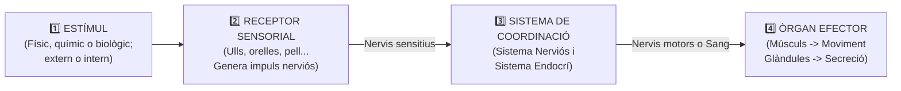
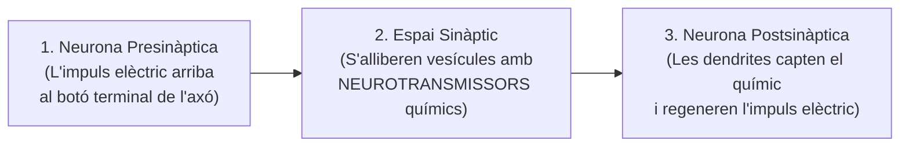

  

    ⚡ Progrés d'aprenentatge (8.1)
    0 / 3 reptes resolts
  

  

    

  

# 8.1 La funció de relació

Cap ésser viu pot sobreviure aïllat del que passa al seu voltant ni desconnectat del seu propi interior. Si un operari al taller no sentira l'olor de fum d'un curtcircuit, si no poguera retirar la mà en tocar una xapa metàl·lica roent, o si el seu cos no sabera regular la temperatura quan fa $40^\circ\text{C}$ a l'estiu, la seua vida correria un perill immediat.

La **funció de relació** és la funció vital mitjançant la qual l'ésser humà capta informació dels canvis que es produeixen a l'exterior o a l'interior del cos (**estímuls**), integra i analitza aquesta informació en els **sistemes de coordinació**, i elabora **respostes** adequades per adaptar-se i sobreviure.

---

## 1. Supervivència i Homeòstasi: L'Equilibri Intern

La funció de relació té dues grans finalitats biològiques:
1. **L'adaptació al medi extern:** Ens permet desplaçar-nos, alimentar-nos, comunicar-nos amb altres persones, aprendre un ofici i fugir o protegir-nos dels perills físics (foc, caigudes, trànsit, sorolls intensos).
2. **L'homeòstasi (equilibri del medi intern):** És el conjunt de mecanismes d'autoregulació que mantenen constants les condicions físiques i químiques internes del nostre organisme, independentment dels canvis bruscos de l'exterior. Exemples clau d'homeòstasi són:
   - **Temperatura corporal constant:** Es manté sempre entre **$36{,}5^\circ\text{C}$ i $37^\circ\text{C}$**. Si fa molta calor, suem per refredar la pell; si fa molt de fred, tremolem per produir calor muscular.
   - **Glucèmia (nivell de sucre a la sang):** Es manté al voltant de $70-100\text{ mg/dL}$ en dejú gràcies a hormones com la insulina i el glucagó.
   - **Tensió arterial i equilibri hídric:** Regulació de la quantitat d'aigua i sals minerals a la sang i l'orina.

---

## 2. El Circuit de la Funció de Relació en 4 Passos

Tota acció de relació —des de parar un penal jugant a futbol fins a segregar adrenalina en un esglai— segueix sempre un circuit ordenat de **quatre etapes fonamentals**:

### Pas 1: L'Estímul
Un **estímul** és qualsevol canvi físic, químic o biològic, tant de l'entorn exterior com de l'interior del nostre cos, que és capaç de desencadenar una resposta en l'organisme.
- **Segons la seua naturalesa:**
  - **Estímuls físics:** La llum, el so (ones sonores), la temperatura (fred o calor), la pressió mecànica o la gravetat.
  - **Estímuls químics:** Les substàncies volàtils de l'aire (olors), les molècules dissoltes als aliments (sabors) o la concentració d'$\text{O}_2$, $\text{CO}_2$ i glucosa a la sang.
  - **Estímuls biològics o biòtics:** La presència d'altres éssers vius (una altra persona que ens parla, un gos que borda, una infecció).
- **Segons la seua procedència:**
  - **Estímuls externs:** Provenen de fora del cos (el so d'una alarma al taller, la llum d'un semàfor).
  - **Estímuls interns:** Provenen del propi organisme (la sensació de fam a l'estómac buit, la set per falta d'aigua, el dolor d'una contractura muscular).

### Pas 2: Els Receptors Sensorials
Són cèl·lules nervioses especialitzades o òrgans complexos (els **òrgans dels sentits**: vista, oïda, olfacte, gust i tacte) que detecten un tipus concret d'estímul i el tradueixen en un senyal elèctric anomenat **impuls nerviós**, que viatja pels **nervis sensitius** cap als centres de coordinació.

### Pas 3: Els Sistemes de Coordinació
Reben la informació dels receptors, la interpreten i decideixen quina és la resposta més adequada. L'ésser humà disposa de dos sistemes coordinadors que treballen en equip:
- **El Sistema Nerviós:** Utilitza **impulsos elèctrics** que viatgen a gran velocitat (fins a $100\text{ m/s}$) al llarg dels nervis. Proporciona respostes **molt ràpides, precises i de curta durada** (com moure la mà o parpellejar).
- **El Sistema Endocrí (o Hormonal):** Utilitza missatgers químics anomenats **hormones**, que viatgen dissoltes per la sang. Proporciona respostes **més lentes, però molt duradores i sostingudes en el temps** (com el creixement corporal, la pubertat o el control del metabolisme).

### Pas 4: Els Òrgans Efectors i l'Execució de la Resposta
Són els òrgans encarregats d'executar l'ordre enviada pels sistemes de coordinació. Hi ha dos tipus de resposta:

| Tipus de Resposta | Òrgan Efector | Mecanisme i Exemples Pràctics |
| :--- | :--- | :--- |
| **Resposta Motora (Moviment)** | **Músculs i ossos** de l'**aparell locomotor** | Els músculs reben l'ordre pels nervis motors, es contrauen i estiren els ossos produint un moviment (caminar, escriure, retirar la mà del foc, bategar el cor). |
| **Resposta Secretora (Secreció)** | **Glàndules** (exocrines o endocrines) | Les glàndules fabriquen i alliberen substàncies químiques líquides: **saliva** en vore menjar, **suor** quan tenim calor, **llàgrimes** per protegir l'ull o **hormones** a la sang. |

---

## 3. La Neurona i l'Impuls Nerviós

La unitat cel·lular bàsica del sistema nerviós és la **neurona**. Són cèl·lules altament especialitzades a generar i conduir corrents elèctrics febles (impulsos nerviosos). Com que les neurones adultes gairebé no es poden dividir ni reproduir, estan acompanyades i nodrides per les **cèl·lules de la glia (neuroglia)**, que les protegeixen i aïllen.

### Anatomia de la Neurona (3 parts)
1. **Soma o cos cel·lular:** És la part central i més ampla de la neurona. Conté el **nucli** (amb l'ADN) i la majoria d'orgànuls (com els mitocondris que fabriquen l'energia necessària). És el centre metabòlic de la cèl·lula.
2. **Dendrites:** Són prolongacions curtes, molt nombroses i ramificades com les branques d'un arbre que ixen del soma. Actuen com a **antenes receptores**: capten els impulsos nerviosos procedents d'altres neurones o dels receptors sensorials.
3. **Axó (o neurita):** És una única prolongació llarga i cilíndrica que ix del soma (pot mesurar des de mil·límetres fins a més d'un metre, com l'axó del nervi ciàtic que va de la columna al peu!). Condueix l'impuls nerviós des del soma fins a la següent neurona o fins a un múscul.
   - **Beina de mielina:** Molts axons estan recoberts per una funda aïllant de greix blanquinós anomenada **mielina** (formada per les cèl·lules de Schwann). Igual que el plàstic aïllant d'un cable elèctric de coure, la mielina evita que el senyal es perda i fa que l'impuls nerviós viatge a salts ultraràpids (**conducció saltatòria**).

---

## 4. La Sinapsi i els Neurotransmissors

Les neurones **no es toquen físicament entre si**; entre el final de l'axó d'una neurona i les dendrites de la següent hi ha una separació microscòpica. Aquesta zona de comunicació funcional entre dues neurones (o entre una neurona i un múscul) s'anomena **sinapsi**.

### Com funciona la transmissió sinàptica?
L'impuls nerviós és sempre **unidireccional** (va sempre des de les dendrites $\rightarrow$ soma $\rightarrow$ axó) i combina electricitat i química:
1. **Neurona presinàptica (emissora):** L'impuls elèctric recorre l'axó i arriba als **botons terminals** de l'extrem.
2. **Espai o fenedura sinàptica:** Com que el corrent elèctric no pot saltar el buit, el botó terminal allibera a l'espai sinàptic unes substàncies químiques emmagatzemades en vesícules anomenades **neurotransmissors**.
3. **Neurona postsinàptica (receptora):** Els neurotransmissors creuen l'espai sinàptic i encaixen com una clau en el seu pany en els receptors de la membrana de les dendrites de la següent neurona, fet que genera un nou impuls elèctric.

> [!TIP]
> ### 🧪 Principals Neurotransmissors del Cos Humà
> - **Acetilcolina:** És el neurotransmissor que connecta les neurones motores amb els músculs esquelètics per ordenar la **contracció muscular**, i participa en l'atenció i la memòria.
> - **Dopamina:** Regula la coordinació motora, la motivació i el sistema de plaer i recompensa del cervell.
> - **Serotonina:** Regula l'estat d'ànim, les emocions, la gana i el cicle de la son (un dèficit s'associa a la depressió).
> - **Adrenalina i Noradrenalina:** Activen l'estat d'alerta màxima, la concentració i la resposta de lluita o fugida davant d'un perill.

---

> [!NOTE]
> ### 💡 Resum de Conceptes Clau
> - La **funció de relació** ens permet adaptar-nos a l'exterior i mantindre l'**homeòstasi** (equilibri intern de temperatura a $36{,}5-37^\circ\text{C}$, glucosa, etc.).
> - El circuit consta sempre de 4 fases: **1) Estímul $\rightarrow$ 2) Receptor sensorial $\rightarrow$ 3) Sistema coordinador (Nerviós o Endocrí) $\rightarrow$ 4) Efector (múscul o glàndula)**.
> - La **neurona** consta de **dendrites** (reben el senyal), **soma** (cos amb nucli) i **axó** recobert de **mielina** (transmet el senyal).
> - La **sinapsi** és la comunicació sense contacte físic entre neurones mitjançant missatgers químics anomenats **neurotransmissors**.

---

## 🎯 Activitats i Autoavaluació Interactiva

  

    🎮 <strong>Zona d'Entrenament FPB:</strong> 0 reptes resolts
    ⭐ 0 punts
  

  

### 1. Qüestionari d'Autoavaluació Tipus Test (MCQ)

  
<strong>1. Quin és l'ordre correcte dels quatre elements que intervenen en el circuit de la funció de relació?</strong>

  

    <button type="button" class="btn-mcq-opt" data-opt="A">A) Òrgan efector → Sistema coordinador → Estímul → Receptor sensorial</button>
    <button type="button" class="btn-mcq-opt" data-opt="B">B) Estímul → Receptor sensorial → Sistema de coordinació → Òrgan efector</button>
    <button type="button" class="btn-mcq-opt" data-opt="C">C) Receptor sensorial → Estímul → Òrgan efector → Sistema de coordinació</button>
    <button type="button" class="btn-mcq-opt" data-opt="D">D) Estímul → Òrgan efector → Receptor sensorial → Glàndula</button>
  

  

  
<strong>2. En quin sentit viatja sempre l'impuls nerviós per l'interior d'una neurona i com passa a la neurona següent?</strong>

  

    <button type="button" class="btn-mcq-opt" data-opt="A">A) Entra per l'axó, passa al soma i ix per les dendrites tocant físicament l'altra neurona</button>
    <button type="button" class="btn-mcq-opt" data-opt="B">B) Viatja per la sang des de la mielina fins al nucli</button>
    <button type="button" class="btn-mcq-opt" data-opt="C">C) Entra per les dendrites, travessa el soma, recorre l'axó i creua l'espai sinàptic mitjançant neurotransmissors químics</button>
    <button type="button" class="btn-mcq-opt" data-opt="D">D) Pot viatjar en qualsevol direcció sense necessitat de neurotransmissors</button>
  

  

---

### 2. Activitats de Vertader (V) o Fals (F)

  <strong>a) Quan sentim olor de menjar en tindre fam i les nostres glàndules salivals comencen a fabricar saliva, s'està produint una resposta secretora.</strong>
  

    <button type="button" class="btn-vf" data-opt="V">V</button>
    <button type="button" class="btn-vf" data-opt="F">F</button>
  

  

  <strong>b) En la sinapsi, l'axó d'una neurona està soldat i unit físicament a les dendrites de la neurona següent perquè el corrent elèctric no s'interrompa.</strong>
  

    <button type="button" class="btn-vf" data-opt="V">V</button>
    <button type="button" class="btn-vf" data-opt="F">F</button>
  

  

---

### 3. Exercicis de Resposta Breu i Vocabulari Tècnic

  
✍️ Com s'anomena el conjunt de mecanismes d'autoregulació que mantenen l'equilibri i l'estabilitat del medi intern del nostre cos?

  

    <input type="text" class="quiz-input" placeholder="Escriu el terme científic...">
    <button type="button" class="btn-quiz-check">Comprovar</button>
  

  

  
✍️ Com s'anomenen les substàncies químiques que s'alliberen a l'espai sinàptic per transmetre el senyal d'una neurona a la següent?

  

    <input type="text" class="quiz-input" placeholder="Escriu el terme...">
    <button type="button" class="btn-quiz-check">Comprovar</button>
  

  

---

### 4. Pregunta de Raonament i Desenvolupament Escrit

  
✍️ <strong>Anàlisi d'un cas real al taller:</strong> Imagina que estàs treballant al taller i, de sobte, sona la sirena d'emergència contra incendis i ixes caminant ràpidament cap al pati. Identifica en aquesta situació: 1) Quin és l'estímul i de quin tipus és, 2) Quin és el receptor sensorial, 3) Quin sistema de coordinació actua i 4) Quins són els òrgans efectors i quin tipus de resposta executen.

  <textarea class="open-response-input" rows="4" placeholder="1) Estímul: ...&#10;2) Receptor: ...&#10;3) Coordinador: ...&#10;4) Efectors i tipus de resposta: ..."></textarea>

---

  <h3 style="margin-top:0; color:#0369a1;">📦 Lliurament d'Activitats d'Aules (Act 8.1)</h3>
  
Genera el teu document de tasca d'aquest apartat amb el teu nom i puntuació obtinguda.

  

    <input type="text" class="aules-student-name" placeholder="Cognoms, Nom de l'Alumne/a" style="padding:8px 12px; border:1px solid #94a3b8; border-radius:4px; flex-grow:1; min-width:240px;">
    <button class="btn-generate-aules-pdf" data-unit="NAT08" data-activity="Act01" data-module="CA" style="padding:8px 16px; background:#0284c7; color:#fff; border:none; border-radius:4px; font-weight:600; cursor:pointer;">📄 Descarregar PDF per a Aules</button>
  

