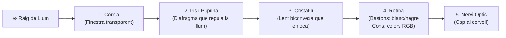

  

    ⚡ Progrés d'aprenentatge (8.2)
    0 / 12 reptes resolts
  

  

    

  

# 8.2 Receptors sensorials

Els **receptors sensorials** són estructures formades per cèl·lules nervioses especialitzades capaces de detectar estímuls específics i transformar-los en impulsos nerviosos elèctrics que s'envien al sistema nerviós central. Quan aquests receptors s'agrupen en estructures anatòmiques complexes, formen els cinc **òrgans dels sentits**.

---

## 1. Classificació dels Receptors Sensorials

Segons d'on prové l'estímul i quina energia capten, classifiquem els receptors en dues grans categories:

### A) Segons la procedència de l'estímul
- **Interoceptors (receptors interns):** Situats a l'interior de les vísceres, músculs, tendons i vasos sanguinis. Informen sobre l'estat intern del cos: la fam, la set, les ganes d'orinar, la tensió arterial, la falta d'oxigen o la posició de les articulacions (**propioceptors**).
- **Exteroceptors (receptors externs):** Situats a la superfície del cos (en els 5 òrgans dels sentits). Capten la informació del món exterior (llum, sons, olors, sabors, contacte físic).

### B) Segons el tipus d'estímul que detecten

| Tipus de Receptor | Estímul que Capta | Localització Principal al Cos Humà |
| :--- | :--- | :--- |
| **Fotoreceptors** | Estímuls lluminosos (llum i colors) | A la **retina de l'ull** (els **cons** i els **bastons**). |
| **Mecanoreceptors** | Deformacions mecàniques: pressió, contacte, vibracions, ones sonores i gravetat | A la **pell** (tacte), al **cargol de l'orella** (audició) i als **canals semicirculars** (equilibri). |
| **Quimioreceptors** | Substàncies químiques dissoltes en l'aire o en els líquids (saliva, sang) | A les **foses nasals** (olfacte) i als **botons gustatius de la llengua** (gust). |
| **Termoreceptors** | Variacions de temperatura (entrada o pèrdua de calor: fred i calor) | Repartits per la **dermis de la pell** (corpuscles de Krause per al fred i de Ruffini per a la calor). |
| **Nociceptors** | Dany als teixits (colps forts, cremades, talls o substàncies corrosives): **el dolor** | Terminacions nervioses lliures repartides per la **pell** i la majoria d'òrgans interns. |

---

## 2. Els Cinc Òrgans dels Sentits

### 1. La Vista: L'Ull (Fotoreceptors)
L'**ull** o globus ocular és un òrgan esfèric encarregat de captar la llum i enfocar les imatges. Està protegit per estructures annexes: les **celles** (desvien la suor), les **parpelles** i **pestanyes** (impedeixen l'entrada de pols) i les **glàndules lacrimals** (netegen i lubriquen amb llàgrimes bactericides).

- **Anatomia i funcionament òptic de l'ull:**
  1. **Escleròtica i Còrnia:** L'escleròtica és la capa externa dura ("el blanc de l'ull"), que per la part davantera es torna totalment transparent i corbada formant la **còrnia**, per on entra la llum.
  2. **Coroide, Iris i Pupil·la:** L'**iris** és el disc acolorit de l'ull (marró, blau, verd). Al seu centre té un orifici negre anomenat **pupil·la**, que funciona com el diafragma d'una càmera: quan hi ha molta llum es tanca per no enlluernar, i a les fosques es dilata per deixar passar més llum.
  3. **Cristal·lí:** Situat darrere de la pupil·la, és una **lent biconvexa elàstica i transparent**. Gràcies als músculs ciliars modifica la seua curvatura (**acomodació**) per enfocar amb nitidesa objectes pròxims o llunyans sobre la retina.
  4. **Retina:** És la capa interna on es projecta la imatge (invertida). Conté milions de cèl·lules **fotoreceptores**:
     - **Bastons (uns 120 milions):** Molt sensibles a la llum feble; permeten la visió nocturna en blanc, negre i grisos, però no distingeixen els colors.
     - **Cons (uns 6-7 milions):** Concentrats al centre de la retina (**fòvea**); necessiten bona il·luminació i capten els **colors** (roig, verd i blau - RGB) i els detalls fins.
  5. **Nervi òptic:** Recull els impulsos elèctrics de la retina i els porta al lòbul occipital del cervell, que interpreta la imatge dreta i en tres dimensions.
- **Defectes visuals freqüents:**
  - **Miopia:** El globus ocular és massa llarg i la imatge s'enfoca *davant* de la retina; **es veuen borrosos els objectes llunyans** (es corregeix amb lents divergents).
  - **Hipermetropia:** L'ull és més curt i la imatge es forma *darrere* de la retina; **costa enfocar els objectes pròxims** (lents convergents).
  - **Astigmatisme:** Curvatura irregular de la còrnia que deforma les línies tant de prop com de lluny.
  - **Cataractes:** Pèrdua de transparència del cristal·lí amb l'edat.

---

### 2. L'Oïda i l'Equilibri: L'Orella (Mecanoreceptors)
L'**orella** és un òrgan doble que allotja dos sentits alhora: l'**audició** i el **sentit de l'equilibri**. Es divideix en tres parts:

1. **Orella Externa:**
   - **Pavelló auditiu (orella):** Estructura de cartílag amb forma d'embut que recull les ones sonores de l'aire i les dirigeix cap al **conducte auditiu extern** (que conté pèls i cera protectora).
   - **Timpà:** Membrana elàstica tensa (com la pell d'un tambor) que vibra quan xoquen contra ella les ones sonores.
2. **Orella Mitjana:**
   - **Cadena d'ossets:** Cavitat plena d'aire (comunicada amb la faringe per la **trompa d'Eustaqui** per equilibrar pressions) que conté els tres ossos més menuts del cos humà encadenats: **Martell $\rightarrow$ Enclusa $\rightarrow$ Estrep**. Amplifiquen la vibració del timpà i la transmeten a la finestra oval de l'orella interna.
3. **Orella Interna (Laberint):** Plena d'un líquid anomenat endolimfa, té dues estructures:
   - **El Cargol o Còclea (Audició):** Tub enrotllat en espiral on es troba l'**òrgan de Corti**, ple de cèl·lules ciliades mecanoreceptores que transformen la vibració del líquid en impulsos elèctrics enviats pel **nervi auditiu** al cervell.
   - **Els Canals Semicirculars i el Vestíbul (Equilibri):** Tres conductes orientats en les 3 dimensions de l'espai. Quan movem o girem el cap, el líquid interior es desplaça, mou els cilis i informa el cerebel de la nostra posició i moviment per no caure.

---

### 3. L'Olfacte (Quimioreceptors gasosos)
Resideix a la part superior de les **foses nasals**. L'interior del nas està tapissat per dues mucoses:
- **Pituitària roja (inferior):** Plena de capil·lars sanguinis que escalfen i humitegen l'aire inspirat.
- **Pituitària groga (superior):** Conté milions de neurones **quimioreceptores olfactives**. Quan les molècules volàtils de l'aire (el perfum d'una flor, l'olor de gas butà o de menjar cremat) es dissolen en el moc nasal, estimulen la pituitària groga, la qual envia el senyal al **bulb olfactori** i d'ací al cervell.

---

### 4. El Gust (Quimioreceptors líquids)
Els receptors del gust es troben principalment a la **llengua**, dins d'unes petites protuberàncies anomenades **papil·les gustatives**, que contenen els **botons gustatius**.
- Perquè puguem percebre el gust d'un aliment, les seues molècules químiques s'han de **dissoldre prèviament en la saliva**.
- El gust humà distingeix **5 sabors bàsics**:
  1. **Dolç** (sucres i hidrats de carboni simples).
  2. **Salat** (clorur de sodi i altres sals minerals).
  3. **Àcid** (cítrics com la llima o el vinagre).
  4. **Amarg** (café pur, tònica; biològicament ens alerta de possibles verins o toxines).
  5. **Umami** ("saborós" en japonés: detecta l'aminoàcid glutamat present a la carn curada, el formatge vell, el pernil o la salsa de soja).

> [!TIP]
> ### 👃👅 Per què quan estem constipats el menjar no té gust?
> El que popularment anomenem "sabor" d'un plat és en realitat la suma del **20% de gust** (els 5 sabors bàsics a la llengua) i el **80% d'olfacte** (les aromes que pugen des de la boca cap a les foses nasals per la faringe mentre masteguem). Quan el moc d'un refredat bloqueja la pituitària groga, perdem el matís aromàtic dels aliments!

---

### 5. El Tacte: La Pell (Mecano-, Termo- i Nociceptors)
La **pell** és l'òrgan més extens del cos humà. Consta d'una capa externa protectora (**epidermis**), una capa intermèdia rica en nervis i vasos (**dermis**) i una capa inferior de greix (**hipodermis**). A la **dermis** es troben els **corpuscles tàctils**:
- **Corpuscles de Meissner i Vater-Pacini (Mecanoreceptors):** Detecten el contacte suau, la textura, les vibracions i la pressió profunda. Són molt abundants a la punta dels dits i als llavis.
- **Corpuscles de Krause i de Ruffini (Termoreceptors):** Detecten el **fred** (Krause) i la **calor** (Ruffini).
- **Terminacions nervioses lliures (Nociceptors):** Capten el **dolor** quan hi ha dany tissular.

---

> [!NOTE]
> ### 💡 Resum de Conceptes Clau
> - Els receptors es classifiquen en **fotoreceptors** (llum), **mecanoreceptors** (so, equilibri, pressió), **quimioreceptors** (olor i gust), **termoreceptors** (fred/calor) i **nociceptors** (dolor).
> - A l'**ull**, la pupil·la regula la llum, el **cristal·lí** enfoca i la **retina** capta la imatge amb els **bastons** (llum feble) i els **cons** (colors).
> - A l'**orella**, el timpà i la cadena **martell-enclusa-estrep** porten el so al **cargol (còclea)**, mentre que els **canals semicirculars** controlen l'**equilibri**.

---

## 🎯 Activitats i Autoavaluació Interactiva (15 Exercicis Diaris)

  

    🎮 <strong>Zona d'Entrenament FPB:</strong> 0 / 12 reptes resolts
    ⭐ 0 punts
  

  

### 1. Qüestionari d'Autoavaluació Tipus Test (MCQ)

  
<strong>1. A quina part de l'ull es troben els cons (visió en color) i els bastons (visió amb poca llum)?</strong>

  

    <button type="button" class="btn-mcq-opt" data-opt="A">A) A la còrnia i l'escleròtica</button>
    <button type="button" class="btn-mcq-opt" data-opt="B">B) Al cristal·lí</button>
    <button type="button" class="btn-mcq-opt" data-opt="C">C) A l'iris i la pupil·la</button>
    <button type="button" class="btn-mcq-opt" data-opt="D">D) A la retina</button>
  

  

  
<strong>2. Quina estructura situada a l'orella interna és la responsable de detectar els moviments del cap i mantindre l'equilibri corporal?</strong>

  

    <button type="button" class="btn-mcq-opt" data-opt="A">A) El timpà i el pavelló auditiu</button>
    <button type="button" class="btn-mcq-opt" data-opt="B">B) Els canals semicirculars i el vestíbul</button>
    <button type="button" class="btn-mcq-opt" data-opt="C">C) La pituitària groga</button>
    <button type="button" class="btn-mcq-opt" data-opt="D">D) Els corpuscles de Meissner</button>
  

  

  
<strong>3. Quin defecte visual pateix una persona que veu borrosos els objectes llunyans perquè la imatge s'enfoca davant de la retina?</strong>

  

    <button type="button" class="btn-mcq-opt" data-opt="A">A) Miopia</button>
    <button type="button" class="btn-mcq-opt" data-opt="B">B) Hipermetropia</button>
    <button type="button" class="btn-mcq-opt" data-opt="C">C) Sordesa coclear</button>
    <button type="button" class="btn-mcq-opt" data-opt="D">D) Anòsmia</button>
  

  

  
<strong>4. Quin és el recorregut exacte que segueix una ona sonora des que entra a l'orella fins que arriba al nervi auditiu?</strong>

  

    <button type="button" class="btn-mcq-opt" data-opt="A">A) Timpà → Canals semicirculars → Trompa d'Eustaqui → Retina</button>
    <button type="button" class="btn-mcq-opt" data-opt="B">B) Pavelló → Cargol → Martell → Timpà → Nervi òptic</button>
    <button type="button" class="btn-mcq-opt" data-opt="C">C) Pavelló i conducte auditiu → Timpà → Martell, Enclusa i Estrep → Cargol (còclea) → Nervi auditiu</button>
    <button type="button" class="btn-mcq-opt" data-opt="D">D) Conducte auditiu → Pituitària groga → Bulb olfactori</button>
  

  

---

### 2. Activitats de Vertader (V) o Fals (F)

  <strong>a) Els sentits de l'olfacte i del gust funcionen tots dos gràcies a cèl·lules quimioreceptores.</strong>
  

    <button type="button" class="btn-vf" data-opt="V">V</button>
    <button type="button" class="btn-vf" data-opt="F">F</button>
  

  

  <strong>b) El martell, l'enclusa i l'estrep són tres lents transparents situades dins de l'ull per enfocar de prop i de lluny.</strong>
  

    <button type="button" class="btn-vf" data-opt="V">V</button>
    <button type="button" class="btn-vf" data-opt="F">F</button>
  

  

  <strong>c) Quan passem d'un lloc fosc a un lloc amb molta llum solar, la pupil·la es tanca (es fa més menuda) automàticament per protegir la retina.</strong>
  

    <button type="button" class="btn-vf" data-opt="V">V</button>
    <button type="button" class="btn-vf" data-opt="F">F</button>
  

  

  <strong>d) Els bastons de la retina són els fotoreceptors encarregats de distingir els colors roig, verd i blau (RGB) a plena llum del dia.</strong>
  

    <button type="button" class="btn-vf" data-opt="V">V</button>
    <button type="button" class="btn-vf" data-opt="F">F</button>
  

  

---

### 3. Exercicis de Resposta Breu, Vocabulari Tècnic i Càlcul

  
✍️ <strong>1.</strong> Com s'anomena la lent biconvexa natural de l'interior de l'ull que modifica la seua curvatura per enfocar les imatges sobre la retina?

  

    <input type="text" class="quiz-input" placeholder="Escriu el nom de la part de l'ull...">
    <button type="button" class="btn-quiz-check">Comprovar</button>
  

  

  
✍️ <strong>2.</strong> Quin és el nom científic dels receptors sensorials encarregats de detectar el dany als teixits i produir la sensació de dolor?

  

    <input type="text" class="quiz-input" placeholder="Escriu el tipus de receptor...">
    <button type="button" class="btn-quiz-check">Comprovar</button>
  

  

  
✍️ <strong>3.</strong> Com s'anomena l'estructura en forma d'espiral de l'orella interna on es troben les cèl·lules mecanoreceptores de l'audició?

  

    <input type="text" class="quiz-input" placeholder="Escriu el nom de l'estructura...">
    <button type="button" class="btn-quiz-check">Comprovar</button>
  

  

  
✍️ <strong>4.</strong> Com s'anomena el cinqué sabor bàsic (a més del dolç, salat, àcid i amarg) que detecta l'aminoàcid glutamat en aliments com el pernil, el formatge curat o la salsa de soja?

  

    <input type="text" class="quiz-input" placeholder="Escriu el nom del cinqué sabor...">
    <button type="button" class="btn-quiz-check">Comprovar</button>
  

  

---

### 4. Exercicis de Raonament i Desenvolupament Escrit (Tasca d'Aula)

  
✍️ <strong>1. Prevenció de riscos al taller (EPIs visuals i auditius):</strong> Explica el recorregut que fa una ona sonora molt forta (una radial tallant ferro a més de 100 dB) des que entra pel pavelló auditiu fins al nervi auditiu, i raona per què l'ús d'ulleres de seguretat i cascos d'oïda és indispensable per evitar lesions irreversibles a la còrnia i al cargol.

  <textarea class="open-response-input" rows="4" placeholder="Recorregut del so: Pavelló -> conducte -> timpà -> ...
Importància dels EPIs: ..."></textarea>

  
✍️ <strong>2. Funcionament òptic de l'ull humà:</strong> Compara l'ull humà amb una càmera fotogràfica digital: explica quina part de l'ull fa de: 1) Finestra protectora exterior, 2) Diafragma que regula la quantitat de llum, 3) Objectiu o lent d'enfocament, i 4) Sensor electrònic on es forma la imatge (indicant la diferència entre cons i bastons).

  <textarea class="open-response-input" rows="4" placeholder="1) Finestra (Còrnia): ...
2) Diafragma (Iris/Pupil·la): ...
3) Lent (Cristal·lí): ...
4) Sensor (Retina: cons i bastons): ..."></textarea>

  
✍️ <strong>3. Interacció entre el gust, l'olfacte i el tacte:</strong> Explica científicament: 1) Per què quan estem molt constipats amb el nas tapat sembla que els aliments no tinguen sabor, i 2) Per què la pell de la punta dels dits té molta més sensibilitat tàctil que la pell de l'esquena.

  <textarea class="open-response-input" rows="4" placeholder="1) Relació gust (20%) i olfacte (80%): ...
2) Densitat de corpuscles tàctils als dits vs esquena: ..."></textarea>

---

  <h3 style="margin-top:0; color:#0369a1;">📦 Lliurament d'Activitats d'Aules (Act 8.2)</h3>
  
Genera el teu document de tasca d'aquest apartat amb el teu nom i els 15 exercicis completats.

  

    <input type="text" class="aules-student-name" placeholder="Cognoms, Nom de l'Alumne/a" style="padding:8px 12px; border:1px solid #94a3b8; border-radius:4px; flex-grow:1; min-width:240px;">
    <button class="btn-generate-aules-pdf" data-unit="NAT08" data-activity="Act02" data-module="CA" style="padding:8px 16px; background:#0284c7; color:#fff; border:none; border-radius:4px; font-weight:600; cursor:pointer;">📄 Descarregar PDF per a Aules</button>
  

