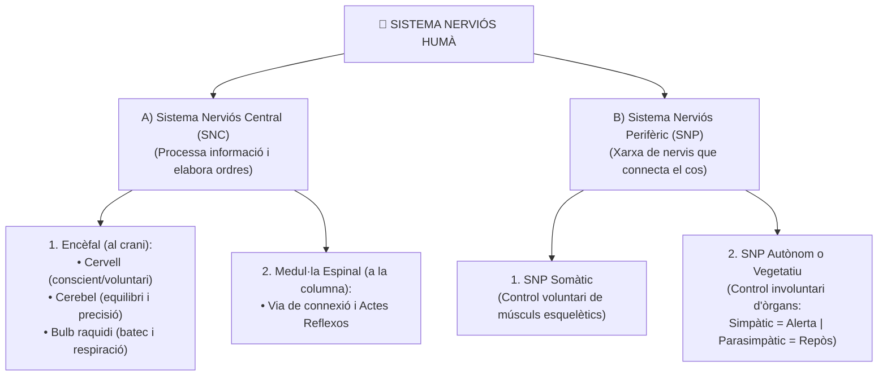

  

    ⚡ Progrés d'aprenentatge (8.3)
    0 / 12 reptes resolts
  

  

    

  

# 8.3 El sistema nerviós

El **sistema nerviós** és el centre de processament i comandament ràpid del cos humà. Rep milions de dades per segon procedents dels òrgans dels sentits i dels receptors interns, les integra i envia ordres elèctriques instantànies als músculs i a les glàndules.

Des del punt de vista anatòmic i funcional, el sistema nerviós es divideix en dues grans parts: el **Sistema Nerviós Central (SNC)** i el **Sistema Nerviós Perifèric (SNP)**.

---

## 1. El Sistema Nerviós Central (SNC)

El **SNC** és l'ordinador central de l'organisme. Com que les neurones són molt delicades i no es regeneren amb facilitat, el SNC compta amb una **triple barrera de protecció**:
1. **Protecció òssia:** L'encèfal està tancat dins de la caixa òssia del **crani**, i la medul·la espinal discorre per l'interior del canal de les **vèrtebres de la columna vertebral**.
2. **Les Meninges:** Són **tres membranes** de teixit connectiu (duramàter, aracnoide i piamàter) que envolten l'encèfal i la medul·la sota l'os.
3. **El Líquid Cefalorraquidi:** Líquid transparent que circula entre les meninges i actua com un **amortidor hidràulic** contra els colps i les sacsejades.

### A) L'Encèfal (allotjat dins del crani)
És la massa nerviosa principal i consta de tres òrgans diferenciats:
1. **El Cervell:** És l'òrgan més voluminós (pesa uns $1{,}3\text{ kg}$). Està dividit en dos **hemisferis cerebrals** (dret i esquerre) connectats pel cos callós. La seua superfície externa és molt rugosa, plena de plecs o circumvolucions, i forma l'**escorça cerebral** (de substància grisa, on estan els somes neuronals).
   - **Funcions del cervell:** Rep i fa conscients les sensacions dels 5 sentits, allotja les facultats intel·lectuals superiors (**pensament, memòria, aprenentatge, llenguatge, emocions i consciència**) i elabora les **ordres motores voluntàries** (com decidir alçar un braç o parlar).
2. **El Cerebel:** Situat a la part posterior i inferior del crani, sota el cervell.
   - **Funcions del cerebel:** S'encarrega de **mantenir l'equilibri i la postura corporal** i de **coordinar els moviments voluntaris precisos** (com anar amb bicicleta, enfilar una agulla, soldar amb precisió o escriure al teclat sense mirar).
3. **El Bulb Raquidi (i el Tronc Encefàlic):** Situat a la base de l'encèfal, enllaça el cervell amb la medul·la espinal (ací es creuen les vies nervioses, per això l'hemisferi esquerre controla el costat dret del cos i viceversa).
   - **Funcions del bulb raquidi:** Controla de forma totalment automàtica i involuntària les **funcions vitals bàsiques per a no morir**: el **ritme cardíac** (batec del cor), el **ritme respiratori** (ventilació pulmonar), la tensió arterial, i reflexos com l'esternut, la tos, la deglució o el vòmit. Una lesió al bulb raquidi provoca la mort instantània.

### B) La Medul·la Espinal (allotjada dins de la columna vertebral)
És un cordó nerviós blanc i cilíndric, del gruix d'un dit menut, que baixa des del bulb raquidi per l'interior de les vèrtebres. Té dues funcions clau:
- **Autopista de comunicació:** Condueix els impulsos sensitius des del cos cap a l'encèfal, i baixa les ordres motores des de l'encèfal cap als músculs.
- **Centre dels Actes Reflexos:** Elabora per si mateixa respostes automàtiques d'emergència ultra-ràpides sense esperar que intervinga el cervell.

---

## 2. El Sistema Nerviós Perifèric (SNP)

El **SNP** està format per la xarxa de **nervis** (feixos d'axons) que ixen del SNC i es ramifiquen per arribar a cada mil·límetre del cos (12 parells de **nervis cranials** que ixen de l'encèfal i 31 parells de **nervis espinals o raquidis** que ixen de la medul·la).
- **Nervis sensitius:** Porten informació des dels receptors cap al SNC.
- **Nervis motors:** Porten ordres des del SNC cap als músculs i glàndules.

Segons la seua funció, el SNP es divideix en dos subsistemes:

### 1. Sistema Nerviós Somàtic (Voluntari)
Connecta el SNC amb els **músculs esquelètics** de l'aparell locomotor. Està sota el nostre control conscient i voluntari (caminar, córrer, agafar una clau anglesa).

### 2. Sistema Nerviós Autònom o Vegetatiu (Involuntari)
Regula de forma automàtica i inconscient el funcionament dels **òrgans interns i vísceres** (cor, pulmons, estómac, intestí, pupil·la, glàndules). Està format per dues branques amb efectes oposats (**antagònics**) que mantenen l'equilibri:

| Branca del SN Autònom | Situació en què s'activa | Efectes Fisiològics sobre els Òrgans |
| :--- | :--- | :--- |
| **Sistema Simpàtic** | **Alerta, estrès, perill, exercici físic o emergència** ("lluita o fugida") | **Accelera el cor (taquicàrdia)**, dilata els bronquis per respirar més aire, dilata la pupil·la, allibera glucosa a la sang i **frena la digestió**. |
| **Sistema Parasimpàtic** | **Calma, repòs, relaxació i recuperació** ("descans i digestió") | **Alenteix el batec del cor**, contrau els bronquis i la pupil·la, estalvia energia i **activa la digestió i la salivació**. |

---

## 3. Actes Voluntaris vs. Actes Reflexos

No totes les nostres accions es decideixen de la mateixa manera. Cal distingir amb claredat entre un acte voluntari i un acte reflex:

### A) L'Acte Voluntari (Conscient — Intervé el Cervell)
Són accions conscients que decidim fer lliurement (per exemple, *veure un got d'aigua sobre la taula i allargar la mà per beure*).
- **Circuit:** Receptor (ull) $\rightarrow$ Nervi sensitiu $\rightarrow$ Medul·la $\rightarrow$ **Escorça del Cervell** (pensem i decidim) $\rightarrow$ Medul·la $\rightarrow$ Nervi motor $\rightarrow$ Efector (músculs del braç).

### B) L'Acte Reflex (Involuntari i Ultraràpid — Intervé només la Medul·la)
Són respostes automàtiques, involuntàries i extremadament ràpides davant de situacions de perill per protegir el cos d'una lesió greu (per exemple, *retirar la mà a l'instant en punxar-se o en tocar un soldador calent abans i tot de ser conscients del dolor*).
- **Circuit (L'Arc Reflex):** Receptor de la pell $\rightarrow$ Neurona sensitiva $\rightarrow$ **Medul·la Espinal** (una **interneurona o neurona d'associació** dóna l'ordre immediata sense pujar al cervell!) $\rightarrow$ Neurona motora $\rightarrow$ Múscul del braç (es contrau i retira la mà).

---

> [!WARNING]
> ### 🚑 Salut del Sistema Nerviós: Danys de l'Alcohol, les Drogues i els Traumatismes
> - **Traumatismes cranioencefàlics i medul·lars:** Un accident de moto, patinet o caiguda en obra sense casc pot seccionar la **medul·la espinal**. Com que els axons medul·lars no es regeneren, s'interromp la connexió entre el cervell i els músculs, provocant **paraplegia** (paràlisi de les cames) o **tetraplegia** (paràlisi de braços i cames).
> - **Alcohol i drogues (cànnabis, cocaïna, amfetamines):** Són substàncies neurotàxiques que alteren els neurotransmissors de les sinapsis, destrueixen neurones, alenteixen els reflexos al volant o amb maquinària perillosa i generen addicció i trastorns mentals greus.

---

> [!NOTE]
> ### 💡 Resum de Conceptes Clau
> - El **SNC** comprèn l'**encèfal** (**cervell** = pensament i actes voluntaris; **cerebel** = equilibri i coordinació; **bulb raquidi** = batec i respiració) i la **medul·la espinal** (connexió i actes reflexos).
> - El **SNP** es divideix en **somàtic** (músculs voluntaris) i **autònom** (**simpàtic** d'alerta vs **parasimpàtic** de repòs).
> - En un **acte reflex** l'ordre l'elabora directament la **medul·la espinal** (arc reflex) per guanyar temps i evitar cremades o ferides greus.

---

## 🎯 Activitats i Autoavaluació Interactiva (15 Exercicis Diaris)

  

    🎮 <strong>Zona d'Entrenament FPB:</strong> 0 / 12 reptes resolts
    ⭐ 0 punts
  

  

### 1. Qüestionari d'Autoavaluació Tipus Test (MCQ)

  
<strong>1. Quin òrgan de l'encèfal controla de manera automàtica i involuntària funcions vitals com el batec del cor i el ritme respiratori?</strong>

  

    <button type="button" class="btn-mcq-opt" data-opt="A">A) L'escorça cerebral</button>
    <button type="button" class="btn-mcq-opt" data-opt="B">B) El cerebel</button>
    <button type="button" class="btn-mcq-opt" data-opt="C">C) El bulb raquidi</button>
    <button type="button" class="btn-mcq-opt" data-opt="D">D) Els nervis espinals del sistema somàtic</button>
  

  

  
<strong>2. Per què quan toquem accidentalment una planxa roent retirem la mà en mil·lèsimes de segon mitjançant un acte reflex?</strong>

  

    <button type="button" class="btn-mcq-opt" data-opt="A">A) Perquè la resposta l'elabora directament la medul·la espinal sense esperar que el senyal puge fins al cervell</button>
    <button type="button" class="btn-mcq-opt" data-opt="B">B) Perquè l'escorça cerebral analitza conscientment la temperatura abans d'enviar l'ordre</button>
    <button type="button" class="btn-mcq-opt" data-opt="C">C) Perquè les hormones de la sang mouen el múscul instantàniament</button>
    <button type="button" class="btn-mcq-opt" data-opt="D">D) Perquè intervé el sistema nerviós parasimpàtic</button>
  

  

  
<strong>3. Quines són les tres barreres físiques que protegeixen el Sistema Nerviós Central (encèfal i medul·la espinal) contra els traumatismes?</strong>

  

    <button type="button" class="btn-mcq-opt" data-opt="A">A) La pell, els músculs bíceps i el líquid sinovial</button>
    <button type="button" class="btn-mcq-opt" data-opt="B">B) Els ossos (crani i columna vertebral), les tres membranes meninges i el líquid cefalorraquidi</button>
    <button type="button" class="btn-mcq-opt" data-opt="C">C) Les costelles, la pleura i el plasma sanguini</button>
    <button type="button" class="btn-mcq-opt" data-opt="D">D) El periosti, els tendons i els lligaments</button>
  

  

  
<strong>4. Quina part de l'encèfal governa les facultats intel·lectuals superiors (memòria, llenguatge, aprenentatge), fa conscients els sentits i ordena els moviments voluntaris?</strong>

  

    <button type="button" class="btn-mcq-opt" data-opt="A">A) La medul·la espinal</button>
    <button type="button" class="btn-mcq-opt" data-opt="B">B) El bulb raquidi</button>
    <button type="button" class="btn-mcq-opt" data-opt="C">C) El sistema nerviós autònom</button>
    <button type="button" class="btn-mcq-opt" data-opt="D">D) El cervell (escorça cerebral)</button>
  

  

---

### 2. Activitats de Vertader (V) o Fals (F)

  <strong>a) El cerebel és l'òrgan de l'encèfal encarregat de coordinar l'equilibri corporal i els moviments precisos com anar amb bicicleta.</strong>
  

    <button type="button" class="btn-vf" data-opt="V">V</button>
    <button type="button" class="btn-vf" data-opt="F">F</button>
  

  

  <strong>b) Davant d'un esglai o perill greu al taller, el sistema nerviós parasimpàtic és el que accelera el cor i dilata els bronquis.</strong>
  

    <button type="button" class="btn-vf" data-opt="V">V</button>
    <button type="button" class="btn-vf" data-opt="F">F</button>
  

  

  <strong>c) Una lesió greu que seccione la medul·la espinal a la columna vertebral pot provocar paraplegia o tetraplegia perquè interromp les ordres entre el cervell i els músculs.</strong>
  

    <button type="button" class="btn-vf" data-opt="V">V</button>
    <button type="button" class="btn-vf" data-opt="F">F</button>
  

  

  <strong>d) L'alcohol i les drogues acceleren els reflexos al volant i protegeixen les neurones de l'escorça cerebral.</strong>
  

    <button type="button" class="btn-vf" data-opt="V">V</button>
    <button type="button" class="btn-vf" data-opt="F">F</button>
  

  

---

### 3. Exercicis de Resposta Breu, Vocabulari Tècnic i Càlcul

  
✍️ <strong>1.</strong> Com s'anomenen les tres membranes protectores que envolten l'encèfal i la medul·la espinal entre les quals circula el líquid cefalorraquidi?

  

    <input type="text" class="quiz-input" placeholder="Escriu el nom de les membranes...">
    <button type="button" class="btn-quiz-check">Comprovar</button>
  

  

  
✍️ <strong>2.</strong> Quina branca del Sistema Nerviós Autònom activa el cos en situacions d'alerta, estrès o emergència accelerant el pols cardíac?

  

    <input type="text" class="quiz-input" placeholder="Sistema nerviós...">
    <button type="button" class="btn-quiz-check">Comprovar</button>
  

  

  
✍️ <strong>3.</strong> Quin òrgan del Sistema Nerviós Central amb forma de cordó blanc discorre per l'interior de la columna vertebral i governa els actes reflexos?

  

    <input type="text" class="quiz-input" placeholder="Escriu el nom de l'òrgan...">
    <button type="button" class="btn-quiz-check">Comprovar</button>
  

  

  
✍️ <strong>4.</strong> Quina branca del Sistema Nerviós Autònom predomina quan estem descansant al sofà després de dinar, alentint el cor i activant la digestió?

  

    <input type="text" class="quiz-input" placeholder="Sistema nerviós...">
    <button type="button" class="btn-quiz-check">Comprovar</button>
  

  

---

### 4. Exercicis de Raonament i Desenvolupament Escrit (Tasca d'Aula)

  
✍️ <strong>1. Comparació entre Acte Voluntari i Acte Reflex:</strong> Explica la diferència de camí nerviós entre: A) Punxar-se el dit amb un cargol rovellat i enretirar la mà sense pensar, i B) Decidir agafar una tireta de la farmaciola i posar-la al dit. Indica quin òrgan del SNC governa cadascuna de les dues accions i per què la primera és molt més ràpida.

  <textarea class="open-response-input" rows="4" placeholder="Cas A (Acte reflex): Governa la...
Cas B (Acte voluntari): Governa el..."></textarea>

  
✍️ <strong>2. Sistema Simpàtic vs. Parasimpàtic en un examen pràctic:</strong> Descriu quins canvis produeix el teu Sistema Nerviós Autònom Simpàtic sobre el cor, els bronquis pulmonars, la pupil·la i la digestió quan estàs en una situació d'alerta o perill, i com actua després el Sistema Parasimpàtic quan torna la calma.

  <textarea class="open-response-input" rows="4" placeholder="Efectes del Sistema Simpàtic (alerta): ...
Efectes del Sistema Parasimpàtic (calma): ..."></textarea>

  
✍️ <strong>3. Seguretat viària i prevenció de lesions medul·lars:</strong> Explica des del punt de vista anatòmic per què és vital portar sempre el casc cordat en moto o patinet elèctric i no tirar-se mai de cap en zones d'aigua poc profunda. Quina diferència hi ha entre danyar-se el cervell, el bulb raquidi o la medul·la espinal?

  <textarea class="open-response-input" rows="4" placeholder="Funció del casc i protecció del SNC: ...
Conseqüències de lesió al cervell, bulb raquidi o medul·la: ..."></textarea>

---

  <h3 style="margin-top:0; color:#0369a1;">📦 Lliurament d'Activitats d'Aules (Act 8.3)</h3>
  
Genera el teu document de tasca d'aquest apartat amb el teu nom i els 15 exercicis completats.

  

    <input type="text" class="aules-student-name" placeholder="Cognoms, Nom de l'Alumne/a" style="padding:8px 12px; border:1px solid #94a3b8; border-radius:4px; flex-grow:1; min-width:240px;">
    <button class="btn-generate-aules-pdf" data-unit="NAT08" data-activity="Act03" data-module="CA" style="padding:8px 16px; background:#0284c7; color:#fff; border:none; border-radius:4px; font-weight:600; cursor:pointer;">📄 Descarregar PDF per a Aules</button>
  

