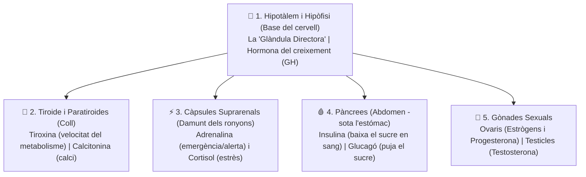

  

    ⚡ Progrés d'aprenentatge (8.5)
    0 / 12 reptes resolts
  

  

    

  

# 8.5 El sistema endocrí

Juntament amb el sistema nerviós, el **sistema endocrí** (o sistema hormonal) és el segon gran sistema de coordinació i control de l'organisme humà. Mentre que els nervis actuen com cables telefònics d'alta velocitat per a ordres immediates, el sistema endocrí funciona com una xarxa de missatgeria química que regula processos constants i de llarga durada: el **creixement corporal**, la velocitat del **metabolisme**, el nivell de **glucosa a la sang**, la resposta a l'**estrès** i el desenvolupament **sexual i reproductiu**.

---

## 1. Glàndules Endocrines, Hormones i Cèl·lules Diana

El sistema endocrí està format per un conjunt d'òrgans repartits pel cos anomenats **glàndules endocrines** (o glàndules de secreció interna).
- **Diferència entre glàndula endocrina i exocrina:**
  - **Glàndules exocrines:** Tenen conductes que aboquen les seues secrecions a l'exterior del cos o a una cavitat oberta (exemples: les *glàndules sudorípares* que treuen suor a la pell, les *salivals* a la boca o les *lacrimals* a l'ull).
  - **Glàndules endocrines:** No tenen conductes d'eixida a l'exterior; **aboquen les seues substàncies directament a l'interior dels capil·lars sanguinis**.
  - **Glàndules mixtes:** Fan totes dues funcions alhora, com el **pàncrees** (aboca suc pancreàtic digestiu a l'intestí i hormones insulina/glucagó a la sang).

### Què són les Hormones i com reconeixen les Cèl·lules Diana?
Les **hormones** són **missatgers químics** fabricats per les glàndules endocrines.
1. Quan una glàndula segrega una hormona a la sang, el torrent circulatori la reparteix per **tot el cos**.
2. Tanmateix, l'hormona **només actua sobre un òrgan o grup de cèl·lules específic**, anomenat **òrgan o cèl·lula diana**, perquè només aquestes cèl·lules tenen a la seua membrana el receptor exacte on l'hormona encaixa com una clau en el seu pany.
3. Són molt potents: n'hi ha prou amb quantitats minúscules en sang per provocar grans efectes fisiològics.

---

## 2. Comparativa: Sistema Nerviós vs. Sistema Endocrí

| Característica | ⚡ Sistema Nerviós | 🧪 Sistema Endocrí (Hormonal) |
| :--- | :--- | :--- |
| **Via de transmissió** | Pels **nervis** (axons neuronals) | Per la **sang** (aparell circulatori) |
| **Tipus de senyal** | Impuls **elèctric** (i neurotransmissors en sinapsis) | Substàncies **químiques** (**hormones**) |
| **Velocitat de resposta** | **Ultraràpida / Instantània** (mil·lisegons) | **Lenta** (tarda segons, minuts, hores o dies) |
| **Durada de l'efecte** | **Molt breu** (cessa tot just acaba l'estímul) | **Molt duradora i sostinguda** en el temps |
| **Funcions que regula** | Moviment muscular, percepció, reflexos | Creixement, metabolisme, glucèmia, cicle sexual |

---

## 3. Mapa de les Principals Glàndules Endocrines i les seues Hormones

### 1. L'Hipotàlem i la Hipòfisi (a la base del cervell)
L'**hipotàlem** és la peça que connecta el sistema nerviós amb l'endocrí, i controla la **hipòfisi** (o glàndula pituïtària), una petita glàndula de la mida d'un pésol situada a la base del crani.
- La **hipòfisi és la "glàndula directora d'orquestra"**: segrega hormones que ordenen a la resta de glàndules del cos (tiroide, suprarenals, ovaris, testicles) quan han de posar-se a treballar.
- A més, produeix:
  - **Hormona del creixement ($\text{GH}$ o somatotropina):** Estimula l'allargament dels ossos i músculs durant la infància i l'adolescència (la seua falta causa *nanisme hipofisiari* i el seu excés *gegantisme*).
  - **Prolactina** (producció de llet materna), **Oxitocina** (contraccions de l'úter en el part) i **Hormona antidiürètica ($\text{ADH}$)** (controla la pèrdua d'aigua a l'orina).

### 2. El Tiroide i les Paratiroides (a la part anterior del coll)
El **tiroide** és una glàndula amb forma de papallona situada davant de la tràquea.
- **Tiroxina:** Hormona rica en **iode** que controla la **velocitat del metabolisme cel·lular** (el ritme amb què les cèl·lules cremen nutrients per obtindre energia i calor).
  - **Hipertiroïdisme (excés de tiroxina):** Metabolisme accelerat, pèrdua de pes malgrat menjar molt, nerviosisme, taquicàrdia, insomni i ulls eixits.
  - **Hipotiroïdisme (falta de tiroxina):** Metabolisme lent, augment de pes, cansament extrem, sensació de fred i somnolència.
- **Calcitonina (del tiroide) i Parathormona (de les paratiroides):** Regulen el nivell de calci entre la sang i els ossos.

### 3. El Pàncrees i el Control de la Glucosa en Sang
El **pàncrees** (situat a l'abdomen, darrere de l'estómac) conté els illots de Langerhans, que fabriquen dues hormones **antagòniques** vitals per controlar la **glucèmia** (sucre a la sang):
- **La Insulina (baixa el sucre en sang):** Quan acabem de menjar i la glucosa puja a la sang, el pàncrees segrega **insulina**. La insulina actua com la "clau" que obri les portes de les cèl·lules musculars i del fetge perquè la glucosa passe de la sang a l'interior de les cèl·lules (i s'emmagatzeme com a glicogen).
- **El Glucagó (puja el sucre en sang):** Quan portem moltes hores en dejú o fem esport i el sucre en sang baixa massa, el pàncrees segrega **glucagó**, que ordena al fetge trencar les seues reserves de glicogen i alliberar glucosa a la sang.

> [!WARNING]
> ### 🩺 La Diabetis Mellitus: Quan falla la Insulina
> La **diabetis mellitus** és una malaltia crònica en què el pàncrees no fabrica prou insulina o les cèl·lules no responen a ella, de manera que la glucosa no pot entrar a les cèl·lules i **s'acumula perillosament a la sang (hiperglucèmia)**, danyant la retina, els ronyons i les artèries:
> - **Diabetis Tipus 1 (juvenil):** El pàncrees deixa de fabricar insulina; requereix punxar-se insulina diàriament.
> - **Diabetis Tipus 2 (de l'adult):** Associada a l'obesitat, el sedentarisme i l'excés de begudes ensucrades; es prevé amb dieta saludable i exercici físic regular.

### 4. Les Càpsules Suprarenals (damunt dels ronyons)
Situades com dos barrets damunt de cada ronyó. Fabriquen:
- **Adrenalina (epinefrina):** L'hormona d'emergència, perill o esglai; en segons accelera el cor, puja la tensió i envia sang als músculs.
- **Cortisol:** L'hormona de l'estrès prolongat i antiinflamatòria natural.

### 5. Les Gònades (Glàndules Sexuals)
- **Ovaris (en la dona):** Fabriquen **estrògens** (desenvolupament dels caràcters sexuals secundaris femenins i maduració d'òvuls) i **progesterona** (prepara l'endometri de l'úter per a l'embaràs).
- **Testicles (en l'home):** Fabriquen **testosterona** (desenvolupament dels caràcters sexuals secundaris masculins, massa muscular i producció d'espermatozoides).

---

> [!NOTE]
> ### 💡 Resum de Conceptes Clau
> - Les **glàndules endocrines** aboquen **hormones** a la **sang**, les quals actuen només sobre les **cèl·lules diana**.
> - La **hipòfisi** dirigeix la resta de glàndules i produeix l'hormona del creixement ($\text{GH}$); el **tiroide** regula el metabolisme amb la **tiroxina**; i les **suprarenals** alliberen **adrenalina**.
> - El **pàncrees** regula el sucre en sang amb la **insulina** (baixa la glucosa) i el **glucagó** (puja la glucosa); la falta d'acció de la insulina causa la **diabetis mellitus**.

---

## 🎯 Activitats i Autoavaluació Interactiva (15 Exercicis Diaris)

  

    🎮 <strong>Zona d'Entrenament FPB:</strong> 0 / 12 reptes resolts
    ⭐ 0 punts
  

  

### 1. Qüestionari d'Autoavaluació Tipus Test (MCQ)

  
<strong>1. Quina hormona segrega el pàncrees després d'un àpat per fer que la glucosa passe de la sang a l'interior de les cèl·lules (baixant el nivell de sucre en sang)?</strong>

  

    <button type="button" class="btn-mcq-opt" data-opt="A">A) La insulina</button>
    <button type="button" class="btn-mcq-opt" data-opt="B">B) La tiroxina</button>
    <button type="button" class="btn-mcq-opt" data-opt="C">C) L'adrenalina</button>
    <button type="button" class="btn-mcq-opt" data-opt="D">D) La testosterona</button>
  

  

  
<strong>2. Quina glàndula situada a la base del cervell es considera la 'glàndula directora' del sistema endocrí i produeix a més l'hormona del creixement (GH)?</strong>

  

    <button type="button" class="btn-mcq-opt" data-opt="A">A) El pàncrees</button>
    <button type="button" class="btn-mcq-opt" data-opt="B">B) Les càpsules suprarenals</button>
    <button type="button" class="btn-mcq-opt" data-opt="C">C) El tiroide</button>
    <button type="button" class="btn-mcq-opt" data-opt="D">D) La hipòfisi (juntament amb l'hipotàlem)</button>
  

  

  
<strong>3. Per què una hormona que viatja per la sang per tot el cos només actua sobre un òrgan concret i no sobre la resta?</strong>

  

    <button type="button" class="btn-mcq-opt" data-opt="A">A) Perquè la sang només passa per un únic òrgan</button>
    <button type="button" class="btn-mcq-opt" data-opt="B">B) Perquè només les cèl·lules diana d'aquell òrgan tenen a la seua membrana els receptors específics on encaixa l'hormona</button>
    <button type="button" class="btn-mcq-opt" data-opt="C">C) Perquè els nervis condueixen l'hormona per dins de l'axó</button>
    <button type="button" class="btn-mcq-opt" data-opt="D">D) Perquè les glàndules endocrines tenen tubs que van directament a la pell</button>
  

  

  
<strong>4. Quins símptomes presenta una persona amb hipotiroïdisme (producció insuficient d'hormona tiroxina pel tiroide)?</strong>

  

    <button type="button" class="btn-mcq-opt" data-opt="A">A) Metabolisme molt accelerat, pèrdua ràpida de pes i taquicàrdia</button>
    <button type="button" class="btn-mcq-opt" data-opt="B">B) Augment extrem de glucosa a l'orina per falta d'insulina</button>
    <button type="button" class="btn-mcq-opt" data-opt="C">C) Alentiment del metabolisme, tendència a guanyar pes, cansament crònic i sensació de fred</button>
    <button type="button" class="btn-mcq-opt" data-opt="D">D) Creixement gegant dels ossos llargs</button>
  

  

---

### 2. Activitats de Vertader (V) o Fals (F)

  <strong>a) Les hormones del sistema endocrí viatgen per l'interior dels nervis a velocitat instantània i el seu efecte dura només uns mil·lisegons.</strong>
  

    <button type="button" class="btn-vf" data-opt="V">V</button>
    <button type="button" class="btn-vf" data-opt="F">F</button>
  

  

  <strong>b) La glàndula tiroide, situada al coll, fabrica l'hormona tiroxina, que s'encarrega de regular la velocitat del metabolisme del cos.</strong>
  

    <button type="button" class="btn-vf" data-opt="V">V</button>
    <button type="button" class="btn-vf" data-opt="F">F</button>
  

  

  <strong>c) El glucagó i la insulina són dues hormones antagòniques del pàncrees: la insulina baixa el sucre en sang i el glucagó el puja.</strong>
  

    <button type="button" class="btn-vf" data-opt="V">V</button>
    <button type="button" class="btn-vf" data-opt="F">F</button>
  

  

  <strong>d) Les glàndules endocrines tenen un conducte que aboca les hormones a l'exterior de la pell, igual que les glàndules sudorípares.</strong>
  

    <button type="button" class="btn-vf" data-opt="V">V</button>
    <button type="button" class="btn-vf" data-opt="F">F</button>
  

  

---

### 3. Exercicis de Resposta Breu, Vocabulari Tècnic i Càlcul

  
✍️ <strong>1.</strong> Quina hormona segreguen les càpsules suprarenals en situacions de perill o emergència per accelerar el cor i preparar els músculs per a l'acció?

  

    <input type="text" class="quiz-input" placeholder="Escriu el nom de l'hormona...">
    <button type="button" class="btn-quiz-check">Comprovar</button>
  

  

  
✍️ <strong>2.</strong> Com s'anomena la malaltia crònica produïda per la falta d'insulina o la resistència a aquesta, que provoca nivells alts de glucosa a la sang?

  

    <input type="text" class="quiz-input" placeholder="Escriu el nom de la malaltia...">
    <button type="button" class="btn-quiz-check">Comprovar</button>
  

  

  
✍️ <strong>3.</strong> Quin oligoelement mineral (present al peix marí i a la sal iodada) és indispensable en la dieta perquè la glàndula tiroide puga fabricar l'hormona tiroxina?

  

    <input type="text" class="quiz-input" placeholder="Escriu el nom del mineral...">
    <button type="button" class="btn-quiz-check">Comprovar</button>
  

  

  
✍️ <strong>4.</strong> Quina hormona del pàncrees (antagònica de la insulina) s'allibera quan estem en dejú per fer que el fetge allibere glucosa a la sang?

  

    <input type="text" class="quiz-input" placeholder="Escriu el nom de l'hormona...">
    <button type="button" class="btn-quiz-check">Comprovar</button>
  

  

---

### 4. Exercicis de Raonament i Desenvolupament Escrit (Tasca d'Aula)

  
✍️ <strong>1. Regulació hormonal del sucre en sang:</strong> Explica pas a pas com treballen en equip la insulina i el glucagó del pàncrees al llarg d'un dia: 1) Què passa a la teua sang just després d'esmorzar un entrepà i un suc i quina hormona actua? 2) Què passa si a les 14:00 h encara no has dinat i estàs fent esport i quina hormona entra en acció aleshores?

  <textarea class="open-response-input" rows="4" placeholder="1) Després d'esmorzar (glucosa alta): El pàncrees segrega...
2) En dejú o fent esport (glucosa baixa): El pàncrees segrega..."></textarea>

  
✍️ <strong>2. Comparativa entre el Sistema Nerviós i el Sistema Endocrí:</strong> Construeix una comparació raonada entre els dos sistemes de coordinació humans indicant per a cadascun: 1) Via per on viatja el missatge, 2) Naturalesa del senyal (elèctric o químic), 3) Velocitat de resposta, 4) Durada de l'efecte i 5) Un exemple de procés que regula.

  <textarea class="open-response-input" rows="4" placeholder="Sistema Nerviós (1-5): ...
Sistema Endocrí (1-5): ..."></textarea>

  
✍️ <strong>3. Prevenció de la Diabetis Tipus 2 i salut endocrina:</strong> Explica quina diferència hi ha entre la diabetis mellitus tipus 1 i la diabetis tipus 2, per què l'abús de begudes ensucrades, brioixeria i el sedentarisme multipliquen el risc de patir diabetis tipus 2, i quins tres hàbits saludables la prevenen.

  <textarea class="open-response-input" rows="4" placeholder="Diferència Diabetis Tipus 1 vs Tipus 2: ...
Tres hàbits de prevenció: ..."></textarea>

---

  <h3 style="margin-top:0; color:#0369a1;">📦 Lliurament d'Activitats d'Aules (Act 8.5)</h3>
  
Genera el teu document de tasca d'aquest apartat amb el teu nom i els 15 exercicis completats.

  

    <input type="text" class="aules-student-name" placeholder="Cognoms, Nom de l'Alumne/a" style="padding:8px 12px; border:1px solid #94a3b8; border-radius:4px; flex-grow:1; min-width:240px;">
    <button class="btn-generate-aules-pdf" data-unit="NAT08" data-activity="Act05" data-module="CA" style="padding:8px 16px; background:#0284c7; color:#fff; border:none; border-radius:4px; font-weight:600; cursor:pointer;">📄 Descarregar PDF per a Aules</button>
  

