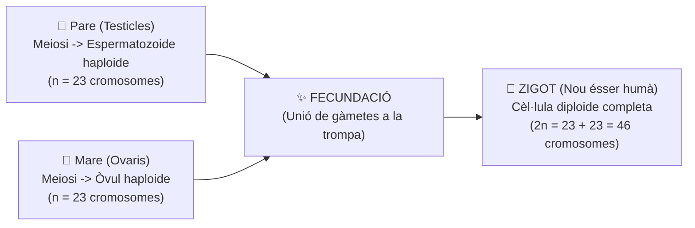
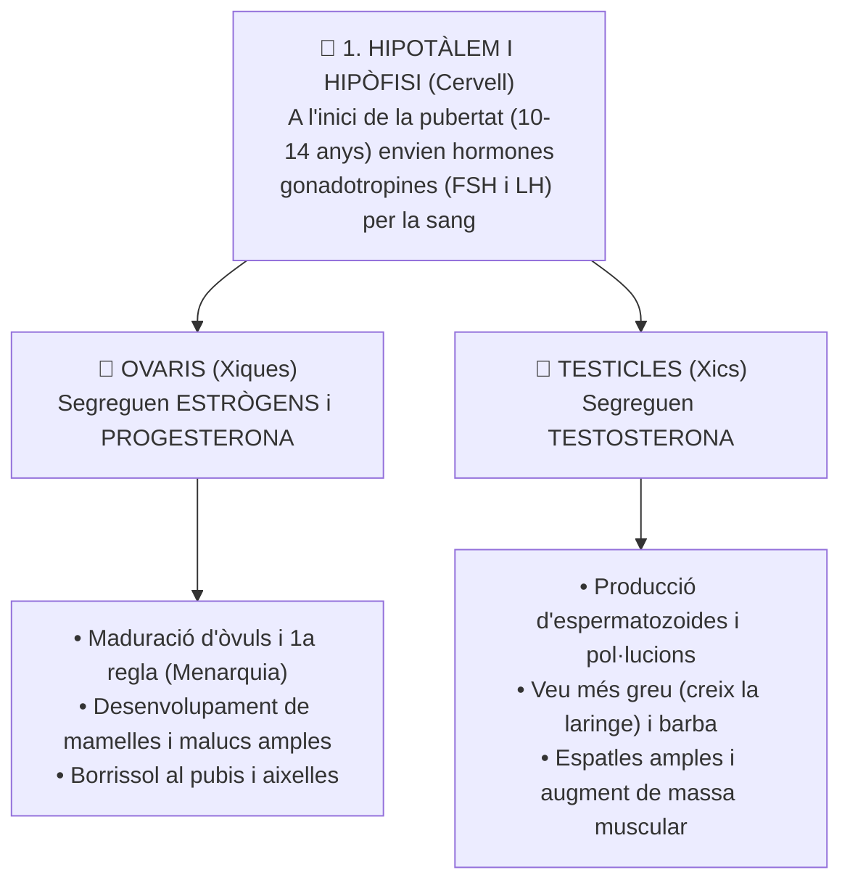
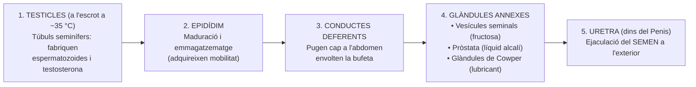
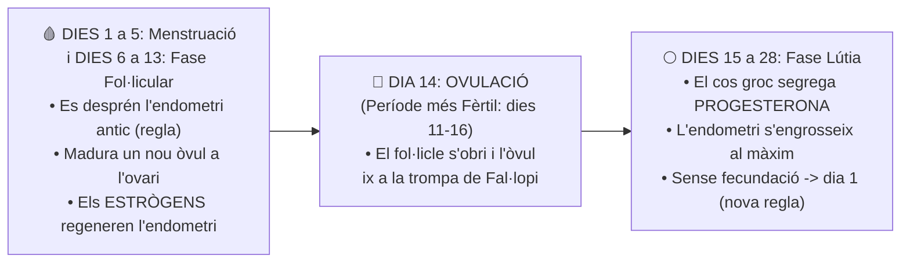
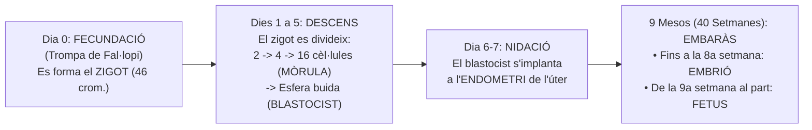
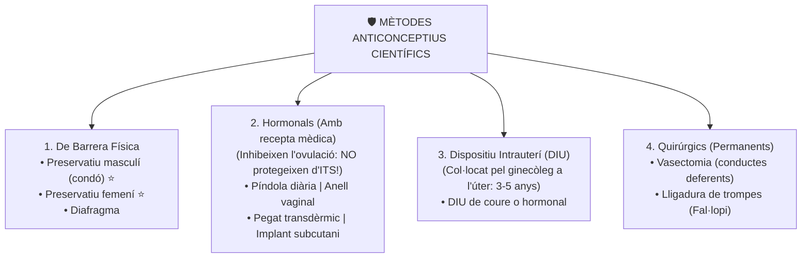
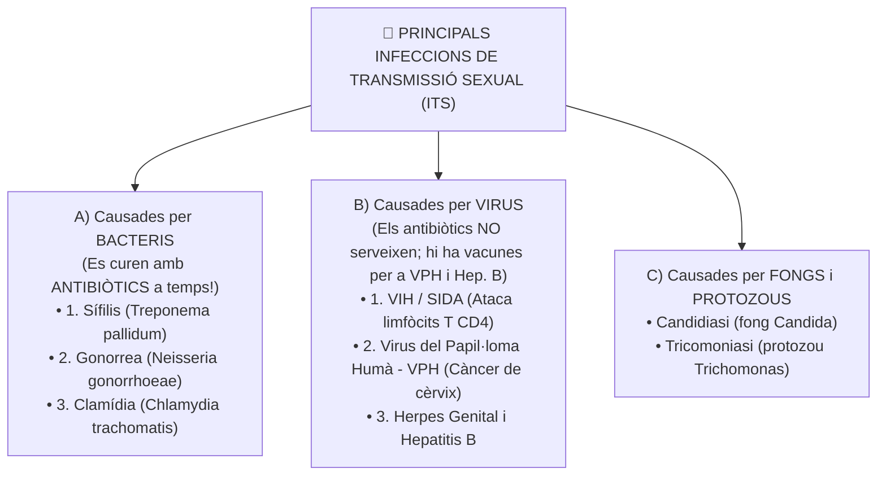

# 🔬 UD9: La Reproducció Humana — Temari Complet i Exercicis Diaris per a Aules

En aquesta pàgina tens tant l'**accés directe a cada sessió diària individual** (amb els seus **15 exercicis diaris** i el seu **botó de descàrrega de PDF per a pujar a Aules cada dia**) com la **vista completa de tota la unitat** amb tots els apartats i el **Butlletí Global d'Activitats Finals de la Unitat**.

---

## 📑 Planificació Diària de Sessions i Tasques d'Aules (UD9)

| Sessió | Apartat del Temari Oficial | Tasca Diària per a Aules | Accés Directe |
| :---: | :--- | :---: | :---: |
| **9.1** | **9.1 La reproducció humana** | 15 Exercicis Diaris + PDF Aules | [**📖 Teoria + 🎯 15 Exercicis →**](./nat0901.html) · [**🎯 Anar a Exercicis →**](./nat0901.html#activitats) |
| **9.2** | **9.2 Caràcters sexuals** | 15 Exercicis Diaris + PDF Aules | [**📖 Teoria + 🎯 15 Exercicis →**](./nat0902.html) · [**🎯 Anar a Exercicis →**](./nat0902.html#activitats) |
| **9.3** | **9.3 Aparell reproductor masculí** | 15 Exercicis Diaris + PDF Aules | [**📖 Teoria + 🎯 15 Exercicis →**](./nat0903.html) · [**🎯 Anar a Exercicis →**](./nat0903.html#activitats) |
| **9.4** | **9.4 Aparell reproductor femení** | 15 Exercicis Diaris + PDF Aules | [**📖 Teoria + 🎯 15 Exercicis →**](./nat0904.html) · [**🎯 Anar a Exercicis →**](./nat0904.html#activitats) |
| **9.5** | **9.5 Cicle vital de l'ésser humà** | 15 Exercicis Diaris + PDF Aules | [**📖 Teoria + 🎯 15 Exercicis →**](./nat0905.html) · [**🎯 Anar a Exercicis →**](./nat0905.html#activitats) |
| **9.6** | **9.6 Planificació familiar** | 15 Exercicis Diaris + PDF Aules | [**📖 Teoria + 🎯 15 Exercicis →**](./nat0906.html) · [**🎯 Anar a Exercicis →**](./nat0906.html#activitats) |
| **9.7** | **9.7 Malalties de transmissió sexual (ITS)** | 15 Exercicis Diaris + PDF Aules | [**📖 Teoria + 🎯 15 Exercicis →**](./nat0907.html) · [**🎯 Anar a Exercicis →**](./nat0907.html#activitats) |
| **9.8** | **9.8 Activitats Finals i Tasca Global de la Unitat 9 (Aules)** | 21 Exercicis Globals + PDF Aules | [**📝 Fer Tasca Global UD →**](./nat0908.html) · [**🎯 Anar a Exercicis →**](./nat0908.html#activitats) |

---

  

    ⚡ Progrés d'aprenentatge (9.1)
    0 / 12 reptes resolts
  

  

    

  

## 📌 9.1 La reproducció humana {#nat0901}

Les funcions de **nutrició** i de **relació** són indispensables perquè un individu concret es mantinga amb vida dia a dia: si deixem de respirar, de menjar o de coordinar els nostres òrgans interns, morim. En canvi, un ésser humà pot viure tota la seua vida amb perfecta salut sense tindre fills.

Per tant, quina és la finalitat biològica de la **funció de reproducció**? La reproducció és la funció vital que permet originar nous individus semblants als seus progenitors per **garantir la supervivència, continuïtat i perpetuació de l'espècie humana** al llarg de les generacions.

---

## 1. Característiques Biològiques de la Reproducció Humana

La reproducció de l'espècie humana (*Homo sapiens*) presenta tres trets biològics fonamentals:

1. **És una Reproducció Sexual (amb variabilitat genètica):**
   - A diferència de la reproducció asexual dels bacteris (que es divideixen produint clons idèntics), en la reproducció sexual intervenen **dos progenitors de sexe biològic diferent** (masculí i femení).
   - Cada progenitor aporta una cèl·lula reproductora especialitzada (**gàmeta**) amb la meitat de la informació genètica. El nou ésser humà no és un clon exacte del pare ni de la mare, sinó una **combinació genètica única i irrepetible**, fet que aporta **variabilitat genètica** i ajuda l'espècie a adaptar-se i evolucionar.
2. **Té Fecundació Interna:**
   - La unió del gàmeta masculí (**espermatozoide**) i el gàmeta femení (**òvul**) no ocorre a l'aigua exterior (com en molts peixos o amfibis), sinó a l'**interior de l'aparell reproductor femení** (concretament a les **trompes de Fal·lopi**), en un medi humit, càlid i protegit.
3. **Té Desenvolupament Vivípar Placentari:**
   - Com a mamífers placentaris que som, l'embrió i el fetus es desenvolupen dins de l'**úter matern** durant uns 9 mesos (40 setmanes), nodrint-se de la sang de la mare a través d'un òrgan temporal anomenat **placenta**, fins al moment de nàixer viu en el **part** i alimentar-se inicialment de llet materna (**lactància**).

---

## 2. Les Gònades i els Gàmetes: Per què tenen 23 Cromosomes?

Totes les cèl·lules del nostre cos (les de la pell, els músculs, el fetge o els ossos), anomenades **cèl·lules somàtiques**, són **diploides ($2n$)**: contenen al seu nucli **46 cromosomes** (organitzats en 23 parelles).

Si s'ajuntaren dues cèl·lules normals de 46 cromosomes, el fill tindria $46 + 46 = 92$ cromosomes, una xifra inviable per a la vida humana! Per evitar-ho, la naturalesa utilitza una divisió cel·lular especial anomenada **meiosi** dins dels òrgans reproductors (**gònades**) per fabricar cèl·lules sexuals amb **la meitat exacta de cromosomes**:

### A) Les Gònades (Òrgans productors)
Les **gònades** són els òrgans principals dels aparells reproductors i tenen una **doble funció**: fabricar les cèl·lules sexuals (**gàmetes**) i segregar les **hormones sexuals** a la sang:
- **Testicles (gònades masculines):** Fabriquen els **espermatozoides** i l'hormona **testosterona**.
- **Ovaris (gònades femenines):** Fabriquen els **òvuls** i les hormones **estrògens i progesterona**.

### B) Els Gàmetes (Cèl·lules reproductores haploides: $n = 23$ cromosomes)
Els **gàmetes** són cèl·lules **haploides (n)**: tenen només **23 cromosomes** (22 cromosomes autosomes i 1 cromosoma sexual, que en l'òvul és sempre X i en l'espermatozoide pot ser X o Y).

| Característica | 🔬 Espermatozoide (Gàmeta Masculí) | 🥚 Òvul (Gàmeta Femení) |
| :--- | :--- | :--- |
| **Gònada on es forma** | Als **testicles** (túbuls seminífers) | Als **ovaris** (dins dels fol·licles) |
| **Nombre de cromosomes** | **23 cromosomes** ($22 + \text{X}$ o bé $22 + \text{Y}$) | **23 cromosomes** (sempre $22 + \text{X}$) |
| **Mida cel·lular** | **Molt menut** ($\approx 0{,}05\text{ mm}$); una de les cèl·lules més menudes del cos | **Molt gran i esfèric** ($\approx 0{,}12-0{,}15\text{ mm}$); la cèl·lula més gran del cos humà |
| **Mobilitat** | **Molt mòbil:** nada activament gràcies al seu llarg **flagel (cua)** | **Immòbil:** no té flagel; es desplaça espentat pels cilis de la trompa de Fal·lopi |
| **Reserves nutritives** | Escasses (només té mitocondris al coll per donar energia al flagel) | **Molt abundants** (citoplasma ple de **vitel** per alimentar el zigot els primers dies) |
| **Ritme de producció** | Se'n fabriquen **milions cada dia** des de la pubertat fins a la vellesa | Unes dones naixen amb tots els òvuls immaturs; en madura **1 cada 28 dies** de la pubertat a la menopausa |

---

## 3. Reproducció, Sexe Biològic i Sexualitat Humana

En l'ésser humà és fonamental no confondre tres conceptes que estan relacionats però no són sinònims:

1. **Sexe biològic:** És el conjunt de característiques genètiques (cromosomes XX o XY), anatòmiques (òrgans genitals), gonadals i hormonals que distingeixen biològicament els individus.
2. **Reproducció:** És el procés estrictament biològic de procrear i tindre descendència mitjançant la fecundació, l'embaràs i el part.
3. **Sexualitat humana:** És un concepte molt més ampli que abarca les dimensions **biològica, afectiva, psicològica, emocional, social i comunicativa** de les persones.
   - En els humans, la sexualitat no té com a única finalitat tindre fills: és una font de **comunicació, afecte, estima, intimitat i plaer compartit** entre les persones.

> [!IMPORTANT]
> ### 🤝 Educació Afectivosexual: Respecte, Igualtat i Consentiment
> Viure una sexualitat saludable i responsable implica tres principis ètics i legals innegociables:
> - **El Consentiment lliure i mutu:** Qualsevol relació afectiva o sexual ha de ser desitjada lliurement i explícitament per totes dues persones, sense cap mena de pressió, xantatge ni coacció.
> - **La Igualtat i el Respecte:** Cap persona és propietat de l'altra; el control del mòbil, la gelosia patològica o la falta de respecte són senyals d'alerta de violència que cal rebutjar.
> - **La Responsabilitat en Salut:** Prevenir embarassos no planificats i protegir-se i protegir la parella contra les Infeccions de Transmissió Sexual (ITS).

---

> [!NOTE]
> ### 💡 Resum de Conceptes Clau
> - La reproducció humana és **sexual**, amb **fecundació interna** (a les trompes de Fal·lopi) i desenvolupament **vivípar placentari** (a l'úter).
> - Les **gònades** (testicles i ovaris) fabriquen hormones sexuals i els **gàmetes** (**espermatozoide** i **òvul**).
> - Els gàmetes són cèl·lules **haploides ($n = 23\text{ cromosomes}$)** perquè en unir-se en la fecundació formen un **zigot diploide ($2n = 46\text{ cromosomes}$)**.

---

## 🎯 Activitats i Autoavaluació Interactiva (15 Exercicis Diaris)

  

    🎮 <strong>Zona d'Entrenament FPB:</strong> 0 / 12 reptes resolts
    ⭐ 0 punts
  

  

### 1. Qüestionari d'Autoavaluació Tipus Test (MCQ)

  
<strong>1. Quants cromosomes tenen els gàmetes humans (un espermatozoide o un òvul) i quants en té el zigot format després de la fecundació?</strong>

  

    <button type="button" class="btn-mcq-opt" data-opt="A">A) Els gàmetes tenen 46 cromosomes i el zigot en té 92</button>
    <button type="button" class="btn-mcq-opt" data-opt="B">B) Cada gàmeta té 23 cromosomes (haploide) i en unir-se formen un zigot amb 46 cromosomes (diploide)</button>
    <button type="button" class="btn-mcq-opt" data-opt="C">C) Tant els gàmetes com el zigot tenen sempre 23 cromosomes</button>
    <button type="button" class="btn-mcq-opt" data-opt="D">D) L'espermatozoide té 46 cromosomes i l'òvul no en té cap</button>
  

  

  
<strong>2. Quina d'aquestes afirmacions descriu correctament les diferències entre l'espermatozoide i l'òvul humà?</strong>

  

    <button type="button" class="btn-mcq-opt" data-opt="A">A) L'òvul és molt menut i té un llarg flagel per nadar, mentre que l'espermatozoide és gegant i immòbil</button>
    <button type="button" class="btn-mcq-opt" data-opt="B">B) Tots dos tenen exactament la mateixa mida i es fabriquen per milions cada dia</button>
    <button type="button" class="btn-mcq-opt" data-opt="C">C) L'espermatozoide és molt menut i mòbil gràcies al seu flagel, mentre que l'òvul és una cèl·lula gran, esfèrica, immòbil i carregada de reserves nutritives</button>
    <button type="button" class="btn-mcq-opt" data-opt="D">D) L'òvul es fabrica als testicles i l'espermatozoide es fabrica als ovaris</button>
  

  

  
<strong>3. Quin avantatge evolutiu fonamental aporta la reproducció sexual humana enfront de la reproducció asexual dels bacteris?</strong>

  

    <button type="button" class="btn-mcq-opt" data-opt="A">A) Genera variabilitat genètica, ja que cada fill o filla és una combinació única i irrepetible dels gens dels dos progenitors</button>
    <button type="button" class="btn-mcq-opt" data-opt="B">B) Permet reproduir-se sense necessitat de cèl·lules ni cromosomes</button>
    <button type="button" class="btn-mcq-opt" data-opt="C">C) Produeix clons exactament idèntics al 100%</button>
    <button type="button" class="btn-mcq-opt" data-opt="D">D) No requereix fecundació ni desenvolupament embrionari</button>
  

  

  
<strong>4. Quin gàmeta determina genèticament el sexe biològic (XX o XY) del futur nadó en el moment de la fecundació?</strong>

  

    <button type="button" class="btn-mcq-opt" data-opt="A">A) Sempre l'òvul matern, perquè és més gran</button>
    <button type="button" class="btn-mcq-opt" data-opt="B">B) Cap dels dos; el sexe es decideix en el moment del part</button>
    <button type="button" class="btn-mcq-opt" data-opt="C">C) La placenta durant el tercer trimestre</button>
    <button type="button" class="btn-mcq-opt" data-opt="D">D) L'espermatozoide patern, ja que l'òvul sempre aporta un cromosoma X i l'espermatozoide pot aportar un cromosoma X (xica, XX) o un cromosoma Y (xic, XY)</button>
  

  

---

### 2. Activitats de Vertader (V) o Fals (F)

  <strong>a) L'ésser humà és una espècie de reproducció sexual amb fecundació interna i desenvolupament vivípar placentari.</strong>
  

    <button type="button" class="btn-vf" data-opt="V">V</button>
    <button type="button" class="btn-vf" data-opt="F">F</button>
  

  

  <strong>b) Igual que ocorre amb la nutrició, si un individu humà decideix no tindre fills mor immediatament perquè la reproducció és indispensable per a la supervivència individual.</strong>
  

    <button type="button" class="btn-vf" data-opt="V">V</button>
    <button type="button" class="btn-vf" data-opt="F">F</button>
  

  

  <strong>c) La meiosi és el tipus especial de divisió cel·lular que té lloc a les gònades per reduir a la meitat el nombre de cromosomes (de 46 a 23) en fabricar els gàmetes.</strong>
  

    <button type="button" class="btn-vf" data-opt="V">V</button>
    <button type="button" class="btn-vf" data-opt="F">F</button>
  

  

  <strong>d) La sexualitat humana es redueix exclusivament a l'acte biològic de tindre fills i no té cap relació amb l'afectivitat, la comunicació ni el respecte.</strong>
  

    <button type="button" class="btn-vf" data-opt="V">V</button>
    <button type="button" class="btn-vf" data-opt="F">F</button>
  

  

---

### 3. Exercicis de Resposta Breu, Vocabulari Tècnic i Càlcul

  
✍️ <strong>1.</strong> Com s'anomenen genèricament els òrgans reproductors (testicles i ovaris) encarregats de fabricar tant els gàmetes com les hormones sexuals?

  

    <input type="text" class="quiz-input" placeholder="Escriu el terme biològic...">
    <button type="button" class="btn-quiz-check">Comprovar</button>
  

  

  
✍️ <strong>2.</strong> Quin nom científic reben les cèl·lules reproductores haploides (amb 23 cromosomes), és a dir, els espermatozoides i els òvuls?

  

    <input type="text" class="quiz-input" placeholder="Escriu el terme...">
    <button type="button" class="btn-quiz-check">Comprovar</button>
  

  

  
✍️ <strong>3.</strong> Càlcul genètic: Quants cromosomes té en total qualsevol cèl·lula somàtica (diploide, 2n) de la pell, d'un múscul o del fetge d'un ésser humà?

  

    <input type="text" class="quiz-input" placeholder="Escriu el nombre de cromosomes...">
    <button type="button" class="btn-quiz-check">Comprovar</button>
  

  

  
✍️ <strong>4.</strong> Com s'anomena la divisió cel·lular especial que ocorre als testicles i ovaris per fabricar gàmetes amb la meitat de cromosomes (23)?

  

    <input type="text" class="quiz-input" placeholder="Escriu el nom de la divisió...">
    <button type="button" class="btn-quiz-check">Comprovar</button>
  

  

---

### 4. Exercicis de Raonament i Desenvolupament Escrit (Tasca d'Aula)

  
✍️ <strong>1. Importància dels 23 cromosomes i la meiosi:</strong> Explica amb un càlcul numèric què passaria amb el nombre de cromosomes dels fills, néts i besnéts al llarg de tres generacions si els òvuls i els espermatozoides tingueren 46 cromosomes en lloc de 23, i per què la meiosi és indispensable.

  <textarea class="open-response-input" rows="4" placeholder="1a generació: 46 + 46 = ...
2a generació: ...
Funció de la meiosi: ..."></textarea>

  
✍️ <strong>2. Comparativa morfològica i funcional entre Espermatozoide i Òvul:</strong> Explica quatre diferències entre l'espermatozoide i l'òvul humà pel que fa a: 1) Mida i forma, 2) Mobilitat, 3) Quantitat de reserves nutritives (vitel) i 4) Ritme de producció al llarg de la vida.

  <textarea class="open-response-input" rows="4" placeholder="1) Mida i forma: ...
2) Mobilitat: ...
3) Reserves nutritives: ...
4) Ritme de producció: ..."></textarea>

  
✍️ <strong>3. Sexe biològic, reproducció i sexualitat responsable:</strong> Diferencia els conceptes de 'reproducció' i 'sexualitat humana', i explica per què el consentiment mutu, la igualtat i el respecte són pilars obligatoris en qualsevol relació afectivosexual.

  <textarea class="open-response-input" rows="4" placeholder="Diferència reproducció vs sexualitat: ...
Importància del consentiment i respecte: ..."></textarea>

---

  <h3 style="margin-top:0; color:#0369a1;">📦 Lliurament d'Activitats d'Aules (Act 9.1)</h3>
  
Genera el teu document de tasca d'aquest apartat amb el teu nom i els 15 exercicis completats.

  

    <input type="text" class="aules-student-name" placeholder="Cognoms, Nom de l'Alumne/a" style="padding:8px 12px; border:1px solid #94a3b8; border-radius:4px; flex-grow:1; min-width:240px;">
    <button class="btn-generate-aules-pdf" data-unit="NAT09" data-activity="Act01" data-module="CA" style="padding:8px 16px; background:#0284c7; color:#fff; border:none; border-radius:4px; font-weight:600; cursor:pointer;">📄 Descarregar PDF per a Aules</button>
  

---

  

    ⚡ Progrés d'aprenentatge (9.2)
    0 / 12 reptes resolts
  

  

    

  

## 📌 9.2 Caràcters sexuals {#nat0902}

Anomenem **caràcters sexuals** el conjunt de trets anatòmics, físics i fisiològics que diferencien biològicament els dos sexes. Segons el moment de la vida en què apareixen i la seua funció, es classifiquen en dos grans grups: els **caràcters sexuals primaris** (amb els quals ja naixem) i els **caràcters sexuals secundaris** (que es desenvolupen a partir de la pubertat).

---

## 1. Els Caràcters Sexuals Primaris (Des del Naixement)

Els **caràcters sexuals primaris** són els mateixos **òrgans reproductors (genitals interns i externs)** amb els quals naix un nadó.
- Estan determinats genèticament des del moment de la fecundació pels cromosomes sexuals (XX o XY) i es formen durant l'embaràs dins de l'úter matern.
- **Quins són?**
  - **Caràcters sexuals primaris masculins:** La presència de testicles, escrot, penis, pròstata i vies espermàtiques.
  - **Caràcters sexuals primaris femenins:** La presència d'ovaris, trompes de Fal·lopi, úter, vagina i vulva.
- Durant tota la **infància** (des del naixement fins als 10-12 anys), els caràcters sexuals primaris ja estan presents, però es troben **immadurs i inactius** (no fabriquen encara ni òvuls madurs ni espermatozoides), i l'aspecte físic exterior d'un xiquet i d'una xiqueta (veu, alçada, silueta corporal) és molt semblant.

---

## 2. La Pubertat i el Despertar Hormonal

Entre els **10 i els 14 anys** aproximadament (sol començar un poc abans en les xiques, cap als **10-12 anys**, que en els xics, cap als **12-14 anys**), s'inicia una etapa biològica de transformació anomenada **pubertat**.

### Com s'activa la pubertat?
1. El rellotge biològic de l'**hipotàlem** i la glàndula **hipòfisi** (a la base del cervell) comença a alliberar a la sang hormones gonadotropines (FSH i LH).
2. Aquestes hormones viatgen per la sang fins a les gònades (ovaris i testicles), "despertant-les" de la seua inactivitat infantil.
3. Les gònades responen posant en marxa dos processos simultanis:
   - **Inici de la capacitat reproductora:** Comencen a madurar els òvuls als ovaris i a fabricar-se espermatozoides als testicles.
   - **Secreció massiva d'hormones sexuals:** Els ovaris aboquen a la sang **estrògens i progesterona**, i els testicles aboquen **testosterona**. Aquestes hormones són les responsables que apareguen els **caràcters sexuals secundaris**.

---

## 3. Els Caràcters Sexuals Secundaris: Taula Comparativa

Els **caràcters sexuals secundaris** són el conjunt de canvis físics, morfològics i fisiològics (no directament genitals) que apareixen durant la pubertat per acció de les hormones sexuals i que donen al cos l'aspecte adult masculí o femení:

| Àmbit del Canvi | 👩 Canvis en les Xiques (Estrògens i Progesterona) | 👨 Canvis en els Xics (Testosterona) |
| :--- | :--- | :--- |
| **Estirada de creixement** | Creixement ràpid en alçada un poc més primerenc (**10-12 anys**). | Estirada d'alçada un poc més tardana (**12-14 anys**) però més prolongada. |
| **Silueta corporal i esquelet** | **Eixamplament de la pelvis i els malucs** (preparació anatòmica per a un futur part). | **Eixamplament de les espatles i del tòrax**; esquelet més pesat. |
| **Músculs i teixit adipós** | Acumulació suau de greix subcutani als malucs, cuixes i pit, arredonint les formes. | **Fort augment de la massa i força muscular** més marcada. |
| **Glàndules mamàries** | Creixement i desenvolupament complet de les **mamelles (pits)**. | Sense desenvolupament mamari funcional. |
| **Veu i laringe** | La veu canvia poc i manté un timbre més **agut**. | Creix la laringe ("nou del coll") i les cordes vocals s'engrosseixen: la veu es torna **més greu**. |
| **Borrissol i pell** | Aparició de pèl al **pubis i a les aixelles**; augment de greix a la pell (possible acne). | Aparició de pèl al **pubis i aixelles**, i més tard **barba i bigot a la cara**, pit i cames; possible acne. |
| **Maduresa reproductora** | Inici de l'ovulació i aparició de la **primera menstruació o regla (menarquia)**. | Creixement de testicles i penis, producció d'espermatozoides i primeres **ejaculacions**. |

> [!TIP]
> ### 🧴 Higiene i Salut durant la Pubertat
> L'augment d'hormones sexuals durant la pubertat activa amb força les **glàndules sudorípares** (suor amb olor més intensa a les aixelles i engonals) i les **glàndules sebàcies** de la pell (que fabriquen més sèu o greix, taponant els porus i provocant els grans de l'**acne juvenil**). Per això és essencial la dutxa diària, rentar-se la cara amb sabó neutre sense rebentar els grans (per evitar infeccions i cicatrius) i mantenir una higiene genital acurada.

---

## 4. Pubertat vs. Adolescència: Els Canvis Psicològics i Socials

Tot i que sovint s'usen com a sinònims, cal distingir dos conceptes:
- **La Pubertat:** És el procés **estrictament biològic i físic** de maduració corporal i hormonal que acabem d'estudiar.
- **L'Adolescència:** És l'etapa de transició **psicològica, emocional i social** entre la infància i l'edat adulta (s'estén aproximadament entre els 11-12 i els 18-20 anys). Es caracteritza per:
  - **Recerca de la pròpia identitat i autonomia:** Necessitat de prendre decisions pròpies, definir gustos, valors i vocació professional (com quan s'inicia l'FP Bàsica per aprendre una professió).
  - **Importància del grup d'iguals (amics i amigues):** Els amics passen a ser un referent fonamental de pertinença i socialització; cal saber dir "no" davant la pressió de grup cap a conductes de risc.
  - **Despertar afectiu i sexual:** Aparició de noves emocions, atracció afectivosexual i necessitat d'informació rigorosa i fiable.

---

> [!NOTE]
> ### 💡 Resum de Conceptes Clau
> - Els **caràcters sexuals primaris** són els òrgans reproductors interns i externs amb els quals naixem.
> - A la **pubertat** (10-14 anys), la **hipòfisi** activa els ovaris i testicles perquè fabriquen gàmetes i hormones sexuals (**estrògens i progesterona** en la dona; **testosterona** en l'home).
> - Les hormones sexuals fan aparéixer els **caràcters sexuals secundaris** (mamelles, malucs i **menarquia** en les xiques; veu greu, barba, espatles amples i espermatozoides en els xics).

---

## 🎯 Activitats i Autoavaluació Interactiva (15 Exercicis Diaris)

  

    🎮 <strong>Zona d'Entrenament FPB:</strong> 0 / 12 reptes resolts
    ⭐ 0 punts
  

  

### 1. Qüestionari d'Autoavaluació Tipus Test (MCQ)

  
<strong>1. Quina és la diferència fonamental entre els caràcters sexuals primaris i els caràcters sexuals secundaris?</strong>

  

    <button type="button" class="btn-mcq-opt" data-opt="A">A) Els primaris són els òrgans reproductors amb què naixem, i els secundaris són els trets físics que apareixen a la pubertat per acció de les hormones</button>
    <button type="button" class="btn-mcq-opt" data-opt="B">B) Els primaris apareixen als 14 anys i els secundaris estan presents des del naixement</button>
    <button type="button" class="btn-mcq-opt" data-opt="C">C) Els primaris són exclusius dels homes i els secundaris són exclusius de les dones</button>
    <button type="button" class="btn-mcq-opt" data-opt="D">D) Els primaris depenen del tiroide i els secundaris depenen del pàncrees</button>
  

  

  
<strong>2. Quina hormona sexual fabricada pels testicles és la responsable de l'aparició dels caràcters sexuals secundaris masculins (veu greu, barba, desenvolupament muscular)?</strong>

  

    <button type="button" class="btn-mcq-opt" data-opt="A">A) La progesterona</button>
    <button type="button" class="btn-mcq-opt" data-opt="B">B) Els estrògens</button>
    <button type="button" class="btn-mcq-opt" data-opt="C">C) La insulina</button>
    <button type="button" class="btn-mcq-opt" data-opt="D">D) La testosterona</button>
  

  

  
<strong>3. Quina glàndula situada a la base del cervell dóna l'ordre d'iniciar la pubertat entre els 10 i els 14 anys enviant hormones gonadotropines (FSH i LH) als ovaris i testicles?</strong>

  

    <button type="button" class="btn-mcq-opt" data-opt="A">A) La glàndula tiroide</button>
    <button type="button" class="btn-mcq-opt" data-opt="B">B) La hipòfisi (dirigida per l'hipotàlem)</button>
    <button type="button" class="btn-mcq-opt" data-opt="C">C) El pàncrees</button>
    <button type="button" class="btn-mcq-opt" data-opt="D">D) Les càpsules suprarenals</button>
  

  

  
<strong>4. Quin dels següents conjunts de canvis físics correspon exclusivament als caràcters sexuals secundaris femenins durant la pubertat?</strong>

  

    <button type="button" class="btn-mcq-opt" data-opt="A">A) Aparició de barba, veu molt greu i producció d'espermatozoides</button>
    <button type="button" class="btn-mcq-opt" data-opt="B">B) Formació dels ovaris i l'úter abans de nàixer</button>
    <button type="button" class="btn-mcq-opt" data-opt="C">C) Desenvolupament de les mamelles, eixamplament dels malucs i la pelvis, borrissol púbic/axil·lar i primera menstruació (menarquia)</button>
    <button type="button" class="btn-mcq-opt" data-opt="D">D) Caiguda de les dents de llet als 6 anys</button>
  

  

---

### 2. Activitats de Vertader (V) o Fals (F)

  <strong>a) La pubertat s'inicia quan la glàndula hipòfisi del cervell envia hormones a la sang per activar el funcionament dels ovaris i dels testicles.</strong>
  

    <button type="button" class="btn-vf" data-opt="V">V</button>
    <button type="button" class="btn-vf" data-opt="F">F</button>
  

  

  <strong>b) L'aparició de la barba en els xics i el desenvolupament de les mamelles en les xiques durant la pubertat són exemples de caràcters sexuals primaris.</strong>
  

    <button type="button" class="btn-vf" data-opt="V">V</button>
    <button type="button" class="btn-vf" data-opt="F">F</button>
  

  

  <strong>c) En els xics, durant la pubertat creix la laringe i s'engrosseixen les cordes vocals per acció de la testosterona, fent que la veu es torne més greu.</strong>
  

    <button type="button" class="btn-vf" data-opt="V">V</button>
    <button type="button" class="btn-vf" data-opt="F">F</button>
  

  

  <strong>d) Durant la infància (abans de la pubertat), els testicles i els ovaris ja fabriquen milions d'espermatozoides i òvuls madurs cada dia.</strong>
  

    <button type="button" class="btn-vf" data-opt="V">V</button>
    <button type="button" class="btn-vf" data-opt="F">F</button>
  

  

---

### 3. Exercicis de Resposta Breu, Vocabulari Tècnic i Càlcul

  
✍️ <strong>1.</strong> Com s'anomenen les hormones sexuals femenines produïdes pels ovaris que provoquen el desenvolupament dels caràcters sexuals secundaris en les xiques?

  

    <input type="text" class="quiz-input" placeholder="Escriu el nom de les hormones...">
    <button type="button" class="btn-quiz-check">Comprovar</button>
  

  

  
✍️ <strong>2.</strong> Quin terme mèdic i biològic s'utilitza per anomenar l'aparició de la primera menstruació o regla en una xica durant la pubertat?

  

    <input type="text" class="quiz-input" placeholder="Escriu el terme...">
    <button type="button" class="btn-quiz-check">Comprovar</button>
  

  

  
✍️ <strong>3.</strong> Com s'anomena l'etapa de maduració estrictament biològica i física (entre els 10 i 14 anys) en què s'activen les gònades i apareixen els caràcters sexuals secundaris?

  

    <input type="text" class="quiz-input" placeholder="Escriu el nom de l'etapa...">
    <button type="button" class="btn-quiz-check">Comprovar</button>
  

  

  
✍️ <strong>4.</strong> Quina hormona sexual masculina fabriquen els testicles per estimular la producció d'espermatozoides, l'augment de massa muscular i l'aparició del pèl facial?

  

    <input type="text" class="quiz-input" placeholder="Escriu el nom de l'hormona...">
    <button type="button" class="btn-quiz-check">Comprovar</button>
  

  

---

### 4. Exercicis de Raonament i Desenvolupament Escrit (Tasca d'Aula)

  
✍️ <strong>1. Quadre comparatiu dels Caràcters Sexuals Secundaris:</strong> Enumera quatre caràcters sexuals secundaris que apareixen en les xiques i quatre que apareixen en els xics durant la pubertat, indicant quina glàndula i quina hormona provoca cadascun.

  <textarea class="open-response-input" rows="4" placeholder="Xiques (Ovaris -> Estrògens): 1... 2... 3... 4...
Xics (Testicles -> Testosterona): 1... 2... 3... 4..."></textarea>

  
✍️ <strong>2. Pubertat biològica vs. Adolescència psicosocial:</strong> Explica per què no és exactament el mateix 'pubertat' que 'adolescència', i descriu tres canvis psicològics, emocionals o socials propis de l'etapa adolescent.

  <textarea class="open-response-input" rows="4" placeholder="Diferència entre pubertat i adolescència: ...
Tres canvis psicològics i socials de l'adolescència: ..."></textarea>

  
✍️ <strong>3. Higiene corporal i cura de la pell en la pubertat:</strong> Explica per què durant la pubertat augmenta la suor amb olor forta i apareixen els grans de l'acne juvenil a la cara i l'esquena, i redacta tres normes d'higiene diària recomanables.

  <textarea class="open-response-input" rows="4" placeholder="Causa hormonal de la suor i l'acne (glàndules sudorípares i sebàcies): ...
Tres normes d'higiene: ..."></textarea>

---

  <h3 style="margin-top:0; color:#0369a1;">📦 Lliurament d'Activitats d'Aules (Act 9.2)</h3>
  
Genera el teu document de tasca d'aquest apartat amb el teu nom i els 15 exercicis completats.

  

    <input type="text" class="aules-student-name" placeholder="Cognoms, Nom de l'Alumne/a" style="padding:8px 12px; border:1px solid #94a3b8; border-radius:4px; flex-grow:1; min-width:240px;">
    <button class="btn-generate-aules-pdf" data-unit="NAT09" data-activity="Act02" data-module="CA" style="padding:8px 16px; background:#0284c7; color:#fff; border:none; border-radius:4px; font-weight:600; cursor:pointer;">📄 Descarregar PDF per a Aules</button>
  

---

  

    ⚡ Progrés d'aprenentatge (9.3)
    0 / 12 reptes resolts
  

  

    

  

## 📌 9.3 Aparell reproductor masculí {#nat0903}

L'**aparell reproductor masculí** té com a missió biològica fabricar de manera contínua els gàmetes masculins (**espermatozoides**), produir l'hormona sexual masculina (**testosterona**), nodrir els espermatozoides amb els líquids de les glàndules annexes formant el **semen** i depositar-los a l'interior de l'aparell reproductor femení per possibilitar la fecundació.

---

## 1. Anatomia Completa de l'Aparell Reproductor Masculí

Per estudiar-lo amb ordre, dividim els seus òrgans en quatre blocs funcionals: **gònades**, **òrgans externs**, **vies espermàtiques** i **glàndules annexes**.

### A) Les Gònades: Els Testicles
Els **testicles** són dos òrgans ovoides situats fora de la cavitat abdominal.
- A l'interior de cada testicle hi ha centenars de conductes finíssims enrotllats anomenats **túbuls seminífers**, a les parets dels quals es fabriquen milions d'espermatozoides cada dia (**espermatogènesi**) a partir de la pubertat.
- Entre els túbuls es troben les *cèl·lules de Leydig*, que fabriquen i aboquen a la sang l'hormona **testosterona**.

### B) Els Òrgans Genitals Externs: Escrot i Penis
1. **L'Escrot (o bossa escrotal):** És una bossa de pell i múscul que envolta i sosté els testicles **fora de l'abdomen**.
   - **Per què els testicles estan fora del cos?** Perquè l'espermatogènesi (fabricació d'espermatozoides sans i fèrtils) **no pot ocórrer a 37 °C**: necessita una temperatura d'uns **35 °C (entre 1,5 °C i 2 °C menys que l'interior del cos)**. Quan fa fred l'escrot s'arronsa per acostar-los al cos, i quan fa calor es relaxa per allunyar-los.
2. **El Penis:** És l'òrgan cilíndric copulador encarregat de l'expulsió tant de l'orina com del semen.
   - **Estructura interna:** Està format per tres cilindres de teixit erèctil esponjós: dos **cossos cavernosos** superiors i un **cos esponjós** inferior (per l'interior del qual passa la uretra). Durant l'excitació sexual, aquests cossos s'omplin de sang arterial a pressió, fet que fa que el penis augmente de mida i s'endurisca (**erecció**).
   - **Extrem distal:** El cos esponjós s'eixampla a la punta formant el **gland** (zona molt rica en terminacions nervioses sensitives), el qual està recobert per un plec de pell mòbil i elàstic anomenat **prepuci**.

> [!TIP]
> ### 🩺 Què és la Fimosi?
> S'anomena **fimosi** l'estretor de l'obertura del **prepuci** que impedeix descobrir el gland amb normalitat, dificultant la higiene i podent causar dolor en l'erecció. Es resol fàcilment amb tractament mèdic o una senzilla intervenció quirúrgica ambulatòria anomenada **circumcisió**.

---

### C) Les Vies Espermàtiques (Conductes Interns)
Són els conductes que transporten els espermatozoides des del testicle fins a l'exterior:
1. **Epidídim:** És un tub llarguíssim però plegat sobre si mateix com un capell damunt de cada testicle. Ací els espermatozoides acabats de fabricar s'emmagatzemen durant diversos dies, **maduren i adquireixen la capacitat de nadar**.
2. **Conductes deferents:** Dos tubs musculars (un de cada epidídim) que pugen des de l'escrot cap a l'interior de la cavitat pelviana, envolten la bufeta urinària i s'uneixen amb les glàndules annexes. *(Són els conductes que es tallen en l'operació anticonceptiva de la **vasectomia**)*.
3. **Uretra:** És el conducte final que travessa la pròstata i recorre tot l'interior del penis fins a obrir-se al meat urinari del gland.
   - **Atenció:** En l'home, la **uretra és un conducte compartit** per l'aparell urinari (condueix l'**orina** des de la bufeta) i per l'aparell reproductor (condueix el **semen** durant l'**ejaculació**), però un esfínter automàtic impedeix que tots dos líquids es barregen mai al mateix temps.

---

### D) Les Glàndules Annexes i la Formació del Semen
Al llarg dels conductes deferents i la uretra, tres tipus de **glàndules annexes** aboquen els seus líquids nutritius per acompanyar els espermatozoides i formar el **semen** (o esperma):

| Glàndula Annexa | Localització | Funció del Líquid que Aporta al Semen |
| :--- | :--- | :--- |
| **1. Vesícules seminals (2)** | Darrere de la bufeta urinària | Aporten un líquid viscós ric en **fructosa (sucre)**, que serveix de **combustible energètic** perquè els espermatozoides puguen moure el flagel. |
| **2. Pròstata (1)** | Sota la bufeta, envoltant l'inici de la uretra | Aporta el **líquid prostàtic**, de color blanquinós i **alcalí (bàsic)**, que protegeix els espermatozoides neutralitzant l'acidesa de la uretra i de la vagina. |
| **3. Glàndules de Cowper (2)** | Sota la pròstata (bulbouretrals) | Segreguen unes gotes de **líquid preseminal** transparent abans de l'ejaculació que **lubrica i neteja la uretra** *(pot contindre espermatozoides!)*. |

> [!IMPORTANT]
> ### 💧 Què és el Semen?
> En cada ejaculació s'expulsen entre 2 mL i 5 mL de **semen**: el **90% del seu volum són els líquids nutritius i protectors** de les vesícules seminals i la pròstata, i el **10% restant són entre 100 i 300 milions d'espermatozoides**.

---

## 2. Anatomia Microscòpica de l'Espermatozoide

L'**espermatozoide** és una cèl·lula altament especialitzada en el desplaçament ràpid, dividida en tres parts ben diferenciades:
1. **El Cap:** Conté dos elements vitals:
   - El **nucli cel·lular**, on viatgen compactats els **23 cromosomes** paterns.
   - L'**acrosoma**, un casquet situat a la punta del cap ple d'**enzims digestius** que actuen com un "trepant químic" per perforar les cobertes protectores de l'òvul en la fecundació.
2. **El Coll o Peça Intermèdia:** Situat entre el cap i la cua, està replet de **mitocondris**, les centrals energètiques que cremen la fructosa del semen per fabricar l'energia (ATP) que mou la cua.
3. **La Cua o Flagel:** Llarg filament mòbil que bat com un fuet per impulsar l'espermatozoide fins a les trompes de Fal·lopi.

---

> [!NOTE]
> ### 💡 Resum de Conceptes Clau
> - Els **testicles** estan fora de l'abdomen dins de l'**escrot** a uns **35 °C** per fabricar espermatozoides i **testosterona**.
> - El recorregut dels espermatozoides és: **Testicle $\rightarrow$ Epidídim (maduració) $\rightarrow$ Conducte deferent $\rightarrow$ Uretra (dins del penis)**.
> - Les **vesícules seminals** (fructosa energètica), la **pròstata** (líquid alcalí protector) i les **glàndules de Cowper** fabriquen els líquids del **semen**.
> - L'espermatozoide consta de **cap** (nucli amb 23 cromosomes + **acrosoma**), **coll** (amb **mitocondris**) i **cua o flagel**.

---

## 🎯 Activitats i Autoavaluació Interactiva (15 Exercicis Diaris)

  

    🎮 <strong>Zona d'Entrenament FPB:</strong> 0 / 12 reptes resolts
    ⭐ 0 punts
  

  

### 1. Qüestionari d'Autoavaluació Tipus Test (MCQ)

  
<strong>1. Per quina raó biològica els testicles es troben allotjats a l'escrot, fora de la cavitat abdominal?</strong>

  

    <button type="button" class="btn-mcq-opt" data-opt="A">A) Perquè no hi ha espai físic disponible dins de l'abdomen</button>
    <button type="button" class="btn-mcq-opt" data-opt="B">B) Per estar a una temperatura més alta de 40 °C</button>
    <button type="button" class="btn-mcq-opt" data-opt="C">C) Per mantindre's a uns 35 °C (uns 2 °C per sota de la temperatura corporal), condició indispensable per a fabricar espermatozoides viables</button>
    <button type="button" class="btn-mcq-opt" data-opt="D">D) Perquè estiguen més a prop dels ronyons</button>
  

  

  
<strong>2. Quin és l'ordre exacte dels conductes pels quals passa un espermatozoide des que es fabrica fins que ix a l'exterior en l'ejaculació?</strong>

  

    <button type="button" class="btn-mcq-opt" data-opt="A">A) Uretra → Pròstata → Conducte deferent → Testicle → Epidídim</button>
    <button type="button" class="btn-mcq-opt" data-opt="B">B) Testicle (túbuls seminífers) → Epidídim → Conducte deferent → Uretra</button>
    <button type="button" class="btn-mcq-opt" data-opt="C">C) Testicle → Urèter → Bufeta urinària → Conducte deferent</button>
    <button type="button" class="btn-mcq-opt" data-opt="D">D) Epidídim → Testicle → Vesícula seminal → Escrot</button>
  

  

  
<strong>3. Quina és la funció de la fructosa que aporten les vesícules seminals i del líquid alcalí que aporta la pròstata al semen?</strong>

  

    <button type="button" class="btn-mcq-opt" data-opt="A">A) La fructosa proporciona energia als mitocondris de l'espermatozoide per nadar, i el líquid prostàtic alcalí neutralitza l'acidesa de la uretra i la vagina</button>
    <button type="button" class="btn-mcq-opt" data-opt="B">B) Serveixen per destruir els espermatozoides abans que isquen</button>
    <button type="button" class="btn-mcq-opt" data-opt="C">C) Transformen els espermatozoides en glòbuls vermells</button>
    <button type="button" class="btn-mcq-opt" data-opt="D">D) Congelen els espermatozoides a 0 °C</button>
  

  

  
<strong>4. Quina estructura situada a la punta del cap de l'espermatozoide conté enzims digestius per perforar les cobertes protectores de l'òvul?</strong>

  

    <button type="button" class="btn-mcq-opt" data-opt="A">A) El flagel</button>
    <button type="button" class="btn-mcq-opt" data-opt="B">B) El prepuci</button>
    <button type="button" class="btn-mcq-opt" data-opt="C">C) El cos cavernós</button>
    <button type="button" class="btn-mcq-opt" data-opt="D">D) L'acrosoma</button>
  

  

---

### 2. Activitats de Vertader (V) o Fals (F)

  <strong>a) En l'home, la uretra és un conducte compartit per l'aparell urinari i per l'aparell reproductor.</strong>
  

    <button type="button" class="btn-vf" data-opt="V">V</button>
    <button type="button" class="btn-vf" data-opt="F">F</button>
  

  

  <strong>b) Els 23 cromosomes de l'espermatozoide es troben repartits al llarg de la cua o flagel, mentre que el cap només conté aigua.</strong>
  

    <button type="button" class="btn-vf" data-opt="V">V</button>
    <button type="button" class="btn-vf" data-opt="F">F</button>
  

  

  <strong>c) L'erecció del penis es produeix quan els cossos cavernosos i el cos esponjós s'omplin de sang arterial a pressió.</strong>
  

    <button type="button" class="btn-vf" data-opt="V">V</button>
    <button type="button" class="btn-vf" data-opt="F">F</button>
  

  

  <strong>d) El 100% del volum del semen està format exclusivament per espermatozoides secs, sense cap líquid de les glàndules annexes.</strong>
  

    <button type="button" class="btn-vf" data-opt="V">V</button>
    <button type="button" class="btn-vf" data-opt="F">F</button>
  

  

---

### 3. Exercicis de Resposta Breu, Vocabulari Tècnic i Càlcul

  
✍️ <strong>1.</strong> Com s'anomena l'òrgan en forma de tub molt enrotllat situat damunt de cada testicle on s'emmagatzemen i maduren els espermatozoides?

  

    <input type="text" class="quiz-input" placeholder="Escriu el nom de l'òrgan...">
    <button type="button" class="btn-quiz-check">Comprovar</button>
  

  

  
✍️ <strong>2.</strong> Quina glàndula annexa masculina situada sota la bufeta urinària aporta al semen un líquid alcalí blanquinós que protegeix els espermatozoides de l'acidesa?

  

    <input type="text" class="quiz-input" placeholder="Escriu el nom de la glàndula...">
    <button type="button" class="btn-quiz-check">Comprovar</button>
  

  

  
✍️ <strong>3.</strong> Com s'anomena el plec de pell mòbil i elàstic que recobreix el gland (extrem del penis) i l'estretor del qual produeix fimosi?

  

    <input type="text" class="quiz-input" placeholder="Escriu el terme anatòmic...">
    <button type="button" class="btn-quiz-check">Comprovar</button>
  

  

  
✍️ <strong>4.</strong> Com s'anomena la bossa externa de pell que allotja els testicles fora de l'abdomen per mantindre'ls a uns 35 °C?

  

    <input type="text" class="quiz-input" placeholder="Escriu el nom de la bossa...">
    <button type="button" class="btn-quiz-check">Comprovar</button>
  

  

---

### 4. Exercicis de Raonament i Desenvolupament Escrit (Tasca d'Aula)

  
✍️ <strong>1. Disseny de l'espermatozoide i del semen:</strong> Imagina l'espermatozoide com un submarí microscòpic que ha d'arribar fins a l'òvul. Explica quina és la funció exacta de: 1) L'acrosoma del cap, 2) El nucli del cap, 3) Els mitocondris del coll i 4) El flagel.

  <textarea class="open-response-input" rows="4" placeholder="1) Acrosoma: ...
2) Nucli (23 cromosomes): ...
3) Mitocondris del coll: ...
4) Flagel: ..."></textarea>

  
✍️ <strong>2. Les tres glàndules annexes masculines:</strong> Explica quina substància aporta cadascuna de les tres glàndules annexes (vesícules seminals, pròstata i glàndules de Cowper) per formar el semen i per què els espermatozoides no podrien fecundar l'òvul sense aquests líquids.

  <textarea class="open-response-input" rows="4" placeholder="1) Vesícules seminals: ...
2) Pròstata: ...
3) Glàndules de Cowper: ..."></textarea>

  
✍️ <strong>3. El camí complet de l'espermatozoide:</strong> Descriu pas a pas el recorregut anatòmic que fa un espermatozoide des que naix en un túbul seminífer del testicle fins que ix per l'extrem del penis, esmentant per ordre els 4 conductes pels quals passa.

  <textarea class="open-response-input" rows="4" placeholder="1. Túbuls seminífers del testicle -> 2. ... -> 3. ... -> 4. ..."></textarea>

---

  <h3 style="margin-top:0; color:#0369a1;">📦 Lliurament d'Activitats d'Aules (Act 9.3)</h3>
  
Genera el teu document de tasca d'aquest apartat amb el teu nom i els 15 exercicis completats.

  

    <input type="text" class="aules-student-name" placeholder="Cognoms, Nom de l'Alumne/a" style="padding:8px 12px; border:1px solid #94a3b8; border-radius:4px; flex-grow:1; min-width:240px;">
    <button class="btn-generate-aules-pdf" data-unit="NAT09" data-activity="Act03" data-module="CA" style="padding:8px 16px; background:#0284c7; color:#fff; border:none; border-radius:4px; font-weight:600; cursor:pointer;">📄 Descarregar PDF per a Aules</button>
  

---

  

    ⚡ Progrés d'aprenentatge (9.4)
    0 / 12 reptes resolts
  

  

    

  

## 📌 9.4 Aparell reproductor femení {#nat0904}

L'**aparell reproductor femení** s'encarrega de produir i fer madurar cíclicament els gàmetes femenins (**òvuls**), segregar les hormones sexuals femenines (**estrògens i progesterona**), proporcionar el lloc on es produeix la **fecundació** (les trompes de Fal·lopi) i albergar, protegir i nodrir el nou ésser humà a l'**úter** durant els 9 mesos d'embaràs fins al part.

---

## 1. Anatomia de l'Aparell Reproductor Femení

A diferència del masculí, gairebé tot l'aparell reproductor femení està situat i protegit a l'**interior de la cavitat pelviana**. Es divideix en **òrgans genitals interns** i **òrgans genitals externs (la vulva)**.

### A) Òrgans Genitals Interns
1. **Els Ovaris (gònades femenines):** Són dos òrgans de la mida i forma d'una ametla (d'uns $3-4\text{ cm}$) situats a cada costat de la pelvis.
   - **Funció:** Una xiqueta ja naix amb centenars de milers d'òvuls immaturs allotjats dins d'unes càpsules microscòpiques anomenades **fol·licles ovàrics**. Des de la pubertat fins a la menopausa (cap als 50 anys), cada 28 dies madura un fol·licle i allibera un **òvul** (**ovogènesi i ovulació**). A més, els ovaris fabriquen les hormones **estrògens i progesterona**.
2. **Les Trompes de Fal·lopi (o oviductes):** Són dos conductes d'uns $10-12\text{ cm}$ amb forma d'embut que connecten cada ovari amb l'úter.
   - **Funció doble:** El seu extrem amb prolongacions (**fímbries**) recull l'òvul quan ix de l'ovari i els seus **cilis** interns l'espenten suaument cap a l'úter. A més, **al terç superior de la trompa de Fal·lopi és on té lloc la FECUNDACIÓ** (la trobada entre l'espermatozoide i l'òvul).
3. **L'Úter o Matriu:** És un òrgan buit, de la mida i forma d'una pera invertida, on s'allotja i creix l'embrió i el fetus durant l'embaràs. Consta de:
   - **Miometri:** Paret muscular llisa molt gruixuda i elàstica (s'estira durant l'embaràs i es contrau amb força per espentar el nadó en el part).
   - **Endometri:** Capa mucosa interna, esponjosa i molt rica en vasos sanguinis, que es renova cada mes per fer de "llit nutritiu" a l'embrió (i que si no hi ha embaràs es desprén formant la **menstruació**).
   - **Coll uterí o Cèrvix:** Part inferior estreta que comunica l'úter amb la vagina.
4. **La Vagina:** Conducte muscular elàstic d'uns $8-10\text{ cm}$ que connecta l'úter amb l'exterior. Rep el penis en el coit, és la via d'eixida de la menstruació i constitueix el **canal del part** per on naix el nadó.

### B) Òrgans Genitals Externs: La Vulva
El conjunt dels genitals externs femenins s'anomena **vulva** i està format per:
- **Llavis majors i llavis menors:** Dos parells de plecs de pell que envolten i protegeixen l'entrada de la vagina i de la uretra.
- **El Clítoris:** Òrgan erèctil situat a la unió anterior dels llavis menors, format per teixit esponjós i amb milers de terminacions nervioses sensitives; la seua funció és exclusivament proporcionar plaer sexual.
- **Orificis independents (Meat urinari i Orifici vaginal):**
  - **Atenció:** A diferència de l'home, en la dona **la uretra (per on ix l'orina) i la vagina són dos conductes totalment separats i independents** que s'obrin a la vulva en dos orificis diferents.

---

## 2. Morfologia Detallada de l'Òvul (Gàmeta Femení)

L'**òvul** és una cèl·lula esfèrica gegant ($\approx 0{,}12-0{,}15\text{ mm}$ de diàmetre, gairebé visible a simple vista com la punta d'una agulla) i immòbil, dissenyada per protegir l'ADN matern i alimentar l'embrió durant els primers dies abans que es forme la placenta:
1. **Nucli haploide ($n = 23\text{ cromosomes}$):** Conté la meitat de la informació genètica del futur fill o filla (22 autosomes + 1 cromosoma sexual X).
2. **Citoplasma ric en Vitel:** Conté una gran reserva de substàncies nutritives (proteïnes i lípids anomenats **vitel**) que alimenten el zigot durant el seu viatge des de la trompa de Fal·lopi fins a l'úter.
3. **Cobertes protectores externes:**
   - **Membrana plasmàtica i Zona pel·lúcida:** Capa gelatinosa de glicoproteïnes que envolta l'òvul i impedeix que hi entre més d'un espermatozoide (**bloqueig de la polispèrmia**).
   - **Corona radiada:** Capa exterior formada per centenars de cèl·lules fol·liculars que acompanyen i protegeixen l'òvul quan ix de l'ovari.

---

## 3. El Cicle Ovàric i Menstrual (28 Dies)

Des de la pubertat (**menarquia**) fins a la **menopausa** (entre els 48 i 52 anys), l'aparell reproductor femení experimenta cada **28 dies** aproximadament (pot variar entre 21 i 35 dies) un cicle coordinat per les hormones de la **hipòfisi** (FSH i LH) i dels **ovaris** (**estrògens i progesterona**):

### Les 3 Fases del Cicle de 28 Dies (comptant com a Dia 1 el primer dia de regla)

| Fase del Cicle | Dies | Què passa a l'Ovari i a l'Endometri de l'Úter? | Hormones Clau |
| :--- | :---: | :--- | :--- |
| **1. Menstruació i Fase Fol·licular** | **Dies 1 al 13** | • **Dies 1-5 (Menstruació o regla):** Es desprén l'endometri del cicle anterior amb un poc de sang. • **Dies 6-13:** Un fol·licle madura a l'ovari i l'endometri torna a créixer. | **FSH** (hipòfisi) i **Estrògens** (ovari) |
| **2. Ovulació (Dies fèrtils)** | **Dia 14** *(aprox.)* | El fol·licle madur esclata i **allibera l'òvul cap a la trompa de Fal·lopi**. L'òvul viu unes 24-48 h (i els espermatozoides fins a 3-5 dies), per això els **dies 11 al 16 són els més fèrtils**. | Pic de **LH** (hipòfisi) |
| **3. Fase Lútia o Secretora** | **Dies 15 al 28** | El fol·licle buit es transforma en el **cos groc (o luti)**, que segrega **progesterona** per fer que l'endometri s'engrossisca i s'òmpliga de vasos sanguinis per si hi ha un embrió. | **Progesterona** (del cos groc de l'ovari) |

- **Què passa al dia 28?**
  - **Si HI HA hagut fecundació:** L'embrió s'implanta a l'endometri, el cos groc es manté actiu, **la menstruació s'atura durant tot l'embaràs** i la prova d'embaràs dóna positiu.
  - **Si NO hi ha hagut fecundació:** L'òvul degenera, el cos groc s'atrofia, deixa de fabricar progesterona i l'endometri es desprén, iniciant el **Dia 1** d'una nova menstruació.

> [!TIP]
> ### 🩺 Salut Ginecològica i Higiene Menstrual
> - Durant la menstruació es perden només entre 30 mL i 80 mL de sang i teixit endometrial al llarg de 3 a 5 dies. És un procés fisiològic totalment natural que permet fer esport, dutxar-se i portar vida normal.
> - Tant si s'utilitzen **compreses**, **tampons**, **calces menstruals** o **copa menstrual**, és fonamental canviar-los o buidar-los cada **4-6 hores** i rentar-se les mans abans i després per evitar infeccions com la síndrome del xoc tòxic o la candidiasi.
> - A l'hora d'eixugar-se després d'anar al lavabo, cal fer-ho sempre **de davant cap arrere** (de la vulva cap a l'anus, mai a l'inrevés) per evitar que els bacteris intestinals entren a la vagina o a la uretra (cistitis).

---

> [!NOTE]
> ### 💡 Resum de Conceptes Clau
> - Els **ovaris** maduren els **òvuls** i fabriquen **estrògens i progesterona**; a les **trompes de Fal·lopi** ocorre la **fecundació**; i a l'**úter** (tapissat per l'**endometri**) es desenvolupa l'embaràs.
> - En la dona, l'orifici de la **uretra** (orina) i la **vagina** són **totalment independents**.
> - El **cicle menstrual (28 dies)** comença el **dia 1** amb la menstruació, té l'**ovulació cap al dia 14** (dies fèrtils) i prepara l'endometri del **dia 15 al 28** gràcies a la **progesterona**.

---

## 🎯 Activitats i Autoavaluació Interactiva (15 Exercicis Diaris)

  

    🎮 <strong>Zona d'Entrenament FPB:</strong> 0 / 12 reptes resolts
    ⭐ 0 punts
  

  

### 1. Qüestionari d'Autoavaluació Tipus Test (MCQ)

  
<strong>1. En quin òrgan exacte de l'aparell reproductor femení es produeix habitualment la fecundació (la unió de l'espermatozoide amb l'òvul)?</strong>

  

    <button type="button" class="btn-mcq-opt" data-opt="A">A) A l'interior de la vagina</button>
    <button type="button" class="btn-mcq-opt" data-opt="B">B) Al terç superior de les trompes de Fal·lopi</button>
    <button type="button" class="btn-mcq-opt" data-opt="C">C) A la vulva o al clítoris</button>
    <button type="button" class="btn-mcq-opt" data-opt="D">D) Dins de la bufeta urinària</button>
  

  

  
<strong>2. En un cicle menstrual regular de 28 dies (on el dia 1 és el primer dia de menstruació), al voltant de quin dia té lloc l'ovulació?</strong>

  

    <button type="button" class="btn-mcq-opt" data-opt="A">A) El dia 1 del cicle, coincidint amb el primer dia de regla</button>
    <button type="button" class="btn-mcq-opt" data-opt="B">B) El dia 28, just una hora abans de la regla següent</button>
    <button type="button" class="btn-mcq-opt" data-opt="C">C) Al voltant del dia 14 (a la meitat del cicle), sent els dies pròxims els més fèrtils</button>
    <button type="button" class="btn-mcq-opt" data-opt="D">D) L'ovulació només ocorre una vegada a l'any</button>
  

  

  
<strong>3. Quina és la diferència entre el miometri i l'endometri de l'úter?</strong>

  

    <button type="button" class="btn-mcq-opt" data-opt="A">A) El miometri és la paret gruixuda de múscul llis que es contrau al part, i l'endometri és la mucosa interna vascularitzada on s'implanta l'embrió (i que es desprén en la regla)</button>
    <button type="button" class="btn-mcq-opt" data-opt="B">B) El miometri està als ovaris i l'endometri està a la vulva</button>
    <button type="button" class="btn-mcq-opt" data-opt="C">C) Tots dos són ossos de la pelvis</button>
    <button type="button" class="btn-mcq-opt" data-opt="D">D) L'endometri fabrica espermatozoides i el miometri fabrica orina</button>
  

  

  
<strong>4. Quina estructura de l'òvul impedeix que hi entre un segon espermatozoide una vegada ja ha sigut fecundat?</strong>

  

    <button type="button" class="btn-mcq-opt" data-opt="A">A) El flagel</button>
    <button type="button" class="btn-mcq-opt" data-opt="B">B) El clítoris</button>
    <button type="button" class="btn-mcq-opt" data-opt="C">C) El coll uterí o cèrvix</button>
    <button type="button" class="btn-mcq-opt" data-opt="D">D) La zona pel·lúcida i la membrana de fecundació</button>
  

  

---

### 2. Activitats de Vertader (V) o Fals (F)

  <strong>a) En l'anatomia femenina, l'orifici de la uretra (per on s'expulsa l'orina) és totalment independent de la vagina.</strong>
  

    <button type="button" class="btn-vf" data-opt="V">V</button>
    <button type="button" class="btn-vf" data-opt="F">F</button>
  

  

  <strong>b) La menstruació o regla es produeix únicament quan l'òvul ha sigut fecundat i la dona s'acaba de quedar embarassada.</strong>
  

    <button type="button" class="btn-vf" data-opt="V">V</button>
    <button type="button" class="btn-vf" data-opt="F">F</button>
  

  

  <strong>c) El clítoris és un òrgan erèctil situat a la vulva amb milers de terminacions nervioses sensorials, la funció del qual és proporcionar plaer sexual.</strong>
  

    <button type="button" class="btn-vf" data-opt="V">V</button>
    <button type="button" class="btn-vf" data-opt="F">F</button>
  

  

  <strong>d) Una dona continua ovulant i tenint la menstruació cada 28 dies fins als 90 anys d'edat sense cap interrupció.</strong>
  

    <button type="button" class="btn-vf" data-opt="V">V</button>
    <button type="button" class="btn-vf" data-opt="F">F</button>
  

  

---

### 3. Exercicis de Resposta Breu, Vocabulari Tècnic i Càlcul

  
✍️ <strong>1.</strong> Com s'anomena la capa mucosa interna de l'úter, molt rica en vasos sanguinis, que s'engrosseix cada mes per acollir l'embrió i es desprén en la menstruació si no hi ha embaràs?

  

    <input type="text" class="quiz-input" placeholder="Escriu el nom de la capa uterina...">
    <button type="button" class="btn-quiz-check">Comprovar</button>
  

  

  
✍️ <strong>2.</strong> Quina hormona segrega el cos groc de l'ovari durant la segona meitat del cicle (dies 15-28) per mantindre l'endometri gruixut i preparat per a un possible embaràs?

  

    <input type="text" class="quiz-input" placeholder="Escriu el nom de l'hormona...">
    <button type="button" class="btn-quiz-check">Comprovar</button>
  

  

  
✍️ <strong>3.</strong> Com s'anomena el procés que ocorre cap al dia 14 del cicle menstrual en què el fol·licle madur de l'ovari s'obri i allibera un òvul cap a la trompa de Fal·lopi?

  

    <input type="text" class="quiz-input" placeholder="Escriu el terme biològic...">
    <button type="button" class="btn-quiz-check">Comprovar</button>
  

  

  
✍️ <strong>4.</strong> Com s'anomena el conjunt dels òrgans genitals externs femenins (format pels llavis majors, llavis menors, clítoris i orificis uretral i vaginal)?

  

    <input type="text" class="quiz-input" placeholder="Escriu el nom anatòmic...">
    <button type="button" class="btn-quiz-check">Comprovar</button>
  

  

---

### 4. Exercicis de Raonament i Desenvolupament Escrit (Tasca d'Aula)

  
✍️ <strong>1. El viatge de l'òvul i el cicle menstrual de 28 dies:</strong> Explica pas a pas què passa a l'ovari i a l'endometri de l'úter durant les tres etapes d'un cicle de 28 dies (Dies 1-13, Dia 14 i Dies 15-28) i raona per què quan una dona es queda embarassada deixa de tindre la menstruació durant els 9 mesos d'embaràs.

  <textarea class="open-response-input" rows="4" placeholder="1) Dies 1-13: ...
2) Dia 14 (Ovulació): ...
3) Dies 15-28: ...
4) Per què s'atura la regla en l'embaràs: ..."></textarea>

  
✍️ <strong>2. Relació entre els 4 òrgans genitals interns femenins:</strong> Descriu la funció exacta dels quatre òrgans interns de l'aparell reproductor femení: 1) Ovaris, 2) Trompes de Fal·lopi, 3) Úter (miometri, endometri i cèrvix) i 4) Vagina.

  <textarea class="open-response-input" rows="4" placeholder="1) Ovaris: ...
2) Trompes de Fal·lopi: ...
3) Úter: ...
4) Vagina: ..."></textarea>

  
✍️ <strong>3. Càlcul de dies fèrtils i salut ginecològica:</strong> Si a una xica amb un cicle regular de 28 dies li comença la menstruació (Dia 1) el dia 3 d'abril: 1) Quin dia aproximat del calendari es produirà l'ovulació i quina setmana serà la més fèrtil? 2) Quines tres normes d'higiene menstrual i íntima cal seguir per prevenir infeccions?

  <textarea class="open-response-input" rows="4" placeholder="1) Càlcul del dia d'ovulació (3 d'abril + 13 dies = ...): ...
2) Tres normes d'higiene: ..."></textarea>

---

  <h3 style="margin-top:0; color:#0369a1;">📦 Lliurament d'Activitats d'Aules (Act 9.4)</h3>
  
Genera el teu document de tasca d'aquest apartat amb el teu nom i els 15 exercicis completats.

  

    <input type="text" class="aules-student-name" placeholder="Cognoms, Nom de l'Alumne/a" style="padding:8px 12px; border:1px solid #94a3b8; border-radius:4px; flex-grow:1; min-width:240px;">
    <button class="btn-generate-aules-pdf" data-unit="NAT09" data-activity="Act04" data-module="CA" style="padding:8px 16px; background:#0284c7; color:#fff; border:none; border-radius:4px; font-weight:600; cursor:pointer;">📄 Descarregar PDF per a Aules</button>
  

---

  

    ⚡ Progrés d'aprenentatge (9.5)
    0 / 12 reptes resolts
  

  

    

  

## 📌 9.5 Cicle vital de l'ésser humà {#nat0905}

El **cicle vital de l'ésser humà** comprén tot el desenvolupament d'una persona des de l'instant precís en què s'uneixen un espermatozoide i un òvul per formar la primera cèl·lula (**zigot**), passant per l'embaràs, el naixement, la infància, l'adolescència i l'edat adulta, fins a la vellesa.

---

## 1. La Fecundació i la Formació del Zigot

La **fecundació** és la unió d'un espermatozoide i un òvul per formar una única cèl·lula diploide (amb **46 cromosomes**) anomenada **zigot** (o cèl·lula ou).
1. **El viatge dels espermatozoides:** Després de l'ejaculació a la vagina (on es depositen uns 200-300 milions d'espermatozoides), aquests naden travessant el coll de l'úter i pugen fins al **terç superior de les trompes de Fal·lopi**. Només uns pocs centenars hi arriben.
2. **La fusió d'un sol espermatozoide:** Quan envolten l'òvul, els espermatozoides alliberen els enzims del seu **acrosoma** per desfer la corona radiada. Tan bon punt **un únic espermatozoide** aconsegueix travessar la zona pel·lúcida, l'òvul crea immediatament una membrana de fecundació impenetrable perquè no en puga entrar cap altre.
3. **Naixement del Zigot:** Es fusionen el nucli de l'espermatozoide ($n = 23$) i el nucli de l'òvul ($n = 23$), originant el **zigot ($2n = 46\text{ cromosomes}$)**, la primera cèl·lula del nou ésser humà.

> [!TIP]
> ### 👯‍♂️ Bessons Idèntics (Univitel·lins) vs. Bessons Fraterns o Mellizos (Bivitel·lins)
> - **Bessons Univitel·lins (Monozigòtics o Idèntics):** Procedeixen d'**1 sol òvul fecundat per 1 sol espermatozoide**. El zigot resultant es divideix en dos embrions separats durant els primers dies. Comparteixen el **100% de l'ADN**: són sempre del mateix sexe i físicament idèntics.
> - **Bessons Bivitel·lins (Dizigòtics o Mellizos):** L'ovari allibera excepcionalment **2 òvuls alhora** i cadascun és fecundat per un espermatozoide diferent. Són com dos germans nascuts el mateix dia: poden ser de sexe diferent i s'assemblen com qualsevol parella de germans.

---

## 2. La Nidació i l'Embaràs o Gestació (40 Setmanes / 9 Mesos)

### A) De la Trompa a l'Úter: Mòrula, Blastocist i Nidació
Mentre baixa per la trompa de Fal·lopi espentat pels cilis cap a l'úter, el zigot es divideix per mitosi ($1 \rightarrow 2 \rightarrow 4 \rightarrow 8 \rightarrow 16\text{ cèl·lules}$):
- Al 3r-4t dia forma una boleta massissa de cèl·lules amb aspecte de mora anomenada **mòrula**.
- Al 5é dia arriba a l'úter convertit en una esfera amb una cavitat interna anomenada **blastocist**.
- **La Nidació (Dia 6-7 després de la fecundació):** El blastocist s'enfonsa i s'arrela a la mucosa esponjosa i vascularitzada de l'**endometri de l'úter**. A partir d'aquest moment s'inicia pròpiament l'**embaràs o gestació**, que dura **40 setmanes (uns 9 mesos o 280 dies)**.

### B) Els Òrgans de Protecció i Nutrició: Bossa Amniòtica, Placenta i Cordó Umbilical
Després de la nidació es formen tres estructures vitals al voltant de l'embrió:
1. **La Bossa Amniòtica (Amni):** Sac membranós ple de **líquid amniòtic** calent dins del qual flota l'embrió i el fetus, protegint-lo contra els colps externs, els canvis de temperatura i la deshidratació.
2. **La Placenta:** Òrgan esponjós en forma de disc ric en capil·lars sanguinis que es forma a la paret de l'úter. Actua com a **pulmó, intestí i ronyó del fetus**: a través de la placenta passen l'**oxigen (O₂)** i els **nutrients** (glucosa, aminoàcids, vitamines, anticossos) des de la sang de la mare cap a la del fetus, i passen el **CO₂ i la urea** del fetus a la mare perquè ella els elimine (**sense que la sang de la mare i del fetus es barregen mai directament**).
3. **El Cordó Umbilical:** Tub flexible d'uns 50 cm amb una vena i dues artèries umbilicals que uneix el melic del fetus amb la placenta.

### C) Evolució per Trimestres: Embrió vs. Fetus
- **1r Trimestre (Mesos 1 a 3):** És l'etapa més crítica i delicada (**organogènesi**). Durant les primeres 8 setmanes s'anomena **embrió**: al primer mes ja li batega el cor! **A partir de la 8a-9a setmana (3r mes)**, com que ja té esbossats tots els òrgans humans i forma reconeixible, passa a anomenar-se **fetus** (mesura uns 9 cm). *(Cal evitar totalment l'alcohol, el tabac, radiografies i fàrmacs, que travessen la placenta!)*.
- **2n Trimestre (Mesos 4 a 6):** El fetus madura ràpidament, es mou, xupa el dit, obri els ulls i la mare ja nota les seues puntades. Es pot vore clarament el sexe en l'ecografia (mesura uns 30 cm i pesa uns $600-800\text{ g}$).
- **3r Trimestre (Mesos 7 a 9):** Els pulmons i el sistema nerviós acaben de madurar, el fetus guanya molt de pes i greix subcutani, i a l'últim mes gira col·locant-se **cap per avall (encaixament)** preparat per a nàixer (mesura uns 50 cm i pesa uns $3-3{,}5\text{ kg}$).

---

## 3. El Part en 3 Fases i les Etapes del Cicle Vital

Al voltant de la **setmana 40**, la hipòfisi segrega l'hormona **oxitocina**, que desencadena el **part** en **tres etapes**:

| Fase del Part | Durada Aprox. | Què ocorre anatòmicament i fisiològicament? |
| :--- | :---: | :--- |
| **1. Fase de Dilatació** | **6 a 12 hores** *(la més llarga)* | El miometri de l'úter comença a tindre **contraccions rítmiques** cada vegada més fortes i seguides; es trenca la bossa amniòtica (**"trencar aigües"**) i el **coll de l'úter (cèrvix) es dilata fins a arribar als 10 cm** d'obertura. |
| **2. Fase d'Expulsió** | **30 a 60 minuts** | Les contraccions uterines i la força abdominal de la mare espenten el fetus a través de la vagina (**canal del part**). Ix primer el cap i després el cos. Quan el nadó plora per primera vegada ompli els pulmons d'aire i es **talla el cordó umbilical** (que deixarà la cicatriu del melic). |
| **3. Fase de Deslliurament** | **10 a 30 minuts** | Uns minuts després que nàixca el bebé, l'úter es torna a contraure per **desprendre i expulsar a l'exterior la placenta** i les restes de la bossa amniòtica. |

*(Quan el part vaginal no és possible o suposa un risc per a la mare o el nadó, es practica una intervenció quirúrgica anomenada **cesària**).*

### Les Etapes del Cicle Vital després del Naixement
1. **Lactància (0 a 1-2 anys):** Alimentació amb llet materna (rica en nutrients i anticossos protectors del calostre) i aprenentatge de caminar i parlar.
2. **Infància (2 a 10-12 anys):** Creixement físic sostingut, desenvolupament psicomotor, socialització i aprenentatge escolar.
3. **Pubertat i Adolescència (10-12 a 18-20 anys):** Maduració sexual i hormonal i transició psicològica cap a l'autonomia.
4. **Edat Adulta o Maduresa (20 a 65 anys):** Plenitud física, professional, emocional i reproductora (en la dona la capacitat fèrtil acaba cap als 50 anys amb la **menopausa**).
5. **Vellesa o Senectut (a partir dels 65-70 anys):** Disminució progressiva de la capacitat física i regeneració cel·lular, acompanyada d'un gran bagatge d'experiència vital.

---

> [!NOTE]
> ### 💡 Resum de Conceptes Clau
> - La **fecundació** a la trompa de Fal·lopi uneix espermatozoide i òvul formant el **zigot (46 cromosomes)**, que baixa dividint-se (mòrula $\rightarrow$ blastocist) i al 6é-7é dia s'implanta a l'endometri (**nidació**).
> - Durant l'**embaràs (40 setmanes)** el nou ésser (anomenat **embrió** fins a la 8a setmana i **fetus** després) flota a la **bossa amniòtica** i es nodreix i respira per la **placenta** i el **cordó umbilical**.
> - El **part** consta de 3 fases: **1) Dilatació** (fins a 10 cm i trencament d'aigües), **2) Expulsió** (naixement del nadó) i **3) Deslliurament** (expulsió de la placenta).

---

## 🎯 Activitats i Autoavaluació Interactiva (15 Exercicis Diaris)

  

    🎮 <strong>Zona d'Entrenament FPB:</strong> 0 / 12 reptes resolts
    ⭐ 0 punts
  

  

### 1. Qüestionari d'Autoavaluació Tipus Test (MCQ)

  
<strong>1. Quin òrgan temporal format a l'úter durant l'embaràs permet que el fetus reba l'oxigen i els nutrients de la sang materna i elimine el diòxid de carboni i els residus?</strong>

  

    <button type="button" class="btn-mcq-opt" data-opt="A">A) L'epidídim</button>
    <button type="button" class="btn-mcq-opt" data-opt="B">B) La trompa d'Eustaqui</button>
    <button type="button" class="btn-mcq-opt" data-opt="C">C) La placenta (unida al fetus pel cordó umbilical)</button>
    <button type="button" class="btn-mcq-opt" data-opt="D">D) El clítoris</button>
  

  

  
<strong>2. Quin és l'ordre cronològic correcte de les tres fases que componen el part humà?</strong>

  

    <button type="button" class="btn-mcq-opt" data-opt="A">A) 1. Dilatació → 2. Expulsió → 3. Deslliurament (expulsió de la placenta)</button>
    <button type="button" class="btn-mcq-opt" data-opt="B">B) 1. Expulsió → 2. Nidació → 3. Dilatació</button>
    <button type="button" class="btn-mcq-opt" data-opt="C">C) 1. Deslliurament → 2. Dilatació → 3. Expulsió</button>
    <button type="button" class="btn-mcq-opt" data-opt="D">D) 1. Fecundació → 2. Ovulació → 3. Menstruació</button>
  

  

  
<strong>3. Quina és la funció de la bossa amniòtica i del líquid amniòtic que envolten l'embrió i el fetus?</strong>

  

    <button type="button" class="btn-mcq-opt" data-opt="A">A) Fabricar espermatozoides</button>
    <button type="button" class="btn-mcq-opt" data-opt="B">B) Protegir el fetus esmorteint els colps externs, mantindre una temperatura constant i evitar la deshidratació</button>
    <button type="button" class="btn-mcq-opt" data-opt="C">C) Substituir el cervell del fetus</button>
    <button type="button" class="btn-mcq-opt" data-opt="D">D) Impedir que el fetus es moga durant els 9 mesos</button>
  

  

  
<strong>4. A partir de quin moment del desenvolupament prenatal l'embrió passa a anomenar-se 'fetus'?</strong>

  

    <button type="button" class="btn-mcq-opt" data-opt="A">A) El mateix dia de la fecundació</button>
    <button type="button" class="btn-mcq-opt" data-opt="B">B) Només quan ja ha nascut després del part</button>
    <button type="button" class="btn-mcq-opt" data-opt="C">C) Al dia 3 quan és una mòrula</button>
    <button type="button" class="btn-mcq-opt" data-opt="D">D) A partir de la 8a-9a setmana d'embaràs (3r mes), quan ja té forma humana reconeixible i tots els òrgans esbossats</button>
  

  

---

### 2. Activitats de Vertader (V) o Fals (F)

  <strong>a) La primera cèl·lula d'un nou ésser humà (amb 46 cromosomes), resultant de la fusió d'un espermatozoide i un òvul, s'anomena zigot.</strong>
  

    <button type="button" class="btn-vf" data-opt="V">V</button>
    <button type="button" class="btn-vf" data-opt="F">F</button>
  

  

  <strong>b) Els bessons univitel·lins (idèntics) es formen quan dos òvuls diferents són fecundats per dos espermatozoides diferents, i per això poden ser xic i xica.</strong>
  

    <button type="button" class="btn-vf" data-opt="V">V</button>
    <button type="button" class="btn-vf" data-opt="F">F</button>
  

  

  <strong>c) A la placenta, l'oxigen i els nutrients passen dels capil·lars de la mare als del fetus per difusió, sense que la sang materna i fetal es barregen directament.</strong>
  

    <button type="button" class="btn-vf" data-opt="V">V</button>
    <button type="button" class="btn-vf" data-opt="F">F</button>
  

  

  <strong>d) El trencament de la bossa amniòtica ('trencar aigües') i l'obertura del coll de l'úter fins a 10 cm tenen lloc durant l'última fase del part anomenada deslliurament.</strong>
  

    <button type="button" class="btn-vf" data-opt="V">V</button>
    <button type="button" class="btn-vf" data-opt="F">F</button>
  

  

---

### 3. Exercicis de Resposta Breu, Vocabulari Tècnic i Càlcul

  
✍️ <strong>1.</strong> Com s'anomena el procés pel qual l'embrió (blastocist) s'implanta i s'adhereix a l'endometri de l'úter uns 6-7 dies després de la fecundació?

  

    <input type="text" class="quiz-input" placeholder="Escriu el terme...">
    <button type="button" class="btn-quiz-check">Comprovar</button>
  

  

  
✍️ <strong>2.</strong> Quin nom rep la tercera i última fase del part en la qual l'úter es contrau per expulsar a l'exterior la placenta?

  

    <input type="text" class="quiz-input" placeholder="Escriu el nom de la fase...">
    <button type="button" class="btn-quiz-check">Comprovar</button>
  

  

  
✍️ <strong>3.</strong> Com s'anomena la primera cèl·lula diploide (amb 46 cromosomes) que es forma a la trompa de Fal·lopi just en l'instant en què s'uneixen l'espermatozoide i l'òvul?

  

    <input type="text" class="quiz-input" placeholder="Escriu el nom de la primera cèl·lula...">
    <button type="button" class="btn-quiz-check">Comprovar</button>
  

  

  
✍️ <strong>4.</strong> Quantes setmanes dura normalment un embaràs humà complet comptant des de l'última regla fins al part (equivalents a 9 mesos)?

  

    <input type="text" class="quiz-input" placeholder="Escriu el nombre de setmanes...">
    <button type="button" class="btn-quiz-check">Comprovar</button>
  

  

---

### 4. Exercicis de Raonament i Desenvolupament Escrit (Tasca d'Aula)

  
✍️ <strong>1. La vida dins de l'úter matern i la placenta:</strong> 1) Si el fetus està completament submergit dins del líquid amniòtic de la bossa amniòtica i els seus pulmons no tenen aire ni menja per la boca, explica detalladament com obté l'oxigen i la glucosa per viure durant els 9 mesos d'embaràs. 2) Per què és tan perillós per al fetus que una dona embarassada fume o bega alcohol?

  <textarea class="open-response-input" rows="4" placeholder="1) Com respira i es nodreix el fetus a través de la placenta i el cordó umbilical: ...
2) Perill de l'alcohol i el tabac a través de la placenta: ..."></textarea>

  
✍️ <strong>2. Bessons Univitel·lins (idèntics) vs. Bessons Bivitel·lins (mellizos):</strong> Explica amb claredat com es formen els bessons univitel·lins i com es formen els bessons bivitel·lins, indicant quants òvuls i espermatozoides intervenen en cada cas i si poden ser o no de sexe diferent.

  <textarea class="open-response-input" rows="4" placeholder="Bessons univitel·lins (1 òvul + 1 espermatozoide): ...
Bessons bivitel·lins (2 òvuls + 2 espermatozoides): ..."></textarea>

  
✍️ <strong>3. Les 3 fases del part humà:</strong> Descriu què ocorre anatòmicament i fisiològicament en cadascuna de les tres fases del part (1. Dilatació, 2. Expulsió i 3. Deslliurament) i explica què és una cesària i quan es practica.

  <textarea class="open-response-input" rows="4" placeholder="1. Dilatació: ...
2. Expulsió: ...
3. Deslliurament: ...
Cesària: ..."></textarea>

---

  <h3 style="margin-top:0; color:#0369a1;">📦 Lliurament d'Activitats d'Aules (Act 9.5)</h3>
  
Genera el teu document de tasca d'aquest apartat amb el teu nom i els 15 exercicis completats.

  

    <input type="text" class="aules-student-name" placeholder="Cognoms, Nom de l'Alumne/a" style="padding:8px 12px; border:1px solid #94a3b8; border-radius:4px; flex-grow:1; min-width:240px;">
    <button class="btn-generate-aules-pdf" data-unit="NAT09" data-activity="Act05" data-module="CA" style="padding:8px 16px; background:#0284c7; color:#fff; border:none; border-radius:4px; font-weight:600; cursor:pointer;">📄 Descarregar PDF per a Aules</button>
  

---

  

    ⚡ Progrés d'aprenentatge (9.6)
    0 / 12 reptes resolts
  

  

    

  

## 📌 9.6 Planificació familiar {#nat0906}

La **planificació familiar** és el conjunt de pràctiques i coneixements mèdics i científics que permeten a les persones i a les parelles decidir de manera lliure, conscient i responsable **si volen tindre fills o no, quants en volen tindre i en quin moment de la seua vida**. Inclou dues vessants complementàries:
1. **Els Mètodes Anticonceptius (Contracepció):** Per evitar embarassos no desitjats (i en el cas dels preservatius, protegir contra les ITS).
2. **Les Tècniques de Reproducció Assistida:** Per ajudar a tindre fills les persones o parelles amb problemes d'infertilitat o esterilitat.

---

## 1. Estudi Complet dels Mètodes Anticonceptius

Els **mètodes anticonceptius** impedeixen o redueixen dràsticament la possibilitat que es produïsca la fecundació o l'embaràs durant una relació sexual amb penetració. Es classifiquen en quatre grans grups científics:

### 1. Mètodes de Barrera (La Doble Protecció del Preservatiu)
Impedeixen físicament que els espermatozoides entren a l'úter i arriben a l'òvul:
- **El Preservatiu Masculí (o condó):** Funda fina i elàstica de làtex (o de poliuretà per a al·lèrgics al làtex) d'un sol ús que es col·loca sobre el penis en erecció **abans de qualsevol contacte genital** i reté el semen.
- **El Preservatiu Femení:** Funda de poliuretà o nitril amb dos anells flexibles que s'introdueix a la vagina abans de la relació, tapissant les seues parets.
- **El Diafragma:** Caputxó de silicona que es col·loca al fons de la vagina tapant el coll de l'úter (s'ha d'usar amb crema espermicida i no protegeix d'ITS).

> [!IMPORTANT]
> ### ⭐ Per què el Preservatiu és el Mètode d'Elecció en Joves i Adolescents?
> El **preservatiu (masculí o femení)** és l'**ÚNIC mètode anticonceptiu que ofereix DOBLE PROTECCIÓ**:
> 1. **Evita embarassos no desitjats** amb una eficàcia del **98%** si s'usa correctament des del principi fins al final.
> 2. **És l'ÚNIC que protegeix contra el contagi de les Infeccions de Transmissió Sexual (ITS)** com el VIH/SIDA, la sífilis, la gonorrea, la clamídia o l'hepatitis B, perquè evita el contacte directe amb el semen, el flux vaginal i la sang.
> - **Normes d'ús segur:** Comprovar la data de caducitat i el segell CE, obrir l'envàs amb els dits (mai amb les dents o tisores), pressionar la punta (dipòsit) en desenrotllar-lo perquè no hi quede aire i es trenque, i retirar-lo subjectant la base abans que desaparega l'erecció.

---

### 2. Mètodes Hormonals (Químics)
Contenen hormones sintètiques (semblants als estrògens i la progesterona) que **enganyen la hipòfisi i els ovaris per impedir l'ovulació** (si no ix cap òvul de l'ovari, no pot haver-hi fecundació). **Tots requereixen consulta i recepta mèdica**, tenen una eficàcia contra l'embaràs superior al **99%**, però **NO ofereixen cap protecció contra les ITS (0%)**:
- **Píndola anticonceptiva oral:** Es pren una pastilla cada dia a la mateixa hora.
- **Anell vaginal:** Anell flexible transparent que la dona introdueix a la vagina; allibera hormones durant 3 setmanes i es descansa 1 setmana.
- **Pegat transdèrmic:** Adhesiu que es pega a la pell i es canvia una vegada per setmana durant 3 setmanes.
- **Implant subcutani i Injecció intramuscular:** L'implant és una barreta fina sota la pell del braç que dura entre 3 i 5 anys.

> [!WARNING]
> ### 💊 La Píndola Anticonceptiva d'Urgència ("Píndola de l'endemà")
> **NO és un mètode anticonceptiu habitual!** És un medicament d'**emergència excepcional** amb una alta dosi hormonal que es pren després d'un accident (per exemple, si s'ha trencat o ha lliscat el preservatiu) per retardar l'ovulació i evitar l'embaràs. S'ha de prendre com més prompte millor (preferiblement en les primeres **12-24 hores**, amb un límit de 72-120 h), **no és abortiva** (si ja hi ha embaràs implantat no fa efecte) i **no protegeix contra cap ITS**.

---

### 3. Dispositiu Intrauterí (DIU)
És un xicotet aparell en forma de **"T"** de plàstic amb **coure** o amb **hormones** que el **ginecòleg o ginecòloga** col·loca a l'interior de l'úter. El coure inactiva els espermatozoides i impedeix la nidació. Dura entre **3 i 5 anys** amb un 99% d'eficàcia contra l'embaràs, però **no protegeix contra les ITS**.

---

### 4. Mètodes Quirúrgics (Esterilització Permanent)
Són intervencions quirúrgiques pensades per a persones adultes que tenen clar que no volen tindre fills (o més fills) de manera definitiva. Tenen més del **99,5% d'eficàcia** contra l'embaràs, però **no protegeixen contra les ITS**:
- **La Vasectomia (en l'home):** Operació senzilla amb anestèsia local en què es **tallen i segellen els dos conductes deferents**. L'home segueix produint testosterona, tenint ereccions i ejaculant semen normalment (fabricat per la pròstata i vesícules seminals), però el semen **ja no conté espermatozoides**.
- **La Lligadura de Trompes (en la dona):** Operació en què es **tallen, lliguen o cauteritzen les trompes de Fal·lopi** perquè els espermatozoides no puguen arribar a l'òvul. La dona continua ovulant i tenint la regla normalment.

---

## 2. Taula Resum d'Eficàcia i Perill dels "Falsos Mètodes Naturals"

| Mètode Anticonceptiu | Eficàcia contra Embaràs | Protegeix contra les ITS? | Observacions Clau |
| :--- | :---: | :---: | :--- |
| **Preservatiu masculí / femení** | **Alta (98%)** | **✅ SÍ (L'ÚNIC!)** | **Doble protecció.** Sense recepta ni efectes hormonals. |
| **Píndola / Anell / Pegat / Implant** | **Molt alta (99%)** | **❌ NO (0%)** | Inhibeixen l'ovulació. Requereixen control mèdic. |
| **DIU (de coure o hormonal)** | **Molt alta (99%)** | **❌ NO (0%)** | El col·loca el ginecòleg a l'úter (dura 3-5 anys). |
| **Vasectomia / Lligadura trompes** | **Màxima (>99,5%)** | **❌ NO (0%)** | Quirúrgics i permanents. |
| **Falsos mètodes ("marxa enrere", Ogino)** | **❌ Molt baixa (Fallen!)** | **❌ NO (0%)** | **NO són mètodes anticonceptius fiables!** |

> [!CAUTION]
> ### 🚫 Per què la "Marxa Enrere" i el Calendari (Ogino) NO són Mètodes Fiables?
> 1. **El *coitus interruptus* o "marxa enrere"** (retirar el penis de la vagina just abans d'ejacular) **provoca milers d'embarassos no desitjats cada any** perquè **abans de l'ejaculació** les glàndules de Cowper expulsen gotes de **líquid preseminal** que ja contenen milers d'espermatozoides actius capaços de fecundar l'òvul!
> 2. **El mètode del calendari (Ogino), temperatura basal o moc cervical** tenen un índex d'error altíssim (especialment en joves) perquè l'ovulació es pot avançar o retardar per estrès, exàmens, un refredat o canvis hormonals, i els espermatozoides poden sobreviure fins a 5 dies dins de l'úter esperant l'òvul.

---

## 3. Tècniques de Reproducció Assistida

Quan una parella no aconsegueix l'embaràs després d'un any o quan una dona o parella vol tindre fills i necessita ajuda mèdica, s'apliquen dues tècniques principals:
1. **Inseminació Artificial (IA):** La fecundació continua sent **interna**: es selecciona i concentra al laboratori una mostra d'espermatozoides mòbils (de la parella o d'un banc de donants) i s'introdueix amb una cànula fina directament dins de l'**úter** el dia exacte de l'ovulació.
2. **Fecundació *In Vitro* (FIV):** La fecundació es fa **al laboratori**: s'estimulen els ovaris amb hormones, s'extrauen diversos òvuls i s'uneixen amb els espermatozoides en una placa de laboratori (*in vitro*). Al cap de 3-5 dies, es transfereixen 1 o 2 embrions sans a l'endometri de l'úter matern perquè s'implanten.

---

> [!NOTE]
> ### 💡 Resum de Conceptes Clau
> - El **preservatiu (masculí o femení)** és l'**únic mètode amb doble protecció**: evita l'embaràs i protegeix contra les **ITS**.
> - Els **mètodes hormonals** (píndola, anell, pegat), el **DIU** i els **quirúrgics** (**vasectomia** i **lligadura de trompes**) són molt eficaços contra l'embaràs però **NO protegeixen contra les ITS**.
> - La **"marxa enrere"** falla perquè el **líquid preseminal** ja pot contindre espermatozoides; i la **píndola d'urgència** és només per a accidents excepcionals.

---

## 🎯 Activitats i Autoavaluació Interactiva (15 Exercicis Diaris)

  

    🎮 <strong>Zona d'Entrenament FPB:</strong> 0 / 12 reptes resolts
    ⭐ 0 punts
  

  

### 1. Qüestionari d'Autoavaluació Tipus Test (MCQ)

  
<strong>1. Quin és l'ÚNIC mètode anticonceptiu que ofereix 'doble protecció', és a dir, que evita alhora els embarassos no desitjats i el contagi d'Infeccions de Transmissió Sexual (ITS)?</strong>

  

    <button type="button" class="btn-mcq-opt" data-opt="A">A) El preservatiu (masculí o femení)</button>
    <button type="button" class="btn-mcq-opt" data-opt="B">B) La píndola anticonceptiva hormonal diària</button>
    <button type="button" class="btn-mcq-opt" data-opt="C">C) El Dispositiu Intrauterí (DIU) de coure</button>
    <button type="button" class="btn-mcq-opt" data-opt="D">D) La píndola d'urgència ('de l'endemà')</button>
  

  

  
<strong>2. Per quina raó científica la 'marxa enrere' (coitus interruptus) NO és un mètode anticonceptiu fiable i provoca nombrosos embarassos no desitjats i ITS?</strong>

  

    <button type="button" class="btn-mcq-opt" data-opt="A">A) Perquè fa que l'ovari allibere deu òvuls alhora</button>
    <button type="button" class="btn-mcq-opt" data-opt="B">B) És totalment fiable i té un 100% d'eficàcia</button>
    <button type="button" class="btn-mcq-opt" data-opt="C">C) Perquè només funciona els dies imparells del mes</button>
    <button type="button" class="btn-mcq-opt" data-opt="D">D) Perquè abans de l'ejaculació s'expulsa líquid preseminal que ja pot contindre milers d'espermatozoides capaços de fecundar l'òvul, i a més hi ha contacte directe de fluids</button>
  

  

  
<strong>3. En què consisteixen els dos mètodes anticonceptius quirúrgics d'esterilització permanent (vasectomia i lligadura de trompes)?</strong>

  

    <button type="button" class="btn-mcq-opt" data-opt="A">A) En extirpar els testicles i els ovaris perquè deixen de fabricar hormones</button>
    <button type="button" class="btn-mcq-opt" data-opt="B">B) La vasectomia talla i segella els conductes deferents en l'home, i la lligadura de trompes talla o bloqueja les trompes de Fal·lopi en la dona</button>
    <button type="button" class="btn-mcq-opt" data-opt="C">C) En col·locar un anell de goma durant 3 setmanes</button>
    <button type="button" class="btn-mcq-opt" data-opt="D">D) En prendre un antibiòtic abans de cada relació</button>
  

  

  
<strong>4. Quina diferència hi ha entre la Inseminació Artificial (IA) i la Fecundació In Vitro (FIV) com a tècniques de reproducció assistida?</strong>

  

    <button type="button" class="btn-mcq-opt" data-opt="A">A) Són exactament la mateixa tècnica</button>
    <button type="button" class="btn-mcq-opt" data-opt="B">B) En la IA no participen espermatozoides i en la FIV no participen òvuls</button>
    <button type="button" class="btn-mcq-opt" data-opt="C">C) En la IA s'introdueixen els espermatozoides a l'úter perquè la fecundació siga interna, mentre que en la FIV s'extrauen els òvuls i es fecunden al laboratori per transferir després l'embrió a l'úter</button>
    <button type="button" class="btn-mcq-opt" data-opt="D">D) La FIV és un mètode anticonceptiu de barrera</button>
  

  

---

### 2. Activitats de Vertader (V) o Fals (F)

  <strong>a) Si una xica pren cada dia la píndola anticonceptiva hormonal, ja està totalment protegida contra el contagi del VIH/SIDA, la sífilis i la gonorrea encara que no s'utilitze preservatiu.</strong>
  

    <button type="button" class="btn-vf" data-opt="V">V</button>
    <button type="button" class="btn-vf" data-opt="F">F</button>
  

  

  <strong>b) Els mètodes anticonceptius hormonals (com la píndola, l'anell vaginal o el pegat) funcionen alliberant hormones que impedeixen que es produïsca l'ovulació als ovaris.</strong>
  

    <button type="button" class="btn-vf" data-opt="V">V</button>
    <button type="button" class="btn-vf" data-opt="F">F</button>
  

  

  <strong>c) Un home que s'ha fet la vasectomia continua tenint ereccions, fabricant testosterona i ejaculant semen amb normalitat, però el seu semen ja no conté espermatozoides.</strong>
  

    <button type="button" class="btn-vf" data-opt="V">V</button>
    <button type="button" class="btn-vf" data-opt="F">F</button>
  

  

  <strong>d) La píndola anticonceptiva d'urgència ('de l'endemà') es pot utilitzar com a mètode anticonceptiu habitual cada setmana i protegeix contra totes les ITS.</strong>
  

    <button type="button" class="btn-vf" data-opt="V">V</button>
    <button type="button" class="btn-vf" data-opt="F">F</button>
  

  

---

### 3. Exercicis de Resposta Breu, Vocabulari Tècnic i Càlcul

  
✍️ <strong>1.</strong> Com s'anomena la intervenció quirúrgica d'esterilització masculina consistent a tallar i segellar els conductes deferents perquè el semen no continga espermatozoides?

  

    <input type="text" class="quiz-input" placeholder="Escriu el nom de l'operació...">
    <button type="button" class="btn-quiz-check">Comprovar</button>
  

  

  
✍️ <strong>2.</strong> Amb quines sigles es coneix l'anticonceptiu en forma de 'T' (de coure o hormonal) que el ginecòleg col·loca a l'interior de l'úter amb una durada de 3 a 5 anys?

  

    <input type="text" class="quiz-input" placeholder="Escriu les sigles...">
    <button type="button" class="btn-quiz-check">Comprovar</button>
  

  

  
✍️ <strong>3.</strong> Quin mètode anticonceptiu de barrera masculí (fabricat amb làtex o poliuretà) és l'únic que protegeix simultàniament d'embarassos no desitjats i d'ITS?

  

    <input type="text" class="quiz-input" placeholder="Escriu el nom del mètode...">
    <button type="button" class="btn-quiz-check">Comprovar</button>
  

  

  
✍️ <strong>4.</strong> Com s'anomena la tècnica de reproducció assistida (sigles FIV) en què s'extrauen òvuls de l'ovari per fecundar-los amb espermatozoides en una placa de laboratori i transferir després l'embrió a l'úter?

  

    <input type="text" class="quiz-input" placeholder="Escriu el nom o sigles...">
    <button type="button" class="btn-quiz-check">Comprovar</button>
  

  

---

### 4. Exercicis de Raonament i Desenvolupament Escrit (Tasca d'Aula)

  
✍️ <strong>1. Protocol d'actuació si es trenca el preservatiu:</strong> 1) Què ha de fer una parella jove en les primeres hores si durant una relació sexual es trenca accidentalment el preservatiu per evitar un embaràs no desitjat i descartar una ITS? 2) Explica per què la píndola d'urgència ('de l'endemà') no s'ha d'utilitzar mai com a mètode habitual.

  <textarea class="open-response-input" rows="4" placeholder="1) Actuació d'urgència (primeres 12-24 h i consulta mèdica): ...
2) Per què no s'ha d'usar com a mètode habitual: ..."></textarea>

  
✍️ <strong>2. Comparativa de mètodes anticonceptius:</strong> Compara quatre mètodes anticonceptius (1. Preservatiu, 2. Píndola/Anell hormonal, 3. DIU, 4. Vasectomia/Lligadura) indicant per a cadascun: com funciona, la seua eficàcia contra l'embaràs i si protegeix o no contra les ITS.

  <textarea class="open-response-input" rows="4" placeholder="1. Preservatiu: ...
2. Hormonals: ...
3. DIU: ...
4. Quirúrgics: ..."></textarea>

  
✍️ <strong>3. Desmuntant el mite dels 'mètodes naturals':</strong> Argumenta científicament a un amic o amiga per què ni la 'marxa enrere' (coitus interruptus) ni el càlcul del calendari (Ogino) són mètodes anticonceptius segurs.

  <textarea class="open-response-input" rows="4" placeholder="1) Per què falla la marxa enrere (líquid preseminal de les glàndules de Cowper): ...
2) Per què falla el calendari Ogino: ..."></textarea>

---

  <h3 style="margin-top:0; color:#0369a1;">📦 Lliurament d'Activitats d'Aules (Act 9.6)</h3>
  
Genera el teu document de tasca d'aquest apartat amb el teu nom i els 15 exercicis completats.

  

    <input type="text" class="aules-student-name" placeholder="Cognoms, Nom de l'Alumne/a" style="padding:8px 12px; border:1px solid #94a3b8; border-radius:4px; flex-grow:1; min-width:240px;">
    <button class="btn-generate-aules-pdf" data-unit="NAT09" data-activity="Act06" data-module="CA" style="padding:8px 16px; background:#0284c7; color:#fff; border:none; border-radius:4px; font-weight:600; cursor:pointer;">📄 Descarregar PDF per a Aules</button>
  

---

  

    ⚡ Progrés d'aprenentatge (9.7)
    0 / 12 reptes resolts
  

  

    

  

## 📌 9.7 Malalties de transmissió sexual (ITS) {#nat0907}

Les **Infeccions de Transmissió Sexual (ITS)** —anteriorment anomenades Malalties de Transmissió Sexual (MTS) o malalties venèries— són un grup de malalties infeccioses causades per microorganismes patògens (**bacteris, virus, fongs o protozous**) que es contagien principalment d'una persona a una altra durant les **relacions sexuals (vaginals, anals o orals) sense protecció (sense preservatiu)**.

Actualment es prefereix el terme mèdic **ITS (Infecció)** perquè moltes d'elles **no donen símptomes visibles al principi (són asimptomàtiques)**: una persona pot tindre un aspecte totalment sa, no sentir cap dolor i, tot i això, estar infectada i transmetre el microorganisme a les seues parelles sexuals si no utilitza preservatiu.

---

## 1. Vies de Transmissió de les ITS (Com ES Contagien i Com NO)

1. **Com ES transmeten les ITS?**
   - **Via sexual (la principal):** Pel contacte directe amb **fluids corporals infectats (semen, líquid preseminal, flux vaginal, sang)** o pel fregament pell amb pell/mucosa amb lesions, úlceres o berrugues durant el sexe vaginal, anal o oral sense preservatiu.
   - **Via sanguínia:** Per compartir agulles, xeringues o material de tatuatge/pírcing no esterilitzat amb sang infectada (com en el VIH o l'Hepatitis B/C).
   - **Via vertical (materno-filial):** D'una mare infectada sense tractament al seu fill durant l'embaràs (a través de la placenta), en el canal del part o per la llet materna.
2. **Com NO es transmeten MAI (Desmuntant falsos mites):**
   - **MAI** es contagien per donar la mà, abraçar-se, fer un bes a la galta, conviure a classe o al taller, compartir el got, els coberts o el mateix lavabo, ni per la suor, les llàgrimes, la tos o les picades de mosquit.

---

## 2. Classificació de les Principals ITS segons l'Agent Patogen

### A) ITS Causades per Bacteris (Es curen amb Antibiòtics si es tracten a temps)

| ITS Bacteriana | Bacteri Causant | Símptomes Principals i Conseqüències si NO es Tracta |
| :--- | :--- | :--- |
| **1. Sífilis** | *Treponema pallidum* | • **1a fase:** Apareix una úlcera o nafra rodona que **no fa mal (xancre sifilític)** als genitals o boca i desapareix sola, però el bacteri segueix a la sang. • **2a i 3a fase:** Taques a la pell i, anys després, **lesions gravíssimes al cervell, sistema nerviós i cor**. |
| **2. Gonorrea** *(Gonocòccia)* | *Neisseria gonorrhoeae* | **Coïssor intensa en orinar** i expulsió d'una **secreció groguenca purulenta (pus)** per la uretra o vagina. En les dones sovint passa desapercebuda i pot pujar a les trompes causant **esterilitat**. |
| **3. Clamídia** *(Clamidiosi)* | *Chlamydia trachomatis* | És l'ITS bacteriana més freqüent en joves i s'anomena **"la infecció silenciosa"** perquè en el 70% de les dones i 50% dels homes **no dóna símptomes inicials**. Si no es tracta, obstrueix les trompes de Fal·lopi causant **malaltia inflamatòria pelviana i esterilitat**. |

---

### B) ITS Causades per Virus (Els Antibiòtics NO serveixen!)

Recorda que **els antibiòtics només maten bacteris i no tenen cap efecte contra els virus**. Moltes ITS víriques són cròniques, però es poden controlar amb **antivirals** i algunes tenen **vacuna preventiva**:

#### 1. El VIH i la SIDA (Virus de la Immunodeficiència Humana)
- **Què fa el virus VIH?** El VIH ataca i destrueix específicament els **limfòcits T CD4** (els glòbuls blancs "directors" del nostre sistema immunitari). Sense aquests limfòcits, el cos queda indefens davant de qualsevol infecció o tumor.
- **Diferència entre ser portador del VIH (seropositiu) i tindre la SIDA:**
  - **Persona amb VIH (seropositiva):** Té el virus a la sang. Gràcies als actuals **tractaments antiretrovirals (TAR)** diaris, el virus es manté bloquejat (**càrrega viral indetectable**), la persona pot portar una vida llarga i normal i no desenvolupa la malaltia.
  - **SIDA (Síndrome d'Immunodeficiència Adquirida):** És l'etapa final i greu que apareix al cap dels anys **si la persona amb VIH no es diagnostica ni pren tractament**, moment en què les defenses cauen i apareixen infeccions oportunistes greus (pneumònies, tumors).

#### 2. El Virus del Papil·loma Humà (VPH) — L'ITS més freqüent
- És l'ITS més estesa a tot el món. Algunes soques del VPH provoquen **berrugues genitals (condilomes)**, però les soques d'alt risc són la **causa principal del càncer de coll d'úter (cèrvix)** en les dones i d'altres tumors genitals i de gola.
- **La Vacuna del VPH:** Inclosa gratuïtament al calendari de vacunació tant per a **xiques com per a xics adolescents (als 12 anys)**; prevé més del 90% dels càncers causats pel virus!

#### 3. L'Herpes Genital i l'Hepatitis B
- **Herpes Genital (Virus VHS-2):** Provoca l'aparició de **butllofes i úlceres molt doloroses** als genitals. El virus queda latent de per vida als ganglis nerviosos i reapareix en brots quan baixen les defenses o hi ha estrès.
- **Hepatitis B (Virus VHB):** Es transmet per via sexual i sanguínia i ataca el **fetge**, podent causar cirrosi i càncer hepàtic. Afortunadament, comptem amb una **vacuna altament eficaç** que s'administra des de la infància.

---

### C) ITS Causades per Fongs i Protozous
- **Tricomoniasi:** Causada pel protozou *Trichomonas vaginalis*; provoca picor i flux vaginal verdós o groguenc amb mala olor. Es cura amb antiparasitaris.
- **Candidiasi genital:** Causada pel fong *Candida albicans* (que també pot créixer per una baixada de defenses o després de prendre antibiòtics sense transmissió sexual); provoca picor intensa i flux blanc espés semblant al iogurt. Es tracta amb antifúngics.

---

> [!IMPORTANT]
> ### 🛡️ Decàleg de Prevenció i Protocol d'Actuació davant les ITS
> 1. **Ús sistemàtic del preservatiu (masculí o femení):** Des del principi fins al final de qualsevol relació sexual (vaginal, anal o oral).
> 2. **Vacunació completa:** Tindre al dia les vacunes contra el **Virus del Papil·loma Humà (VPH)** i l'**Hepatitis B**.
> 3. **No compartir mai agulles, xeringues ni fulles d'afaitar**, i fer-se tatuatges o pírcings només en centres sanitaris homologats amb material d'un sol ús.
> 4. **Què fer si tens un símptoma o s'ha trencat el preservatiu?**
>    - **Acudir immediatament al metge o centre de salut sexual** per fer-se una prova diagnòstica (anàlisi de sang o mostra).
>    - **No automedicar-se mai** ni deixar un tractament antibiòtic a mitges.
>    - **Abstenir-se de mantindre relacions sexuals** fins a estar curat i **avisar amb honestedat la parella o parelles sexuals** perquè també es facen la prova i reben tractament.

---

> [!NOTE]
> ### 💡 Resum de Conceptes Clau
> - Les **ITS bacterianes** (**sífilis**, **gonorrea** i **clamídia**) es curen amb **antibiòtics** si es detecten a temps; si no es tracten poden causar esterilitat o danys neurològics.
> - Les **ITS víriques** inclouen el **VIH/SIDA** (ataca els limfòcits T CD4 del sistema immunitari), el **VPH** (causa berrugues i **càncer de coll d'úter**; té **vacuna**), l'**herpes genital** i l'**hepatitis B** (té **vacuna**).
> - El **preservatiu** i la **vacunació (VPH i Hepatitis B)** són les armes més eficaces per prevenir les ITS.

---

## 🎯 Activitats i Autoavaluació Interactiva (15 Exercicis Diaris)

  

    🎮 <strong>Zona d'Entrenament FPB:</strong> 0 / 12 reptes resolts
    ⭐ 0 punts
  

  

### 1. Qüestionari d'Autoavaluació Tipus Test (MCQ)

  
<strong>1. Quines de les següents Infeccions de Transmissió Sexual (ITS) estan causades per BACTERIS i, per tant, es poden curar completament amb un tractament d'antibiòtics si es diagnostiquen a temps?</strong>

  

    <button type="button" class="btn-mcq-opt" data-opt="A">A) El VIH/SIDA, l'Herpes genital i el Virus del Papil·loma Humà (VPH)</button>
    <button type="button" class="btn-mcq-opt" data-opt="B">B) La Sífilis, la Gonorrea i la Clamídia</button>
    <button type="button" class="btn-mcq-opt" data-opt="C">C) L'Hepatitis B i el VIH</button>
    <button type="button" class="btn-mcq-opt" data-opt="D">D) Cap ITS es pot curar amb antibiòtics</button>
  

  

  
<strong>2. Quin virus de transmissió sexual és el responsable de les berrugues genitals i la causa principal del càncer de coll d'úter (cèrvix), motiu pel qual es vacuna els adolescents?</strong>

  

    <button type="button" class="btn-mcq-opt" data-opt="A">A) El bacteri Treponema pallidum de la sífilis</button>
    <button type="button" class="btn-mcq-opt" data-opt="B">B) El fong Candida albicans</button>
    <button type="button" class="btn-mcq-opt" data-opt="C">C) El Virus del Papil·loma Humà (VPH)</button>
    <button type="button" class="btn-mcq-opt" data-opt="D">D) El protozou Trichomonas vaginalis</button>
  

  

  
<strong>3. Quines cèl·lules del cos humà ataca i destrueix específicament el Virus de la Immunodeficiència Humana (VIH)?</strong>

  

    <button type="button" class="btn-mcq-opt" data-opt="A">A) Els limfòcits T CD4 del sistema immunitari (defenses)</button>
    <button type="button" class="btn-mcq-opt" data-opt="B">B) Els osteòcits dels ossos llargs</button>
    <button type="button" class="btn-mcq-opt" data-opt="C">C) Els fotoreceptors de la retina</button>
    <button type="button" class="btn-mcq-opt" data-opt="D">D) Les fibres musculars del bíceps</button>
  

  

  
<strong>4. Per a quines dues ITS víriques molt perilloses existeix actualment una vacuna preventiva inclosa al calendari oficial de vacunació infantil i juvenil?</strong>

  

    <button type="button" class="btn-mcq-opt" data-opt="A">A) Per a la sífilis i la gonorrea</button>
    <button type="button" class="btn-mcq-opt" data-opt="B">B) Per a la candidiasi i la tricomoniasi</button>
    <button type="button" class="btn-mcq-opt" data-opt="C">C) Per a l'herpes simple i la clamídia</button>
    <button type="button" class="btn-mcq-opt" data-opt="D">D) Per al Virus del Papil·loma Humà (VPH) i per a l'Hepatitis B</button>
  

  

---

### 2. Activitats de Vertader (V) o Fals (F)

  <strong>a) Una persona pot estar infectada per una ITS (com la clamídia o el VIH) sense tindre cap símptoma ni molèstia visible i transmetre-la igualment si manté relacions sense preservatiu.</strong>
  

    <button type="button" class="btn-vf" data-opt="V">V</button>
    <button type="button" class="btn-vf" data-opt="F">F</button>
  

  

  <strong>b) El virus del VIH es pot contagiar fàcilment per donar la mà, abraçar o compartir un got d'aigua o una eina al taller amb una persona seropositiva.</strong>
  

    <button type="button" class="btn-vf" data-opt="V">V</button>
    <button type="button" class="btn-vf" data-opt="F">F</button>
  

  

  <strong>c) Els antibiòtics són totalment inútils per curar les ITS causades per virus com el VIH, el VPH o l'herpes genital, ja que els antibiòtics només actuen contra els bacteris.</strong>
  

    <button type="button" class="btn-vf" data-opt="V">V</button>
    <button type="button" class="btn-vf" data-opt="F">F</button>
  

  

  <strong>d) La clamídia i la gonorrea no tenen cap importància mèdica i mai poden afectar la fertilitat encara que es deixen sense tractar durant anys.</strong>
  

    <button type="button" class="btn-vf" data-opt="V">V</button>
    <button type="button" class="btn-vf" data-opt="F">F</button>
  

  

---

### 3. Exercicis de Resposta Breu, Vocabulari Tècnic i Càlcul

  
✍️ <strong>1.</strong> Amb quines tres sigles es coneix el virus que ataca i destrueix els limfòcits T CD4 del sistema immunitari humà i que, sense tractament antiretroviral, provoca la SIDA?

  

    <input type="text" class="quiz-input" placeholder="Escriu les 3 sigles del virus...">
    <button type="button" class="btn-quiz-check">Comprovar</button>
  

  

  
✍️ <strong>2.</strong> Com s'anomena l'ITS bacteriana causada per Treponema pallidum que comença amb una úlcera indolora (xancre) als genitals i que, si no es cura amb antibiòtics, acaba danyant el cervell i el cor?

  

    <input type="text" class="quiz-input" placeholder="Escriu el nom de l'ITS...">
    <button type="button" class="btn-quiz-check">Comprovar</button>
  

  

  
✍️ <strong>3.</strong> Com s'anomena l'ITS bacteriana més freqüent en joves (causada per Chlamydia trachomatis), coneguda com 'la infecció silenciosa' perquè sovint no dóna símptomes però pot causar esterilitat?

  

    <input type="text" class="quiz-input" placeholder="Escriu el nom de l'ITS...">
    <button type="button" class="btn-quiz-check">Comprovar</button>
  

  

  
✍️ <strong>4.</strong> Amb quines tres sigles es coneix el virus de transmissió sexual més freqüent, causant de berrugues genitals i del càncer de coll d'úter, contra el qual es vacuna els adolescents?

  

    <input type="text" class="quiz-input" placeholder="Escriu les 3 sigles...">
    <button type="button" class="btn-quiz-check">Comprovar</button>
  

  

---

### 4. Exercicis de Raonament i Desenvolupament Escrit (Tasca d'Aula)

  
✍️ <strong>1. VIH vs. SIDA i Vies de Transmissió:</strong> Explica quina és la diferència entre ser portador del VIH (seropositiu amb tractament antiretroviral) i desenvolupar la SIDA. A continuació, indica les 3 vies per les quals SÍ es transmet el VIH i 4 situacions de convivència diària en què MAI es transmet.

  <textarea class="open-response-input" rows="4" placeholder="Diferència portador VIH vs SIDA: ...
3 vies de transmissió: ...
4 situacions on MAI es transmet: ..."></textarea>

  
✍️ <strong>2. ITS Bacterianes vs. ITS Víriques:</strong> Classifica les 6 ITS següents en Bacterianes o Víriques: Sífilis, VIH, Gonorrea, VPH, Clamídia i Herpes genital. Explica per a quin dels dos grups funcionen els antibiòtics i què passa si una clamídia o una sífilis no es tracten a temps.

  <textarea class="open-response-input" rows="4" placeholder="ITS Bacterianes (es curen amb antibiòtics): ...
ITS Víriques: ...
Conseqüències de no tractar-les: ..."></textarea>

  
✍️ <strong>3. Protocol d'actuació responsable davant una sospita d'ITS:</strong> Imagina que una persona jove ha mantingut una relació sexual sense preservatiu i, uns dies després, nota coïssor en orinar o una petita ferida als genitals. Enumera els 4 passos responsables que ha de seguir immediatament per cuidar la seua salut i la de les seues parelles.

  <textarea class="open-response-input" rows="4" placeholder="1. Consulta mèdica i proves: ...
2. No automedicar-se i completar el tractament: ...
3. Abstenció sexual durant el tractament: ...
4. Avisar les parelles sexuals: ..."></textarea>

---

  <h3 style="margin-top:0; color:#0369a1;">📦 Lliurament d'Activitats d'Aules (Act 9.7)</h3>
  
Genera el teu document de tasca d'aquest apartat amb el teu nom i els 15 exercicis completats.

  

    <input type="text" class="aules-student-name" placeholder="Cognoms, Nom de l'Alumne/a" style="padding:8px 12px; border:1px solid #94a3b8; border-radius:4px; flex-grow:1; min-width:240px;">
    <button class="btn-generate-aules-pdf" data-unit="NAT09" data-activity="Act07" data-module="CA" style="padding:8px 16px; background:#0284c7; color:#fff; border:none; border-radius:4px; font-weight:600; cursor:pointer;">📄 Descarregar PDF per a Aules</button>
  

---

  

    🏆 Progrés d'Avaluació Global (UD9 — La Reproducció Humana)
    0 / 17 reptes resolts
  

  

    

  

## 📌 9.8 Activitats Finals i Tasca Global de la Unitat 9 (Aules) {#nat0908}

En aquesta sessió final integraràs tots els continguts treballats a la **Unitat Didàctica 9 (La Reproducció Humana)**: les característiques de la reproducció, gònades i gàmetes de 23 cromosomes (9.1), els caràcters sexuals primaris i secundaris en la pubertat (9.2), els aparells reproductors masculí (9.3) i femení i el cicle menstrual de 28 dies (9.4), la fecundació, l'embaràs i el part (9.5), els mètodes anticonceptius i la reproducció assistida (9.6), i la prevenció de les Infeccions de Transmissió Sexual ITS (9.7).

> [!IMPORTANT]
> ### 📋 Instruccions per al Lliurament Global a Aules
> 1. Completa els **17 reptes autoavaluables** (6 preguntes tipus test, 6 de Vertader/Fals i 5 de vocabulari científic i càlcul).
> 2. Desenvolupa per escrit els **4 casos pràctics de síntesi** sobre salut reproductiva, cicle menstrual, embaràs i prevenció d'ITS.
> 3. Introdueix els teus **Cognoms i Nom** a la targeta inferior i polsa **"📄 Descarregar PDF Global UD9 per a Aules"** (`NAT09 - ActGlobal`).

---

## 🎯 Bateria Global d'Avaluació de la UD9 (21 Exercicis)

  

    🎮 <strong>Zona d'Avaluació Final UD9:</strong> 0 / 17 reptes resolts
    ⭐ 0 punts
  

  

### 1. Qüestionari Global Tipus Test (6 Preguntes MCQ)

  
<strong>1. [9.1 i 9.2 Gònades, gàmetes i hormones] Quina afirmació sobre les gònades humanes, els gàmetes i les hormones sexuals és totalment CORRECTA?</strong>

  

    <button type="button" class="btn-mcq-opt" data-opt="A">A) Els gàmetes tenen 46 cromosomes i en unir-se en la fecundació formen un zigot de 92 cromosomes</button>
    <button type="button" class="btn-mcq-opt" data-opt="B">B) Els testicles fabriquen espermatozoides (23 cromosomes) i testosterona, mentre que els ovaris fabriquen òvuls (23 cromosomes), estrògens i progesterona</button>
    <button type="button" class="btn-mcq-opt" data-opt="C">C) Els ovaris fabriquen testosterona i els testicles fabriquen progesterona</button>
    <button type="button" class="btn-mcq-opt" data-opt="D">D) L'òvul és una cèl·lula molt menuda amb flagel i l'espermatozoide és una cèl·lula gegant i immòbil</button>
  

  

  
<strong>2. [9.3 Aparell reproductor masculí] Quina és la funció de l'escrot, l'epidídim, les vesícules seminals i la pròstata en l'aparell reproductor masculí?</strong>

  

    <button type="button" class="btn-mcq-opt" data-opt="A">A) L'escrot manté els testicles a ~35 °C; a l'epidídim maduren els espermatozoides; les vesícules seminals aporten fructosa energètica i la pròstata aporta líquid alcalí protector al semen</button>
    <button type="button" class="btn-mcq-opt" data-opt="B">B) L'epidídim fabrica l'orina i la pròstata manté els testicles a 40 °C dins de l'abdomen</button>
    <button type="button" class="btn-mcq-opt" data-opt="C">C) Les vesícules seminals fabriquen els 23 cromosomes i l'escrot filtra la sang</button>
    <button type="button" class="btn-mcq-opt" data-opt="D">D) En l'home la uretra serveix únicament per al semen i l'orina ix per un conducte diferent</button>
  

  

  
<strong>3. [9.4 Aparell reproductor femení i cicle menstrual] On es produeix la fecundació i què ocorre al llarg del cicle menstrual de 28 dies?</strong>

  

    <button type="button" class="btn-mcq-opt" data-opt="A">A) La fecundació ocorre a la vagina el dia 1 de la menstruació</button>
    <button type="button" class="btn-mcq-opt" data-opt="B">B) La fecundació ocorre a l'ovari el dia 28 i la regla apareix només quan hi ha embaràs</button>
    <button type="button" class="btn-mcq-opt" data-opt="C">C) En la dona l'orina i la menstruació ixen pel mateix orifici de la uretra</button>
    <button type="button" class="btn-mcq-opt" data-opt="D">D) L'ovulació ocorre cap al dia 14; si hi ha fecundació té lloc a la trompa de Fal·lopi, i entre els dies 15-28 la progesterona engrosseix l'endometri de l'úter per acollir l'embrió</button>
  

  

  
<strong>4. [9.5 Embaràs i part] Quin és l'ordre cronològic correcte des de la fecundació fins al final del part humà?</strong>

  

    <button type="button" class="btn-mcq-opt" data-opt="A">A) Nidació a la trompa → Zigot → Fetus → Embrió → Part (Deslliurament → Expulsió → Dilatació)</button>
    <button type="button" class="btn-mcq-opt" data-opt="B">B) Ovulació a l'úter → Placenta → Mòrula → Zigot</button>
    <button type="button" class="btn-mcq-opt" data-opt="C">C) Fecundació a la trompa (Zigot) → Mòrula i Blastocist → Nidació a l'endometri (dia 6-7) → Embrió i Fetus (nodrit per la placenta durant 40 setmanes) → Part (1. Dilatació, 2. Expulsió, 3. Deslliurament)</button>
    <button type="button" class="btn-mcq-opt" data-opt="D">D) El fetus respira aire pels pulmons dins del líquid amniòtic durant els 9 mesos</button>
  

  

  
<strong>5. [9.6 Planificació familiar i anticoncepció] Quina d'aquestes afirmacions sobre els mètodes anticonceptius és científicament CERTA?</strong>

  

    <button type="button" class="btn-mcq-opt" data-opt="A">A) El preservatiu (masculí o femení) és l'únic mètode amb doble protecció (evita l'embaràs i les ITS), mentre que els mètodes hormonals (píndola, anell), el DIU i els quirúrgics (vasectomia, lligadura) eviten l'embaràs però NO protegeixen gens contra les ITS</button>
    <button type="button" class="btn-mcq-opt" data-opt="B">B) La 'marxa enrere' és un mètode 100% segur perquè el líquid preseminal mai conté espermatozoides ni virus</button>
    <button type="button" class="btn-mcq-opt" data-opt="C">C) La píndola anticonceptiva diària i el DIU protegeixen al 100% contra el VIH i la gonorrea</button>
    <button type="button" class="btn-mcq-opt" data-opt="D">D) La píndola d'urgència ('de l'endemà') és el millor mètode per prendre cada cap de setmana</button>
  

  

  
<strong>6. [9.7 Infeccions de Transmissió Sexual ITS] Quina afirmació sobre els agents causants, el tractament i la prevenció de les ITS és CORRECTA?</strong>

  

    <button type="button" class="btn-mcq-opt" data-opt="A">A) El VIH i el VPH són bacteris que es curen en tres dies prenent antibiòtics</button>
    <button type="button" class="btn-mcq-opt" data-opt="B">B) La sífilis, la gonorrea i la clamídia són ITS bacterianes curables amb antibiòtics; mentre que el VIH (ataca limfòcits T CD4), el VPH (causa càncer de cèrvix) i l'hepatitis B són virus (i hi ha vacuna preventiva per al VPH i l'hepatitis B)</button>
    <button type="button" class="btn-mcq-opt" data-opt="C">C) Una persona que no té cap símptoma ni dolor als genitals mai pot tindre ni contagiar cap ITS</button>
    <button type="button" class="btn-mcq-opt" data-opt="D">D) El VIH es contagia per compartir un got d'aigua o donar-se la mà a classe</button>
  

  

---

### 2. Bloc Global de Vertader (V) o Fals (F) (6 Afirmacions)

  <strong>a) Totes les cèl·lules somàtiques del cos humà tenen 46 cromosomes, excepte els gàmetes (espermatozoides i òvuls), que són haploides i en tenen només 23 gràcies a la meiosi.</strong>
  

    <button type="button" class="btn-vf" data-opt="V">V</button>
    <button type="button" class="btn-vf" data-opt="F">F</button>
  

  

  <strong>b) Els òrgans reproductors interns i externs amb els quals naix un nadó s'anomenen caràcters sexuals secundaris.</strong>
  

    <button type="button" class="btn-vf" data-opt="V">V</button>
    <button type="button" class="btn-vf" data-opt="F">F</button>
  

  

  <strong>c) Si un òvul és fecundat i l'embrió s'implanta a l'endometri de l'úter (nidació), les menstruacions s'aturen durant els 9 mesos que dura l'embaràs.</strong>
  

    <button type="button" class="btn-vf" data-opt="V">V</button>
    <button type="button" class="btn-vf" data-opt="F">F</button>
  

  

  <strong>d) La vasectomia és una operació d'esterilització femenina que consisteix a tallar les trompes de Fal·lopi de la dona.</strong>
  

    <button type="button" class="btn-vf" data-opt="V">V</button>
    <button type="button" class="btn-vf" data-opt="F">F</button>
  

  

  <strong>e) Els bessons bivitel·lins (mellizos) es formen quan dos òvuls diferents són fecundats per dos espermatozoides diferents, i per això un pot ser xic i l'altra xica.</strong>
  

    <button type="button" class="btn-vf" data-opt="V">V</button>
    <button type="button" class="btn-vf" data-opt="F">F</button>
  

  

  <strong>f) La vacunació contra el Virus del Papil·loma Humà (VPH) en adolescents i l'ús del preservatiu són les mesures més eficaces per prevenir el càncer de coll d'úter (cèrvix).</strong>
  

    <button type="button" class="btn-vf" data-opt="V">V</button>
    <button type="button" class="btn-vf" data-opt="F">F</button>
  

  

---

### 3. Reptes de Vocabulari Científic i Càlcul (5 Exercicis)

  
✍️ <strong>1. [9.2 / 9.3]</strong> Com s'anomena l'hormona sexual masculina fabricada pels testicles que activa la producció d'espermatozoides i l'aparició dels caràcters sexuals secundaris en els xics?

  

    <input type="text" class="quiz-input" placeholder="Escriu el nom de l'hormona...">
    <button type="button" class="btn-quiz-check">Comprovar</button>
  

  

  
✍️ <strong>2. [9.4]</strong> En quin conducte de l'aparell reproductor femení (que comunica l'ovari amb l'úter) es produeix la trobada entre l'espermatozoide i l'òvul (la fecundació)?

  

    <input type="text" class="quiz-input" placeholder="Escriu el nom dels conductes...">
    <button type="button" class="btn-quiz-check">Comprovar</button>
  

  

  
✍️ <strong>3. [9.5]</strong> Quin òrgan temporal s'encarrega d'intercanviar oxigen, nutrients i substàncies de rebuig entre la sang de la mare i la del fetus durant l'embaràs sense que es barregen les dues sangs?

  

    <input type="text" class="quiz-input" placeholder="Escriu el nom de l'òrgan...">
    <button type="button" class="btn-quiz-check">Comprovar</button>
  

  

  
✍️ <strong>4. [9.6]</strong> Quin és l'únic mètode anticonceptiu que proporciona 'doble protecció', evitant tant els embarassos no desitjats com la transmissió d'ITS?

  

    <input type="text" class="quiz-input" placeholder="Escriu el nom del mètode...">
    <button type="button" class="btn-quiz-check">Comprovar</button>
  

  

  
✍️ <strong>5. [9.1 Càlcul genètic]</strong> Quants cromosomes conté el nucli d'un òvul o d'un espermatozoide humà (cèl·lules haploides, n)?

  

    <input type="text" class="quiz-input" placeholder="Escriu el nombre...">
    <button type="button" class="btn-quiz-check">Comprovar</button>
  

  

---

### 4. Casos Pràctics de Síntesi i Desenvolupament Escrit (4 Tasques Globals)

  
✍️ <strong>Cas Pràctic 1 (9.1 + 9.3 + 9.4 — El Viatge dels dos Gàmetes fins a la Fecundació):</strong> Descriu de forma completa i ordenada: 1) El camí que segueix un espermatozoide des que es fabrica al testicle (a 35 °C a l'escrot) passant per tots els conductes i glàndules annexes masculines, i 2) El camí que segueix quan entra a la vagina fins que troba l'òvul al terç superior de la trompa de Fal·lopi i es fusionen els seus nuclis de 23 cromosomes per formar el zigot de 46 cromosomes.

  <textarea class="open-response-input" rows="5" placeholder="1) Recorregut a l'aparell masculí i formació del semen: ...&#10;2) Recorregut a l'aparell femení i fecundació a la trompa de Fal·lopi: ..."></textarea>

  
✍️ <strong>Cas Pràctic 2 (9.2 + 9.4 — Regulació Hormonal de la Pubertat i del Cicle Menstrual de 28 Dies):</strong> 1) Explica com la hipòfisi del cervell activa els ovaris i els testicles en la pubertat i quins canvis (caràcters sexuals secundaris) provoquen la testosterona i els estrògens. 2) Si una dona amb un cicle regular de 28 dies comença la regla (Dia 1) el dia 10 de maig, calcula quin dia aproximat ovularà, quins seran els dies més fèrtils i explica què fa l'hormona progesterona sobre l'endometri entre els dies 15 i 28.

  <textarea class="open-response-input" rows="5" placeholder="1) Activació de la pubertat i caràcters secundaris: ...&#10;2) Càlcul del dia d'ovulació (10 de maig + 13 dies = ...) i paper de la progesterona: ..."></textarea>

  
✍️ <strong>Cas Pràctic 3 (9.5 — De la Nidació al Part i les Tècniques de Reproducció Assistida):</strong> 1) Explica què és la nidació (dia 6-7), per a què serveixen la bossa amniòtica, la placenta i el cordó umbilical durant les 40 setmanes d'embaràs, i què ocorre en les 3 fases del part (Dilatació, Expulsió i Deslliurament). 2) Si una parella té problemes d'infertilitat, quina diferència hi ha entre aplicar una Inseminació Artificial (IA) o una Fecundació In Vitro (FIV)?

  <textarea class="open-response-input" rows="5" placeholder="1) Nidació, placenta/bossa amniòtica i les 3 fases del part: ...&#10;2) Diferència entre Inseminació Artificial (IA) i Fecundació In Vitro (FIV): ..."></textarea>

  
✍️ <strong>Cas Pràctic 4 (9.6 + 9.7 — Consultori de Salut Sexual, Anticoncepció i Prevenció d'ITS):</strong> Respon amb arguments científics a tres dubtes reals d'adolescents: A) "La meua parella pren la píndola anticonceptiva, així que no ens cal usar preservatiu ni tan sols al principi d'eixir junts", B) "Nosaltres fem servir la marxa enrere i així és impossible quedar-se embarassada", i C) "Com que una persona té bon aspecte físic i no li fa mal res, és impossible que tinga VIH, clamídia o VPH".

  <textarea class="open-response-input" rows="5" placeholder="Resposta científica al cas A (píndola vs ITS): ...&#10;Resposta científica al cas B (perill del líquid preseminal en la marxa enrere): ...&#10;Resposta científica al cas C (ITS asimptomàtiques i prevenció): ..."></textarea>

---

  <h3 style="margin-top:0; color:#0369a1;">📦 Lliurament de la Tasca Global de la UD9 per a Aules (ActGlobal NAT09)</h3>
  
Genera el teu document PDF complet d'avaluació final de la Unitat 9 (La Reproducció Humana) amb els 21 exercicis i puja'l a la tasca d'Aules.

  

    <input type="text" class="aules-student-name" placeholder="Cognoms, Nom de l'Alumne/a" style="padding:8px 12px; border:1px solid #94a3b8; border-radius:4px; flex-grow:1; min-width:240px;">
    <button class="btn-generate-aules-pdf" data-unit="NAT09" data-activity="ActGlobal" data-module="CA" style="padding:8px 16px; background:#0284c7; color:#fff; border:none; border-radius:4px; font-weight:600; cursor:pointer;">📄 Descarregar PDF Global UD9 per a Aules</button>
  

