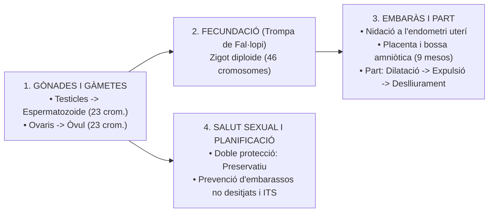

# UD9: La Reproducció Humana (Ciències Naturals)

Benvingut/da a la **Unitat Didàctica 9** de Ciències Aplicades I (bloc de Ciències Naturals). En aquesta unitat estudiarem la funció biològica de la **reproducció humana**, els canvis de la pubertat i l'adolescència, l'anatomia i fisiologia dels aparells reproductors masculí i femení, l'embaràs i el part, així com l'educació afectivosexual responsable: **mètodes anticonceptius** i prevenció de les **Infeccions de Transmissió Sexual (ITS)**.

---

## 📑 Planificació de Subunitats Didàctiques (1 Sessió per Apartat)

| Sessió | Subunitat | Contingut Principal de la Sessió | Bateria d'Activitats | Enllaç Directe |
| :---: | :---: | :--- | :---: | :---: |
| **Sessió 1** | **9.1** | **La reproducció humana:** Reproducció sexual, fecundació interna, viviparisme, gònades, gàmetes (23 cromosomes) i sexualitat. | MCQ, V/F, Vocabulari, Raonament i Aules | [**📖 Anar a la Sessió 9.1 →**](./nat0901.html) |
| **Sessió 2** | **9.2** | **Caràcters sexuals:** Caràcters primaris vs secundaris, pubertat, hormones sexuals i adolescència. | MCQ, V/F, Vocabulari, Raonament i Aules | [**📖 Anar a la Sessió 9.2 →**](./nat0902.html) |
| **Sessió 3** | **9.3** | **Aparell reproductor masculí:** Testicles, escrot ($35^\circ\text{C}$), vies espermàtiques, glàndules annexes, semen i espermatozoide. | MCQ, V/F, Vocabulari, Raonament i Aules | [**📖 Anar a la Sessió 9.3 →**](./nat0903.html) |
| **Sessió 4** | **9.4** | **Aparell reproductor femení:** Ovaris, trompes de Fal·lopi, úter (endometri), vagina, vulva, òvul i cicle menstrual (28 dies). | MCQ, V/F, Vocabulari, Raonament i Aules | [**📖 Anar a la Sessió 9.4 →**](./nat0904.html) |
| **Sessió 5** | **9.5** | **Cicle vital de l'ésser humà:** Fecundació (zigot), nidació, placenta, embaràs (40 setmanes), les 3 fases del part i etapes vitals. | MCQ, V/F, Vocabulari, Raonament i Aules | [**📖 Anar a la Sessió 9.5 →**](./nat0905.html) |
| **Sessió 6** | **9.6** | **Planificació familiar:** Mètodes anticonceptius de barrera (preservatiu), hormonals, DIU, quirúrgics i reproducció assistida (IA/FIV). | MCQ, V/F, Vocabulari, Raonament i Aules | [**📖 Anar a la Sessió 9.6 →**](./nat0906.html) |
| **Sessió 7** | **9.7** | **Malalties de transmissió sexual (ITS):** Bacterianes (sífilis, gonorrea, clamídia), víriques (VIH/SIDA, VPH, herpes, hepatitis B) i prevenció. | MCQ, V/F, Vocabulari, Raonament i Aules | [**📖 Anar a la Sessió 9.7 →**](./nat0907.html) |

---

## 🧬 Mapa Conceptual General de la Unitat 9

---

> [!IMPORTANT]
> ### 🎯 Objectius d'Aprenentatge de la UD9
> 1. Comprendre les característiques de la reproducció humana (sexual, interna i vivípara) i per què els gàmetes tenen **23 cromosomes** (haploides).
> 2. Diferenciar els **caràcters sexuals primaris** dels **secundaris** que apareixen a la pubertat per acció de la testosterona, els estrògens i la progesterona.
> 3. Identificar els òrgans i funcions dels **aparells reproductors masculí i femení** i interpretar les fases del **cicle ovàric i menstrual de 28 dies**.
> 4. Descriure el procés des de la **fecundació** a les trompes de Fal·lopi fins a la **nidació**, el paper de la **placenta** i les 3 etapes del **part**.
> 5. Valorar de forma crítica els **mètodes anticonceptius**, reconeixent el **preservatiu** com l'únic mètode que ofereix **doble protecció** (davant d'embaràs i d'ITS), i conéixer les principals **ITS** i la seua prevenció.
