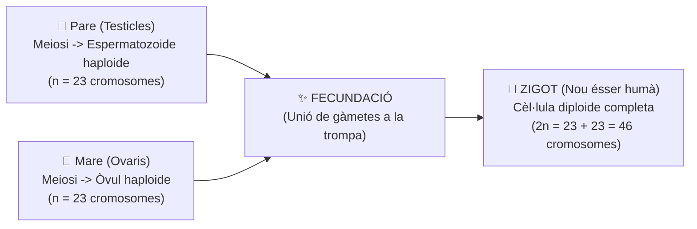

  

    ⚡ Progrés d'aprenentatge (9.1)
    0 / 12 reptes resolts
  

  

    

  

# 9.1 La reproducció humana

Les funcions de **nutrició** i de **relació** són indispensables perquè un individu concret es mantinga amb vida dia a dia: si deixem de respirar, de menjar o de coordinar els nostres òrgans interns, morim. En canvi, un ésser humà pot viure tota la seua vida amb perfecta salut sense tindre fills.

Per tant, quina és la finalitat biològica de la **funció de reproducció**? La reproducció és la funció vital que permet originar nous individus semblants als seus progenitors per **garantir la supervivència, continuïtat i perpetuació de l'espècie humana** al llarg de les generacions.

---

## 1. Característiques Biològiques de la Reproducció Humana

La reproducció de l'espècie humana (*Homo sapiens*) presenta tres trets biològics fonamentals:

1. **És una Reproducció Sexual (amb variabilitat genètica):**
   - A diferència de la reproducció asexual dels bacteris (que es divideixen produint clons idèntics), en la reproducció sexual intervenen **dos progenitors de sexe biològic diferent** (masculí i femení).
   - Cada progenitor aporta una cèl·lula reproductora especialitzada (**gàmeta**) amb la meitat de la informació genètica. El nou ésser humà no és un clon exacte del pare ni de la mare, sinó una **combinació genètica única i irrepetible**, fet que aporta **variabilitat genètica** i ajuda l'espècie a adaptar-se i evolucionar.
2. **Té Fecundació Interna:**
   - La unió del gàmeta masculí (**espermatozoide**) i el gàmeta femení (**òvul**) no ocorre a l'aigua exterior (com en molts peixos o amfibis), sinó a l'**interior de l'aparell reproductor femení** (concretament a les **trompes de Fal·lopi**), en un medi humit, càlid i protegit.
3. **Té Desenvolupament Vivípar Placentari:**
   - Com a mamífers placentaris que som, l'embrió i el fetus es desenvolupen dins de l'**úter matern** durant uns 9 mesos (40 setmanes), nodrint-se de la sang de la mare a través d'un òrgan temporal anomenat **placenta**, fins al moment de nàixer viu en el **part** i alimentar-se inicialment de llet materna (**lactància**).

---

## 2. Les Gònades i els Gàmetes: Per què tenen 23 Cromosomes?

Totes les cèl·lules del nostre cos (les de la pell, els músculs, el fetge o els ossos), anomenades **cèl·lules somàtiques**, són **diploides ($2n$)**: contenen al seu nucli **46 cromosomes** (organitzats en 23 parelles).

Si s'ajuntaren dues cèl·lules normals de 46 cromosomes, el fill tindria $46 + 46 = 92$ cromosomes, una xifra inviable per a la vida humana! Per evitar-ho, la naturalesa utilitza una divisió cel·lular especial anomenada **meiosi** dins dels òrgans reproductors (**gònades**) per fabricar cèl·lules sexuals amb **la meitat exacta de cromosomes**:

### A) Les Gònades (Òrgans productors)
Les **gònades** són els òrgans principals dels aparells reproductors i tenen una **doble funció**: fabricar les cèl·lules sexuals (**gàmetes**) i segregar les **hormones sexuals** a la sang:
- **Testicles (gònades masculines):** Fabriquen els **espermatozoides** i l'hormona **testosterona**.
- **Ovaris (gònades femenines):** Fabriquen els **òvuls** i les hormones **estrògens i progesterona**.

### B) Els Gàmetes (Cèl·lules reproductores haploides: $n = 23$ cromosomes)
Els **gàmetes** són cèl·lules **haploides (n)**: tenen només **23 cromosomes** (22 cromosomes autosomes i 1 cromosoma sexual, que en l'òvul és sempre X i en l'espermatozoide pot ser X o Y).

| Característica | 🔬 Espermatozoide (Gàmeta Masculí) | 🥚 Òvul (Gàmeta Femení) |
| :--- | :--- | :--- |
| **Gònada on es forma** | Als **testicles** (túbuls seminífers) | Als **ovaris** (dins dels fol·licles) |
| **Nombre de cromosomes** | **23 cromosomes** ($22 + \text{X}$ o bé $22 + \text{Y}$) | **23 cromosomes** (sempre $22 + \text{X}$) |
| **Mida cel·lular** | **Molt menut** ($\approx 0{,}05\text{ mm}$); una de les cèl·lules més menudes del cos | **Molt gran i esfèric** ($\approx 0{,}12-0{,}15\text{ mm}$); la cèl·lula més gran del cos humà |
| **Mobilitat** | **Molt mòbil:** nada activament gràcies al seu llarg **flagel (cua)** | **Immòbil:** no té flagel; es desplaça espentat pels cilis de la trompa de Fal·lopi |
| **Reserves nutritives** | Escasses (només té mitocondris al coll per donar energia al flagel) | **Molt abundants** (citoplasma ple de **vitel** per alimentar el zigot els primers dies) |
| **Ritme de producció** | Se'n fabriquen **milions cada dia** des de la pubertat fins a la vellesa | Unes dones naixen amb tots els òvuls immaturs; en madura **1 cada 28 dies** de la pubertat a la menopausa |

---

## 3. Reproducció, Sexe Biològic i Sexualitat Humana

En l'ésser humà és fonamental no confondre tres conceptes que estan relacionats però no són sinònims:

1. **Sexe biològic:** És el conjunt de característiques genètiques (cromosomes XX o XY), anatòmiques (òrgans genitals), gonadals i hormonals que distingeixen biològicament els individus.
2. **Reproducció:** És el procés estrictament biològic de procrear i tindre descendència mitjançant la fecundació, l'embaràs i el part.
3. **Sexualitat humana:** És un concepte molt més ampli que abarca les dimensions **biològica, afectiva, psicològica, emocional, social i comunicativa** de les persones.
   - En els humans, la sexualitat no té com a única finalitat tindre fills: és una font de **comunicació, afecte, estima, intimitat i plaer compartit** entre les persones.

> [!IMPORTANT]
> ### 🤝 Educació Afectivosexual: Respecte, Igualtat i Consentiment
> Viure una sexualitat saludable i responsable implica tres principis ètics i legals innegociables:
> - **El Consentiment lliure i mutu:** Qualsevol relació afectiva o sexual ha de ser desitjada lliurement i explícitament per totes dues persones, sense cap mena de pressió, xantatge ni coacció.
> - **La Igualtat i el Respecte:** Cap persona és propietat de l'altra; el control del mòbil, la gelosia patològica o la falta de respecte són senyals d'alerta de violència que cal rebutjar.
> - **La Responsabilitat en Salut:** Prevenir embarassos no planificats i protegir-se i protegir la parella contra les Infeccions de Transmissió Sexual (ITS).

---

> [!NOTE]
> ### 💡 Resum de Conceptes Clau
> - La reproducció humana és **sexual**, amb **fecundació interna** (a les trompes de Fal·lopi) i desenvolupament **vivípar placentari** (a l'úter).
> - Les **gònades** (testicles i ovaris) fabriquen hormones sexuals i els **gàmetes** (**espermatozoide** i **òvul**).
> - Els gàmetes són cèl·lules **haploides ($n = 23\text{ cromosomes}$)** perquè en unir-se en la fecundació formen un **zigot diploide ($2n = 46\text{ cromosomes}$)**.

---

## 🎯 Activitats i Autoavaluació Interactiva (15 Exercicis Diaris)

  

    🎮 <strong>Zona d'Entrenament FPB:</strong> 0 / 12 reptes resolts
    ⭐ 0 punts
  

  

### 1. Qüestionari d'Autoavaluació Tipus Test (MCQ)

  
<strong>1. Quants cromosomes tenen els gàmetes humans (un espermatozoide o un òvul) i quants en té el zigot format després de la fecundació?</strong>

  

    <button type="button" class="btn-mcq-opt" data-opt="A">A) Els gàmetes tenen 46 cromosomes i el zigot en té 92</button>
    <button type="button" class="btn-mcq-opt" data-opt="B">B) Cada gàmeta té 23 cromosomes (haploide) i en unir-se formen un zigot amb 46 cromosomes (diploide)</button>
    <button type="button" class="btn-mcq-opt" data-opt="C">C) Tant els gàmetes com el zigot tenen sempre 23 cromosomes</button>
    <button type="button" class="btn-mcq-opt" data-opt="D">D) L'espermatozoide té 46 cromosomes i l'òvul no en té cap</button>
  

  

  
<strong>2. Quina d'aquestes afirmacions descriu correctament les diferències entre l'espermatozoide i l'òvul humà?</strong>

  

    <button type="button" class="btn-mcq-opt" data-opt="A">A) L'òvul és molt menut i té un llarg flagel per nadar, mentre que l'espermatozoide és gegant i immòbil</button>
    <button type="button" class="btn-mcq-opt" data-opt="B">B) Tots dos tenen exactament la mateixa mida i es fabriquen per milions cada dia</button>
    <button type="button" class="btn-mcq-opt" data-opt="C">C) L'espermatozoide és molt menut i mòbil gràcies al seu flagel, mentre que l'òvul és una cèl·lula gran, esfèrica, immòbil i carregada de reserves nutritives</button>
    <button type="button" class="btn-mcq-opt" data-opt="D">D) L'òvul es fabrica als testicles i l'espermatozoide es fabrica als ovaris</button>
  

  

  
<strong>3. Quin avantatge evolutiu fonamental aporta la reproducció sexual humana enfront de la reproducció asexual dels bacteris?</strong>

  

    <button type="button" class="btn-mcq-opt" data-opt="A">A) Genera variabilitat genètica, ja que cada fill o filla és una combinació única i irrepetible dels gens dels dos progenitors</button>
    <button type="button" class="btn-mcq-opt" data-opt="B">B) Permet reproduir-se sense necessitat de cèl·lules ni cromosomes</button>
    <button type="button" class="btn-mcq-opt" data-opt="C">C) Produeix clons exactament idèntics al 100%</button>
    <button type="button" class="btn-mcq-opt" data-opt="D">D) No requereix fecundació ni desenvolupament embrionari</button>
  

  

  
<strong>4. Quin gàmeta determina genèticament el sexe biològic (XX o XY) del futur nadó en el moment de la fecundació?</strong>

  

    <button type="button" class="btn-mcq-opt" data-opt="A">A) Sempre l'òvul matern, perquè és més gran</button>
    <button type="button" class="btn-mcq-opt" data-opt="B">B) Cap dels dos; el sexe es decideix en el moment del part</button>
    <button type="button" class="btn-mcq-opt" data-opt="C">C) La placenta durant el tercer trimestre</button>
    <button type="button" class="btn-mcq-opt" data-opt="D">D) L'espermatozoide patern, ja que l'òvul sempre aporta un cromosoma X i l'espermatozoide pot aportar un cromosoma X (xica, XX) o un cromosoma Y (xic, XY)</button>
  

  

---

### 2. Activitats de Vertader (V) o Fals (F)

  <strong>a) L'ésser humà és una espècie de reproducció sexual amb fecundació interna i desenvolupament vivípar placentari.</strong>
  

    <button type="button" class="btn-vf" data-opt="V">V</button>
    <button type="button" class="btn-vf" data-opt="F">F</button>
  

  

  <strong>b) Igual que ocorre amb la nutrició, si un individu humà decideix no tindre fills mor immediatament perquè la reproducció és indispensable per a la supervivència individual.</strong>
  

    <button type="button" class="btn-vf" data-opt="V">V</button>
    <button type="button" class="btn-vf" data-opt="F">F</button>
  

  

  <strong>c) La meiosi és el tipus especial de divisió cel·lular que té lloc a les gònades per reduir a la meitat el nombre de cromosomes (de 46 a 23) en fabricar els gàmetes.</strong>
  

    <button type="button" class="btn-vf" data-opt="V">V</button>
    <button type="button" class="btn-vf" data-opt="F">F</button>
  

  

  <strong>d) La sexualitat humana es redueix exclusivament a l'acte biològic de tindre fills i no té cap relació amb l'afectivitat, la comunicació ni el respecte.</strong>
  

    <button type="button" class="btn-vf" data-opt="V">V</button>
    <button type="button" class="btn-vf" data-opt="F">F</button>
  

  

---

### 3. Exercicis de Resposta Breu, Vocabulari Tècnic i Càlcul

  
✍️ <strong>1.</strong> Com s'anomenen genèricament els òrgans reproductors (testicles i ovaris) encarregats de fabricar tant els gàmetes com les hormones sexuals?

  

    <input type="text" class="quiz-input" placeholder="Escriu el terme biològic...">
    <button type="button" class="btn-quiz-check">Comprovar</button>
  

  

  
✍️ <strong>2.</strong> Quin nom científic reben les cèl·lules reproductores haploides (amb 23 cromosomes), és a dir, els espermatozoides i els òvuls?

  

    <input type="text" class="quiz-input" placeholder="Escriu el terme...">
    <button type="button" class="btn-quiz-check">Comprovar</button>
  

  

  
✍️ <strong>3.</strong> Càlcul genètic: Quants cromosomes té en total qualsevol cèl·lula somàtica (diploide, 2n) de la pell, d'un múscul o del fetge d'un ésser humà?

  

    <input type="text" class="quiz-input" placeholder="Escriu el nombre de cromosomes...">
    <button type="button" class="btn-quiz-check">Comprovar</button>
  

  

  
✍️ <strong>4.</strong> Com s'anomena la divisió cel·lular especial que ocorre als testicles i ovaris per fabricar gàmetes amb la meitat de cromosomes (23)?

  

    <input type="text" class="quiz-input" placeholder="Escriu el nom de la divisió...">
    <button type="button" class="btn-quiz-check">Comprovar</button>
  

  

---

### 4. Exercicis de Raonament i Desenvolupament Escrit (Tasca d'Aula)

  
✍️ <strong>1. Importància dels 23 cromosomes i la meiosi:</strong> Explica amb un càlcul numèric què passaria amb el nombre de cromosomes dels fills, néts i besnéts al llarg de tres generacions si els òvuls i els espermatozoides tingueren 46 cromosomes en lloc de 23, i per què la meiosi és indispensable.

  <textarea class="open-response-input" rows="4" placeholder="1a generació: 46 + 46 = ...
2a generació: ...
Funció de la meiosi: ..."></textarea>

  
✍️ <strong>2. Comparativa morfològica i funcional entre Espermatozoide i Òvul:</strong> Explica quatre diferències entre l'espermatozoide i l'òvul humà pel que fa a: 1) Mida i forma, 2) Mobilitat, 3) Quantitat de reserves nutritives (vitel) i 4) Ritme de producció al llarg de la vida.

  <textarea class="open-response-input" rows="4" placeholder="1) Mida i forma: ...
2) Mobilitat: ...
3) Reserves nutritives: ...
4) Ritme de producció: ..."></textarea>

  
✍️ <strong>3. Sexe biològic, reproducció i sexualitat responsable:</strong> Diferencia els conceptes de 'reproducció' i 'sexualitat humana', i explica per què el consentiment mutu, la igualtat i el respecte són pilars obligatoris en qualsevol relació afectivosexual.

  <textarea class="open-response-input" rows="4" placeholder="Diferència reproducció vs sexualitat: ...
Importància del consentiment i respecte: ..."></textarea>

---

  <h3 style="margin-top:0; color:#0369a1;">📦 Lliurament d'Activitats d'Aules (Act 9.1)</h3>
  
Genera el teu document de tasca d'aquest apartat amb el teu nom i els 15 exercicis completats.

  

    <input type="text" class="aules-student-name" placeholder="Cognoms, Nom de l'Alumne/a" style="padding:8px 12px; border:1px solid #94a3b8; border-radius:4px; flex-grow:1; min-width:240px;">
    <button class="btn-generate-aules-pdf" data-unit="NAT09" data-activity="Act01" data-module="CA" style="padding:8px 16px; background:#0284c7; color:#fff; border:none; border-radius:4px; font-weight:600; cursor:pointer;">📄 Descarregar PDF per a Aules</button>
  

