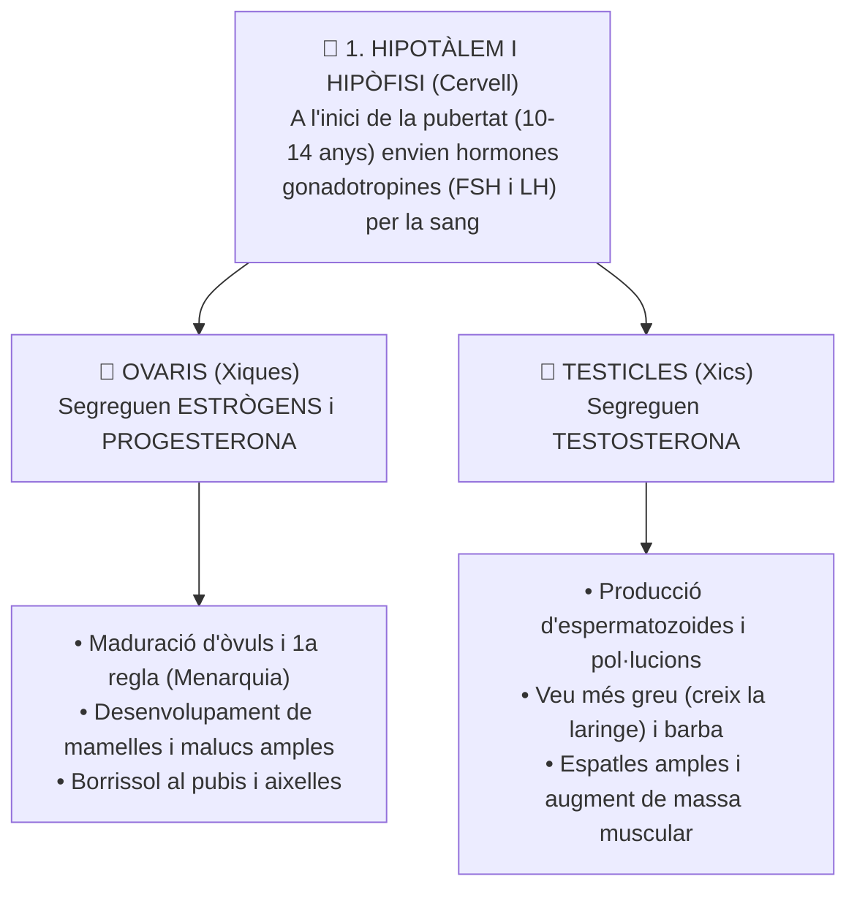

  

    ⚡ Progrés d'aprenentatge (9.2)
    0 / 12 reptes resolts
  

  

    

  

# 9.2 Caràcters sexuals

Anomenem **caràcters sexuals** el conjunt de trets anatòmics, físics i fisiològics que diferencien biològicament els dos sexes. Segons el moment de la vida en què apareixen i la seua funció, es classifiquen en dos grans grups: els **caràcters sexuals primaris** (amb els quals ja naixem) i els **caràcters sexuals secundaris** (que es desenvolupen a partir de la pubertat).

---

## 1. Els Caràcters Sexuals Primaris (Des del Naixement)

Els **caràcters sexuals primaris** són els mateixos **òrgans reproductors (genitals interns i externs)** amb els quals naix un nadó.
- Estan determinats genèticament des del moment de la fecundació pels cromosomes sexuals (XX o XY) i es formen durant l'embaràs dins de l'úter matern.
- **Quins són?**
  - **Caràcters sexuals primaris masculins:** La presència de testicles, escrot, penis, pròstata i vies espermàtiques.
  - **Caràcters sexuals primaris femenins:** La presència d'ovaris, trompes de Fal·lopi, úter, vagina i vulva.
- Durant tota la **infància** (des del naixement fins als 10-12 anys), els caràcters sexuals primaris ja estan presents, però es troben **immadurs i inactius** (no fabriquen encara ni òvuls madurs ni espermatozoides), i l'aspecte físic exterior d'un xiquet i d'una xiqueta (veu, alçada, silueta corporal) és molt semblant.

---

## 2. La Pubertat i el Despertar Hormonal

Entre els **10 i els 14 anys** aproximadament (sol començar un poc abans en les xiques, cap als **10-12 anys**, que en els xics, cap als **12-14 anys**), s'inicia una etapa biològica de transformació anomenada **pubertat**.

### Com s'activa la pubertat?
1. El rellotge biològic de l'**hipotàlem** i la glàndula **hipòfisi** (a la base del cervell) comença a alliberar a la sang hormones gonadotropines (FSH i LH).
2. Aquestes hormones viatgen per la sang fins a les gònades (ovaris i testicles), "despertant-les" de la seua inactivitat infantil.
3. Les gònades responen posant en marxa dos processos simultanis:
   - **Inici de la capacitat reproductora:** Comencen a madurar els òvuls als ovaris i a fabricar-se espermatozoides als testicles.
   - **Secreció massiva d'hormones sexuals:** Els ovaris aboquen a la sang **estrògens i progesterona**, i els testicles aboquen **testosterona**. Aquestes hormones són les responsables que apareguen els **caràcters sexuals secundaris**.

---

## 3. Els Caràcters Sexuals Secundaris: Taula Comparativa

Els **caràcters sexuals secundaris** són el conjunt de canvis físics, morfològics i fisiològics (no directament genitals) que apareixen durant la pubertat per acció de les hormones sexuals i que donen al cos l'aspecte adult masculí o femení:

| Àmbit del Canvi | 👩 Canvis en les Xiques (Estrògens i Progesterona) | 👨 Canvis en els Xics (Testosterona) |
| :--- | :--- | :--- |
| **Estirada de creixement** | Creixement ràpid en alçada un poc més primerenc (**10-12 anys**). | Estirada d'alçada un poc més tardana (**12-14 anys**) però més prolongada. |
| **Silueta corporal i esquelet** | **Eixamplament de la pelvis i els malucs** (preparació anatòmica per a un futur part). | **Eixamplament de les espatles i del tòrax**; esquelet més pesat. |
| **Músculs i teixit adipós** | Acumulació suau de greix subcutani als malucs, cuixes i pit, arredonint les formes. | **Fort augment de la massa i força muscular** més marcada. |
| **Glàndules mamàries** | Creixement i desenvolupament complet de les **mamelles (pits)**. | Sense desenvolupament mamari funcional. |
| **Veu i laringe** | La veu canvia poc i manté un timbre més **agut**. | Creix la laringe ("nou del coll") i les cordes vocals s'engrosseixen: la veu es torna **més greu**. |
| **Borrissol i pell** | Aparició de pèl al **pubis i a les aixelles**; augment de greix a la pell (possible acne). | Aparició de pèl al **pubis i aixelles**, i més tard **barba i bigot a la cara**, pit i cames; possible acne. |
| **Maduresa reproductora** | Inici de l'ovulació i aparició de la **primera menstruació o regla (menarquia)**. | Creixement de testicles i penis, producció d'espermatozoides i primeres **ejaculacions**. |

> [!TIP]
> ### 🧴 Higiene i Salut durant la Pubertat
> L'augment d'hormones sexuals durant la pubertat activa amb força les **glàndules sudorípares** (suor amb olor més intensa a les aixelles i engonals) i les **glàndules sebàcies** de la pell (que fabriquen més sèu o greix, taponant els porus i provocant els grans de l'**acne juvenil**). Per això és essencial la dutxa diària, rentar-se la cara amb sabó neutre sense rebentar els grans (per evitar infeccions i cicatrius) i mantenir una higiene genital acurada.

---

## 4. Pubertat vs. Adolescència: Els Canvis Psicològics i Socials

Tot i que sovint s'usen com a sinònims, cal distingir dos conceptes:
- **La Pubertat:** És el procés **estrictament biològic i físic** de maduració corporal i hormonal que acabem d'estudiar.
- **L'Adolescència:** És l'etapa de transició **psicològica, emocional i social** entre la infància i l'edat adulta (s'estén aproximadament entre els 11-12 i els 18-20 anys). Es caracteritza per:
  - **Recerca de la pròpia identitat i autonomia:** Necessitat de prendre decisions pròpies, definir gustos, valors i vocació professional (com quan s'inicia l'FP Bàsica per aprendre una professió).
  - **Importància del grup d'iguals (amics i amigues):** Els amics passen a ser un referent fonamental de pertinença i socialització; cal saber dir "no" davant la pressió de grup cap a conductes de risc.
  - **Despertar afectiu i sexual:** Aparició de noves emocions, atracció afectivosexual i necessitat d'informació rigorosa i fiable.

---

> [!NOTE]
> ### 💡 Resum de Conceptes Clau
> - Els **caràcters sexuals primaris** són els òrgans reproductors interns i externs amb els quals naixem.
> - A la **pubertat** (10-14 anys), la **hipòfisi** activa els ovaris i testicles perquè fabriquen gàmetes i hormones sexuals (**estrògens i progesterona** en la dona; **testosterona** en l'home).
> - Les hormones sexuals fan aparéixer els **caràcters sexuals secundaris** (mamelles, malucs i **menarquia** en les xiques; veu greu, barba, espatles amples i espermatozoides en els xics).

---

## 🎯 Activitats i Autoavaluació Interactiva (15 Exercicis Diaris)

  

    🎮 <strong>Zona d'Entrenament FPB:</strong> 0 / 12 reptes resolts
    ⭐ 0 punts
  

  

### 1. Qüestionari d'Autoavaluació Tipus Test (MCQ)

  
<strong>1. Quina és la diferència fonamental entre els caràcters sexuals primaris i els caràcters sexuals secundaris?</strong>

  

    <button type="button" class="btn-mcq-opt" data-opt="A">A) Els primaris són els òrgans reproductors amb què naixem, i els secundaris són els trets físics que apareixen a la pubertat per acció de les hormones</button>
    <button type="button" class="btn-mcq-opt" data-opt="B">B) Els primaris apareixen als 14 anys i els secundaris estan presents des del naixement</button>
    <button type="button" class="btn-mcq-opt" data-opt="C">C) Els primaris són exclusius dels homes i els secundaris són exclusius de les dones</button>
    <button type="button" class="btn-mcq-opt" data-opt="D">D) Els primaris depenen del tiroide i els secundaris depenen del pàncrees</button>
  

  

  
<strong>2. Quina hormona sexual fabricada pels testicles és la responsable de l'aparició dels caràcters sexuals secundaris masculins (veu greu, barba, desenvolupament muscular)?</strong>

  

    <button type="button" class="btn-mcq-opt" data-opt="A">A) La progesterona</button>
    <button type="button" class="btn-mcq-opt" data-opt="B">B) Els estrògens</button>
    <button type="button" class="btn-mcq-opt" data-opt="C">C) La insulina</button>
    <button type="button" class="btn-mcq-opt" data-opt="D">D) La testosterona</button>
  

  

  
<strong>3. Quina glàndula situada a la base del cervell dóna l'ordre d'iniciar la pubertat entre els 10 i els 14 anys enviant hormones gonadotropines (FSH i LH) als ovaris i testicles?</strong>

  

    <button type="button" class="btn-mcq-opt" data-opt="A">A) La glàndula tiroide</button>
    <button type="button" class="btn-mcq-opt" data-opt="B">B) La hipòfisi (dirigida per l'hipotàlem)</button>
    <button type="button" class="btn-mcq-opt" data-opt="C">C) El pàncrees</button>
    <button type="button" class="btn-mcq-opt" data-opt="D">D) Les càpsules suprarenals</button>
  

  

  
<strong>4. Quin dels següents conjunts de canvis físics correspon exclusivament als caràcters sexuals secundaris femenins durant la pubertat?</strong>

  

    <button type="button" class="btn-mcq-opt" data-opt="A">A) Aparició de barba, veu molt greu i producció d'espermatozoides</button>
    <button type="button" class="btn-mcq-opt" data-opt="B">B) Formació dels ovaris i l'úter abans de nàixer</button>
    <button type="button" class="btn-mcq-opt" data-opt="C">C) Desenvolupament de les mamelles, eixamplament dels malucs i la pelvis, borrissol púbic/axil·lar i primera menstruació (menarquia)</button>
    <button type="button" class="btn-mcq-opt" data-opt="D">D) Caiguda de les dents de llet als 6 anys</button>
  

  

---

### 2. Activitats de Vertader (V) o Fals (F)

  <strong>a) La pubertat s'inicia quan la glàndula hipòfisi del cervell envia hormones a la sang per activar el funcionament dels ovaris i dels testicles.</strong>
  

    <button type="button" class="btn-vf" data-opt="V">V</button>
    <button type="button" class="btn-vf" data-opt="F">F</button>
  

  

  <strong>b) L'aparició de la barba en els xics i el desenvolupament de les mamelles en les xiques durant la pubertat són exemples de caràcters sexuals primaris.</strong>
  

    <button type="button" class="btn-vf" data-opt="V">V</button>
    <button type="button" class="btn-vf" data-opt="F">F</button>
  

  

  <strong>c) En els xics, durant la pubertat creix la laringe i s'engrosseixen les cordes vocals per acció de la testosterona, fent que la veu es torne més greu.</strong>
  

    <button type="button" class="btn-vf" data-opt="V">V</button>
    <button type="button" class="btn-vf" data-opt="F">F</button>
  

  

  <strong>d) Durant la infància (abans de la pubertat), els testicles i els ovaris ja fabriquen milions d'espermatozoides i òvuls madurs cada dia.</strong>
  

    <button type="button" class="btn-vf" data-opt="V">V</button>
    <button type="button" class="btn-vf" data-opt="F">F</button>
  

  

---

### 3. Exercicis de Resposta Breu, Vocabulari Tècnic i Càlcul

  
✍️ <strong>1.</strong> Com s'anomenen les hormones sexuals femenines produïdes pels ovaris que provoquen el desenvolupament dels caràcters sexuals secundaris en les xiques?

  

    <input type="text" class="quiz-input" placeholder="Escriu el nom de les hormones...">
    <button type="button" class="btn-quiz-check">Comprovar</button>
  

  

  
✍️ <strong>2.</strong> Quin terme mèdic i biològic s'utilitza per anomenar l'aparició de la primera menstruació o regla en una xica durant la pubertat?

  

    <input type="text" class="quiz-input" placeholder="Escriu el terme...">
    <button type="button" class="btn-quiz-check">Comprovar</button>
  

  

  
✍️ <strong>3.</strong> Com s'anomena l'etapa de maduració estrictament biològica i física (entre els 10 i 14 anys) en què s'activen les gònades i apareixen els caràcters sexuals secundaris?

  

    <input type="text" class="quiz-input" placeholder="Escriu el nom de l'etapa...">
    <button type="button" class="btn-quiz-check">Comprovar</button>
  

  

  
✍️ <strong>4.</strong> Quina hormona sexual masculina fabriquen els testicles per estimular la producció d'espermatozoides, l'augment de massa muscular i l'aparició del pèl facial?

  

    <input type="text" class="quiz-input" placeholder="Escriu el nom de l'hormona...">
    <button type="button" class="btn-quiz-check">Comprovar</button>
  

  

---

### 4. Exercicis de Raonament i Desenvolupament Escrit (Tasca d'Aula)

  
✍️ <strong>1. Quadre comparatiu dels Caràcters Sexuals Secundaris:</strong> Enumera quatre caràcters sexuals secundaris que apareixen en les xiques i quatre que apareixen en els xics durant la pubertat, indicant quina glàndula i quina hormona provoca cadascun.

  <textarea class="open-response-input" rows="4" placeholder="Xiques (Ovaris -> Estrògens): 1... 2... 3... 4...
Xics (Testicles -> Testosterona): 1... 2... 3... 4..."></textarea>

  
✍️ <strong>2. Pubertat biològica vs. Adolescència psicosocial:</strong> Explica per què no és exactament el mateix 'pubertat' que 'adolescència', i descriu tres canvis psicològics, emocionals o socials propis de l'etapa adolescent.

  <textarea class="open-response-input" rows="4" placeholder="Diferència entre pubertat i adolescència: ...
Tres canvis psicològics i socials de l'adolescència: ..."></textarea>

  
✍️ <strong>3. Higiene corporal i cura de la pell en la pubertat:</strong> Explica per què durant la pubertat augmenta la suor amb olor forta i apareixen els grans de l'acne juvenil a la cara i l'esquena, i redacta tres normes d'higiene diària recomanables.

  <textarea class="open-response-input" rows="4" placeholder="Causa hormonal de la suor i l'acne (glàndules sudorípares i sebàcies): ...
Tres normes d'higiene: ..."></textarea>

---

  <h3 style="margin-top:0; color:#0369a1;">📦 Lliurament d'Activitats d'Aules (Act 9.2)</h3>
  
Genera el teu document de tasca d'aquest apartat amb el teu nom i els 15 exercicis completats.

  

    <input type="text" class="aules-student-name" placeholder="Cognoms, Nom de l'Alumne/a" style="padding:8px 12px; border:1px solid #94a3b8; border-radius:4px; flex-grow:1; min-width:240px;">
    <button class="btn-generate-aules-pdf" data-unit="NAT09" data-activity="Act02" data-module="CA" style="padding:8px 16px; background:#0284c7; color:#fff; border:none; border-radius:4px; font-weight:600; cursor:pointer;">📄 Descarregar PDF per a Aules</button>
  

