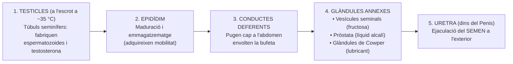

  

    ⚡ Progrés d'aprenentatge (9.3)
    0 / 12 reptes resolts
  

  

    

  

# 9.3 Aparell reproductor masculí

L'**aparell reproductor masculí** té com a missió biològica fabricar de manera contínua els gàmetes masculins (**espermatozoides**), produir l'hormona sexual masculina (**testosterona**), nodrir els espermatozoides amb els líquids de les glàndules annexes formant el **semen** i depositar-los a l'interior de l'aparell reproductor femení per possibilitar la fecundació.

---

## 1. Anatomia Completa de l'Aparell Reproductor Masculí

Per estudiar-lo amb ordre, dividim els seus òrgans en quatre blocs funcionals: **gònades**, **òrgans externs**, **vies espermàtiques** i **glàndules annexes**.

### A) Les Gònades: Els Testicles
Els **testicles** són dos òrgans ovoides situats fora de la cavitat abdominal.
- A l'interior de cada testicle hi ha centenars de conductes finíssims enrotllats anomenats **túbuls seminífers**, a les parets dels quals es fabriquen milions d'espermatozoides cada dia (**espermatogènesi**) a partir de la pubertat.
- Entre els túbuls es troben les *cèl·lules de Leydig*, que fabriquen i aboquen a la sang l'hormona **testosterona**.

### B) Els Òrgans Genitals Externs: Escrot i Penis
1. **L'Escrot (o bossa escrotal):** És una bossa de pell i múscul que envolta i sosté els testicles **fora de l'abdomen**.
   - **Per què els testicles estan fora del cos?** Perquè l'espermatogènesi (fabricació d'espermatozoides sans i fèrtils) **no pot ocórrer a 37 °C**: necessita una temperatura d'uns **35 °C (entre 1,5 °C i 2 °C menys que l'interior del cos)**. Quan fa fred l'escrot s'arronsa per acostar-los al cos, i quan fa calor es relaxa per allunyar-los.
2. **El Penis:** És l'òrgan cilíndric copulador encarregat de l'expulsió tant de l'orina com del semen.
   - **Estructura interna:** Està format per tres cilindres de teixit erèctil esponjós: dos **cossos cavernosos** superiors i un **cos esponjós** inferior (per l'interior del qual passa la uretra). Durant l'excitació sexual, aquests cossos s'omplin de sang arterial a pressió, fet que fa que el penis augmente de mida i s'endurisca (**erecció**).
   - **Extrem distal:** El cos esponjós s'eixampla a la punta formant el **gland** (zona molt rica en terminacions nervioses sensitives), el qual està recobert per un plec de pell mòbil i elàstic anomenat **prepuci**.

> [!TIP]
> ### 🩺 Què és la Fimosi?
> S'anomena **fimosi** l'estretor de l'obertura del **prepuci** que impedeix descobrir el gland amb normalitat, dificultant la higiene i podent causar dolor en l'erecció. Es resol fàcilment amb tractament mèdic o una senzilla intervenció quirúrgica ambulatòria anomenada **circumcisió**.

---

### C) Les Vies Espermàtiques (Conductes Interns)
Són els conductes que transporten els espermatozoides des del testicle fins a l'exterior:
1. **Epidídim:** És un tub llarguíssim però plegat sobre si mateix com un capell damunt de cada testicle. Ací els espermatozoides acabats de fabricar s'emmagatzemen durant diversos dies, **maduren i adquireixen la capacitat de nadar**.
2. **Conductes deferents:** Dos tubs musculars (un de cada epidídim) que pugen des de l'escrot cap a l'interior de la cavitat pelviana, envolten la bufeta urinària i s'uneixen amb les glàndules annexes. *(Són els conductes que es tallen en l'operació anticonceptiva de la **vasectomia**)*.
3. **Uretra:** És el conducte final que travessa la pròstata i recorre tot l'interior del penis fins a obrir-se al meat urinari del gland.
   - **Atenció:** En l'home, la **uretra és un conducte compartit** per l'aparell urinari (condueix l'**orina** des de la bufeta) i per l'aparell reproductor (condueix el **semen** durant l'**ejaculació**), però un esfínter automàtic impedeix que tots dos líquids es barregen mai al mateix temps.

---

### D) Les Glàndules Annexes i la Formació del Semen
Al llarg dels conductes deferents i la uretra, tres tipus de **glàndules annexes** aboquen els seus líquids nutritius per acompanyar els espermatozoides i formar el **semen** (o esperma):

| Glàndula Annexa | Localització | Funció del Líquid que Aporta al Semen |
| :--- | :--- | :--- |
| **1. Vesícules seminals (2)** | Darrere de la bufeta urinària | Aporten un líquid viscós ric en **fructosa (sucre)**, que serveix de **combustible energètic** perquè els espermatozoides puguen moure el flagel. |
| **2. Pròstata (1)** | Sota la bufeta, envoltant l'inici de la uretra | Aporta el **líquid prostàtic**, de color blanquinós i **alcalí (bàsic)**, que protegeix els espermatozoides neutralitzant l'acidesa de la uretra i de la vagina. |
| **3. Glàndules de Cowper (2)** | Sota la pròstata (bulbouretrals) | Segreguen unes gotes de **líquid preseminal** transparent abans de l'ejaculació que **lubrica i neteja la uretra** *(pot contindre espermatozoides!)*. |

> [!IMPORTANT]
> ### 💧 Què és el Semen?
> En cada ejaculació s'expulsen entre 2 mL i 5 mL de **semen**: el **90% del seu volum són els líquids nutritius i protectors** de les vesícules seminals i la pròstata, i el **10% restant són entre 100 i 300 milions d'espermatozoides**.

---

## 2. Anatomia Microscòpica de l'Espermatozoide

L'**espermatozoide** és una cèl·lula altament especialitzada en el desplaçament ràpid, dividida en tres parts ben diferenciades:
1. **El Cap:** Conté dos elements vitals:
   - El **nucli cel·lular**, on viatgen compactats els **23 cromosomes** paterns.
   - L'**acrosoma**, un casquet situat a la punta del cap ple d'**enzims digestius** que actuen com un "trepant químic" per perforar les cobertes protectores de l'òvul en la fecundació.
2. **El Coll o Peça Intermèdia:** Situat entre el cap i la cua, està replet de **mitocondris**, les centrals energètiques que cremen la fructosa del semen per fabricar l'energia (ATP) que mou la cua.
3. **La Cua o Flagel:** Llarg filament mòbil que bat com un fuet per impulsar l'espermatozoide fins a les trompes de Fal·lopi.

---

> [!NOTE]
> ### 💡 Resum de Conceptes Clau
> - Els **testicles** estan fora de l'abdomen dins de l'**escrot** a uns **35 °C** per fabricar espermatozoides i **testosterona**.
> - El recorregut dels espermatozoides és: **Testicle $\rightarrow$ Epidídim (maduració) $\rightarrow$ Conducte deferent $\rightarrow$ Uretra (dins del penis)**.
> - Les **vesícules seminals** (fructosa energètica), la **pròstata** (líquid alcalí protector) i les **glàndules de Cowper** fabriquen els líquids del **semen**.
> - L'espermatozoide consta de **cap** (nucli amb 23 cromosomes + **acrosoma**), **coll** (amb **mitocondris**) i **cua o flagel**.

---

## 🎯 Activitats i Autoavaluació Interactiva (15 Exercicis Diaris)

  

    🎮 <strong>Zona d'Entrenament FPB:</strong> 0 / 12 reptes resolts
    ⭐ 0 punts
  

  

### 1. Qüestionari d'Autoavaluació Tipus Test (MCQ)

  
<strong>1. Per quina raó biològica els testicles es troben allotjats a l'escrot, fora de la cavitat abdominal?</strong>

  

    <button type="button" class="btn-mcq-opt" data-opt="A">A) Perquè no hi ha espai físic disponible dins de l'abdomen</button>
    <button type="button" class="btn-mcq-opt" data-opt="B">B) Per estar a una temperatura més alta de 40 °C</button>
    <button type="button" class="btn-mcq-opt" data-opt="C">C) Per mantindre's a uns 35 °C (uns 2 °C per sota de la temperatura corporal), condició indispensable per a fabricar espermatozoides viables</button>
    <button type="button" class="btn-mcq-opt" data-opt="D">D) Perquè estiguen més a prop dels ronyons</button>
  

  

  
<strong>2. Quin és l'ordre exacte dels conductes pels quals passa un espermatozoide des que es fabrica fins que ix a l'exterior en l'ejaculació?</strong>

  

    <button type="button" class="btn-mcq-opt" data-opt="A">A) Uretra → Pròstata → Conducte deferent → Testicle → Epidídim</button>
    <button type="button" class="btn-mcq-opt" data-opt="B">B) Testicle (túbuls seminífers) → Epidídim → Conducte deferent → Uretra</button>
    <button type="button" class="btn-mcq-opt" data-opt="C">C) Testicle → Urèter → Bufeta urinària → Conducte deferent</button>
    <button type="button" class="btn-mcq-opt" data-opt="D">D) Epidídim → Testicle → Vesícula seminal → Escrot</button>
  

  

  
<strong>3. Quina és la funció de la fructosa que aporten les vesícules seminals i del líquid alcalí que aporta la pròstata al semen?</strong>

  

    <button type="button" class="btn-mcq-opt" data-opt="A">A) La fructosa proporciona energia als mitocondris de l'espermatozoide per nadar, i el líquid prostàtic alcalí neutralitza l'acidesa de la uretra i la vagina</button>
    <button type="button" class="btn-mcq-opt" data-opt="B">B) Serveixen per destruir els espermatozoides abans que isquen</button>
    <button type="button" class="btn-mcq-opt" data-opt="C">C) Transformen els espermatozoides en glòbuls vermells</button>
    <button type="button" class="btn-mcq-opt" data-opt="D">D) Congelen els espermatozoides a 0 °C</button>
  

  

  
<strong>4. Quina estructura situada a la punta del cap de l'espermatozoide conté enzims digestius per perforar les cobertes protectores de l'òvul?</strong>

  

    <button type="button" class="btn-mcq-opt" data-opt="A">A) El flagel</button>
    <button type="button" class="btn-mcq-opt" data-opt="B">B) El prepuci</button>
    <button type="button" class="btn-mcq-opt" data-opt="C">C) El cos cavernós</button>
    <button type="button" class="btn-mcq-opt" data-opt="D">D) L'acrosoma</button>
  

  

---

### 2. Activitats de Vertader (V) o Fals (F)

  <strong>a) En l'home, la uretra és un conducte compartit per l'aparell urinari i per l'aparell reproductor.</strong>
  

    <button type="button" class="btn-vf" data-opt="V">V</button>
    <button type="button" class="btn-vf" data-opt="F">F</button>
  

  

  <strong>b) Els 23 cromosomes de l'espermatozoide es troben repartits al llarg de la cua o flagel, mentre que el cap només conté aigua.</strong>
  

    <button type="button" class="btn-vf" data-opt="V">V</button>
    <button type="button" class="btn-vf" data-opt="F">F</button>
  

  

  <strong>c) L'erecció del penis es produeix quan els cossos cavernosos i el cos esponjós s'omplin de sang arterial a pressió.</strong>
  

    <button type="button" class="btn-vf" data-opt="V">V</button>
    <button type="button" class="btn-vf" data-opt="F">F</button>
  

  

  <strong>d) El 100% del volum del semen està format exclusivament per espermatozoides secs, sense cap líquid de les glàndules annexes.</strong>
  

    <button type="button" class="btn-vf" data-opt="V">V</button>
    <button type="button" class="btn-vf" data-opt="F">F</button>
  

  

---

### 3. Exercicis de Resposta Breu, Vocabulari Tècnic i Càlcul

  
✍️ <strong>1.</strong> Com s'anomena l'òrgan en forma de tub molt enrotllat situat damunt de cada testicle on s'emmagatzemen i maduren els espermatozoides?

  

    <input type="text" class="quiz-input" placeholder="Escriu el nom de l'òrgan...">
    <button type="button" class="btn-quiz-check">Comprovar</button>
  

  

  
✍️ <strong>2.</strong> Quina glàndula annexa masculina situada sota la bufeta urinària aporta al semen un líquid alcalí blanquinós que protegeix els espermatozoides de l'acidesa?

  

    <input type="text" class="quiz-input" placeholder="Escriu el nom de la glàndula...">
    <button type="button" class="btn-quiz-check">Comprovar</button>
  

  

  
✍️ <strong>3.</strong> Com s'anomena el plec de pell mòbil i elàstic que recobreix el gland (extrem del penis) i l'estretor del qual produeix fimosi?

  

    <input type="text" class="quiz-input" placeholder="Escriu el terme anatòmic...">
    <button type="button" class="btn-quiz-check">Comprovar</button>
  

  

  
✍️ <strong>4.</strong> Com s'anomena la bossa externa de pell que allotja els testicles fora de l'abdomen per mantindre'ls a uns 35 °C?

  

    <input type="text" class="quiz-input" placeholder="Escriu el nom de la bossa...">
    <button type="button" class="btn-quiz-check">Comprovar</button>
  

  

---

### 4. Exercicis de Raonament i Desenvolupament Escrit (Tasca d'Aula)

  
✍️ <strong>1. Disseny de l'espermatozoide i del semen:</strong> Imagina l'espermatozoide com un submarí microscòpic que ha d'arribar fins a l'òvul. Explica quina és la funció exacta de: 1) L'acrosoma del cap, 2) El nucli del cap, 3) Els mitocondris del coll i 4) El flagel.

  <textarea class="open-response-input" rows="4" placeholder="1) Acrosoma: ...
2) Nucli (23 cromosomes): ...
3) Mitocondris del coll: ...
4) Flagel: ..."></textarea>

  
✍️ <strong>2. Les tres glàndules annexes masculines:</strong> Explica quina substància aporta cadascuna de les tres glàndules annexes (vesícules seminals, pròstata i glàndules de Cowper) per formar el semen i per què els espermatozoides no podrien fecundar l'òvul sense aquests líquids.

  <textarea class="open-response-input" rows="4" placeholder="1) Vesícules seminals: ...
2) Pròstata: ...
3) Glàndules de Cowper: ..."></textarea>

  
✍️ <strong>3. El camí complet de l'espermatozoide:</strong> Descriu pas a pas el recorregut anatòmic que fa un espermatozoide des que naix en un túbul seminífer del testicle fins que ix per l'extrem del penis, esmentant per ordre els 4 conductes pels quals passa.

  <textarea class="open-response-input" rows="4" placeholder="1. Túbuls seminífers del testicle -> 2. ... -> 3. ... -> 4. ..."></textarea>

---

  <h3 style="margin-top:0; color:#0369a1;">📦 Lliurament d'Activitats d'Aules (Act 9.3)</h3>
  
Genera el teu document de tasca d'aquest apartat amb el teu nom i els 15 exercicis completats.

  

    <input type="text" class="aules-student-name" placeholder="Cognoms, Nom de l'Alumne/a" style="padding:8px 12px; border:1px solid #94a3b8; border-radius:4px; flex-grow:1; min-width:240px;">
    <button class="btn-generate-aules-pdf" data-unit="NAT09" data-activity="Act03" data-module="CA" style="padding:8px 16px; background:#0284c7; color:#fff; border:none; border-radius:4px; font-weight:600; cursor:pointer;">📄 Descarregar PDF per a Aules</button>
  

