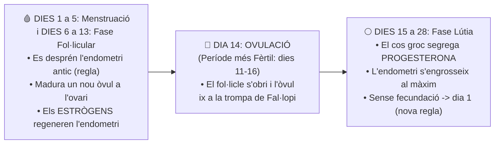

  

    ⚡ Progrés d'aprenentatge (9.4)
    0 / 12 reptes resolts
  

  

    

  

# 9.4 Aparell reproductor femení

L'**aparell reproductor femení** s'encarrega de produir i fer madurar cíclicament els gàmetes femenins (**òvuls**), segregar les hormones sexuals femenines (**estrògens i progesterona**), proporcionar el lloc on es produeix la **fecundació** (les trompes de Fal·lopi) i albergar, protegir i nodrir el nou ésser humà a l'**úter** durant els 9 mesos d'embaràs fins al part.

---

## 1. Anatomia de l'Aparell Reproductor Femení

A diferència del masculí, gairebé tot l'aparell reproductor femení està situat i protegit a l'**interior de la cavitat pelviana**. Es divideix en **òrgans genitals interns** i **òrgans genitals externs (la vulva)**.

### A) Òrgans Genitals Interns
1. **Els Ovaris (gònades femenines):** Són dos òrgans de la mida i forma d'una ametla (d'uns $3-4\text{ cm}$) situats a cada costat de la pelvis.
   - **Funció:** Una xiqueta ja naix amb centenars de milers d'òvuls immaturs allotjats dins d'unes càpsules microscòpiques anomenades **fol·licles ovàrics**. Des de la pubertat fins a la menopausa (cap als 50 anys), cada 28 dies madura un fol·licle i allibera un **òvul** (**ovogènesi i ovulació**). A més, els ovaris fabriquen les hormones **estrògens i progesterona**.
2. **Les Trompes de Fal·lopi (o oviductes):** Són dos conductes d'uns $10-12\text{ cm}$ amb forma d'embut que connecten cada ovari amb l'úter.
   - **Funció doble:** El seu extrem amb prolongacions (**fímbries**) recull l'òvul quan ix de l'ovari i els seus **cilis** interns l'espenten suaument cap a l'úter. A més, **al terç superior de la trompa de Fal·lopi és on té lloc la FECUNDACIÓ** (la trobada entre l'espermatozoide i l'òvul).
3. **L'Úter o Matriu:** És un òrgan buit, de la mida i forma d'una pera invertida, on s'allotja i creix l'embrió i el fetus durant l'embaràs. Consta de:
   - **Miometri:** Paret muscular llisa molt gruixuda i elàstica (s'estira durant l'embaràs i es contrau amb força per espentar el nadó en el part).
   - **Endometri:** Capa mucosa interna, esponjosa i molt rica en vasos sanguinis, que es renova cada mes per fer de "llit nutritiu" a l'embrió (i que si no hi ha embaràs es desprén formant la **menstruació**).
   - **Coll uterí o Cèrvix:** Part inferior estreta que comunica l'úter amb la vagina.
4. **La Vagina:** Conducte muscular elàstic d'uns $8-10\text{ cm}$ que connecta l'úter amb l'exterior. Rep el penis en el coit, és la via d'eixida de la menstruació i constitueix el **canal del part** per on naix el nadó.

### B) Òrgans Genitals Externs: La Vulva
El conjunt dels genitals externs femenins s'anomena **vulva** i està format per:
- **Llavis majors i llavis menors:** Dos parells de plecs de pell que envolten i protegeixen l'entrada de la vagina i de la uretra.
- **El Clítoris:** Òrgan erèctil situat a la unió anterior dels llavis menors, format per teixit esponjós i amb milers de terminacions nervioses sensitives; la seua funció és exclusivament proporcionar plaer sexual.
- **Orificis independents (Meat urinari i Orifici vaginal):**
  - **Atenció:** A diferència de l'home, en la dona **la uretra (per on ix l'orina) i la vagina són dos conductes totalment separats i independents** que s'obrin a la vulva en dos orificis diferents.

---

## 2. Morfologia Detallada de l'Òvul (Gàmeta Femení)

L'**òvul** és una cèl·lula esfèrica gegant ($\approx 0{,}12-0{,}15\text{ mm}$ de diàmetre, gairebé visible a simple vista com la punta d'una agulla) i immòbil, dissenyada per protegir l'ADN matern i alimentar l'embrió durant els primers dies abans que es forme la placenta:
1. **Nucli haploide ($n = 23\text{ cromosomes}$):** Conté la meitat de la informació genètica del futur fill o filla (22 autosomes + 1 cromosoma sexual $\text{X}$).
2. **Citoplasma ric en Vitel:** Conté una gran reserva de substàncies nutritives (proteïnes i lípids anomenats **vitel**) que alimenten el zigot durant el seu viatge des de la trompa de Fal·lopi fins a l'úter.
3. **Cobertes protectores externes:**
   - **Membrana plasmàtica i Zona pel·lúcida:** Capa gelatinosa de glicoproteïnes que envolta l'òvul i impedeix que hi entre més d'un espermatozoide (**bloqueig de la polispèrmia**).
   - **Corona radiada:** Capa exterior formada per centenars de cèl·lules fol·liculars que acompanyen i protegeixen l'òvul quan ix de l'ovari.

---

## 3. El Cicle Ovàric i Menstrual (28 Dies)

Des de la pubertat (**menarquia**) fins a la **menopausa** (entre els 48 i 52 anys), l'aparell reproductor femení experimenta cada **28 dies** aproximadament (pot variar entre 21 i 35 dies) un cicle coordinat per les hormones de la **hipòfisi** ($\text{FSH}$ i $\text{LH}$) i dels **ovaris** (**estrògens i progesterona**):

### Les 3 Fases del Cicle de 28 Dies (comptant com a Dia 1 el primer dia de regla)

| Fase del Cicle | Dies | Què passa a l'Ovari i a l'Endometri de l'Úter? | Hormones Clau |
| :--- | :---: | :--- | :--- |
| **1. Menstruació i Fase Fol·licular** | **Dies 1 al 13** | • **Dies 1-5 (Menstruació o regla):** Es desprén l'endometri del cicle anterior amb un poc de sang. • **Dies 6-13:** Un fol·licle madura a l'ovari i l'endometri torna a créixer. | **$\text{FSH}$** (hipòfisi) i **Estrògens** (ovari) |
| **2. Ovulació (Dies fèrtils)** | **Dia 14** *(aprox.)* | El fol·licle madur esclata i **allibera l'òvul cap a la trompa de Fal·lopi**. L'òvul viu unes 24-48 h (i els espermatozoides fins a 3-5 dies), per això els **dies 11 al 16 són els més fèrtils**. | Pic de **$\text{LH}$** (hipòfisi) |
| **3. Fase Lútia o Secretora** | **Dies 15 al 28** | El fol·licle buit es transforma en el **cos groc (o luti)**, que segrega **progesterona** per fer que l'endometri s'engrossisca i s'òmpliga de vasos sanguinis per si hi ha un embrió. | **Progesterona** (del cos groc de l'ovari) |

- **Què passa al dia 28?**
  - **Si HI HA hagut fecundació:** L'embrió s'implanta a l'endometri, el cos groc es manté actiu, **la menstruació s'atura durant tot l'embaràs** i la prova d'embaràs dóna positiu.
  - **Si NO hi ha hagut fecundació:** L'òvul degenera, el cos groc s'atrofia, deixa de fabricar progesterona i l'endometri es desprén, iniciant el **Dia 1** d'una nova menstruació.

> [!TIP]
> ### 🩺 Salut Ginecològica i Higiene Menstrual
> - Durant la menstruació es perden només entre $30\text{ mL}$ i $80\text{ mL}$ de sang i teixit endometrial al llarg de 3 a 5 dies. És un procés fisiològic totalment natural que permet fer esport, dutxar-se i portar vida normal.
> - Tant si s'utilitzen **compreses**, **tampons**, **calces menstruals** o **copa menstrual**, és fonamental canviar-los o buidar-los cada **4-6 hores** i rentar-se les mans abans i després per evitar infeccions com la síndrome del xoc tòxic o la candidiasi.
> - A l'hora d'eixugar-se després d'anar al lavabo, cal fer-ho sempre **de davant cap arrere** (de la vulva cap a l'anus, mai a l'inrevés) per evitar que els bacteris intestinals entren a la vagina o a la uretra (cistitis).

---

> [!NOTE]
> ### 💡 Resum de Conceptes Clau
> - Els **ovaris** maduren els **òvuls** i fabriquen **estrògens i progesterona**; a les **trompes de Fal·lopi** ocorre la **fecundació**; i a l'**úter** (tapissat per l'**endometri**) es desenvolupa l'embaràs.
> - En la dona, l'orifici de la **uretra** (orina) i la **vagina** són **totalment independents**.
> - El **cicle menstrual (28 dies)** comença el **dia 1** amb la menstruació, té l'**ovulació cap al dia 14** (dies fèrtils) i prepara l'endometri del **dia 15 al 28** gràcies a la **progesterona**.

---

## 🎯 Activitats i Autoavaluació Interactiva (15 Exercicis Diaris)

  

    🎮 <strong>Zona d'Entrenament FPB:</strong> 0 / 12 reptes resolts
    ⭐ 0 punts
  

  

### 1. Qüestionari d'Autoavaluació Tipus Test (MCQ)

  
<strong>1. En quin òrgan exacte de l'aparell reproductor femení es produeix habitualment la fecundació (la unió de l'espermatozoide amb l'òvul)?</strong>

  

    <button type="button" class="btn-mcq-opt" data-opt="A">A) A l'interior de la vagina</button>
    <button type="button" class="btn-mcq-opt" data-opt="B">B) Al terç superior de les trompes de Fal·lopi</button>
    <button type="button" class="btn-mcq-opt" data-opt="C">C) A la vulva o al clítoris</button>
    <button type="button" class="btn-mcq-opt" data-opt="D">D) Dins de la bufeta urinària</button>
  

  

  
<strong>2. En un cicle menstrual regular de 28 dies (on el dia 1 és el primer dia de menstruació), al voltant de quin dia té lloc l'ovulació?</strong>

  

    <button type="button" class="btn-mcq-opt" data-opt="A">A) El dia 1 del cicle, coincidint amb el primer dia de regla</button>
    <button type="button" class="btn-mcq-opt" data-opt="B">B) El dia 28, just una hora abans de la regla següent</button>
    <button type="button" class="btn-mcq-opt" data-opt="C">C) Al voltant del dia 14 (a la meitat del cicle), sent els dies pròxims els més fèrtils</button>
    <button type="button" class="btn-mcq-opt" data-opt="D">D) L'ovulació només ocorre una vegada a l'any</button>
  

  

  
<strong>3. Quina és la diferència entre el miometri i l'endometri de l'úter?</strong>

  

    <button type="button" class="btn-mcq-opt" data-opt="A">A) El miometri és la paret gruixuda de múscul llis que es contrau al part, i l'endometri és la mucosa interna vascularitzada on s'implanta l'embrió (i que es desprén en la regla)</button>
    <button type="button" class="btn-mcq-opt" data-opt="B">B) El miometri està als ovaris i l'endometri està a la vulva</button>
    <button type="button" class="btn-mcq-opt" data-opt="C">C) Tots dos són ossos de la pelvis</button>
    <button type="button" class="btn-mcq-opt" data-opt="D">D) L'endometri fabrica espermatozoides i el miometri fabrica orina</button>
  

  

  
<strong>4. Quina estructura de l'òvul impedeix que hi entre un segon espermatozoide una vegada ja ha sigut fecundat?</strong>

  

    <button type="button" class="btn-mcq-opt" data-opt="A">A) El flagel</button>
    <button type="button" class="btn-mcq-opt" data-opt="B">B) El clítoris</button>
    <button type="button" class="btn-mcq-opt" data-opt="C">C) El coll uterí o cèrvix</button>
    <button type="button" class="btn-mcq-opt" data-opt="D">D) La zona pel·lúcida i la membrana de fecundació</button>
  

  

---

### 2. Activitats de Vertader (V) o Fals (F)

  <strong>a) En l'anatomia femenina, l'orifici de la uretra (per on s'expulsa l'orina) és totalment independent de la vagina.</strong>
  

    <button type="button" class="btn-vf" data-opt="V">V</button>
    <button type="button" class="btn-vf" data-opt="F">F</button>
  

  

  <strong>b) La menstruació o regla es produeix únicament quan l'òvul ha sigut fecundat i la dona s'acaba de quedar embarassada.</strong>
  

    <button type="button" class="btn-vf" data-opt="V">V</button>
    <button type="button" class="btn-vf" data-opt="F">F</button>
  

  

  <strong>c) El clítoris és un òrgan erèctil situat a la vulva amb milers de terminacions nervioses sensorials, la funció del qual és proporcionar plaer sexual.</strong>
  

    <button type="button" class="btn-vf" data-opt="V">V</button>
    <button type="button" class="btn-vf" data-opt="F">F</button>
  

  

  <strong>d) Una dona continua ovulant i tenint la menstruació cada 28 dies fins als 90 anys d'edat sense cap interrupció.</strong>
  

    <button type="button" class="btn-vf" data-opt="V">V</button>
    <button type="button" class="btn-vf" data-opt="F">F</button>
  

  

---

### 3. Exercicis de Resposta Breu, Vocabulari Tècnic i Càlcul

  
✍️ <strong>1.</strong> Com s'anomena la capa mucosa interna de l'úter, molt rica en vasos sanguinis, que s'engrosseix cada mes per acollir l'embrió i es desprén en la menstruació si no hi ha embaràs?

  

    <input type="text" class="quiz-input" placeholder="Escriu el nom de la capa uterina...">
    <button type="button" class="btn-quiz-check">Comprovar</button>
  

  

  
✍️ <strong>2.</strong> Quina hormona segrega el cos groc de l'ovari durant la segona meitat del cicle (dies 15-28) per mantindre l'endometri gruixut i preparat per a un possible embaràs?

  

    <input type="text" class="quiz-input" placeholder="Escriu el nom de l'hormona...">
    <button type="button" class="btn-quiz-check">Comprovar</button>
  

  

  
✍️ <strong>3.</strong> Com s'anomena el procés que ocorre cap al dia 14 del cicle menstrual en què el fol·licle madur de l'ovari s'obri i allibera un òvul cap a la trompa de Fal·lopi?

  

    <input type="text" class="quiz-input" placeholder="Escriu el terme biològic...">
    <button type="button" class="btn-quiz-check">Comprovar</button>
  

  

  
✍️ <strong>4.</strong> Com s'anomena el conjunt dels òrgans genitals externs femenins (format pels llavis majors, llavis menors, clítoris i orificis uretral i vaginal)?

  

    <input type="text" class="quiz-input" placeholder="Escriu el nom anatòmic...">
    <button type="button" class="btn-quiz-check">Comprovar</button>
  

  

---

### 4. Exercicis de Raonament i Desenvolupament Escrit (Tasca d'Aula)

  
✍️ <strong>1. El viatge de l'òvul i el cicle menstrual de 28 dies:</strong> Explica pas a pas què passa a l'ovari i a l'endometri de l'úter durant les tres etapes d'un cicle de 28 dies (Dies 1-13, Dia 14 i Dies 15-28) i raona per què quan una dona es queda embarassada deixa de tindre la menstruació durant els 9 mesos d'embaràs.

  <textarea class="open-response-input" rows="4" placeholder="1) Dies 1-13: ...
2) Dia 14 (Ovulació): ...
3) Dies 15-28: ...
4) Per què s'atura la regla en l'embaràs: ..."></textarea>

  
✍️ <strong>2. Relació entre els 4 òrgans genitals interns femenins:</strong> Descriu la funció exacta dels quatre òrgans interns de l'aparell reproductor femení: 1) Ovaris, 2) Trompes de Fal·lopi, 3) Úter (miometri, endometri i cèrvix) i 4) Vagina.

  <textarea class="open-response-input" rows="4" placeholder="1) Ovaris: ...
2) Trompes de Fal·lopi: ...
3) Úter: ...
4) Vagina: ..."></textarea>

  
✍️ <strong>3. Càlcul de dies fèrtils i salut ginecològica:</strong> Si a una xica amb un cicle regular de 28 dies li comença la menstruació (Dia 1) el dia 3 d'abril: 1) Quin dia aproximat del calendari es produirà l'ovulació i quina setmana serà la més fèrtil? 2) Quines tres normes d'higiene menstrual i íntima cal seguir per prevenir infeccions?

  <textarea class="open-response-input" rows="4" placeholder="1) Càlcul del dia d'ovulació (3 d'abril + 13 dies = ...): ...
2) Tres normes d'higiene: ..."></textarea>

---

  <h3 style="margin-top:0; color:#0369a1;">📦 Lliurament d'Activitats d'Aules (Act 9.4)</h3>
  
Genera el teu document de tasca d'aquest apartat amb el teu nom i els 15 exercicis completats.

  

    <input type="text" class="aules-student-name" placeholder="Cognoms, Nom de l'Alumne/a" style="padding:8px 12px; border:1px solid #94a3b8; border-radius:4px; flex-grow:1; min-width:240px;">
    <button class="btn-generate-aules-pdf" data-unit="NAT09" data-activity="Act04" data-module="CA" style="padding:8px 16px; background:#0284c7; color:#fff; border:none; border-radius:4px; font-weight:600; cursor:pointer;">📄 Descarregar PDF per a Aules</button>
  

