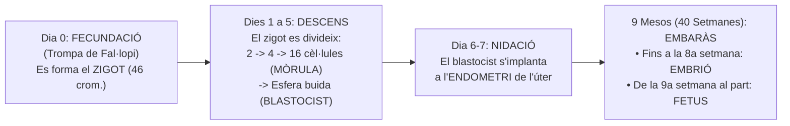

  

    ⚡ Progrés d'aprenentatge (9.5)
    0 / 12 reptes resolts
  

  

    

  

# 9.5 Cicle vital de l'ésser humà

El **cicle vital de l'ésser humà** comprén tot el desenvolupament d'una persona des de l'instant precís en què s'uneixen un espermatozoide i un òvul per formar la primera cèl·lula (**zigot**), passant per l'embaràs, el naixement, la infància, l'adolescència i l'edat adulta, fins a la vellesa.

---

## 1. La Fecundació i la Formació del Zigot

La **fecundació** és la unió d'un espermatozoide i un òvul per formar una única cèl·lula diploide (amb **46 cromosomes**) anomenada **zigot** (o cèl·lula ou).
1. **El viatge dels espermatozoides:** Després de l'ejaculació a la vagina (on es depositen uns 200-300 milions d'espermatozoides), aquests naden travessant el coll de l'úter i pugen fins al **terç superior de les trompes de Fal·lopi**. Només uns pocs centenars hi arriben.
2. **La fusió d'un sol espermatozoide:** Quan envolten l'òvul, els espermatozoides alliberen els enzims del seu **acrosoma** per desfer la corona radiada. Tan bon punt **un únic espermatozoide** aconsegueix travessar la zona pel·lúcida, l'òvul crea immediatament una membrana de fecundació impenetrable perquè no en puga entrar cap altre.
3. **Naixement del Zigot:** Es fusionen el nucli de l'espermatozoide ($n = 23$) i el nucli de l'òvul ($n = 23$), originant el **zigot ($2n = 46\text{ cromosomes}$)**, la primera cèl·lula del nou ésser humà.

> [!TIP]
> ### 👯‍♂️ Bessons Idèntics (Univitel·lins) vs. Bessons Fraterns o Mellizos (Bivitel·lins)
> - **Bessons Univitel·lins (Monozigòtics o Idèntics):** Procedeixen d'**1 sol òvul fecundat per 1 sol espermatozoide**. El zigot resultant es divideix en dos embrions separats durant els primers dies. Comparteixen el **100% de l'ADN**: són sempre del mateix sexe i físicament idèntics.
> - **Bessons Bivitel·lins (Dizigòtics o Mellizos):** L'ovari allibera excepcionalment **2 òvuls alhora** i cadascun és fecundat per un espermatozoide diferent. Són com dos germans nascuts el mateix dia: poden ser de sexe diferent i s'assemblen com qualsevol parella de germans.

---

## 2. La Nidació i l'Embaràs o Gestació (40 Setmanes / 9 Mesos)

### A) De la Trompa a l'Úter: Mòrula, Blastocist i Nidació
Mentre baixa per la trompa de Fal·lopi espentat pels cilis cap a l'úter, el zigot es divideix per mitosi ($1 \rightarrow 2 \rightarrow 4 \rightarrow 8 \rightarrow 16\text{ cèl·lules}$):
- Al 3r-4t dia forma una boleta massissa de cèl·lules amb aspecte de mora anomenada **mòrula**.
- Al 5é dia arriba a l'úter convertit en una esfera amb una cavitat interna anomenada **blastocist**.
- **La Nidació (Dia 6-7 després de la fecundació):** El blastocist s'enfonsa i s'arrela a la mucosa esponjosa i vascularitzada de l'**endometri de l'úter**. A partir d'aquest moment s'inicia pròpiament l'**embaràs o gestació**, que dura **40 setmanes (uns 9 mesos o 280 dies)**.

### B) Els Òrgans de Protecció i Nutrició: Bossa Amniòtica, Placenta i Cordó Umbilical
Després de la nidació es formen tres estructures vitals al voltant de l'embrió:
1. **La Bossa Amniòtica (Amni):** Sac membranós ple de **líquid amniòtic** calent dins del qual flota l'embrió i el fetus, protegint-lo contra els colps externs, els canvis de temperatura i la deshidratació.
2. **La Placenta:** Òrgan esponjós en forma de disc ric en capil·lars sanguinis que es forma a la paret de l'úter. Actua com a **pulmó, intestí i ronyó del fetus**: a través de la placenta passen l'**oxigen (O₂)** i els **nutrients** (glucosa, aminoàcids, vitamines, anticossos) des de la sang de la mare cap a la del fetus, i passen el **CO₂ i la urea** del fetus a la mare perquè ella els elimine (**sense que la sang de la mare i del fetus es barregen mai directament**).
3. **El Cordó Umbilical:** Tub flexible d'uns 50 cm amb una vena i dues artèries umbilicals que uneix el melic del fetus amb la placenta.

### C) Evolució per Trimestres: Embrió vs. Fetus
- **1r Trimestre (Mesos 1 a 3):** És l'etapa més crítica i delicada (**organogènesi**). Durant les primeres 8 setmanes s'anomena **embrió**: al primer mes ja li batega el cor! **A partir de la 8a-9a setmana (3r mes)**, com que ja té esbossats tots els òrgans humans i forma reconeixible, passa a anomenar-se **fetus** (mesura uns 9 cm). *(Cal evitar totalment l'alcohol, el tabac, radiografies i fàrmacs, que travessen la placenta!)*.
- **2n Trimestre (Mesos 4 a 6):** El fetus madura ràpidament, es mou, xupa el dit, obri els ulls i la mare ja nota les seues puntades. Es pot vore clarament el sexe en l'ecografia (mesura uns 30 cm i pesa uns $600-800\text{ g}$).
- **3r Trimestre (Mesos 7 a 9):** Els pulmons i el sistema nerviós acaben de madurar, el fetus guanya molt de pes i greix subcutani, i a l'últim mes gira col·locant-se **cap per avall (encaixament)** preparat per a nàixer (mesura uns 50 cm i pesa uns $3-3{,}5\text{ kg}$).

---

## 3. El Part en 3 Fases i les Etapes del Cicle Vital

Al voltant de la **setmana 40**, la hipòfisi segrega l'hormona **oxitocina**, que desencadena el **part** en **tres etapes**:

| Fase del Part | Durada Aprox. | Què ocorre anatòmicament i fisiològicament? |
| :--- | :---: | :--- |
| **1. Fase de Dilatació** | **6 a 12 hores** *(la més llarga)* | El miometri de l'úter comença a tindre **contraccions rítmiques** cada vegada més fortes i seguides; es trenca la bossa amniòtica (**"trencar aigües"**) i el **coll de l'úter (cèrvix) es dilata fins a arribar als 10 cm** d'obertura. |
| **2. Fase d'Expulsió** | **30 a 60 minuts** | Les contraccions uterines i la força abdominal de la mare espenten el fetus a través de la vagina (**canal del part**). Ix primer el cap i després el cos. Quan el nadó plora per primera vegada ompli els pulmons d'aire i es **talla el cordó umbilical** (que deixarà la cicatriu del melic). |
| **3. Fase de Deslliurament** | **10 a 30 minuts** | Uns minuts després que nàixca el bebé, l'úter es torna a contraure per **desprendre i expulsar a l'exterior la placenta** i les restes de la bossa amniòtica. |

*(Quan el part vaginal no és possible o suposa un risc per a la mare o el nadó, es practica una intervenció quirúrgica anomenada **cesària**).*

### Les Etapes del Cicle Vital després del Naixement
1. **Lactància (0 a 1-2 anys):** Alimentació amb llet materna (rica en nutrients i anticossos protectors del calostre) i aprenentatge de caminar i parlar.
2. **Infància (2 a 10-12 anys):** Creixement físic sostingut, desenvolupament psicomotor, socialització i aprenentatge escolar.
3. **Pubertat i Adolescència (10-12 a 18-20 anys):** Maduració sexual i hormonal i transició psicològica cap a l'autonomia.
4. **Edat Adulta o Maduresa (20 a 65 anys):** Plenitud física, professional, emocional i reproductora (en la dona la capacitat fèrtil acaba cap als 50 anys amb la **menopausa**).
5. **Vellesa o Senectut (a partir dels 65-70 anys):** Disminució progressiva de la capacitat física i regeneració cel·lular, acompanyada d'un gran bagatge d'experiència vital.

---

> [!NOTE]
> ### 💡 Resum de Conceptes Clau
> - La **fecundació** a la trompa de Fal·lopi uneix espermatozoide i òvul formant el **zigot (46 cromosomes)**, que baixa dividint-se (mòrula $\rightarrow$ blastocist) i al 6é-7é dia s'implanta a l'endometri (**nidació**).
> - Durant l'**embaràs (40 setmanes)** el nou ésser (anomenat **embrió** fins a la 8a setmana i **fetus** després) flota a la **bossa amniòtica** i es nodreix i respira per la **placenta** i el **cordó umbilical**.
> - El **part** consta de 3 fases: **1) Dilatació** (fins a 10 cm i trencament d'aigües), **2) Expulsió** (naixement del nadó) i **3) Deslliurament** (expulsió de la placenta).

---

## 🎯 Activitats i Autoavaluació Interactiva (15 Exercicis Diaris)

  

    🎮 <strong>Zona d'Entrenament FPB:</strong> 0 / 12 reptes resolts
    ⭐ 0 punts
  

  

### 1. Qüestionari d'Autoavaluació Tipus Test (MCQ)

  
<strong>1. Quin òrgan temporal format a l'úter durant l'embaràs permet que el fetus reba l'oxigen i els nutrients de la sang materna i elimine el diòxid de carboni i els residus?</strong>

  

    <button type="button" class="btn-mcq-opt" data-opt="A">A) L'epidídim</button>
    <button type="button" class="btn-mcq-opt" data-opt="B">B) La trompa d'Eustaqui</button>
    <button type="button" class="btn-mcq-opt" data-opt="C">C) La placenta (unida al fetus pel cordó umbilical)</button>
    <button type="button" class="btn-mcq-opt" data-opt="D">D) El clítoris</button>
  

  

  
<strong>2. Quin és l'ordre cronològic correcte de les tres fases que componen el part humà?</strong>

  

    <button type="button" class="btn-mcq-opt" data-opt="A">A) 1. Dilatació → 2. Expulsió → 3. Deslliurament (expulsió de la placenta)</button>
    <button type="button" class="btn-mcq-opt" data-opt="B">B) 1. Expulsió → 2. Nidació → 3. Dilatació</button>
    <button type="button" class="btn-mcq-opt" data-opt="C">C) 1. Deslliurament → 2. Dilatació → 3. Expulsió</button>
    <button type="button" class="btn-mcq-opt" data-opt="D">D) 1. Fecundació → 2. Ovulació → 3. Menstruació</button>
  

  

  
<strong>3. Quina és la funció de la bossa amniòtica i del líquid amniòtic que envolten l'embrió i el fetus?</strong>

  

    <button type="button" class="btn-mcq-opt" data-opt="A">A) Fabricar espermatozoides</button>
    <button type="button" class="btn-mcq-opt" data-opt="B">B) Protegir el fetus esmorteint els colps externs, mantindre una temperatura constant i evitar la deshidratació</button>
    <button type="button" class="btn-mcq-opt" data-opt="C">C) Substituir el cervell del fetus</button>
    <button type="button" class="btn-mcq-opt" data-opt="D">D) Impedir que el fetus es moga durant els 9 mesos</button>
  

  

  
<strong>4. A partir de quin moment del desenvolupament prenatal l'embrió passa a anomenar-se 'fetus'?</strong>

  

    <button type="button" class="btn-mcq-opt" data-opt="A">A) El mateix dia de la fecundació</button>
    <button type="button" class="btn-mcq-opt" data-opt="B">B) Només quan ja ha nascut després del part</button>
    <button type="button" class="btn-mcq-opt" data-opt="C">C) Al dia 3 quan és una mòrula</button>
    <button type="button" class="btn-mcq-opt" data-opt="D">D) A partir de la 8a-9a setmana d'embaràs (3r mes), quan ja té forma humana reconeixible i tots els òrgans esbossats</button>
  

  

---

### 2. Activitats de Vertader (V) o Fals (F)

  <strong>a) La primera cèl·lula d'un nou ésser humà (amb 46 cromosomes), resultant de la fusió d'un espermatozoide i un òvul, s'anomena zigot.</strong>
  

    <button type="button" class="btn-vf" data-opt="V">V</button>
    <button type="button" class="btn-vf" data-opt="F">F</button>
  

  

  <strong>b) Els bessons univitel·lins (idèntics) es formen quan dos òvuls diferents són fecundats per dos espermatozoides diferents, i per això poden ser xic i xica.</strong>
  

    <button type="button" class="btn-vf" data-opt="V">V</button>
    <button type="button" class="btn-vf" data-opt="F">F</button>
  

  

  <strong>c) A la placenta, l'oxigen i els nutrients passen dels capil·lars de la mare als del fetus per difusió, sense que la sang materna i fetal es barregen directament.</strong>
  

    <button type="button" class="btn-vf" data-opt="V">V</button>
    <button type="button" class="btn-vf" data-opt="F">F</button>
  

  

  <strong>d) El trencament de la bossa amniòtica ('trencar aigües') i l'obertura del coll de l'úter fins a 10 cm tenen lloc durant l'última fase del part anomenada deslliurament.</strong>
  

    <button type="button" class="btn-vf" data-opt="V">V</button>
    <button type="button" class="btn-vf" data-opt="F">F</button>
  

  

---

### 3. Exercicis de Resposta Breu, Vocabulari Tècnic i Càlcul

  
✍️ <strong>1.</strong> Com s'anomena el procés pel qual l'embrió (blastocist) s'implanta i s'adhereix a l'endometri de l'úter uns 6-7 dies després de la fecundació?

  

    <input type="text" class="quiz-input" placeholder="Escriu el terme...">
    <button type="button" class="btn-quiz-check">Comprovar</button>
  

  

  
✍️ <strong>2.</strong> Quin nom rep la tercera i última fase del part en la qual l'úter es contrau per expulsar a l'exterior la placenta?

  

    <input type="text" class="quiz-input" placeholder="Escriu el nom de la fase...">
    <button type="button" class="btn-quiz-check">Comprovar</button>
  

  

  
✍️ <strong>3.</strong> Com s'anomena la primera cèl·lula diploide (amb 46 cromosomes) que es forma a la trompa de Fal·lopi just en l'instant en què s'uneixen l'espermatozoide i l'òvul?

  

    <input type="text" class="quiz-input" placeholder="Escriu el nom de la primera cèl·lula...">
    <button type="button" class="btn-quiz-check">Comprovar</button>
  

  

  
✍️ <strong>4.</strong> Quantes setmanes dura normalment un embaràs humà complet comptant des de l'última regla fins al part (equivalents a 9 mesos)?

  

    <input type="text" class="quiz-input" placeholder="Escriu el nombre de setmanes...">
    <button type="button" class="btn-quiz-check">Comprovar</button>
  

  

---

### 4. Exercicis de Raonament i Desenvolupament Escrit (Tasca d'Aula)

  
✍️ <strong>1. La vida dins de l'úter matern i la placenta:</strong> 1) Si el fetus està completament submergit dins del líquid amniòtic de la bossa amniòtica i els seus pulmons no tenen aire ni menja per la boca, explica detalladament com obté l'oxigen i la glucosa per viure durant els 9 mesos d'embaràs. 2) Per què és tan perillós per al fetus que una dona embarassada fume o bega alcohol?

  <textarea class="open-response-input" rows="4" placeholder="1) Com respira i es nodreix el fetus a través de la placenta i el cordó umbilical: ...
2) Perill de l'alcohol i el tabac a través de la placenta: ..."></textarea>

  
✍️ <strong>2. Bessons Univitel·lins (idèntics) vs. Bessons Bivitel·lins (mellizos):</strong> Explica amb claredat com es formen els bessons univitel·lins i com es formen els bessons bivitel·lins, indicant quants òvuls i espermatozoides intervenen en cada cas i si poden ser o no de sexe diferent.

  <textarea class="open-response-input" rows="4" placeholder="Bessons univitel·lins (1 òvul + 1 espermatozoide): ...
Bessons bivitel·lins (2 òvuls + 2 espermatozoides): ..."></textarea>

  
✍️ <strong>3. Les 3 fases del part humà:</strong> Descriu què ocorre anatòmicament i fisiològicament en cadascuna de les tres fases del part (1. Dilatació, 2. Expulsió i 3. Deslliurament) i explica què és una cesària i quan es practica.

  <textarea class="open-response-input" rows="4" placeholder="1. Dilatació: ...
2. Expulsió: ...
3. Deslliurament: ...
Cesària: ..."></textarea>

---

  <h3 style="margin-top:0; color:#0369a1;">📦 Lliurament d'Activitats d'Aules (Act 9.5)</h3>
  
Genera el teu document de tasca d'aquest apartat amb el teu nom i els 15 exercicis completats.

  

    <input type="text" class="aules-student-name" placeholder="Cognoms, Nom de l'Alumne/a" style="padding:8px 12px; border:1px solid #94a3b8; border-radius:4px; flex-grow:1; min-width:240px;">
    <button class="btn-generate-aules-pdf" data-unit="NAT09" data-activity="Act05" data-module="CA" style="padding:8px 16px; background:#0284c7; color:#fff; border:none; border-radius:4px; font-weight:600; cursor:pointer;">📄 Descarregar PDF per a Aules</button>
  

