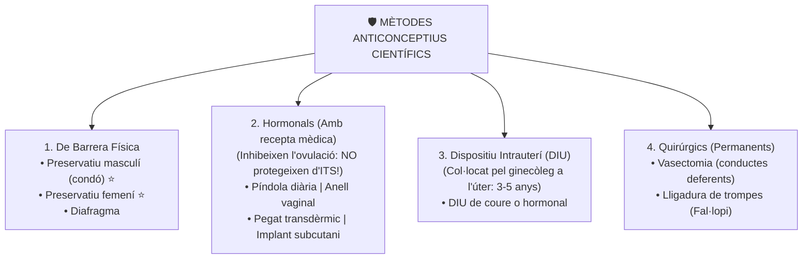

  

    ⚡ Progrés d'aprenentatge (9.6)
    0 / 3 reptes resolts
  

  

    

  

# 9.6 Planificació familiar

La **planificació familiar** és el conjunt de pràctiques i coneixements mèdics i científics que permeten a les persones i a les parelles decidir de manera lliure, conscient i responsable **si volen tindre fills o no, quants en volen tindre i en quin moment de la seua vida**. Inclou dues vessants complementàries:
1. **Els Mètodes Anticonceptius (Contracepció):** Per evitar embarassos no desitjats (i en el cas dels preservatius, protegir contra les ITS).
2. **Les Tècniques de Reproducció Assistida:** Per ajudar a tindre fills les persones o parelles amb problemes d'infertilitat o esterilitat.

---

## 1. Estudi Complet dels Mètodes Anticonceptius

Els **mètodes anticonceptius** impedeixen o redueixen dràsticament la possibilitat que es produïsca la fecundació o l'embaràs durant una relació sexual amb penetració. Es classifiquen en quatre grans grups científics:

### 1. Mètodes de Barrera (La Doble Protecció del Preservatiu)
Impedeixen físicament que els espermatozoides entren a l'úter i arriben a l'òvul:
- **El Preservatiu Masculí (o condó):** Funda fina i elàstica de làtex (o de poliuretà per a al·lèrgics al làtex) d'un sol ús que es col·loca sobre el penis en erecció **abans de qualsevol contacte genital** i reté el semen.
- **El Preservatiu Femení:** Funda de poliuretà o nitril amb dos anells flexibles que s'introdueix a la vagina abans de la relació, tapissant les seues parets.
- **El Diafragma:** Caputxó de silicona que es col·loca al fons de la vagina tapant el coll de l'úter (s'ha d'usar amb crema espermicida i no protegeix d'ITS).

> [!IMPORTANT]
> ### ⭐ Per què el Preservatiu és el Mètode d'Elecció en Joves i Adolescents?
> El **preservatiu (masculí o femení)** és l'**ÚNIC mètode anticonceptiu que ofereix DOBLE PROTECCIÓ**:
> 1. **Evita embarassos no desitjats** amb una eficàcia del **98%** si s'usa correctament des del principi fins al final.
> 2. **És l'ÚNIC que protegeix contra el contagi de les Infeccions de Transmissió Sexual (ITS)** com el VIH/SIDA, la sífilis, la gonorrea, la clamídia o l'hepatitis B, perquè evita el contacte directe amb el semen, el flux vaginal i la sang.
> - **Normes d'ús segur:** Comprovar la data de caducitat i el segell CE, obrir l'envàs amb els dits (mai amb les dents o tisores), pressionar la punta (dipòsit) en desenrotllar-lo perquè no hi quede aire i es trenque, i retirar-lo subjectant la base abans que desaparega l'erecció.

---

### 2. Mètodes Hormonals (Químics)
Contenen hormones sintètiques (semblants als estrògens i la progesterona) que **enganyen la hipòfisi i els ovaris per impedir l'ovulació** (si no ix cap òvul de l'ovari, no pot haver-hi fecundació). **Tots requereixen consulta i recepta mèdica**, tenen una eficàcia contra l'embaràs superior al **99%**, però **NO ofereixen cap protecció contra les ITS (0%)**:
- **Píndola anticonceptiva oral:** Es pren una pastilla cada dia a la mateixa hora.
- **Anell vaginal:** Anell flexible transparent que la dona introdueix a la vagina; allibera hormones durant 3 setmanes i es descansa 1 setmana.
- **Pegat transdèrmic:** Adhesiu que es pega a la pell i es canvia una vegada per setmana durant 3 setmanes.
- **Implant subcutani i Injecció intramuscular:** L'implant és una barreta fina sota la pell del braç que dura entre 3 i 5 anys.

> [!WARNING]
> ### 💊 La Píndola Anticonceptiva d'Urgència ("Píndola de l'endemà")
> **NO és un mètode anticonceptiu habitual!** És un medicament d'**emergència excepcional** amb una alta dosi hormonal que es pren després d'un accident (per exemple, si s'ha trencat o ha lliscat el preservatiu) per retardar l'ovulació i evitar l'embaràs. S'ha de prendre com més prompte millor (preferiblement en les primeres **12-24 hores**, amb un límit de 72-120 h), **no és abortiva** (si ja hi ha embaràs implantat no fa efecte) i **no protegeix contra cap ITS**.

---

### 3. Dispositiu Intrauterí (DIU)
És un xicotet aparell en forma de **"T"** de plàstic amb **coure** o amb **hormones** que el **ginecòleg o ginecòloga** col·loca a l'interior de l'úter. El coure inactiva els espermatozoides i impedeix la nidació. Dura entre **3 i 5 anys** amb un 99% d'eficàcia contra l'embaràs, però **no protegeix contra les ITS**.

---

### 4. Mètodes Quirúrgics (Esterilització Permanent)
Són intervencions quirúrgiques pensades per a persones adultes que tenen clar que no volen tindre fills (o més fills) de manera definitiva. Tenen més del **99,5% d'eficàcia** contra l'embaràs, però **no protegeixen contra les ITS**:
- **La Vasectomia (en l'home):** Operació senzilla amb anestèsia local en què es **tallen i segellen els dos conductes deferents**. L'home segueix produint testosterona, tenint ereccions i ejaculant semen normalment (fabricat per la pròstata i vesícules seminals), però el semen **ja no conté espermatozoides**.
- **La Lligadura de Trompes (en la dona):** Operació en què es **tallen, lliguen o cauteritzen les trompes de Fal·lopi** perquè els espermatozoides no puguen arribar a l'òvul. La dona continua ovulant i tenint la regla normalment.

---

## 2. Taula Resum d'Eficàcia i Perill dels "Falsos Mètodes Naturals"

| Mètode Anticonceptiu | Eficàcia contra Embaràs | Protegeix contra les ITS? | Observacions Clau |
| :--- | :---: | :---: | :--- |
| **Preservatiu masculí / femení** | **Alta (98%)** | **✅ SÍ (L'ÚNIC!)** | **Doble protecció.** Sense recepta ni efectes hormonals. |
| **Píndola / Anell / Pegat / Implant** | **Molt alta (99%)** | **❌ NO (0%)** | Inhibeixen l'ovulació. Requereixen control mèdic. |
| **DIU (de coure o hormonal)** | **Molt alta (99%)** | **❌ NO (0%)** | El col·loca el ginecòleg a l'úter (dura 3-5 anys). |
| **Vasectomia / Lligadura trompes** | **Màxima (>99,5%)** | **❌ NO (0%)** | Quirúrgics i permanents. |
| **Falsos mètodes ("marxa enrere", Ogino)** | **❌ Molt baixa (Fallen!)** | **❌ NO (0%)** | **NO són mètodes anticonceptius fiables!** |

> [!CAUTION]
> ### 🚫 Per què la "Marxa Enrere" i el Calendari (Ogino) NO són Mètodes Fiables?
> 1. **El *coitus interruptus* o "marxa enrere"** (retirar el penis de la vagina just abans d'ejacular) **provoca milers d'embarassos no desitjats cada any** perquè **abans de l'ejaculació** les glàndules de Cowper expulsen gotes de **líquid preseminal** que ja contenen milers d'espermatozoides actius capaços de fecundar l'òvul!
> 2. **El mètode del calendari (Ogino), temperatura basal o moc cervical** tenen un índex d'error altíssim (especialment en joves) perquè l'ovulació es pot avançar o retardar per estrès, exàmens, un refredat o canvis hormonals, i els espermatozoides poden sobreviure fins a 5 dies dins de l'úter esperant l'òvul.

---

## 3. Tècniques de Reproducció Assistida

Quan una parella no aconsegueix l'embaràs després d'un any o quan una dona o parella vol tindre fills i necessita ajuda mèdica, s'apliquen dues tècniques principals:
1. **Inseminació Artificial (IA):** La fecundació continua sent **interna**: es selecciona i concentra al laboratori una mostra d'espermatozoides mòbils (de la parella o d'un banc de donants) i s'introdueix amb una cànula fina directament dins de l'**úter** el dia exacte de l'ovulació.
2. **Fecundació *In Vitro* (FIV):** La fecundació es fa **al laboratori**: s'estimulen els ovaris amb hormones, s'extrauen diversos òvuls i s'uneixen amb els espermatozoides en una placa de laboratori (*in vitro*). Al cap de 3-5 dies, es transfereixen 1 o 2 embrions sans a l'endometri de l'úter matern perquè s'implanten.

---

> [!NOTE]
> ### 💡 Resum de Conceptes Clau
> - El **preservatiu (masculí o femení)** és l'**únic mètode amb doble protecció**: evita l'embaràs i protegeix contra les **ITS**.
> - Els **mètodes hormonals** (píndola, anell, pegat), el **DIU** i els **quirúrgics** (**vasectomia** i **lligadura de trompes**) són molt eficaços contra l'embaràs però **NO protegeixen contra les ITS**.
> - La **"marxa enrere"** falla perquè el **líquid preseminal** ja pot contindre espermatozoides; i la **píndola d'urgència** és només per a accidents excepcionals.

---

## 🎯 Activitats i Autoavaluació Interactiva

  

    🎮 <strong>Zona d'Entrenament FPB:</strong> 0 reptes resolts
    ⭐ 0 punts
  

  

### 1. Qüestionari d'Autoavaluació Tipus Test (MCQ)

  
<strong>1. Quin és l'ÚNIC mètode anticonceptiu que ofereix "doble protecció", és a dir, que evita alhora els embarassos no desitjats i el contagi d'Infeccions de Transmissió Sexual (ITS)?</strong>

  

    <button type="button" class="btn-mcq-opt" data-opt="A">A) El preservatiu (masculí o femení)</button>
    <button type="button" class="btn-mcq-opt" data-opt="B">B) La píndola anticonceptiva hormonal diària</button>
    <button type="button" class="btn-mcq-opt" data-opt="C">C) El Dispositiu Intrauterí (DIU) de coure</button>
    <button type="button" class="btn-mcq-opt" data-opt="D">D) La píndola d'urgència ("de l'endemà")</button>
  

  

  
<strong>2. Per quina raó científica la "marxa enrere" (coitus interruptus) NO és un mètode anticonceptiu fiable i provoca nombrosos embarassos no desitjats i ITS?</strong>

  

    <button type="button" class="btn-mcq-opt" data-opt="A">A) Perquè fa que l'ovari allibere deu òvuls alhora</button>
    <button type="button" class="btn-mcq-opt" data-opt="B">B) És totalment fiable i té un 100% d'eficàcia</button>
    <button type="button" class="btn-mcq-opt" data-opt="C">C) Perquè només funciona els dies imparells del mes</button>
    <button type="button" class="btn-mcq-opt" data-opt="D">D) Perquè abans de l'ejaculació s'expulsa líquid preseminal que ja pot contindre milers d'espermatozoides capaços de fecundar l'òvul, i a més hi ha contacte directe de fluids</button>
  

  

---

### 2. Activitats de Vertader (V) o Fals (F)

  <strong>a) Si una xica pren cada dia la píndola anticonceptiva hormonal, ja està totalment protegida contra el contagi del VIH/SIDA, la sífilis i la gonorrea encara que no s'utilitze preservatiu.</strong>
  

    <button type="button" class="btn-vf" data-opt="V">V</button>
    <button type="button" class="btn-vf" data-opt="F">F</button>
  

  

  <strong>b) Els mètodes anticonceptius hormonals (com la píndola, l'anell vaginal o el pegat) funcionen alliberant hormones que impedeixen que es produïsca l'ovulació als ovaris.</strong>
  

    <button type="button" class="btn-vf" data-opt="V">V</button>
    <button type="button" class="btn-vf" data-opt="F">F</button>
  

  

---

### 3. Exercicis de Resposta Breu i Vocabulari Tècnic

  
✍️ Com s'anomena la intervenció quirúrgica d'esterilització masculina consistent a tallar i segellar els conductes deferents perquè el semen no continga espermatozoides?

  

    <input type="text" class="quiz-input" placeholder="Escriu el nom de l'operació...">
    <button type="button" class="btn-quiz-check">Comprovar</button>
  

  

  
✍️ Amb quines sigles es coneix l'anticonceptiu en forma de "T" (de coure o hormonal) que el ginecòleg col·loca a l'interior de l'úter amb una durada de 3 a 5 anys?

  

    <input type="text" class="quiz-input" placeholder="Escriu les sigles...">
    <button type="button" class="btn-quiz-check">Comprovar</button>
  

  

---

### 4. Pregunta de Raonament i Desenvolupament Escrit

  
✍️ <strong>Assessorament científic en salut sexual:</strong> 1) Què ha de fer una parella jove si durant una relació sexual es trenca accidentalment el preservatiu per evitar un embaràs no desitjat i comprovar que no hi ha hagut contagi d'ITS? 2) Explica per què la píndola d'urgència ("de l'endemà") no s'ha d'utilitzar mai com a mètode anticonceptiu habitual cada cap de setmana.

  <textarea class="open-response-input" rows="4" placeholder="1) Protocol d'actuació si es trenca el preservatiu: ...&#10;2) Per què la píndola d'urgència és només per a emergències excepcionals: ..."></textarea>

---

  <h3 style="margin-top:0; color:#0369a1;">📦 Lliurament d'Activitats d'Aules (Act 9.6)</h3>
  
Genera el teu document de tasca d'aquest apartat amb el teu nom i puntuació obtinguda.

  

    <input type="text" class="aules-student-name" placeholder="Cognoms, Nom de l'Alumne/a" style="padding:8px 12px; border:1px solid #94a3b8; border-radius:4px; flex-grow:1; min-width:240px;">
    <button class="btn-generate-aules-pdf" data-unit="NAT09" data-activity="Act06" data-module="CA" style="padding:8px 16px; background:#0284c7; color:#fff; border:none; border-radius:4px; font-weight:600; cursor:pointer;">📄 Descarregar PDF per a Aules</button>
  

