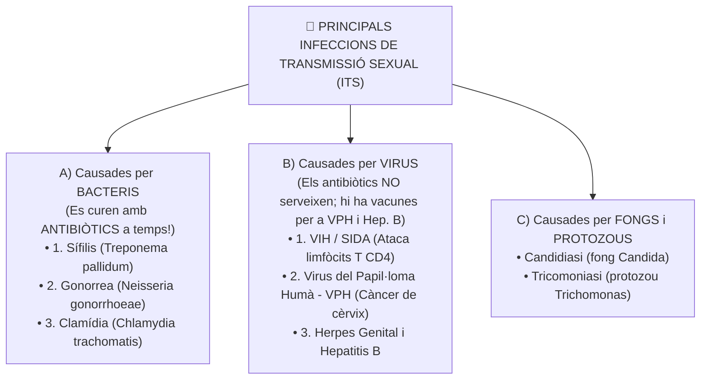

  

    ⚡ Progrés d'aprenentatge (9.7)
    0 / 12 reptes resolts
  

  

    

  

# 9.7 Malalties de transmissió sexual (ITS)

Les **Infeccions de Transmissió Sexual (ITS)** —anteriorment anomenades Malalties de Transmissió Sexual (MTS) o malalties venèries— són un grup de malalties infeccioses causades per microorganismes patògens (**bacteris, virus, fongs o protozous**) que es contagien principalment d'una persona a una altra durant les **relacions sexuals (vaginals, anals o orals) sense protecció (sense preservatiu)**.

Actualment es prefereix el terme mèdic **ITS (Infecció)** perquè moltes d'elles **no donen símptomes visibles al principi (són asimptomàtiques)**: una persona pot tindre un aspecte totalment sa, no sentir cap dolor i, tot i això, estar infectada i transmetre el microorganisme a les seues parelles sexuals si no utilitza preservatiu.

---

## 1. Vies de Transmissió de les ITS (Com ES Contagien i Com NO)

1. **Com ES transmeten les ITS?**
   - **Via sexual (la principal):** Pel contacte directe amb **fluids corporals infectats (semen, líquid preseminal, flux vaginal, sang)** o pel fregament pell amb pell/mucosa amb lesions, úlceres o berrugues durant el sexe vaginal, anal o oral sense preservatiu.
   - **Via sanguínia:** Per compartir agulles, xeringues o material de tatuatge/pírcing no esterilitzat amb sang infectada (com en el VIH o l'Hepatitis B/C).
   - **Via vertical (materno-filial):** D'una mare infectada sense tractament al seu fill durant l'embaràs (a través de la placenta), en el canal del part o per la llet materna.
2. **Com NO es transmeten MAI (Desmuntant falsos mites):**
   - **MAI** es contagien per donar la mà, abraçar-se, fer un bes a la galta, conviure a classe o al taller, compartir el got, els coberts o el mateix lavabo, ni per la suor, les llàgrimes, la tos o les picades de mosquit.

---

## 2. Classificació de les Principals ITS segons l'Agent Patogen

### A) ITS Causades per Bacteris (Es curen amb Antibiòtics si es tracten a temps)

| ITS Bacteriana | Bacteri Causant | Símptomes Principals i Conseqüències si NO es Tracta |
| :--- | :--- | :--- |
| **1. Sífilis** | *Treponema pallidum* | • **1a fase:** Apareix una úlcera o nafra rodona que **no fa mal (xancre sifilític)** als genitals o boca i desapareix sola, però el bacteri segueix a la sang. • **2a i 3a fase:** Taques a la pell i, anys després, **lesions gravíssimes al cervell, sistema nerviós i cor**. |
| **2. Gonorrea** *(Gonocòccia)* | *Neisseria gonorrhoeae* | **Coïssor intensa en orinar** i expulsió d'una **secreció groguenca purulenta (pus)** per la uretra o vagina. En les dones sovint passa desapercebuda i pot pujar a les trompes causant **esterilitat**. |
| **3. Clamídia** *(Clamidiosi)* | *Chlamydia trachomatis* | És l'ITS bacteriana més freqüent en joves i s'anomena **"la infecció silenciosa"** perquè en el 70% de les dones i 50% dels homes **no dóna símptomes inicials**. Si no es tracta, obstrueix les trompes de Fal·lopi causant **malaltia inflamatòria pelviana i esterilitat**. |

---

### B) ITS Causades per Virus (Els Antibiòtics NO serveixen!)

Recorda que **els antibiòtics només maten bacteris i no tenen cap efecte contra els virus**. Moltes ITS víriques són cròniques, però es poden controlar amb **antivirals** i algunes tenen **vacuna preventiva**:

#### 1. El VIH i la SIDA (Virus de la Immunodeficiència Humana)
- **Què fa el virus VIH?** El VIH ataca i destrueix específicament els **limfòcits T CD4** (els glòbuls blancs "directors" del nostre sistema immunitari). Sense aquests limfòcits, el cos queda indefens davant de qualsevol infecció o tumor.
- **Diferència entre ser portador del VIH (seropositiu) i tindre la SIDA:**
  - **Persona amb VIH (seropositiva):** Té el virus a la sang. Gràcies als actuals **tractaments antiretrovirals (TAR)** diaris, el virus es manté bloquejat (**càrrega viral indetectable**), la persona pot portar una vida llarga i normal i no desenvolupa la malaltia.
  - **SIDA (Síndrome d'Immunodeficiència Adquirida):** És l'etapa final i greu que apareix al cap dels anys **si la persona amb VIH no es diagnostica ni pren tractament**, moment en què les defenses cauen i apareixen infeccions oportunistes greus (pneumònies, tumors).

#### 2. El Virus del Papil·loma Humà (VPH) — L'ITS més freqüent
- És l'ITS més estesa a tot el món. Algunes soques del VPH provoquen **berrugues genitals (condilomes)**, però les soques d'alt risc són la **causa principal del càncer de coll d'úter (cèrvix)** en les dones i d'altres tumors genitals i de gola.
- **La Vacuna del VPH:** Inclosa gratuïtament al calendari de vacunació tant per a **xiques com per a xics adolescents (als 12 anys)**; prevé més del 90% dels càncers causats pel virus!

#### 3. L'Herpes Genital i l'Hepatitis B
- **Herpes Genital (Virus VHS-2):** Provoca l'aparició de **butllofes i úlceres molt doloroses** als genitals. El virus queda latent de per vida als ganglis nerviosos i reapareix en brots quan baixen les defenses o hi ha estrès.
- **Hepatitis B (Virus VHB):** Es transmet per via sexual i sanguínia i ataca el **fetge**, podent causar cirrosi i càncer hepàtic. Afortunadament, comptem amb una **vacuna altament eficaç** que s'administra des de la infància.

---

### C) ITS Causades per Fongs i Protozous
- **Tricomoniasi:** Causada pel protozou *Trichomonas vaginalis*; provoca picor i flux vaginal verdós o groguenc amb mala olor. Es cura amb antiparasitaris.
- **Candidiasi genital:** Causada pel fong *Candida albicans* (que també pot créixer per una baixada de defenses o després de prendre antibiòtics sense transmissió sexual); provoca picor intensa i flux blanc espés semblant al iogurt. Es tracta amb antifúngics.

---

> [!IMPORTANT]
> ### 🛡️ Decàleg de Prevenció i Protocol d'Actuació davant les ITS
> 1. **Ús sistemàtic del preservatiu (masculí o femení):** Des del principi fins al final de qualsevol relació sexual (vaginal, anal o oral).
> 2. **Vacunació completa:** Tindre al dia les vacunes contra el **Virus del Papil·loma Humà (VPH)** i l'**Hepatitis B**.
> 3. **No compartir mai agulles, xeringues ni fulles d'afaitar**, i fer-se tatuatges o pírcings només en centres sanitaris homologats amb material d'un sol ús.
> 4. **Què fer si tens un símptoma o s'ha trencat el preservatiu?**
>    - **Acudir immediatament al metge o centre de salut sexual** per fer-se una prova diagnòstica (anàlisi de sang o mostra).
>    - **No automedicar-se mai** ni deixar un tractament antibiòtic a mitges.
>    - **Abstenir-se de mantindre relacions sexuals** fins a estar curat i **avisar amb honestedat la parella o parelles sexuals** perquè també es facen la prova i reben tractament.

---

> [!NOTE]
> ### 💡 Resum de Conceptes Clau
> - Les **ITS bacterianes** (**sífilis**, **gonorrea** i **clamídia**) es curen amb **antibiòtics** si es detecten a temps; si no es tracten poden causar esterilitat o danys neurològics.
> - Les **ITS víriques** inclouen el **VIH/SIDA** (ataca els limfòcits T CD4 del sistema immunitari), el **VPH** (causa berrugues i **càncer de coll d'úter**; té **vacuna**), l'**herpes genital** i l'**hepatitis B** (té **vacuna**).
> - El **preservatiu** i la **vacunació (VPH i Hepatitis B)** són les armes més eficaces per prevenir les ITS.

---

## 🎯 Activitats i Autoavaluació Interactiva (15 Exercicis Diaris)

  

    🎮 <strong>Zona d'Entrenament FPB:</strong> 0 / 12 reptes resolts
    ⭐ 0 punts
  

  

### 1. Qüestionari d'Autoavaluació Tipus Test (MCQ)

  
<strong>1. Quines de les següents Infeccions de Transmissió Sexual (ITS) estan causades per BACTERIS i, per tant, es poden curar completament amb un tractament d'antibiòtics si es diagnostiquen a temps?</strong>

  

    <button type="button" class="btn-mcq-opt" data-opt="A">A) El VIH/SIDA, l'Herpes genital i el Virus del Papil·loma Humà (VPH)</button>
    <button type="button" class="btn-mcq-opt" data-opt="B">B) La Sífilis, la Gonorrea i la Clamídia</button>
    <button type="button" class="btn-mcq-opt" data-opt="C">C) L'Hepatitis B i el VIH</button>
    <button type="button" class="btn-mcq-opt" data-opt="D">D) Cap ITS es pot curar amb antibiòtics</button>
  

  

  
<strong>2. Quin virus de transmissió sexual és el responsable de les berrugues genitals i la causa principal del càncer de coll d'úter (cèrvix), motiu pel qual es vacuna els adolescents?</strong>

  

    <button type="button" class="btn-mcq-opt" data-opt="A">A) El bacteri Treponema pallidum de la sífilis</button>
    <button type="button" class="btn-mcq-opt" data-opt="B">B) El fong Candida albicans</button>
    <button type="button" class="btn-mcq-opt" data-opt="C">C) El Virus del Papil·loma Humà (VPH)</button>
    <button type="button" class="btn-mcq-opt" data-opt="D">D) El protozou Trichomonas vaginalis</button>
  

  

  
<strong>3. Quines cèl·lules del cos humà ataca i destrueix específicament el Virus de la Immunodeficiència Humana (VIH)?</strong>

  

    <button type="button" class="btn-mcq-opt" data-opt="A">A) Els limfòcits T CD4 del sistema immunitari (defenses)</button>
    <button type="button" class="btn-mcq-opt" data-opt="B">B) Els osteòcits dels ossos llargs</button>
    <button type="button" class="btn-mcq-opt" data-opt="C">C) Els fotoreceptors de la retina</button>
    <button type="button" class="btn-mcq-opt" data-opt="D">D) Les fibres musculars del bíceps</button>
  

  

  
<strong>4. Per a quines dues ITS víriques molt perilloses existeix actualment una vacuna preventiva inclosa al calendari oficial de vacunació infantil i juvenil?</strong>

  

    <button type="button" class="btn-mcq-opt" data-opt="A">A) Per a la sífilis i la gonorrea</button>
    <button type="button" class="btn-mcq-opt" data-opt="B">B) Per a la candidiasi i la tricomoniasi</button>
    <button type="button" class="btn-mcq-opt" data-opt="C">C) Per a l'herpes simple i la clamídia</button>
    <button type="button" class="btn-mcq-opt" data-opt="D">D) Per al Virus del Papil·loma Humà (VPH) i per a l'Hepatitis B</button>
  

  

---

### 2. Activitats de Vertader (V) o Fals (F)

  <strong>a) Una persona pot estar infectada per una ITS (com la clamídia o el VIH) sense tindre cap símptoma ni molèstia visible i transmetre-la igualment si manté relacions sense preservatiu.</strong>
  

    <button type="button" class="btn-vf" data-opt="V">V</button>
    <button type="button" class="btn-vf" data-opt="F">F</button>
  

  

  <strong>b) El virus del VIH es pot contagiar fàcilment per donar la mà, abraçar o compartir un got d'aigua o una eina al taller amb una persona seropositiva.</strong>
  

    <button type="button" class="btn-vf" data-opt="V">V</button>
    <button type="button" class="btn-vf" data-opt="F">F</button>
  

  

  <strong>c) Els antibiòtics són totalment inútils per curar les ITS causades per virus com el VIH, el VPH o l'herpes genital, ja que els antibiòtics només actuen contra els bacteris.</strong>
  

    <button type="button" class="btn-vf" data-opt="V">V</button>
    <button type="button" class="btn-vf" data-opt="F">F</button>
  

  

  <strong>d) La clamídia i la gonorrea no tenen cap importància mèdica i mai poden afectar la fertilitat encara que es deixen sense tractar durant anys.</strong>
  

    <button type="button" class="btn-vf" data-opt="V">V</button>
    <button type="button" class="btn-vf" data-opt="F">F</button>
  

  

---

### 3. Exercicis de Resposta Breu, Vocabulari Tècnic i Càlcul

  
✍️ <strong>1.</strong> Amb quines tres sigles es coneix el virus que ataca i destrueix els limfòcits T CD4 del sistema immunitari humà i que, sense tractament antiretroviral, provoca la SIDA?

  

    <input type="text" class="quiz-input" placeholder="Escriu les 3 sigles del virus...">
    <button type="button" class="btn-quiz-check">Comprovar</button>
  

  

  
✍️ <strong>2.</strong> Com s'anomena l'ITS bacteriana causada per Treponema pallidum que comença amb una úlcera indolora (xancre) als genitals i que, si no es cura amb antibiòtics, acaba danyant el cervell i el cor?

  

    <input type="text" class="quiz-input" placeholder="Escriu el nom de l'ITS...">
    <button type="button" class="btn-quiz-check">Comprovar</button>
  

  

  
✍️ <strong>3.</strong> Com s'anomena l'ITS bacteriana més freqüent en joves (causada per Chlamydia trachomatis), coneguda com 'la infecció silenciosa' perquè sovint no dóna símptomes però pot causar esterilitat?

  

    <input type="text" class="quiz-input" placeholder="Escriu el nom de l'ITS...">
    <button type="button" class="btn-quiz-check">Comprovar</button>
  

  

  
✍️ <strong>4.</strong> Amb quines tres sigles es coneix el virus de transmissió sexual més freqüent, causant de berrugues genitals i del càncer de coll d'úter, contra el qual es vacuna els adolescents?

  

    <input type="text" class="quiz-input" placeholder="Escriu les 3 sigles...">
    <button type="button" class="btn-quiz-check">Comprovar</button>
  

  

---

### 4. Exercicis de Raonament i Desenvolupament Escrit (Tasca d'Aula)

  
✍️ <strong>1. VIH vs. SIDA i Vies de Transmissió:</strong> Explica quina és la diferència entre ser portador del VIH (seropositiu amb tractament antiretroviral) i desenvolupar la SIDA. A continuació, indica les 3 vies per les quals SÍ es transmet el VIH i 4 situacions de convivència diària en què MAI es transmet.

  <textarea class="open-response-input" rows="4" placeholder="Diferència portador VIH vs SIDA: ...
3 vies de transmissió: ...
4 situacions on MAI es transmet: ..."></textarea>

  
✍️ <strong>2. ITS Bacterianes vs. ITS Víriques:</strong> Classifica les 6 ITS següents en Bacterianes o Víriques: Sífilis, VIH, Gonorrea, VPH, Clamídia i Herpes genital. Explica per a quin dels dos grups funcionen els antibiòtics i què passa si una clamídia o una sífilis no es tracten a temps.

  <textarea class="open-response-input" rows="4" placeholder="ITS Bacterianes (es curen amb antibiòtics): ...
ITS Víriques: ...
Conseqüències de no tractar-les: ..."></textarea>

  
✍️ <strong>3. Protocol d'actuació responsable davant una sospita d'ITS:</strong> Imagina que una persona jove ha mantingut una relació sexual sense preservatiu i, uns dies després, nota coïssor en orinar o una petita ferida als genitals. Enumera els 4 passos responsables que ha de seguir immediatament per cuidar la seua salut i la de les seues parelles.

  <textarea class="open-response-input" rows="4" placeholder="1. Consulta mèdica i proves: ...
2. No automedicar-se i completar el tractament: ...
3. Abstenció sexual durant el tractament: ...
4. Avisar les parelles sexuals: ..."></textarea>

---

  <h3 style="margin-top:0; color:#0369a1;">📦 Lliurament d'Activitats d'Aules (Act 9.7)</h3>
  
Genera el teu document de tasca d'aquest apartat amb el teu nom i els 15 exercicis completats.

  

    <input type="text" class="aules-student-name" placeholder="Cognoms, Nom de l'Alumne/a" style="padding:8px 12px; border:1px solid #94a3b8; border-radius:4px; flex-grow:1; min-width:240px;">
    <button class="btn-generate-aules-pdf" data-unit="NAT09" data-activity="Act07" data-module="CA" style="padding:8px 16px; background:#0284c7; color:#fff; border:none; border-radius:4px; font-weight:600; cursor:pointer;">📄 Descarregar PDF per a Aules</button>
  

