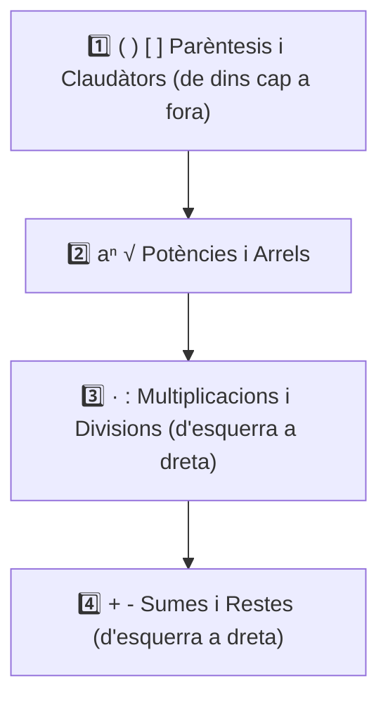

# UD1: Els Nombres Naturals (Matemàtiques)

  

    

      PDI · Pissarra Digital
      🎯 5 Reptes Interactius d'Arrastrar i Soltar de UD1
    

    
Practica a la pissarra de classe amb pantalles tàctils o des de tauletes amb sons i autocorrecció immediata.

  

  <a href="../pissarra-interactiva.html" onclick="localStorage.setItem('pdi-target-unit', 'ud1')" style="background: linear-gradient(135deg, #059669, #0d9488); color: #fff !important; font-weight: 800; padding: 10px 18px; border-radius: 10px; text-decoration: none !important; box-shadow: 0 4px 12px rgba(5, 150, 105, 0.3); display: inline-flex; align-items: center; gap: 6px;">
    🖥️ Obrir Reptes PDI
    →
  </a>

Benvingut/da a la **Unitat Didàctica 1** del bloc de Matemàtiques de Ciències Aplicades I. En aquesta unitat aprendràs com funciona el nostre sistema decimal, com operar amb nombres naturals, la jerarquia oficial d'operacions i com calcular potències de manera senzilla i pràctica.

<svg viewBox="0 0 860 260" xmlns="http://www.w3.org/2000/svg" style="max-width: 100%; height: auto; font-family: 'Segoe UI', system-ui, sans-serif; background: linear-gradient(135deg, #0f172a 0%, #1e293b 100%); border-radius: 12px; border: 1px solid #334155; box-shadow: 0 10px 25px -5px rgba(0, 0, 0, 0.4);">
  <defs>
    <linearGradient id="g-dec" x1="0%" y1="0%" x2="100%" y2="100%">
      <stop offset="0%" stop-color="#38bdf8" stop-opacity="0.25"/>
      <stop offset="100%" stop-color="#0284c7" stop-opacity="0.05"/>
    </linearGradient>
    <linearGradient id="g-opb" x1="0%" y1="0%" x2="100%" y2="100%">
      <stop offset="0%" stop-color="#818cf8" stop-opacity="0.25"/>
      <stop offset="100%" stop-color="#4f46e5" stop-opacity="0.05"/>
    </linearGradient>
    <linearGradient id="g-jer" x1="0%" y1="0%" x2="100%" y2="100%">
      <stop offset="0%" stop-color="#34d399" stop-opacity="0.25"/>
      <stop offset="100%" stop-color="#059669" stop-opacity="0.05"/>
    </linearGradient>
    <linearGradient id="g-pot" x1="0%" y1="0%" x2="100%" y2="100%">
      <stop offset="0%" stop-color="#f59e0b" stop-opacity="0.25"/>
      <stop offset="100%" stop-color="#d97706" stop-opacity="0.05"/>
    </linearGradient>
  </defs>

  <!-- Capçalera -->
  <text x="430" y="32" text-anchor="middle" fill="#f8fafc" font-size="16" font-weight="700" letter-spacing="1">ELS NOMBRES NATURALS: SISTEMA DECIMAL, JERARQUIA I POTÈNCIES</text>
  <text x="430" y="50" text-anchor="middle" fill="#94a3b8" font-size="12">Valor posicional, operacions bàsiques, ordre de càlcul i propietats exponencials</text>

  <!-- Bloc 1: Sistema Decimal -->
  <g transform="translate(25, 70)">
    <rect width="185" height="165" rx="10" fill="url(#g-dec)" stroke="#38bdf8" stroke-width="1.5"/>
    <rect x="15" y="14" width="28" height="28" rx="6" fill="#38bdf8" fill-opacity="0.2"/>
    <text x="29" y="33" text-anchor="middle" fill="#38bdf8" font-size="14" font-weight="bold">🔟</text>
    <text x="52" y="33" fill="#f8fafc" font-size="13" font-weight="bold">Sistema Decimal</text>
    <text x="15" y="62" fill="#38bdf8" font-size="11" font-weight="600">Valor Posicional</text>
    <text x="15" y="84" fill="#cbd5e1" font-size="11">• Base 10: {0,1,2...9}</text>
    <text x="15" y="104" fill="#cbd5e1" font-size="11">• U, D, C, UM, DM, CM</text>
    <text x="15" y="124" fill="#cbd5e1" font-size="11">• Descomposició en base 10</text>
    <text x="15" y="144" fill="#cbd5e1" font-size="11">• 523 = 5·10² + 2·10¹ + 3</text>
  </g>

  <!-- Bloc 2: Operacions Bàsiques -->
  <g transform="translate(230, 70)">
    <rect width="185" height="165" rx="10" fill="url(#g-opb)" stroke="#818cf8" stroke-width="1.5"/>
    <rect x="15" y="14" width="28" height="28" rx="6" fill="#818cf8" fill-opacity="0.2"/>
    <text x="29" y="33" text-anchor="middle" fill="#818cf8" font-size="14" font-weight="bold">➕</text>
    <text x="52" y="33" fill="#f8fafc" font-size="13" font-weight="bold">Operacions (+ - · :)</text>
    <text x="15" y="62" fill="#818cf8" font-size="11" font-weight="600">Propietats i Proves</text>
    <text x="15" y="84" fill="#cbd5e1" font-size="11">• Suma amb portades</text>
    <text x="15" y="104" fill="#cbd5e1" font-size="11">• Resta demanant prestat</text>
    <text x="15" y="124" fill="#cbd5e1" font-size="11">• Distributiva: a·(b+c)</text>
    <text x="15" y="144" fill="#cbd5e1" font-size="11">• Prova: D = d·c + r</text>
  </g>

  <!-- Bloc 3: Jerarquia d'Operacions -->
  <g transform="translate(435, 70)">
    <rect width="185" height="165" rx="10" fill="url(#g-jer)" stroke="#34d399" stroke-width="1.5"/>
    <rect x="15" y="14" width="28" height="28" rx="6" fill="#34d399" fill-opacity="0.2"/>
    <text x="29" y="33" text-anchor="middle" fill="#34d399" font-size="14" font-weight="bold">📐</text>
    <text x="52" y="33" fill="#f8fafc" font-size="13" font-weight="bold">Jerarquia Oficial</text>
    <text x="15" y="62" fill="#34d399" font-size="11" font-weight="600">Ordre de Càlcul</text>
    <text x="15" y="84" fill="#cbd5e1" font-size="11">1. Parèntesis ( ) [ ]</text>
    <text x="15" y="104" fill="#cbd5e1" font-size="11">2. Potències i arrels</text>
    <text x="15" y="124" fill="#cbd5e1" font-size="11">3. Multiplicació i divisió</text>
    <text x="15" y="144" fill="#cbd5e1" font-size="11">4. Sumes i restes</text>
  </g>

  <!-- Bloc 4: Potències de Naturals -->
  <g transform="translate(640, 70)">
    <rect width="195" height="165" rx="10" fill="url(#g-pot)" stroke="#f59e0b" stroke-width="1.5"/>
    <rect x="15" y="14" width="28" height="28" rx="6" fill="#f59e0b" fill-opacity="0.2"/>
    <text x="29" y="33" text-anchor="middle" fill="#f59e0b" font-size="14" font-weight="bold">⚡</text>
    <text x="52" y="33" fill="#f8fafc" font-size="13" font-weight="bold">Potències aⁿ</text>
    <text x="15" y="62" fill="#f59e0b" font-size="11" font-weight="600">Lleis dels Exponents</text>
    <text x="15" y="84" fill="#cbd5e1" font-size="11">• aⁿ · aᵐ = aⁿ⁺ᵐ</text>
    <text x="15" y="104" fill="#cbd5e1" font-size="11">• aⁿ : aᵐ = aⁿ⁻ᵐ</text>
    <text x="15" y="124" fill="#cbd5e1" font-size="11">• (aⁿ)ᵐ = aⁿ·ᵐ</text>
    <text x="15" y="144" fill="#cbd5e1" font-size="11">• a⁰ = 1  |  a¹ = a</text>
  </g>
</svg>

---

## 📑 Índex d'Apartats de la Unitat {#index-unitat}

  
Accés ràpid als apartats complets d'aquesta unitat:

  <ol style="margin: 0; padding-left: 20px; line-height: 2.1;">
    <li><a href="#sec1-1"><strong>1.1 El Sistema de Numeració Decimal i Valor Posicional</strong></a></li>
    <li><a href="#sec1-2"><strong>1.2 Els Nombres Naturals i les Operacions Bàsiques</strong></a></li>
    <li><a href="#sec1-3"><strong>1.3 Propietats de les Operacions i Jerarquia</strong></a></li>
    <li><a href="#sec1-4"><strong>1.4 Potències de Nombres Naturals i Propietats</strong></a></li>
  </ol>

---

## 📌 1.1 El Sistema de Numeració Decimal i Valor Posicional {#sec1-1}

El sistema de numeració que utilitzem cada dia és el **sistema decimal**. Probablement, els éssers humans vam començar a comptar utilitzant els dits de les mans, i per aquesta mateixa raó vam idear un sistema basat en **10 símbols bàsics** (anomenats dígits o xifres):

$$\{0, 1, 2, 3, 4, 5, 6, 7, 8, 9\}$$

---

### 1. Ordres d'Unitats: De la Unitat al Millar

En el sistema decimal, agrupem les quantitats de **10 en 10**: cada deu unitats d'un ordre formen una unitat de l'ordre immediatament superior:

| Ordre d'Unitat | Abreviatura | Equivalència en Unitats |
| :--- | :---: | :---: |
| **Unitat** | **U** | $1 \text{ U}$ |
| **Desena** | **D** | $1 \text{ D} = 10 \text{ U}$ |
| **Centena** | **C** | $1 \text{ C} = 10 \text{ D} = 100 \text{ U}$ |
| **Unitat de Millar** | **UM** | $1 \text{ UM} = 10 \text{ C} = 1.000 \text{ U}$ |
| **Desena de Millar** | **DM** | $1 \text{ DM} = 10 \text{ UM} = 10.000 \text{ U}$ |
| **Centena de Millar**| **CM** | $1 \text{ CM} = 10 \text{ DM} = 100.000 \text{ U}$ |

> [!NOTE]
> **Per què agrupem?**
> Si volguérem representar el nombre $1.200$ dibuixant elements solts d'un en un, seria lent i fàcil equivocar-se. Agrupant en desenes ($10$), centenes ($100$) i milers ($1.000$) podem escriure qualsevol quantitat enorme amb només unes poques xifres.

---

### 2. El Valor Posicional de les Xifres

El sistema decimal és un **sistema posicional**: el valor real d'una xifra depèn directament de la **posició** que ocupa dins del nombre.

Vegem per exemple el nombre **$523$**:

| Centenes (C) | Desenes (D) | Unitats (U) | Descomposició Polinòmica |
| :---: | :---: | :---: | :---: |
| **5** ($5 \times 100$) | **2** ($2 \times 10$) | **3** ($3 \times 1$) | $500 + 20 + 3 = 523$ |

- La xifra **$3$** ocupa el lloc de les unitats $\rightarrow 3 \times 1 = 3$
- La xifra **$2$** ocupa el lloc de les desenes $\rightarrow 2 \times 10 = 20$
- La xifra **$5$** ocupa el lloc de les centenes $\rightarrow 5 \times 100 = 500$

Per tant:
$$523 = 500 + 20 + 3 = 5\text{C} + 2\text{D} + 3\text{U}$$

---

### 3. Descomposició Polinòmica amb Potències de Base 10

Les potències de $10$ ens permeten expressar de manera abreujada els diferents ordres d'unitats:

- $10^0 = 1$ (Unitats)
- $10^1 = 10$ (Desenes)
- $10^2 = 100$ (Centenes)
- $10^3 = 1.000$ (Unitats de millar)
- $10^4 = 10.000$ (Desenes de millar)

La **descomposició polinòmica** d'un nombre consisteix a expressar-lo com una suma de productes de cada xifra per la potència de $10$ corresponent a la seua posició:

$$523 = (5 \times 10^2) + (2 \times 10^1) + (3 \times 10^0)$$

Com que $10^0 = 1$, podem simplificar l'últim terme directament com a $3$:
$$523 = (5 \times 10^2) + (2 \times 10^1) + 3$$

#### Exemple Resolts Pas a Pas:
Descompon el nombre **$4.708$**:
- Té $4$ milers, $7$ centenes, $0$ desenes i $8$ unitats.
- Descomposició aditiva: $4.000 + 700 + 8$
- Descomposició polinòmica:
  $$4.708 = (4 \times 10^3) + (7 \times 10^2) + 8$$

---

### ✍️ Activitats d'Aprenentatge

  

    🎮 <strong>Zona d'Entrenament FPB:</strong> 0 reptes resolts
    ⭐ 0 punts
  

  

#### 1. Identifica el valor posicional de la xifra subratllada

  
✍️ Quin valor en unitats té la xifra subratllada a: 3.<u>4</u>52 ?

  

    <input type="text" class="quiz-input" placeholder="El teu resultat...">
    <button type="button" class="btn-quiz-check">Comprovar</button>
  

  

  
✍️ Quin valor en unitats té la xifra subratllada a: <u>7</u>.120 ?

  

    <input type="text" class="quiz-input" placeholder="El teu resultat...">
    <button type="button" class="btn-quiz-check">Comprovar</button>
  

  

  
✍️ Quin valor en unitats té la xifra subratllada a: 98<u>6</u> ?

  

    <input type="text" class="quiz-input" placeholder="El teu resultat...">
    <button type="button" class="btn-quiz-check">Comprovar</button>
  

  

  
✍️ Quin valor en unitats té la xifra subratllada a: <u>5</u>4.300 ?

  

    <input type="text" class="quiz-input" placeholder="El teu resultat...">
    <button type="button" class="btn-quiz-check">Comprovar</button>
  

  

---

#### 2. Descomposició Polinòmica Inversa

Escriu el nombre complet que correspon a cadascuna de les expressions polinòmiques:

  
✍️ Quin nombre és: (8 × 10³) + (3 × 10²) + (5 × 10¹) + 4 ?

  

    <input type="text" class="quiz-input" placeholder="El teu resultat...">
    <button type="button" class="btn-quiz-check">Comprovar</button>
  

  

  
✍️ Quin nombre és: (6 × 10⁴) + (2 × 10²) + 9 ?

  

    <input type="text" class="quiz-input" placeholder="El teu resultat...">
    <button type="button" class="btn-quiz-check">Comprovar</button>
  

  

  <a href="#index-unitat" class="page-nav-btn" style="display: inline-block; padding: 4px 14px; font-size: 0.85rem;">⬆️ Pujar a l'Índex</a>

---

## 📌 1.2 Els Nombres Naturals i les Operacions Bàsiques {#sec1-2}

### 1. El Conjunt dels Nombres Naturals ($\mathbb{N}$)

Els **nombres naturals** van sorgir de la necessitat humana de comptar i ordenar objectes (animals, fruites, eines). Es representen amb la lletra $\mathbb{N}$:

$$\mathbb{N} = \{0, 1, 2, 3, 4, 5, 6, 7, 8, 9, 10, 11, 12, \dots\}$$

- **Infinitud:** No hi ha un nombre natural que siga més gran que tots els altres. Sempre podem afegir $+1$ i trobar-ne un de major.
- **Ordre i Recta Numèrica:** Els nombres naturals estan ordenats. Podem representar-los en una recta numèrica:

$$\mathbf{0} \quad 1 \quad 2 \quad 3 \quad 4 \quad 5 \quad 6 \quad 7 \quad 8 \quad 9 \quad 10 \quad \dots \longrightarrow +\infty$$

Sempre és **menor** aquell nombre que està més a l'esquerra:
- Utilitzem el símbol **$<$** per a expressar "menor que": $4 < 7$
- Utilitzem el símbol **$>$** per a expressar "major que": $9 > 3$

---

### 2. Suma (Addició)

Per a sumar dos o més nombres:
1. Col·loquem els sumands en vertical alineant les unitats davall de les unitats, les desenes davall de les desenes, etc.
2. Sumem columna a columna començant per les unitats.
3. Si el resultat d'una columna és $10$ o superior, apuntem la unitat i afegim la desena a la columna següent (**"en portem una"**).

#### Exemple amb Portada:
Volem calcular **$46 + 27$**:

$$\begin{array}{r@{\quad}l}
  \overset{1}{4}6 & \text{(Unitats: } 6 + 7 = 13 \rightarrow \text{escrivim } 3 \text{ i en portem } 1) \\
+ 27 & \text{(Desenes: } 4 + 2 + 1 = 7) \\
\hline
  \mathbf{73} & \text{(Resultat final)}
\end{array}$$

---

### 3. Resta (Subtracció)

Col·loquem el **minuend** (la quantitat inicial) a dalt i el **subtrahend** (la quantitat que llevem) a baix, alineant per unitats:

$$\text{Minuend} - \text{Subtrahend} = \text{Diferència}$$

Quan una xifra del minuend és menor que la del subtrahend, hem de **demanar prestat** a la columna immediatament superior (una desena es converteix en $10$ unitats).

#### Exemple amb Préstec:
Volem calcular **$32 - 17$**:

$$\begin{array}{r@{\quad}l}
  \overset{2}{3}\,\overset{12}{2} & \text{(Unitats: com } 2 < 7\text{, prenem } 1\text{ desena: } 12 - 7 = 5) \\
- 1\,\;7 & \text{(Desenes: quedaven } 2\text{ desenes: } 2 - 1 = 1) \\
\hline
  \mathbf{15} & \text{(Resultat final)}
\end{array}$$

---

### 4. Multiplicació (Producte)

Multiplicar no és més que una **manera ràpida de fer una suma repetida**.
- Si Andrés compra $6$ sobres de cromos i cadascun porta $5$ cromos, en lloc de fer $5 + 5 + 5 + 5 + 5 + 5$, fem:
  $$6 \times 5 = 30 \text{ cromos}$$

Els nombres que es multipliquen s'anomenen **factors**, i el resultat és el **producte**.

$$\begin{array}{r@{\quad}l}
  58 & \\
\times 2 & \\
\hline
  \mathbf{116} & (2 \times 8 = 16 \rightarrow \text{posem } 6 \text{ i en portem } 1; \; 2 \times 5 = 10 + 1 = 11)
\end{array}$$

---

### 5. Divisió (Repartiment)

La divisió consisteix a **repartir una quantitat en parts iguals**. Els seus components són:

- **Dividend ($D$):** La quantitat total que volem repartir.
- **Divisor ($d$):** En quantes parts iguals repartim.
- **Quocient ($c$):** El resultat del repartiment (el que li toca a cadascú).
- **Residu ($r$):** El que sobra (sempre ha de ser menor que el divisor, $r < d$).

#### La Prova de la Divisió
Per comprovar si una divisió està ben resolta, s'ha de complir sempre la igualtat fonamental:

$$\text{Dividend} = (\text{Divisor} \times \text{Quocient}) + \text{Residu} \quad \longrightarrow \quad D = d \times c + r$$

> [!TIP]
> - Si el residu és **$0$**, la divisió és **exacta**: $D = d \times c$.
> - Si el residu és **diferent de $0$**, la divisió és **entera**.

#### Exemple Resolts:
Volem dividir **$754 : 32$**:

$$\begin{array}{r|l}
  754 & 32 \\
\cline{2-2}
- 64 & \mathbf{23} \text{ (Quocient)} \\
\cline{1-1}
  114 & \\
- 96 & \\
\cline{1-1}
  \mathbf{18} & \text{(Residu } r < d\text{)} \\
\end{array}$$

**Prova de la divisió:** $D = d \cdot c + r \implies 754 = 32 \cdot 23 + 18 = 736 + 18 = 754$ *(Correcte)*.

**Comprovació amb la Prova:**
$$32 \times 23 + 18 = 736 + 18 = 754 \quad \text{(Correcte!)}$$

---

### ✍️ Activitats d'Aprenentatge

  

    🎮 <strong>Zona d'Entrenament FPB:</strong> 0 reptes resolts
    ⭐ 0 punts
  

  

#### 1. Sumes i Restes amb Nombres Naturals

 1.273.">
  
✍️ Calcula la suma: 348 + 925

  

    <input type="text" class="quiz-input" placeholder="El teu resultat...">
    <button type="button" class="btn-quiz-check">Comprovar</button>
  

  

 538.">
  
✍️ Calcula la resta amb préstec: 1.405 - 867

  

    <input type="text" class="quiz-input" placeholder="El teu resultat...">
    <button type="button" class="btn-quiz-check">Comprovar</button>
  

  

  
✍️ Calcula la resta: 12.340 - 5.789

  

    <input type="text" class="quiz-input" placeholder="El teu resultat...">
    <button type="button" class="btn-quiz-check">Comprovar</button>
  

  

---

#### 2. Multiplicacions

  
✍️ Calcula el producte: 234 × 15

  

    <input type="text" class="quiz-input" placeholder="El teu resultat...">
    <button type="button" class="btn-quiz-check">Comprovar</button>
  

  

  
✍️ Calcula el producte: 1.042 × 36

  

    <input type="text" class="quiz-input" placeholder="El teu resultat...">
    <button type="button" class="btn-quiz-check">Comprovar</button>
  

  

---

#### 3. Divisions i Prova del Residu

  
✍️ Calcula la divisió exacta: 840 : 6

  

    <input type="text" class="quiz-input" placeholder="El teu resultat...">
    <button type="button" class="btn-quiz-check">Comprovar</button>
  

  

  
✍️ Quin és el quocient enter de: 957 : 24 ?

  

    <input type="text" class="quiz-input" placeholder="El teu resultat...">
    <button type="button" class="btn-quiz-check">Comprovar</button>
  

  

  
✍️ Quin és el quocient enter de: 1.520 : 35 ?

  

    <input type="text" class="quiz-input" placeholder="El teu resultat...">
    <button type="button" class="btn-quiz-check">Comprovar</button>
  

  

  <a href="#index-unitat" class="page-nav-btn" style="display: inline-block; padding: 4px 14px; font-size: 0.85rem;">⬆️ Pujar a l'Índex</a>

---

## 📌 1.3 Propietats de les Operacions i Jerarquia {#sec1-3}

### 1. Propietats Fonamentals de la Multiplicació

La multiplicació compleix tres propietats matemàtiques clau:

#### 1) Propietat Commutativa
> *"L'ordre dels factors no altera el producte."*

$$a \cdot b = b \cdot a$$

- **Exemple:** $10 \cdot 3 = 30$ i $3 \cdot 10 = 30$. El resultat és exactament el mateix.

#### 2) Propietat Associativa
> *"La forma d'agrupar els factors no varia el resultat."*

$$(a \cdot b) \cdot c = a \cdot (b \cdot c)$$

- **Exemple:** $(3 \cdot 2) \cdot 5 = 6 \cdot 5 = 30$
- Agrupant d'una altra manera: $3 \cdot (2 \cdot 5) = 3 \cdot 10 = 30$.

#### 3) Propietat Distributiva (respecte a la suma i la resta)
> *"La multiplicació d'un nombre per una suma és igual a la suma dels productes d'aquest nombre per cadascun dels sumands."*

$$a \cdot (b + c) = (a \cdot b) + (a \cdot c)$$

- **Exemple:** $2 \cdot (3 + 5)$
  - *Mètode A (resolent el parèntesi primer):* $2 \cdot 8 = 16$
  - *Mètode B (aplicant propietat distributiva):* $(2 \cdot 3) + (2 \cdot 5) = 6 + 10 = 16$

> [!WARNING]
> **I la Divisió?**
> La divisió **NO** té les propietats commutativa ni associativa:
> - $20 : 5 = 4$, però $5 : 20 \neq 4$. L'ordre sí que importa!
> - Per això, en expressions amb divisions, els parèntesis són obligatoris per a definir quina operació va primer.

---

### 2. La Jerarquia d'Operacions

Quan tenim diverses operacions barrejades en una mateixa expressió (operacions combinades), cal seguir sempre aquest **ordre oficial estricte**:

#### Exemples Resolts Pas a Pas:

##### Exemple A: Sense Parèntesis
Calcular: $6 : 2 + 5 - 12 : 4$

1. Primer fem les divisions (d'esquerra a dreta):
   - $6 : 2 = 3$
   - $12 : 4 = 3$
   - L'expressió queda: $3 + 5 - 3$
2. Ara fem les sumes i restes:
   - $3 + 5 = 8$
   - $8 - 3 = 5$
   - **Resultat final: $5$**

##### Exemple B: Amb Parèntesis
Calcular: $40 : 8 - (30 : 6 + 2)$

1. Resolem primer l'interior del parèntesi:
   - Dins del parèntesi hi ha divisió i suma $\rightarrow$ primer la divisió: $30 : 6 = 5$
   - Ara sumem: $5 + 2 = 7$
2. Substituïm el parèntesi: $40 : 8 - 7$
3. Fem la divisió: $40 : 8 = 5$
4. Fem la resta: $5 - 7$ *(en nombres naturals no podem restar si el minuend és menor, per la qual cosa en $\mathbb{N}$ caldrà que el resultat siga positiu; en aquest cas $40:8$ dóna 5)*.

##### Exemple C: Amb Claudàtors i Parèntesis
Calcular: $10 \cdot [(6 - 5) + (9 - 4)]$

1. Resolem primer els parèntesis interiors:
   - $(6 - 5) = 1$
   - $(9 - 4) = 5$
2. Ara l'interior del claudàtor: $[1 + 5] = 6$
3. Finalment, multipliquem: $10 \cdot 6 = 60$
   - **Resultat final: $60$**

---

### ✍️ Activitats d'Aprenentatge

  

    🎮 <strong>Zona d'Entrenament FPB:</strong> 0 reptes resolts
    ⭐ 0 punts
  

  

#### 1. Propietat Distributiva

  
✍️ Aplica la distributiva i resol: 5 · (6 + 3)

  

    <input type="text" class="quiz-input" placeholder="El teu resultat...">
    <button type="button" class="btn-quiz-check">Comprovar</button>
  

  

  
✍️ Aplica la distributiva i resol: 4 · (10 - 2)

  

    <input type="text" class="quiz-input" placeholder="El teu resultat...">
    <button type="button" class="btn-quiz-check">Comprovar</button>
  

  

  
✍️ Aplica la distributiva i resol: 3 · (8 + 12)

  

    <input type="text" class="quiz-input" placeholder="El teu resultat...">
    <button type="button" class="btn-quiz-check">Comprovar</button>
  

  

---

#### 2. Jerarquia d'Operacions Combinades

  
✍️ Calcula segons la jerarquia: 5 · 4 + 2 · 3

  

    <input type="text" class="quiz-input" placeholder="El teu resultat...">
    <button type="button" class="btn-quiz-check">Comprovar</button>
  

  

  
✍️ Calcula segons la jerarquia: 20 : 5 - 8 : 2

  

    <input type="text" class="quiz-input" placeholder="El teu resultat...">
    <button type="button" class="btn-quiz-check">Comprovar</button>
  

  

  
✍️ Calcula amb parèntesi: 27 : (12 - 9) - 4

  

    <input type="text" class="quiz-input" placeholder="El teu resultat...">
    <button type="button" class="btn-quiz-check">Comprovar</button>
  

  

  
✍️ Calcula amb claudàtor: 19 + 3 · [5 + (10 - 8)]

  

    <input type="text" class="quiz-input" placeholder="El teu resultat...">
    <button type="button" class="btn-quiz-check">Comprovar</button>
  

  

  
✍️ Calcula: 25 - 2 · [(9 - 7) · 3] + (16 - 8)

  

    <input type="text" class="quiz-input" placeholder="El teu resultat...">
    <button type="button" class="btn-quiz-check">Comprovar</button>
  

  

  <a href="#index-unitat" class="page-nav-btn" style="display: inline-block; padding: 4px 14px; font-size: 0.85rem;">⬆️ Pujar a l'Índex</a>

---

## 📌 1.4 Potències de Nombres Naturals i Propietats {#sec1-4}

### 1. Concepte de Potència

Una **potència** és una forma abreujada d'expressar una multiplicació de factors iguals (una multiplicació repetida):

$$a^n = \underbrace{a \cdot a \cdot a \dots a}_{n \text{ vegades}}$$

Una potència està formada per dos elements:

- **Base ($a$):** El nombre que es multiplica per si mateix.
- **Exponent ($n$):** El nombre de vegades que es repeteix la base.

$$\underbrace{\mathbf{2}}_{\text{Base: el nombre que es repeteix}}^{\overbrace{\mathbf{3}}^{\text{Exponent: quantes vegades es multiplica}}} = 2 \cdot 2 \cdot 2 = \mathbf{8}$$

#### Exemples Didàctics:
- $3^4 = 3 \cdot 3 \cdot 3 \cdot 3 = 81$
- $5^2 = 5 \cdot 5 = 25$ *(es llig "cinc al quadrat")*
- $2^3 = 2 \cdot 2 \cdot 2 = 8$ *(es llig "dos al cub")*
- $10^3 = 10 \cdot 10 \cdot 10 = 1.000$

> [!IMPORTANT]
> **Alerta amb un error molt típic:**
> **$(3 + 2)^3$ NO és el mateix que $3^3 + 2^3$**:
> - $(3 + 2)^3 = 5^3 = 5 \cdot 5 \cdot 5 = 125$
> - $3^3 + 2^3 = 27 + 8 = 35$
> Com pots comprovar, $125 \neq 35$. La potència d'una suma mai és la suma de les potències!

---

### 2. Quadre Resum de les Propietats de les Potències

Les potències tenen regles algebraiques que ens permeten simplificar càlculs complexos en un instant:

| Propietat | Regla Matemàtica | Exemple Pràctic |
| :--- | :---: | :---: |
| **Producte de potències de la mateixa base** | $a^n \cdot a^m = a^{n + m}$ | $4^2 \cdot 4^3 = 4^{2+3} = 4^5 = 1.024$ |
| **Quocient de potències de la mateixa base** | $a^n : a^m = \dfrac{a^n}{a^m} = a^{n - m}$ | $3^5 : 3^2 = 3^{5-2} = 3^3 = 27$ |
| **Potència d'un producte** | $(a \cdot b)^n = a^n \cdot b^n$ | $(3 \cdot 4)^2 = 3^2 \cdot 4^2 = 9 \cdot 16 = 144$ |
| **Potència d'un quocient (fracció)** | $(a : b)^n = \left(\dfrac{a}{b}\right)^n = \dfrac{a^n}{b^n}$ | $(8 : 4)^2 = 8^2 : 4^2 = 64 : 16 = 4$ |
| **Potència d'una potència** | $(a^n)^m = a^{n \cdot m}$ | $(2^2)^3 = 2^{2 \cdot 3} = 2^6 = 64$ |
| **Potència d'exponent $0$** | $a^0 = 1 \quad (a \neq 0)$ | $7^0 = 1 \quad ; \quad 125^0 = 1$ |
| **Potència d'exponent $1$** | $a^1 = a$ | $9^1 = 9 \quad ; \quad 42^1 = 42$ |

> [!TIP]
> **Divisions i Fraccions:**
> Recorda que una divisió $a : b$ és exactament el mateix que una fracció $\dfrac{a}{b}$. Ambdues representen la mateixa operació de quocient.

---

### 3. Potències de Base 10

Les potències de $10$ són immediates de calcular en el nostre sistema decimal:
Només cal escriure l'$1$ seguit de tants zeros com indique l'exponent:

- $10^1 = 10$ ($1$ zero)
- $10^2 = 100$ ($2$ zeros)
- $10^3 = 1.000$ ($3$ zeros)
- $10^4 = 10.000$ ($4$ zeros)
- $10^6 = 1.000.000$ ($6$ zeros $\rightarrow$ un milió)

---

### ✍️ Activitats d'Aprenentatge

  

    🎮 <strong>Zona d'Entrenament FPB:</strong> 0 reptes resolts
    ⭐ 0 punts
  

  

#### 1. Càlcul de Potències Bàsiques

  
✍️ Calcula el valor de la potència: 2⁴

  

    <input type="text" class="quiz-input" placeholder="El teu resultat...">
    <button type="button" class="btn-quiz-check">Comprovar</button>
  

  

  
✍️ Calcula el valor de la potència: 5³

  

    <input type="text" class="quiz-input" placeholder="El teu resultat...">
    <button type="button" class="btn-quiz-check">Comprovar</button>
  

  

  
✍️ Calcula la potència de 10: 10⁴

  

    <input type="text" class="quiz-input" placeholder="El teu resultat...">
    <button type="button" class="btn-quiz-check">Comprovar</button>
  

  

  
✍️ Calcula: 3³

  

    <input type="text" class="quiz-input" placeholder="El teu resultat...">
    <button type="button" class="btn-quiz-check">Comprovar</button>
  

  

  
✍️ Quin és el valor de qualsevol nombre elevat a zero: 7⁰ ?

  

    <input type="text" class="quiz-input" placeholder="El teu resultat...">
    <button type="button" class="btn-quiz-check">Comprovar</button>
  

  

---

#### 2. Propietats dels Exponents i Problema de Taller

  
✍️ Producte de la mateixa base: 5² · 5⁴ (escriu el valor de l'exponent final)

  

    <input type="text" class="quiz-input" placeholder="El teu resultat...">
    <button type="button" class="btn-quiz-check">Comprovar</button>
  

  

  
✍️ Divisió de la mateixa base: 3⁸ : 3⁵ (escriu el valor final calculat)

  

    <input type="text" class="quiz-input" placeholder="El teu resultat...">
    <button type="button" class="btn-quiz-check">Comprovar</button>
  

  

  
✍️ En una botiga hi ha 4 prestatgeries, cadascuna amb 4 lleixes, 4 caixes per lleixa i 4 retoladors per caixa. Quants retoladors hi ha en total (4⁴)?

  

    <input type="text" class="quiz-input" placeholder="El teu resultat...">
    <button type="button" class="btn-quiz-check">Comprovar</button>
  

  

  <a href="#index-unitat" class="page-nav-btn" style="display: inline-block; padding: 4px 14px; font-size: 0.85rem;">⬆️ Pujar a l'Índex</a>

---

